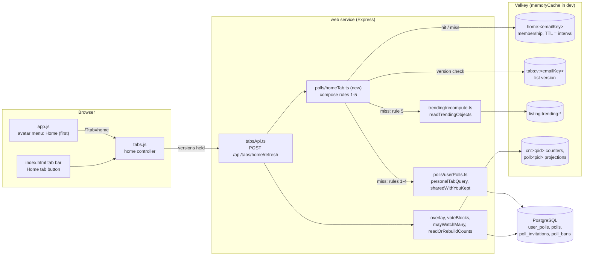
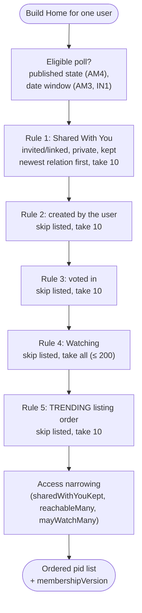
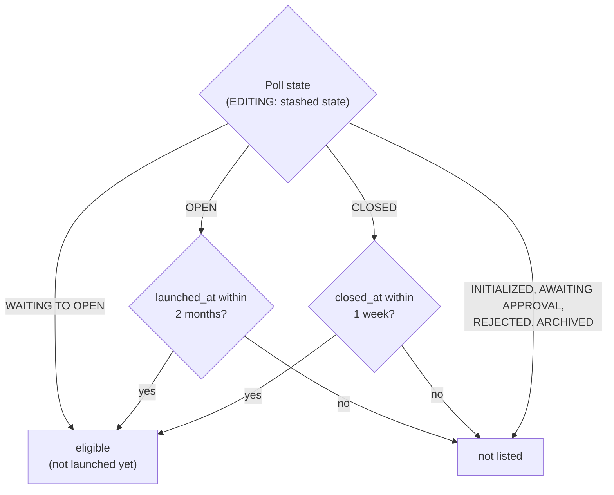
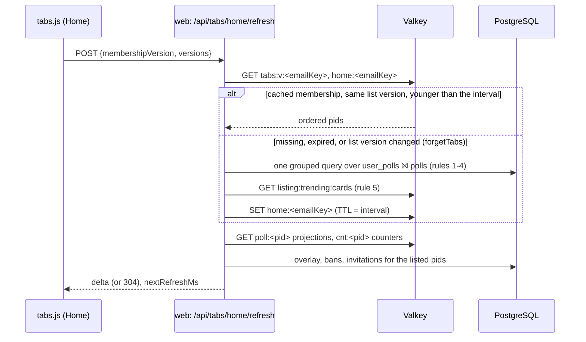

# High Level Requirements

Requirements: `requirements/20261103-120521-home-tab/requirements.md`  
External Files: `dontTrack/home-icon.jpg` (outside `requirements/20261103-120521-home-tab`; the link does not resolve from it, see UA1)  
Generated: 2026-11-03 12:07 PM  

Add a Tab Bar item for a new tab called "Home".
The icon will be created from the icon below:  

The Avatar menu will also include a new menu item for the Home tab page.  
This item will be added to the menu as the first item.  

The Polls that populate the Home page are according to the following rules:

1. Up to 10 polls that have are "Shared With You", but not launched more than 2 months ago, and not closed more than 1 week ago.  
2. Up to 10 polls that the user has created but launched more than 2 months ago, and not closed more than 1 week ago, and havent' already been included by the previous rules.  
3. Up to 10 polls that the user has participated in but not launched more than 2 months ago, and not closed more than 1 week ago, and havent' already been included by the previous rules.  
4. all the polls the user is "Watching", but not launched more than 2 months ago, and not closed more than 1 week ago, and havent' already been included by the previous rules.  
5. Up to 10 polls that are trending, and havent' already been included by the previous rules.  

This only needs to be refreshed periodically, rather than in real-time, to reduce server load.  
The period could be every two hours. (or specified by a new environment variable ENV_HOME_TAB_REFRESH_INTERVAL, or if a sweep ENV_HOMETAB_SWEEP_INTERVAL)

First, do the research to determine how this can be done efficiently without excessive load on the server.  
If this can't be done efficiently, consider alternative approaches such as caching or precomputing the poll lists.  

Create new Findings if the research yields any questions that need to be answered by the development team.  
Additionally, document any assumptions made during the research and any potential trade-offs identified.  

After the research questions are resolved,  
begin the implementation of the efficient mechanism for populating the Home tab with polls according to the rules specified above.  
Ensure that the implementation respects the refresh interval and any caching or precomputation strategies identified during the research.  

The deliverable of this feature culminated with the successful implementation of the Home tab.

## Additional Requirements and Research Requests

**Instructions To The Developer**  
Enter any additional requirements or research requests under the ## Additional Requirements and Research Requests heading above.  
When you Type or Say: "Next" in the CC CLI terminal, the additional requirements and research requests will be applied to the report.  
  
You may leave these instructions here. They will be ignored when "Next" is executed.  

## 1. Overview and Scope

The feature adds a ninth tab, **Home**, to the tab bar of `/` (`src/public/index.html`, `tabs.js`), and a **Home** item as the first entry of the avatar menu (`src/public/app.js`, `renderSiteHeader`).  
Home is a digest: one list of polls drawn from four of the user's own relations and from TRENDING, by five ordered rules, each poll listed once.  

| Rule | Source today | Relation / listing | Cap | Date window |
|---|---|---|---|---|
| 1. Shared With You | Shared With You tab (`sharedWithYouTab` + `sharedWithYouKept`) | `user_polls` `invited`, `linked`; private; not own | 10 | launched ≤ 2 months, closed ≤ 1 week |
| 2. Created by the user | Your Polls tab (`yourPollsTab`) | `user_polls` `created` | 10 | as written: launched **>** 2 months (see IN1) |
| 3. Participated in | Your Votes tab (`yourVotesTab`) | `user_polls` `voted` (see AM2) | 10 | launched ≤ 2 months, closed ≤ 1 week |
| 4. Watching | Watching tab (`watchingTab`) | `user_polls` `bookmarked` | all (≤ `ENV_MAX_BOOKMARKS_PER_USER`, 200; see AM1) | launched ≤ 2 months, closed ≤ 1 week |
| 5. Trending | TRENDING listing (`listing:trending:*`, `trendingSweep`) | public, OPEN | 10 | none |

- **In scope**: the tab, its icon, the avatar menu item, the composition rules, the periodic refresh with its setting, and the mechanism that keeps it cheap (RS1).  
- **Out of scope** (assumed): changes to the other eight tabs, to TRENDING's own ranking, and to the guest experience beyond how a guest sees the Home tab (UA3).  
- **What exists already**: every input is computed today.  
  Rules 1–4 are the four personal tabs' queries over `user_polls` (index `user_polls_email_updated` on `(email, updated_at desc)`, migration 003);  
  rule 5 is the TRENDING listing the trending sweep publishes to the cache every `ENV_TRENDING_POLLS_RECOMPUTE_SWEEP_INTERVAL` (60 s).  
  Live counts come from the `cnt:<pid>` counters, never the poll row.  

### Assumptions

- Home is a personal tab: it needs a session, like Your Polls, Shared With You, Your Votes, Watching and Live Results.  
- A poll is listed under the first rule that matches it; the later rules skip it ("havent' already been included").  
- The date windows are measured from "now" at the moment the list is built, not when it is shown.  
- The cards on Home are the ordinary poll cards (vote, watch, maximize, line graph), with the same overlay as the personal tabs.  
- No new table: the per-user list is cache state, rebuilt from `user_polls` and the TRENDING listing (RS1).  
- The tab id is `home`; its API route is `POST /api/tabs/home/refresh`, beside the other personal tabs, and is added to `postman/openapi.json`.  

## 2. Component Diagram

## 3. Composition Flow: Which Polls Home Lists

The date window, as AM3 recommends reading it:

## 4. Sequence: A Home Refresh

## 5. Research Results

### 5.1 How can the Home tab be populated efficiently?

**RS1. How can the Home tab be populated efficiently, without excessive load on the server?**  
<b>
✅ Resolved</b>  
✅ Requirements File Updated: 2026-11-03 1:23 PM  
**Notes**: Recommendation accepted in file 2026-11-03: Recommendation A, **build on demand, cache each user's list for the interval, and rebuild early when their list version changes.**;  
the requirements now record it under "Decisions", RS1.  

> The requirements ask how to compose five rules per user cheaply, and whether caching or precomputing is needed.  
> Sources: the codebase (`src/routes/tabsApi.ts`, `src/polls/userPolls.ts`, `src/refresh/tabVersions.ts`, `src/trending/recompute.ts`, `src/polls/sweeps.ts`, migration `003-participation.ts`), [PostgreSQL 16 — Multicolumn Indexes](https://www.postgresql.org/docs/16/indexes-multicolumn.html), [Valkey — SET with PX](https://valkey.io/commands/set/).  
> Rules 1–4 all read one table, `user_polls`, for one `email`, through the existing index `(email, updated_at desc)`: one index range scan joined to `polls` by primary key, the same work each personal tab already does on every refresh.  
> They can be one grouped query (`relation in ('invited','linked','created','voted','bookmarked')`) with the date and state filters in SQL, so a rebuild costs about one personal-tab refresh, not four.  
> Rule 5 needs no database read: the trending sweep already publishes the ranked listing to `listing:trending:cards` once a minute, for every user at once.  
> The per-refresh cost that remains — projections, live counts, the overlay, bans and invitations for at most about 240 polls — is the same as any personal tab's, and the existing refresh floors and load budget already govern it.  
> Every write to `user_polls`, `poll_invitations` or `poll_bans` already calls `forgetTabs`, which deletes the user's list version `tabs:v:<emailKey>`, so a cached Home list can tell at once when the user's own relations changed.  
> A sweep that precomputes Home for every user would do work for every account every interval, while most accounts are idle; the advisory-locked sweeps today all work over polls, not users.  

  - **Recommendation A** _(recommended)_: **build on demand, cache each user's list for the interval, and rebuild early when their list version changes.**  

    [X] ➡️ **Accepted**

    - <u>Pros</u>: work is proportional to active users: at most one rebuild per user per interval (default 2 hours), plus one after each change of their own relations;  
      no new sweep, lock or table;  
      the cached list (`home:<emailKey>`, the ordered pids and the `tabs:v` version it was built under, TTL = `ENV_HOME_TAB_REFRESH_INTERVAL`) lives in Valkey, so every instance shares it.  
    - <u>Cons</u>: the first Home view after the interval pays one rebuild;  
      a poll that crosses a date window, or a change in TRENDING, shows up only at the next rebuild (by design).  

  - **Recommendation B**: **a sweep precomputes every user's list each interval (`ENV_HOME_TAB_SWEEP_INTERVAL`).**  

    [ ] ➡️ **Not Accepted**

    - <u>Pros</u>: a Home refresh never pays a rebuild.  
    - <u>Cons</u>: the work grows with all accounts, active or not, and arrives as one burst each interval;  
      it needs a new advisory lock number and batching;  
      a user's own new poll or vote still needs an early rebuild, so the on-demand path is needed anyway.  

  - **Recommendation C**: **no cache: compose the list on every refresh, like the other personal tabs.**  

    [ ] ➡️ **Not Accepted**

    - <u>Pros</u>: simplest, always current, no setting.  
    - <u>Cons</u>: it ignores the requirement to refresh periodically;  
      Home will likely be the most-opened tab, so it would carry the most query load of any personal tab.  

  - **Developer Resolution D**:  

    [ ] ➡️ **Not Accepted**

## 6. Breaking Changes

- **BC1. The avatar menu order changes**: Home becomes the first item, ahead of Edit Profile (`app.js` `renderSiteHeader`).  
  Tests or documentation that pin the menu's first item, or its item count, change with it.  
- **BC2. The tab bar holds nine tabs, not eight**: `tabs.js`'s header comment ("the eight-tab home page"), `PERSONAL_TABS`, `KIND_OF`, `LANDING_TABS`, and the tab-bar tests (`client-tabs-026.test.ts`, `tab-bar-assets.test.ts`, `client-tab-bar-scroll.test.ts`) count or list the tabs.  
- **BC3. The landing tab for signed-in users may change** from Trending to Home (NC1, Recommendation A).  
  A signed-in user who expects `/` to open on Trending will see Home instead; guests keep Trending.  

## 7. Technical Debt

- **TD1. `launched_at` is cleared when a poll closes** (`updatePoll`, `src/polls/store.ts:738`) and re-stamped when it reopens, so a closed poll has no record of when it was launched.  
  This is why rule windows on closed polls can only use `closed_at` (AM3).  
- **TD2. Each personal tab composes its own query and narrowing** in `tabsApi.ts` (`personalTabRoute` with a `load` and a `narrow` per tab).  
  Home combines four of them; rules 1–4 should share one grouped query and the existing narrowing functions, rather than call the four loaders and merge.  
- **TD3. "Home" already means something else**: the page `/` is called the home page throughout (`tabs.js` comments, `search.search("home", …)`, the `home_listable` column, the `polls_home_launched` index).  
  A tab named Home on the home page will make names like `home_listable` ambiguous; new identifiers should say `homeTab` (`homeTab.ts`, `home-tab` CSS), and the route `/api/tabs/home` stays unambiguous because it sits under `/api/tabs/`.  
- **TD4. The tab list is repeated by hand** in `index.html`, `PERSONAL_TABS`, `KIND_OF`, `LANDING_TABS`, `EMPTY_LINES` and the refresh loop at `tabs.js:1130`; adding a tab touches each of them.  

## 8. Findings

### 8.1 Inconsistencies

**IN1. Rule 2 says "launched more than 2 months ago"; every other rule says "not launched more than 2 months ago".**  
<b>
✅ Resolved</b>  
✅ Requirements File Updated: 2026-11-03 1:23 PM  
**Notes**: Recommendation accepted in file 2026-11-03: Recommendation, **read rule 2 as "not launched more than 2 months ago", the same window as rules 1, 3 and 4.**;  
the requirements now record it under "Decisions", IN1.  

> Rule 2 reads "polls that the user has created but launched more than 2 months ago", while rules 1, 3 and 4 read "but not launched more than 2 months ago".  
> Taken literally, rule 2 would list only the user's *old* polls, the opposite of the other rules, and of a digest of what is current.  

  - **Recommendation**: **read rule 2 as "not launched more than 2 months ago", the same window as rules 1, 3 and 4.**  

    [X] ➡️ **Accepted**

    - The requirements will record rule 2 as "Up to 10 polls the user has created, not launched more than 2 months ago and not closed more than 1 week ago, not already included".  

  - **Developer Resolution B**:  

    [ ] ➡️ **Not Accepted**

**IN2. Two names are offered for the interval setting, and the project's naming rule decides between them by mechanism.**  
<b>
✅ Resolved</b>  
✅ Requirements File Updated: 2026-11-03 1:23 PM  
**Notes**: Recommendation accepted in file 2026-11-03: Recommendation A, **`ENV_HOME_TAB_REFRESH_INTERVAL`, in ms, default `7200000` (2 hours), minimum `60000`, with RS1 Recommendation A.**;  
the requirements now record it under "Decisions", IN2.  

> The requirements offer `ENV_HOME_TAB_REFRESH_INTERVAL`, "or if a sweep `ENV_HOMETAB_SWEEP_INTERVAL`".  
> In `src/config.ts`, every sweep's interval is named `ENV_<NAME>_SWEEP_INTERVAL`, and the older `_INTERVAL` names are listed as renamed settings, so using one stops the app.  
> `ENV_HOMETAB_…` also spells the words differently from `HOME_TAB`.  
> All intervals are in milliseconds.  

  - **Recommendation A** _(recommended)_: **`ENV_HOME_TAB_REFRESH_INTERVAL`, in ms, default `7200000` (2 hours), minimum `60000`, with RS1 Recommendation A.**  

    [X] ➡️ **Accepted**

    - <u>Pros</u>: it is not a sweep, so it does not take the `_SWEEP_INTERVAL` suffix;  
      it is the TTL of each user's cached list;  
      it is added to `loadConfig`, `.claude/rules/environment.md` and the `.example` launch templates.  
    - <u>Cons</u>: none beyond a new setting.  

  - **Recommendation B**: **`ENV_HOME_TAB_SWEEP_INTERVAL`, in ms, default `7200000`, with RS1 Recommendation B.**  

    [ ] ➡️ **Not Accepted**

    - <u>Pros</u>: it follows the sweep naming rule, if a sweep is chosen.  
    - <u>Cons</u>: only fits if RS1 chooses a sweep.  

  - **Developer Resolution C**:  

    [ ] ➡️ **Not Accepted**

### 8.2 Ambiguities

**AM1. Rule 4 takes "all" Watching polls, where every other rule takes up to 10.**  
<b>
✅ Resolved</b>  
✅ Requirements File Updated: 2026-11-03 1:23 PM  
**Notes**: Recommendation accepted in file 2026-11-03: Recommendation A, **all, as written: every Watching poll in the date window, bounded by `ENV_MAX_BOOKMARKS_PER_USER`.**;  
the requirements now record it under "Decisions", AM1.  

> Rules 1, 2, 3 and 5 say "Up to 10"; rule 4 says "all the polls the user is Watching".  
> Watching is already bounded: `ENV_MAX_BOOKMARKS_PER_USER` (200) caps it, and bookmarks expire after `ENV_BOOKMARK_EXPIRY_MONTHS` (6).  
> With the date window, "all" will usually be a handful, but it may be up to 200.  

  - **Recommendation A** _(recommended)_: **all, as written: every Watching poll in the date window, bounded by `ENV_MAX_BOOKMARKS_PER_USER`.**  

    [X] ➡️ **Accepted**

    - <u>Pros</u>: watching is the user's explicit wish to follow a poll, so none is hidden;  
      the existing cap bounds the cost.  
    - <u>Cons</u>: a heavy watcher's Home can run long, pushing Trending far down.  

  - **Recommendation B**: **up to 10, like the other rules.**  

    [ ] ➡️ **Not Accepted**

    - <u>Pros</u>: Home is never longer than 50 polls.  
    - <u>Cons</u>: watched polls beyond ten are only on the Watching tab.  

  - **Developer Resolution C**:  

    [ ] ➡️ **Not Accepted**

**AM2. What does "participated in" mean?**  
<b>
✅ Resolved</b>  
✅ Requirements File Updated: 2026-11-03 1:23 PM  
**Notes**: Recommendation accepted in file 2026-11-03: Recommendation, **voted: the polls the Your Votes tab lists (relation `voted`), with the same access narrowing (`reachableMany`).**;  
the requirements now record it under "Decisions", AM2.  

> Rule 3 lists polls "the user has participated in".  
> It could mean voted (the Your Votes tab, relation `voted`), or also added a choice, or opened by link (relation `linked`, which rule 1 already covers).  

  - **Recommendation**: **voted: the polls the Your Votes tab lists (relation `voted`), with the same access narrowing (`reachableMany`).**  

    [X] ➡️ **Accepted**

    - A withdrawn vote removes the `voted` relation (`src/polls/store.ts:652`), so it also leaves Home at the next rebuild.  

  - **Developer Resolution B**:  

    [ ] ➡️ **Not Accepted**

**AM3. How is "not launched more than 2 months ago" judged for a poll that is closed, or not launched yet?**  
<b>
✅ Resolved</b>  
✅ Requirements File Updated: 2026-11-03 1:23 PM  
**Notes**: Recommendation accepted in file 2026-11-03: Recommendation A, **judge each state by the date it has: OPEN by `launched_at` within 2 months, CLOSED by `closed_at` within 1 week, WAITING TO OPEN always eligible.**;  
the requirements now record it under "Decisions", AM3.  

> `launched_at` is stamped when a poll opens, and set back to null when it closes (`src/polls/store.ts:738`), so a CLOSED poll no longer records its launch (TD1).  
> A WAITING TO OPEN poll has never launched.  
> Read strictly, "launched within 2 months and closed within 1 week" cannot be checked for a closed poll, and is undefined for one not yet launched.  
> A poll being edited (EDITING) is judged by its stashed state, as voter-facing readers see it.  

  - **Recommendation A** _(recommended)_: **judge each state by the date it has: OPEN by `launched_at` within 2 months, CLOSED by `closed_at` within 1 week, WAITING TO OPEN always eligible.**  

    [X] ➡️ **Accepted**

    - <u>Pros</u>: no migration;  
      a poll that just closed stays a week so the user sees its result;  
      an upcoming poll the user was invited to is shown before it opens.  
    - <u>Cons</u>: a poll launched long ago that closed this week is shown for that week, which the strict reading would leave out.  

  - **Recommendation B**: **add a `first_launched_at` column that closing never clears, and apply both windows to closed polls.**  

    [ ] ➡️ **Not Accepted**

    - <u>Pros</u>: the strict reading of the rule.  
    - <u>Cons</u>: a migration;  
      polls already closed have no launch date to back-fill, so they would still need Recommendation A's rule.  

  - **Developer Resolution C**:  

    [ ] ➡️ **Not Accepted**

**AM4. Which poll states may Home list?**  
<b>
✅ Resolved</b>  
✅ Requirements File Updated: 2026-11-03 1:23 PM  
**Notes**: Recommendation accepted in file 2026-11-03: Recommendation A, **published polls only: WAITING TO OPEN, OPEN and CLOSED (EDITING by its stashed state);  
never drafts, rejected or archived polls.**;  
the requirements now record it under "Decisions", AM4.  

> Your Polls lists the user's drafts too (INITIALIZED, AWAITING APPROVAL, REJECTED, ARCHIVED), and Shared With You shows an unpublished poll as a "not published" placeholder.  
> The rules do not say whether Home shows these.  

  - **Recommendation A** _(recommended)_: **published polls only: WAITING TO OPEN, OPEN and CLOSED (EDITING by its stashed state); never drafts, rejected or archived polls.**  

    [X] ➡️ **Accepted**

    - <u>Pros</u>: Home shows polls people can vote in or read results of;  
      drafts stay on Your Polls, where their editing controls are.  
    - <u>Cons</u>: a creator does not see a rejected poll on Home.  

  - **Recommendation B**: **also the creator's own unpublished polls in rule 2.**  

    [ ] ➡️ **Not Accepted**

    - <u>Pros</u>: the creator sees what is waiting for approval or was rejected.  
    - <u>Cons</u>: draft cards need their placeholder and rejection-reason rendering on Home too;  
      the date windows do not apply to a never-launched draft.  

  - **Developer Resolution C**:  

    [ ] ➡️ **Not Accepted**

**AM5. Is rule 1's "Shared With You" exactly what the Shared With You tab lists?**  
<b>
✅ Resolved</b>  
✅ Requirements File Updated: 2026-11-03 1:23 PM  
**Notes**: Recommendation accepted in file 2026-11-03: Recommendation, **the same polls the tab lists, by the same rule, but Home does not mark invitations accepted.**;  
the requirements now record it under "Decisions", AM5.  

> The tab lists private polls someone else created, that the user was invited to or opened by link, and keeps an Invitation Only poll only while the invitation stands (`sharedWithYouKept`).  
> Opening that tab also marks invitations accepted (`markAccepted`) and adopts pending invitations (`adoptInvitations`).  

  - **Recommendation**: **the same polls the tab lists, by the same rule, but Home does not mark invitations accepted.**  

    [X] ➡️ **Accepted**

    - Home reuses `sharedWithYouKept`;  
      acceptance stays a deliberate act on the Shared With You tab, so a cached, periodic list never writes to `poll_invitations`.  

  - **Developer Resolution B**:  

    [ ] ➡️ **Not Accepted**

**AM6. What is "refreshed periodically": the list of polls, or also their counts?**  
<b>
✅ Resolved</b>  
✅ Requirements File Updated: 2026-11-03 1:23 PM  
**Notes**: Recommendation accepted in file 2026-11-03: Recommendation, **only the membership is rebuilt each interval;  
the cards' content and live counts refresh like any other tab's.**;  
the requirements now record it under "Decisions", AM6.  

> "This only needs to be refreshed periodically, rather than in real-time" could mean the whole tab, cards and counts included, updates every two hours.  
> Every other tab refreshes its cards' counts on the refresh floor (`ENV_*` floors, `nextRefreshMs`).  

  - **Recommendation**: **only the membership (which polls, in which order) is rebuilt each interval; the cards' content and live counts refresh like any other tab's.**  

    [X] ➡️ **Accepted**

    - Counts come from the cached `cnt:<pid>` counters and projections, so they cost no query on the list;  
      a two-hour-old vote count on a poll the user voted in would look broken.  

  - **Developer Resolution B**:  

    [ ] ➡️ **Not Accepted**

**AM7. In what order are the polls shown, and are the rules visible?**  
<b>
✅ Resolved</b>  
✅ Requirements File Updated: 2026-11-03 1:23 PM  
**Notes**: Recommendation accepted in file 2026-11-03: Recommendation A, **one list in rule order, no headings;  
most recent relation first within rules 1–4, TRENDING's rank within rule 5.**;  
the requirements now record it under "Decisions", AM7.  

> The rules are ordered, but the requirements do not say whether Home is one list or grouped, nor how polls are ordered within a rule.  

  - **Recommendation A** _(recommended)_: **one list in rule order, no headings; within rules 1–4 the most recent relation first (`user_polls.updated_at`), within rule 5 TRENDING's rank.**  

    [X] ➡️ **Accepted**

    - <u>Pros</u>: the same card grid as every other tab;  
      the personal tabs already order by the newest relation.  
    - <u>Cons</u>: the user does not see why a poll is on Home.  

  - **Recommendation B**: **one list in rule order, with a small heading before each rule's group ("Shared With You", "Your Polls", "Your Votes", "Watching", "Trending").**  

    [ ] ➡️ **Not Accepted**

    - <u>Pros</u>: the reason for each poll is plain.  
    - <u>Cons</u>: headings break the grid's single-column and maximized layouts, and need their own M3 sheet and tests.  

  - **Developer Resolution C**:  

    [ ] ➡️ **Not Accepted**

### 8.3 Unspecified Aspects

**UA1. The icon image is outside the requirements folder, in a git-ignored directory.**  
<b>
✅ Resolved</b>  
✅ Requirements File Updated: 2026-11-03 1:23 PM  
**Notes**: Recommendation accepted in file 2026-11-03: Recommendation, **copy the image into the requirements folder as `home-icon.jpg` and link it as ``.**;  
the requirements now record it under "Decisions", UA1.  

> The requirements embed ``, a path relative to `requirements/20261103-120521-home-tab/`, where no such file exists.  
> The image is at the project root's `dontTrack/home-icon.jpg`, which `.gitignore` ignores, so the spec and anyone reading the requirements in git cannot see it.  
> Earlier features keep their images beside the requirements (e.g. `poll-admin-icon.jpg` in the site-settings folder).  

  - **Recommendation**: **copy the image into the requirements folder as `home-icon.jpg` and link it as ``.**  

    [X] ➡️ **Accepted**

    - The original under `dontTrack/` stays where it is.  

  - **Developer Resolution B**:  

    [ ] ➡️ **Not Accepted**

**UA2. How is the icon drawn, and in which style?**  
<b>
✅ Resolved</b>  
✅ Requirements File Updated: 2026-11-03 1:23 PM  
**Notes**: Recommendation accepted in file 2026-11-03: Recommendation, **an inline SVG house outline in `currentColor` in the tab bar, and a `HOME_GLYPH` filled circle in the avatar menu.**;  
the requirements now record it under "Decisions", UA2.  

> The image is a house outline (a pitched roof over a body with a door), dark on light.  
> The tab bar's icons are inline SVGs in two styles: filled grey circles with light glyphs (Your Polls, Shared With You, Your Votes, Newest), and plain `currentColor` line or fill glyphs (Trending, Search, Watching).  
> The avatar menu's icons are all filled circles (`*_GLYPH` in `app.js`).  

  - **Recommendation**: **redraw it as an inline SVG house outline, `viewBox="0 0 24 24"`, stroked in `currentColor` like Search in the tab bar, and as a `HOME_GLYPH` filled circle with the house in `var(--paper)` in the avatar menu.**  

    [X] ➡️ **Accepted**

    - No image file is shipped, so there is no new asset request, and the icon follows Light and Dark through `currentColor` and `--paper`.  

  - **Developer Resolution B**:  

    [ ] ➡️ **Not Accepted**

**UA3. What does a guest see on the Home tab?**  
<b>
✅ Resolved</b>  
✅ Requirements File Updated: 2026-11-03 1:23 PM  
**Notes**: Recommendation accepted in file 2026-11-03: Developer Resolution B, **Home is a personal tab: hidden from guests, a guest's landing tab stays Trending;  
no Home tab icon and no Home avatar menu item for guests.**;  
the requirements now record it under "Decisions", UA3.  

> Rules 1–4 need a signed-in user; rule 5 (Trending) does not.  
> The personal tabs are disabled for guests, titled "Sign in to use this tab".  

  - **Recommendation**: **Home is a personal tab: shown but disabled for guests, with the same title, and a guest's landing tab stays Trending.**  

    [ ] ➡️ **Not Accepted**

    - `home` joins `PERSONAL_TABS`; signing out while on Home selects Trending, as for the other personal tabs.  
    - A guest-only Home would only repeat Trending.  

  - **Developer Resolution B**:  

    [X] ➡️ **Accepted**

    - Home is a personal tab: hidden from guests, a guest's landing tab stays Trending. The Home Tab Bar icon is not shown and the Avatar menu does not show a Home item for guests.

**UA4. What does the avatar menu's Home item do, on `/` and on other pages?**  
<b>
✅ Resolved</b>  
✅ Requirements File Updated: 2026-11-03 1:23 PM  
**Notes**: Recommendation accepted in file 2026-11-03: Recommendation, **the item, labelled "Home", links to `/?tab=home`;  
on `/` it selects the Home tab without reloading;  
`home` joins `LANDING_TABS`.**;  
the requirements now record it under "Decisions", UA4.  

> The avatar menu is on every page (`/profile`, `/settings`, `/admin`, …), and today holds no tab items.  
> A link to `/` opens the landing tab, and `/?tab=` honours only `your-polls`, `shared-with-you` and `trending` (`LANDING_TABS`).  

  - **Recommendation**: **the item, labelled "Home", links to `/?tab=home`; on `/` it selects the Home tab without reloading; `home` joins `LANDING_TABS`.**  

    [X] ➡️ **Accepted**

    - It is shown to every signed-in user, whatever their permissions, like Site Settings.  

  - **Developer Resolution B**:  

    [ ] ➡️ **Not Accepted**

**UA5. What does an empty Home say?**  
<b>
✅ Resolved</b>  
✅ Requirements File Updated: 2026-11-03 1:23 PM  
**Notes**: Recommendation accepted in file 2026-11-03: Recommendation, **"Nothing here yet. Polls shared with you, your polls, your votes, the polls you watch and what's trending will appear here."**;  
the requirements now record it under "Decisions", UA5.  

> Every personal tab has an empty line (`EMPTY_LINES` in `tabs.js`).  
> Home is empty only when the user has no qualifying relations and TRENDING is empty or not ready.  

  - **Recommendation**: **"Nothing here yet. Polls shared with you, your polls, your votes, the polls you watch and what's trending will appear here."**  

    [X] ➡️ **Accepted**

    - It uses the existing empty-line style (`empty-tab-line-m3.css`).  

  - **Developer Resolution B**:  

    [ ] ➡️ **Not Accepted**

**UA6. Does the user's own action wait up to two hours to show on Home?**  
<b>
✅ Resolved</b>  
✅ Requirements File Updated: 2026-11-03 1:23 PM  
**Notes**: Recommendation accepted in file 2026-11-03: Recommendation, **a change of the user's own relations rebuilds their Home at the next refresh;  
the interval bounds only what time and TRENDING change.**;  
the requirements now record it under "Decisions", UA6.  

> With a two-hour list, a poll the user has just created, voted in, started watching or been invited to would not appear on Home until the next rebuild.  
> Those actions already call `forgetTabs`, which changes the user's list version.  

  - **Recommendation**: **a change of the user's own relations rebuilds their Home at the next refresh; the interval bounds only what time and TRENDING change.**  

    [X] ➡️ **Accepted**

    - The cached list records the `tabs:v:<emailKey>` version it was built under, and is rebuilt when that differs (RS1 A).  
    - A poll that becomes unavailable to the user (banned, made private, deleted) is dropped by the per-refresh access narrowing, not left until the rebuild.  

  - **Developer Resolution B**:  

    [ ] ➡️ **Not Accepted**

**UA7. Which trending polls does rule 5 take, and what if TRENDING is not ready?**  
<b>
✅ Resolved</b>  
✅ Requirements File Updated: 2026-11-03 1:23 PM  
**Notes**: Recommendation accepted in file 2026-11-03: Recommendation, **the first 10 TRENDING polls not already listed;  
when TRENDING is not ready, rules 1–4 alone, cached for one trending interval.**;  
the requirements now record it under "Decisions", UA7.  

> TRENDING lists public polls that are OPEN (or EDITING after OPEN), ranked by votes in the last hour, up to `ENV_MAX_TRENDING_POLLS` (200).  
> Right after a deploy the listing may be missing (`503 trending-not-ready`).  

  - **Recommendation**: **the first 10 polls of the current TRENDING listing, in its order, that rules 1–4 did not list; when the listing is not ready, Home lists rules 1–4 alone and fills rule 5 at the next rebuild.**  

    [X] ➡️ **Accepted**

    - A Home built without rule 5 is cached for one trending interval (`ENV_TRENDING_POLLS_RECOMPUTE_SWEEP_INTERVAL`) rather than the full Home interval, so Trending appears within a minute.  

  - **Developer Resolution B**:  

    [ ] ➡️ **Not Accepted**

### 8.4 Needs Clarifications

**NC1. Where does Home sit in the tab bar, and is it the tab a signed-in user lands on?**  
<b>
✅ Resolved</b>  
✅ Requirements File Updated: 2026-11-03 1:23 PM  
**Notes**: Recommendation accepted in file 2026-11-03: Recommendation A, **Home is the first tab, and the landing tab for signed-in users;  
guests still land on Trending.**;  
the requirements now record it under "Decisions", NC1.  

> The requirements put Home first in the avatar menu, but say nothing of its place in the tab bar or whether `/` opens on it.  
> Today the bar runs Your Polls, Shared With You, Your Votes, Trending, Newest, Watching, Live Results, Search, and `/` opens on Trending for everyone.  

  - **Recommendation A** _(recommended)_: **Home is the first tab, and the landing tab for signed-in users; guests still land on Trending.**  

    [X] ➡️ **Accepted**

    - <u>Pros</u>: a tab named Home is where people expect to start;  
      it matches its first place in the avatar menu.  
    - <u>Cons</u>: changes where signed-in users land (BC3);  
      a link landing (`/?tab=…&open=…`) still wins over it.  

  - **Recommendation B**: **Home is the first tab, and Trending stays the landing tab for everyone.**  

    [ ] ➡️ **Not Accepted**

    - <u>Pros</u>: nobody's landing changes.  
    - <u>Cons</u>: Home is one click away, which weakens it as a digest.  

  - **Developer Resolution C**:  

    [ ] ➡️ **Not Accepted**

## 9. Requirements Report Complete Report  
  
- **Requirements Report Document:** requirements/20261103-120521-home-tab/requirements-report.md  
- **Requirements Document:** requirements/20261103-120521-home-tab/requirements.md  
- **Software Architecture Diagrams:** 4  
- **Inconsistencies:** 2  
- **Ambiguities:** 7  
- **Unspecified Aspects:** 7  
- **Needs Clarifications:** 1  
- **Research Results:** 1  
- **Breaking Changes:** 3  
- **Technical Debt items:** 4  
  
The requirements are ready for /speckit-specify.  
To generate specs from the requirements document, use the `/speckit-specify` skill followed by the path (relative to the project root) to the requirements file.  
At the prompt, Type:  
🟩 👉 /speckit-specify requirements/20261103-120521-home-tab/requirements.md  
