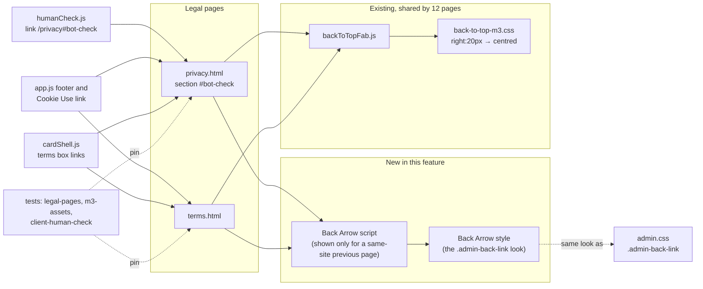
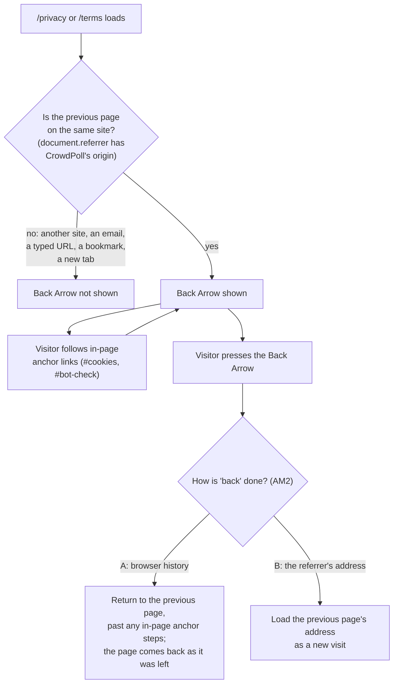

# High Level Requirements

Requirements: `requirements/20261104-180032-legal-page-updates/requirements.md`  
External Files: `dontTrack\privacy-policy-back-arrow.jpg` (outside `requirements/20261104-180032-legal-page-updates`, and git-ignored; a copy was placed beside the requirements as `privacy-policy-back-arrow.jpg`, see UA4)  
Generated: 2026-11-04 6:01 PM  

For /privacy page

Here is what the FCAPTCHA section of the privacy policy currently says:
```
Bot check
Before a sign-in starts, on the Login, Create Account and invitation pages, you tick a box that checks you are a person and not an automated program.

What it measures: characteristics of your device and browser (such as how it draws graphics, plays audio and measures fonts), the timing of your pointer, touch and typing on the page, and details of your connection.
Why: to tell people from automated programs before a sign-in starts, so that bots cannot create accounts or send sign-in emails.
Where: on CrowdPoll's own servers, using the open-source FCaptcha software. It is never sent to or shared with a third party.
How long: held in memory for at most one hour, then gone. It is not stored with your account.
Cookies: the check sets no cookie and stores nothing in your browser.
```

Change it to:
```
Bot and AI Agent Detection
Before a sign-in starts, on the Login, Create Account and invitation pages, you tick a box that checks you are not a Bot or an AI Agent.

What it measures: characteristics of your device and browser (such as how it draws graphics, plays audio and measures fonts), the timing of your pointer, touch and typing on the page, and details of your connection.
Why: to prevent Bots or AI Agents from creating accounts and subsequently voting on a poll. 
Where: on CrowdPoll's own servers, using the open-source FCaptcha software. It is never sent to or shared with a third party.
How long: held in memory for at most one hour, then gone. It is not stored with your account.
Cookies: the check sets no cookie and stores nothing in your browser.

```

Add a Back Arrow icon to allow the user to easily navigate back to the page they were previously on. 
However, if the previous page is not on the same site, then the Back Arrow icon will be hidden.
This Back Arrow icon will appear similar to the Back Arrow on the Admin Poll page. 

The existing Up Arrow icon will now be centered on the page (currently on the right).

A mockup of the icons appears in the figure below.


The Terms of Service page, will get the same Back Arrow and centerd Up Arrow icons as the Privacy Policy page.

## Additional Requirements and Research Requests

**Instructions To The Developer**  
Enter any additional requirements or research requests under the ## Additional Requirements and Research Requests heading above.  
When you Type or Say: "Next" in the CC CLI terminal, the additional requirements and research requests will be applied to the report.  
  
You may leave these instructions here. They will be ignored when "Next" is executed.  

## 1. Overview and Scope

The feature changes the two legal pages, `/privacy` (`src/public/privacy.html`) and `/terms` (`src/public/terms.html`), in three ways:  

| # | Change | Pages | Where it lives today |
|---|---|---|---|
| 1 | The bot-check section is renamed **Bot and AI Agent Detection**, with a new first sentence and a new **Why** | `/privacy` | `<section id="bot-check">`, `privacy.html:93–109` |
| 2 | A new **Back Arrow**, shown only when the previous page is on CrowdPoll | `/privacy`, `/terms` | none; the look is the admin page's `.admin-back-link` (`admin.html:71`, `admin.css:30–46`) |
| 3 | The existing **Up Arrow** (back-to-top button) moves from the right edge to the centre | `/privacy`, `/terms` (see AM1) | `backToTopFab.js`, `back-to-top-m3.css` (`right:20px`), loaded by 12 pages |

- **In scope**: the section's text, the two icons on both legal pages, and the tests that pin them.  
- **Out of scope** (assumed): the human check itself (`humanCheck.js`, FCaptcha), the rest of the policy's text (except what UA1 and NC1 settle), and the back arrow on any other page.  
- **The new wording is accurate**: FCaptcha 1.46.1 looks for AI agents.  
  Its `detection.js` flags self-declared AI-agent user agents (`checkDeclaredAIAgent`), and `engine.js` treats near-zero pointer movement as a sign of an AI agent or a programmatic click.  
- **How visitors reach the legal pages today**, all by ordinary same-tab links:  
  - the footer of every page (`app.js:510`);  
  - the cookie notice's Cookie Use link (`app.js:484`);  
  - the terms box and terms line of the sign-in cards (`cardShell.js:247–267`);  
  - the human check's "What this safeguard checks." link to `/privacy#bot-check` (`humanCheck.js:90`);  
  - the Profile page (`profileCard.js:251`);  
  - each other (`terms.html` links to `/privacy` and `/privacy#rights`).  

### Assumptions

- "The Admin Poll page" is Poll Administration, `admin.html`: its back control is a 40 px filled tonal circle (`secondary-container`) with a 26 px stroked left arrow and M3 state layers.  
  The new Back Arrow copies that look; only its behaviour differs (it goes back, where the admin link goes to `/`).  
- "Hidden" means the arrow is not shown at all and takes no space; nothing replaces it.  
- The mockup shows the page scrolled to the Bot check section with the arrow still under the header, so the arrow stays in view while the page scrolls (see UA3).  
- The section keeps its anchor `id="bot-check"`, so existing links (`humanCheck.js`, the "In short" list) keep working (see UA1).  
- The Back Arrow needs no new cookie or browser storage key, so no Cookie Use row is added.  
- The pages stay free of third-party requests: the arrow is inline SVG, as on the admin page.  

## 2. Component Diagram



## 3. Back Arrow: When It Shows and Where It Goes



## 4. Sequence: From the Human Check to the Policy and Back

```mermaid
sequenceDiagram
  actor V as Visitor
  participant LG as /login (human check)
  participant PP as /privacy
  participant BR as Browser history

  V->>LG: opens /login, the check shows
  V->>LG: clicks "What this safeguard checks."
  LG->>PP: same-tab link to /privacy#bot-check
  PP->>PP: referrer is crowdpoll.vote → Back Arrow shown
  V->>PP: reads, clicks "#cookies" in the page
  PP->>BR: an in-page step is added
  V->>PP: presses the Back Arrow
  alt AM2 A: history
    PP->>BR: go back past the in-page steps
    BR-->>LG: /login as it was left (restored from the back-forward cache when the browser keeps it)
  else AM2 B: referrer address
    PP->>LG: load /login again
    LG-->>V: a fresh page; the check starts over
  end
```

## 5. Breaking Changes

- **BC1. Every account may have to accept the policy again** if the change takes a new version (NC1, Recommendation A).  
  The Privacy Policy and the Terms of Service share one version, `TERMS_VERSION` (`src/legal/version.ts`).  
  A new version sends every signed-in account to `/accept-terms` on its next visit.  
- **BC2. Tests that pin the old text or position change with it**:  
  - `tests/legal-pages.test.ts` expects the section to contain "Bot check";  
  - `tests/m3-assets.test.ts` (`LAYER_ORDER`) pins the stylesheets and scripts of `privacy.html` and `terms.html`, so a new sheet or script is added there;  
  - any test of the back-to-top button's position, if the centring applies to every page (AM1, Recommendation B).  

## 6. Technical Debt

- **TD1. The back-arrow style lives in `admin.css`**, an admin-only sheet that the legal pages do not load.  
  Copying the rule into a second sheet would let the two drift apart.  
  A shared M3 layer (for example `back-arrow-m3.css`) used by both pages, with `admin.css` keeping only its toolbar placement, avoids that.  
- **TD2. The back-to-top button has one position for all 12 pages** (`back-to-top-m3.css`, `right:20px`).  
  Centring it on some pages only needs a page-level modifier (a class on `<body>`, or a data attribute read by the sheet), which the sheet does not have today.  
- **TD3. One version number covers two documents**: `TERMS_VERSION` versions both the Terms of Service and the Privacy Policy.  
  A wording change to the policy alone cannot take a new policy version without asking every account to accept the Terms again (NC1).  

## 7. Findings

### 7.1 Inconsistencies

**IN1. The new Why names only account creation, while the check also runs on Login and on invitations.**  
<span style="font-size:large" ><b>
✅ Resolved</b></span>  
✅ Requirements File Updated: 2026-11-04 6:18 PM  
**Notes**: Recommendation accepted in file 2026-11-04: Recommendation A, **"Why: to prevent bots and AI agents from creating accounts, sending sign-in emails, and voting on polls."**;  
the requirements now record it under "Decisions", IN1.  

> The new first sentence keeps "on the Login, Create Account and invitation pages".  
> The new Why reads "to prevent Bots or AI Agents from creating accounts and subsequently voting on a poll."  
> Signing in on `/login` and accepting an invitation do not create an account for an existing user; the check there stops automated sign-in emails, which the old Why named ("so that bots cannot create accounts or send sign-in emails").  
> A reader could ask why the check runs on Login if its purpose is account creation.  

  - **Recommendation A** _(recommended)_: **"Why: to prevent bots and AI agents from creating accounts, sending sign-in emails, and voting on polls."**  

    [X] ➡️ **Accepted**

    - <u>Pros</u>: it covers every page the check runs on, keeps the new emphasis on voting, and matches what `requireHumanCheck` guards.  
    - <u>Cons</u>: it is a little longer than the wording given.  


  - **Recommendation B**: **keep the Why as written.**  

    [ ] ➡️ **Not Accepted**

    - <u>Pros</u>: it is the developer's wording.  
    - <u>Cons</u>: the Login page's check has no stated purpose.  


  - **Developer Resolution C**:  

    [ ] ➡️ **Not Accepted**

### 7.2 Ambiguities

**AM1. Is the Up Arrow centred on the two legal pages only, or on every page?**  
<span style="font-size:large" ><b>
✅ Resolved</b></span>  
✅ Requirements File Updated: 2026-11-04 6:18 PM  
**Notes**: Recommendation accepted in file 2026-11-04: Recommendation B, **centred on every page that has it.**;  
the requirements now record it under "Decisions", AM1.  

> "The existing Up Arrow icon will now be centered on the page (currently on the right)" appears under the Privacy Policy, and the Terms of Service "will get the same … centerd Up Arrow".  
> The same button (`backToTopFab.js`, `back-to-top-m3.css`) is on 12 pages, among them the home page with its poll grid, the admin pages and Profile.  
> On the legal pages the text column is centred, so a centred button sits over the text (the mockup shows it covering part of a line), where the right-edge button sits in the margin on a wide screen.  

  - **Recommendation A** _(recommended)_: **centred on `/privacy` and `/terms` only; every other page keeps it on the right.**  

    [ ] ➡️ **Not Accepted**

    - <u>Pros</u>: it is what the requirements describe page by page;  
      the poll grid and the admin pages, where a centred button would cover cards and controls, are unchanged.  
    - <u>Cons</u>: the button's position differs between pages;  
      the sheet needs a page-level modifier (TD2).  


  - **Recommendation B**: **centred on every page that has it.**  

    [X] ➡️ **Accepted**

    - <u>Pros</u>: one position everywhere, and one rule in `back-to-top-m3.css`.  
    - <u>Cons</u>: on the home page it sits over the middle column of poll cards, and on phones over the vote buttons;  
      it widens the feature beyond the legal pages.  


  - **Developer Resolution C**:  

    [ ] ➡️ **Not Accepted**


**AM2. Does "navigate back to the page they were previously on" use the browser's history, or load the previous page's address?**  
<span style="font-size:large" ><b>
✅ Resolved</b></span>  
✅ Requirements File Updated: 2026-11-04 6:18 PM  
**Notes**: Recommendation accepted in file 2026-11-04: Recommendation A, **the browser's history: go back past the in-page anchor steps taken on this page, to the previous page.**;  
the requirements now record it under "Decisions", AM2.  

> The legal pages have in-page links ("In short" → `#bot-check`, and the human check's link lands on `/privacy#bot-check`), and each one the visitor follows adds a step to the browser's history.  
> A plain "back" would then only scroll the same page to its previous anchor, not return to the previous page.  
> Loading the previous page's address instead (`document.referrer`) always leaves the page, but as a new visit: the page is rebuilt, its scroll position is lost, and the human check's pass, which lives in page memory only (FCAPTCHA-AND-SEO, clarification Q1), is gone, so the check starts over.  

  - **Recommendation A** _(recommended)_: **the browser's history: go back past the in-page anchor steps taken on this page, to the previous page.**  

    [X] ➡️ **Accepted**

    - <u>Pros</u>: it acts like the browser's own Back button, done once;  
      the previous page comes back as it was left, from the back-forward cache when the browser keeps it, so a passed check can survive the visit to the policy.  
    - <u>Cons</u>: the page counts its own anchor steps;  
      a browser that does not keep the previous page in its cache reloads it, as Back does.  


  - **Recommendation B**: **load the previous page's address (`document.referrer`).**  

    [ ] ➡️ **Not Accepted**

    - <u>Pros</u>: simplest; always leaves the legal page, whatever anchors were followed.  
    - <u>Cons</u>: adds a forward step to history, so the browser's Back then returns to the policy;  
      the previous page starts over (scroll position, an open dialog, a passed human check).  


  - **Developer Resolution C**:  

    [ ] ➡️ **Not Accepted**


**AM3. Is the new section's wording used exactly as given, or in the policy's house style?**  
<span style="font-size:large" ><b>
✅ Resolved</b></span>  
✅ Requirements File Updated: 2026-11-04 6:18 PM  
**Notes**: Recommendation accepted in file 2026-11-04: Recommendation A, **keep the heading as given, and write "bot", "bots", "AI agent" and "AI agents" in lower case in the sentences.**;  
the requirements now record it under "Decisions", AM3.  

> The new text capitalizes "Bot", "Bots", "AI Agent" and "AI Agents" mid-sentence, where the rest of the policy writes ordinary nouns in lower case ("bot check", "automated programs").  
> The new Why also ends with a trailing space.  
> The heading, "Bot and AI Agent Detection", is a title, so its capitals are expected.  

  - **Recommendation A** _(recommended)_: **keep the heading as given, and write "bot", "bots", "AI agent" and "AI agents" in lower case in the sentences.**  

    [X] ➡️ **Accepted**

    - <u>Pros</u>: it reads like the rest of the policy;  
      the sentence becomes "you tick a box that checks you are not a bot or an AI agent."  
    - <u>Cons</u>: it differs in case from the text the developer wrote.  


  - **Recommendation B**: **use the text exactly as given, capitals included.**  

    [ ] ➡️ **Not Accepted**

    - <u>Pros</u>: no interpretation of the developer's text.  
    - <u>Cons</u>: the capitals stand out in a page that does not use them elsewhere.  


  - **Developer Resolution C**:  

    [ ] ➡️ **Not Accepted**

### 7.3 Unspecified Aspects

**UA1. The policy names the check in two more places, and other pages link to its anchor.**  
<span style="font-size:large" ><b>
✅ Resolved</b></span>  
✅ Requirements File Updated: 2026-11-04 6:18 PM  
**Notes**: Recommendation accepted in file 2026-11-04: Recommendation, **update the summary line and the retention row to the new name, keep the anchor `bot-check`, and leave the human check's link as it is.**;  
the requirements now record it under "Decisions", UA1.  

> The "In short" list says "Before you sign in, a quick bot check on our own servers tells people from automated programs" (`privacy.html:43`), linking to `#bot-check`.  
> The retention table has the row "Bot check measurements" (`privacy.html:139`).  
> The human check links to `/privacy#bot-check` with the text "What this safeguard checks." (`humanCheck.js:90`), and `tests/client-human-check.test.ts` pins that address.  
> The requirements change only the section.  

  - **Recommendation**: **update the summary line and the retention row to the new name, keep the anchor `bot-check`, and leave the human check's link as it is.**  

    [X] ➡️ **Accepted**

    - The summary line becomes "Before you sign in, a quick check on our own servers detects bots and AI agents. It sets no cookie.", with "check" still linking to `#bot-check`.  
    - The retention row becomes "Bot and AI agent detection measurements".  
    - The anchor stays `bot-check`, so the human check's link and any link already shared keep landing on the section.  


  - **Developer Resolution B**:  

    [ ] ➡️ **Not Accepted**


**UA2. How is "the previous page is on the same site" decided, and what counts when there is no previous page?**  
<span style="font-size:large" ><b>
✅ Resolved</b></span>  
✅ Requirements File Updated: 2026-11-04 6:18 PM  
**Notes**: Recommendation accepted in file 2026-11-04: Recommendation, **same site means the referrer's origin equals the page's own (`https://crowdpoll.vote`); an empty or other referrer hides the arrow.**;  
the requirements now record it under "Decisions", UA2.  

> A page learns its previous page from `document.referrer`, which the browser fills only when the visitor followed a link or a redirect.  
> It is empty for a typed address, a bookmark, a link opened from an email or another app, and a new tab; it keeps its value on a reload.  
> The site sends no `Referrer-Policy`, so browsers use their default (`strict-origin-when-cross-origin`), which gives the full address for a same-site link.  

  - **Recommendation**: **same site means the referrer's origin equals the page's own (`https://crowdpoll.vote`); an empty or other referrer hides the arrow.**  

    [X] ➡️ **Accepted**

    - A visitor who opened the policy from an email, a search result or a typed address sees no arrow, since there is nowhere on CrowdPoll to go back to.  
    - Going from `/privacy` to `/terms` and back shows the arrow on each.  
    - The decision is made once, when the page loads.  


  - **Developer Resolution B**:  

    [ ] ➡️ **Not Accepted**


**UA3. Where does the Back Arrow sit, does it stay in view while the page scrolls, and what happens on a phone?**  
<span style="font-size:large" ><b>
✅ Resolved</b></span>  
✅ Requirements File Updated: 2026-11-04 6:18 PM  
**Notes**: Recommendation accepted in file 2026-11-04: Recommendation C, **always fixed under the header at the left edge.**;  
the requirements now record it under "Decisions", UA3, with a left gutter for the text on narrow screens.  

> The mockup places it at the left edge, just under the header, with the page scrolled to the middle of the policy, so it seems to stay in view.  
> On a wide screen that edge is empty margin beside the centred 72-character text column.  
> On a phone the column fills the width, so a fixed arrow at the left would sit over the first words of every line it passes.  

  - **Recommendation A** _(recommended)_: **fixed under the header at the page's left edge while the margin is wide enough for it; on narrower screens, in the page above the title, scrolling away with it.**  

    [ ] ➡️ **Not Accepted**

    - <u>Pros</u>: it matches the mockup on a desktop, and never covers text on a phone.  
    - <u>Cons</u>: two placements to build and test;  
      on a phone the visitor scrolls to the top to reach it (the Up Arrow takes them there).  


  - **Recommendation B**: **always in the page above the title, scrolling away with it.**  

    [ ] ➡️ **Not Accepted**

    - <u>Pros</u>: one placement, as on the admin page, where the back link sits above the content.  
    - <u>Cons</u>: it differs from the mockup, which shows it still in view mid-page.  


  - **Recommendation C**: **always fixed under the header at the left edge.**  

    [X] ➡️ **Accepted**

    - <u>Pros</u>: always one tap away, exactly as the mockup.  
    - <u>Cons</u>: on a phone it covers the start of the lines beneath it, or the text needs a left gutter of about 56 px.  


  - **Developer Resolution D**:  

    [ ] ➡️ **Not Accepted**


**UA4. The mockup's link points outside the requirements folder.**  
<span style="font-size:large" ><b>
✅ Resolved</b></span>  
✅ Requirements File Updated: 2026-11-04 6:18 PM  
**Notes**: Recommendation accepted in file 2026-11-04: Recommendation, **point the requirements' image link at the copy beside them, `privacy-policy-back-arrow.jpg`.**;  
the image link in the requirements now reads `privacy-policy-back-arrow.jpg`, and "Decisions" records it, UA4.  

> The requirements link `dontTrack\privacy-policy-back-arrow.jpg`, a git-ignored folder at the repository root, so the link does not resolve from the requirements folder and the image would not be committed with it.  
> A copy was placed beside the requirements as `privacy-policy-back-arrow.jpg`.  

  - **Recommendation**: **point the requirements' image link at the copy beside them, `privacy-policy-back-arrow.jpg`.**  

    [X] ➡️ **Accepted**

    - The mockup then shows in `requirements.md` and in this report, and is committed with the feature.  


  - **Developer Resolution B**:  

    [ ] ➡️ **Not Accepted**


**UA5. The Back Arrow's name for screen readers, its tooltip and its keyboard use are not given.**  
<span style="font-size:large" ><b>
✅ Resolved</b></span>  
✅ Requirements File Updated: 2026-11-04 6:18 PM  
**Notes**: Recommendation accepted in file 2026-11-04: Recommendation, **a button named "Back", with the tooltip "Back", reachable by Tab and pressed with Enter or Space, with the admin link's focus ring.**;  
the requirements now record it under "Decisions", UA5.  

> The admin page's link is named "Back to the home page", because it always goes to `/`.  
> The new arrow goes to whichever page came before, so that name would be wrong.  
> The site shows tooltips with `tooltip-m3.js`, which both legal pages already load.  

  - **Recommendation**: **a button named "Back", with the tooltip "Back", reachable by Tab and pressed with Enter or Space, with the admin link's focus ring.**  

    [X] ➡️ **Accepted**

    - It is a button rather than a link, since it has no fixed address.  
    - It comes first in the tab order after the header, as it does on screen.  


  - **Developer Resolution B**:  

    [ ] ➡️ **Not Accepted**

### 7.4 Needs Clarifications

**NC1. Does the changed section take a new policy version?**  
<span style="font-size:large" ><b>
✅ Resolved</b></span>  
✅ Requirements File Updated: 2026-11-04 6:18 PM  
**Notes**: Recommendation accepted in file 2026-11-04: Recommendation A, **a new version, the release date, and "Last updated" set to the same date; no 30-day email.**;  
the requirements now record it under "Decisions", NC1.  

> The policy says "The version and date at the top change whenever this policy does", and "If we make a change that matters, we will email every account 30 days before it takes effect."  
> The version printed on both pages is `TERMS_VERSION`, `2026-11-01` (`src/legal/version.ts`), checked by `tests/legal-pages.test.ts`; a new value sends every account to `/accept-terms` (BC1, TD3).  
> The new Why adds a purpose (stopping bots from voting) without collecting anything new.  
> The site is still in its pre-launch, allowlisted stage.  

  - **Recommendation A** _(recommended)_: **a new version, the release date, and "Last updated" set to the same date; no 30-day email.**  

    [X] ➡️ **Accepted**

    - <u>Pros</u>: keeps the policy's own promise that the version changes whenever the policy does;  
      the allowlisted accounts accept once, at no real cost before launch;  
      the change is a clarification, not a change that matters, so no advance email.  
    - <u>Cons</u>: every account, the developers' included, is asked to accept again;  
      the Terms' version changes too, though their text does not.  


  - **Recommendation B**: **only "Last updated" changes; the version stays `2026-11-01`.**  

    [ ] ➡️ **Not Accepted**

    - <u>Pros</u>: nobody is asked to accept again.  
    - <u>Cons</u>: the page breaks its own sentence that the version changes whenever the policy does.  


  - **Recommendation C**: **nothing at the top changes.**  

    [ ] ➡️ **Not Accepted**

    - <u>Pros</u>: no other change.  
    - <u>Cons</u>: a reader cannot tell the policy changed, which the policy promises they can.  


  - **Developer Resolution D**:  

    [ ] ➡️ **Not Accepted**

## 8. Requirements Report Complete Report  
  
- **Requirements Report Document:** requirements/20261104-180032-legal-page-updates/requirements-report.md  
- **Requirements Document:** requirements/new-20261104-170306/requirements.md → requirements/20261104-180032-legal-page-updates/requirements.md  
- **Software Architecture Diagrams:** 3  
- **Inconsistencies:** 1  
- **Ambiguities:** 3  
- **Unspecified Aspects:** 5  
- **Needs Clarifications:** 1  
- **Research Results:** 0  
- **Breaking Changes:** 2  
- **Technical Debt items:** 3  
  
The requirements are ready for /speckit-specify.  
To generate specs from the requirements document, use the `/speckit-specify` skill followed by the path (relative to the project root) to the requirements file.  
At the prompt, Type:  
🟩 👉 /speckit-specify requirements/20261104-180032-legal-page-updates/requirements.md  
