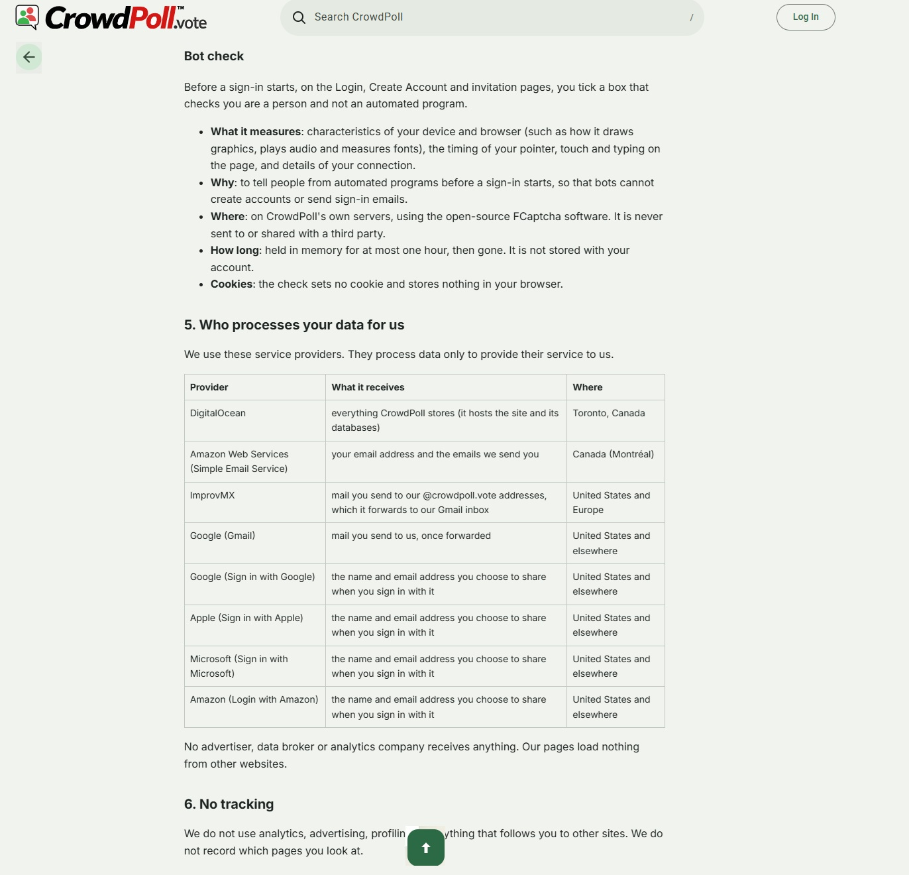

Start a new spec for these requirements called `20261104-180032-LEGAL-PAGE-UPDATES`  
!! THIS FILE IS GENERATED USING THE SKILL `/speckit-requirements`. DO NOT EDIT OR DELETE THIS FILE !!  

# Initial High-Level Requirements

For /privacy page

Here is what the FCAPTCHA section of the privacy policy currently says:
```
Bot check
Before a sign-in starts, on the Login, Create Account and invitation pages, you tick a box that checks you are a person and not an automated program.

What it measures: characteristics of your device and browser (such as how it draws graphics, plays audio and measures fonts), the timing of your pointer, touch and typing on the page, and details of your connection.
Why: to tell people from automated programs before a sign-in starts, so that bots cannot create accounts or send sign-in emails.
Where: on CrowdPoll's own servers, using the open-source FCaptcha software. It is never sent to or shared with a third party.
How long: held in memory for at most one hour, then gone. It is not stored with your account.
Cookies: the check sets no cookie and stores nothing in your browser.
```

Change it to:
```
Bot and AI Agent Detection
Before a sign-in starts, on the Login, Create Account and invitation pages, you tick a box that checks you are not a Bot or an AI Agent.

What it measures: characteristics of your device and browser (such as how it draws graphics, plays audio and measures fonts), the timing of your pointer, touch and typing on the page, and details of your connection.
Why: to prevent Bots or AI Agents from creating accounts and subsequently voting on a poll. 
Where: on CrowdPoll's own servers, using the open-source FCaptcha software. It is never sent to or shared with a third party.
How long: held in memory for at most one hour, then gone. It is not stored with your account.
Cookies: the check sets no cookie and stores nothing in your browser.

```

Add a Back Arrow icon to allow the user to easily navigate back to the page they were previously on. 
However, if the previous page is not on the same site, then the Back Arrow icon will be hidden.
This Back Arrow icon will appear similar to the Back Arrow on the Admin Poll page. 

The existing Up Arrow icon will now be centered on the page (currently on the right).

A mockup of the icons appears in the figure below.


The Terms of Service page, will get the same Back Arrow and centerd Up Arrow icons as the Privacy Policy page. 

## Decisions (from requirements-report.md, 2026-11-04 6:18 PM)

- **IN1**: the section's Why reads "to prevent bots and AI agents from creating accounts, sending sign-in emails, and voting on polls."  
- **AM1**: the Up Arrow is centred on every page that has it, not only on `/privacy` and `/terms`.  
- **AM2**: the Back Arrow uses the browser's history: it goes back past the in-page anchor steps taken on the page, to the previous page.  
- **AM3**: the heading stays "Bot and AI Agent Detection";  
  the sentences write "bot", "bots", "AI agent" and "AI agents" in lower case, e.g. "you tick a box that checks you are not a bot or an AI agent."  
- **UA1**: the "In short" line becomes "Before you sign in, a quick check on our own servers detects bots and AI agents. It sets no cookie.", with "check" linking to `#bot-check`;  
  the retention row becomes "Bot and AI agent detection measurements";  
  the anchor stays `bot-check`, and the human check's "What this safeguard checks." link is unchanged.  
- **UA2**: the previous page is on the same site when `document.referrer`'s origin equals the page's own;  
  an empty or other referrer (an email, a search result, a typed address, a bookmark, a new tab) hides the arrow;  
  the decision is made once, when the page loads.  
- **UA3**: the Back Arrow is always fixed under the header at the page's left edge, as in the mockup;  
  on a narrow screen the text gets a left gutter (about 56 px) so the arrow does not cover it.  
- **UA4**: the mockup is `privacy-policy-back-arrow.jpg`, beside this file.  
- **UA5**: the Back Arrow is a button named "Back", with the tooltip "Back", reachable by Tab and pressed with Enter or Space, with the admin back link's focus ring.  
- **NC1**: the change takes a new version, the release date, with "Last updated" set to the same date;  
  every account accepts the new version once;  
  no 30-day email, since the change is a clarification.  
