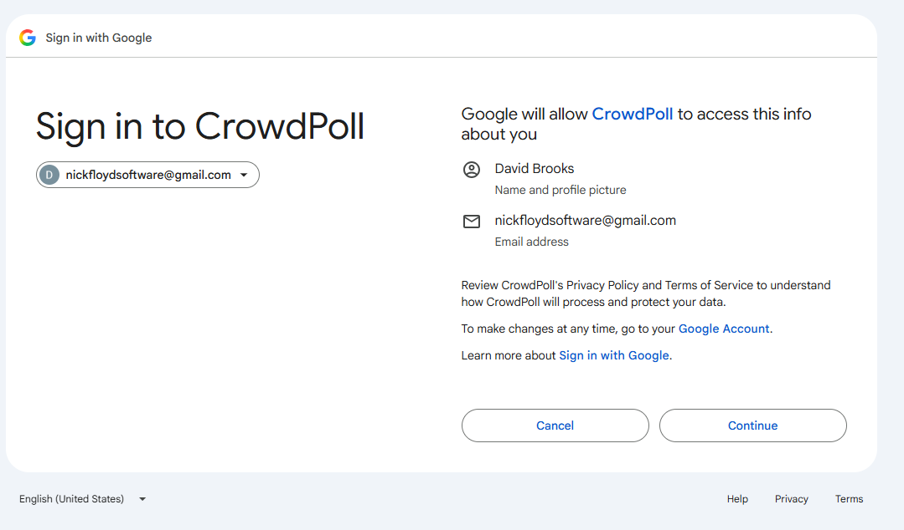
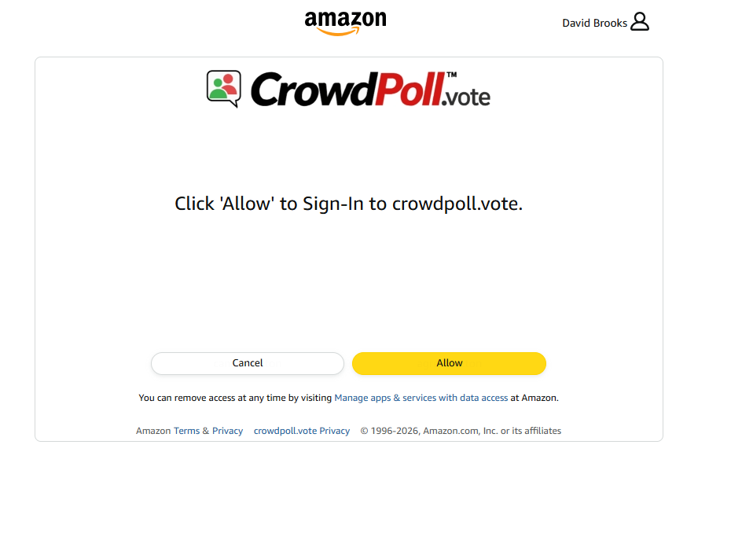
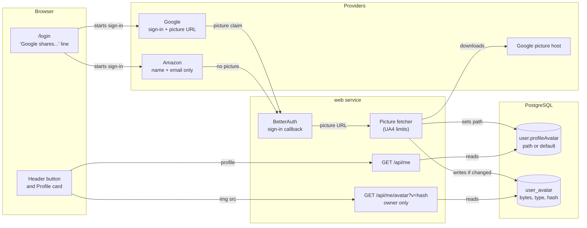
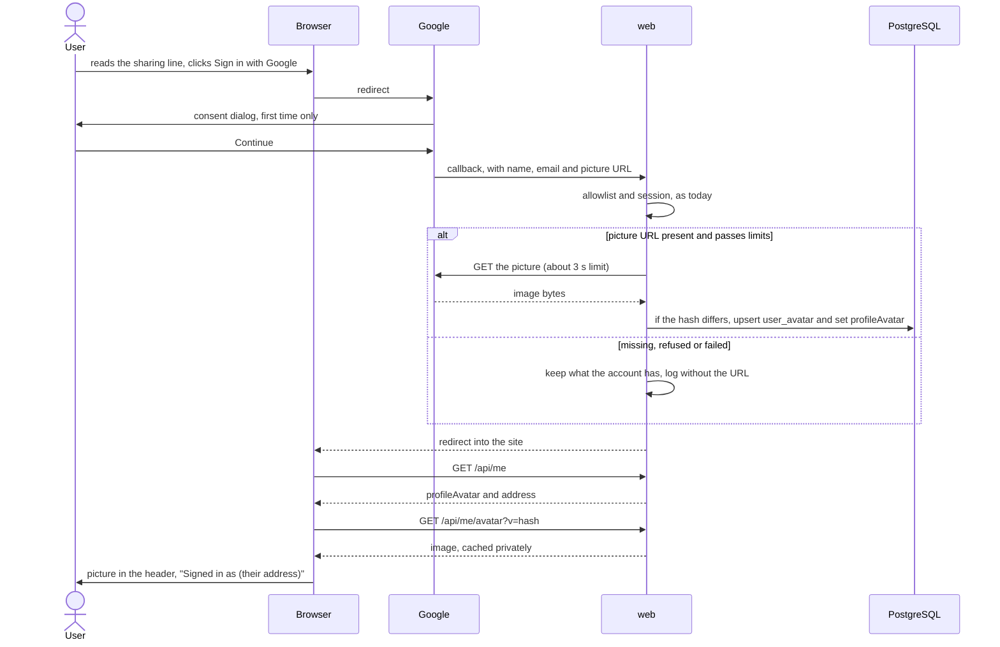
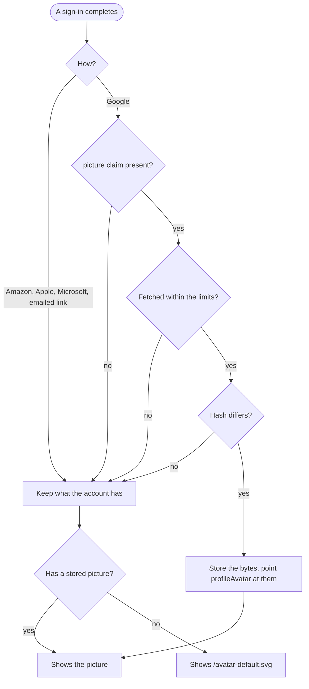

# High Level Requirements

Requirements: `requirements/20261105-161242-social-login-avatar/requirements.md`
External Files: `requirements/20261105-161242-social-login-avatar/image-2.png`, `requirements/20261105-161242-social-login-avatar/image-1.png`
Generated: 2026-11-05 4:12 PM

Now that we have two Social Login providers: Google and Amazon,  
we want to be able to get the users Profile icon (they call it profile picture) for use where the default Avatar is now displayed.  
We will store the Profile Icon in the database in a table and column where you think it is best.
When we first login using Google for a user that has not previously logged in, a dialog from Google explaining what information is being requested will be displayed.  
See the screenshot below:  

The dialog shown for Amazon is shown below.  
 

We didn't get any description of what was being shared.  
Note: we think it was the first time logging in with Amazon for this user. If it wasn't then perhaps that is the reason a description of what information is being shared was not displayed.  
We don't know how to return to the new state. If it wasn't the first time then Amazon must be keeping track of which users have previously logged in and only shows the dialog the first time.  

Another not about the Amazon login shown in the image above: we definitely would like to make it more explicit which account is being used to log in. The Avatar in the top right when clicked shown the account email address, but it would be better if was displaed on the dialog.

We need to determine how to handle the Profile Icon for both Google and Amazon logins, ensuring that it is correctly retrieved and stored in our database.  

And we want to ensure that the user is informed about what information is being shared when they log in using either Google or Amazon for the first time.

## Additional Requirements and Research Requests

**Instructions To The Developer**
Enter any additional requirements or research requests under the ## Additional Requirements and Research Requests heading above.
When you Type or Say: "Next" in the CC CLI terminal, the additional requirements and research requests will be applied to the report.

You may leave these instructions here. They will be ignored when "Next" is executed.

## 1. Overview and Scope

Replace the default avatar with the user's own profile picture when a social provider can supply one, and tell the user what is shared and which account is in use.

**The main result of the research:** Google can supply the picture; Amazon's sign-in cannot (RS1).
Amazon's dialog cannot be changed by CrowdPoll either, so anything added there has to appear on CrowdPoll's own pages (RS2, NC2).

**In scope:**

- retrieving the Google picture on the server, and storing it in the database;
- showing it where the default avatar is shown now: the header button and the Profile card;
- a line saying what each provider shares, and showing the address used after signing in;
- the Privacy Policy, which today promises that no picture is kept.

**Out of scope:**

- uploading a picture of one's own;
- pictures on polls and votes, seen by other users (AM1);
- changing the permissions requested from Google or Amazon.

### Assumptions

- "Profile Icon", "profile picture" and "avatar" mean one thing: the UI and the policy say **profile picture**, as Google does, and the identifiers keep `profileAvatar`.
- The default avatar stays for everyone with no picture: emailed-link accounts, Amazon, Apple and Microsoft.
- Deleting a CrowdPoll account does not revoke its permission at the provider, as today.
- How BetterAuth exposes the picture on a sign-in of an existing account is decided at plan time (TD2).

## 2. Component Diagram: Where the Picture Travels

The browser never contacts Google for the image; only the `web` service does, once per sign-in.

## 3. Sequence: A Google Sign-In

The picture step can fail without affecting the sign-in, and it is skipped altogether for Amazon.

## 4. Which Picture an Account Ends Up With

Only one path changes the stored picture (UA2).

## 5. Research Results

### 5.1 The picture from each provider

**RS1. Can Google and Amazon each supply the user's profile picture?**  
<b>
✅ Resolved</b>  
✅ Requirements File Updated: 2026-11-05 6:51 PM  
**Notes**: Recommendation accepted in file 2026-11-05, then changed by the developer the same day: Recommendation B, as the developer reworded it, apply to Amazon's Data Portability programme for the photo, and Google users get their picture;  
it replaces Developer Resolution C, "Recommendation A and B";  
the requirements now also say that the application runs separately, no Amazon photo code is built in this feature, and Amazon users keep the default avatar until access is granted.  

> The requirements ask how to handle the picture for both providers.  
> Sources: [Google — OpenID Connect reference](https://developers.google.com/identity/openid-connect/reference), [Amazon — Customer Profile](https://developer.amazon.com/docs/login-with-amazon/customer-profile.html), [Amazon — Authorization Code Grant](https://developer.amazon.com/docs/login-with-amazon/authorization-code-grant.html), [Amazon — Data Portability scopes](https://developer.amazon.com/docs/amazon-data-portability/available-scopes.html).  
> **Google: yes.** The `picture` claim is a URL that "might be provided" with the `profile` scope, so it can be missing;  
> the dialog in `image-2.png` already says "Name and profile picture", so no new permission is asked for.  
> **Amazon: no, not through sign-in.** The `profile` scope "consists of three parts: the `user_id`, the `email`, and the `name`";  
> the sign-in scopes are only `profile`, `profile:user_id` and `postal_code`.  
> A photo exists only under `portability::customer_profile`, a Data Portability programme scope that requires business identity verification.  
> Which customers and regions that programme covers could not be confirmed from the pages read.  

  - **Recommendation A** _(recommended)_: **Google users get their picture; Amazon users keep the default avatar.**  

    [ ] ➡️ **Not Accepted**

    - <u>Pros</u>: it works with today's permissions and needs no Amazon approval, and the requirement is met as far as Amazon allows.  
    - <u>Cons</u>: an Amazon user sees no picture, so the two sign-ins look different.  

  - **Recommendation B**: **Apply to Amazon's Data Portability programme for the photo. Google users get their picture.**  

    [X] ➡️ **Accepted**

    - <u>Pros</u>: Amazon users could get their picture too, if their region and account qualify.  
    - <u>Cons</u>: it means business verification, a security assessment and a far broader data request than signing in needs, for one small image; the outcome and coverage are unconfirmed.  

  - **Developer Resolution C**:  

    [ ] ➡️ **Not Accepted**

### 5.2 Amazon's dialog and returning to the first-time state

**RS2. Why did Amazon's dialog list nothing, and how do we get back to the first-time state?**  
<b>
✅ Resolved</b>  
✅ Requirements File Updated: 2026-11-05 4:46 PM  
**Notes**: Recommendation accepted in file 2026-11-05: Recommendation, treat the provider screens as outside our control, and add a manual check to the feature's quickstart;  
the requirements now say so under Decisions From the Requirements Report.  

> The requirements note that Amazon's dialog described nothing being shared, and do not know how to reset it.  
> Sources: [Amazon — Customer Profile](https://developer.amazon.com/docs/login-with-amazon/customer-profile.html), [Amazon — FAQ](https://developer.amazon.com/docs/login-with-amazon/faq.html), [Amazon — Authorization Code Grant](https://developer.amazon.com/docs/login-with-amazon/authorization-code-grant.html).  
> Amazon's page says the first login presents a consent screen that "shows the information requested and their current values", and that once consent is recorded, later logins "will not present a consent screen".  
> So a repeat login should show no screen at all, and the Allow and Cancel buttons in `image-1.png` suggest this was the first-time screen.  
> That is an inference: the screenshot does not match the documentation, which was last updated in 2020.  
> **Resetting:** access is removed under Manage apps & services with data access at Amazon, the link on that dialog, and under the Google Account link on Google's.  
> Neither provider's pages read here state that consent is asked again after removal, though it follows from consent being recorded.  
> Amazon's authorization request has no `prompt` or account-selection parameter, so CrowdPoll cannot ask for the screen or for another account.  

  - **Recommendation**: **Treat the provider screens as outside our control, and add a manual check to the feature's quickstart.**  

    [X] ➡️ **Accepted**

    - The check: remove CrowdPoll's access at Amazon and at Google, delete the test account on CrowdPoll, sign in again, and record what each screen shows.  
    - CrowdPoll's own informing does not depend on the result (NC3).  

  - **Developer Resolution B**:  

    [ ] ➡️ **Not Accepted**

## 6. Breaking Changes

- **BC1. A test pins the opposite behaviour.**
  `tests/oauth-providers.test.ts` signs in with Google and expects `profileAvatar` to stay `/avatar-default.svg`.
  A test fetching the picture also needs the outgoing request stubbed.
- **BC2. A promise in the Privacy Policy is reversed.**
  "We keep no picture" goes, and every account may have to accept again (NC4).
  The comment in `src/auth/auth.ts` ("A provider's picture is not kept") and the notes in `CLAUDE_COMPLETE.md` go with it.
- **BC3. `profileAvatar` is no longer always the default path.**
  It stays a same-origin path that an `` can load, so the API's shape does not change;
  `postman/openapi.json` adds the new route.

- **BC4. `profileAvatar` can be an absolute URL on the CDN**, once Spaces is used (NC1, IN1).  
  A reader that treats it as a same-origin path no longer works; `app.js` and `profileCard.js` only set it as an image source, so they are unaffected.  
  `postman/openapi.json` describes it.  

## 7. Technical Debt

- **TD1. `user.image` is an unused column**, forced to `null` at creation, beside `user.profileAvatar`.
  This feature leaves it alone, since BetterAuth owns it.
- **TD2. BetterAuth's handling of an existing account's picture is unconfirmed.**
  Its pages read here say a sign-in does not write the profile: `validateUserInfo` only gates it, and `updateUserInfoOnLink` applies to linking.
  This worktree has no `node_modules` to check against, so the plan must confirm where the picture can be read during a sign-in.
- **TD3. Images are read from PostgreSQL**, on a site built for large audiences.
  The private, long-lived browser cache and the owner-only route keep it to about one read per browser per picture; moving to Spaces later would change only the store and the path.
- **TD4. The Privacy Policy's avatar sentence is wrong today** (AM1), whichever way this feature goes.

## 8. Findings

### 8.1 Inconsistencies

**IN1. The decision to use Spaces contradicts the owner-only route and the sentence about the database.**  
<b>
✅ Resolved</b>  
✅ Requirements File Updated: 2026-11-05 7:51 PM  
**Notes**: Recommendation accepted in file 2026-11-05: Recommendation A, keep Spaces, and replace the route with an unguessable, public-read object, whose URL `GET /api/me` returns;  
the requirements now say so, UA5's route and UA4's `nosniff` are gone, and the database sentence is marked as replaced.  

> NC1 stores the bytes in Spaces and serves them through the CDN.  
> UA5 still requires `GET /api/me/avatar`, for the signed-in owner only, with `Cache-Control: private`;  
> UA4 still requires `X-Content-Type-Options: nosniff`, which that route was to send;  
> the requirements still open with "We will store the Profile Icon in the database".  
> A CDN object is loaded by anyone who has its URL, so it cannot be owner-only, and whether Spaces can send that header was not confirmed.  
> The CDN itself is not a new problem: the pages already load assets from it, and it is CrowdPoll's own (`infra/spaces.tf`).  
> The bucket is private, so it cannot be listed, and `src/trending/publish.ts` uploads each object `public-read`.  

  - **Recommendation A** _(recommended)_: **Keep Spaces, and replace the route: an unguessable, public-read object, whose URL `GET /api/me` returns.**  

    [X] ➡️ **Accepted**

    - <u>Details</u>: the key is `avatars/` and a random 128-bit value, new for each image, with the content type and a long, immutable `Cache-Control` set at upload.  
    - `user.profileAvatar` holds the key or the default path, and `GET /api/me` and `PATCH /api/me` return the full URL; `app.js` and `profileCard.js` do not change.  
    - UA5's route and its Terms gate entry are dropped, and so is UA4's `nosniff`: the object is on another host, typed at upload and never SVG.  
    - The database sentence is marked as replaced by NC1.  
    - <u>Pros</u>: it follows your NC1 decision and the way TRENDING objects are already published, and suits avatars being shown to others later (AM1).  
    - <u>Cons</u>: a photograph is reachable by anyone who obtains the URL, without signing in, for as long as the object exists.  

  - **Recommendation B**: **Go back to the database: NC1's Recommendation A, a `user_avatar` table and the owner-only route.**  

    [ ] ➡️ **Not Accepted**

    - <u>Pros</u>: the original sentence, UA4, UA5 and the diagrams all hold again, the photograph stays behind sign-in, and IN1, UA8, UA9 and UA10 fall away.  
    - <u>Cons</u>: it reverses your NC1 decision, every image request reaches the app and the database, and the route has to be widened once others see avatars.  

  - **Developer Resolution C**:  

    [ ] ➡️ **Not Accepted**

**IN2. "Keep the Privacy Policy the way it is" contradicts the new policy version.**  
<b>
✅ Resolved</b>  
✅ Requirements File Updated: 2026-11-05 7:51 PM  
**Notes**: Recommendation accepted in file 2026-11-05: Recommendation A, AM1 covers only the avatar sentence, and the other policy wording changes;  
the requirements now say so.  

> AM1 keeps the Privacy Policy as it is, while NC4 takes a new `TERMS_VERSION` because "We keep no picture" is reversed.  
> AM1 was asked about one sentence, the one saying the avatar is shown with polls and votes, and that is how it was carried into the requirements.  
> The policy cannot stay wholly unchanged: it would promise no picture is kept while CrowdPoll keeps one.  

  - **Recommendation A** _(recommended)_: **AM1 covers only the avatar sentence; the other policy wording changes.**  

    [X] ➡️ **Accepted**

    - <u>Details</u>: "We keep no picture" becomes a statement that CrowdPoll keeps the profile picture Google shares.  
    - The Google row of the table says name, email address and profile picture.  
    - The picture is covered by DigitalOcean's row, "everything CrowdPoll stores", so no row is added.  
    - <u>Pros</u>: the policy tells the truth about what is kept, and NC4 stands.  
    - <u>Cons</u>: the avatar sentence still overstates who sees the picture until the future requirement ships.  

  - **Recommendation B**: **No policy change at all, and no new version: NC4 is reversed.**  

    [ ] ➡️ **Not Accepted**

    - <u>Pros</u>: no interruption, and no change to the legal pages.  
    - <u>Cons</u>: the policy says "We keep no picture" while CrowdPoll keeps one, which is an untrue statement to users.  

  - **Developer Resolution C**:  

    [ ] ➡️ **Not Accepted**

### 8.2 Ambiguities

**AM1. Who sees the picture?**  
<b>
✅ Resolved</b>  
✅ Requirements File Updated: 2026-11-05 7:09 PM  
**Notes**: Recommendation accepted in file 2026-11-05: Developer Resolution C, keep the Privacy Policy the way it is, and showing avatars to other users will be included in a future requirement;  
the requirements now say so: the picture is shown to its owner only in this feature, and the policy's avatar sentence stays as written.  

> The requirements say it goes "where the default Avatar is now displayed".  
> Today that is only the owner's own header button and Profile card (`app.js`, `profileCard.js`, from `GET /api/me`).  
> But `privacy.html` says the avatar is "shown with your polls and, on polls that do not hide voters, with your votes", which the code does not do.  
> A real photograph makes the difference matter.  

  - **Recommendation A** _(recommended)_: **Only the owner sees it; correct the sentence in the Privacy Policy.**  

    [ ] ➡️ **Not Accepted**

    - <u>Pros</u>: it matches the requirement's wording and today's code, keeps a photograph private, and allows an owner-only route (UA5).  
    - <u>Cons</u>: pictures add nothing for other users.  

  - **Recommendation B**: **Also show it to other users, on polls and votes.**  

    [ ] ➡️ **Not Accepted**

    - <u>Pros</u>: the Privacy Policy's sentence becomes true.  
    - <u>Cons</u>: it publishes faces next to votes, which is a new feature with new cards, projections and privacy questions the requirements do not ask for.  

  - **Developer Resolution C**:  

    [X] ➡️ **Accepted**

    - keep the Privacy Policy the way it is. The feature of showing avatars will be included in a future requirement.

**AM2. When is the picture retrieved: only at the first sign-in, or at every one?**  
<b>
✅ Resolved</b>  
✅ Requirements File Updated: 2026-11-05 7:09 PM  
**Notes**: Recommendation accepted in file 2026-11-05: Recommendation A, at every Google sign-in, the stored copy replaced only when the bytes differ;  
the requirements now say so.  

> The requirements describe the first login, and want the picture "correctly retrieved and stored".  
> A user may change the picture at Google later, and accounts that exist today have already had their first sign-in.  

  - **Recommendation A** _(recommended)_: **At every Google sign-in; the stored copy is replaced only when the bytes differ.**  

    [X] ➡️ **Accepted**

    - <u>Pros</u>: existing accounts get a picture at their next sign-in, and a changed picture follows.  
    - <u>Cons</u>: one more outgoing request per Google sign-in, and with sessions of up to 30 days a change can take a while to appear.  

  - **Recommendation B**: **Only when the account has no stored picture yet.**  

    [ ] ➡️ **Not Accepted**

    - <u>Pros</u>: fewer requests, and the picture never changes unexpectedly.  
    - <u>Cons</u>: a picture changed at Google is never picked up unless the account is deleted and created again.  

  - **Developer Resolution C**:  

    [ ] ➡️ **Not Accepted**

### 8.3 Unspecified Aspects

**UA1. What about Apple and Microsoft?**  
<b>
✅ Resolved</b>  
✅ Requirements File Updated: 2026-11-05 7:09 PM  
**Notes**: Recommendation accepted in file 2026-11-05: Recommendation, out of scope, Apple and Microsoft accounts keep the default avatar;  
the requirements now say so.  

> The requirements speak of two providers, Google and Amazon, but the code also has Apple and Microsoft sign-in (`src/auth/auth.ts`).  
> Microsoft is set to `disableProfilePhoto: true`;  
> Apple was not checked, since the requirements do not ask for it.  

  - **Recommendation**: **Out of scope: Apple and Microsoft accounts keep the default avatar, and the code path does not preclude adding them later.**  

    [X] ➡️ **Accepted**

    - The Privacy Policy's wording names Google alone as the source of a picture.  

  - **Developer Resolution B**:  

    [ ] ➡️ **Not Accepted**

**UA2. Which picture wins when an account signs in several ways?**  
<b>
✅ Resolved</b>  
✅ Requirements File Updated: 2026-11-05 7:09 PM  
**Notes**: Recommendation accepted in file 2026-11-05: Recommendation, only a Google sign-in that returns a picture changes it;  
the requirements now say so.  

> Accounts are linked by email key across providers and the emailed link, so one account can use Google one day and Amazon the next.  

  - **Recommendation**: **Only a Google sign-in that returns a picture changes it; any other sign-in leaves it as it is.**  

    [X] ➡️ **Accepted**

    - Signing in with Amazon or the emailed link never clears a stored picture;  
    - a Google sign-in with no `picture` claim keeps the stored one too.  
    - Section 4 draws this.  

  - **Developer Resolution B**:  

    [ ] ➡️ **Not Accepted**

**UA3. What about a Google account with no photo of its own?**  
<b>
✅ Resolved</b>  
✅ Requirements File Updated: 2026-11-05 7:09 PM  
**Notes**: Recommendation accepted in file 2026-11-05: Recommendation A, store and show whatever Google returns, letter included;  
the requirements now say so.  

> `image.png` shows that Google draws a coloured letter for accounts with no photo (three of the four listed).  
> Whether the `picture` claim returns that letter image could not be confirmed from Google's documentation;  
> the developer's own test accounts can settle it.  

  - **Recommendation A** _(recommended)_: **Store and show whatever Google returns, letter included.**  

    [X] ➡️ **Accepted**

    - <u>Pros</u>: no extra permission or API; the letter is still recognisably the user's.  
    - <u>Cons</u>: some users see Google's letter rather than the CrowdPoll default.  

  - **Recommendation B**: **Detect a letter image and keep the default avatar.**  

    [ ] ➡️ **Not Accepted**

    - <u>Pros</u>: only real photographs replace the default.  
    - <u>Cons</u>: the sign-in claims do not say which it is, as far as could be confirmed, so it needs another Google API call or guessing from the URL or the image.  

  - **Developer Resolution C**:  

    [ ] ➡️ **Not Accepted**

**UA4. What are the limits on fetching and storing an image, and what happens when it fails?**  
<b>
✅ Resolved</b>  
✅ Requirements File Updated: 2026-11-05 7:09 PM  
**Notes**: Recommendation accepted in file 2026-11-05: Recommendation, strict limits, and a failure never stops a sign-in;  
the requirements now list the limits.  

> The server would fetch a URL it was given from outside and later serve those bytes from the site's own origin, so the URL and the bytes both need rules.  
> No image library is in the dependencies.  

  - **Recommendation**: **Strict limits, and a failure never stops a sign-in.**  

    [X] ➡️ **Accepted**

    - The URL: `https` on Google's picture host only, checked at plan time against the real value, with redirects not followed outside it;  
    - a timeout of about 3 seconds.  
    - The bytes: at most about 256 KB, PNG, JPEG or WebP by their leading bytes, never SVG, stored as sent with no new dependency.  
    - Any failure keeps what the account has now and is logged without the URL;  
    - served with `X-Content-Type-Options: nosniff`.  

  - **Developer Resolution B**:  

    [ ] ➡️ **Not Accepted**

**UA5. How does the browser get the stored image?**  
<b>
✅ Resolved</b>  
✅ Requirements File Updated: 2026-11-05 7:09 PM  
**Notes**: Recommendation accepted in file 2026-11-05: Recommendation, `GET /api/me/avatar?v=<hash>`, for the signed-in owner only;  
the requirements now say so.  

> The invariant "no third-party request from a page" means the browser must load it from CrowdPoll.  
> A new `/api/*` route is refused before Terms acceptance unless listed in `src/legal/termsGate.ts`, and the header is drawn on the Accept Terms page as well.  

  - **Recommendation**: **`GET /api/me/avatar?v=<hash>`, for the signed-in owner only.**  

    [X] ➡️ **Accepted**

    - `user.profileAvatar` holds that path, so `app.js`, `profileCard.js` and `GET /api/me` do not change;  
    - it answers `Cache-Control: private` with a long lifetime, because the hash changes with the image.  
    - It joins the Terms gate's list and `postman/openapi.json`;  
    - `profileAvatar` changing calls `forgetUserSessions`, as a profile change does today.  

  - **Developer Resolution B**:  

    [ ] ➡️ **Not Accepted**

**UA6. May a user remove the picture?**  
<b>
✅ Resolved</b>  
✅ Requirements File Updated: 2026-11-05 7:09 PM  
**Notes**: Recommendation accepted in file 2026-11-05: Recommendation A, no new control, deleting the account removes it, and it changes when changed at Google;  
the requirements now say so.  

> The requirements say nothing about it.  
> The Profile card's image says "not editable", and a user who deletes the account should lose the picture.  

  - **Recommendation A** _(recommended)_: **No new control: deleting the account removes it, and it changes when changed at Google.**  

    [X] ➡️ **Accepted**

    - <u>Pros</u>: no new setting or screen; with AM1 only the owner ever sees it, so there is little to protect against.  
    - <u>Cons</u>: a user who dislikes seeing it can only change it at Google.  

  - **Recommendation B**: **A Remove button on the Profile page, remembered so sign-in does not bring it back.**  

    [ ] ➡️ **Not Accepted**

    - <u>Pros</u>: the user has direct control.  
    - <u>Cons</u>: one more column, control and set of tests for a picture that only they see.  

  - **Developer Resolution C**:  

    [ ] ➡️ **Not Accepted**

**UA7. `image.png` is in the folder, but the requirements do not link it.**  
<b>
✅ Resolved</b>  
✅ Requirements File Updated: 2026-11-05 7:09 PM  
**Notes**: Recommendation accepted in file 2026-11-05: Recommendation, link `image.png` in the requirements document, under the Google dialog, as supporting evidence;  
the requirements now link it there, and no requirement changed.  

> It is Google's Choose an account screen.  
> It is the only evidence for UA3, and it shows that Google already names the account being used.  

  - **Recommendation**: **Link it in the requirements document, under the Google dialog, as supporting evidence.**  

    [X] ➡️ **Accepted**

    - No requirement changes.  

  - **Developer Resolution B**:  

    [ ] ➡️ **Not Accepted**

**UA8. What happens to the picture without Spaces?**  
<b>
✅ Resolved</b>  
✅ Requirements File Updated: 2026-11-05 7:51 PM  
**Notes**: Recommendation accepted in file 2026-11-05: Recommendation B, without Spaces, the account keeps the default avatar;  
the requirements now say so.  

> Spaces is optional: with `ENV_SPACES_*` unset, TRENDING objects and assets are served from the instance (`src/config.ts`), and development needs PostgreSQL only.  
> NC1 says nothing about where a picture goes in that case.  

  - **Recommendation A** _(recommended)_: **Mirror TRENDING: without Spaces, keep the image in the instance's memory and serve it from a route.**  

    [ ] ➡️ **Not Accepted**

    - <u>Pros</u>: the feature can be seen working in development with PostgreSQL only, in the same way as TRENDING.  
    - <u>Cons</u>: one development-only store and route; the image is lost at restart and comes back at the next Google sign-in.  

  - **Recommendation B**: **Without Spaces, the account keeps the default avatar.**  

    [X] ➡️ **Accepted**

    - <u>Pros</u>: nothing extra to build, and tests can stub the upload.  
    - <u>Cons</u>: the picture can never be seen in development without configuring Spaces.  

  - **Developer Resolution C**:  

    [ ] ➡️ **Not Accepted**

**UA9. How is the object removed when an account is deleted or the picture changes?**  
<b>
✅ Resolved</b>  
✅ Requirements File Updated: 2026-11-05 7:51 PM  
**Notes**: Recommendation accepted in file 2026-11-05: Recommendation A, durable removal, with the key recorded in a small table and a sweep that deletes the object and retries;  
the requirements now say so.  

> UA6 says deleting the account removes the picture, and the database's cascade no longer does this once the bytes are in Spaces.  
> `src/legal/deleteAccount.ts` deletes the account in a transaction, and a call to Spaces can fail after it commits;  
> `src/trending/publish.ts` has only a `put`, with no delete.  
> A cached CDN copy also outlives the object until its lifetime ends: the Terraform sets no lifetime, and DigitalOcean's default was not confirmed.  

  - **Recommendation A** _(recommended)_: **Durable removal: the transaction records the key in a small table, and a sweep deletes the object and retries.**  

    [X] ➡️ **Accepted**

    - <u>Pros</u>: a failure at Spaces cannot leave a photograph behind after the account is gone, which is what the Privacy Policy promises; a replaced picture uses the same path.  
    - <u>Cons</u>: a table, a sweep and an advisory lock number, for a rare event; the CDN copy still lasts until it expires.  

  - **Recommendation B**: **Best effort: delete the object right after the commit, and log a failure.**  

    [ ] ➡️ **Not Accepted**

    - <u>Pros</u>: no table or sweep.  
    - <u>Cons</u>: a failed call leaves a public photograph with no record of it, found only by reading the logs.  

  - **Developer Resolution C**:  

    [ ] ➡️ **Not Accepted**

**UA10. Sections 2, 3 and 7 no longer fit the Spaces decision.**  
<b>
✅ Resolved</b>  
✅ Requirements File Updated: 2026-11-05 7:51 PM  
**Notes**: Recommendation accepted in file 2026-11-05: Recommendation, record that the Decisions override the diagrams, and have the plan redraw them;  
the requirements now say so, and name the report's sections 1, 2 and 3 and TD3.  

> The component diagram and the sequence still show `user_avatar` and `GET /api/me/avatar`, and TD3 describes reading images from PostgreSQL.  
> BC3 says `profileAvatar` stays a same-origin path, and BC4 now corrects it.  
> The report's existing sections are not rewritten.  

  - **Recommendation**: **Record in the requirements that their Decisions section overrides those diagrams, and have the plan redraw them.**  

    [X] ➡️ **Accepted**

    - Section 4, which picture an account ends up with, still holds.  

  - **Developer Resolution B**:  

    [ ] ➡️ **Not Accepted**

### 8.4 Needs Clarifications

**NC1. Where is the picture stored?**  
<b>
✅ Resolved</b>  
✅ Requirements File Updated: 2026-11-05 7:34 PM  
**Notes**: Recommendation accepted in file 2026-11-05: Recommendation C, bytes in Spaces, served through the CDN, with a key on `user`;  
the requirements now say so, and that this replaces the database as the place for the image itself.  

> The requirements leave the table and column to this report.  
> The session read returns the whole `user` row and caches it, so image bytes on that row would travel with every session look-up.  
> `user.image` exists but is always `null`, and storing only a URL there would make each page load the image from Google, which the invariant forbids.  

  - **Recommendation A** _(recommended)_: **A new table, `user_avatar`: `userId` (key, cascades on delete), `bytes`, `contentType`, `hash`, `updatedAt`.**  

    [ ] ➡️ **Not Accepted**

    - <u>Pros</u>: it is in the database as asked, development still needs PostgreSQL only, session reads stay small, and deleting an account deletes the picture.  
    - <u>Cons</u>: one migration (017), and images add to the database and its backups.  

  - **Recommendation B**: **A `user.image` URL, loaded by the browser from Google.**  

    [ ] ➡️ **Not Accepted**

    - <u>Pros</u>: no bytes, table or route at all.  
    - <u>Cons</u>: it breaks "no third-party request from a page", tells Google each visit, and the URL can stop working.  

  - **Recommendation C**: **Bytes in Spaces, served through the CDN; a key on `user`.**  

    [X] ➡️ **Accepted**

    - <u>Pros</u>: image traffic never reaches the app or the database.  
    - <u>Cons</u>: it is not the database as asked, it needs Spaces in development, and a CDN URL is not owner-only.  

  - **Developer Resolution D**:  

    [ ] ➡️ **Not Accepted**

**NC2. How do we make the account used with Amazon explicit?**  
<b>
✅ Resolved</b>  
✅ Requirements File Updated: 2026-11-05 7:09 PM  
**Notes**: Recommendation accepted in file 2026-11-05: Recommendation A, after a provider sign-in, show "Signed in as (their address)", on the Accept Terms page and as a brief message on the first page otherwise;  
the requirements now say so, and that Amazon's own dialog cannot be changed.  

> The requirements want the email address shown "on the dialog", but that dialog is Amazon's page: CrowdPoll supplies the logo and the links, not the text.  
> It shows the Amazon name ("David Brooks") at the top, and Amazon has no parameter to choose an account or show the address (RS2).  
> So the address can only be shown on CrowdPoll's own pages, once Amazon has answered.  
> Today the header shows the user name, and the address appears only in the avatar menu or on the Profile page.  
> Google's dialog already shows the address (`image-2.png`).  

  - **Recommendation A** _(recommended)_: **After a provider sign-in, show "Signed in as (their address)": on the Accept Terms page and as a brief message on the first page otherwise.**  

    [X] ➡️ **Accepted**

    - <u>Pros</u>: the user sees the address at every sign-in, right after the moment that matters, and it helps every provider.  
    - <u>Cons</u>: it comes after consent, not on the dialog, and needs a small new message on the page.  

  - **Recommendation B**: **Show the address on the Accept Terms page only.**  

    [ ] ➡️ **Not Accepted**

    - <u>Pros</u>: the smallest change, and it covers the first sign-in, when consent is given.  
    - <u>Cons</u>: a returning user who signed in with the wrong Amazon account still gets no signal.  

  - **Recommendation C**: **Make no change, and record that the dialog cannot be altered.**  

    [ ] ➡️ **Not Accepted**

    - <u>Pros</u>: nothing to build.  
    - <u>Cons</u>: the need stated in the requirements stays unmet.  

  - **Developer Resolution D**:  

    [ ] ➡️ **Not Accepted**

**NC3. How, and when, do we tell the user what is being shared?**  
<b>
✅ Resolved</b>  
✅ Requirements File Updated: 2026-11-05 7:09 PM  
**Notes**: Recommendation accepted in file 2026-11-05: Recommendation A, one short line beside the provider buttons, always shown, naming only the configured providers;  
the requirements now say so.  

> The requirements want the user informed "for the first time" with either provider.  
> Before the redirect CrowdPoll cannot know whether this is someone's first time, and Amazon's screen did not say (RS2), so it has to be said on CrowdPoll's side.  

  - **Recommendation A** _(recommended)_: **One short line beside the provider buttons, always shown, naming only the configured providers.**  

    [X] ➡️ **Accepted**

    - <u>Pros</u>: it is read before anything is shared, and needs no first-time logic; for example "Google shares your name, email address and profile picture. Amazon shares your name and email address." with a link to `/privacy`.  
    - <u>Cons</u>: returning users see it each time, and the login card gets one more line.  

  - **Recommendation B**: **A line on the Accept Terms page, which a new account always sees.**  

    [ ] ➡️ **Not Accepted**

    - <u>Pros</u>: shown only around the first sign-in, and the login card stays as it is.  
    - <u>Cons</u>: it arrives after the data has already been shared, so it reports rather than informs.  

  - **Developer Resolution C**:  

    [ ] ➡️ **Not Accepted**

**NC4. Does this change need a new `TERMS_VERSION`?**  
<b>
✅ Resolved</b>  
✅ Requirements File Updated: 2026-11-05 7:09 PM  
**Notes**: Recommendation accepted in file 2026-11-05: Recommendation A, a new version, the release date, with every account accepting once and no 30-day email;  
the requirements now say so.  

> `privacy.html` says today "We keep no picture, contacts or anything else from your account there", which this feature reverses.  
> It also lists what Google shares (the sub-processors table) and needs the AM1 correction.  
> A new version sends every account to `/accept-terms` once.  

  - **Recommendation A** _(recommended)_: **A new version (the release date); every account accepts once, with no 30-day email, as in the last legal change.**  

    [X] ➡️ **Accepted**

    - <u>Pros</u>: the promise being reversed is an explicit one, and each user's agreement then covers it.  
    - <u>Cons</u>: each account is interrupted once more, soon after the previous version.  

  - **Recommendation B**: **Update the wording under the same version.**  

    [ ] ➡️ **Not Accepted**

    - <u>Pros</u>: no interruption.  
    - <u>Cons</u>: accounts stay recorded as having accepted a policy that said no picture is kept.  

  - **Developer Resolution C**:  

    [ ] ➡️ **Not Accepted**

## 9. Requirements Report Complete Report

- **Requirements Report Document:** requirements/20261105-161242-social-login-avatar/requirements-report.md
- **Requirements Document:** requirements/20261105-161242-social-login-avatar/requirements.md
- **Software Architecture Diagrams:** 3
- **Inconsistencies:** 2
- **Ambiguities:** 2
- **Unspecified Aspects:** 10
- **Needs Clarifications:** 4
- **Research Results:** 2
- **Breaking Changes:** 4
- **Technical Debt items:** 4

The requirements are ready for /speckit-specify.
To generate specs from the requirements document, use the `/speckit-specify` skill followed by the path (relative to the project root) to the requirements file.
At the prompt, Type:
🟩 👉 /speckit-specify requirements/20261105-161242-social-login-avatar/requirements.md
