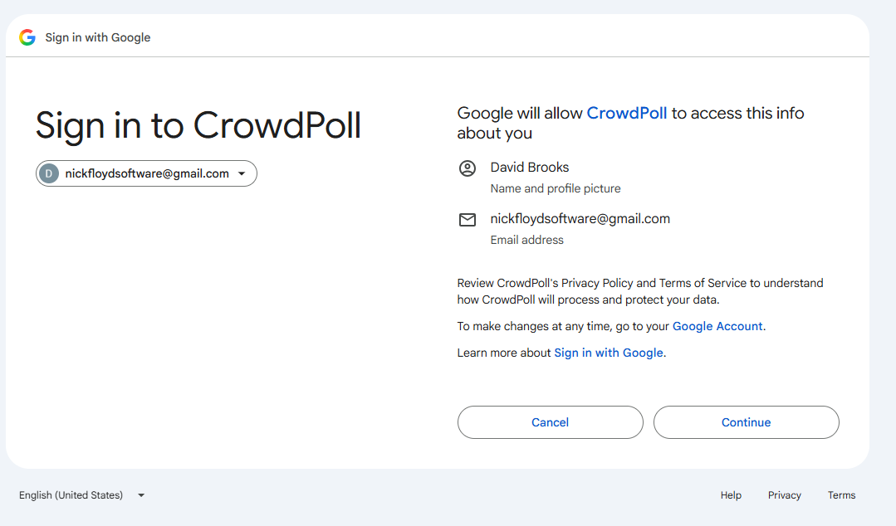
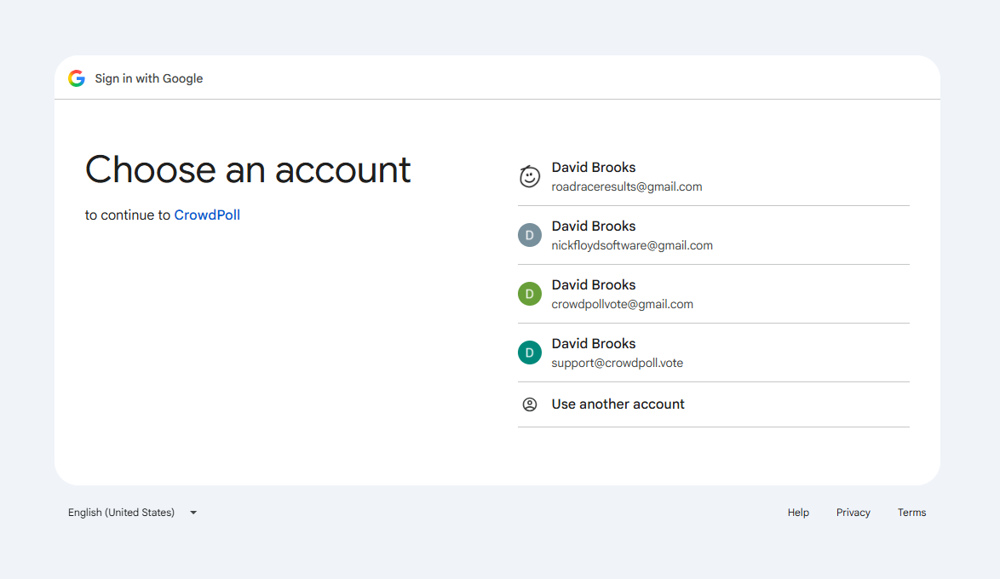
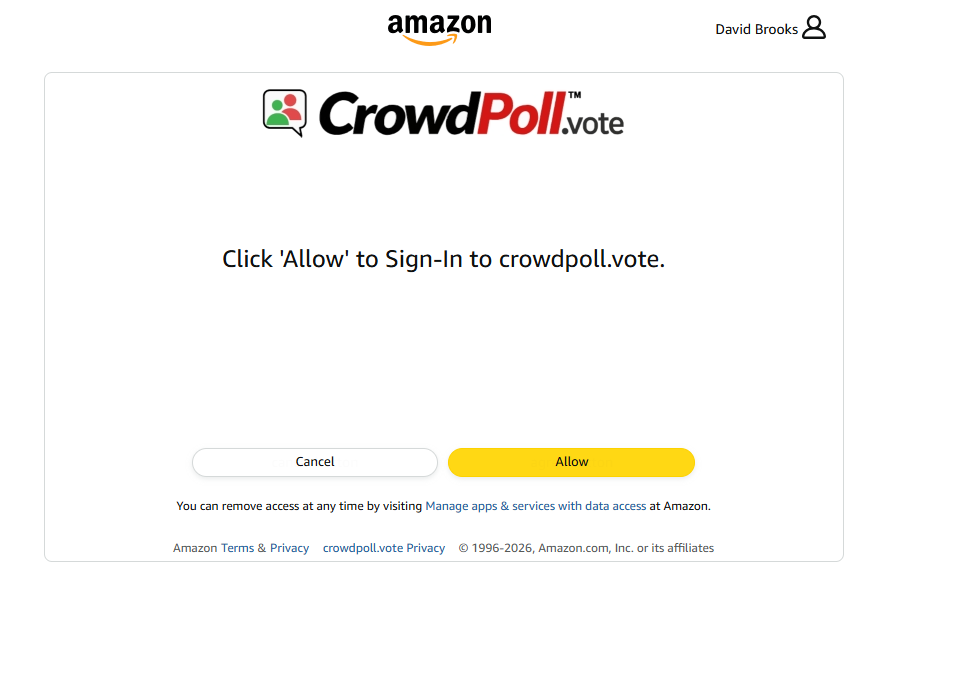

Start a new spec for these requirements called `20261105-161242-SOCIAL-LOGIN-AVATAR`  
!! THIS FILE IS GENERATED USING THE SKILL `/speckit-requirements`. DO NOT EDIT OR DELETE THIS FILE !!  

# Initial High-Level Requirements

Now that we have two Social Login providers: Google and Amazon,  
we want to be able to get the users Profile icon (they call it profile picture) for use where the default Avatar is now displayed.  
We will store the Profile Icon in the database in a table and column where you think it is best. (Replaced by NC1 and IN1 under Decisions: the image is stored in Spaces.)
When we first login using Google for a user that has not previously logged in, a dialog from Google explaining what information is being requested will be displayed.  
See the screenshot below:  

Google's account chooser, shown before that dialog:  

The dialog shown for Amazon is shown below.  
 

We didn't get any description of what was being shared.  
Note: we think it was the first time logging in with Amazon for this user. If it wasn't then perhaps that is the reason a description of what information is being shared was not displayed.  
We don't know how to return to the new state. If it wasn't the first time then Amazon must be keeping track of which users have previously logged in and only shows the dialog the first time.  

Another not about the Amazon login shown in the image above: we definitely would like to make it more explicit which account is being used to log in. The Avatar in the top right when clicked shown the account email address, but it would be better if was displaed on the dialog.

We need to determine how to handle the Profile Icon for both Google and Amazon logins, ensuring that it is correctly retrieved and stored in our database.  

And we want to ensure that the user is informed about what information is being shared when they log in using either Google or Amazon for the first time.

## Decisions From the Requirements Report

- **RS1. The picture from each provider:** Google users get their profile picture, from the `picture` value of today's sign-in, with no new permission.  
  Amazon users keep the default avatar, because Amazon's sign-in scopes return only `user_id`, `email` and `name`.  
  In addition, CrowdPoll applies to Amazon's Data Portability programme (`portability::customer_profile`), which requires business identity verification, for the Amazon photo.  
  This application runs separately: no code for the Amazon photo is built in this feature, and Amazon users keep the default avatar until access is granted.  
- **RS2. The provider screens:** they are outside CrowdPoll's control.  
  The feature's quickstart has a manual check: remove CrowdPoll's access at Amazon and at Google, delete the test account on CrowdPoll, sign in again, and record what each screen shows.
- **AM1. Who sees the picture:** in this feature the picture appears only where the default avatar appears now, for its owner: the header button and the Profile card.  
  The Privacy Policy's sentence on the avatar stays as written.  
  Showing avatars to other users, on polls and votes, will be included in a future requirement.  
- **AM2. When the picture is retrieved:** at every Google sign-in; the stored copy is replaced only when the bytes differ.  
  Existing accounts get their picture at their next Google sign-in.  
- **UA1. Apple and Microsoft:** out of scope; their accounts keep the default avatar, and the code path does not preclude adding them later.  
  The Privacy Policy names Google alone as the source of a picture.  
- **UA2. Several ways of signing in:** only a Google sign-in that returns a picture changes it.  
  Signing in with Amazon or the emailed link never clears a stored picture, and a Google sign-in with no `picture` value keeps the stored one too.  
- **UA3. A Google account with no photo:** store and show whatever Google returns, including its coloured letter.  
- **UA4. Limits on the image:** `https` on Google's picture host only, checked at plan time against the real value, with redirects not followed outside it, and a timeout of about 3 seconds.  
  At most about 256 KB; PNG, JPEG or WebP by their leading bytes, never SVG; stored as sent, with no new dependency.  
  Any failure keeps what the account has now, is logged without the URL, and never stops a sign-in.  
- **UA5 and IN1. How the browser gets the image:** an unguessable, public-read object on the CDN, whose URL `GET /api/me` returns; there is no owner-only route, and no new entry in the Terms gate.  
  The key is `avatars/` and a random 128-bit value, new for each image, with the content type and `Cache-Control: public, max-age=86400, immutable` (one day, confirmed in analysis finding I1, because that also bounds how long a deleted picture stays reachable) set at upload.  
  `user.profileAvatar` holds the key or the default path, and `GET /api/me` and `PATCH /api/me` return the full URL, so `app.js` and `profileCard.js` do not change.  
  `postman/openapi.json` describes it, and a change to `profileAvatar` calls `forgetUserSessions`.  
- **UA6. Removing the picture:** no new control; deleting the account removes it, and it changes when changed at Google.  
- **NC1. Where the picture is stored:** the image bytes are stored in Spaces and served through the CDN, with the object's key on the `user` row.  
  This replaces the database as the place for the image itself.  
- **UA8. Without Spaces:** the account keeps the default avatar, and tests stub the upload.  
- **UA9. Removing the object:** when an account is deleted or a picture replaced, the transaction records the key in a small table, and a sweep deletes the object and retries.  
  A cached CDN copy lasts until it expires.  
- **IN2. The Privacy Policy:** AM1 covers only the avatar sentence; the other wording changes.  
  "We keep no picture" becomes a statement that CrowdPoll keeps the profile picture Google shares.  
  The Google row of the table says name, email address and profile picture, and DigitalOcean's row already covers the picture.  
  The policy also says (analysis finding U1): "The copy is kept on our content delivery network at an address that cannot be guessed and that we give only to you, though anyone holding that address could load it. If you delete your account it is removed within minutes, a cached copy can last up to a day, and the network may hold cached copies outside Canada."  
- **UA10. The report's earlier sections:** these Decisions override the report's sections 1, 2 and 3 and its TD3 where they differ; the plan redraws the diagrams.  
- **NC2. The account in use:** Amazon's dialog cannot be changed by CrowdPoll.  
  After a provider sign-in, CrowdPoll shows "Signed in as" and the address: on the Accept Terms page, and as a brief message on the first page otherwise.  
- **NC3. What is shared:** one short line beside the provider buttons, always shown, naming only the configured providers, with a link to `/privacy`.  
  For example: "Google shares your name, email address and profile picture. Amazon shares your name and email address."  
- **NC4. Terms version:** a new `TERMS_VERSION`, the release date, because "We keep no picture" is reversed; every account accepts once, with no 30-day email.  
