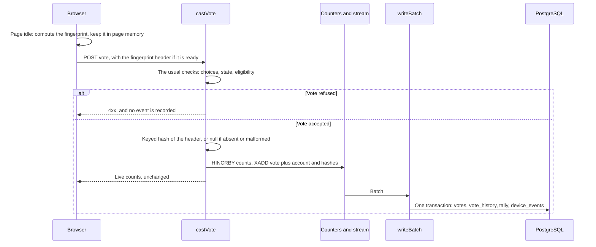
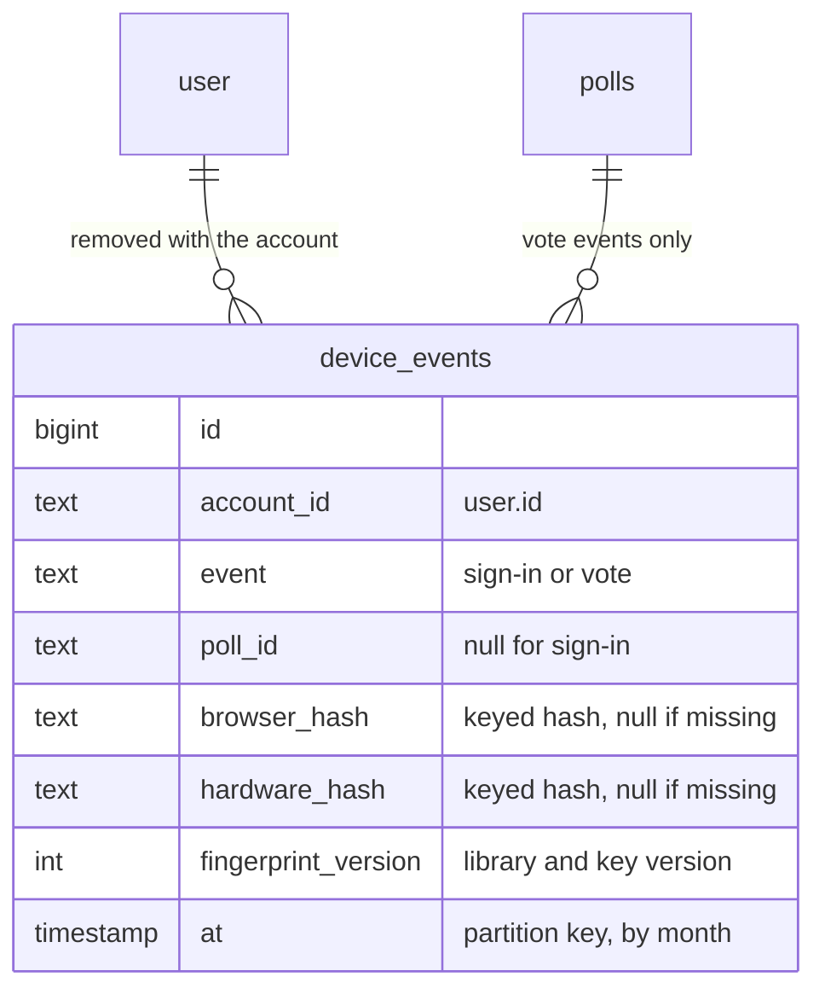

# High Level Requirements

Requirements: `requirements/20261105-162941-multiple-account-prevention/requirements.md`  
External Files: none  
Generated: 2026-11-05 4:33 PM  

# Initial High-Level Requirements

Currently, the Crowdpoll web app is still restricted to test users.  
However, we want to prepare for when it is opened up to the general public, by preparing the necessary infrastructure and security measures to be able to detect when a user is attempting to create multiple accounts or engage in other forms of fraudulent activity.  
The most critical aspect of the CrowdPoll service is to ensure that there is one vote per person.  
To achieve this, we need to implement robust mechanisms for user verification, account monitoring, and fraud detection, while maintaining a seamless user experience.  
We need to do this without compromising the user experience, ensuring that legitimate users can easily participate in polls while fraudulent activities are effectively mitigated.  
We also need to do this without infringing on user privacy, ensuring that any data collected for fraud detection is handled securely and in compliance with relevant regulations.  

Currently, we are using FCaptcha as a mechanism to prevent automated account creation and fraudulent activity.  
There are also safeguards in place with the Better-Auth library to enhance account security and prevent unauthorized access.  

In addition to this, the raw data that would help in detecting fraud attepts, would be tracking { account ID, device fingerprint }.  
The analysis of this data would be done offline to identify patterns indicative of fraudulent activity, without impacting the real-time user experience.  
The offline analysis would involve examining the collected data to detect when a single device finger-print signs in, and more importantly, votes multiple times with different account within a certain time frame.  
Of course, a device could be used to vote from 2 accounts legitimately, such as in a shared household scenario, so the analysis needs to account for such cases and avoid false positives.  
But consistent patterns of multiple accounts voting from the same device fingerprint within a short time frame would be indicative of fraudulent activity and should trigger further investigation.

The deliverables for this requirement includes the collection of the data.  
The analysis of the data, and the subsequent identification of potential fraudulent activity, and how it is addressed, would be a requirement for the future.

Question: one question that we would like you top consider, and research if necessary:  
would assigning each user a "Voter ID" help to make the priority of "One Vote, One Person" more clear as a part of the brand.  
The "Vote ID" would not be used to Log In, but it is just a branding element to reinforce the concept of "One Vote, One Person" and to help users easily identify their unique voting identity within the platform.  
We have also considered that this could backfire by being interpretted as a challenge to hackers when they might not otherwise target the platform, potentially drawing unwanted attention and attempts to compromise the system.

## Additional Requirements and Research Requests

**Instructions To The Developer**  
Enter any additional requirements or research requests under the ## Additional Requirements and Research Requests heading above.  
When you Type or Say: "Next" in the CC CLI terminal, the additional requirements and research requests will be applied to the report.  
  
You may leave these instructions here. They will be ignored when "Next" is executed.  

## 1. Overview and Scope

The goal is one vote per person.  
This feature does not detect anyone: it starts **collecting the evidence** that a later feature will analyse offline.  
Evidence that was not collected cannot be recovered later, so the shape of the record is the main decision here.  

| | In this feature | Later feature |
|---|---|---|
| **Collect** | A device fingerprint with the account, at sign-in and at each vote | |
| **Disclose** | The Privacy Policy, the Terms, and the notice they promise | |
| **Retain** | A retention limit, and removal with the account | |
| **Analyse** | | Find devices voting from several accounts, allowing for shared households |
| **Act** | | Investigate, and decide what happens to the accounts and votes |

What exists today, from the code:  

- **Accounts**: sign-up is restricted to test users by the allow list (`src/auth/allowlist.ts`); the Terms already say "One account per person" (`terms.html:43`).  
- **FCaptcha**: runs only before sign-in, on `/login`, `/create-account` and `/invite` (`humanCheck.js`).  
  It answers the web app with a yes or no; nothing it measures reaches the database, and `privacy.html:99–107` promises that.  
- **Sessions**: the sign-in hook deliberately blanks `ipAddress` and `userAgent` (`src/auth/auth.ts:240`).  
- **Votes**: `POST /api/polls/:pid/vote` → `castVote` (`src/votes/votePath.ts`) → the vote stream → `writeBatch` (`src/votes/consumer.ts`).  
  No database write happens per vote request, and that invariant must hold for the new record too.  
- **No fingerprint exists anywhere**: "fingerprint" in `src/` refers only to asset file names (`src/routes/assets.ts`).  

**The limit to keep in view**: a fingerprint is computed in the browser and reported by it, so a determined fraudster can change or forge it.  
The FingerprintJS README says so itself: "vulnerable to spoofing and reverse engineering" ([README](https://github.com/fingerprintjs/fingerprintjs)).  
It is evidence for the casual and the careless, not proof, and not a guarantee of one vote per person.  

### Assumptions

- **Account ID** means `user.id`, which survives an email change, unlike the email the votes table is keyed by.  
- **Signed-in only**: a guest's browser is never fingerprinted, and neither is one that has not accepted the current Terms, since the terms gate refuses the call.  
- **No IP address or user agent** is added to the record: the requirements name only the account and the fingerprint, and the policy says the address is not stored with the account.  
- **Never the choices**: the record says that an account voted on a poll, not how.  
- **No effect on the voter**: nothing in this feature refuses a vote, warns anyone or changes a count.  
- **Development scripts** that write votes directly (the populate scripts) create no records.  
- **"A certain time frame", "consistent patterns" and the false-positive rules** belong to the later analysis, so they are not findings here.  
  They do bear on how long the data is kept (UA4).  

## 2. Data Flow: What Is Collected, and What Is Left for Later

The solid path is this feature; the dashed part is the future analysis, shown to make clear what the record must serve.  
This drawing assumes the recommendations of IN2, AM1, AM2, UA1, UA2 and UA3.  

```mermaid
flowchart LR
    subgraph Browser
        FP["Fingerprint script<br/>computed once per page,<br/>nothing stored"]
        VC["voteClient.js"]
        SE["First page after sign-in"]
    end
    subgraph Web["web service"]
        GATE["Terms gate"]
        VOTE["POST /api/polls/:pid/vote<br/>castVote"]
        SIGN["New sign-in event route"]
        HASH["Keyed hash<br/>raw value discarded"]
    end
    STREAM[("Vote stream")]
    CONS["writeBatch consumer"]
    DB[("device_events<br/>account, event, poll,<br/>2 hashes, time")]
    SWEEP["Retention sweep"]
    OFF["Offline analysis"]
    INV["Investigation"]

    FP -->|"fingerprint header"| VC
    FP -->|"fingerprint"| SE
    VC -->|"vote + header"| GATE
    SE -->|"once per session"| GATE
    GATE -->|"Terms accepted"| VOTE
    GATE -->|"Terms accepted"| SIGN
    VOTE --> HASH
    SIGN --> HASH
    HASH -->|"vote entry"| STREAM
    STREAM -->|"batch"| CONS
    CONS -->|"same transaction<br/>as the votes"| DB
    HASH -->|"sign-in row"| DB
    SWEEP -->|"drops old months,<br/>removes on account deletion"| DB
    DB -.->|"future feature"| OFF
    OFF -.->|"future feature"| INV
```



## 3. Sequence: A Vote Carrying a Fingerprint

The vote must not wait for the fingerprint or fail because of it (UA3).  



## 4. Sequence: Recording a Sign-In from Any Method

Magic links, social providers and invitation links all end with a session, but none has a page of ours running at that moment.  
So the sign-in event is reported by the first page that loads afterwards (AM2), past the terms gate.  

```mermaid
sequenceDiagram
    participant U as Browser
    participant A as Sign-in (link, provider or invitation)
    participant G as Terms gate
    participant R as Sign-in event route
    participant D as PostgreSQL

    U->>A: Follow the link, or return from the provider
    A-->>U: session_token cookie, redirect
    U->>G: Load the page
    alt Current Terms not accepted
        G-->>U: /accept-terms; no fingerprint is sent yet
        U->>G: Accept, then load the next page
    end
    U->>U: Compute the fingerprint
    U->>R: POST the fingerprint
    R->>D: Insert the event, at most one per session
    R-->>U: 204
```

## 5. Data Model

A proposed record, following IN2, AM1 and UA2; `/speckit-plan` settles the column names.  



## 6. Research Results

### Would a "Voter ID" help make "One Vote, One Person" part of the brand?

**RS1. Should each user be given a "Voter ID" as a branding element?**  
<span style="font-size:large" ><b>
✅ Resolved</b></span>  
✅ Requirements File Updated: 2026-11-05 6:10 PM  
**Notes**: Recommendation accepted in file 2026-11-05: Recommendation A, no Voter ID; carry the brand in words, and revisit once the analysis exists;  
the requirements now record the decision beneath the question.  

> The requirements ask whether a Voter ID, which is not used to log in, would reinforce "One Vote, One Person", or would instead read as a challenge to hackers.  
> The requirements use both "Voter ID" and "Vote ID"; this report treats them as one name.  
> Sources: [The Register, Oracle's security claim](https://www.theregister.com/2002/01/16/oracle_security_claim/), [ISN archive, tenfold attacks](https://seclists.org/isn/2002/Jan/77), [Maclean's, voter information cards](https://macleans.ca/politics/ottawa/how-often-are-voter-information-cards-being-abused/), [Global News, voter cards](https://globalnews.ca/news/2090515/feds-argue-voter-information-cards-could-lead-to-fraud/), [Biometric Update, World](https://www.biometricupdate.com/202504/world-puzzled-by-lack-of-public-trust-in-massive-technology-corporations).  
> **The backfire is real, but it comes from a boast, not an identifier.**  
> Oracle's "Unbreakable" campaign of 2001 drew a public challenge from researchers and flaws within weeks;  
> Oracle's CEO himself put the rise in attacks on its site at tenfold, a figure no independent source confirms.  
> A quiet identifier makes no such claim, but copy such as "every vote guaranteed" would.  
> **The ID would not mean what it appears to mean.**  
> It would be issued per account, so a person with two accounts holds two Voter IDs, and the ID says nothing about the one thing it stands for.  
> The one-person brand that does prove uniqueness, World ID, needs an iris scan, and it attracts criticism for exactly that.  
> **The name carries baggage.**  
> In Canada, where CrowdPoll is based, voter identification was a contested public issue, and the same term could suggest an official election document.  
> **What could not be confirmed**: no study was found on whether a displayed identifier raises user trust, or whether one attracts attackers.  
> The answer below is reasoning from these cases, not measured evidence.  

  - **Recommendation A** _(recommended)_: **no Voter ID; carry the brand in words, and revisit once the analysis exists.**  

    [X] ➡️ **Accepted**

    - <u>Pros</u>: the phrase "One Vote, One Person" states the principle without an artifact that a two-account user would contradict; there is no new identifier to protect or disclose, and no build cost.  
    - <u>Cons</u>: there is nothing personal for a user to point to, so the brand message is less tangible.  


  - **Recommendation B**: **a display-only Voter ID on the Profile page: random, not sequential, not on polls, and with no security claim beside it.**  

    [ ] ➡️ **Not Accepted**

    - <u>Pros</u>: it gives the brand a visible token at a small cost, and keeping it off polls stops it linking one person's votes across polls.  
    - <u>Cons</u>: it means something it cannot yet deliver, it needs a column, a policy line and a name check, and it widens this feature's scope beyond collection.  


  - **Developer Resolution C**:  

    [ ] ➡️ **Not Accepted**

## 7. Breaking Changes

- **BC1. The Privacy Policy's promises reverse, and every account accepts again.**  
  These lines stop being true: "No tracking: no analytics, no advertising, no profiling" (`privacy.html:43`), the detection section's "It is not stored with your account" (`privacy.html:107`) would no longer describe everything measured about a device, and the retention table (`privacy.html:132`) gains a row.  
  The Terms and the policy share `TERMS_VERSION`, so a new version sends every account to `/accept-terms` (NC1).  
- **BC2. The policy promises 30 days' email for a change that matters** (`privacy.html:168`, `terms.html:68`), so the release date and the start of collection are separated (NC2).  
- **BC3. Tests that pin today's behaviour change with it**:  
  - `tests/legal-pages.test.ts` pins the policy text;  
  - `tests/m3-assets.test.ts` (`LAYER_ORDER`) pins each page's stylesheets and scripts, so a new script is added there;  
  - `tests/cookie-use-list.test.ts` fails if a browser storage key is added without a Cookie Use row (NC3, Recommendation B);  
  - the vote and consumer suites gain the new stream fields.  

## 8. Technical Debt

- **TD1. Votes are keyed by email, and the stream carries no account ID.**  
  `VoteRequest.userId` is optional, and `QueuedVote` has only `email`.  
  The new record needs `user.id`, so the stream entry gains a field, and an entry queued before the release arrives without one.  
- **TD2. `writeBatch` collapses a participant's votes within a batch** to one row per poll (`consumer.ts`, "One row per participant per poll").  
  Events must be taken before that step, or a burst of changed votes is under-recorded.  
- **TD3. The policy states the same facts in several places**: "In short", the section body, the retention table and the Cookie Use list.  
  Each policy change has to find all of them, and only the Cookie Use list has a test.  

## 9. Findings

### 9.1 Inconsistencies

**IN1. "Implement robust mechanisms for verification, monitoring and fraud detection", or only collect the data?**  
<span style="font-size:large" ><b>
✅ Resolved</b></span>  
✅ Requirements File Updated: 2026-11-05 6:51 PM  
**Notes**: Recommendation accepted in file 2026-11-05: Recommendation, this feature delivers collection only, with its disclosure and retention;  
verification, monitoring and detection are stated as the long-term goal;  
the requirements now state it under Decisions (IN1).  

> The opening paragraphs say we need to implement robust mechanisms for user verification, account monitoring and fraud detection.  
> The closing paragraph says the deliverable is the collection of the data, and that analysis, identification and response are for the future.  
> Read alone, the first would add identity checks and detection to this feature.  

  - **Recommendation**: **this feature delivers collection only, with its disclosure and retention; verification, monitoring and detection are stated as the long-term goal, for later features.**  

    [X] ➡️ **Accepted**

    - This follows the requirements' own statement of deliverables, and it adds no new step for any user.  
    - It also means this feature, alone, does not yet ensure one vote per person, so nothing should claim that it does.  


  - **Developer Resolution B**:  

    [ ] ➡️ **Not Accepted**

**IN2. The record is { account ID, device fingerprint }, but the analysis it serves needs more.**  
<span style="font-size:large" ><b>
✅ Resolved</b></span>  
✅ Requirements File Updated: 2026-11-05 6:51 PM  
**Notes**: Recommendation accepted in file 2026-11-05: Recommendation, each record holds the account ID, the fingerprint, the event, the poll for a vote, and the time;  
never the choices;  
the requirements now state it under Decisions (IN2).  

> The raw data is given as the pair { account ID, device fingerprint }.  
> The analysis is to find a fingerprint that signs in, and especially votes, from different accounts within a time frame.  
> The pair alone holds neither a time nor whether the event was a sign-in or a vote, and it cannot tell two accounts voting on the same poll from two voting on different ones.  

  - **Recommendation**: **each record holds the account ID, the fingerprint, the event (sign-in or vote), the poll for a vote, and the time; never the choices.**  

    [X] ➡️ **Accepted**

    - These are the least additions that make the stated analysis possible, and history that was not recorded cannot be rebuilt.  
    - The poll adds no new exposure, since the `votes` table already links each account's email to the poll.  


  - **Developer Resolution B**:  

    [ ] ➡️ **Not Accepted**

### 9.2 Ambiguities

**AM1. Does "device fingerprint" identify the device or the browser?**  
<span style="font-size:large" ><b>
✅ Resolved</b></span>  
✅ Requirements File Updated: 2026-11-05 6:51 PM  
**Notes**: Recommendation accepted in file 2026-11-05: Recommendation A, record two hashes, one for the browser and one for the hardware-like attributes;  
the requirements now state it under Decisions (AM1).  

> A browser fingerprint, such as FingerprintJS's visitor ID, survives private mode and purged browser data, according to its [README](https://github.com/fingerprintjs/fingerprintjs).  
> But the same person in Chrome and in Firefox on one computer would generally get two different values, which is the simplest way to vote from a second account.  
> A hash of only the hardware-like attributes (screen, GPU, CPU cores, time zone, platform) links those two browsers, but it also matches identical devices, such as two phones of one model in one city.  
> Neither can be added later for the data already gathered.  

  - **Recommendation A** _(recommended)_: **record two hashes, one for the browser and one for the hardware-like attributes.**  

    [X] ➡️ **Accepted**

    - <u>Pros</u>: the future analysis can weigh a precise match against a broad one, and the second-browser route stays visible.  
    - <u>Cons</u>: it is a little more code and one more value to disclose, and the hardware hash alone must never be read as one device.  


  - **Recommendation B**: **record one hash, the browser fingerprint.**  

    [ ] ➡️ **Not Accepted**

    - <u>Pros</u>: it is the simplest to build and explain, and collects the least.  
    - <u>Cons</u>: a second browser on the same device looks like a second device, permanently, for the data gathered.  


  - **Developer Resolution C**:  

    [ ] ➡️ **Not Accepted**

**AM2. What counts as "signs in"?**  
<span style="font-size:large" ><b>
✅ Resolved</b></span>  
✅ Requirements File Updated: 2026-11-05 6:51 PM  
**Notes**: Recommendation accepted in file 2026-11-05: Recommendation, one sign-in event per session, sent by the first page that loads after the session starts and the Terms are accepted;  
the requirements now state it under Decisions (AM2).  

> A session begins in several ways: a magic link, four social providers and an invitation link.  
> Those end in a server redirect, with no page of ours running to compute a fingerprint.  
> A session also lasts up to 30 days, so a returning user does not sign in again.  
> A user who has not accepted the current Terms is also signed in, but has not yet agreed to the collection.  

  - **Recommendation**: **one sign-in event per session, sent by the first page that loads after the session starts and the Terms are accepted, whichever method was used.**  

    [X] ➡️ **Accepted**

    - One route covers every sign-in method, and the terms gate guarantees nothing is collected before acceptance.  
    - A returning 30-day session gives no new sign-in event, but each of its votes still carries its own fingerprint, and votes are the part the requirements call more important.  


  - **Developer Resolution B**:  

    [ ] ➡️ **Not Accepted**

**AM3. Which votes are recorded?**  
<span style="font-size:large" ><b>
✅ Resolved</b></span>  
✅ Requirements File Updated: 2026-11-05 6:51 PM  
**Notes**: Recommendation accepted in file 2026-11-05: Recommendation, every vote castVote accepts is recorded, including changes and clears;  
refused requests are not;  
the requirements now state it under Decisions (AM3).  

> A Dynamic-Vote poll lets a voter change or clear a choice, and a vote can be refused for load, eligibility or a closed poll.  
> "Votes" could mean first votes, every accepted request, or every attempt.  

  - **Recommendation**: **every vote `castVote` accepts is recorded, including changes and clears; refused requests are not.**  

    [X] ➡️ **Accepted**

    - It keeps the volume in step with the vote stream, and a refused request put no vote into any count.  
    - A later analysis that wants only first votes can filter them out; the reverse would not be possible.  


  - **Developer Resolution B**:  

    [ ] ➡️ **Not Accepted**

### 9.3 Unspecified Aspects

**UA1. What produces the fingerprint?**  
<span style="font-size:large" ><b>
✅ Resolved</b></span>  
✅ Requirements File Updated: 2026-11-05 6:51 PM  
**Notes**: Recommendation accepted in file 2026-11-05: Recommendation A, FingerprintJS 5 (MIT), a pinned copy committed under src/public/, served by CrowdPoll;  
the requirements now state it under Decisions (UA1).  

> The requirements do not name a source.  
> Sources: [FingerprintJS README](https://github.com/fingerprintjs/fingerprintjs), [FingerprintJS 5.0, MIT license](https://fingerprint.com/blog/fingerprintjs-version-5-0-mit-license/), [FP-Stalker](https://hal.archives-ouvertes.fr/hal-01652021), [FCaptcha](https://github.com/WebDecoy/FCaptcha), [Firefox 145](https://www.bleepingcomputer.com/news/security/mozilla-firefox-gets-new-anti-fingerprinting-defenses/), [DataDome on browser defences](https://datadome.co/threat-research/end-of-fingerprinting-how-browser-privacy-reshaping-bot-detection/).  
> FingerprintJS 5 is MIT licensed; its README calls its accuracy "significantly lower" than the paid service and gives no number.  
> Its README's CDN example would be a third-party request, which the project forbids, so the file would be committed and served by CrowdPoll.  
> FCaptcha's documented verify answer holds `valid` and `score`, with no device value found, and it runs only before sign-in, not at a vote; its package is not installed here, so its code could not be checked.  
> Fingerprints drift: the FP-Stalker study (2018) saw them change within hours to days, and its algorithm could still link a browser for 54 days on average.  
> Browsers are also pushing back: Safari now adds noise to Canvas, WebGL and audio by default, per secondary sources, and Firefox 145 reduced what can be measured; how often a Safari value changes could not be confirmed.  

  - **Recommendation A** _(recommended)_: **FingerprintJS 5 (MIT), a pinned copy committed under `src/public/`, served by CrowdPoll.**  

    [X] ➡️ **Accepted**

    - <u>Pros</u>: it is maintained against browser changes, makes no third-party request as we would serve it, and adds no server dependency.  
    - <u>Cons</u>: Safari and Firefox users will be less reliably matched, and a library upgrade may change the values, which is why the record keeps a version (UA2).  


  - **Recommendation B**: **our own small script over a chosen set of attributes.**  

    [ ] ➡️ **Not Accepted**

    - <u>Pros</u>: no outside code, and we choose exactly what is measured, which also makes the policy wording exact.  
    - <u>Cons</u>: we then own the upkeep as browsers change, for a purpose that is not our product.  


  - **Developer Resolution C**:  

    [ ] ➡️ **Not Accepted**

**UA2. In what form is the fingerprint stored?**  
<span style="font-size:large" ><b>
✅ Resolved</b></span>  
✅ Requirements File Updated: 2026-11-05 6:51 PM  
**Notes**: Recommendation accepted in file 2026-11-05: Recommendation, store only a keyed hash, with a version number for the library and key;  
raw attributes never reach the database or the logs;  
the requirements now state it under Decisions (UA2).  

> The requirements ask that data be handled securely, but not how.  
> Comparison only needs equal values to stay equal, so the attributes themselves need not be kept.  
> A plain hash could be matched against the same library's output on any other site that collects it.  

  - **Recommendation**: **store only a keyed hash (HMAC-SHA-256, with a new secret in `infra/secrets.auto.tfvars`), with a version number for the library and key; raw attributes never reach the database or the logs.**  

    [X] ➡️ **Accepted**

    - Stored values are useless outside CrowdPoll, and a database leak does not expose device details.  
    - Replacing the key makes older values unmatchable, which the version number makes visible and which the retention limit ages out.  


  - **Developer Resolution B**:  

    [ ] ➡️ **Not Accepted**

**UA3. How does the fingerprint reach the server without touching the vote path's speed or its success?**  
<span style="font-size:large" ><b>
✅ Resolved</b></span>  
✅ Requirements File Updated: 2026-11-05 6:51 PM  
**Notes**: Recommendation accepted in file 2026-11-05: Recommendation, computed once at page idle and sent as a request header;  
a missing or malformed value never delays or refuses a vote;  
written by writeBatch with the votes;  
the requirements now state it under Decisions (UA3).  

> The requirements insist on no harm to the user experience and to real-time use.  
> The vote path takes no database write per request, a fingerprint can take a moment to compute, and a browser may block it.  
> They do not say what happens when it is missing.  

  - **Recommendation**: **computed once at page idle and sent as a request header; a missing or malformed value never delays or refuses a vote; the event travels in the vote stream and is written by `writeBatch` with the votes, with empty hashes when missing.**  

    [X] ➡️ **Accepted**

    - It keeps the no-write-per-vote design and leaves the response unchanged.  
    - A recorded vote with no fingerprint is itself useful evidence, for example of a script calling the API directly.  


  - **Developer Resolution B**:  

    [ ] ➡️ **Not Accepted**

**UA4. How long is the data kept, and what happens when an account is deleted?**  
<span style="font-size:large" ><b>
✅ Resolved</b></span>  
✅ Requirements File Updated: 2026-11-05 6:51 PM  
**Notes**: Recommendation accepted in file 2026-11-05: Recommendation A, 3 months by monthly partition, removed at once with the account;  
the requirements now state it under Decisions (UA4).  

> The requirements give no retention period, and the policy needs one for its table.  
> The policy also promises deletion of your data with your account.  
> The window must outlast the "certain time frame" of the future analysis, and polls may stay open for months;  
> but the less kept, the easier the privacy case.  
> Deleting with the account lets a fraudster remove the evidence by deleting the account; that follows from the policy's promise.  

  - **Recommendation A** _(recommended)_: **3 months by monthly partition, removed at once with the account.**  

    [X] ➡️ **Accepted**

    - <u>Pros</u>: it is the easier retention to justify for sensitive device data, and it can be lengthened later once the analysis shows a need.  
    - <u>Cons</u>: a pattern spread over more than 3 months cannot be seen, and the analysis has only 3 months of data when it first runs.  


  - **Recommendation B**: **12 months by monthly partition, like the history of changed votes, removed at once with the account.**  

    [ ] ➡️ **Not Accepted**

    - <u>Pros</u>: the analysis starts with a full year of data, and it matches an existing period in the policy.  
    - <u>Cons</u>: it keeps more for longer, before anything uses it, and storage grows with every vote.  


  - **Developer Resolution C**:  

    [ ] ➡️ **Not Accepted**

**UA5. Who can see the data, and how does it reach the offline analysis?**  
<span style="font-size:large" ><b>
✅ Resolved</b></span>  
✅ Requirements File Updated: 2026-11-05 7:54 PM  
**Notes**: Recommendation accepted in file 2026-11-05: Recommendation, no screen, API or export in this feature;  
read only by the operator, directly from the database;  
not visible to poll creators or in-app administrators;  
never logged;  
included in a privacy-request copy;  
the requirements now state it under Decisions (UA5).  

> The analysis is offline and future, so nothing here reads the data.  
> The requirements do not say who may see it.  
> The policy's right to "see your data" (`privacy.html:156`) would also cover it.  

  - **Recommendation**: **no screen, API or export in this feature: it is read only by the operator, directly from the database; not visible to poll creators or in-app administrators; never logged; and included in a privacy-request copy.**  

    [X] ➡️ **Accepted**

    - It leaves the smallest surface to protect, and the later feature designs the extract once it knows what it needs.  


  - **Developer Resolution B**:  

    [ ] ➡️ **Not Accepted**

**UA6. When does collection start: for the test users now, or only at the public opening?**  
<span style="font-size:large" ><b>
✅ Resolved</b></span>  
✅ Requirements File Updated: 2026-11-05 6:51 PM  
**Notes**: Recommendation accepted in file 2026-11-05: Recommendation, a setting, ENV_DEVICE_EVENTS_ENABLED, off by default;  
turned on in production after the notice, test users included;  
the requirements now state it under Decisions (UA6).  

> The site is still restricted to test users, and the aim is to be ready for the public.  
> Collecting from test users would prove the path works, but only if the notice has run its course (NC2).  

  - **Recommendation**: **a setting, `ENV_DEVICE_EVENTS_ENABLED`, off by default; turned on in production after the notice period, test users included; when off, no script runs and nothing is sent.**  

    [X] ➡️ **Accepted**

    - The code can ship before the notice ends, the test period exercises it with real traffic, and it matches how other optional services are enabled here.  


  - **Developer Resolution B**:  

    [ ] ➡️ **Not Accepted**

**UA7. How will we know the collection works, and did no harm?**  
<span style="font-size:large" ><b>
✅ Resolved</b></span>  
✅ Requirements File Updated: 2026-11-05 6:51 PM  
**Notes**: Recommendation accepted in file 2026-11-05: Recommendation, tests prove a vote without a fingerprint still succeeds and no cookie, storage key or third-party request appears;  
a periodic count gives coverage;  
the requirements now state it under Decisions (UA7).  

> The requirements name no success measure, and a silent failure would only be noticed months later, when the analysis starts.  

  - **Recommendation**: **tests prove that a vote without a fingerprint still succeeds and that no cookie, browser storage key or third-party request appears; a periodic count logs events with and without a fingerprint, as a coverage figure, with no identifying value.**  

    [X] ➡️ **Accepted**

    - The coverage figure is the early warning that the data is really arriving, for example if a browser update breaks the script.  


  - **Developer Resolution B**:  

    [ ] ➡️ **Not Accepted**

### 9.4 Needs Clarifications

**NC1. On what basis is the fingerprint collected: disclosure with the Terms, or a separate consent?**  
<span style="font-size:large" ><b>
✅ Resolved</b></span>  
✅ Requirements File Updated: 2026-11-05 6:51 PM  
**Notes**: Recommendation accepted in file 2026-11-05: Recommendation A, plain disclosure in the policy and Terms, accepted once through /accept-terms with a new TERMS_VERSION;  
a lawyer's review before the public opening;  
the requirements now state it under Decisions (NC1).  

> The requirements ask for compliance with relevant regulations but name none; CrowdPoll is in Ontario, and a public site may draw users from anywhere.  
> **Canada**: the OPC calls for express consent when a collection is sensitive, is outside reasonable expectations, or creates a meaningful risk of harm, and says consent as a condition of service must be integral to it ([consent guidelines](https://www.priv.gc.ca/en/privacy-topics/collecting-personal-information/consent/gl_omc_201805/)).  
> Its statement against device fingerprinting, because people cannot decline it, is framed around behavioural advertising ([advertising guidelines](https://www.priv.gc.ca/en/privacy-topics/technology/online-privacy-tracking-cookies/tracking-and-ads/gl_ba_1112/)); it does not address fraud prevention.  
> **EU**: the EDPB confirms that fingerprinting falls within Article 5(3) of the ePrivacy Directive, which needs consent or strict necessity ([Guidelines 2/2023](https://www.edpb.europa.eu/system/files/2024-10/edpb_guidelines_202302_technical_scope_art_53_eprivacydirective_v2_en_0.pdf)); those guidelines do not mention fraud.  
> **UK**: secondary sources report that the ICO treats fraud prevention as potentially exempt in some cases and not in others ([DLA Piper](https://privacymatters.dlapiper.com/2025/01/googles-u-turn-on-device-fingerprinting-icos-response-and-subsequent-guidance/)); the ICO's own page refused automated reading, so this is unconfirmed.  
> This is a reading of published guidance, not legal advice, and whether "one vote per person" is integral to the service is a question for counsel.  

  - **Recommendation A** _(recommended)_: **plain disclosure in the policy and Terms, stating the purpose and that it is never for advertising, accepted once through the existing `/accept-terms` card with a new `TERMS_VERSION`; a lawyer's review is required before the public opening.**  

    [X] ➡️ **Accepted**

    - <u>Pros</u>: it adds one acceptance and no new flow, and the fingerprint is treated as a term of voting, which fits the service's central promise.  
    - <u>Cons</u>: acceptance tied to using the service may not count as freely given consent in the EU, so counsel may require more for that audience.  


  - **Recommendation B**: **a separate, explicit opt-in for the fingerprint, apart from the Terms; a user who declines can still vote, and their votes are recorded with no fingerprint.**  

    [ ] ➡️ **Not Accepted**

    - <u>Pros</u>: it is the strongest legal position across jurisdictions.  
    - <u>Cons</u>: it adds a step for every user, the people the evidence is for simply decline, and the record of the choice is one more thing to store.  


  - **Developer Resolution C**:  

    [ ] ➡️ **Not Accepted**

**NC2. Does this change need the policy's 30-day email?**  
<span style="font-size:large" ><b>
✅ Resolved</b></span>  
✅ Requirements File Updated: 2026-11-05 6:51 PM  
**Notes**: Recommendation accepted in file 2026-11-05: Recommendation B, tell the test users directly, without the formal 30 days, and start at once;  
nobody from the public has an account yet;  
the requirements now state it under Decisions (NC2).  

> The policy and the Terms both promise: "for a change that matters we will email every account 30 days before it takes effect" (`privacy.html:168`, `terms.html:68`).  
> The last legal update chose no email, as a small change of wording; this one is a new kind of data.  
> The accounts today are only test users, but the promise says every account.  

  - **Recommendation A** _(recommended)_: **keep the promise: publish the new text, email every current account, and turn collection on (UA6) no sooner than 30 days later.**  

    [ ] ➡️ **Not Accepted**

    - <u>Pros</u>: the promise stays true, and with few accounts today it costs little, a one-off sending of one email.  
    - <u>Cons</u>: the test-period data starts at least 30 days after release.  


  - **Recommendation B**: **tell the test users directly, without the formal 30 days, and start at once; nobody from the public has an account yet.**  

    [X] ➡️ **Accepted**

    - <u>Pros</u>: data arrives immediately, in time to check the feature before opening.  
    - <u>Cons</u>: it departs from the published wording, which only holds up if every account really is a test user who agrees.  


  - **Developer Resolution C**:  

    [ ] ➡️ **Not Accepted**

**NC3. Should a stored browser identifier sit beside the fingerprint?**  
<span style="font-size:large" ><b>
✅ Resolved</b></span>  
✅ Requirements File Updated: 2026-11-05 6:51 PM  
**Notes**: Recommendation accepted in file 2026-11-05: Recommendation A, fingerprint only, as the requirements say;  
revisit if the coverage figure or the later analysis shows it is too unstable;  
the requirements now state it under Decisions (NC3).  

> The requirements name a fingerprint only, and it drifts, particularly on Safari and Firefox (UA1).  
> A random identifier saved in `localStorage` would be exact across sign-outs in the same browser, which is the likeliest way one person switches accounts, until they clear it or use private mode.  
> It would also end the policy's claim that detection "stores nothing in your browser", and require a Cookie Use row.  
> Under the EU rule in NC1 it is treated the same way as a fingerprint.  

  - **Recommendation A** _(recommended)_: **fingerprint only, as the requirements say; revisit if the coverage figure or the later analysis shows the fingerprint is too unstable.**  

    [X] ➡️ **Accepted**

    - <u>Pros</u>: the policy can still say we store nothing else in your browser, and scope stays as requested.  
    - <u>Cons</u>: the evidence gathered in the meantime is weaker on the browsers that resist fingerprints, and it cannot be added back.  


  - **Recommendation B**: **add the stored identifier as a third value on the record.**  

    [ ] ➡️ **Not Accepted**

    - <u>Pros</u>: exact matching for the casual case in all browsers, including those with fingerprint protection.  
    - <u>Cons</u>: it is a persistent identifier beyond what the requirements ask for, easily cleared by the people it targets, and one more item to disclose.  


  - **Developer Resolution C**:  

    [ ] ➡️ **Not Accepted**

## 10. Requirements Report Complete Report

- **Requirements Report Document:** requirements/20261105-162941-multiple-account-prevention/requirements-report.md
- **Requirements Document:** requirements/20261105-162941-multiple-account-prevention/requirements.md
- **Software Architecture Diagrams:** 4
- **Inconsistencies:** 2
- **Ambiguities:** 3
- **Unspecified Aspects:** 7
- **Needs Clarifications:** 3
- **Research Results:** 1
- **Breaking Changes:** 3
- **Technical Debt items:** 3

The requirements are ready for /speckit-specify.
To generate specs from the requirements document, use the `/speckit-specify` skill followed by the path (relative to the project root) to the requirements file.
At the prompt, Type:
🟩 👉 /speckit-specify requirements/20261105-162941-multiple-account-prevention/requirements.md
