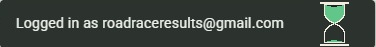
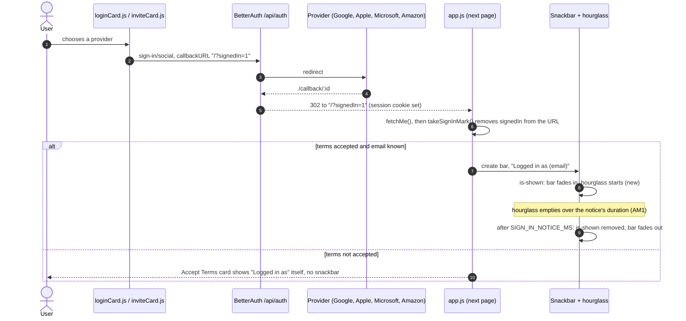
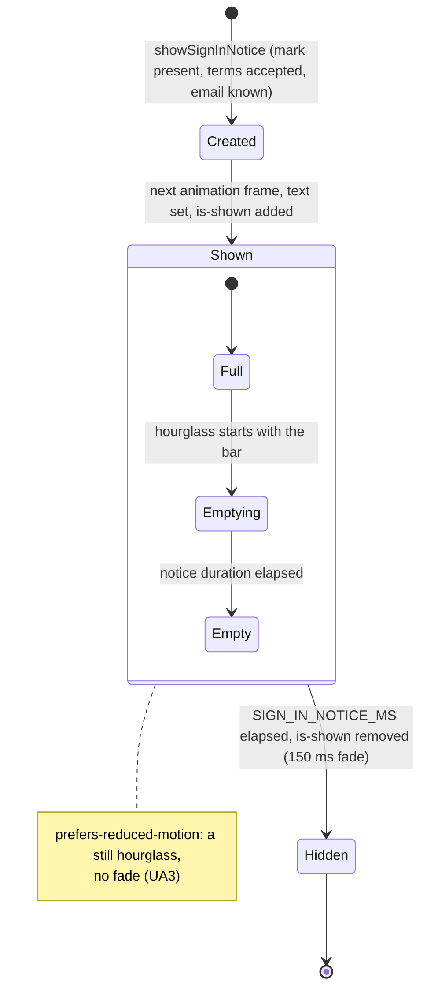
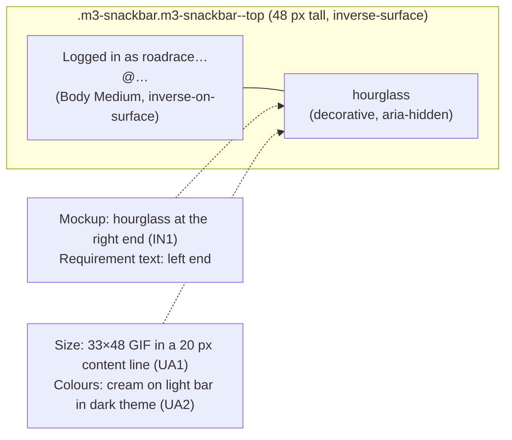

# High Level Requirements

Requirements: `requirements/20261108-193031-snackbar-hourglass/requirements.md`  
External Files: `snackbar_hourglass_7_seconds.gif`, `snackbar.jpg`  
Generated: 2026-11-08 7:31 PM  

This feature will add an hourglass indicator to the "Logged in as..." snackbar. 

The hourglass that will appear on the left end of the snackbar is the animated gif in:

The image below is a mockup of how it should appear:

Question: please describe the logic around the "Logged in as..." snackbar. 
Does it always appear, or only under certain conditions?  
How long does it remain visible? 

## Additional Requirements and Research Requests

**Instructions To The Developer**  
Enter any additional requirements or research requests under the ## Additional Requirements and Research Requests heading above.  
When you Type or Say: "Next" in the CC CLI terminal, the additional requirements and research requests will be applied to the report.  
  
You may leave these instructions here. They will be ignored when "Next" is executed.  

✅ Applied 2026-11-08 7:57 PM: 1 correction to the report (the Sign-in Notice sequence diagram: a `;` in a message ended the statement early, now a `,`);  
no requirement or research request, so requirements.md is unchanged.  
✅ Applied 2026-11-08 8:02 PM: 1 research request added to requirements.md (RS2).  

## 1. Overview and Scope

The "Logged in as `<email>`" snackbar gains an hourglass that empties while the snackbar is on screen.  
It tells the reader, without words, that the message is temporary and how long it has left.  

- **In scope**:
  - the one snackbar `app.js` shows after a provider login (`showSignInNotice`, `src/public/app.js:623`);
  - the hourglass image, its size, its place in the bar, its timing, its colours in the light and dark themes, and its reduced-motion behaviour.
- **Out of scope** (assumed, see NC1):
  - the other snackbars ("Link copied", "Choices pasted" in `adminCard.js`, the profile page's `profile-snackbar`);
  - the "Logged in as" line on the Accept Terms card (`acceptTermsCard.js:54`), which is a card, not a snackbar;
  - when the snackbar appears (that logic is unchanged; RS1 describes it).
- **The assets as supplied**:
  - `snackbar_hourglass_7_seconds.gif`: 33 × 48 px, 14 frames of 500 ms (7 000 ms in all), looping forever, transparent background, cream outline `#F2EDE0` and green sand `#62C58A`;
  - `snackbar.jpg`: the mockup, with the hourglass at the **right** end of a dark bar, after the text.
- **What exists today**:
  - the bar is `.m3-snackbar.m3-snackbar--top` (`src/public/snackbar-m3.css`), at least 48 px tall with 14 px × 16 px padding, `inverse-surface` background;
  - it is shown for `SIGN_IN_NOTICE_MS = 6000` ms, then fades out over 150 ms;
  - `inverse-surface` is `#2C322D` (dark) in the light theme and `#DFE4DD` (light) in the dark theme (`m3-tokens.css:31`, `:65`).

## 2. The Sign-in Notice, End to End

## 3. The Snackbar's States

## 4. Layout of the Bar

## 5. Assumptions

- The hourglass is decorative: the text already says everything, so screen readers hear only "Logged in as `<email>`".  
- The asset is committed under `src/public/` and served by the app, as every image is (no third-party request).  
- No setting, route, cookie, storage key or dependency is added.  
- The snackbar's trigger (provider login, `signedIn=1`) does not change.  

## 6. Research Results

### 6.1 The "Logged in as" snackbar today

**RS1. When does the "Logged in as..." snackbar appear, and how long does it stay?**  
<b>
✅ Resolved</b>  
✅ Requirements File Updated: 2026-11-08 7:43 PM  
**Notes**: Recommendation accepted by "Accept all" 2026-11-08: Recommendation, record the behaviour as found; this feature does not change when the snackbar appears;  
the answer was added under the question in the requirements.  

> The requirements ask whether the snackbar always appears and how long it remains visible.  
> Sources: the codebase — `src/public/app.js:609-635`, `src/public/loginCard.js:140`, `src/public/inviteCard.js:57`, `src/routes/api.ts:207`, `:221`, `:452`, `src/public/acceptTermsCard.js:16-22`, `tests/client-sign-in-notice.test.ts`.  
> It appears **only after a provider login** (Google, Apple, Microsoft or Amazon), on the first page loaded after the provider sends the browser back.  
> The login and invitation cards set the provider's `callbackURL` to `/?signedIn=1` (or `/?PID=<pid>&signedIn=1`);  
> `app.js` reads that mark and removes it from the address at once, so a reload or a later page never shows it again.  
> It does **not** appear after an emailed-link login (that link's `callbackURL` is `/`), nor on an ordinary page load.  
> It is also skipped when the account has not yet accepted the current Terms (the Accept Terms card says "Logged in as" itself, and removes `signedIn` from the page it goes to next), or when the session has no email address.  
> It shows at the top centre of the screen for **6 seconds** (`SIGN_IN_NOTICE_MS = 6000`), fading in and out over 150 ms (no fade under reduced motion);  
> it cannot be dismissed and has no action.  

  - **Recommendation**: **record the behaviour as found; this feature does not change when the snackbar appears.**  

    [X] ➡️ **Accepted**

    - The answer is added under the question in the requirements, and the trigger stays out of scope.  
    - Only how long it stays may change, through AM1.  

  - **Developer Resolution B**:  

    [ ] ➡️ **Not Accepted**

### 6.2 Serving the hourglass from the Spaces CDN

**RS2. Can the hourglass be served from the Spaces CDN?**  
<b>
✅ Resolved</b>  
✅ Requirements File Updated: 2026-11-08 8:39 PM  
**Notes**: Recommendation accepted in file 2026-11-08: Recommendation, no separate file, app.js builds the hourglass as an inline SVG coloured and animated by snackbar-m3.css, both served from the CDN;  
the requirements now answer the research request, the Drawing item says inline SVG, and the Files item no longer names hourglass.svg.  

> The additional requirements ask whether the hourglass can come from the Spaces CDN rather than the app.  
> Sources: the codebase — `devScripts/build-assets.ts`, `devScripts/publish-assets.ts`, `src/routes/assets.ts`, `src/routes/api.ts:159`, `infra/app.tf:116`, `infra/spaces.tf`, `src/public/app.js:335`.  
> **Yes, and much of it already happens.** Every release's build (`npm run build && npm run publish-assets`) copies each `.js`, `.css`, `.svg`, `.png`, `.jpg`, `.ico` and `.woff2` file at the top of `src/public/` to `assets/<hash>/<name>` in the Spaces bucket, with a one-year immutable cache;  
> the server then rewrites a page's `href="/x.css"` and `src="/x.svg"` attributes to those CDN addresses.  
> So `snackbar-m3.css`, where the hourglass's rules go (UA5), is already served from the CDN.  
> But only references written in a page's HTML are rewritten.  
> A file a script names, such as `app.js`'s `"/avatar-default.svg"`, is served by the instance, because the script cannot know the file's hash;  
> a `url(...)` inside a stylesheet is not rewritten either, and would point beside the stylesheet's own hashed folder, where the file is not.  
> The sign-in notice is built by `app.js`, so a separate `hourglass.svg` would not reach the CDN without new plumbing (for example publishing the asset manifest to the browser).  
> There is also a conflict between two resolved findings:  
> UA2 draws the hourglass in the theme's colour tokens, but an SVG loaded as a file (``) cannot read the page's CSS variables or be animated by its stylesheet;  
> only an SVG placed inline in the page can.  
> Without Spaces (development), all of this is served by the instance, with the same headers.  

  - **Recommendation**: **no separate file: `app.js` builds the hourglass as a small inline SVG inside the bar, and `snackbar-m3.css` colours and animates it; the drawing's only stylesheet is therefore served from the CDN, immutable, as today; UA5's `hourglass.svg` is dropped.**  

    [X] ➡️ **Accepted**

    - It is the only way the theme colours (UA2) and the still image under reduced motion (UA3) work, and it needs no extra request, no new build step and no manifest in the browser.  
    - The SVG markup is a few hundred bytes of `app.js`, which is itself fingerprinted and served from the CDN.  
    - The requirements' Files item (UA5) is reworded to match.  

  - **Developer Resolution B**:  

    [ ] ➡️ **Not Accepted**

## 7. Breaking Changes

None.  
If AM1 changes the notice's duration, `tests/client-sign-in-notice.test.ts` (`NOTICE_MS = 6000`) follows it;  
that is a test update, not a change to any API, route or stored data.  

## 8. Technical Debt

- **Three snackbar implementations**: `app.js` (sign-in notice) and `adminCard.js` each build an `.m3-snackbar`, and `profileCard.js` has its own `.profile-snackbar` in `card-shell-m3.css`, each with its own duration.  
  The hourglass is added to the sign-in notice only;  
  a shared snackbar helper would let it be reused later.  
- **The sign-in bar is never removed**: after it fades, the `div` stays in the page, invisible.  
  Harmless today (one per page load), but an image inside it would keep animating unseen unless it plays once.  

## 9. Findings

### 9.1 Inconsistencies

**IN1. Does the hourglass sit at the left or the right end of the bar?**  
<b>
✅ Resolved</b>  
✅ Requirements File Updated: 2026-11-08 7:57 PM  
**Notes**: Recommendation accepted in file 2026-11-08: Recommendation A, the right end, after the text, as in the mockup;  
the requirements' sentence now says "right end", and The Hourglass has a Position item.  

> The requirement says the hourglass "will appear on the left end of the snackbar".  
> The mockup `snackbar.jpg` shows it at the right end, after "Logged in as roadraceresults@gmail.com".  

  - **Recommendation A** _(recommended)_: **the right end, after the text, as in the mockup.**  

    [X] ➡️ **Accepted**

    - <u>Pros</u>: it matches the mockup;  
      the trailing end is where Material 3 puts a snackbar's action, so the text still starts where a reader looks first.  
    - <u>Cons</u>: it contradicts the requirement's wording, which is then corrected.  

  - **Recommendation B**: **the left end, before the text, as the requirement says.**  

    [ ] ➡️ **Not Accepted**

    - <u>Pros</u>: a leading icon is read first, like a status glyph.  
    - <u>Cons</u>: it does not match the mockup, which is then not the reference for the look.  

  - **Developer Resolution C**:  

    [ ] ➡️ **Not Accepted**

### 9.2 Ambiguities

**AM1. What does the hourglass count down: 7 seconds, or the bar's 6?**  
<b>
✅ Resolved</b>  
✅ Requirements File Updated: 2026-11-08 7:57 PM  
**Notes**: Recommendation accepted in file 2026-11-08: Recommendation A, show the snackbar for 7 seconds, the hourglass running once from full as the bar appears;  
The Hourglass has a Timing item: SIGN_IN_NOTICE_MS becomes 7000 and its test follows.  

> The GIF runs out in 7 seconds (14 frames × 500 ms), while the snackbar leaves after 6 seconds (`SIGN_IN_NOTICE_MS`, RS1).  
> As things stand the bar would vanish with a seventh of the sand still in the top, which reads as "cut short".  
> The GIF also loops forever, so if it were seen past 7 seconds it would refill and start again.  

  - **Recommendation A** _(recommended)_: **show the snackbar for 7 seconds, so the hourglass empties just as the bar fades; it runs once, from full, starting when the bar appears.**  

    [X] ➡️ **Accepted**

    - <u>Pros</u>: the picture tells the truth about the time left;  
      the asset needs no change of timing;  
      one more second is still within Material 3's 4–10 s snackbar range.  
    - <u>Cons</u>: `SIGN_IN_NOTICE_MS` and its test change from 6000 to 7000.  

  - **Recommendation B**: **keep 6 seconds, and make the hourglass empty in 6 seconds.**  

    [ ] ➡️ **Not Accepted**

    - <u>Pros</u>: the notice's timing is unchanged.  
    - <u>Cons</u>: the supplied 7-second GIF must be re-timed (or replaced, see UA2).  

  - **Developer Resolution C**:  

    [ ] ➡️ **Not Accepted**

### 9.3 Unspecified Aspects

**UA1. How big is the hourglass, and does the bar grow to hold it?**  
<b>
✅ Resolved</b>  
✅ Requirements File Updated: 2026-11-08 7:43 PM  
**Notes**: Recommendation accepted by "Accept all" 2026-11-08: Recommendation, the hourglass 32 px tall (22 px wide), the bar kept 48 px with 8 px vertical padding, 12 px from the text;  
the requirements now say so under The Hourglass, Size.  

> The GIF is 33 × 48 px.  
> The bar is at least 48 px tall with 14 px of padding above and below, so its content line is 20 px.  
> Shown at its own size, the hourglass would push the bar to 76 px, about half again as tall as in the mockup, where it nearly fills a bar of ordinary height.  

  - **Recommendation**: **show the hourglass 32 px tall (22 px wide, its proportions kept), and keep the bar 48 px tall by reducing its vertical padding to 8 px while it holds the hourglass; 12 px between the text and the hourglass.**  

    [X] ➡️ **Accepted**

    - This matches the mockup's proportions, and the bar keeps Material 3's single-line height.  
    - The text stays vertically centred.  
    - On a narrow phone the text wraps before the hourglass is squeezed (the hourglass never shrinks).  

  - **Developer Resolution B**:  

    [ ] ➡️ **Not Accepted**

**UA2. How does the hourglass look in the dark theme?**  
<b>
✅ Resolved</b>  
✅ Requirements File Updated: 2026-11-08 7:57 PM  
**Notes**: Recommendation accepted in file 2026-11-08: Recommendation A, a committed SVG animated with CSS in the bar's own colours (inverse-on-surface, inverse-primary);  
The Hourglass has a Drawing item, and the Files item now names hourglass.svg.  

> The GIF's colours are fixed: a cream outline (`#F2EDE0`) and green sand (`#62C58A`) on a transparent background.  
> In the light theme the bar is dark (`#2C322D`) and the hourglass shows as in the mockup.  
> In the dark theme the bar is light (`#DFE4DD`), and the cream outline all but disappears against it.  

  - **Recommendation A** _(recommended)_: **redraw the hourglass as a small committed SVG animated with CSS (7 s, or the duration AM1 settles), drawn in the bar's own colours: outline `inverse-on-surface`, sand `inverse-primary`; the GIF stays as the reference for the look.**  

    [X] ➡️ **Accepted**

    - <u>Pros</u>: correct in both themes, sharp at any size and pixel density, a fraction of the 13.7 KB GIF;  
      it starts exactly when the bar appears and plays once;  
      it can stand still under reduced motion (UA3), which a GIF cannot.  
    - <u>Cons</u>: the animation is re-created rather than used as supplied, so it may differ slightly from the GIF frame by frame.  

  - **Recommendation B**: **keep the GIF for the light theme, and add a second GIF with a dark outline for the dark theme, chosen by the page's colour scheme.**  

    [ ] ➡️ **Not Accepted**

    - <u>Pros</u>: the supplied animation is used as drawn.  
    - <u>Cons</u>: a second asset to make and keep in step;  
      the site also switches theme by `colorScheme.js`, not only the system setting, so the swap needs script or CSS, not just `<picture>`;  
      a GIF cannot pause for reduced motion, blurs when scaled (UA1), and starting it from its first frame takes care.  

  - **Developer Resolution C**:  

    [ ] ➡️ **Not Accepted**

**UA3. What does the hourglass do when the reader asks for reduced motion?**  
<b>
✅ Resolved</b>  
✅ Requirements File Updated: 2026-11-08 7:43 PM  
**Notes**: Recommendation accepted by "Accept all" 2026-11-08: Recommendation, under reduced motion the hourglass is shown still, full of sand at the top;  
the requirements now say so under The Hourglass, Reduced motion.  

> The bar already drops its fade under `prefers-reduced-motion: reduce` (`snackbar-m3.css:34`).  
> The requirements do not say whether the hourglass still runs.  

  - **Recommendation**: **under reduced motion the hourglass is shown still, full of sand at the top, and the bar leaves after the same time as usual.**  

    [X] ➡️ **Accepted**

    - It follows the site's existing rule for motion, and still marks the message as temporary.  
    - With the SVG of UA2 A this is one CSS rule; with a GIF it needs a separate still image.  

  - **Developer Resolution B**:  

    [ ] ➡️ **Not Accepted**

**UA4. What do screen readers hear?**  
<b>
✅ Resolved</b>  
✅ Requirements File Updated: 2026-11-08 7:43 PM  
**Notes**: Recommendation accepted by "Accept all" 2026-11-08: Recommendation, the hourglass is decorative and the announcement stays "Logged in as <email>";  
the requirements now say so under The Hourglass, Screen readers.  

> The bar is `role="status"`, so its contents are announced.  
> The requirements do not say whether the hourglass is announced too.  

  - **Recommendation**: **the hourglass is decorative (`aria-hidden="true"`, empty `alt` if an image); the announcement stays exactly "Logged in as `<email>`".**  

    [X] ➡️ **Accepted**

    - The text carries the whole message, and the existing test of the bar's text keeps passing.  

  - **Developer Resolution B**:  

    [ ] ➡️ **Not Accepted**

**UA5. Where do the asset and its styles live?**  
<b>
✅ Resolved</b>  
✅ Requirements File Updated: 2026-11-08 7:43 PM  
**Notes**: Recommendation accepted by "Accept all" 2026-11-08: Recommendation, the asset committed in src/public/ and its rules in snackbar-m3.css under m3-snackbar--timed;  
the requirements now say so under The Hourglass, Files.  

> The requirements give the image but not where it is served from or which stylesheet places it.  
> Every page's stylesheets are pinned by `tests/m3-assets.test.ts`, and no page may make a third-party request.  

  - **Recommendation**: **the asset is committed in `src/public/` (e.g. `hourglass.svg`, or `hourglass.gif` under UA2 B) and served by the app; its rules join `snackbar-m3.css` under a modifier class (`m3-snackbar--timed`), using M3 tokens only; no new stylesheet, so `LAYER_ORDER` is unchanged.**  

    [X] ➡️ **Accepted**

    - It keeps the snackbar's look in one sheet, already loaded by every page that can show the notice.  
    - The other snackbars, which do not carry the class, are unaffected (NC1).  

  - **Developer Resolution B**:  

    [ ] ➡️ **Not Accepted**

### 9.4 Needs Clarifications

**NC1. Is the hourglass for the "Logged in as" snackbar only?**  
<b>
✅ Resolved</b>  
✅ Requirements File Updated: 2026-11-08 7:43 PM  
**Notes**: Recommendation accepted by "Accept all" 2026-11-08: Recommendation, only the "Logged in as" snackbar shown after a provider login;  
the requirements now say so under a new Scope section.  

> The site has other snackbars: "Link copied", "Choices pasted" and the like on the admin card, and the profile page's own.  
> The Accept Terms card also shows a "Logged in as" line, but as part of a card, not a snackbar.  
> The requirements name only the "Logged in as..." snackbar.  

  - **Recommendation**: **only the "Logged in as" snackbar that `app.js` shows after a provider login; the other snackbars and the Accept Terms card are unchanged.**  

    [X] ➡️ **Accepted**

    - It is what the requirements name, and it keeps the feature small;  
      the other snackbars are short confirmations of an action the reader just took, where a countdown adds nothing.  

  - **Developer Resolution B**:  

    [ ] ➡️ **Not Accepted**

## 10. Requirements Report Complete Report  
  
- **Requirements Report Document:** requirements/20261108-193031-snackbar-hourglass/requirements-report.md  
- **Requirements Document:** requirements/20261108-193031-snackbar-hourglass/requirements.md  
- **Software Architecture Diagrams:** 3  
- **Inconsistencies:** 1  
- **Ambiguities:** 1  
- **Unspecified Aspects:** 5  
- **Needs Clarifications:** 1  
- **Research Results:** 2  
- **Breaking Changes:** 0  
- **Technical Debt items:** 2  
  
The requirements are ready for /speckit-specify.  
To generate specs from the requirements document, use the `/speckit-specify` skill followed by the path (relative to the project root) to the requirements file.  
At the prompt, Type:  
🟩 👉 /speckit-specify requirements/20261108-193031-snackbar-hourglass/requirements.md  
