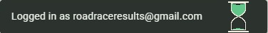

Start a new spec for these requirements called `20261108-193031-SNACKBAR-HOURGLASS`  
!! THIS FILE IS GENERATED USING THE SKILL `/speckit-requirements`. DO NOT EDIT OR DELETE THIS FILE !!  

# Initial High-Level Requirements

This feature will add an hourglass indicator to the "Logged in as..." snackbar. 

The hourglass that will appear on the right end of the snackbar (IN1: after the text, as in the mockup) is the animated gif in:

The image below is a mockup of how it should appear:

Question: please describe the logic around the "Logged in as..." snackbar. 
Does it always appear, or only under certain conditions?  
How long does it remain visible? 

Answer (RS1, as found in the code; this feature does not change when the snackbar appears):  
- It appears only after a provider login (Google, Apple, Microsoft or Amazon), on the first page loaded after the provider sends the browser back: the login and invitation cards set the provider's `callbackURL` to `/?signedIn=1`, and `app.js` removes that mark from the address at once, so a reload never shows it again.  
- It does not appear after an emailed-link login, nor on an ordinary page load.  
- It is skipped when the account has not yet accepted the current Terms (the Accept Terms card says "Logged in as" itself), or when the session has no email address.  
- It shows at the top centre of the screen for 6 seconds (`SIGN_IN_NOTICE_MS = 6000`), fading in and out over 150 ms, with no action and no way to dismiss it.  

## Scope (NC1)

- Only the "Logged in as" snackbar that `app.js` shows after a provider login gets the hourglass.  
- The other snackbars ("Link copied", "Choices pasted" and the like, and the profile page's own) and the "Logged in as" line on the Accept Terms card are unchanged.  

## The Hourglass

- **Position (IN1)**: the hourglass sits at the right end of the bar, after the text, as in the mockup.  
- **Timing (AM1)**: the snackbar is shown for 7 seconds (`SIGN_IN_NOTICE_MS` becomes 7000, and its test follows), so the hourglass empties just as the bar fades;  
  the hourglass runs once, from full, starting when the bar appears, and does not loop.  
- **Drawing (UA2)**: the hourglass is redrawn as a small inline SVG (RS2) animated with CSS, over the notice's 7 seconds;  
  it is drawn in the bar's own colours, the outline `inverse-on-surface` and the sand `inverse-primary`, so it is correct in both the light and the dark theme;  
  the supplied GIF is the reference for its look, not the asset served.  
- **Size (UA1)**: the hourglass is shown 32 px tall (22 px wide, its proportions kept);  
  the bar stays 48 px tall, its vertical padding reduced to 8 px while it holds the hourglass;  
  12 px separate the text and the hourglass;  
  on a narrow screen the text wraps before the hourglass is squeezed (the hourglass never shrinks).  
- **Reduced motion (UA3)**: under `prefers-reduced-motion: reduce` the hourglass is shown still, full of sand at the top, and the bar leaves after the same time as usual.  
- **Screen readers (UA4)**: the hourglass is decorative (`aria-hidden="true"`);  
  the announcement stays exactly "Logged in as `<email>`".  
- **Files (UA5, RS2)**: there is no separate image file: `app.js` builds the hourglass as a small inline SVG inside the bar, so the theme's colour tokens reach it;  
  its rules join `snackbar-m3.css` under a modifier class (`m3-snackbar--timed`), using M3 tokens only;  
  no new stylesheet, so `LAYER_ORDER` in `tests/m3-assets.test.ts` is unchanged.  

## Additional Requirements (2026-11-08 8:02 PM)

- Research this: can the hourglass be served from the Spaces CDN?  

  Answer (RS2): yes, through the files that draw it.  
  `app.js` and `snackbar-m3.css` are already fingerprinted and served from the CDN with a one-year immutable cache on every release, so the inline hourglass comes from the CDN with no extra request;  
  a separate image file named by a script would be served by the instance instead, so none is used.  
  Without Spaces (development) the instance serves them, with the same headers.  
