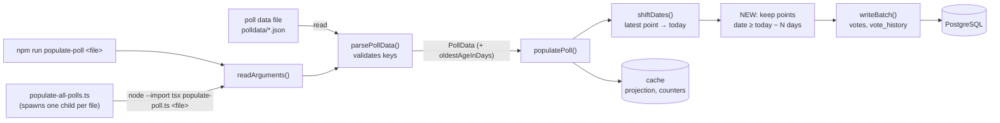
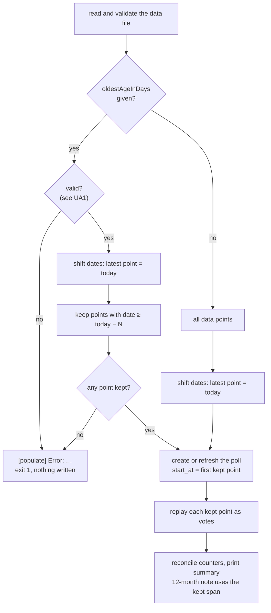
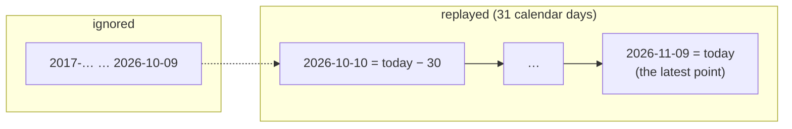

# High Level Requirements

Requirements: `requirements/20261109-083912-populate-oldest-age/requirements.md`\
External Files: none\
Generated: 2026-11-09 8:39 AM

Update the script "devScripts\populate\populate-poll.ts" so that there is an optional field called:
"oldestAgeInDays"

This field should represent the oldest age in days for the poll data to be considered.
If not provided, the script should consider all poll data regardless of age.

If the field is provided, the script should only consider poll data that is no older than the specified number of days.

## Additional Requirements and Research Requests

**Instructions To The Developer**\
Enter any additional requirements or research requests under the ## Additional Requirements and Research Requests heading above.\
When you Type or Say: "Next" in the CC CLI terminal, the additional requirements and research requests will be applied to the report.

You may leave these instructions here. They will be ignored when "Next" is executed.

✅ Applied 2026-11-09 8:45 AM: 1 requirement added to requirements.md (the key is spelled `oldest_age_in_days`; already covered by AM2, no new finding); no research request.  

## 1. Overview and Scope

`devScripts/populate/populate-poll.ts` creates or refreshes one demonstration poll from a JSON data file.\
It moves the file's dates so that the latest data point falls on today, then replays every data point as about `vote_count` simulated votes cast on that day.\
`populate-all-polls.ts` runs it once per new or changed `.json` file of a folder, and remembers each file by its SHA-256.

Some data files cover many years (the Macron approval file starts on 05/17/17), so a run replays thousands of days.\
Votes older than 12 months are later removed by the daily retention sweep anyway.\
This feature adds an optional limit, `oldestAgeInDays`:

* **Absent**: every data point is replayed, exactly as today.
* **Present**: only the data points no older than that many days are replayed;\
  the older ones are ignored as if they were not in the file.

**In scope**: reading and validating the limit, filtering the data points, the poll's dates and the run's notes after filtering, the populate README and `tests/populate-poll.test.ts`.\
**Out of scope**: the server, the database schema, the retention sweep, `seed-polls.ts`, and the data files themselves (none of them has to change).

## 2. Architecture Diagrams

### 2.1 Components — where the limit enters

The limit is drawn here as a key of the data file (see AM1); as a command-line option it would enter at `readArguments()` instead, and `populate-all-polls.ts` would have to pass it on.

### 2.2 One run — decision flow

### 2.3 Example — `oldestAgeInDays: 30` on today, 2026-11-09

With the boundary inclusive (UA1), `N` keeps up to `N + 1` calendar days: today and the `N` days before it.

## 3. Design Notes

* **Filter after shifting**: `shiftDates()` already makes the latest point today, so "age" after shifting is simply the distance from today (AM3).
* **Validation before writing**: an invalid limit, or a limit that leaves no point, is an `InputError`, so it prints one `[populate] Error:` line and exits 1 before anything is written, like every other input error.
* **The poll's dates follow the kept points**: `start_at`, `launched_at` and, for a new poll, `created_at` are the first kept point's day (UA2).
* **Reruns need nothing new**: a rerun already deletes every earlier simulated vote, history row and relation of the poll, so votes from a longer earlier run do not linger.
* **`populate-all-polls`** **needs nothing new** if the limit is a key of the data file: adding or changing it changes the file's SHA-256, so the next run repopulates that file.

## 4. Breaking Changes

None.
Without the limit, every run behaves exactly as it does today, and no existing data file has to change.

## 5. Technical Debt

* **The populate README is not committed.**\
  `.gitignore` allows `devScripts/populate/README.md`, but the file is named `README-populate-poll-and-seed-poll.md`, so it is git-ignored;\
  the header comments of `populate-poll.ts` and `populate-all-polls.ts` point to `devScripts/populate/README.md`, which does not exist.
* **The README's length limits are stale**: it says the title is at most 50 characters and the subtitle at most 30;\
  the script enforces `TITLE_MAX` 60 and `SUBTITLE_MAX` 40 (`src/polls/service.ts`).

## 6. Findings

### 6.1 Inconsistencies

None found.

### 6.2 Ambiguities

**AM1. Where is** **`oldestAgeInDays`** **given: in the data file or on the command line?**  
<b>
✅ Resolved</b>  
✅ Requirements File Updated: 2026-11-09 8:45 AM  
**Notes**: Recommendation accepted in file 2026-11-09: Recommendation A, an optional key of the poll data file;  
the requirements now say so under Decisions, and that `populate-all-polls.ts` does not change.  

> "An optional field" could be a key of the poll data file, beside `vote_count`, or an option of the command, beside the file path.\
> The two behave differently with `populate-all-polls`, which runs `populate-poll.ts` with the file path only, and notices a file's changes by its SHA-256.

* **Recommendation A** _(recommended)_: **an optional key of the poll data file.**

  [X] ➡️ **Accepted**

  * <u>Pros</u>: each file keeps its own limit (a nine-year series and a three-month one can differ);\
    `populate-all-polls` needs no change, and adding or changing the key repopulates that file on its next run.
  * <u>Cons</u>: trying a different limit means editing the file.

* **Recommendation B**: **a command-line option,** **`--oldest-age-in-days <N>`.**

  [ ] ➡️ **Not Accepted**

  * <u>Pros</u>: a different limit can be tried without touching the file.
  * <u>Cons</u>: `readArguments()` takes exactly one argument today, and its usage line changes;\
    `populate-all-polls` must accept and pass the option on, and its history does not record it, so a changed limit does not repopulate unchanged files.

* **Developer Resolution C**:

  [ ] ➡️ **Not Accepted**

**AM2. Is the key spelled** **`oldestAgeInDays`, or** **`oldest_age_in_days`** **like the file's other keys?**  
<b>
✅ Resolved</b>  
✅ Requirements File Updated: 2026-11-09 8:45 AM  
**Notes**: Recommendation accepted in file 2026-11-09: Recommendation B, `oldest_age_in_days`, matching the other keys;  
it is also the additional requirement applied by this "Next";  
the requirements now say so under Decisions, replacing the name `oldestAgeInDays`.  

> The requirements name the field `oldestAgeInDays`.\
> Every key of a poll data file is in snake case: `poll_creator_email`, `vote_count`, `data_points`, `choice_a`.\
> (If AM1 chooses the command line, this decides the option's spelling instead.)

* **Recommendation A** _(recommended)_: **`oldestAgeInDays`, exactly as the requirements name it.**

  [ ] ➡️ **Not Accepted**

  * <u>Pros</u>: it is the name the developer chose and will type.
  * <u>Cons</u>: it is the only camel-case key in the file.

* **Recommendation B**: **`oldest_age_in_days`, matching the other keys.**

  [X] ➡️ **Accepted**

  * <u>Pros</u>: one naming style for every key of the file.
  * <u>Cons</u>: it differs from the name in the requirements.

* **Developer Resolution C**:

  [ ] ➡️ **Not Accepted**

**AM3. A data point's age is measured from which day?**  
<b>
✅ Resolved</b>  
✅ Requirements File Updated: 2026-11-09 8:45 AM  
**Notes**: Recommendation accepted in file 2026-11-09: Recommendation A, from the latest data point;  
the requirements now say a point is kept when its moved date is no earlier than today minus N days.  

> The script moves every date so that the file's latest data point falls on today.\
> A point's age could be measured on those moved dates (from today, which is also the latest point), or on the file's original dates from the real today.\
> On the original dates, a file whose latest point is a year old would keep nothing at `oldestAgeInDays: 30`.

* **Recommendation A** _(recommended)_: **from the latest data point: keep a point when its moved date is no earlier than today minus N days.**

  [X] ➡️ **Accepted**

  * <u>Pros</u>: the limit means the same for every file, however old its data;\
    it is the age the votes will have in the poll.
  * <u>Cons</u>: none known.

* **Recommendation B**: **from the real today, on the file's original dates.**

  [ ] ➡️ **Not Accepted**

  * <u>Pros</u>: it measures how old the source data really is.
  * <u>Cons</u>: the same limit keeps different spans as the source files age, and keeps nothing once a file's latest point is older than N days.

* **Developer Resolution C**:

  [ ] ➡️ **Not Accepted**

### 6.3 Unspecified Aspects

**UA1. Which values are valid, is the boundary inclusive, and what if nothing is left?**  
<b>
✅ Resolved</b>  
✅ Requirements File Updated: 2026-11-09 8:45 AM  
**Notes**: Recommendation accepted in file 2026-11-09: Recommendation, a whole number of at least 0, inclusive, anything else an input error;  
the requirements now give the valid values, the boundary and the error line, spelled `oldest_age_in_days`.  

> The requirements do not say whether the limit is a whole number, whether 0 is allowed, whether a point exactly N days old is kept, or what happens when the limit leaves no data point.

* **Recommendation**: **a whole number of at least 0; a point exactly N days old is kept; anything else is an input error.**

  [X] ➡️ **Accepted**

  * `0` keeps only today's point;\
    `30` keeps today and the 30 days before it.
  * A value that is not a whole number of at least 0 (`-1`, `2.5`, `"30"`, `null`) stops the run with `[populate] Error: "oldestAgeInDays" must be a whole number of at least 0, not …`, before anything is written.
  * Since the latest point is always kept, the filter can never leave nothing;\
    a limit larger than the file's span keeps every point.

* **Developer Resolution B**:

  [ ] ➡️ **Not Accepted**

**UA2. What else follows the kept points: the poll's dates and the run's notes?**  
<b>
✅ Resolved</b>  
✅ Requirements File Updated: 2026-11-09 8:45 AM  
**Notes**: Recommendation accepted in file 2026-11-09: Recommendation, the kept points replace the file's points everywhere;  
the requirements now list the poll's dates, the votes, the 12-month note and the kept-points line.  

> The script sets the poll's `start_at` and `launched_at` (and, for a new poll, `created_at`) to the first data point's day, and notes when the data span more than 12 months.\
> The requirements do not say whether these use the first point of the file or the first point kept.

* **Recommendation**: **the kept points replace the file's points everywhere: dates, votes and notes.**

  [X] ➡️ **Accepted**

  * The poll starts on the first kept point's day, and the 12-month note is printed only when the kept span exceeds 12 months.
  * When a limit removes points, the run prints one line, e.g. `[populate] Kept 31 of 3,094 data points (oldestAgeInDays 30)`.
  * A rerun with a shorter limit leaves no older votes behind, since a rerun already deletes the poll's earlier simulated votes.

* **Developer Resolution B**:

  [ ] ➡️ **Not Accepted**

**UA3. Documentation and tests**  
<b>
✅ Resolved</b>  
✅ Requirements File Updated: 2026-11-09 8:45 AM  
**Notes**: Recommendation accepted in file 2026-11-09: Recommendation, document the key in the populate README and cover it in `tests/populate-poll.test.ts`;  
the requirements now list the README row and the test cases.  

> The requirements do not mention the README's key table or `tests/populate-poll.test.ts`, which covers `parsePollData` and `populatePoll`.

* **Recommendation**: **document the limit in the populate README and cover it in** **`tests/populate-poll.test.ts`.**

  [X] ➡️ **Accepted**

  * The README gets a row for the limit, with an example.
  * The tests cover: absent (every point kept), a limit that drops points (votes, `start_at`, the kept-points line), `0`, a limit larger than the span, and each invalid value.

* **Developer Resolution B**:

  [ ] ➡️ **Not Accepted**

### 6.4 Needs Clarifications

None found.

## 7. Requirements Report Complete Report  
  
- **Requirements Report Document:** requirements/20261109-083912-populate-oldest-age/requirements-report.md  
- **Requirements Document:** requirements/new-20261109-082450/requirements.md → requirements/20261109-083912-populate-oldest-age/requirements.md  
- **Software Architecture Diagrams:** 3  
- **Inconsistencies:** 0  
- **Ambiguities:** 3  
- **Unspecified Aspects:** 3  
- **Needs Clarifications:** 0  
- **Research Results:** 0  
- **Breaking Changes:** 0  
- **Technical Debt items:** 2  
  
The requirements are ready for /speckit-specify.
To generate specs from the requirements document, use the `/speckit-specify` skill followed by the path (relative to the project root) to the requirements file.
At the prompt, Type:  
🟩 👉 /speckit-specify requirements/20261109-083912-populate-oldest-age/requirements.md  
