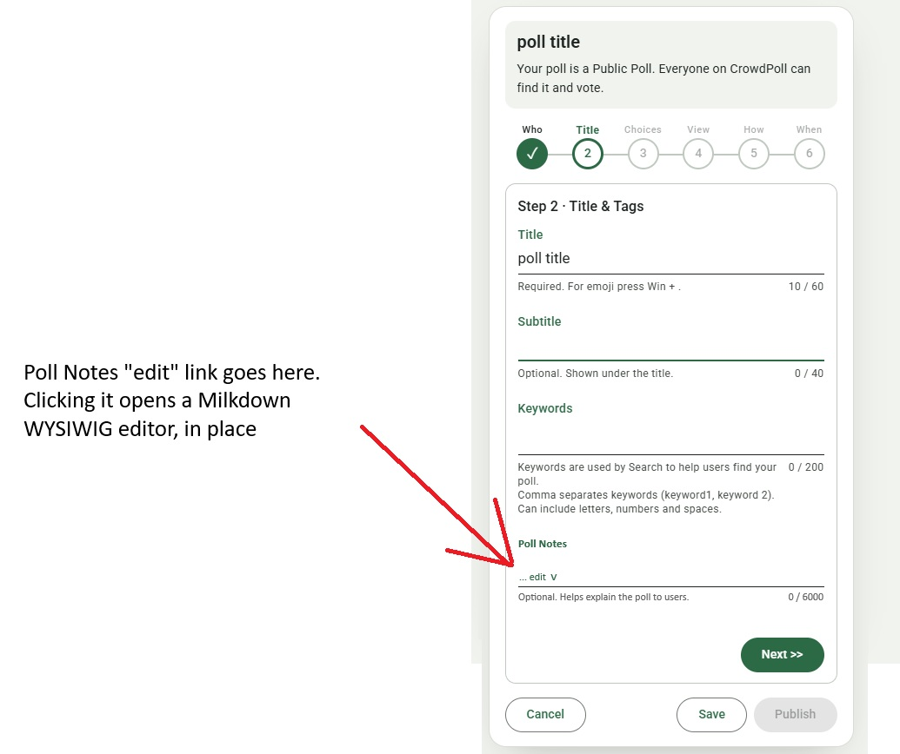
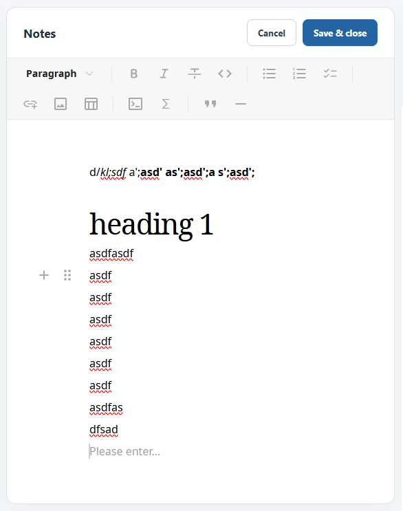
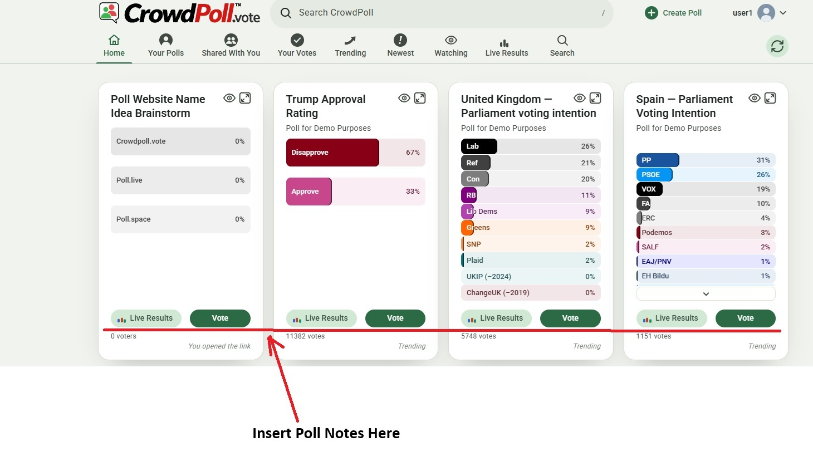
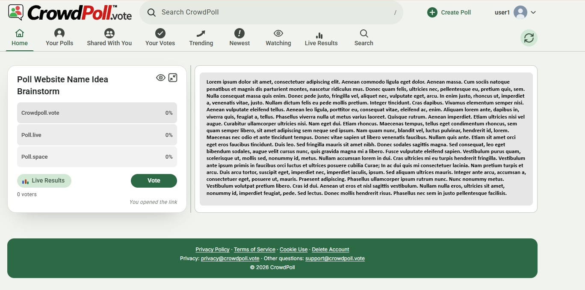
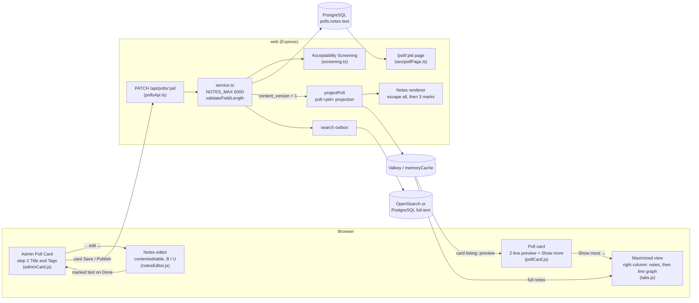
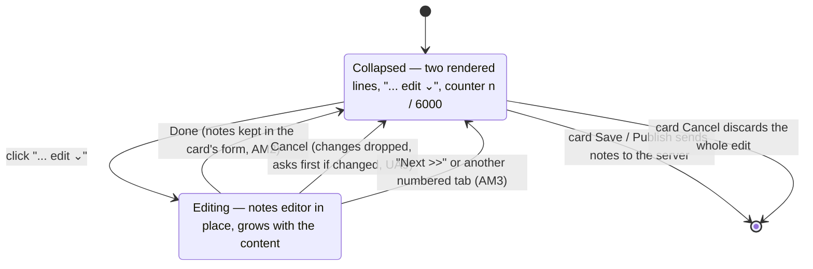
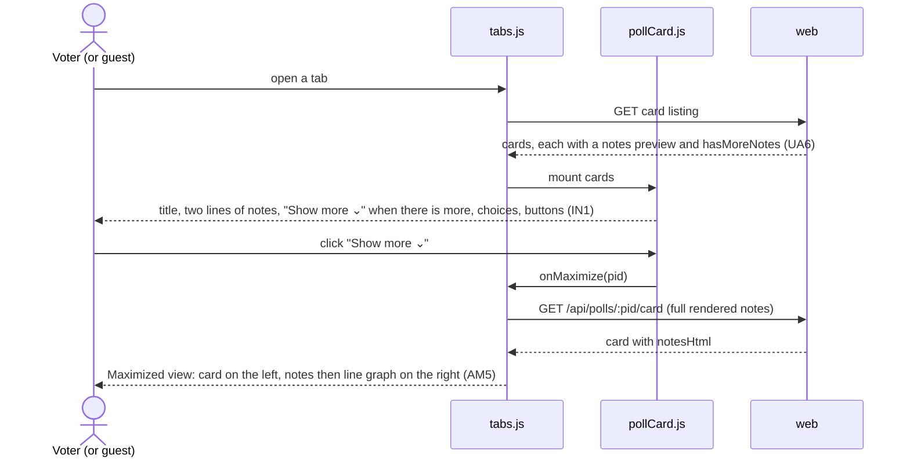

# High Level Requirements

Requirements: `requirements/20261109-114330-poll-notes/requirements.md`  
External Files: `requirements/20261109-114330-poll-notes/poll_notes_wysiwig_editor.jpg`, `requirements/20261109-114330-poll-notes/poll_notes_editor.jpg`, `requirements/20261109-114330-poll-notes/poll_notes_location.jpg`, `requirements/20261109-114330-poll-notes/poll_notes_maximized_view.jpg`  
Generated: 2026-11-09 11:43 AM  

# Initial High-Level Requirements

A Poll can now have a "notes" field.  
By default the notes field is empty.
The notes field is limited to 6000 characters.  

The notes will be edited on the Admin Poll Card on the "Title" section 2,  
as seen in the mockup in:  
  

The WYSIWIG editor will be Milkdown found on NPM at:  
https://www.npmjs.com/package/@milkdown/crepe

The editor will have a traditional toolbar.  

To launch the editor, the user will click on the "... edit V" link that is in the notes field.  
The "V" is a chevron pointing downwards.  
Clicking on it will expand the WYSIWIG editor for editing the notes, in place.  
When in edit mode, the window will grow a necessary to fit the data the creator enters.  
There will be two buttons:  
- Cancel
- Save  

Clicking either of these buttons will close the editor.  
Clicking the Edit Poll card's "Next >>" button, or another numbered tab will also close the editor.  

This mockup shows how the editor will appear when expanded for editing the notes:  

When the "Title" section 2 is active, just two lines of the current notes will be displayed. 
At the end of the 2nd line will be the "... edit V" link to expand the editor.  

The Milkdown editor will provide markdown of the notes the creator enters.  
The markdown will be stored in the backend and used to render the notes when the poll is viewed.  

The Admin Poll Card will not show markdown, but the rendered notes will be displayed as formatted text.  

On the Poll Card that all users see, the notes will appear between the poll title and the poll options  
as shown in the mockup:

These notes will also be limited to 2 lines.  
If there are more than 2 lines then there will be an ellipsis ("...") indicating that there is more content.  
Under the 2nd line there will be a "Show more V" link, where the "V" is a chevron pointing downwards.  

Clicking the "Show more V" link will switch to the "Maximized" view where the complete notes will be rendered in the right column above any other content that is in the right column.  
Currently, the "Maximized" view right column has an optional line graph.  
The notes will be rendered above that.  
Here is a mockup of how the notes will appear in the "Maximized" view:

## Additional Requirements and Research Requests

**Instructions To The Developer**  
Enter any additional requirements or research requests under the ## Additional Requirements and Research Requests heading above.  
When you Type or Say: "Next" in the CC CLI terminal, the additional requirements and research requests will be applied to the report.  
  
You may leave these instructions here. They will be ignored when "Next" is executed.  
✅ Applied 2026-11-09 11:52 AM: 1 correction to the report: the Mermaid parse error in diagram 2.3 was fixed (a ";" inside a message), with the same ";" in 2.2 and the HTML entities in 2.1; 0 requirements added to requirements.md; 0 research requests.  
✅ Applied 2026-11-09 12:26 PM: 1 requirement added to requirements.md (bold, italics and underline only; findings IN4, NC2, UA10; AM4 and UA2 re-opened; NC1 and UA7 no longer applicable); 1 research request (RS1).  

## 1. Overview and Scope

A poll gains one optional, formatted text field, **notes** (text with bold, italics and underline only, at most 6000 characters, empty by default), that explains the poll to voters.  

- **Writing it**: the poll's creator writes the notes in step 2 ("Title & Tags") of the Admin Poll Card, in a small WYSIWYG editor of CrowdPoll's own (a `contenteditable` box with B, I and U buttons, no dependency, RS1) that opens in place from a "... edit ⌄" link and closes with Cancel or Done.  
  The step shows the rendered notes, two lines, never the stored marks.  
- **Reading it**: every poll card shows the first two lines of the rendered notes, with an ellipsis and a "Show more ⌄" link when there is more.  
  "Show more" opens the poll's Maximized view, where the whole notes are rendered at the top of the right column, above the optional line graph.  
- **Storing it**: the notes are stored with the poll as plain text with three marks (`**bold**`, `*italic*`, `++underline++`, NC2), and rendered on the server wherever the poll is shown (UA2).  

**In scope**: the field and its migration, validation, the step-2 editor, the preview on the Admin Poll Card and on poll cards, the Maximized view, the API and `postman/openapi.json`.  
**Settled by the findings below**: where the notes sit on the card (IN1), the editor's buttons and toolbar (IN2, IN3), the editor and the stored format (RS1, NC2), how the notes are rendered safely (UA2), and whether they reach screening, search and SEO (UA3, UA5).  
**Out of scope**: any formatting but bold, italics and underline (no links, images, lists or headings), notes on anything other than a poll, comments or replies from voters, and a revision history of the notes.  

**What exists today** (from the codebase):  

- A poll's text fields are `title` (60), `subtitle` (40) and `keywords` (200), each limited in `src/polls/service.ts` (`LIMITS`) and checked by `validateFieldLength`.  
- `title`, `subtitle` and the choices go through Acceptability Screening (`src/polls/screening.ts`); `title` and `subtitle` are indexed for search (`src/search/openSearch.ts`) and used on the SEO page (`src/seo/pollPage.ts`).  
- A content change bumps `content_version` unless the field is in `NON_CONTENT_FIELDS` (`src/polls/store.ts`); `projectPoll` (`src/polls/versions.ts`) builds the `poll:<pid>` projection every card is served from.  
- `duplicatePoll` copies title, subtitle and choices into a new INITIALIZED poll.  
- `src/public/` is plain JavaScript with no bundler and no npm package used in the browser; `express.static` serves it, and no page makes a third-party request.  
- The Maximized view (`pollCard.js` `setMaximized`, `tabs.js`) shows one card with an optional line graph beside it.  

## 2. Architecture

### 2.1 Components and data flow

### 2.2 Editing the notes in step 2

### 2.3 Reading the notes

## 3. Assumptions

- The field is named `notes` everywhere (column, API, projection), `text not null default ''`, added by one migration.  
- `NOTES_MAX = 6000` joins `LIMITS` in `src/polls/service.ts`, beside the other field limits; it is a constant, not an `ENV_*` setting, like the others.  
- Only someone who may edit the poll may edit its notes; the existing admin-route access rules apply unchanged.  
- The counter under the field ("0 / 6000", as in the mockup) counts what AM1 decides.  
- The UI text is "Poll Notes" for the label and "Optional. Helps explain the poll to users." for the help line, as in the mockup.  
- The chevron "V" is drawn as the down-chevron already used elsewhere in the M3 sheets, not the letter V.  
- Notes are in the language the creator writes them in; there is no translation.  

## 4. Research Results

### 4.1 A bold, italics and underline editor

**RS1. Can a bold, italics and underline editor be built with no dependency, or is there a light library?**
<b>
✅ Resolved</b>  
✅ Requirements File Updated: 2026-11-09 1:03 PM  
**Notes**: Recommendation accepted in file 2026-11-09: Recommendation A, **no dependency: a `contenteditable` box with B, I and U buttons using `execCommand` and the browser's own shortcuts, in `notesEditor.js`**;  
the requirements now say so under "Decisions from the requirements report" (Editor)  

> The additional requirement asks whether a simple editor for bold, italics and underline can be built with no third-party dependency, or which light npm library could do it without Milkdown's weight.
> Sources: [MDN — Document.execCommand()](https://developer.mozilla.org/en/docs/web/api/document/execcommand), [W3C Editing — execCommand draft](https://w3c.github.io/editing/docs/execCommand/), [web-platform-tests — input events from execCommand](https://chromium.googlesource.com/external/w3c/web-platform-tests/+/refs/tags/merge_pr_15457/input-events/input-events-exec-command.html), [GitHub — fastmail/Squire](https://github.com/fastmail/Squire), [npm — @milkdown/crepe](https://npmjs.com/package/@milkdown/crepe), and the developer's demo in `milkdown-crepe-demo/`.
> **No dependency**: an element with `contenteditable` already applies bold, italics and underline with Ctrl/⌘+B, I and U in current browsers, and `document.execCommand('bold' | 'italic' | 'underline')` does the same from toolbar buttons;
> `document.queryCommandState` gives each button's on/off state.
> MDN marks `execCommand` deprecated, but notes there are valid uses with no alternative yet;
> it is described in the W3C Editing draft and covered by the web-platform tests, and no browser removal was found.
> The editor's content becomes the stored format by walking its DOM and keeping only text, line breaks and the three marks, so the browser's own markup never reaches the server.
> **Squire** (`squire-rte`, Fastmail) is a maintained `contenteditable` editor with cross-browser normalisation and bold, italic and underline state;
> it produces HTML, would still need bundling for `src/public/`, and does far more than three marks need; its size was not confirmed.
> **Milkdown Crepe** 7.23.0 (the developer's demo) has a fixed `Crepe.Feature.TopBar`, but it is a Markdown editor built on ProseMirror with CodeMirror and KaTeX among its dependencies, and Markdown has no underline.

  - **Recommendation A** _(recommended)_: **no dependency: a `contenteditable` box with B, I and U toolbar buttons using `execCommand` and the browser's own shortcuts, in its own script (`notesEditor.js`), converting to and from the stored format (NC2); the `execCommand` calls sit in one small function, so they can be replaced if browsers ever drop them.**

    [X] ➡️ **Accepted**

    - <u>Pros</u>: nothing to install, bundle or pin;
      the admin page loads a few kilobytes;
      it keeps `src/public/` plain scripts with no build step.
    - <u>Cons</u>: it relies on a deprecated, though universally supported, API;
      jsdom has no `execCommand`, so the client tests drive the DOM and the format conversion directly.

  - **Recommendation B**: **Squire (`squire-rte`), pinned exactly and vendored as one committed file built once with `esbuild`.**

    [ ] ➡️ **Not Accepted**

    - <u>Pros</u>: cross-browser normalisation and an editing API maintained by others.
    - <u>Cons</u>: a build step and a vendored file;
      more editor than three marks need;
      its HTML still has to be converted to the stored format.

  - **Recommendation C**: **Milkdown Crepe as in the demo (`TopBar`), with every feature but bold and italics turned off, and underline added as a custom mark.**

    [ ] ➡️ **Not Accepted**

    - <u>Pros</u>: already tried, and its fixed toolbar works.
    - <u>Cons</u>: by far the heaviest option;
      underline needs a custom Milkdown extension;
      a build step and a vendored bundle.

  - **Developer Resolution D**:  

    [ ] ➡️ **Not Accepted**

## 5. Findings

### 5.1 Inconsistencies

**IN1. Where do the notes sit on the poll card?**  
<b>
✅ Resolved</b>  
✅ Requirements File Updated: 2026-11-09 12:26 PM  
**Notes**: Recommendation accepted in file 2026-11-09: **Developer Resolution C**: Recommendation A (between the title and the choices) plus a taller minimum card height and an M3 container;  
the requirements now say so under "Decisions from the requirements report" (Notes on the poll card)  

> The text says the notes appear "between the poll title and the poll options, as shown in the mockup".  
> The mockup `poll_notes_location.jpg` shows them below the Live Results and Vote buttons, above "0 voters".  

  - **Recommendation A**: **between the title and the choices, as the text says.**  

    [ ] ➡️ **Not Accepted**

    - <u>Pros</u>: the voter reads the explanation before choosing.  
    - <u>Cons</u>: the choices and the Vote button move down by two lines on cards with notes, so cards side by side in a tab no longer line up, and the choices fall further below the fold on phones.  

  - **Recommendation B** _(recommended)_: **below the Live Results and Vote buttons, above the voter count, as the mockup shows.**  

    [ ] ➡️ **Not Accepted**

    - <u>Pros</u>: the choices and buttons stay where they are on every card, with or without notes;  
      the notes read as supporting detail, which is what the help line ("Helps explain the poll") says they are.  
    - <u>Cons</u>: a voter may vote before seeing the notes.  

  - **Developer Resolution C**:  

    [X] ➡️ **Accepted**

    - Recommendation A plus this: the minimum height of a Poll Card will grow by the amount that 2 lines of Notes and he "Show more V" link occupy.  
    A suitable container for the notes will be used that is consistent with Material 3 design principles.

**IN2. What are the editor's buttons called, and where are they?**  
<b>
✅ Resolved</b>  
✅ Requirements File Updated: 2026-11-09 12:26 PM  
**Notes**: Recommendation accepted in file 2026-11-09: Recommendation A, **"Cancel" and "Done" at the top right of the editor, under a "Notes" heading**;  
the requirements now say so under "Decisions from the requirements report" (Editor buttons)  

> The text names two buttons, "Cancel" and "Save".  
> The mockup `poll_notes_editor.jpg` shows "Cancel" and "Save & close" at the top right of the editor, beside a "Notes" heading.  
> The Admin Poll Card already has its own "Cancel" and "Save" at the bottom, which do something different (they end or save the whole edit).  

  - **Recommendation A** _(recommended)_: **"Cancel" and "Done" at the top right of the editor, under a "Notes" heading, as placed in the mockup.**  

    [X] ➡️ **Accepted**

    - <u>Pros</u>: "Done" does not promise a save to the server, which only the card's own Save or Publish makes (see AM2);  
      no two buttons on the card share a label.  
    - <u>Cons</u>: it matches neither the text nor the mockup's label.  

  - **Recommendation B**: **"Cancel" and "Save & close" at the top right, as in the mockup.**  

    [ ] ➡️ **Not Accepted**

    - <u>Pros</u>: it is what the mockup shows, and it is distinct from the card's "Save".  
    - <u>Cons</u>: if AM2 keeps the notes in the card's form, "Save" here is not a save, and a creator may leave the card believing the notes were stored.  

  - **Recommendation C**: **"Cancel" and "Save", as the text says.**  

    [ ] ➡️ **Not Accepted**

    - <u>Pros</u>: it follows the text.  
    - <u>Cons</u>: two "Cancel" and two "Save" buttons on one card, with different effects.  

  - **Developer Resolution D**:  

    [ ] ➡️ **Not Accepted**

**IN3. A "traditional toolbar", but Crepe's toolbar floats**  
<b>
✅ Resolved</b>  
✅ Requirements File Updated: 2026-11-09 12:26 PM  
**Notes**: Recommendation accepted in file 2026-11-09: **Developer Resolution C**: a fixed toolbar, as in the test implementation's screenshot;  
the requirements now say so under "Decisions from the requirements report" (Toolbar);  
this finding's statement that Crepe has no fixed toolbar was wrong: the developer's demo uses Crepe 7.23.0's `Crepe.Feature.TopBar`  

> The text asks for "a traditional toolbar", and the mockup shows a fixed bar of buttons above the text (Paragraph, bold, italic, strike, code, lists, link, image, table, code block, math, quote, rule).  
> Crepe's own `Toolbar` feature is a floating bar that appears over a text selection, built on Milkdown's tooltip plugin; Crepe also adds a block handle ("+" and drag dots, seen in the mockup) and a "/" slash menu.  
> No fixed-toolbar option was found in Crepe's documentation or source.  
> Sources: [npm — @milkdown/crepe](https://npmjs.com/package/@milkdown/crepe), [Crepe toolbar source (7.21.2)](https://cdn.jsdelivr.net/npm/@milkdown/crepe@7.21.2/src/feature/toolbar/index.ts), [DeepWiki — Crepe editor](https://deepwiki.com/Milkdown/milkdown/7.3-crepe-editor).  

  - **Recommendation A** _(recommended)_: **a fixed toolbar built by CrowdPoll above the Crepe editor, whose buttons call Milkdown's commands; Crepe's floating toolbar stays off, its block handle and slash menu stay on.**  

    [ ] ➡️ **Not Accepted**

    - <u>Pros</u>: it is the mockup's traditional toolbar, styled with the site's M3 tokens, and shows only the formatting NC1 allows.  
    - <u>Cons</u>: one more component to write and test, tied to Milkdown's command names across upgrades.  

  - **Recommendation B**: **Crepe as it comes: the floating selection toolbar, block handle and slash menu.**  

    [ ] ➡️ **Not Accepted**

    - <u>Pros</u>: no custom code; upgrades come with the package.  
    - <u>Cons</u>: it is not a traditional toolbar; formatting is hidden until text is selected, which is harder to find on phones.  

  - **Developer Resolution C**:  

    [X] ➡️ **Accepted**

    - the screenshot below is from an actual test implementation that has a fixed toolbar:
    

    The code for the test implementation is located at:
    requirements\20261109-114330-poll-notes\milkdown-crepe-demo

    The test implementation demonstrates how the fixed toolbar behaves in the editor.  
    It also has the floating bar. If possible, we would like to remove the floating bar.  

**IN4. The requirements and the report still name Milkdown and Markdown**
<b>
✅ Resolved</b>  
✅ Requirements File Updated: 2026-11-09 1:03 PM  
**Notes**: Recommendation accepted in file 2026-11-09: Recommendation, **the additional requirement supersedes the Milkdown and Markdown sentences; the report is redrawn to match**;  
the requirements now say so under "Decisions from the requirements report" (Milkdown and Markdown superseded);  
the report's overview, diagrams 2.1–2.3 and Technical Debt were redrawn for RS1 A and NC2 A;  
Breaking Changes named neither and is unchanged  

> The requirements say "The WYSIWIG editor will be Milkdown", "The Milkdown editor will provide markdown" and "The markdown will be stored in the backend".
> The additional requirement of 2026-11-09 allows only bold, italics and underline, and says this can probably be done without Milkdown.
> Markdown has no underline, so it cannot be the stored format as written.
> The report's overview (section 1), diagrams 2.1 and 2.2, and its Breaking Changes and Technical Debt sections still show Milkdown Crepe and a Markdown renderer.

  - **Recommendation**: **the additional requirement supersedes the earlier sentences: the editor is the one RS1 chooses and the stored format the one NC2 chooses; the requirements record this under their decisions, and the report's overview, diagrams 2.1–2.3, Breaking Changes and Technical Debt are redrawn to match.**

    [X] ➡️ **Accepted**

    - The developer's original text stays as written, with the decision beside it, so the history is kept.
    - Best accepted after RS1 and NC2, so the redrawn diagrams show their choices.

  - **Developer Resolution B**:  

    [ ] ➡️ **Not Accepted**

### 5.2 Ambiguities

**AM1. What do the 6000 characters count?**  
<b>
✅ Resolved</b>  
✅ Requirements File Updated: 2026-11-09 12:26 PM  
**Notes**: Recommendation accepted in file 2026-11-09: Recommendation A, **the stored text in characters, checked by the server; the counter shows it; Done is disabled above 6000**;  
the requirements now say so under "Decisions from the requirements report" (The 6000 characters);  
"Markdown" is written as "the stored notes, formatting marks included", since NC2 now decides the format  

> "The notes field is limited to 6000 characters", and the notes are stored as Markdown.  
> The Markdown is longer than the text a reader sees (`**bold**` is 8 characters for 4 visible ones; a link carries its URL).  

  - **Recommendation A** _(recommended)_: **the stored Markdown, in characters (code points), checked by the server like every other field; the counter shows it, and Save in the editor is disabled above 6000.**  

    [X] ➡️ **Accepted**

    - <u>Pros</u>: the server can check it exactly, with `validateFieldLength`, and it bounds what is stored and sent.  
    - <u>Cons</u>: the counter rises faster than the visible text when the creator formats a lot.  

  - **Recommendation B**: **the visible text only.**  

    [ ] ➡️ **Not Accepted**

    - <u>Pros</u>: the number matches what the creator sees.  
    - <u>Cons</u>: the server must render the Markdown to count it, and the stored size is unbounded by the limit (long link URLs, for example), so a second, hidden limit is needed anyway.  

  - **Developer Resolution C**:  

    [ ] ➡️ **Not Accepted**

**AM2. Does the editor's Save store the notes, or the card's Save?**  
<b>
✅ Resolved</b>  
✅ Requirements File Updated: 2026-11-09 12:26 PM  
**Notes**: Recommendation accepted in file 2026-11-09: Recommendation A, **the editor's Done puts the notes into the card's form; the card's Save or Publish sends them**;  
the requirements now say so under "Decisions from the requirements report" (Saving the notes)  

> The editor has its own Save, and the Admin Poll Card has a Save and a Publish of its own.  
> The text does not say whether the editor's Save writes to the server at once or only keeps the notes in the card until the card is saved.  

  - **Recommendation A** _(recommended)_: **the editor's Save puts the Markdown into the card's form, like typing into Subtitle; the card's Save or Publish sends it to the server with the other fields, and the card's Cancel discards it.**  

    [X] ➡️ **Accepted**

    - <u>Pros</u>: one save path for every field, so the notes are screened and versioned with the rest of the edit (UA3, UA4); the card's existing discard prompt covers unsaved notes.  
    - <u>Cons</u>: a creator who closes the tab after the editor's Save loses the notes, as with any unsaved field today.  

  - **Recommendation B**: **the editor's Save sends the notes to the server at once, on their own.**  

    [ ] ➡️ **Not Accepted**

    - <u>Pros</u>: nothing written in the editor is lost.  
    - <u>Cons</u>: on a published poll it changes live content outside the edit, past screening, and the card's Cancel can no longer undo it.  

  - **Developer Resolution C**:  

    [ ] ➡️ **Not Accepted**

**AM3. "Next >>" or another numbered tab closes the editor: are the changes kept?**  
<b>
✅ Resolved</b>  
✅ Requirements File Updated: 2026-11-09 12:26 PM  
**Notes**: Recommendation accepted in file 2026-11-09: Recommendation A, **kept, exactly as the editor's Done**;  
the requirements now say so under "Decisions from the requirements report" (Closing by Next or a tab)  

> The text says these also close the editor, but not whether what was typed is kept, as with Save, or dropped, as with Cancel.  

  - **Recommendation A** _(recommended)_: **kept, exactly as the editor's Save.**  

    [X] ➡️ **Accepted**

    - <u>Pros</u>: moving on never loses typing, as with every other field in the steps; the card's Cancel still discards everything.  
    - <u>Cons</u>: a creator who meant to abandon the change must use the editor's Cancel first.  

  - **Recommendation B**: **dropped, as with Cancel.**  

    [ ] ➡️ **Not Accepted**

    - <u>Pros</u>: only an explicit Save keeps a change.  
    - <u>Cons</u>: typing is lost silently by a button that does not look like Cancel.  

  - **Developer Resolution C**:  

    [ ] ➡️ **Not Accepted**

**AM4. What are "two lines" of formatted notes?**
<b>
✅ Resolved</b>  
✅ Requirements File Updated: 2026-11-09 1:16 PM  
**Notes**: Recommendation accepted in file 2026-11-09: Recommendation, **the preview is the rendered notes clipped to two lines with CSS `line-clamp`; "Show more ⌄" only when clipped; "... edit ⌄" always ends the second line**;  
the requirements now say so under "Decisions from the requirements report" (Two-line preview)  

> Both cards show "just two lines" of the rendered notes, with "..." when there is more.
> **Re-opened 2026-11-09**: the decision accepted by "Accept all" also covered headings, tables, rules and code blocks, which the notes can no longer contain (additional requirement: bold, italics and underline only);
> it was taken out of the requirements, and the recommendation below is the same decision without them.

  - **Recommendation**: **the preview is the rendered notes, clipped to two lines of body text with CSS `line-clamp`, which draws the ellipsis; on the poll card "Show more ⌄" appears only when the notes are clipped; on the Admin Poll Card "... edit ⌄" always ends the second line, so empty notes can be started.**

    [X] ➡️ **Accepted**

    - Every card's preview is the same height whatever the notes hold.

  - **Developer Resolution B**:  

    [ ] ➡️ **Not Accepted**

**AM5. The Maximized view: what the card shows, how to get back, and narrow screens**  
<b>
✅ Resolved</b>  
✅ Requirements File Updated: 2026-11-09 11:51 AM  
**Notes**: Recommendation accepted by "Accept all" 2026-11-09: Recommendation, **the card hides its preview; the full notes head the right column, before the line graph**;  
the requirements now say so under "Decisions from the requirements report" (Maximized view).  

> "Show more" switches to the Maximized view with the full notes at the top of the right column.  
> The mockup `poll_notes_maximized_view.jpg` shows no preview on the maximized card itself.  
> The text does not say what happens on a single-column (phone) layout, whether the maximize button opens the notes too, or what the view shows for a poll without notes.  

  - **Recommendation**: **in the Maximized view the card hides its preview and "Show more"; the full notes head the right column whenever the poll has notes, whichever way the view was opened (Show more or the maximize button), followed by the line graph; on a single-column layout they come straight after the card, before the line graph; the view is left as today (the maximize button or Back).**  

    [X] ➡️ **Accepted**

    - The notes are never shown twice on one screen, and the view needs no new way out.  
    - A poll without notes shows the Maximized view exactly as today.  

  - **Developer Resolution B**:  

    [ ] ➡️ **Not Accepted**

**AM6. How far does the editor grow?**  
<b>
✅ Resolved</b>  
✅ Requirements File Updated: 2026-11-09 11:51 AM  
**Notes**: Recommendation accepted by "Accept all" 2026-11-09: Recommendation, **the editor grows up to the viewport height, then scrolls inside**;  
the requirements now say so under "Decisions from the requirements report" (Editor height).  

> "The window will grow as necessary to fit the data the creator enters."  
> 6000 characters can be several screens tall, which would push the editor's own buttons and the card's "Next >>" far off screen.  

  - **Recommendation**: **the editor grows with its content up to the height of the viewport less the site header and the editor's own bar, then scrolls inside; its heading, Cancel/Done buttons and toolbar stay at its top.**  

    [X] ➡️ **Accepted**

    - The buttons stay reachable whatever the length, and short notes still get a short editor.  

  - **Developer Resolution B**:  

    [ ] ➡️ **Not Accepted**

### 5.3 Unspecified Aspects

**UA1. Who sees the notes, and where?**  
<b>
✅ Resolved</b>  
✅ Requirements File Updated: 2026-11-09 11:51 AM  
**Notes**: Recommendation accepted by "Accept all" 2026-11-09: Recommendation, **anyone who may see the poll, on the card front and in the Maximized view**;  
the requirements now say so under "Decisions from the requirements report" (Who sees the notes).  

> The text names the poll card and the Maximized view, but not guests, invitation-only polls, closed polls, the card's back (results) view or the SEO page.  

  - **Recommendation**: **the notes are part of the poll: anyone who may see the poll (`src/polls/access.ts`) sees them, guests included, in every state the card is shown (OPEN, CLOSED, WAITING TO OPEN), on the card front and in the Maximized view; not on the card's back or the admin results page.**  

    [X] ➡️ **Accepted**

    - No new access rule; a poll the caller may not see still answers `404`, notes and all.  

  - **Developer Resolution B**:  

    [ ] ➡️ **Not Accepted**

**UA2. How are the notes rendered safely for viewers?**
<b>
✅ Resolved</b>  
✅ Requirements File Updated: 2026-11-09 1:03 PM  
**Notes**: Recommendation accepted in file 2026-11-09: Recommendation, **render on the server with no dependency: escape everything, then turn the three marks into tags**;  
the requirements now say so under "Decisions from the requirements report" (Safe rendering)  

> The notes are written by any poll creator and shown to everyone, so rendering them is the first place a user's text reaches other users' pages as HTML.
> **Re-opened 2026-11-09**: the decision accepted by "Accept all" chose a Markdown library with link rules and no images;
> with only bold, italics and underline (additional requirement) there are no links or images to police, and no library is needed;
> it was taken out of the requirements.

  - **Recommendation**: **render on the server, once per content version, with no dependency: escape every `&`, `<`, `>` and quote first, then turn the three marks (NC2) into `<strong>`, `<em>` and `<u>` and newlines into ` `; nothing else can appear, so a URL typed into the notes stays plain text; the rendered HTML travels in the poll's projection, and the cards, the Maximized view, the Admin Poll Card preview and the SEO page all use this one renderer.**

    [X] ➡️ **Accepted**

    - Escaping first means the browser's markup never reaches a viewer, whatever the editor sent.
    - Tests pin the dangerous cases (`<script>`, `javascript:`, unbalanced or nested marks).
    - If NC2 chooses an HTML subset instead, this becomes an allowlist sanitizer on the server.

  - **Developer Resolution B**:  

    [ ] ➡️ **Not Accepted**

**UA3. Are the notes screened?**  
<b>
✅ Resolved</b>  
✅ Requirements File Updated: 2026-11-09 11:51 AM  
**Notes**: Recommendation accepted by "Accept all" 2026-11-09: Recommendation, **the notes' text joins the screened text**;  
the requirements now say so under "Decisions from the requirements report" (Screening).  

> Acceptability Screening checks the title, subtitle and choices before a poll is published (`src/polls/screening.ts`).  
> The notes are longer than all of those together and just as public.  

  - **Recommendation**: **the notes' text joins the screened text, and the rejection message names them ("Please revise the title, subtitle, notes and choices.").**  

    [X] ➡️ **Accepted**

    - Without it the notes would be the one way to publish language the screen refuses elsewhere.  

  - **Developer Resolution B**:  

    [ ] ➡️ **Not Accepted**

**UA4. Editing the notes of a published poll**  
<b>
✅ Resolved</b>  
✅ Requirements File Updated: 2026-11-09 11:51 AM  
**Notes**: Recommendation accepted by "Accept all" 2026-11-09: Recommendation, **notes are content, like the subtitle**;  
the requirements now say so under "Decisions from the requirements report" (Editing a published poll).  

> The text does not say whether notes can change after a poll opens, or how viewers see the change.  

  - **Recommendation**: **notes are content, like the subtitle: they may be edited in any state where the subtitle may; a change bumps `content_version` (they are not in `NON_CONTENT_FIELDS`), so open cards refresh; while the poll is `EDITING`, the stashed notes are what voters see; the change is screened with the edit.**  

    [X] ➡️ **Accepted**

    - It reuses the edit session and refresh paths unchanged.  

  - **Developer Resolution B**:  

    [ ] ➡️ **Not Accepted**

**UA5. Do the notes reach search and the SEO page?**  
<b>
✅ Resolved</b>  
✅ Requirements File Updated: 2026-11-09 11:51 AM  
**Notes**: Recommendation accepted by "Accept all" 2026-11-09: Recommendation, **index the notes' plain text at the lowest weight; add the rendered notes to the `/poll/:pid` page**;  
the requirements now say so under "Decisions from the requirements report" (Search and SEO).  

> Search indexes the title (weight 4), subtitle (3), choices (2) and keywords (1); the `/poll/:pid` page uses the subtitle for its description and summary.  
> The text says nothing of the notes in either.  

  - **Recommendation**: **index the notes' plain text for search, at the lowest weight (1, beside keywords), in OpenSearch and PostgreSQL full-text alike, through the existing outbox; on the `/poll/:pid` page, add the rendered notes under the summary, and keep the meta description as it is.**  

    [X] ➡️ **Accepted**

    - The notes help people find a poll without outranking its title.  
    - The OpenSearch mapping gains a field, so the index is rebuilt once.  

  - **Developer Resolution B**:  

    [ ] ➡️ **Not Accepted**

**UA6. How much of the notes travels with each card?**  
<b>
✅ Resolved</b>  
✅ Requirements File Updated: 2026-11-09 11:51 AM  
**Notes**: Recommendation accepted by "Accept all" 2026-11-09: Recommendation, **listings carry a short preview and `hasMoreNotes`; the single-card response carries the full notes**;  
the requirements now say so under "Decisions from the requirements report" (Payload).  

> Card listings (Home, Trending, Newest, Search and the others) are served from the `poll:<pid>` projection, many cards at a time, to very large audiences.  
> Up to 6000 characters of Markdown, rendered to more HTML, on every card of every listing, would multiply the payload of each tab, while a card shows only two lines.  

  - **Recommendation**: **listings carry a short rendered preview (the start of the notes, enough for two lines, cut at a word) and `hasMoreNotes`; the full rendered notes come with the single-card response (`GET /api/polls/:pid/card`) that the Maximized view and the Admin Poll Card use.**  

    [X] ➡️ **Accepted**

    - The listings stay about as small as today.  
    - "Show more" makes one request, which the Maximized view already makes for the line graph.  

  - **Developer Resolution B**:  

    [ ] ➡️ **Not Accepted**

**UA7. How is Milkdown Crepe shipped to the browser?**  
[-] **No longer applicable**  
**Notes**: Made no longer applicable 2026-11-09 by the additional requirement, which asks whether Milkdown is needed at all;  
it had been accepted by "Accept all" 2026-11-09;  
RS1 now chooses the editor and how it is shipped, and the decision "Shipping Milkdown Crepe" was taken out of the requirements.  

> `src/public/` has no bundler and has never loaded an npm package; pages make no third-party request, so a CDN is ruled out.  
> `@milkdown/crepe` is published as ES modules with about 17 dependencies (ProseMirror, CodeMirror, KaTeX among them) and its own CSS themes.  
> Sources: [npm — @milkdown/crepe](https://npmjs.com/package/@milkdown/crepe), [DeepWiki — Crepe editor](https://deepwiki.com/Milkdown/milkdown/7.3-crepe-editor).  

  - **Recommendation**: **pin `@milkdown/crepe` exactly as a dev dependency; a named dev script (`npm run build:editor`, with its `!devScripts/…` line) bundles it once with `esbuild` into `src/public/vendor/notes-editor.js` and `.css`, committed; only the admin page loads it, on the first click of "... edit ⌄"; Crepe features NC1 rules out are turned off, so their code (KaTeX, CodeMirror) is left out of the bundle.**  

    [ ] ➡️ **Not Accepted**

    - Production still serves static files only; voters never download the editor.  
    - It is the project's first build step for browser code (see Technical Debt).  
    - The bundled CSS is restyled by an M3 sheet, and `m3-assets.test.ts` pins it.  

  - **Developer Resolution B**:  

    [ ] ➡️ **Not Accepted**

**UA8. Does a duplicated poll keep its notes?**  
<b>
✅ Resolved</b>  
✅ Requirements File Updated: 2026-11-09 11:51 AM  
**Notes**: Recommendation accepted by "Accept all" 2026-11-09: Recommendation, **the copy carries the notes, screened when it is published**;  
the requirements now say so under "Decisions from the requirements report" (Duplicated polls).  

> `duplicatePoll` copies the title, subtitle and choices into a new, unscreened poll.  

  - **Recommendation**: **yes: the copy carries the notes, and they are screened when it is published, like the rest.**  

    [X] ➡️ **Accepted**

    - Re-running a poll is the reason to duplicate it, and its explanation goes with it.  

  - **Developer Resolution B**:  

    [ ] ➡️ **Not Accepted**

**UA9. Cancel after typing, and the keyboard**  
<b>
✅ Resolved</b>  
✅ Requirements File Updated: 2026-11-09 11:51 AM  
**Notes**: Recommendation accepted by "Accept all" 2026-11-09: Recommendation, **Cancel with changes asks first; Escape is Cancel; focus moves in and back**;  
the requirements now say so under "Decisions from the requirements report" (Cancel and keyboard).  

> The text does not say whether Cancel asks before dropping typed notes, or how the editor works from the keyboard.  

  - **Recommendation**: **Cancel with changes asks first, with the site's existing discard dialog; Escape is Cancel; on opening, the focus goes into the editor, and on closing it returns to "... edit ⌄"; the toolbar buttons have labels and tooltips.**  

    [X] ➡️ **Accepted**

    - Up to 6000 characters is too much to lose to one click.  

  - **Developer Resolution B**:  

    [ ] ➡️ **Not Accepted**

**UA10. Pasting, and the keyboard shortcuts**
<b>
✅ Resolved</b>  
✅ Requirements File Updated: 2026-11-09 1:03 PM  
**Notes**: Recommendation accepted in file 2026-11-09: Recommendation, **pasting keeps plain text only; Ctrl/⌘+B, I and U toggle the marks; nothing else can be produced**;  
the requirements now say so under "Decisions from the requirements report" (Pasting and shortcuts)  

> An editable box accepts pasted content with links, images, colours and fonts from other pages and documents, which the notes do not allow.
> Browsers also apply bold, italics and underline with Ctrl/⌘+B, I and U in an editable box.

  - **Recommendation**: **pasting or dropping content inserts its plain text only; Ctrl/⌘+B, I and U toggle the three marks, and the B, I and U buttons show which marks are on at the cursor; nothing else (headings, lists, links, images) can be produced, whatever the browser offers.**

    [X] ➡️ **Accepted**

    - The editor then never holds anything the stored format cannot carry, so nothing is lost silently on Done.

  - **Developer Resolution B**:  

    [ ] ➡️ **Not Accepted**

### 5.4 Needs Clarifications

**NC1. Which formatting may notes use?**  
[-] **No longer applicable**  
**Notes**: Made no longer applicable 2026-11-09 by the additional requirement: the notes support only bold, italics and underline;  
none of the options below is used, and NC2 now asks how those three are stored.  

> The mockup's toolbar has images, tables, code blocks, math (LaTeX) and task lists beside text formatting.  
> Images need somewhere to live: a remote URL breaks "no third-party request from a page", an embedded data URL does not fit in 6000 characters, and uploads need storage, moderation and removal like the avatars.  
> Math brings KaTeX and its fonts; code blocks bring CodeMirror.  

  - **Recommendation A** _(recommended)_: **text formatting only: paragraph and headings, bold, italic, strikethrough, inline code, bulleted and numbered lists, quote, link, horizontal rule, and plain code blocks; no images, tables, math or task lists.**  

    [ ] ➡️ **Not Accepted**

    - <u>Pros</u>: everything explains a poll in words; no storage, no third-party request, and a much smaller editor bundle;  
      everything renders legibly in a two-line preview.  
    - <u>Cons</u>: a creator cannot show a picture or a table.  

  - **Recommendation B**: **A, plus tables.**  

    [ ] ➡️ **Not Accepted**

    - <u>Pros</u>: tables suit comparing options, and cost no storage.  
    - <u>Cons</u>: wide tables need horizontal scrolling on phones and the Maximized column.  

  - **Recommendation C**: **everything in the mockup, with images uploaded to Spaces (`notes/<random>`) as the avatars are.**  

    [ ] ➡️ **Not Accepted**

    - <u>Pros</u>: the full editor, as drawn.  
    - <u>Cons</u>: an upload route, a removal queue and sweep, image moderation, KaTeX fonts committed, and a much larger bundle; a feature of its own.  

  - **Developer Resolution D**:  

    [ ] ➡️ **Not Accepted**

**NC2. How are the formatted notes stored?**
<b>
✅ Resolved</b>  
✅ Requirements File Updated: 2026-11-09 1:03 PM  
**Notes**: Recommendation accepted in file 2026-11-09: Recommendation A, **plain text with `**bold**`, `*italic*` and `++underline++`, backslash escapes, newlines kept**;  
the requirements now say so under "Decisions from the requirements report" (Stored format)  

> With only bold, italics and underline, the stored notes carry text, line breaks and three marks.
> Standard Markdown has bold (`**`) and italics (`*`) but no underline.
> Whatever is stored is rendered for every viewer, so it decides how hard safe rendering is (UA2), and it is what the 6000 characters count (AM1).

  - **Recommendation A** _(recommended)_: **plain text with three marks: `**bold**`, `*italic*` and `++underline++`, with a backslash before a literal `*`, `+` or `\`; line breaks stored as newlines.**

    [X] ➡️ **Accepted**

    - <u>Pros</u>: the server escapes all HTML first and then turns the marks into tags, so no other HTML can ever result, with no HTML parser or sanitizer;
      it reads as plain text for screening and search;
      bold and italics are standard Markdown.
    - <u>Cons</u>: `++underline++` is not standard Markdown;
      the editor converts its content to the marks on Done and back on opening.

  - **Recommendation B**: **a small HTML subset (`<strong>`, `<em>`, `<u>`, ` `, `
`), cleaned by an allowlist sanitizer on every save.**

    [ ] ➡️ **Not Accepted**

    - <u>Pros</u>: close to what the editor produces, so little conversion.
    - <u>Cons</u>: the server must parse untrusted HTML, which needs a sanitizer dependency (e.g. `sanitize-html`) or a hand-written parser, the riskiest code to write;
      tag text counts toward the 6000;
      screening and search must strip the tags.

  - **Developer Resolution C**:  

    [ ] ➡️ **Not Accepted**

## 6. Breaking Changes

- **The OpenSearch index mapping gains a `notes` field** (if UA5 is accepted): the index is rebuilt once at release, as for any mapping change.  
- **The poll projection and the card API gain fields** (`notes`, a preview, `hasMoreNotes`, the rendered HTML): additive, so existing clients are unaffected, but cached `poll:<pid>` projections from before the release lack them and are rebuilt on their next content version or expiry.  
- **The screening rejection message changes wording** (if UA3 is accepted); tests that match it are updated.  

## 7. Technical Debt

- **A deprecated browser API**: the editor uses `document.execCommand`, deprecated though supported by every current browser;  
  its calls sit in one function so they can be replaced if browsers drop it (RS1).  
- **The first user-written rich text**: the notes renderer (escape everything, then three marks) becomes a security boundary with its own tests;  
  any formatting added later must change the editor, the stored format and the renderer together.  
- **`adminCard.js` keeps growing**: the editor's open, close and preview logic is best kept in its own script (`notesEditor.js`) beside it, rather than adding to the card.

## 8. Requirements Report Complete Report  
  
- **Requirements Report Document:** requirements/20261109-114330-poll-notes/requirements-report.md  
- **Requirements Document:** requirements/new-20261108-204803/requirements.md → requirements/20261109-114330-poll-notes/requirements.md  
- **Software Architecture Diagrams:** 3  
- **Inconsistencies:** 4  
- **Ambiguities:** 6  
- **Unspecified Aspects:** 10 (UA7 no longer applicable)  
- **Needs Clarifications:** 2 (NC1 no longer applicable)  
- **Research Results:** 1  
- **Breaking Changes:** 3  
- **Technical Debt items:** 3  
  
The requirements are ready for /speckit-specify.  
To generate specs from the requirements document, use the `/speckit-specify` skill followed by the path (relative to the project root) to the requirements file.  
At the prompt, Type:  
🟩 👉 /speckit-specify requirements/20261109-114330-poll-notes/requirements.md  
