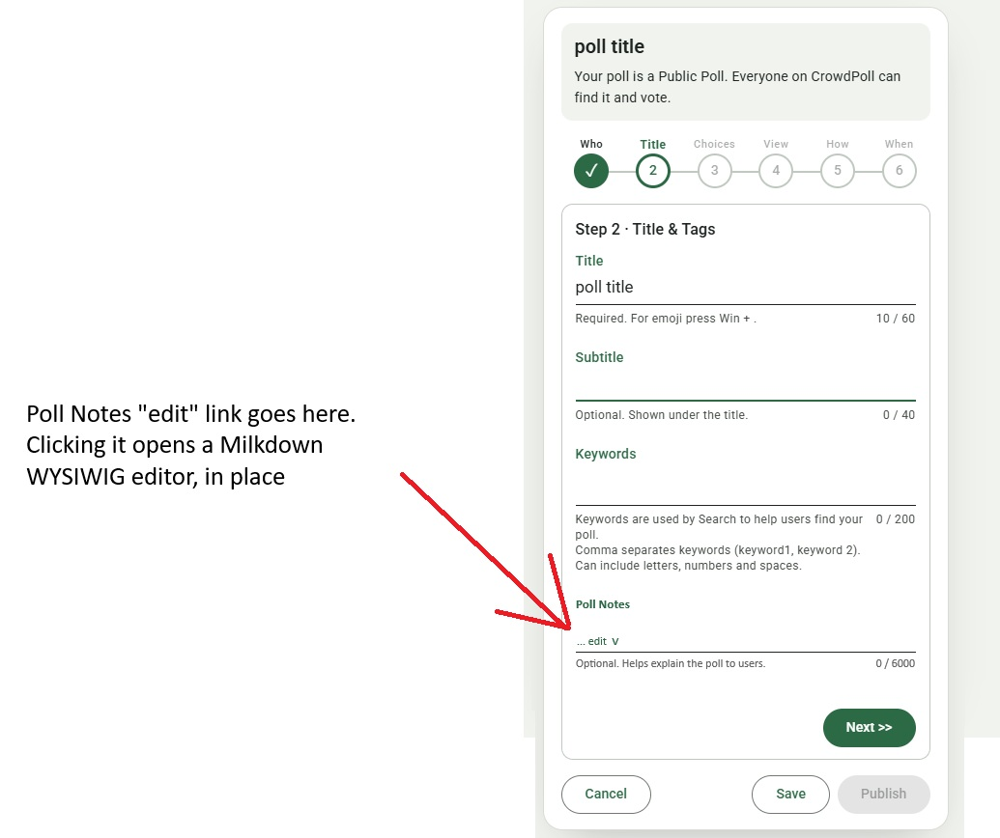
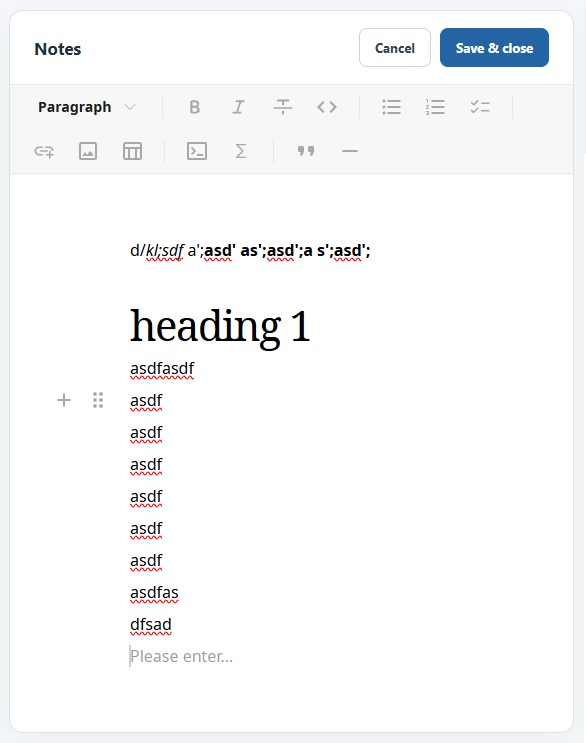
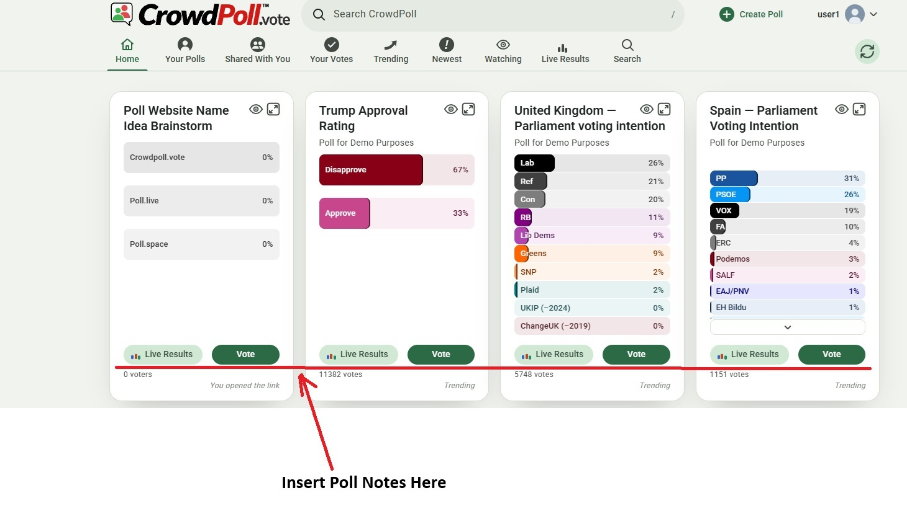
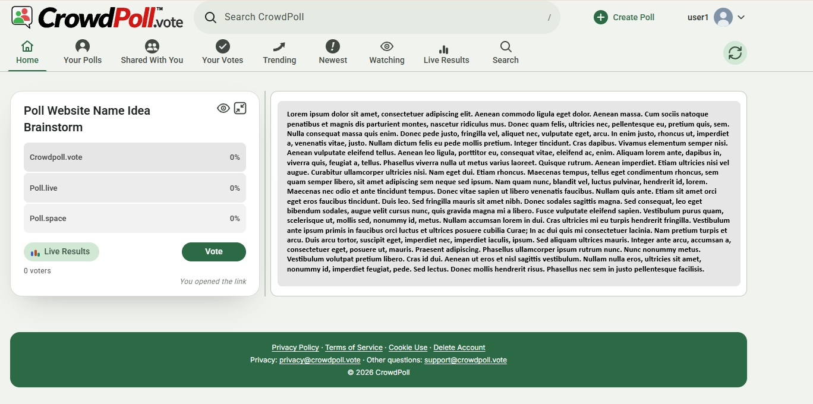

Start a new spec for these requirements called `20261109-114330-POLL-NOTES`  
!! THIS FILE IS GENERATED USING THE SKILL `/speckit-requirements`. DO NOT EDIT OR DELETE THIS FILE !!  

# Initial High-Level Requirements

A Poll can now have a "notes" field.  
By default the notes field is empty.
The notes field is limited to 6000 characters.  

The notes will be edited on the Admin Poll Card on the "Title" section 2,  
as seen in the mockup in:  
  

The WYSIWIG editor will be Milkdown found on NPM at:  
https://www.npmjs.com/package/@milkdown/crepe

The editor will have a traditional toolbar.  

To launch the editor, the user will click on the "... edit V" link that is in the notes field.  
The "V" is a chevron pointing downwards.  
Clicking on it will expand the WYSIWIG editor for editing the notes, in place.  
When in edit mode, the window will grow a necessary to fit the data the creator enters.  
There will be two buttons:  
- Cancel
- Save  

Clicking either of these buttons will close the editor.  
Clicking the Edit Poll card's "Next >>" button, or another numbered tab will also close the editor.  

This mockup shows how the editor will appear when expanded for editing the notes:  

When the "Title" section 2 is active, just two lines of the current notes will be displayed. 
At the end of the 2nd line will be the "... edit V" link to expand the editor.  

The Milkdown editor will provide markdown of the notes the creator enters.  
The markdown will be stored in the backend and used to render the notes when the poll is viewed.  

The Admin Poll Card will not show markdown, but the rendered notes will be displayed as formatted text.  

On the Poll Card that all users see, the notes will appear between the poll title and the poll options  
as shown in the mockup:

These notes will also be limited to 2 lines.  
If there are more than 2 lines then there will be an ellipsis ("...") indicating that there is more content.  
Under the 2nd line there will be a "Show more V" link, where the "V" is a chevron pointing downwards.  

Clicking the "Show more V" link will switch to the "Maximized" view where the complete notes will be rendered in the right column above any other content that is in the right column.  
Currently, the "Maximized" view right column has an optional line graph.  
The notes will be rendered above that.  
Here is a mockup of how the notes will appear in the "Maximized" view:

## Decisions from the requirements report

Each decision below was accepted in `requirements-report.md`; the finding's id is in brackets.  

- **Maximized view (AM5)**:  
  In the Maximized view the card hides its notes preview and "Show more ⌄".  
  The full notes head the right column whenever the poll has notes, however the view was opened ("Show more ⌄" or the maximize button), followed by the line graph.  
  On a single-column layout they come straight after the card, before the line graph.  
  A poll without notes shows the Maximized view as today, and the view is left as today (the maximize button or Back).  

- **Editor height (AM6)**:  
  The editor grows with its content up to the height of the viewport less the site header and the editor's own bar, then scrolls inside.  
  Its heading, buttons and toolbar stay at its top.  

- **Who sees the notes (UA1)**:  
  The notes are part of the poll: anyone who may see the poll (`src/polls/access.ts`) sees them, guests included, in every state the card is shown (OPEN, CLOSED, WAITING TO OPEN).  
  They show on the card front and in the Maximized view, not on the card's back or the admin results page.  
  There is no new access rule; a poll the caller may not see still answers `404`.  

- **Screening (UA3)**:  
  The notes' text is screened by Acceptability Screening with the title, subtitle and choices.  
  The rejection message names them: "Please revise the title, subtitle, notes and choices."  

- **Editing a published poll (UA4)**:  
  Notes may be edited in any state where the subtitle may.  
  A change bumps `content_version` (notes are not in `NON_CONTENT_FIELDS`), so open cards refresh.  
  While the poll is `EDITING`, voters see the stashed notes; the change is screened with the edit.  

- **Search and SEO (UA5)**:  
  The notes' plain text is indexed for search at the lowest weight (1, beside keywords), in OpenSearch and PostgreSQL full-text alike, through the existing outbox.  
  The `/poll/:pid` page adds the rendered notes under the summary; its meta description is unchanged.  

- **Payload (UA6)**:  
  Card listings carry a short rendered preview (the start of the notes, enough for two lines, cut at a word) and `hasMoreNotes`.  
  The full rendered notes come with the single-card response (`GET /api/polls/:pid/card`) that the Maximized view and the Admin Poll Card use.  

- **Duplicated polls (UA8)**:  
  A duplicated poll (`duplicatePoll`) carries the notes; they are screened when the copy is published, like the rest.  

- **Cancel and keyboard (UA9)**:  
  The editor's Cancel, when the notes were changed, asks first with the site's existing discard dialog.  
  Escape is Cancel.  
  On opening, the focus goes into the editor; on closing, it returns to "... edit ⌄".  
  The toolbar buttons have labels and tooltips.

- **Notes on the poll card (IN1)**:  
  The notes sit between the poll title and the choices, as the text says.  
  The minimum height of a poll card grows by the height of two lines of notes and the "Show more ⌄" link.  
  The notes sit in a container consistent with Material 3 design principles.  

- **Editor buttons (IN2)**:  
  The editor has a "Notes" heading with "Cancel" and "Done" at its top right, as placed in the mockup.  

- **Toolbar (IN3)**:  
  The editor has a fixed, always-visible toolbar above the text, as in the screenshot from the developer's test implementation (`poll_notes_editor.jpg`).  
  It holds only the buttons the allowed formatting needs.  

- **The 6000 characters (AM1)**:  
  The 6000 characters count the stored notes, formatting marks included, in code points, checked by the server with `validateFieldLength` like every other field.  
  The counter under the field shows that count, and the editor's Done is disabled above 6000.  

- **Saving the notes (AM2)**:  
  The editor's Done puts the notes into the card's form, like typing into Subtitle;  
  the card's Save or Publish sends them to the server with the other fields, and the card's Cancel discards them.  

- **Closing by Next or a tab (AM3)**:  
  Closing the editor with "Next >>" or another numbered tab keeps the changes, exactly as Done.

- **Editor (RS1)**:  
  The notes editor has no dependency: a `contenteditable` box with B, I and U toolbar buttons using `document.execCommand`, and the browser's own Ctrl/⌘+B, I and U, in its own script `notesEditor.js`.  
  It converts its content to and from the stored format (Stored format, NC2) by walking its DOM, keeping only text, line breaks and the three marks.  
  The `execCommand` calls sit in one small function, so they can be replaced if browsers ever drop them.  
  Milkdown is not used.  

- **Milkdown and Markdown superseded (IN4)**:  
  The additional requirement of 2026-11-09 supersedes the sentences that name Milkdown and Markdown:  
  the editor is the one under Editor (RS1), and the stored format the one under Stored format (NC2).  

- **Safe rendering (UA2)**:  
  The notes are rendered on the server, once per content version, with no dependency: every `&`, `<`, `>` and quote is escaped first, then the three marks become `<strong>`, `<em>` and `<u>`, and newlines ` `.  
  Nothing else can appear, so a URL typed into the notes stays plain text.  
  The rendered HTML travels in the poll's projection; the cards, the Maximized view, the Admin Poll Card preview and the SEO page all use this one renderer.  
  Tests pin the dangerous cases (`<script>`, `javascript:`, unbalanced or nested marks).  

- **Pasting and shortcuts (UA10)**:  
  Pasting or dropping content into the editor inserts its plain text only.  
  Ctrl/⌘+B, I and U toggle the three marks, and the B, I and U buttons show which marks are on at the cursor.  
  Nothing else (headings, lists, links, images) can be produced, whatever the browser offers.  

- **Stored format (NC2)**:  
  The notes are stored as plain text with three marks: `**bold**`, `*italic*` and `++underline++`.  
  A literal `*`, `+` or `\` is written with a backslash before it; line breaks are stored as newlines.

- **Two-line preview (AM4)**:  
  On both cards the preview is the rendered notes, clipped to two lines of body text with CSS `line-clamp`, which draws the ellipsis.  
  On the poll card, "Show more ⌄" appears only when the notes are clipped.  
  On the Admin Poll Card, "... edit ⌄" always ends the second line, so empty notes can be started.  

## Additional Requirements (2026-11-09 12:26 PM)

After reviewing some opf the questions in the findings,
we have decided that there is no benefit in allowing anything in the notes besides bold, italics and underline.
There is too much risk in urls, images and other potentially unsafe content.
Therefore, the notes will only support basic text formatting: bold, italics, and underline.
This can probably be done without the overhead and complexity of Milkdown.
As a topic fopr research: Can a simple editor be implemented that only supports bold, italics, and underline be implmeneted with no third-party dependencies?
Or is the a light-weight npm library that can provide this functionality without the overhead of Milkdown?
