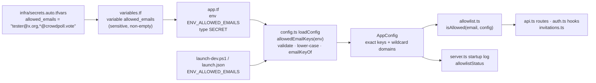
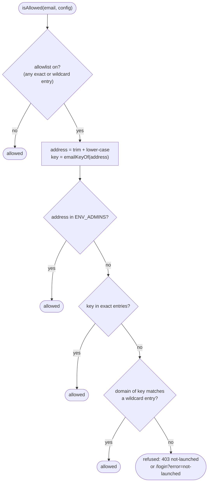
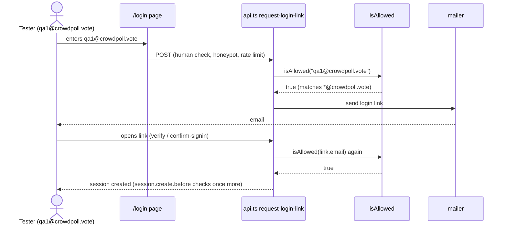

# High Level Requirements

Requirements: `requirements/20261109-201638-allowlist-domain-wildcard/requirements.md`  
External Files: none  
Generated: 2026-11-09 8:16 PM  

We want the email addresses to have the wildcard "*" that are allowed when the site is in test mode
in the environment variable 
`ENV_ALLOWED_EMAILS`
and when configuring usinfg terraform in the file
`infra\secrets.auto.tfvars`
using the variable
`allowed_emails`

For example, "*.crowdpoll.vote" would allow any email address ending with `@crowdpoll.vote` when the site is in test mode. 

## Additional Requirements and Research Requests

**Instructions To The Developer**  
Enter any additional requirements or research requests under the ## Additional Requirements and Research Requests heading above.  
When you Type or Say: "Next" in the CC CLI terminal, the additional requirements and research requests will be applied to the report.  
  
You may leave these instructions here. They will be ignored when "Next" is executed.  

✅ Applied 2026-11-09 8:25 PM: 1 requirement added to requirements.md (findings IN1, IN2, UA7); no research request.  

## 1. Overview and Scope

The pre-launch allowlist (`ENV_ALLOWED_EMAILS`, feature `20261021-143942-prelaunch-signup-allowlist`) lets only listed addresses, and the `ENV_ADMINS` addresses, create an account and log in.  
Today every entry must be one full address; it is lower-cased and stored as its email key (`emailKeyOf`: plus-tag dropped, Gmail dots removed), and `isAllowed` looks the address's key up in that set.  
This feature adds a **wildcard entry**, so one entry admits every address at a domain (the requirement's example: every address ending `@crowdpoll.vote`).  

- **In scope**:  
  - the syntax of a wildcard entry in `ENV_ALLOWED_EMAILS` (and so in `allowed_emails`, which Terraform passes through unchanged);  
  - its validation at startup (`loadConfig`, `ConfigError`);  
  - matching in `isAllowed`, which every refusal path already calls (create account, login link, verify and confirm-signin, email change, invitation redemption, and the BetterAuth `user.create.before` and `session.create.before` hooks that cover the provider logins);  
  - the startup log line, tests and documentation.  
- **Out of scope**:  
  - any new setting or Terraform variable: `allowed_emails` stays one sensitive string, validated non-empty;  
  - wildcards in `ENV_ADMINS`;  
  - a change to what a refused person sees (`not-launched`).  

## 2. Where the setting travels

Terraform needs no change: the `*` is an ordinary character in an HCL string, and the variable is already one comma-separated string.  
The only code that reads the entries is `allowedEmailKeys` in `src/config.ts`; the only code that matches them is `isAllowed` in `src/auth/allowlist.ts`.  

## 3. The admission decision

## 4. A login from a wildcard address

## 5. Findings

### 5.1 Inconsistencies

**IN1. The UA3 rule contradicts wildcards in the domain**  
<b>
✅ Resolved</b>  
✅ Requirements File Updated: 2026-11-09 8:33 PM  
**Notes**: Recommendation accepted in file 2026-11-09: Recommendation A, **drop the UA3 rule: an entry with `*` is valid when it has exactly one `@` with at least one character on each side; nothing else is refused**;  
the Invalid wildcard entries requirement in requirements.md is rewritten to say so (`*@*` is valid and admits every address).  

> UA3, resolved earlier, says a wildcard entry is valid only when its domain has at least one dot and no `*`, and refuses `*@*` and `*@*.crowdpoll.vote`.  
> UA2's Developer Resolution lets the wildcard appear anywhere in the entry, more than once, so `*@*.crowdpoll.vote` is meant to work.  
> The additional requirement says UA2 makes UA3 irrelevant.  

  - **Recommendation A** _(recommended)_: **drop the UA3 rule: an entry with `*` is valid when it has exactly one `@` with at least one character on each side; nothing else is refused.**  

    [X] ➡️ **Accepted**

    - <u>Pros</u>: matches the additional requirement; the only check left is the address shape, which still catches `*.crowdpoll.vote` (AM1).  
    - <u>Cons</u>: `*@*` is then valid and admits everyone, the same as an empty list but while the startup line says the allowlist is on.  

  - **Recommendation B**: **drop the UA3 rule but keep one guard: an entry that would admit every address (`*@*`, `*@*.*`, any entry made only of `*`, `.` and `@`) stops the app.**  

    [ ] ➡️ **Not Accepted**

    - <u>Pros</u>: wildcards anywhere still work, and a typo cannot silently open the site to everyone.  
    - <u>Cons</u>: one rule more than the additional requirement asks for.  

  - **Developer Resolution C**:  

    [ ] ➡️ **Not Accepted**

**IN2. The startup line and the decision diagram speak of domains**  
<b>
✅ Resolved</b>  
✅ Requirements File Updated: 2026-11-09 8:33 PM  
**Notes**: Recommendation accepted in file 2026-11-09: **Recommendation**, **count patterns instead: `[auth] Sign-up allowlist on (2 addresses, 1 pattern)`**;  
the Startup line requirement in requirements.md now counts patterns; section 3's diagram is read as "the key matches a wildcard pattern".  

> UA5 gives the startup line as `(2 addresses, 1 domain)`, and section 3's diagram asks whether "the domain of key matches a wildcard entry".  
> Since UA1 and UA2, a wildcard entry is a pattern over the whole address, not a domain.  

  - **Recommendation**: **count patterns instead: `[auth] Sign-up allowlist on (2 addresses, 1 pattern)`, and read the diagram's question as "the key matches a wildcard pattern".**  

    [X] ➡️ **Accepted**

    - An entry is a pattern when it holds a `*`, otherwise an address; still no entry is named in the log.  

  - **Developer Resolution B**:  

    [ ] ➡️ **Not Accepted**

### 5.2 Ambiguities

**AM1. How is a wildcard entry written?**  
<b>
✅ Resolved</b>  
✅ Requirements File Updated: 2026-11-09 8:25 PM  
**Notes**: Recommendation accepted in file 2026-11-09: Recommendation A, **write it as an address whose local part is `*`: `*@crowdpoll.vote`**;  
the requirements now say so under Resolved Requirements (Wildcard form).  

> The requirement's example is `*.crowdpoll.vote`, and says it admits every address ending `@crowdpoll.vote`.  
> Written that way the entry has no `@`, and by the usual convention `*.crowdpoll.vote` means "any subdomain of crowdpoll.vote" (as in TLS certificates and DNS), so it reads like `a@mail.crowdpoll.vote` rather than `a@crowdpoll.vote`.  
> Today every entry must match `EMAIL_PATTERN`, an address with one `@`.  

  - **Recommendation A** _(recommended)_: **write it as an address whose local part is `*`: `*@crowdpoll.vote`.**  

    [X] ➡️ **Accepted**

    - <u>Pros</u>: it reads as "anyone @crowdpoll.vote", sits naturally beside full addresses in the same list, and still passes the address shape check.  
    - <u>Cons</u>: it differs from the example as written; an entry written `*.crowdpoll.vote` stops the app with a message showing the right form.  

  - **Recommendation B**: **accept both `*@crowdpoll.vote` and `*.crowdpoll.vote`, meaning the same.**  

    [ ] ➡️ **Not Accepted**

    - <u>Pros</u>: the example works as written, and either habit is forgiven.  
    - <u>Cons</u>: two spellings for one thing, and `*.crowdpoll.vote` then cannot later mean "subdomains" (see UA2).  

  - **Recommendation C**: **only `*.crowdpoll.vote`, as in the example.**  

    [ ] ➡️ **Not Accepted**

    - <u>Pros</u>: matches the requirement's example exactly.  
    - <u>Cons</u>: a bare domain in an address list is easy to misread, and the subdomain reading above is the common one.  

  - **Developer Resolution D**:  

    [ ] ➡️ **Not Accepted**

**AM2. What is "test mode"?**  
<b>
✅ Resolved</b>  
✅ Requirements File Updated: 2026-11-09 8:19 PM  
**Notes**: Recommendation accepted by "Accept all" 2026-11-09: **Recommendation**: **"test mode" is the allowlist being on; no new setting.**;  
the requirements now say so under Resolved Requirements (Test mode).  

> The requirement says wildcards apply "when the site is in test mode".  
> The site has no setting called test mode; the allowlist itself is what limits the site to testers before launch: on while `ENV_ALLOWED_EMAILS` holds an entry, off when it is unset or empty.  

  - **Recommendation**: **"test mode" is the allowlist being on; no new setting.**  

    [X] ➡️ **Accepted**

    - Wildcard entries are simply entries of `ENV_ALLOWED_EMAILS`; a list holding only wildcard entries also turns the allowlist on.  
    - Emptying the list (at launch) turns everything off, wildcards included.  

  - **Developer Resolution B**:  

    [ ] ➡️ **Not Accepted**

### 5.3 Unspecified Aspects

**UA1. Where may the `*` appear?**  
<b>
✅ Resolved</b>  
✅ Requirements File Updated: 2026-11-09 8:25 PM  
**Notes**: Recommendation accepted in file 2026-11-09: Recommendation B, **anywhere in the local part, as a glob (`*` = any characters)**;  
the requirements now say so under Resolved Requirements (Where `*` may appear).  

> The requirement shows only a whole-domain wildcard.  
> It does not say whether `*` may stand for part of a local part (`qa-*@gmail.com`), or appear more than once.  

  - **Recommendation A** _(recommended)_: **only as the whole local part: `*@<domain>`.**  

    [ ] ➡️ **Not Accepted**

    - <u>Pros</u>: covers the stated need with one simple rule (compare the domain), and is easy to read in a list.  
    - <u>Cons</u>: a tester group inside a public domain (`qa-*@gmail.com`) still has to be listed address by address.  

  - **Recommendation B**: **anywhere in the local part, as a glob (`*` = any characters).**  

    [X] ➡️ **Accepted**

    - <u>Pros</u>: also admits patterned addresses (`qa-*@gmail.com`).  
    - <u>Cons</u>: anyone can register a matching Gmail address, so it admits strangers; and it must be defined against the email key (Gmail dots and plus-tags removed), which is easy to get wrong.  

  - **Developer Resolution C**:  

    [ ] ➡️ **Not Accepted**

**UA2. Does a domain wildcard admit its subdomains?**  
<b>
✅ Resolved</b>  
✅ Requirements File Updated: 2026-11-09 8:25 PM  
**Notes**: Recommendation accepted in file 2026-11-09: Developer Resolution C, **the wildcard can appear anywhere in the entry, and there may be more than one wildcard in an entry**;  
the requirements now say so under Resolved Requirements (Wildcards in the domain).  

> The requirement says "ending with `@crowdpoll.vote`".  
> It does not say whether `qa@mail.crowdpoll.vote` is admitted by the same entry.  

  - **Recommendation A** _(recommended)_: **no: the domain must match exactly; a subdomain needs its own entry (`*@mail.crowdpoll.vote`).**  

    [ ] ➡️ **Not Accepted**

    - <u>Pros</u>: matches "ending with `@crowdpoll.vote`" literally, and admits nothing the list does not name.  
    - <u>Cons</u>: one more entry per subdomain used for mail.  

  - **Recommendation B**: **yes: `*@crowdpoll.vote` also admits any `*.crowdpoll.vote` subdomain.**  

    [ ] ➡️ **Not Accepted**

    - <u>Pros</u>: one entry covers the whole organisation's mail.  
    - <u>Cons</u>: wider than the requirement states, and less obvious when reading the list.  

  - **Developer Resolution C**:  

    [X] ➡️ **Accepted**

    - the wildcard can appear anywhere in the entry, and there may be more than one wildcard in an entry.

**UA3. Which wildcard entries stop the app?**  
<b>
✅ Resolved</b>  
✅ Requirements File Updated: 2026-11-09 8:19 PM  
**Notes**: Recommendation accepted by "Accept all" 2026-11-09: **Recommendation**: **a wildcard entry is valid only as `*@` followed by a domain with at least one dot and no `*`; anything else with a `*` stops the app, naming the entry and the accepted form.**;  
the requirements now list the refused spellings under Resolved Requirements (Invalid wildcard entries).  

> Today an entry that is not an address stops the app with `Invalid ENV_ALLOWED_EMAILS: "<entry>" is not an email address.`  
> The requirement does not say which wildcard spellings are valid, and some would quietly admit everyone (`*`, `*@*`) or nothing useful (`*@com`).  

  - **Recommendation**: **a wildcard entry is valid only as `*@` followed by a domain with at least one dot and no `*`; anything else with a `*` stops the app, naming the entry and the accepted form.**  

    [X] ➡️ **Accepted**

    - `*`, `*@*`, `*@com`, `*@*.crowdpoll.vote`, `qa*@x.org` (under UA1 A) and `*.crowdpoll.vote` (under AM1 A) are refused with a `ConfigError`, so a typo cannot open the site to everyone.  
    - To let everyone in, the list is emptied, as today.  
    - The message names the entry, as today's does; a domain is not an address, so this is not a privacy concern for the logs.  

  - **Developer Resolution B**:  

    [ ] ➡️ **Not Accepted**

**UA4. How is a wildcard matched against letter case and the email key?**  
<b>
✅ Resolved</b>  
✅ Requirements File Updated: 2026-11-09 8:19 PM  
**Notes**: Recommendation accepted by "Accept all" 2026-11-09: **Recommendation**: **compare the wildcard's lower-cased domain with the domain of the address's email key.**;  
the requirements now say so under Resolved Requirements (Matching).  

> Exact entries are compared by email key (`emailKeyOf`), which lower-cases nothing itself but is fed a lower-cased address, and rewrites `googlemail.com` to `gmail.com`.  
> The requirement does not say how a wildcard's domain is compared.  

  - **Recommendation**: **compare the wildcard's lower-cased domain with the domain of the address's email key.**  

    [X] ➡️ **Accepted**

    - `QA@CrowdPoll.Vote` matches `*@crowdpoll.vote`; `*@gmail.com` also admits `googlemail.com`, just as an exact Gmail entry does today.  
    - The same comparison serves every path, provider logins included, because they all call `isAllowed`.  

  - **Developer Resolution B**:  

    [ ] ➡️ **Not Accepted**

**UA5. What does the startup line say?**  
<b>
✅ Resolved</b>  
✅ Requirements File Updated: 2026-11-09 8:19 PM  
**Notes**: Recommendation accepted by "Accept all" 2026-11-09: **Recommendation**: **count the two kinds separately: `[auth] Sign-up allowlist on (2 addresses, 1 domain)`.**;  
the requirements now give the line under Resolved Requirements (Startup line).  

> Startup logs `[auth] Sign-up allowlist on (<n> addresses)`, a count only, never an address (`tests/allowlist.test.ts`).  
> With wildcard entries a count of "addresses" is no longer what the list holds.  

  - **Recommendation**: **count the two kinds separately: `[auth] Sign-up allowlist on (2 addresses, 1 domain)`; a kind with none is left out; still no address or domain is named.**  

    [X] ➡️ **Accepted**

    - A list of only wildcards reads `(1 domain)`; a list of only addresses reads exactly as today.  

  - **Developer Resolution B**:  

    [ ] ➡️ **Not Accepted**

**UA6. Which tests and documents change?**  
<b>
✅ Resolved</b>  
✅ Requirements File Updated: 2026-11-09 8:19 PM  
**Notes**: Recommendation accepted by "Accept all" 2026-11-09: **Recommendation**: **the tests in `tests/allowlist.test.ts` and the wildcard form in each document.**;  
the requirements now list them under Resolved Requirements (Tests and documentation).  

> The requirement names the setting and the Terraform variable, but not what must be proven or documented.  
> The allowlist is described in `README.md`, `ARCHITECTURE.md`, `CLAUDE_COMPLETE.md`, `.claude/rules/environment.md` and `infra/secrets.auto.tfvars.example`, and tested in `tests/allowlist.test.ts`.  

  - **Recommendation**: **tests in `tests/allowlist.test.ts` for parsing, refusal of bad wildcards, matching (case, Gmail, subdomain, admin), a wildcard-only list turning the allowlist on, a login link and a provider-style account creation from a wildcard address, and the startup line; and the wildcard form added to each of those documents.**  

    [X] ➡️ **Accepted**

    - `infra/secrets.auto.tfvars.example` gets a comment showing a mixed list; Terraform itself does not change.  

  - **Developer Resolution B**:  

    [ ] ➡️ **Not Accepted**

**UA7. How is a pattern matched against the email key?**  
<b>
✅ Resolved</b>  
✅ Requirements File Updated: 2026-11-09 8:31 PM  
**Notes**: Recommendation accepted in file 2026-11-09: Developer Resolution B, **match the entry literally against the email key, with `*` standing for any run of characters except `@`**;  
the requirements now say so under Resolved Requirements (continued), noting that a Gmail pattern with a dot or plus-tag in its local part matches no Gmail address.  

> UA4 compares by email key, which drops a plus-tag and, for Gmail, the dots of the local part.  
> A pattern such as `john.*@gmail.com` would then never match, because the key of `john.smith@gmail.com` is `johnsmith@gmail.com`.  
> The requirements also do not say what `*` may stand for: an empty run, an `@`, a dot.  

  - **Recommendation**: **turn each pattern into its own email key (lower-cased, plus-tag dropped, Gmail dots removed, `googlemail.com` read as `gmail.com`), then match it against the whole key of the address, where `*` stands for any run of characters, possibly empty, except `@`.**  

    [ ] ➡️ **Not Accepted**

    - `john.*@gmail.com` becomes `john*@gmail.com` and admits `john.smith@gmail.com`; `*@*.crowdpoll.vote` admits `qa@mail.crowdpoll.vote` but not `qa@crowdpoll.vote`.  
    - Every other character is matched literally (a `.` is a dot, not "any character").  

  - **Developer Resolution B**:  

    [X] ➡️ **Accepted**

    - match the entry literally against the email key, with `*` standing for any run of characters except `@`.

### 5.4 Needs Clarifications

**NC1. May a wildcard name a public mail domain?**  
<b>
✅ Resolved</b>  
✅ Requirements File Updated: 2026-11-09 8:25 PM  
**Notes**: Recommendation accepted in file 2026-11-09: Recommendation A, **allow it; the documentation warns that a wildcard admits everyone with a mailbox at that domain**;  
the requirements now say so under Resolved Requirements (Public mail domains).  

> A wildcard on a domain anyone can get a mailbox at (`*@gmail.com`, `*@outlook.com`) admits the general public, which defeats a pre-launch allowlist.  
> A login still proves the person owns the mailbox, so the risk is only that the list is wider than meant.  

  - **Recommendation A** _(recommended)_: **allow it; the documentation warns that a wildcard admits everyone with a mailbox at that domain.**  

    [X] ➡️ **Accepted**

    - <u>Pros</u>: no list of providers to maintain; the operator decides.  
    - <u>Cons</u>: a mistaken `*@gmail.com` would open sign-up to the public until noticed.  

  - **Recommendation B**: **refuse a wildcard on a built-in list of public mail domains at startup.**  

    [ ] ➡️ **Not Accepted**

    - <u>Pros</u>: the mistake cannot happen for the common providers.  
    - <u>Cons</u>: a list that is never complete and must be kept up to date, for a setting only the operator edits.  

  - **Developer Resolution C**:  

    [ ] ➡️ **Not Accepted**

## 6. Breaking Changes

- An entry of the form `*@domain` is accepted today (it passes `EMAIL_PATTERN`) and admits only the literal address with local part `*`, which no one has.  
  With this feature it admits the whole domain.  
  No real list is expected to hold such an entry, so the change is in name only.  
- Every other existing list keeps its meaning exactly.  

## 7. Technical Debt

- **"Is the allowlist on?" is asked as `config.allowedEmailKeys` being set**, in `src/auth/auth.ts:226` (`session.create.before`) and `src/routes/api.ts:517` and `:570`.  
  If wildcard domains are held apart from the exact keys, a wildcard-only list would leave those checks off.  
  One allowlist value (exact keys and wildcard domains together, with an `on` test) used by every check avoids that.  
- **`ENV_ADMINS` is compared by lower-cased address, not by email key**, unlike the list entries; an admin's Gmail dot variant is not recognised as the admin.  
  This is existing behaviour and is not changed here.  

## 8. Assumptions

- The wildcard is for the pre-launch period only, like the allowlist itself; at launch the list is emptied.  
- Wildcards apply to `ENV_ALLOWED_EMAILS` only, not to `ENV_ADMINS`.  
- No database change, route, setting, cookie or dependency is needed; the change is confined to `src/config.ts`, `src/auth/allowlist.ts`, the checks named in *Technical Debt*, tests and documentation.  

## 9. Requirements Report Complete Report  
  
- **Requirements Report Document:** requirements/20261109-201638-allowlist-domain-wildcard/requirements-report.md  
- **Requirements Document:** requirements/20261109-201638-allowlist-domain-wildcard/requirements.md  
- **Software Architecture Diagrams:** 3  
- **Inconsistencies:** 2  
- **Ambiguities:** 2  
- **Unspecified Aspects:** 7  
- **Needs Clarifications:** 1  
- **Research Results:** 0  
- **Breaking Changes:** 1  
- **Technical Debt items:** 2  
  
The requirements are ready for /speckit-specify.
To generate specs from the requirements document, use the `/speckit-specify` skill followed by the path (relative to the project root) to the requirements file.
At the prompt, Type:  
🟩 👉 /speckit-specify requirements/20261109-201638-allowlist-domain-wildcard/requirements.md  
