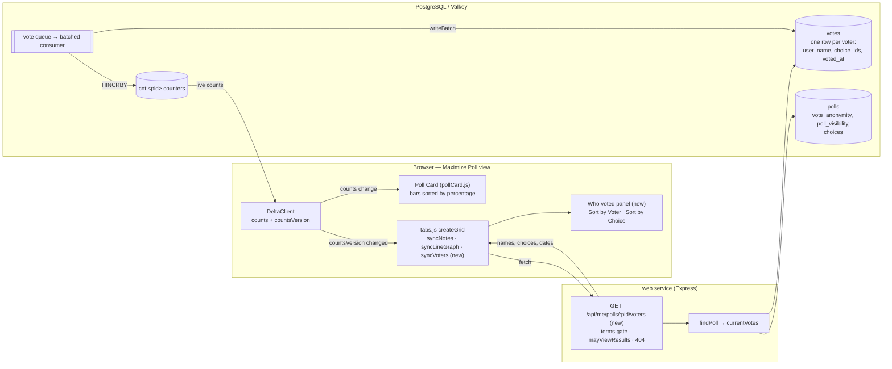
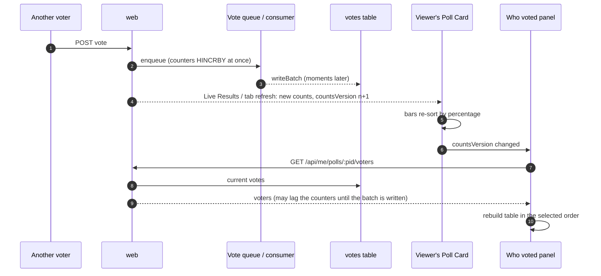
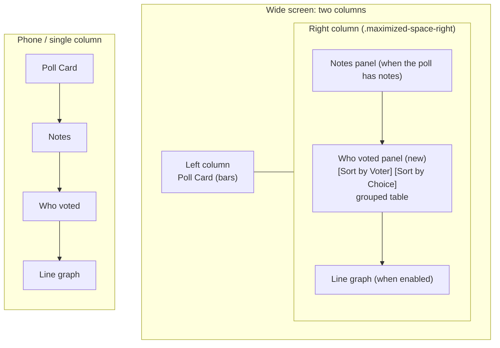

# High Level Requirements

Requirements: `requirements/20261110-123524-who-voted-report/requirements.md`  
External Files: none  
Generated: 2026-11-10 12:37 PM  

This feature will add a report of who voted for what for Private Polls that are not anonymous.  
 
The report will appear on the Maximize Poll view as a panel that has the same appearance as the Notes panel,   
in the right column,  
below the Notes panel if there is one  
otherwise, the top of the right column.  

The UI/UX of the panel will adhere to material 3 design guidelines, and have a consistent look with existing Crowdpoll webapp.  

The current vote (or votes) will be revealed.  
If a poll allows votes to be changed, the report does not display previous votes, only the current ones.  
The report will change as the bars change in the Poll Card that is in the left column of the Maximize Poll view.  

Above the table will be two buttons:
(Sort by Voter) (Sort by Choice)

When Sort by Voter is selected, the table will be sorted alphabetically by voter name, and then by choice in the order they appear on the Poll Card front.
In that case, the report will be in the form of a table:
| Voter | Choice | Date
|-------|--------|----|
| Alice | Option 1 | 2024-06-10 |
| Bob   | Option 2 | 2024-06-10 |  

If the poll is multiple choice   
| Voter | Choice | Date
|-------|--------|----|
| Alice | Option 1 | 2024-06-10 |
|       | Option 2 | 2024-06-10 |
| Bob   | Option 2 | 2024-06-10 |  
|       | Option 4| 2024-06-10 |  
|       | Option 6| 2024-06-10 |  

When Sort by Choice is selected, the table will be sorted by choice in the order they appear on the Poll Card front, and then by voter name alphabetically.
In that case, the report will be in the form of a table:
| Choice | Voter | Date
|-------|--------|----|
| Option 2 | Luke   | 2024-06-10 |  
|  | Mark   | 2024-06-10 |  
|  | Tom   | 2024-06-10 |  
| Option 1 | Alice | 2024-06-10 |
|  | Mark | 2024-06-10 |
|  | Matthew | 2024-06-10 |
|  | Paul   | 2024-06-10 |

The rows of the table will alternate background color for readability.  
To be more clear, a row is either all the choices for a voter,   
or all the voters for a Choice.

The panel will grow to fit the entire table.

## Additional Requirements and Research Requests

**Instructions To The Developer**  
Enter any additional requirements or research requests under the ## Additional Requirements and Research Requests heading above.  
When you Type or Say: "Next" in the CC CLI terminal, the additional requirements and research requests will be applied to the report.  
  
You may leave these instructions here. They will be ignored when "Next" is executed.  

## 1. Overview and Scope

A private poll can already be set so that votes are not anonymous: the wizard's switch **Users can see who voted for what** stores `vote_anonymity = "No"`.
Its help text promises that "the names of voters are shown next to the choices they picked", but today nothing shows them to voters.
Only the poll's owner and administrators see names, on `/admin/poll/results` (`GET /api/admin/polls/:pid/results`).
This feature keeps that promise in the Maximize Poll view.

- **In scope**
  - A **Who voted** panel in the right column of the Maximize Poll view (`.maximized-space-right` in `index.html`), below the Notes panel when there is one, otherwise at the top.
  - Only for a poll with `poll_visibility = "Private Poll"` and `vote_anonymity = "No"`.
  - Each voter's **current** vote only (the `votes` table, one row per voter), never `vote_history`.
  - Two sort orders, **Sort by Voter** and **Sort by Choice**, each a grouped table with a Date column and alternating group backgrounds.
  - The panel follows the bars of the Poll Card in the left column as they change, and grows to fit the whole table.
  - Material 3 look, matching the Notes panel.
- **Out of scope** (assumed)
  - Public polls and anonymous private polls: no panel, and no names reach the browser.
  - Vote history, previous votes, and the invited voters who have not voted.
  - The admin results page and the admin card, which keep their own voter lists.
  - Export, printing or download of the report.

The number of rows is bounded: a private poll holds at most `ENV_MAX_PRIVATE_POLL_VOTERS` voters (default 100), so a table that grows to fit stays a reasonable size.

## 2. Components and data flow

The panel is a third right-column panel beside the existing two, managed the way `syncNotes` manages the Notes panel: fetched when the poll is maximized, refetched when the card's `countsVersion` changes, cleared on `restore`.
Names travel only on a new per-viewer route, never in the shared, cacheable card or tab payloads.

## 3. Keeping the report in step with the bars

The bars come from the live counters, the names from the `votes` table, which the batched consumer writes a moment later.
UA3 settles how the panel catches up.

## 4. Layout and table shapes

| Sort by Voter (one group per voter) | Sort by Choice (one group per choice) |
|---|---|
| Voter · Choice · Date | Choice · Voter · Date |
| groups A→Z by voter name; inside a group, choices in bar order | groups in bar order; inside a group, voters A→Z |
| the name shows on the group's first line only | the choice shows on the group's first line only |
| backgrounds alternate per group | backgrounds alternate per group |

## 5. Findings

### 5.1 Inconsistencies

**IN1. The Sort by Choice example contradicts the bar order**  
<b>
✅ Resolved</b>  
✅ Requirements File Updated: 2026-11-10 1:08 PM  
**Notes**: Recommendation accepted in file 2026-11-10: Recommendation, the rule wins; the example is illustrative;  
the requirements now carry a note under the Sort by Choice example that its rows show the layout only.  

> The rule says choices follow "the order they appear on the Poll Card front".  
> The card front sorts its bars by percentage, highest first (`data.sort((a, b) => b.pct - a.pct)` in `pollCard.js`).  
> The example lists Option 2 (3 voters) above Option 1 (4 voters), the reverse of the bar order on a single-choice poll.  

  - **Recommendation**: **the rule wins; the example is illustrative.**  

    [X] ➡️ **Accepted**

    - The requirements gain a note under the example that its rows show the layout, not a real count order.  
    - The order itself is settled by AM1.  

  - **Developer Resolution B**:  

    [ ] ➡️ **Not Accepted**

### 5.2 Ambiguities

**AM1. What is "the order they appear on the Poll Card front"?**  
<b>
✅ Resolved</b>  
✅ Requirements File Updated: 2026-11-10 1:08 PM  
**Notes**: Recommendation accepted in file 2026-11-10: Recommendation A, the live bar order, ties in the creator's order;  
the requirements' Decisions section now defines the choice order.  

> The card front draws its bars sorted by percentage, highest first, with ties kept in the creator's order (`position`).  
> That order changes live as votes arrive.  
> The phrase could mean that live order, or the creator's fixed order of the choices.  

  - **Recommendation A** _(recommended)_: **the live bar order, ties in the creator's order.**  

    [X] ➡️ **Accepted**

    - <u>Pros</u>: the table reads in the same order as the bars beside it, which is what the requirements describe;  
      the panel already rebuilds whenever the bars change.  
    - <u>Cons</u>: in Sort by Choice, groups move when one choice overtakes another.  

  - **Recommendation B**: **the creator's fixed order (`position`).**  

    [ ] ➡️ **Not Accepted**

    - <u>Pros</u>: groups never move.  
    - <u>Cons</u>: it does not match the bars, which is the order the requirements name.  

  - **Developer Resolution C**:  

    [ ] ➡️ **Not Accepted**

**AM2. Is the Date per vote or per choice?**  
<b>
✅ Resolved</b>  
✅ Requirements File Updated: 2026-11-10 1:08 PM  
**Notes**: Recommendation accepted in file 2026-11-10: Recommendation, the date of the voter's current vote, shown on every line;  
added to the Decisions section.  

> A voter's current vote is one row in `votes`, with one `choice_ids` array and one `voted_at`.  
> The multiple-choice example repeats a date on each choice line, which suggests each choice has a date of its own.  
> It does not: every choice of one vote carries the same date.  

  - **Recommendation**: **the date of the voter's current vote, shown on every line.**  

    [X] ➡️ **Accepted**

    - Each line of a voter's group shows the same date, as in the examples;  
      in Sort by Choice each line shows that voter's vote date.  
    - Changing a vote (where allowed) changes the date of every one of that voter's lines.  

  - **Developer Resolution B**:  

    [ ] ➡️ **Not Accepted**

### 5.3 Unspecified Aspects

**UA1. Which votes does the report list?**  
<b>
✅ Resolved</b>  
✅ Requirements File Updated: 2026-11-10 1:08 PM  
**Notes**: Recommendation accepted in file 2026-11-10: Recommendation, exactly the votes the bars count;  
added to the Decisions section.  

> "The current vote (or votes)" needs a precise set.  
> The `votes` table also holds invited addresses with empty `choice_ids`, votes of deleted accounts (renamed `Deleted user`), and may hold a choice id a later edit removed.  
> The bars count a particular set, and the report should agree with them.  

  - **Recommendation**: **exactly the votes the bars count.**  

    [X] ➡️ **Accepted**

    - Rows with at least one choice id that is still a choice of the poll (as projected: the stashed choices while the poll is `EDITING`);  
      choice ids no longer on the poll are left out.  
    - Invited addresses that have not voted are not listed.  
    - A deleted account's vote is listed under `Deleted user`, one entry per vote, as the admin results page does.  
    - A banned voter's current vote is listed exactly when the bars still count it.  

  - **Developer Resolution B**:  

    [ ] ➡️ **Not Accepted**

**UA2. How is the Date written?**  
<b>
✅ Resolved</b>  
✅ Requirements File Updated: 2026-11-10 1:08 PM  
**Notes**: Recommendation accepted in file 2026-11-10: Recommendation, the day in the viewer's time zone and locale, the full date and time on hover;  
added to the Decisions section.  

> The examples show `2024-06-10`.  
> Nothing says which time zone the day is taken in, whether a time is shown, or whether the format follows the viewer's locale.  

  - **Recommendation**: **the day in the viewer's time zone, in the viewer's locale; the full date and time on hover.**  

    [X] ➡️ **Accepted**

    - The cell shows `Intl.DateTimeFormat(undefined, { dateStyle: "medium" })` (e.g. `Jun 10, 2024`) inside a `<time datetime="…">`;  
      its tooltip gives the date and time.  
    - The route sends `voted_at` as an ISO 8601 instant, and the browser formats it.  

  - **Developer Resolution B**:  

    [ ] ➡️ **Not Accepted**

**UA3. How does the report follow the bars, and catch up with the batched votes?**  
<b>
✅ Resolved</b>  
✅ Requirements File Updated: 2026-11-10 1:08 PM  
**Notes**: Recommendation accepted in file 2026-11-10: Recommendation, refetch when `countsVersion` changes and retry once when the totals disagree;  
added to the Decisions section.  

> The bars change when the card's counts change (Live Results, a tab refresh, or the viewer's own vote), read from the live counters.  
> Voter names live in the `votes` table, which the batched consumer writes moments after the counters move.  
> A fetch made as soon as the bars move can miss the newest vote.  

  - **Recommendation**: **refetch when the card's `countsVersion` changes; retry once when the totals disagree.**  

    [X] ➡️ **Accepted**

    - `tabs.js` gains a `syncVoters` beside `syncNotes`: it fetches on maximize and whenever the maximized card's `countsVersion` changes, and drops a reply that arrives after a newer request or after the view closed.  
    - When the reply lists a different number of voters from the card's `totalVoted`, it fetches once more after `ENV_VOTE_QUEUE_LAG_NOTICE` (2 s), then waits for the next change.  
    - No new timer or setting: the panel moves only when the bars move.  

  - **Developer Resolution B**:  

    [ ] ➡️ **Not Accepted**

**UA4. How do the names reach the browser?**  
<b>
✅ Resolved</b>  
✅ Requirements File Updated: 2026-11-10 1:08 PM  
**Notes**: Recommendation accepted in file 2026-11-10: Recommendation, a new signed-in route `GET /api/me/polls/:pid/voters`, never cached;  
added to the Decisions section.  

> Card and tab payloads are shared across viewers and cached (`304`s, CDN for guests), so they must never carry names.  
> The requirements do not say which request delivers the report, or what a viewer without access receives.  

  - **Recommendation**: **a new signed-in route, `GET /api/me/polls/:pid/voters`, never cached.**  

    [X] ➡️ **Accepted**

    - It answers `404` when the poll is public, anonymous, or one the caller may not view (NC1), per the cross-feature rule (never `403`).  
    - Body: `{ voters: [{ name, choiceIds, votedAt }] }` — names only, no email address; the browser takes labels and order from the card it already holds.  
    - `Cache-Control: private, no-store`; it sits behind the terms gate like other `/api/me` routes, is rate-limited like Live Results, and is added to `postman/openapi.json`.  

  - **Developer Resolution B**:  

    [ ] ➡️ **Not Accepted**

**UA5. What are the two sort buttons, and which is selected first?**  
<b>
✅ Resolved</b>  
✅ Requirements File Updated: 2026-11-10 1:08 PM  
**Notes**: Recommendation accepted in file 2026-11-10: Recommendation, one M3 single-select segmented button, Sort by Voter first, not remembered;  
added to the Decisions section.  

> "Two buttons" could be two separate buttons or one control.  
> Nothing says which order is shown when the panel opens, or whether the choice is remembered.  

  - **Recommendation**: **one M3 single-select segmented button; Sort by Voter first; not remembered.**  

    [X] ➡️ **Accepted**

    - Two segments, `Sort by Voter` and `Sort by Choice`, with `aria-pressed`, the selected one showing the M3 check mark.  
    - The selection lasts while the poll stays maximized and survives refreshes, and resets when the view closes.  
    - No browser storage key, so no new Cookie Use row in `privacy.html`.  

  - **Developer Resolution B**:  

    [ ] ➡️ **Not Accepted**

**UA6. How are grouped rows built, and are choices with no votes listed?**  
<b>
✅ Resolved</b>  
✅ Requirements File Updated: 2026-11-10 1:08 PM  
**Notes**: Recommendation accepted in file 2026-11-10: Recommendation, one `<tbody>` per group with a row-group header, choices without votes left out;  
added to the Decisions section.  

> A "row" is a whole group (all of a voter's choices, or all of a choice's voters), shown over several lines with the name only on the first.  
> A screen reader reading a line with a blank first cell loses whose line it is.  
> Sort by Choice does not say whether a choice nobody picked gets a group.  

  - **Recommendation**: **one `<tbody>` per group, its name as a row-group header; choices without votes left out.**  

    [X] ➡️ **Accepted**

    - Each group is a `<tbody>`, its first cell a `<th scope="rowgroup" rowspan="n">`, so the name is announced for every line and shown once.  
    - Backgrounds alternate per `<tbody>` with M3 surface tokens (`surface-container-low` / `surface-container`), legible in both colour schemes.  
    - Sort by Choice lists only choices with at least one voter.  

  - **Developer Resolution B**:  

    [ ] ➡️ **Not Accepted**

**UA7. What does the panel show around the table, and when is it shown?**  
<b>
✅ Resolved</b>  
✅ Requirements File Updated: 2026-11-10 1:08 PM  
**Notes**: Recommendation accepted in file 2026-11-10: Recommendation, a "Who voted" heading, "No votes yet." when empty, shown whenever the bars are shown;  
added to the Decisions section.  

> The Notes panel has no visible title, but a table of names needs one to be understood.  
> Nothing says what the panel shows before the first vote, or in which poll states it appears.  

  - **Recommendation**: **a "Who voted" heading; "No votes yet." when empty; shown whenever the bars are shown.**  

    [X] ➡️ **Accepted**

    - The panel (`<section class="maximized-voters" aria-labelledby=…>`) has the heading `Who voted`, the sort control, then the table.  
    - Before the first vote it shows the heading and `No votes yet.` without the sort control.  
    - It appears in `OPEN`, `CLOSED` and `EDITING` (judged by the stashed state, as voters see it), and never in states where the card shows no results.  
    - It is hidden, and its contents removed, when the view closes or a refresh finds the poll no longer qualifies.  

  - **Developer Resolution B**:  

    [ ] ➡️ **Not Accepted**

**UA8. Which name is shown: the name at the time of the vote, or the current one?**  
<b>
✅ Resolved</b>  
✅ Requirements File Updated: 2026-11-10 1:08 PM  
**Notes**: Recommendation accepted in file 2026-11-10: Recommendation A, the name stored with the vote;  
added to the Decisions section.  

> `votes.user_name` is a copy of the profile name taken when the vote was cast.  
> A voter who renames their profile afterwards keeps the old name in that row until they vote again.  

  - **Recommendation A** _(recommended)_: **the name stored with the vote.**  

    [X] ➡️ **Accepted**

    - <u>Pros</u>: no join; the same name the admin results page shows; the name the voter used when they voted.  
    - <u>Cons</u>: a rename does not show until the voter votes again.  

  - **Recommendation B**: **the voter's current profile name.**  

    [ ] ➡️ **Not Accepted**

    - <u>Pros</u>: always up to date.  
    - <u>Cons</u>: a join from `votes` to users by email key on every fetch, and the admin results page would disagree.  

  - **Developer Resolution C**:  

    [ ] ➡️ **Not Accepted**

**UA9. Where does the panel go relative to the line graph, and on a phone?**  
<b>
✅ Resolved</b>  
✅ Requirements File Updated: 2026-11-10 1:08 PM  
**Notes**: Recommendation accepted in file 2026-11-10: Recommendation, Notes, then Who voted, then the line graph, in both layouts;  
added to the Decisions section.  

> The right column also holds the line graph (`.maximized-graph`), and on a narrow screen the view becomes one column.  
> "The top of the right column" when there are no notes leaves the graph's place unstated.  

  - **Recommendation**: **Notes, then Who voted, then the line graph, in both layouts.**  

    [X] ➡️ **Accepted**

    - The template gains `<section class="maximized-voters" hidden>` between `.maximized-notes` and `.maximized-graph`.  
    - In the single-column layout the same order follows the card.  
    - The panel never scrolls on its own; it grows with the table, and the page scrolls.  

  - **Developer Resolution B**:  

    [ ] ➡️ **Not Accepted**

### 5.4 Needs Clarifications

**NC1. Who may see the report?**  
<b>
✅ Resolved</b>  
✅ Requirements File Updated: 2026-11-10 1:08 PM  
**Notes**: Recommendation accepted in file 2026-11-10: Recommendation A, everyone who may see the poll's results, and administrators;  
added to the Decisions section.  

> The switch's help says "the names of voters are shown next to the choices they picked", without saying to whom.  
> `README.md` still says "ordinary voters never do" see who voted, and an `adminCard.js` comment says "Who sees the names is unchanged: administrators only".  
> A private poll's results are visible to its creator, its invitees and the people who reached it by its link (`mayViewResults`), and to administrators.  

  - **Recommendation A** _(recommended)_: **everyone who may see the poll's results.**  

    [X] ➡️ **Accepted**

    - <u>Pros</u>: it is what the switch's help promises the voters; one access rule (`mayViewResults`), already tested.  
    - <u>Cons</u>: someone who has not voted sees the others' choices before deciding.  

  - **Recommendation B**: **only those who have voted, plus the creator and administrators.**  

    [ ] ➡️ **Not Accepted**

    - <u>Pros</u>: names are shared only among people who shared theirs; no peeking before voting.  
    - <u>Cons</u>: a second rule beside `mayViewResults`, and a voter who withdraws loses the panel.  

  - **Recommendation C**: **only the creator and administrators.**  

    [ ] ➡️ **Not Accepted**

    - <u>Pros</u>: matches today's README wording.  
    - <u>Cons</u>: contradicts the switch's label "Users can see who voted for what" and its help text; the creator already has the admin results page.  

  - **Developer Resolution D**:  

    [ ] ➡️ **Not Accepted**

**NC2. How is a voter identified when names are not unique?**  
<b>
✅ Resolved</b>  
✅ Requirements File Updated: 2026-11-10 1:08 PM  
**Notes**: Recommendation accepted in file 2026-11-10: Recommendation A, the name only, same names as separate groups;  
added to the Decisions section.  

> Profile names are free text and not unique, so two voters may both be `Alex`.  
> Every deleted account's vote shows as `Deleted user`.  
> Logs and pages never carry a full email address, so the address cannot simply be shown.  

  - **Recommendation A** _(recommended)_: **the name only; two voters with the same name are two separate groups.**  

    [X] ➡️ **Accepted**

    - <u>Pros</u>: no address leaves the server; matches the privacy policy ("to show who voted on polls you take part in").  
    - <u>Cons</u>: two groups both titled `Alex` cannot be told apart.  

  - **Recommendation B**: **the name, plus a masked address when two names collide.**  

    [ ] ➡️ **Not Accepted**

    - <u>Pros</u>: duplicates can be told apart (`Alex (a…@gmail.com)`).  
    - <u>Cons</u>: part of an address reaches other voters, which needs a privacy policy change and a new `TERMS_VERSION`.  

  - **Developer Resolution C**:  

    [ ] ➡️ **Not Accepted**

## 6. Breaking Changes

- **BC1. Voters on existing non-anonymous private polls start seeing names.**  
  Polls created with the switch on before this release will show their voters' names to the people NC1 settles, on votes already cast.  
  Those voters were told, by the creator's switch and the invitation email, that their vote is not anonymous, so this keeps the promise rather than changing it.  
- **BC2. The documented meaning of Anonymous Votes changes.**  
  `README.md`'s "Poll visibility settings" row ("Administrators always see who voted; ordinary voters never do. … not yet enforced") no longer holds and must be rewritten.  

## 7. Technical Debt

- **TD1. Stale descriptions of who sees names**: the `README.md` row above and the `adminCard.js` comment "Who sees the names is unchanged: administrators only" disagree with the switch's own help text.  
- **TD2. `tabs.js` `createGrid` keeps growing**: it already hand-manages two right-column panels (`syncNotes`, `syncLineGraph`), each with its own stale-reply guard and cleanup in `restore`;  
  a third suggests a small shared "maximized panel" helper.  
- **TD3. `syncNotes` fetches the whole card** to read `notesHtml`;  
  the voters panel adds a second per-maximize request, so the two could later share one call.  

## 8. Assumptions

- The panel is part of the Maximize Poll view of the tabs (`tabs.js`); the admin card and `/admin/poll/results` are unchanged.  
- Guests never see a private poll, so the panel is for signed-in viewers only.  
- The privacy policy already covers showing who voted to the people taking part, so no `TERMS_VERSION` change is needed (unless NC2 B is chosen).  
- No migration, setting or dependency: one route, one script or section of `tabs.js`, one `-m3.css` sheet registered in `m3-assets.test.ts`.  
- At most `ENV_MAX_PRIVATE_POLL_VOTERS` (100 by default) voters, so the table is never paged.  

## 9. Requirements Report Complete Report  
  
- **Requirements Report Document:** requirements/20261110-123524-who-voted-report/requirements-report.md  
- **Requirements Document:** requirements/new-20261110-115530/requirements.md → requirements/20261110-123524-who-voted-report/requirements.md  
- **Software Architecture Diagrams:** 3  
- **Inconsistencies:** 1  
- **Ambiguities:** 2  
- **Unspecified Aspects:** 9  
- **Needs Clarifications:** 2  
- **Research Results:** 0  
- **Breaking Changes:** 2  
- **Technical Debt items:** 3  
  
The requirements are ready for /speckit-specify.
To generate specs from the requirements document, use the `/speckit-specify` skill followed by the path (relative to the project root) to the requirements file.
At the prompt, Type:  
🟩 👉 /speckit-specify requirements/20261110-123524-who-voted-report/requirements.md  
