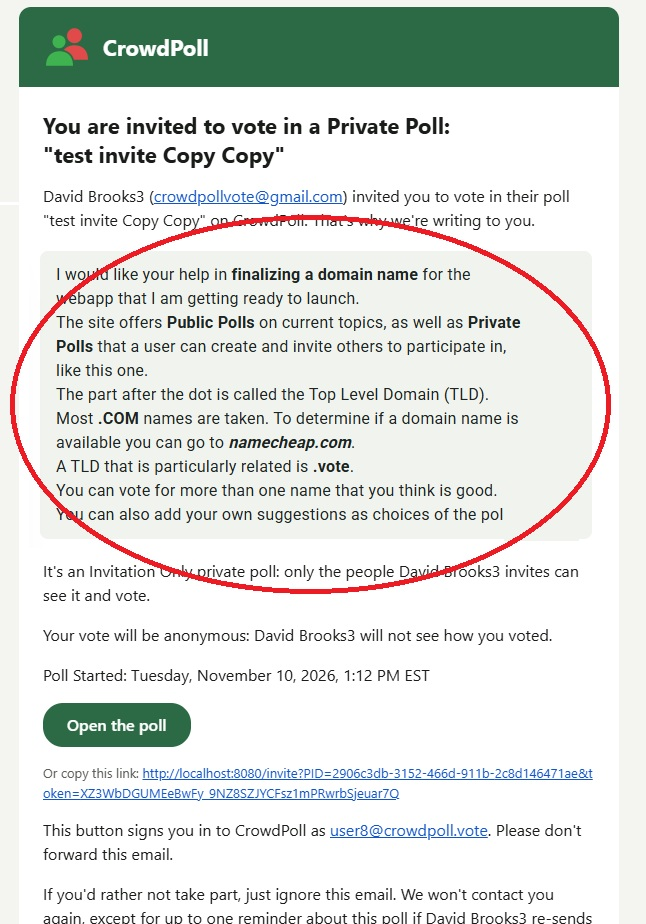
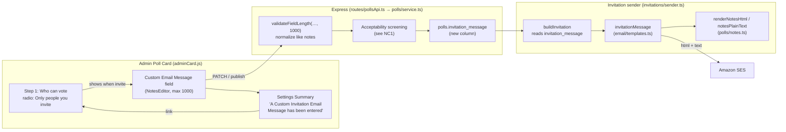
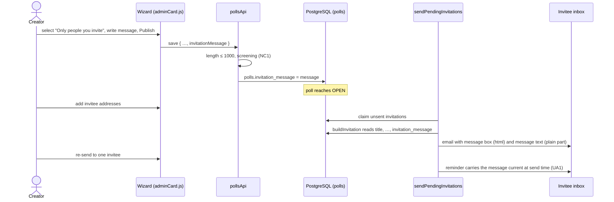
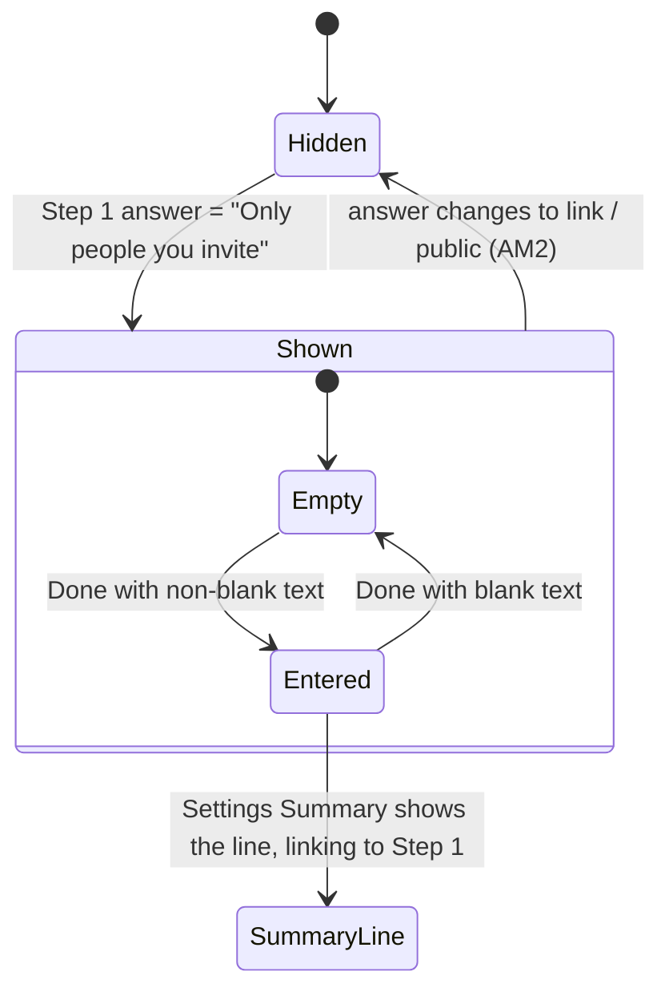

# High Level Requirements

Requirements: `requirements/20261110-160141-invitation-custom-message/requirements.md`  
External Files: `dontTrack\invitation-email-custom-message.jpg` (as linked; a copy is now in this folder as `invitation-email-custom-message.jpg`, see UA6)  
Generated: 2026-11-10 4:01 PM  

This feature will allow the creator of an "Only people you invite" poll to add a custom message to the Invitation Email. 

The Admin Poll Card will have a "Custom Email Message" field on the "Who" tab 1, where the creator can enter a personalized message to be included in the Invitation Email.  
The custom message field will only appear when the poll is set to "Only people you invite" on the "Who" tab.  
The field will behave exactly like the the "Notes" field on the "Title" tab, supporting multiline input and preserving line breaks.  
It will have a "... edit V" button just as the Notes field does on the Title tab.  

The custom message will be limited to 1000 characters.

When a custom message is entered, the summary wizard will say, under the "Only people you invite..." section:  
"A Custom Invitation Email Message has been entered" 
that will link to the "Who" tab.

When a custom message is entered, it will be included in the Invitation Email as mocked up in this image:

## Additional Requirements and Research Requests

**Instructions To The Developer**  
Enter any additional requirements or research requests under the ## Additional Requirements and Research Requests heading above.  
When you Type or Say: "Next" in the CC CLI terminal, the additional requirements and research requests will be applied to the report.  
  
You may leave these instructions here. They will be ignored when "Next" is executed.  

## 1. Overview and Scope

The creator of an **Invitation Only** private poll (`pollVisibility = "Private Poll"`, `pollSharingMode = "Invitation Only"`) can write a short personal message that is shown inside the invitation email each invitee receives.  

- **In scope**:
  - a new optional field, **Custom Email Message**, in Step 1 "Who can vote" of the poll wizard on the Admin Poll Card, shown only while "Only people you invite" is selected;  
  - the field reuses the Notes editor (`src/public/notesEditor.js`): a preview with a "... edit ⌄" button, a multiline editor that keeps line breaks, and a character counter, here capped at 1000;  
  - one line in the Settings Summary, "A Custom Invitation Email Message has been entered", that opens Step 1;  
  - the message rendered in a shaded box in `invitationMessage` (`src/email/templates.ts`), after the "… invited you to vote …" paragraph, as in the mockup.  
- **Out of scope**: messages for "Anyone you send the link to" or public polls, per-invitee messages, attachments or images in the message, and changing the rest of the invitation email.  

The mockup (below) shows the message as rich text: **bold** and *italic* runs, line breaks, in a light grey rounded box directly under the opening paragraph.  

## 2. Components and Data Flow

The message travels from the wizard, through the poll save path that Notes already use, into a new poll column, and is read by the invitation sender for each send.  

## 3. Sending Sequence

Invitations are sent only while the poll is `OPEN`; a reminder is a re-send of the same email with the "Reminder:" heading.  

## 4. Field Visibility and Summary Line

## 5. Findings

### Inconsistencies

None found.

### Ambiguities

**AM1. What does "behave exactly like the Notes field" carry over: formatting, and how the 1000 characters are counted?**  
<b>
✅ Resolved</b>  
✅ Requirements File Updated: 2026-11-10 4:07 PM  
**Notes**: Recommendation accepted in file 2026-11-10: Recommendation A, same editor and same markup as Notes, with 1000 counting the stored text, markup included;  
the requirements now say so under Decisions (AM1).  

> Notes support **bold** (`**`), *italic* (`*`) and underline (`++`) through `parseNotes`, and the mockup shows bold and italic runs in the email.  
> The Notes counter and the server limit (`NOTES_MAX`, 6000) count the stored text, markup included, not the visible characters.  
> The requirements say only "multiline input and preserving line breaks" and "limited to 1000 characters".  

  - **Recommendation A** _(recommended)_: **same editor and same markup as Notes; 1000 counts the stored text, markup included, as Notes do.**  

    [X] ➡️ **Accepted**

    - <u>Pros</u>: matches the mockup; one editor, one parser (`src/polls/notes.ts`), one counting rule, so the counter and the server always agree.  
    - <u>Cons</u>: heavy formatting uses up a few of the 1000 characters.  

  - **Recommendation B**: **plain text with line breaks only; 1000 visible characters.**  

    [ ] ➡️ **Not Accepted**

    - <u>Pros</u>: simplest to render in email clients.  
    - <u>Cons</u>: contradicts the mockup's bold and italic text, and needs a second editor mode.  

  - **Developer Resolution C**:  

    [ ] ➡️ **Not Accepted**

**AM2. What happens to a saved message when the creator switches the poll away from "Only people you invite"?**  
<b>
✅ Resolved</b>  
✅ Requirements File Updated: 2026-11-10 4:07 PM  
**Notes**: Recommendation accepted in file 2026-11-10: Recommendation B, always kept, and used again if the poll returns to "Only people you invite";  
the requirements now say so under Decisions (AM2).  

> The field is shown only while "Only people you invite" is selected, and a private poll may switch sharing mode even after it has votes.  
> The requirements do not say whether a message entered earlier is kept (hidden) or discarded when the poll is saved with another answer.  

  - **Recommendation A** _(recommended)_: **kept while the wizard is open; cleared when the poll is saved with any answer other than "Only people you invite".**  

    [ ] ➡️ **Not Accepted**

    - <u>Pros</u>: an accidental radio tap loses nothing, and no hidden text is stored that the creator cannot see.  
    - <u>Cons</u>: switching back after saving means writing the message again.  

  - **Recommendation B**: **always kept, and used again if the poll returns to "Only people you invite".**  

    [X] ➡️ **Accepted**

    - <u>Pros</u>: nothing is ever lost.  
    - <u>Cons</u>: the poll stores text the creator cannot see, which a later switch silently starts emailing.  

  - **Developer Resolution C**:  

    [ ] ➡️ **Not Accepted**

### Unspecified Aspects

**UA1. Which emails carry the message, and which version of it?**  
<b>
✅ Resolved</b>  
✅ Requirements File Updated: 2026-11-10 4:03 PM  
**Notes**: Recommendation accepted by "Accept all" 2026-11-10: Recommendation, every invitation and reminder carries the message as it stands when sent;  
the requirements now say so under Decisions (UA1).  

> Invitations are sent by `sendPendingInvitations` once the poll is `OPEN`, and `sendReminder` re-sends one with a "Reminder:" heading.  
> The creator may edit the message after some invitations have gone out.  

  - **Recommendation**: **every invitation and every reminder carries the message as it stands when that email is sent; emails already sent are not changed or re-sent.**  

    [X] ➡️ **Accepted**

    - `buildInvitation` already reads the poll row at send time, so this needs only one more column in its select.  

  - **Developer Resolution B**:  

    [ ] ➡️ **Not Accepted**

**UA2. Where and how is the message drawn in the email, including its plain-text part?**  
<b>
✅ Resolved</b>  
✅ Requirements File Updated: 2026-11-10 4:03 PM  
**Notes**: Recommendation accepted by "Accept all" 2026-11-10: Recommendation, a shaded box rendered by `renderNotesHtml` after the first paragraph, and `notesPlainText` in the plain-text part;  
the requirements now say so under Decisions (UA2).  

> The mockup places it in a light grey, rounded box directly after the "… invited you to vote …" paragraph.  
> Every CrowdPoll email also has a plain-text part (`layout` builds `text` and `html`), which the requirements do not mention.  
> CLAUDE.md requires poll notes to reach HTML only through `src/polls/notes.ts`.  

  - **Recommendation**: **HTML: a shaded box (email-safe inline styles, the email's 16 px body text) right after the first paragraph, its content from `renderNotesHtml`; plain text: the `notesPlainText` of the message as its own paragraph at the same place; no box and no paragraph when the message is empty.**  

    [X] ➡️ **Accepted**

    - It reuses the escaping renderer, so the message cannot inject markup into the email, and `layout` gains one optional block rather than a new template.  

  - **Developer Resolution B**:  

    [ ] ➡️ **Not Accepted**

**UA3. Where is the message stored, and who may see it?**  
<b>
✅ Resolved</b>  
✅ Requirements File Updated: 2026-11-10 4:03 PM  
**Notes**: Recommendation accepted by "Accept all" 2026-11-10: Recommendation, a new `polls.invitation_message` column, admin detail only, in `NON_CONTENT_FIELDS`, copied by Duplicate;  
the requirements now say so under Decisions (UA3).  

> The requirements do not say how the message is stored, whether voters see it on the poll card, or what Duplicate does with it.  
> Card, tab and delta payloads are cached projections, and a field that changes them bumps `content_version`.  

  - **Recommendation**: **a new `polls.invitation_message` text column (migration, default `''`); it is returned only on the creator's/administrator's admin poll detail, never in card, tab, delta or SEO payloads, and joins `NON_CONTENT_FIELDS`; Duplicate copies it with the invitee list; `postman/openapi.json` documents the new field.**  

    [X] ➡️ **Accepted**

    - The message is written to invitees' inboxes, not to the poll, so voters' cached copies need not change when it is edited.  

  - **Developer Resolution B**:  

    [ ] ➡️ **Not Accepted**

**UA4. Where exactly does the summary line go, and what does it link to?**  
<b>
✅ Resolved</b>  
✅ Requirements File Updated: 2026-11-10 4:03 PM  
**Notes**: Recommendation accepted by "Accept all" 2026-11-10: Recommendation, a separate summary line after the Who line that opens Step 1 on the field;  
the requirements now say so under Decisions (UA4).  

> The requirements say "under the 'Only people you invite...' section" and that the line links to the "Who" tab.  
> The Settings Summary's Who line reads "Your poll is a Private Poll. Only people you invite by email can vote. Votes are anonymous."  

  - **Recommendation**: **a separate summary line directly after the Who line, shown only when the poll is "Only people you invite" and the message is not blank; the whole sentence is a summary link that opens Step 1 with the Custom Email Message field focused.**  

    [X] ➡️ **Accepted**

    - It follows the existing `summaryPart(text, step, field)` pattern, which opens a step and focuses a field.  

  - **Developer Resolution B**:  

    [ ] ➡️ **Not Accepted**

**UA5. What are the field's label, support text, position in Step 1, and server-side limit?**  
<b>
✅ Resolved</b>  
✅ Requirements File Updated: 2026-11-10 4:03 PM  
**Notes**: Recommendation accepted by "Accept all" 2026-11-10: Recommendation, the label, support text, counter, position after the voters switch, and a 1000-character server check;  
the requirements now say so under Decisions (UA5).  

> The requirements name the field "Custom Email Message" but give no support text, no position within Step 1 (which also holds the radio list, the "Users can see who voted for what" switch and the "What does this mean?" help), and no server-side check.  

  - **Recommendation**: **label "Custom Email Message", support text "Optional. Added to the invitation email we send to the people you invite.", counter "n / 1000"; placed after the voters switch and before the help; the server refuses more than 1000 characters with the same `validateFieldLength` message as other fields, and blank text (`normalizeNotes`) is stored as empty.**  

    [X] ➡️ **Accepted**

    - It matches the Notes field's wording and limits, and keeps the radio answers and the switch together at the top of the step.  

  - **Developer Resolution B**:  

    [ ] ➡️ **Not Accepted**

**UA6. The mockup's link does not resolve from the requirements folder.**  
<b>
✅ Resolved</b>  
✅ Requirements File Updated: 2026-11-10 4:03 PM  
**Notes**: Recommendation accepted by "Accept all" 2026-11-10: Recommendation, the image link points at the copy in the requirements folder;  
the requirements' image link was changed and the change is noted under Decisions (UA6).  

> The requirements link `dontTrack\invitation-email-custom-message.jpg`, a git-ignored folder at the project root, so the image is missing for anyone reading `requirements.md` from its folder or from git.  
> A copy has been placed beside the requirements as `invitation-email-custom-message.jpg`, as earlier features keep their mockups.  

  - **Recommendation**: **point the requirements' image link at `invitation-email-custom-message.jpg` in the requirements folder.**  

    [X] ➡️ **Accepted**

    - The mockup then travels with the requirements and the spec that will be made from them.  

  - **Developer Resolution B**:  

    [ ] ➡️ **Not Accepted**

### Needs Clarifications

**NC1. Is the message screened and reviewed like the Notes, since it is emailed to third parties?**  
<b>
✅ Resolved</b>  
✅ Requirements File Updated: 2026-11-10 4:07 PM  
**Notes**: Recommendation accepted in file 2026-11-10: Recommendation A, treat it exactly as notes, screened and held in `pending_update` on an ever-voted published poll;  
the requirements now say so under Decisions (NC1).  

> Title, subtitle and notes go through Acceptability Screening (`localScreener`) on publish, private polls included, and on an ever-voted published poll a changed title, subtitle or notes waits in `pending_update` until approved.  
> The custom message is sent from CrowdPoll's address to people who never signed up, so abusive or spam text would be mailed under the site's name.  

  - **Recommendation A** _(recommended)_: **treat it exactly as notes: screened with them, and a change on an ever-voted published poll waits in `pending_update`; until it is approved, invitations carry the approved message.**  

    [X] ➡️ **Accepted**

    - <u>Pros</u>: protects the sending domain's reputation and the invitees; uses the existing review path.  
    - <u>Cons</u>: an edit to a voted poll's message is not mailed until it is approved.  

  - **Recommendation B**: **screened on save, but applied at once, without `pending_update`.**  

    [ ] ➡️ **Not Accepted**

    - <u>Pros</u>: edits take effect immediately.  
    - <u>Cons</u>: a second, different review rule for one text field; the screener runs outside the publish flow it was built for.  

  - **Recommendation C**: **not screened.**  

    [ ] ➡️ **Not Accepted**

    - <u>Pros</u>: simplest.  
    - <u>Cons</u>: any text can be emailed to any address under CrowdPoll's name, within the daily invitation allowance.  

  - **Developer Resolution D**:  

    [ ] ➡️ **Not Accepted**

## 6. Breaking Changes

- None: the new column defaults to empty, so existing polls send the same invitation email as today.  

## 7. Technical Debt

- `src/public/notesEditor.js` hardcodes `NOTES_MAX = 6000` for its counter and Done check; reusing it for a 1000-character field needs the limit passed in through `open(…)`.  
- The 6000 limit is defined twice, in `src/polls/notes.ts` and `notesEditor.js`; the new 1000 limit should be defined once on the server (`LIMITS` in `src/polls/service.ts`) and its browser copy pinned by a test.  
- `layout` in `src/email/templates.ts` escapes every paragraph; the message box is the first email block holding pre-rendered HTML, so it needs a separate, clearly named input rather than a paragraph string.  

## 8. Assumptions

- "Admin Poll Card … 'Who' tab 1" is Step 1 "Who can vote" of the poll wizard, and the "Title" tab is Step 2 "Title & Tags".  
- "summary wizard" is the wizard's Settings Summary.  
- "... edit V" is the Notes preview's "... edit" button with its chevron.  
- The message carries no attribution line of its own: the paragraph above it already names the creator.  
- No new setting, cookie or browser storage key is introduced.  

## 9. Requirements Report Complete Report  
  
- **Requirements Report Document:** requirements/20261110-160141-invitation-custom-message/requirements-report.md  
- **Requirements Document:** requirements/20261110-160141-invitation-custom-message/requirements.md  
- **Software Architecture Diagrams:** 3  
- **Inconsistencies:** 0  
- **Ambiguities:** 2  
- **Unspecified Aspects:** 6  
- **Needs Clarifications:** 1  
- **Research Results:** 0  
- **Breaking Changes:** 0  
- **Technical Debt items:** 3  
  
The requirements are ready for /speckit-specify.
To generate specs from the requirements document, use the `/speckit-specify` skill followed by the path (relative to the project root) to the requirements file.
At the prompt, Type:  
🟩 👉 /speckit-specify requirements/20261110-160141-invitation-custom-message/requirements.md  

