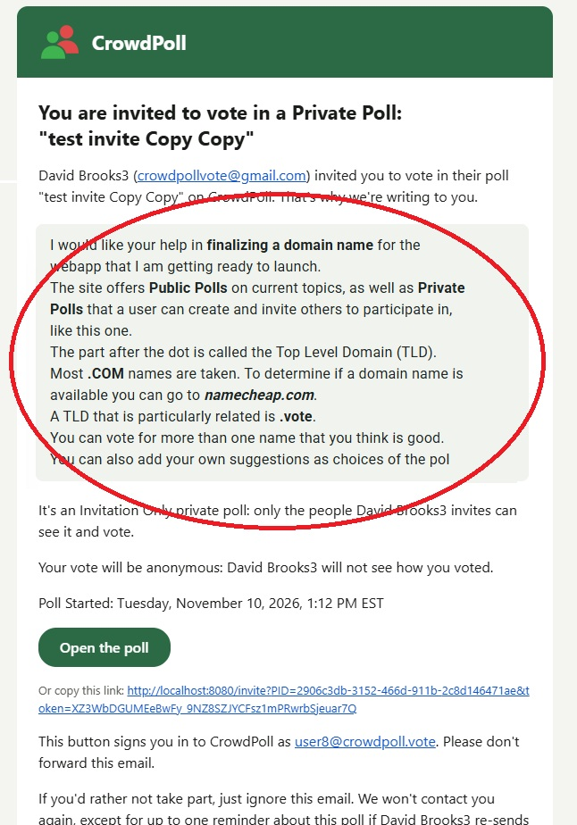

Start a new spec for these requirements called `20261110-160141-INVITATION-CUSTOM-MESSAGE`  
!! THIS FILE IS GENERATED USING THE SKILL `/speckit-requirements`. DO NOT EDIT OR DELETE THIS FILE !!  

# Initial High-Level Requirements

This feature will allow the creator of an "Only people you invite" poll to add a custom message to the Invitation Email. 

The Admin Poll Card will have a "Custom Email Message" field on the "Who" tab 1, where the creator can enter a personalized message to be included in the Invitation Email.  
The custom message field will only appear when the poll is set to "Only people you invite" on the "Who" tab.  
The field will behave exactly like the the "Notes" field on the "Title" tab, supporting multiline input and preserving line breaks.  
It will have a "... edit V" button just as the Notes field does on the Title tab.  

The custom message will be limited to 1000 characters.

When a custom message is entered, the summary wizard will say, under the "Only people you invite..." section:  
"A Custom Invitation Email Message has been entered" 
that will link to the "Who" tab.

When a custom message is entered, it will be included in the Invitation Email as mocked up in this image:

## Decisions (from requirements-report.md, 2026-11-10 4:03 PM)

- **Emails that carry the message (UA1)**: every invitation and every reminder carries the message as it stands when that email is sent;  
  emails already sent are not changed or re-sent.  
  `buildInvitation` reads it from the poll row at send time.  
- **Drawing it in the email (UA2)**: in the HTML part, a light grey, rounded box (email-safe inline styles, the email's 16 px body text) directly after the "… invited you to vote …" paragraph, its content rendered by `renderNotesHtml` (`src/polls/notes.ts`);  
  in the plain-text part, the message's `notesPlainText` as its own paragraph at the same place;  
  no box and no paragraph when the message is empty.  
- **Storage and visibility (UA3)**: a new `polls.invitation_message` text column (migration, default `''`);  
  returned only on the creator's or an administrator's admin poll detail, never in card, tab, delta or SEO payloads;  
  it joins `NON_CONTENT_FIELDS`, so editing it does not bump `content_version`;  
  Duplicate copies it with the invitee list;  
  `postman/openapi.json` documents the new field.  
- **Summary line (UA4)**: a separate Settings Summary line directly after the Who line, shown only when the poll is "Only people you invite" and the message is not blank;  
  the whole sentence "A Custom Invitation Email Message has been entered" is a summary link that opens Step 1 with the Custom Email Message field focused.  
- **The field (UA5)**: label "Custom Email Message", support text "Optional. Added to the invitation email we send to the people you invite.", counter "n / 1000";  
  placed in Step 1 after the "Users can see who voted for what" switch and before the "What does this mean?" help;  
  the server refuses more than 1000 characters with the same `validateFieldLength` message as other fields, and blank text (`normalizeNotes`) is stored as empty.  
- **Mockup (UA6)**: the image link points at `invitation-email-custom-message.jpg` in this folder.  
- **Formatting and length (AM1)**: the field uses the Notes editor and the Notes markup: **bold** (`**`), *italic* (`*`) and underline (`++`), with line breaks kept, as in the mockup;  
  the 1000-character limit counts the stored text, markup included, as the Notes limit does, in the counter and on the server alike.  
- **Switching away from "Only people you invite" (AM2)**: the message is always kept;  
  while the poll is not "Only people you invite" it is hidden and not sent, and it is used again if the poll returns to "Only people you invite".  
- **Screening and review (NC1)**: the message is treated exactly as notes: it goes through Acceptability Screening with the title, subtitle and notes;  
  on an ever-voted published poll a changed message waits in `pending_update` until approved, and until then invitations carry the approved message.  
