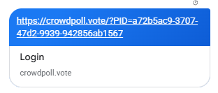
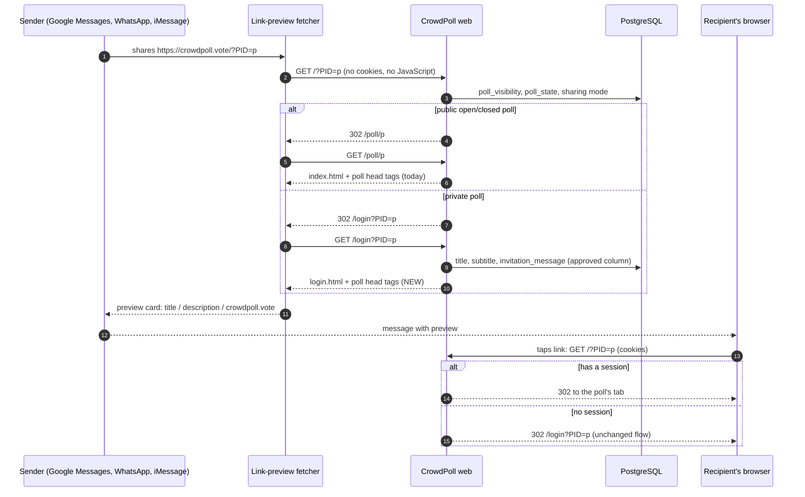
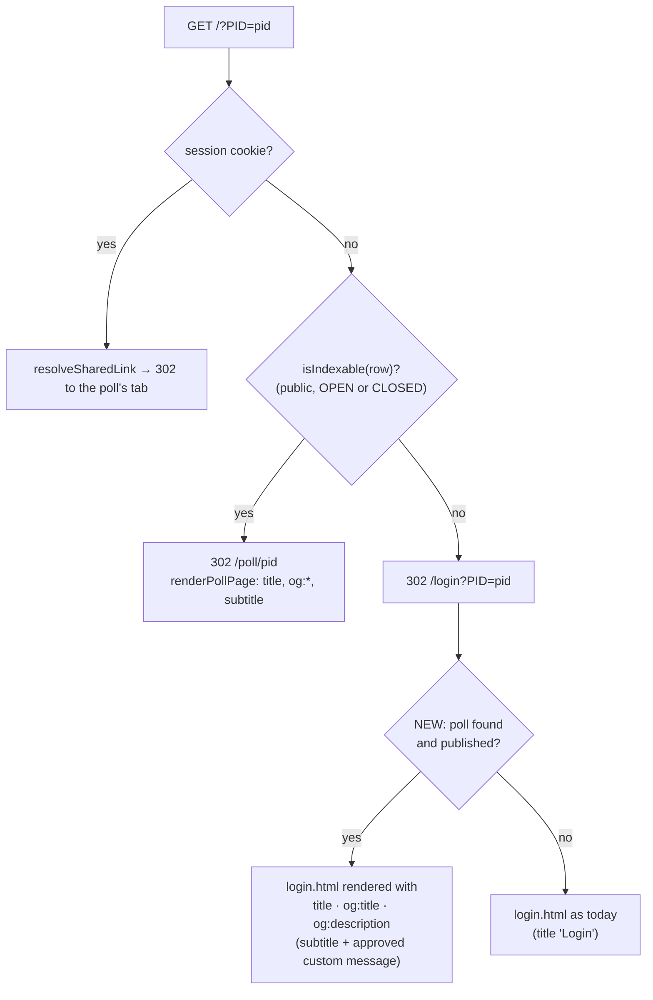
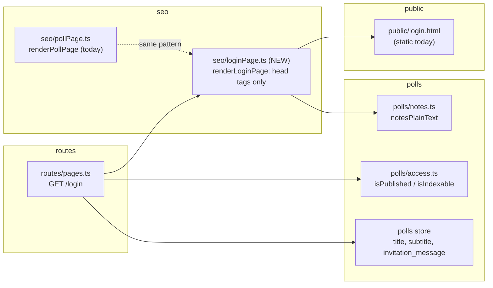

# High Level Requirements

Requirements: `requirements/20261110-202128-link-preview-message/requirements.md`  
External Files: `requirements/20261110-202128-link-preview-message/image.png`  
Generated: 2026-11-10 8:21 PM  

This feature might be a bit of a challenge.  

Currently there is a Custom Email Message that is embedded in invitation for private polls.

The goal of this feature is to show this Custom Message to recipients of the Poll Link when the link is sent using some messaging platform.  
For example, in SMS, Whats App or Google Messages, when a link is shared, content for the destination page is typically shown as a preview or snippet.  

Currently, when a poll link is shared in Google Messages, the message appears as follows:  

We want the title of the poll to be displayed in the link preview (where it currently says Login).
We want the poll subtitle (if there is one) to appear under the title.
We want the Custom Message to appear under the title and subtitle.  

Likely to make this possible, the landing page for the link will need to be a page with the correct title, subtitle, and custom message,
where that landing page then automatically redirects to the actual login page when clicked. 

However, we don't know how to make this happen. 

Please research the technical details of how to make this happen.

## Additional Requirements and Research Requests

**Instructions To The Developer**  
Enter any additional requirements or research requests under the ## Additional Requirements and Research Requests heading above.  
When you Type or Say: "Next" in the CC CLI terminal, the additional requirements and research requests will be applied to the report.  
  
You may leave these instructions here. They will be ignored when "Next" is executed.  

## 1. Overview and Scope

A poll's shared link is `https://crowdpoll.vote/?PID=<pid>` (the admin card's and admin list's "copy link", and the
`oauth`-mode invitation email).  
When a messaging app shows a preview of that link, the preview is built from the page the link leads to.  
Today, for a private poll, a visitor without a session is redirected from `/?PID=<pid>` to `/login?PID=<pid>`, whose
page is the static `login.html` with `<title>Login</title>` and no Open Graph tags;  
that is why the preview in the mockup reads "Login" over "crowdpoll.vote".  
A public open or closed poll already fares better: the same visitor is redirected to `/poll/<pid>`, which
`src/seo/pollPage.ts` renders with the poll's `<title>`, `og:title`, `og:description` (the subtitle) and `og:url`.  

In scope:  

- The preview of a private poll's shared link shows the poll's title, its subtitle when there is one, and, for an
  "Only people you invite" poll, the approved custom email message (`polls.invitation_message`).  
- The link keeps working exactly as today for a person who taps it: a guest reaches the login page and, once signed
  in, the poll;  
  a signed-in user reaches the poll directly.  

Out of scope (see the findings for what is still to be decided):  

- The `/invite?PID=…&token=…` link of a native-sign-in invitation email, which is personal to one address.  
- Changing what the preview shows for public polls (already title and subtitle).  
- A preview image (see UA4).  

## 2. How a Link Preview Is Built (Research Summary)

The research is reported in full in section 5 (RS1).  
In short:  

- Messaging apps run a **link-preview fetcher** — Google's is the user-triggered fetcher `GoogleMessages`;  
  WhatsApp's requests arrive as `WhatsApp/2.x`, `facebookexternalhit/1.1` and `Facebot`;  
  iMessage's is a frozen Safari user agent that also carries the `facebookexternalhit`, `Facebot` and `Twitterbot`
  tokens.  
- The fetcher requests the URL **without cookies**, **follows HTTP redirects** (301/302), **does not run
  JavaScript**, and (at least Apple's) **does not follow an HTML `meta refresh`**.  
- It reads the final page's **Open Graph** tags first (`og:title`, `og:description`, `og:image`, `og:url`), then
  Twitter Card tags, then the plain `<title>` and `<meta name="description">`.  
- Google's user-triggered fetchers "generally ignore robots.txt", which the mockup confirms:  
  `/login` is `Disallow`ed in `robots.txt`, yet the preview read its `<title>`.  

The consequence for this feature: **no visible landing page is needed**.  
Because the fetcher follows the existing `302` from `/?PID=<pid>` to `/login?PID=<pid>`, the page it reads is the
login page;  
rendering that page with the poll's head tags (the way `renderPollPage` already does for `index.html`) is enough for
every platform above, while a person tapping the link sees the login page exactly as today.  

## 3. Request Flow

## 4. Routing Decision for `/?PID=<pid>`

## 5. Components Touched

- `GET /login` (`src/routes/pages.ts`): when `PID` names a published poll, serve `login.html` through a renderer
  that replaces its `<title>` and adds the Open Graph tags;  
  otherwise serve it as today.  
- The renderer follows `renderPollPage`: it works on the page HTML `assets.pageHtml("login.html")` returns, escapes
  every value with `escapeHtml`, and reads the message as plain text through `notesPlainText` (the one HTML path for
  notes and the custom message stays `src/polls/notes.ts`).  
- Only the approved `invitation_message` column is read, never `pending_update` (R4 of the custom-message feature).  

## 6. Research Results

### Research Requests

**RS1. How can a messaging app's link preview show the poll's title, subtitle and custom message?**  
<b>
✅ Resolved</b>  
✅ Requirements File Updated: 2026-11-10 8:32 PM  
**Notes**: Recommendation accepted in file 2026-11-10: Recommendation A, render the poll's `<title>` and Open Graph tags on `/login?PID=<pid>` itself; no landing page, no redirect change;  
the requirements now describe the mechanism under "Resolved Findings".  

> The requirements ask how to make SMS, WhatsApp and Google Messages previews of `https://crowdpoll.vote/?PID=<pid>` show the poll title (instead of "Login"), the subtitle and the custom email message.  
> Sources: [Google — user-triggered fetchers](https://developers.google.com/crawling/docs/crawlers-fetchers/google-user-triggered-fetchers), [Microbrowsers are everywhere (24ways, 2019)](https://24ways.org/2019/microbrowsers-are-everywhere/), [Apple TN3156 — Create rich previews for Messages](https://developer.apple.com/documentation/technotes/tn3156-create-rich-previews-for-messages), [Apple TN2444 (archived note on link previews)](https://developer.apple.com/library/archive/technotes/tn2444/_index.html), [Fixing thumbnail previews on WhatsApp, LinkedIn and X](https://andrewbaker.ninja/2026/03/05/fix-thumbnail-previews-on-whatsapp-linkedin-x-guide/), [Apple link-preview crawler notes](https://docs.centinelanalytica.com/crawlers/apple-link-preview), [SMS link preview metadata explained](https://messageflow.com/?p=2294), [Google Messages card-style previews (Android Authority)](https://www.androidauthority.com/google-messages-link-previews-3601696).  
> What was found:  
> Every messaging app builds the preview from the page the link resolves to, read by a fetcher that sends no cookies and runs no JavaScript ("don't execute JavaScript - so your react application won't work", 24ways).  
> The fetchers read Open Graph tags first (`og:title`, `og:description`, `og:image`, `og:url`), then Twitter Card tags, then the `<title>` and `<meta name="description">` ("the most commonly recognized microdata tags for preview are the Open-Graph tags", 24ways).  
> They follow HTTP redirects ("some will follow redirects, but will quickly time out after a few seconds", 24ways); Apple's "follows server-side 301/302 redirects but not HTML meta redirects" (third-party guide, since Apple's own TN3156 page is rendered by JavaScript and could not be fetched).  
> Google documents its fetcher as the user agent `GoogleMessages`, "used to generate link previews for URLs sent in chat messages", and says that user-triggered fetchers "generally ignore robots.txt rules"; it runs from Google's servers (`*.gae.googleusercontent.com`), not from the phone.  
> WhatsApp requests arrive as `WhatsApp/2.x`, `facebookexternalhit/1.1` and `Facebot`; iMessage sends a frozen Safari 9 user agent ending in `facebookexternalhit/1.1 Facebot Twitterbot/1.0`, one request per recipient.  
> Google Messages' current card shows the page title in a heavier font and the host, and omits the longer description in some layouts (Android Authority), so the subtitle and message may be truncated or dropped by the app itself.  
> Applied to CrowdPoll: a guest's `GET /?PID=<pid>` for a private poll answers `302 /login?PID=<pid>`, which the fetchers follow, so the page they read is `login.html` with `<title>Login</title>` — exactly the mockup; the public-poll path already answers with `renderPollPage`'s tags on `/poll/<pid>`.  
> Three ways to put the poll's tags in front of the fetcher were compared: (A) render them on the login page itself; (B) answer `/?PID=<pid>` with an interstitial landing page that holds the tags and a `meta refresh` to the login page; (C) detect fetcher user agents and serve them a tags-only page.  

  - **Recommendation A** _(recommended)_: **render the poll's `<title>` and Open Graph tags on `/login?PID=<pid>` itself; no landing page, no redirect change.**  

    [X] ➡️ **Accepted**

    - <u>Pros</u>: the fetchers already follow the existing `302`, so it works for Google Messages, WhatsApp and iMessage without user-agent lists or a second page;  
      a person tapping the link sees exactly today's login page;  
      it reuses the `renderPollPage` pattern already in `src/seo/pollPage.ts`.  
    - <u>Cons</u>: `login.html` becomes a server-rendered page when a `PID` is present (a small renderer and a database read per request, cached by nothing today);  
      a fetcher that gives up on redirects (24ways says some time out "after a few seconds") would still show the bare link.  

  - **Recommendation B**: **answer `/?PID=<pid>` for guests with an interstitial landing page holding the tags and `<meta http-equiv="refresh" content="0;url=/login?PID=…">`.**  

    [ ] ➡️ **Not Accepted**

    - <u>Pros</u>: it matches the mechanism the requirements sketch (a landing page that redirects), and it removes the redirect hop for the fetcher.  
    - <u>Cons</u>: a person tapping the link sees a flash of the landing page before the login page, and a `meta refresh` is slower than a `302` in every browser;  
      the `/` route gains a second response type for guests, next to the `/poll/<pid>` redirect, and the landing page needs its own stylesheet pinning in `m3-assets.test.ts`.  

  - **Recommendation C**: **keep the `302` for everyone except known preview fetchers (`GoogleMessages`, `WhatsApp/`, `facebookexternalhit`, `Facebot`, `Twitterbot`), who get a tags-only page at `/?PID=<pid>`.**  

    [ ] ➡️ **Not Accepted**

    - <u>Pros</u>: nothing changes for browsers at all, and the tags-only page is tiny.  
    - <u>Cons</u>: a user-agent list goes stale (Google added `GoogleMessages` only recently) and misses every app not on it;  
      serving bots a different page than people is cloaking, which search engines penalise;  
      the user agents can be spoofed, so it is no privacy control either.  

  - **Developer Resolution D**:  

    [ ] ➡️ **Not Accepted**

## 7. Findings

### Inconsistencies

None found.

### Ambiguities

**AM1. Does the login page's own `<title>` (the browser tab) change, or only the preview tags?**  
<b>
✅ Resolved</b>  
✅ Requirements File Updated: 2026-11-10 8:32 PM  
**Notes**: Recommendation accepted in file 2026-11-10: Recommendation A, both: `<title>` becomes `<poll title> · CrowdPoll` and `og:title` the poll title, as on `/poll/<pid>`;  
the requirements now say so under "Resolved Findings".  

> The requirements say the poll title should show "where it currently says Login", which is the preview card.  
> The preview reads `og:title` first and falls back to `<title>`, so either the tag or the title could carry it.  
> Changing `<title>` also changes the browser tab and the history entry of the login page for a person who taps the link.  

  - **Recommendation A** _(recommended)_: **both: `<title>` becomes `<poll title> · CrowdPoll` and `og:title` the poll title, as on `/poll/<pid>`.**  

    [X] ➡️ **Accepted**

    - <u>Pros</u>: a fetcher that ignores Open Graph still shows the poll title;  
      it is the same convention as the public poll page.  
    - <u>Cons</u>: the login page's tab no longer reads "Login" when a `PID` is present.  

  - **Recommendation B**: **only the Open Graph tags; `<title>` stays "Login".**  

    [ ] ➡️ **Not Accepted**

    - <u>Pros</u>: nothing a person sees in the browser changes.  
    - <u>Cons</u>: a plain-`<title>` fetcher keeps showing "Login".  

  - **Developer Resolution C**:  

    [ ] ➡️ **Not Accepted**

### Unspecified Aspects

**UA1. Which private polls get the richer preview: only "Only people you invite", or "Anyone With The Link" too?**  
<b>
✅ Resolved</b>  
✅ Requirements File Updated: 2026-11-10 8:25 PM  
**Notes**: Recommendation accepted by "Accept all" 2026-11-10: Recommendation, every private published poll: title and subtitle always; the custom message when the poll has one;  
the requirements now say so under "Resolved Findings".  

> The custom email message exists only for "Only people you invite" polls (Invitation Only).  
> A private "Anyone With The Link" poll's shared link redirects to the same login page and previews as "Login" today.  
> The requirements name the custom message as the goal but ask for the title and subtitle first.  

  - **Recommendation**: **every private published poll: title and subtitle always; the custom message when the poll has one.**  

    [X] ➡️ **Accepted**

    - One code path serves both sharing modes;  
      an "Anyone With The Link" poll simply has an empty message, so its description is the subtitle alone.  

  - **Developer Resolution B**:  

    [ ] ➡️ **Not Accepted**

**UA2. How are the subtitle and the custom message combined into one `og:description`, and how long may it be?**  
<b>
✅ Resolved</b>  
✅ Requirements File Updated: 2026-11-10 8:32 PM  
**Notes**: Recommendation accepted in file 2026-11-10: Recommendation A, the subtitle, then a blank line, then the message as plain text; capped at 300 characters with an ellipsis;  
the requirements now say so under "Resolved Findings", with the fallbacks when either part is empty.  

> A preview card has one title and one description string;  
> the requirements want the subtitle "under the title" and the message "under the title and subtitle".  
> The custom message is stored as notes markup of up to 1000 characters; `notesPlainText` yields its text.  
> `/poll/<pid>` caps its description at 160 characters, a search-snippet convention; messaging apps apply their own, undocumented, truncation.  

  - **Recommendation A** _(recommended)_: **the subtitle, then a blank line, then the message as plain text; capped at 300 characters with an ellipsis.**  

    [X] ➡️ **Accepted**

    - <u>Pros</u>: the subtitle leads, as asked, and most of a typical message survives;  
      300 characters covers what any current card shows before its own cut.  
    - <u>Cons</u>: a long message is cut on the server before the app's own truncation;  
      most apps collapse the blank line to a space.  

  - **Recommendation B**: **the same, with no server-side cap (up to the subtitle plus 1000 characters).**  

    [ ] ➡️ **Not Accepted**

    - <u>Pros</u>: each app decides how much to show;  
      nothing the creator wrote is lost before that.  
    - <u>Cons</u>: a 1 KB attribute in the head of every login page for that poll;  
      `<meta name="description">` of that length is unusual.  

  - **Developer Resolution C**:  

    [ ] ➡️ **Not Accepted**

**UA3. In which poll states does the login page carry the poll's tags?**  
<b>
✅ Resolved</b>  
✅ Requirements File Updated: 2026-11-10 8:25 PM  
**Notes**: Recommendation accepted by "Accept all" 2026-11-10: Recommendation, published polls only (OPEN or CLOSED; EDITING by the state before the edit), reading the approved `invitation_message` column;  
any other poll, or an unknown `PID`, gets today's plain login page;  
the requirements now say so under "Resolved Findings".  

> A poll's link can be shared before it opens, while it is open, after it closes, and after it is archived or rejected.  
> `/poll/<pid>` renders only for `isIndexable` polls (public and OPEN or CLOSED, an EDITING poll by its prior state).  
> The custom message has a pending copy while an edit awaits review (`pending_update`); the emails read only the approved column.  

  - **Recommendation**: **published polls only (OPEN or CLOSED; EDITING by the state before the edit), reading the approved `invitation_message` column; any other poll, or an unknown `PID`, gets today's plain login page.**  

    [X] ➡️ **Accepted**

    - It is the rule `/poll/<pid>` already applies, minus the public-visibility test, and the rule the invitation emails follow for the message;  
      an unreviewed message is never shown.  

  - **Developer Resolution B**:  

    [ ] ➡️ **Not Accepted**

**UA4. Should the preview carry an image (`og:image`)?**  
<b>
✅ Resolved</b>  
✅ Requirements File Updated: 2026-11-10 8:32 PM  
**Notes**: Recommendation accepted in file 2026-11-10: Recommendation A, no image: a text card, matching the public poll page today;  
the requirements now say so under "Resolved Findings".  

> Google Messages, WhatsApp and iMessage show a thumbnail when the page offers `og:image`; otherwise a text-only card, as in the mockup.  
> `/poll/<pid>` offers no image today; the site has `favicon.svg` and the header's brand logo.  

  - **Recommendation A** _(recommended)_: **no image: a text card, matching the public poll page today.**  

    [X] ➡️ **Accepted**

    - <u>Pros</u>: nothing to design or host;  
      the text card leaves the most room for the title and message.  
    - <u>Cons</u>: a plainer card than links with an image.  

  - **Recommendation B**: **a static CrowdPoll logo image (a committed PNG, at least 1200×630) on both the login and the public poll page.**  

    [ ] ➡️ **Not Accepted**

    - <u>Pros</u>: a branded card everywhere a CrowdPoll link is shared.  
    - <u>Cons</u>: a new asset to draw and commit;  
      an image card in Google Messages can push the description out of view.  

  - **Developer Resolution C**:  

    [ ] ➡️ **Not Accepted**

**UA5. Does the login page show the poll's title, subtitle and message to the person who taps the link, or only carry them in its head?**  
<b>
✅ Resolved</b>  
✅ Requirements File Updated: 2026-11-10 8:32 PM  
**Notes**: Recommendation accepted in file 2026-11-10: Recommendation A, head tags only; the visible login page is unchanged;  
the requirements now say so under "Resolved Findings".  

> Once the login page knows the poll, it could greet the visitor with "You're invited to: <title>" above the sign-in card.  
> The requirements speak only of the preview; the sign-in card is unchanged today when a `PID` is present.  

  - **Recommendation A** _(recommended)_: **head tags only; the visible login page is unchanged.**  

    [X] ➡️ **Accepted**

    - <u>Pros</u>: the smallest change, and no new place the custom message reaches HTML.  
    - <u>Cons</u>: the visitor sees the message only in the preview, not once on the page.  

  - **Recommendation B**: **also show the title and subtitle (not the message) above the sign-in card.**  

    [ ] ➡️ **Not Accepted**

    - <u>Pros</u>: the visitor knows which poll they are signing in for.  
    - <u>Cons</u>: a login-page layout change with its own M3 styling and test pinning;  
      a separate UI feature in its own right.  

  - **Developer Resolution C**:  

    [ ] ➡️ **Not Accepted**

### Needs Clarifications

**NC1. Is it acceptable that a private poll's title, subtitle and custom message become readable without signing in?**  
<b>
✅ Resolved</b>  
✅ Requirements File Updated: 2026-11-10 8:32 PM  
**Notes**: Recommendation accepted in file 2026-11-10: Recommendation A, yes: the three fields are the preview's purpose; the requirements record that they are readable by anyone holding the link, and the creator's custom-message help text says so;  
the requirements now say so under "Resolved Findings".  

> To reach the preview fetcher, the tags must be served to any request for `/login?PID=<pid>` that carries no session.  
> So anyone who holds the link — and the servers of Google, Meta and Apple, which fetch and cache previews — can read those three fields of an "Only people you invite" poll, though not its choices, notes or results, and cannot vote or watch it.  
> The `PID` is an unguessable UUID, so this reaches only people the link was sent or forwarded to, but today those fields are shown to signed-in invitees only.  

  - **Recommendation A** _(recommended)_: **yes: the three fields are the preview's purpose; the requirements record that they are readable by anyone holding the link, and the creator's custom-message help text says so.**  

    [X] ➡️ **Accepted**

    - <u>Pros</u>: the feature works for every invitee on every platform with no setting to find;  
      the link already carries the same trust (whoever has it can sign in and ask for access).  
    - <u>Cons</u>: a creator who wrote something sensitive in the message cannot keep it off the preview.  

  - **Recommendation B**: **per poll, an "Show in link previews" switch next to the custom message, off by default.**  

    [ ] ➡️ **Not Accepted**

    - <u>Pros</u>: the creator decides, poll by poll.  
    - <u>Cons</u>: a new column, migration, wizard field and admin detail;  
      most creators would never find it, so most previews would still read "Login".  

  - **Recommendation C**: **title and subtitle only; the custom message stays in the email.**  

    [ ] ➡️ **Not Accepted**

    - <u>Pros</u>: the preview shows what a public poll's shows, and nothing a creator wrote for invitees' eyes.  
    - <u>Cons</u>: it drops the stated goal of the feature.  

  - **Developer Resolution D**:  

    [ ] ➡️ **Not Accepted**

## 8. Breaking Changes

None.  
The shared link, every redirect and the sign-in flow are unchanged;  
only the head of `login.html` differs when a `PID` names a published poll.  

## 9. Technical Debt

- `login.html` is served as a static page through `page("login.html")`;  
  rendering poll tags into it needs a server-side renderer, so the `renderPollPage` string-replacement approach would
  gain a second instance.  
  Extracting the shared head-tag helper (`<title>`, `description`, `og:*`) into one module serves both.  
- The private-poll login response should be sent `Cache-Control: no-cache` like `/poll/<pid>`, since the tags change
  with the poll;  
  fetchers cache previews on their side regardless, so an edited title or message appears only in new shares.  

## 10. Assumptions

- Previews are fetched by the platforms' servers (or the sender's device), never through the recipient's session, so
  the page a fetcher reads is always the guest path.  
- WhatsApp's and iMessage's fetchers follow the `302` as Google's does; the mockup proves it for Google Messages, the
  sources say so for Apple, and WhatsApp is inferred from `facebookexternalhit`'s behaviour.  
- `robots.txt`'s `Disallow: /login` stays: user-triggered preview fetchers ignore it, and search engines should keep
  out of the login page, which also carries `<meta name="robots" content="noindex">`.  
- The text part of the description comes from `notesPlainText`; no HTML of the message reaches the login page.  

## 11. Requirements Report Complete Report  
  
- **Requirements Report Document:** requirements/20261110-202128-link-preview-message/requirements-report.md  
- **Requirements Document:** requirements/new-20261110-200118/requirements.md → requirements/20261110-202128-link-preview-message/requirements.md  
- **Software Architecture Diagrams:** 3  
- **Inconsistencies:** 0  
- **Ambiguities:** 1  
- **Unspecified Aspects:** 5  
- **Needs Clarifications:** 1  
- **Research Results:** 1  
- **Breaking Changes:** 0  
- **Technical Debt items:** 2  
  
The requirements are ready for /speckit-specify.
To generate specs from the requirements document, use the `/speckit-specify` skill followed by the path (relative to the project root) to the requirements file.
At the prompt, Type:  
🟩 👉 /speckit-specify requirements/20261110-202128-link-preview-message/requirements.md  
