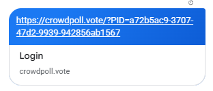

Start a new spec for these requirements called `20261110-202128-LINK-PREVIEW-MESSAGE`  
!! THIS FILE IS GENERATED USING THE SKILL `/speckit-requirements`. DO NOT EDIT OR DELETE THIS FILE !!  

# Initial High-Level Requirements

This feature might be a bit of a challenge.  

Currently there is a Custom Email Message that is embedded in invitation for private polls.

The goal of this feature is to show this Custom Message to recipients of the Poll Link when the link is sent using some messaging platform.  
For example, in SMS, Whats App or Google Messages, when a link is shared, content for the destination page is typically shown as a preview or snippet.  

Currently, when a poll link is shared in Google Messages, the message appears as follows:  

We want the title of the poll to be displayed in the link preview (where it currently says Login).
We want the poll subtitle (if there is one) to appear under the title.
We want the Custom Message to appear under the title and subtitle.  

Likely to make this possible, the landing page for the link will need to be a page with the correct title, subtitle, and custom message,
where that landing page then automatically redirects to the actual login page when clicked. 

However, we don't know how to make this happen. 

Please research the technical details of how to make this happen.

## Resolved Findings (2026-11-10 8:25 PM)

- **Which private polls get the richer preview (UA1)**: every private published poll.  
  The preview shows the title and the subtitle always, and the custom email message when the poll has one;  
  an "Anyone With The Link" poll has no message, so its description is the subtitle alone.  
- **Poll states (UA3)**: the login page carries the poll's tags for published polls only (OPEN or CLOSED;  
  an EDITING poll by the state it held before the edit), reading the approved `invitation_message` column, never the pending copy;  
  any other poll, or an unknown PID, gets today's plain login page.  

## Resolved Findings (2026-11-10 8:32 PM)

- **How the preview is produced (RS1)**: no landing page.  
  Messaging apps' link-preview fetchers (Google's `GoogleMessages`, WhatsApp's `facebookexternalhit`/`WhatsApp/2`, iMessage's Safari-like agent) send no cookies, run no JavaScript, and follow HTTP redirects, so they already arrive at `/login?PID=<pid>`.  
  That page is rendered with the poll's `<title>` and Open Graph tags (`og:title`, `og:description`, `og:url`, `og:site_name`, `og:type`), the way `/poll/<pid>` is rendered for public polls;  
  the shared link, its redirects and the sign-in flow do not change, and no user-agent detection is used.  
- **Login page title (AM1)**: when the PID names a published poll, the login page's `<title>` becomes `<poll title> · CrowdPoll` and `og:title` the poll title, as on `/poll/<pid>`;  
  otherwise the title stays "Login".  
- **Description (UA2)**: `og:description` (and `<meta name="description">`) is the subtitle, then a blank line, then the custom message as plain text (`notesPlainText`);  
  the whole is capped at 300 characters with an ellipsis.  
  Without a subtitle it is the message alone;  
  without either, "Vote and see live results: <title>", as on `/poll/<pid>`.  
- **Image (UA4)**: no `og:image`;  
  the preview is a text card, as for public polls today.  
- **Visible login page (UA5)**: head tags only;  
  the sign-in card and the rest of the login page are unchanged.  
- **Privacy (NC1)**: the title, subtitle and custom message of a private published poll are readable by anyone who holds the link (and by the preview servers of Google, Meta and Apple) without signing in;  
  the choices, notes, results and voting stay behind sign-in and access rules.  
  The custom-message help text in the poll wizard says that the message also appears in link previews.  
