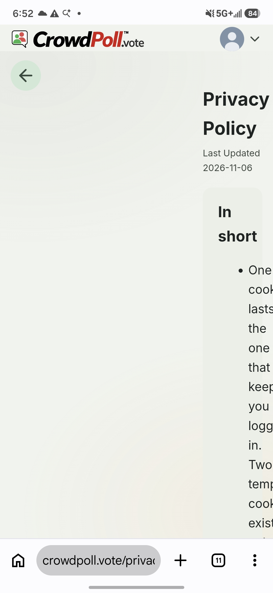
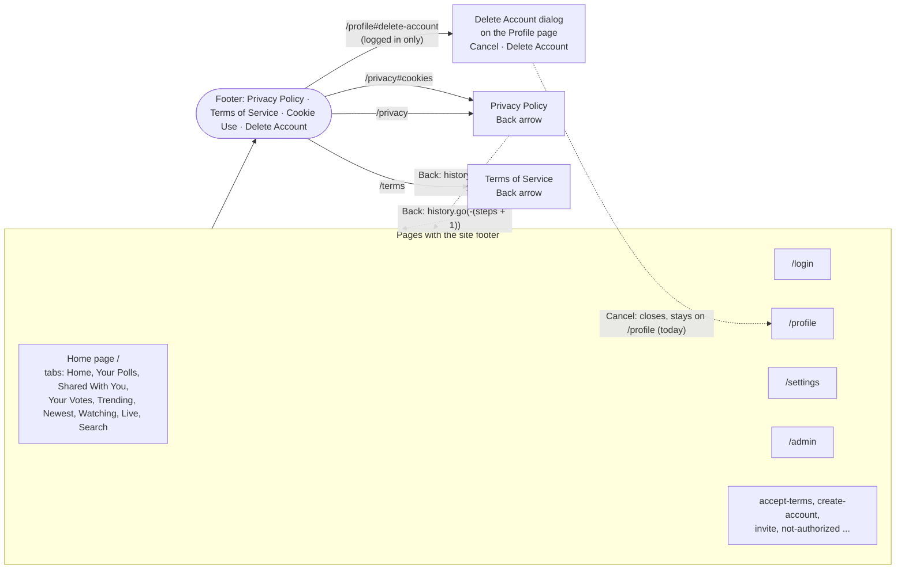
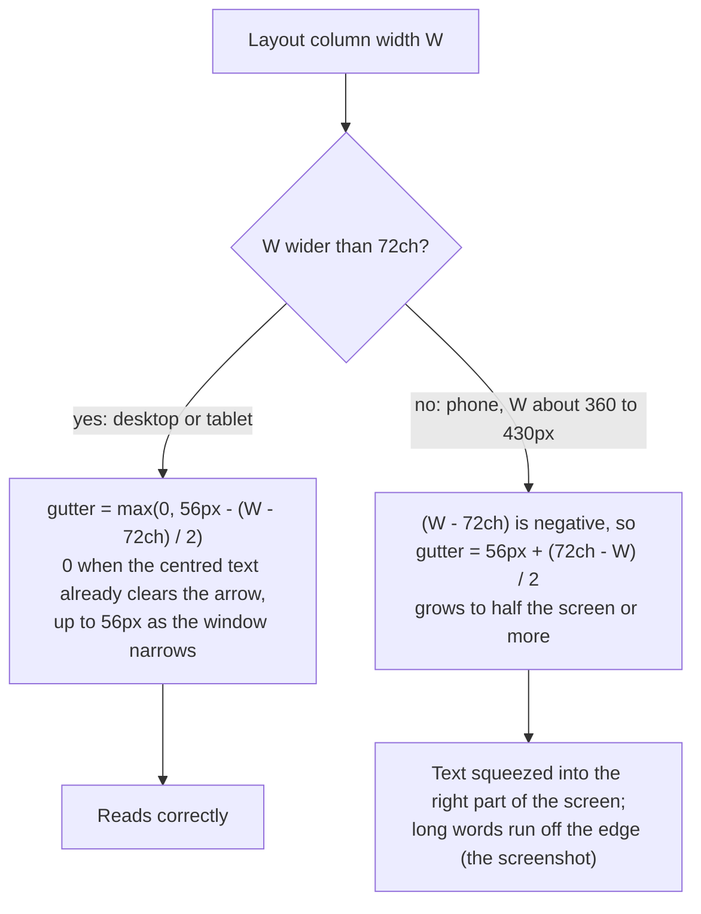

# High Level Requirements

Requirements: `requirements/20261111-091956-footer-links/requirements.md`  
External Files: `requirements/20261111-091956-footer-links/privacy-policy-on-phone.jpg`  
Generated: 2026-11-11 9:20 AM  

# Initial High-Level Requirements

The requirements for this feature are related to the links in the footer.  

1. on a phone, the Terms page and Privacy Policy page don't adjust properly.  
See the image:   
  

2. Can the Back Arrow icon on the Privacy Policy and Terms page go back to the current tab if that is where the user navigated from?  
We checked when the pages are launched from other locations and they all go back to the correct page.

3. When "Cancel" is clicked on "delete Account" page, it goes back to the Profile page.  
Please make it go back to the page from which the user navigated to the "delete Account" page,  
same as the Privacy Policy and the Terms page.

4. Please investigate if the Back Arrow does not navigate back to the correct page when launched from different locations.
Provide a solution to ensure consistent navigation behavior across all pages.

## Additional Requirements and Research Requests

**Instructions To The Developer**  
Enter any additional requirements or research requests under the ## Additional Requirements and Research Requests heading above.  
When you Type or Say: "Next" in the CC CLI terminal, the additional requirements and research requests will be applied to the report.  
  
You may leave these instructions here. They will be ignored when "Next" is executed.  

## 1. Overview and Scope

The feature repairs three things reached from the site footer, and settles one rule for all of them.  

- **The legal pages on a phone** (item 1): the Privacy Policy and Terms of Service are pushed into the right part of a phone screen and their words run off the edge;  
  the cause is one stylesheet rule, found below.  
- **The Back arrow and the home page's tab** (item 2): the arrow already returns to the right history entry;  
  what is lost is the tab that was showing on the home page, because the home page's address never names its tab.  
- **The Delete Account dialog's Cancel** (item 3): it closes the dialog and leaves the visitor on the Profile page;  
  it should return to the page the visitor came from, under the same rule as the legal pages' Back arrow.  
- **One rule for "Back" everywhere** (item 4): researched in *Research Results*;  
  the site has four back controls with four rules today.  

In scope: `legal-m3.css`, `back-arrow-m3.css`, `backArrow.js`, `profileCard.js` (the dialog), `tabs.js` (the home page's tab on load and on return), `app.js` (the footer) and the admin page's arrow, with their tests.  
Out of scope: the footer's content and look, the legal texts, the delete flow itself (the DELETE confirmation and `DELETE /api/me`), and any new page.  
No setting, route, migration, cookie, dependency or email changes;  
whether a browser storage key is added depends on NC1.  

## 2. The Footer's Links and Where They Lead

Every page builds the same footer in `app.js` (`renderSiteFooter`): Privacy Policy, Terms of Service, Cookie Use, and, for a logged-in visitor, Delete Account.  
The legal pages add a Back arrow (`backArrow.js`) when the visitor came from a CrowdPoll page in the same browser tab;  
the Delete Account link opens a dialog on the Profile page.  



The legal pages are also linked from the login, accept-terms, create-account and invite cards (`cardShell.js`), from the cookie banner (`/privacy#cookies`), from the bot-check box (`/privacy#bot-check`) and from each other.  
Every one of those is a same-origin navigation in the same tab, so the arrow shows and `history.go` lands on the page the visitor left.  

## 3. Item 1: The Legal Pages on a Phone

`legal-m3.css` gives the document a left gutter so its text clears the fixed Back arrow on a narrow desktop window:  

```
.legal-doc{ padding-inline-start:max(0px, calc(56px - (100% - 72ch) / 2)); }
```

`100%` is the layout column's width and `72ch` the document's maximum width.  
On a desktop the difference is positive, and the gutter shrinks to nothing once the centred text already clears the arrow.  
On a phone the column is narrower than `72ch`, the difference turns negative, and subtracting a negative number *adds* to the 56px:  
the gutter grows to half the screen or more, which is exactly the screenshot.  
The words then overflow the few pixels left to the "In short" list, because a word does not wrap inside itself.  



Both pages share the rule, so both break the same way.  
The fix is a rule that stops growing once the column is narrower than the text, and a decision on where the arrow sits on a phone (UA1).  
Note that `tests/legal-pages.test.ts` pins the faulty line verbatim ("keeps the text clear of the Back arrow on a narrow screen"), so the test changes with the rule.  

## 4. Items 2 and 4: The Back Arrow and the Home Page's Tab

`backArrow.js` shows the arrow only when `document.referrer` has this site's origin and `history.length > 1`, decided once at load.  
Its click runs `history.go(-(legalDepth + 1))`, stepping past every in-page anchor the reader followed, and the step count survives a reload in `history.state.legalDepth`.  
That logic is sound for every launch location (see *Research Results*);  
the one place that lands wrong is the home page, and the arrow is not at fault.  

The home page keeps its active tab in memory only (`activeTab` in `tabs.js`), and its address is always `/`.  
When the visitor returns, by the arrow, by the browser's Back button or by a reload, the browser either restores the page from its back/forward cache, keeping the tab, or loads it afresh, and `init` then selects Home for a logged-in visitor or Trending for a guest.  
Which of the two happens depends on the browser and its memory, so the site cannot rely on it.  

```mermaid
sequenceDiagram
  actor V as Visitor
  participant H as Home page (/)
  participant B as Browser history
  participant P as Privacy Policy (/privacy)
  V->>H: selects the Your Votes tab
  Note over H: the tab lives only in memory; the address stays /
  V->>H: taps Privacy Policy in the footer
  H->>B: new entry /privacy (referrer: /)
  B->>P: loads; same-origin referrer and history.length > 1, so the Back arrow shows
  V->>P: taps the Back arrow
  P->>B: history.go(-1)
  alt Restored from the back/forward cache
    B->>H: pageshow (persisted): Your Votes is still showing
  else Loaded afresh (today)
    B->>H: load; init selects Home (logged in) or Trending (guest)
    Note over H: Your Votes is lost (item 2)
  else Loaded afresh (after this feature, NC1 A)
    Note over H: the history entry's address is /?tab=your-votes
    B->>H: load; init honours tab=your-votes
  end
```

The remedy is for the home page to record its tab somewhere a return can read it: in its address (`/?tab=<name>`, kept with `history.replaceState` so no history entry is added) or in session storage (NC1).  
The page already honours `?tab=` for four tabs when a poll link lands (`LANDING_TABS` in `tabs.js`), and the avatar menu's Home item is `/?tab=home`;  
the address form extends what exists.  

## 5. Item 3: The Delete Account Dialog's Cancel

The footer's Delete Account link is `/profile#delete-account`.  
`profileCard.js` opens the dialog when the address carries that hash, removes the hash with `history.replaceState`, and Cancel (or Escape) simply closes the dialog, so the visitor stays on the Profile page.  
The requirement is for Cancel to return to the page the visitor came from, under the legal pages' rule: a same-origin referrer and more than one history entry.  

```mermaid
sequenceDiagram
  actor V as Visitor
  participant S as Starting page (any page with the footer)
  participant PR as Profile page (/profile)
  participant D as Delete Account dialog
  V->>S: taps Delete Account in the footer
  S->>PR: /profile#delete-account (referrer: the starting page)
  PR->>PR: removes #delete-account from the address (replaceState)
  PR->>D: opens the dialog
  V->>D: Cancel (or Escape, AM1)
  alt Came from another CrowdPoll page in this browser tab
    D->>PR: close
    PR->>S: history.back(): the starting page (after this feature)
  else Opened on the Profile page itself, in a new tab, or from outside
    D->>PR: close; stays on the Profile page (UA4)
  end
```

The Privacy Policy links to the same address three times ("delete your account"), so Cancel from there returns to the Privacy Policy, as the arrow would.  
Going back from the Profile page to the home page meets item 2 again: the home page must restore its tab (NC1).  

## 6. Assumptions

- "A phone" means a viewport narrower than 640px, the breakpoint `back-arrow-m3.css`, `footer-m3.css` and `site.css` already use.  
- "The current tab" is the tab active on the home page (`/`) when the footer link was tapped;  
  the admin page's tabs keep their own `admin:tab` memory and are not part of this feature.  
- The arrow's visibility rule (same-origin referrer and `history.length > 1`, decided once at load) stays as it is;  
  a legal page opened in a new tab, from an email or from another site still has no arrow.  
- "The delete Account page" is the Delete Account dialog on the Profile page, reached by `/profile#delete-account`;  
  there is no separate page.  
- The dialog's Delete Account button is unchanged: a deleted account still goes to the address the server answers with (`/` by default).  
- No new setting, route, migration, cookie or dependency;  
  a session storage key is added only if NC1 chooses it, with its Cookie Use row in `privacy.html`.  

## 7. Breaking Changes

- **The home page's address may carry `?tab=<name>`** (NC1, Recommendation A): bookmarks of `/` keep working, and a shared `/?tab=` address opens that tab;  
  the landing code (`takeLanding`) must keep the `tab` parameter it strips today, and `LANDING_TABS` grows from four names to all nine.  
- **`tests/legal-pages.test.ts`** pins the faulty gutter line verbatim and must change with it;  
  `tests/client-back-arrow.test.ts` and `tests/client-delete-account.test.ts` gain the new return cases.  
- No change to the API (`postman/openapi.json`), the database, the cookies or the emails.  

## 8. Technical Debt

- **The arrow is drawn three times**: the SVG in `backArrow.js`, in `index.html` (the maximized poll's arrow) and in `admin.html`;  
  one source for the markup, or one builder, would keep them alike.  
- **Four "Back" rules**: the legal pages' history step, the admin page's plain link to `/`, the maximized poll's in-page close, and the dialog's close;  
  RS1 proposes one shared helper for the first, second and fourth.  
- **The home page's tab names live in two places**, `index.html` (the buttons) and `tabs.js` (`LANDING_TABS`, `PERSONAL_TABS`);  
  honouring `?tab=` for every tab is a chance to derive the list from the buttons.  
- **Tests that pin stylesheet text verbatim** (`legal-pages.test.ts`, `client-footer.test.ts`) break on any rewording of a rule, even a correct one;  
  the gutter test is the case in point: it pinned the bug.  
- **`backArrow.js` decides and acts in one closure**, so nothing else can reuse its "came from this site" rule;  
  item 3 needs exactly that rule.  

## 9. Research Results

### 9.1 Back arrow consistency across launch locations

**RS1. Does the Back arrow fail to return to the right page from any launch location, and what makes back navigation consistent across all pages?**  
<span style="font-size:large" ><b>
✅ Resolved</b></span>  
✅ Requirements File Updated: 2026-11-11 9:59 AM  
**Notes**: Recommendation accepted in file 2026-11-11: Recommendation A, one shared back rule, used by the legal pages, the Delete Account dialog and the admin page's arrow, plus the home page remembering its tab;  
the requirements now carry the decision under Decisions, Item 4.  

> Item 4 asks for an investigation of every place the legal pages are launched from, and a solution that makes "Back" behave the same everywhere.  
> Sources: `src/public/backArrow.js`, `src/public/tabs.js` (`init`, `takeLanding`, `LANDING_TABS`), `src/public/profileCard.js`, `src/public/admin.html`, `src/public/app.js` (`renderSiteFooter`), `src/public/cardShell.js`, `tests/client-back-arrow.test.ts`;  
> [MDN: Document.referrer](https://developer.mozilla.org/en-US/docs/Web/API/Document/referrer), [MDN: Referrer-Policy](https://developer.mozilla.org/en-US/docs/Web/HTTP/Reference/Headers/Referrer-Policy), [web.dev: Back/forward cache](https://web.dev/articles/bfcache).  
> **Launch locations checked**: the footer of every page, the login, accept-terms, create-account and invite cards, the cookie banner, the bot-check box's link, the Privacy Policy's three "delete your account" links, and each legal page's link to the other.  
> Each is a same-origin navigation in the same browser tab;  
> the server sends no `Referrer-Policy` header, so the browser default (`strict-origin-when-cross-origin`) passes the full same-origin referrer and the arrow shows;  
> `history.go(-(legalDepth + 1))` then lands on the entry the visitor left, past any in-page anchors, and the count survives a reload.  
> **Found**: the arrow itself goes to the right history entry from every location;  
> the only wrong landing is the home page, whose tab is lost whenever the browser loads the entry afresh instead of restoring it from the back/forward cache (item 2).  
> The browser's own Back button and a reload lose the tab the same way, so the fix belongs to the home page (NC1), not to the arrow.  
> **Found**: the site has four back controls with four rules: the legal pages step through history;  
> the admin page's arrow (`admin-back-link`) is a plain link to `/`, so it never returns to the tab or page the admin came from;  
> the maximized poll's arrow closes the view in place;  
> the Delete Account dialog's Cancel closes the dialog (item 3).  
> **Found**: the "no arrow" cases are right as they are: a new tab, a typed address, an email link or another site give no same-origin referrer, and there is no CrowdPoll page to return to.  
> Settings, admin results and invite pages have no back control of their own and rely on the browser's.  

  - **Recommendation A** _(recommended)_: **one shared back rule, used by the legal pages, the Delete Account dialog and the admin page's arrow, plus the home page remembering its tab.**  

    [X] ➡️ **Accepted**

    - <u>Pros</u>: `backArrow.js` exposes its rule (came from this site in this tab, then go back through history; otherwise go to a fallback page), and every control that means "back" calls it: the legal pages as today, the dialog's Cancel with no fallback (it just closes, UA4), the admin arrow with `/` as fallback.  
      With the home page's tab in its address (NC1), every return lands on the tab, whichever control or button brought the visitor back.  
    - <u>Cons</u>: the admin page's arrow changes behaviour (history first, `/` only as a fallback) and its test with it;  
      one more module boundary to document in `CLAUDE.md`.  


  - **Recommendation B**: **fix only the legal pages' landing and the dialog's Cancel; leave the admin arrow as a link to `/`.**  

    [ ] ➡️ **Not Accepted**

    - <u>Pros</u>: the smallest change that meets items 2 and 3.  
    - <u>Cons</u>: the admin arrow keeps its own rule, so "consistent navigation behaviour across all pages" is not reached;  
      the "came from this site" rule is copied into `profileCard.js` or reached through a second helper.  


  - **Developer Resolution C**:  

    [ ] ➡️ **Not Accepted**


## 10. Findings

### 10.1 Inconsistencies

None found.

### 10.2 Ambiguities

**AM1. Does "Cancel" mean the Cancel button only, or every way of dismissing the Delete Account dialog?**  
<span style="font-size:large" ><b>
✅ Resolved</b></span>  
✅ Requirements File Updated: 2026-11-11 9:59 AM  
**Notes**: Recommendation accepted in file 2026-11-11: Recommendation A, Cancel and Escape both return to the page the visitor came from; the scrim stays inert;  
the requirements now carry the decision under Decisions, Item 3.  

> Item 3 names the Cancel button.  
> The dialog also closes on the Escape key (`onKey` in `profileCard.js`), and both leave the visitor on the Profile page today.  
> A click on the dimmed background (the scrim) does nothing.  

  - **Recommendation A** _(recommended)_: **Cancel and Escape both return to the page the visitor came from; the scrim stays inert.**  

    [X] ➡️ **Accepted**

    - <u>Pros</u>: Escape is the keyboard's Cancel, so a keyboard user gets the same result as a pointer user;  
      the scrim is unchanged, so nothing new is dismissed by accident.  
    - <u>Cons</u>: a visitor who pressed Escape only to close the dialog is taken off the Profile page.  


  - **Recommendation B**: **only the Cancel button returns; Escape keeps closing the dialog in place.**  

    [ ] ➡️ **Not Accepted**

    - <u>Pros</u>: the literal reading of item 3, and Escape stays a pure "close".  
    - <u>Cons</u>: two dismissals with different destinations, which a test must spell out and a visitor must learn.  


  - **Developer Resolution C**:  

    [ ] ➡️ **Not Accepted**


### 10.3 Unspecified Aspects

**UA1. Where does the Back arrow sit on a phone, once the gutter is fixed?**  
<span style="font-size:large" ><b>
✅ Resolved</b></span>  
✅ Requirements File Updated: 2026-11-11 9:59 AM  
**Notes**: Recommendation accepted in file 2026-11-11: Recommendation A, below 640px the arrow bar joins the page flow above the title, with no gutter; the text takes the full width;  
the requirements now carry the decision under Decisions, Item 1.  

> Item 1 shows the symptom but not the layout wanted.  
> On a desktop the arrow is fixed under the header at the left and the text keeps a gutter so it never passes under the arrow.  
> On a phone a 56px gutter costs about a sixth of the screen, and no gutter means the fixed arrow floats over the text's left edge when the reader scrolls.  

  - **Recommendation A** _(recommended)_: **below 640px the arrow bar joins the page flow above the title, with no gutter; the text takes the full width.**  

    [X] ➡️ **Accepted**

    - <u>Pros</u>: the text reads at full width and nothing floats over it;  
      the arrow is where a phone reader expects it, above the title, and the Back-to-top button brings the reader back to it.  
    - <u>Cons</u>: once scrolled, the arrow is out of sight until the reader returns to the top (the browser's Back still works).  


  - **Recommendation B**: **the arrow stays fixed on a phone; the gutter is capped at 56px once the column is narrower than the text.**  

    [ ] ➡️ **Not Accepted**

    - <u>Pros</u>: the smallest change (`clamp(0px, calc(56px - (100% - 72ch) / 2), 56px)`), and the arrow is always in reach.  
    - <u>Cons</u>: the gutter takes about a sixth of a phone's width on every line;  
      the tables in the Privacy Policy get narrower still.  


  - **Recommendation C**: **the arrow stays fixed, with no gutter on a phone; the document starts below it and the arrow floats over the text's left edge when scrolled, as the Back-to-top button floats over its right edge.**  

    [ ] ➡️ **Not Accepted**

    - <u>Pros</u>: full-width text and an arrow always in reach, mirroring the existing floating button.  
    - <u>Cons</u>: a 40px disc over the first words of a line, at the reader's eye level, on every scroll position.  


  - **Developer Resolution D**:  

    [ ] ➡️ **Not Accepted**


**UA2. What shows when the remembered tab is one the visitor may no longer use?**  
<span style="font-size:large" ><b>
✅ Resolved</b></span>  
✅ Requirements File Updated: 2026-11-11 9:59 AM  
**Notes**: Recommendation accepted in file 2026-11-11: Recommendation, a remembered tab the visitor may not use falls back to the guest default, Trending, and never redirects to the login page;  
the requirements now carry the decision under Decisions, Item 2.  

> A return can find the session gone (logged out in another tab, or the session expired while reading the Terms).  
> Home, Your Polls, Shared With You, Your Votes, Watching and Live are for logged-in visitors;  
> today a guest who clicks one of them is sent to the login page, and a guest landing on `?tab=home` is shown Trending.  

  - **Recommendation**: **a remembered tab the visitor may not use falls back to the guest default, Trending, and never redirects to the login page.**  

    [X] ➡️ **Accepted**

    - It follows the rule the landing code already applies to `?tab=home`;  
      a return from a legal page must never turn into a login prompt.  
    - A name that is not a tab at all is ignored the same way.  


  - **Developer Resolution B**:  

    [ ] ➡️ **Not Accepted**


**UA3. Is a maximized poll card restored along with the tab?**  
<span style="font-size:large" ><b>
✅ Resolved</b></span>  
✅ Requirements File Updated: 2026-11-11 9:59 AM  
**Notes**: Recommendation accepted in file 2026-11-11: Recommendation, the tab is restored, not the maximized card; the list shows as on a fresh visit to that tab;  
the requirements now carry the decision under Decisions, Item 2.  

> A visitor may follow the footer link while a poll card is maximized inside a tab.  
> Item 2 asks for the tab.  
> Restoring the maximized card too would mean recording the poll's id as well, and the card may no longer be in the tab's list on return.  

  - **Recommendation**: **the tab is restored, not the maximized card; the list shows as on a fresh visit to that tab.**  

    [X] ➡️ **Accepted**

    - It keeps the remembered state to one name, which is all item 2 asks for;  
      a poll of interest has its own link (`/?PID=`) for a return to it.  
    - When the browser restores the page from its back/forward cache, the card is still maximized, as today.  


  - **Developer Resolution B**:  

    [ ] ➡️ **Not Accepted**


**UA4. Where does Cancel go when there is no page to go back to?**  
<span style="font-size:large" ><b>
✅ Resolved</b></span>  
✅ Requirements File Updated: 2026-11-11 9:59 AM  
**Notes**: Recommendation accepted in file 2026-11-11: Recommendation, Cancel closes the dialog and stays on the Profile page whenever the legal pages' rule would show no arrow, and when the dialog was opened on the Profile page itself;  
the requirements now carry the decision under Decisions, Item 3.  

> The dialog can be opened on the Profile page itself (the footer's link while already on `/profile`, a hash change with no navigation), in a new tab, from a typed address, or from a page on another site.  
> The legal pages show no arrow in those cases;  
> a dialog must still close.  

  - **Recommendation**: **Cancel closes the dialog and stays on the Profile page whenever the legal pages' rule would show no arrow, and when the dialog was opened on the Profile page itself.**  

    [X] ➡️ **Accepted**

    - The decision is made when the dialog opens: it goes back only when the page was loaded with `#delete-account` from a same-origin referrer with an earlier history entry;  
      a dialog opened by a hash change on the Profile page, or opened again after a Cancel, just closes.  
    - Focus returns to the Profile card's name field, as today, when the dialog closes in place.  


  - **Developer Resolution B**:  

    [ ] ➡️ **Not Accepted**


### 10.4 Needs Clarifications

**NC1. How does the home page remember its tab for a return?**  
<span style="font-size:large" ><b>
✅ Resolved</b></span>  
✅ Requirements File Updated: 2026-11-11 9:59 AM  
**Notes**: Recommendation accepted in file 2026-11-11: Recommendation A, the tab is part of the home page's address, `/?tab=<name>`, set with `history.replaceState` on each selection and honoured for every tab on load;  
the requirements now carry the decision under Decisions, Item 2.  

> Item 2 needs the home page to restore the tab that was showing when the footer link was tapped, whether the browser restores the page from its cache or loads it afresh.  
> The page honours `?tab=` for four tabs on a poll-link landing and strips it from the address afterwards;  
> the admin page remembers its tab in session storage (`admin:tab`), listed under Cookie Use in `privacy.html`.  
> Either mechanism also keeps the tab across a reload and the browser's own Back button.  

  - **Recommendation A** _(recommended)_: **the tab is part of the home page's address, `/?tab=<name>`, set with `history.replaceState` on each selection and honoured for every tab on load.**  

    [X] ➡️ **Accepted**

    - <u>Pros</u>: the history entry itself carries the tab, so every return lands on it with no storage and no Cookie Use row;  
      a tab's address can be bookmarked or shared, and it extends the `?tab=` landing that exists;  
      `replaceState` adds no history entries, so the browser's Back button is unaffected.  
    - <u>Cons</u>: the address bar changes as tabs are selected;  
      `takeLanding` must keep the `tab` parameter, and the Search tab's `?q=` must coexist with it.  


  - **Recommendation B**: **the tab is remembered in session storage (`home:tab`), as the admin page does, and read on load.**  

    [ ] ➡️ **Not Accepted**

    - <u>Pros</u>: the address stays `/`;  
      a precedent exists in `adminList.js`.  
    - <u>Cons</u>: a new browser storage key, with its Cookie Use row in `privacy.html` and `tests/cookie-use-list.test.ts`;  
      the memory is per browser tab and tied to the last selection, not to the history entry, so a return to an older entry shows the newest tab.  


  - **Developer Resolution C**:  

    [ ] ➡️ **Not Accepted**


## 11. Requirements Report Complete Report

- **Requirements Report Document:** requirements/20261111-091956-footer-links/requirements-report.md
- **Requirements Document:** requirements/20261111-091956-footer-links/requirements.md
- **Software Architecture Diagrams:** 4
- **Inconsistencies:** 0
- **Ambiguities:** 1
- **Unspecified Aspects:** 4
- **Needs Clarifications:** 1
- **Research Results:** 1
- **Breaking Changes:** 2
- **Technical Debt items:** 5

The requirements are ready for /speckit-specify.
To generate specs from the requirements document, use the `/speckit-specify` skill followed by the path (relative to the project root) to the requirements file.
At the prompt, Type:
🟩 👉 /speckit-specify requirements/20261111-091956-footer-links/requirements.md

