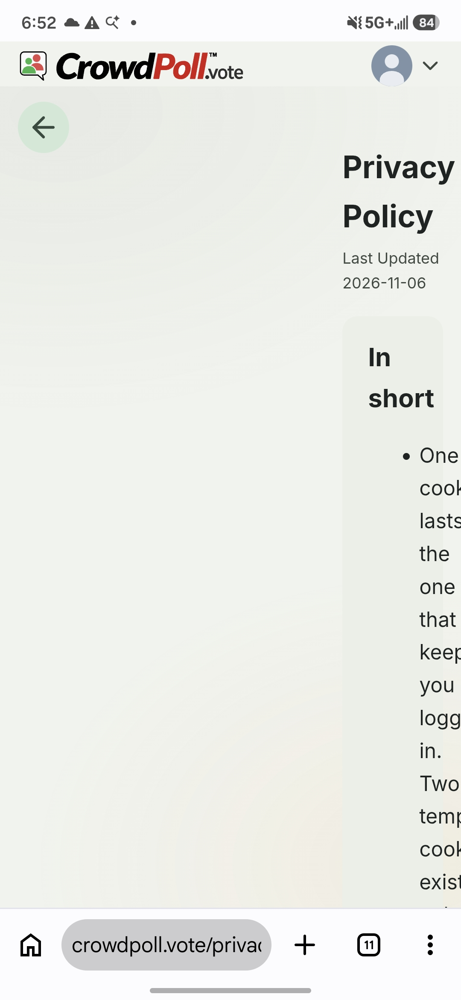

Start a new spec for these requirements called `20261111-091956-FOOTER-LINKS`  
!! THIS FILE IS GENERATED USING THE SKILL `/speckit-requirements`. DO NOT EDIT OR DELETE THIS FILE !!  

# Initial High-Level Requirements

The requirements for this feature are related to the links in the footer.  

1. on a phone, the Terms page and Privacy Policy page don't adjust properly.  
See the image:   
  

2. Can the Back Arrow icon on the Privacy Policy and Terms page go back to the current tab if that is where the user navigated from?  
We checked when the pages are launched from other locations and they all go back to the correct page.

3. When "Cancel" is clicked on "delete Account" page, it goes back to the Profile page.  
Please make it go back to the page from which the user navigated to the "delete Account" page,  
same as the Privacy Policy and the Terms page.

4. Please investigate if the Back Arrow does not navigate back to the correct page when launched from different locations.
Provide a solution to ensure consistent navigation behavior across all pages.

## Decisions (2026-11-11)

Resolved with `/speckit-requirements`;
each decision names the item it settles.

- **Item 1, the legal pages on a phone (UA1)**: below 640px the Back arrow bar joins the page flow above the title, with no text gutter;
  the text takes the full width.
  The gutter rule in `legal-m3.css` is replaced so it never grows once the column is narrower than the text.
- **Item 2, the home page's tab (NC1, UA2, UA3)**: the home page keeps its active tab in its address, `/?tab=<name>`, set with `history.replaceState` on each selection and honoured for every tab on load, so a return by the Back arrow, the browser's Back button or a reload shows that tab.
  A remembered tab the visitor may not use (a personal tab for a guest, or an unknown name) falls back to Trending, never to the login page.
  The tab is restored, not a maximized poll card.
- **Item 3, the Delete Account dialog (AM1, UA4)**: Cancel and the Escape key both return to the page the visitor came from, under the legal pages' rule (a same-origin referrer and an earlier history entry, decided when the dialog opens);
  the scrim stays inert.
  When that rule gives no page to return to, or the dialog was opened on the Profile page itself, Cancel closes the dialog and stays on the Profile page.
- **Item 4, one back rule (RS1)**: `backArrow.js` exposes one rule, "came from this site in this browser tab: go back through history; otherwise go to a fallback page", used by the legal pages' arrow, the Delete Account dialog's Cancel (no fallback: it closes) and the admin page's arrow (fallback `/`).
  Together with the tab in the home page's address, every return lands on the tab the visitor left.
