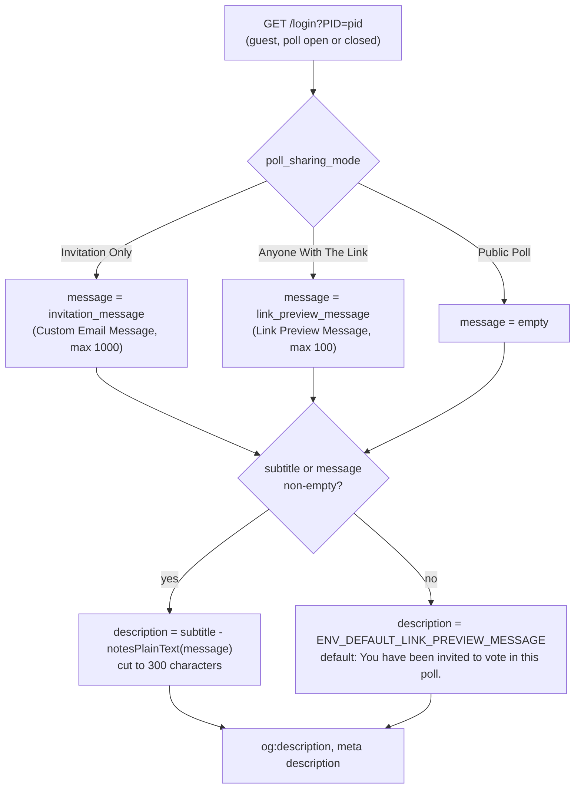
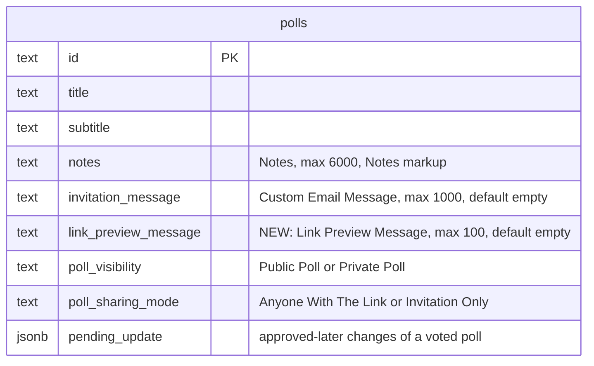
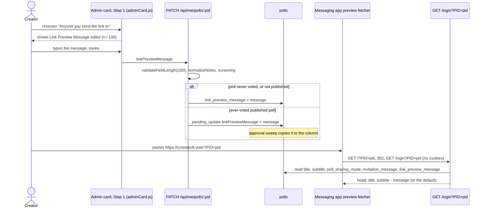

# High Level Requirements

Requirements: `requirements/20261111-122415-shared-link-message/requirements.md`  
External Files: none  
Generated: 2026-11-11 12:24 PM  

The requirements of this feature continues to make changes to the support of creating a preview for Messaging Apps.  

Currently, the notes that appear in the link preview come from the Custom Email Message field that is entered when the Poll Creator selects "Only people you invite" on the "Who" tab.  
However, the notes are used for the "Anyone you send the link to" when the notes are hidden.  

Please add an editor under the "Anyone you send the link to" section, similar to the one under the "Only people you invite".  
This field will be limnited to 100 characters since most previews truncate it, and this context only requires a summary message describing the poll.  

Store this in a new polls table field, since we want to be able to switch between "Anyone you send the link to" and "Only people you invite",  
and the messages need to be retained for each.  

When the Poll doesn't have a Custom Message or subtitle, the link preview will fall back to CrowdPoll's default message: "Vote and see live results: title"  
as specified in `src/seo/loginPage.ts`.  
Make this an environment variable called ENV_DEFAULT_LINK_PREVIEW_MESSAGE when the preview with the default of "You have been invited to vote in this poll."

The other place this is used as a preview to Search Engines for public polls. The default message is suitable for those, since there is no way to enter a custom message for public polls. 

## Additional Requirements and Research Requests

**Instructions To The Developer**  
Enter any additional requirements or research requests under the ## Additional Requirements and Research Requests heading above.  
When you Type or Say: "Next" in the CC CLI terminal, the additional requirements and research requests will be applied to the report.  
  
You may leave these instructions here. They will be ignored when "Next" is executed.  
✅ Applied 2026-11-11 1:11 PM: the messaging-app test observations added to requirements.md; 3 research requests (RS1, RS2, RS3).  

## 1. Overview and Scope

The previous feature (`20261110-204911-LINK-PREVIEW-MESSAGE`) made `GET /login?PID=<pid>` carry a poll's title, subtitle and
Custom Email Message in its head, so a messaging app's preview card shows them.  
The description it builds is `subtitle - notesPlainText(invitation_message)`, cut to 300 characters, falling back to
`Vote and see live results: <title>` when both are empty (`linkPreviewDescription` in `src/seo/loginPage.ts`).  
`polls.invitation_message` is kept when a poll leaves "Only people you invite" (decision AM2 of
`20261110-160141-INVITATION-CUSTOM-MESSAGE`), so today an "Anyone you send the link to" poll that once had a Custom
Email Message still shows it in its preview, although Step 1 of the wizard no longer shows the field.  

This feature adds a second, independent message for the preview of an "Anyone you send the link to" poll, and makes the
fallback sentence a setting.  

In scope:  

- A **Link Preview Message** editor in Step 1 ("Who") under the "Anyone you send the link to" option, like the Custom
  Email Message editor under "Only people you invite", limited to 100 characters.  
- A new `polls` column for it, so each sharing mode keeps its own message and switching between the two modes loses
  neither.  
- The preview of an "Anyone you send the link to" poll uses this field;  
  the preview of an "Only people you invite" poll keeps using the Custom Email Message.  
- The fallback sentence, used when a poll has neither a subtitle nor the message of its sharing mode, becomes
  `ENV_DEFAULT_LINK_PREVIEW_MESSAGE`, default "You have been invited to vote in this poll."  

Out of scope:  

- The public poll page `/poll/<pid>`, whose description for search engines stays `subtitle` or
  `Vote and see live results: <title>` (`describe()` in `src/seo/pollPage.ts`);  
  the requirements say that sentence suits it, since a public poll has no custom message (see AM1).  
- The invitation email: the new field is never sent by email.  
- Public polls get no message editor.  

## 2. Where the Preview Description Comes From

The description `GET /login?PID=<pid>` writes into `og:description` and `<meta name="description">`, after this feature.  
The subtitle and the mode's message are each trimmed;  
the non-empty parts are joined by ` - ` and the whole is cut to 300 characters, as today.  

Today's rule differs in two places: the message is always `invitation_message`, whatever the sharing mode, and the
fallback is the fixed `Vote and see live results: <title>`.  

## 3. Data Model

One new column on `polls`, beside the one the previous feature added;  
no other table changes.  

The column follows `invitation_message` in every respect (see UA2): `text not null default ''`, stored normalized by
`normalizeNotes`, listed in `NON_CONTENT_FIELDS` so a change does not bump `content_version`, copied by Duplicate,
returned only on the admin poll detail, and parked in `pending_update` on an ever-voted published poll until approved
(see UA3).  

## 4. Editing and Previewing the Message

## 5. Configuration

`ENV_DEFAULT_LINK_PREVIEW_MESSAGE` joins `loadConfig` in `src/config.ts` as a text setting
(`read.text(name, fallback)`, like `ENV_EMAIL_FROM`), default `You have been invited to vote in this poll.`  
It is documented in `.claude/rules/environment.md`, the README settings table and `CLAUDE_COMPLETE.md`;  
the development templates (`.vscode/launch.json.example`, `devScripts.example/launch-dev.ps1`) and `infra/app.tf` need
no entry when the default is wanted (see UA5 for validation and placement).  

## 6. Components Touched

| Area | File(s) | Change |
|---|---|---|
| Migration | `src/db/migrations/021-link-preview-message.ts`, `index.ts`, `src/db/schema.ts` | new column `link_preview_message text not null default ''` |
| Store | `src/polls/store.ts` | field `linkPreviewMessage`, column mapping, `NON_CONTENT_FIELDS`, `pending_update` application |
| Limits | `src/polls/notes.ts`, `src/polls/service.ts` (`LIMITS`) | `LINK_PREVIEW_MESSAGE_MAX = 100`, `validateFieldLength` |
| Service | `src/polls/service.ts` | new poll default `""`, PATCH handling, Duplicate copies it, screening input |
| API | `src/routes/pollsApi.ts`, `postman/openapi.json` | admin detail returns `linkPreviewMessage` and `linkPreviewMessageHtml`; admin list `hasLinkPreviewMessage`; pending-update routing |
| Sweeps | `src/polls/sweeps.ts` | screening and approval carry the new field like `invitationMessage` |
| Preview | `src/seo/loginPage.ts`, `src/routes/pages.ts` | choose the message by `poll_sharing_mode`; fallback from config |
| Config | `src/config.ts`, `.claude/rules/environment.md`, `README.md`, `CLAUDE_COMPLETE.md` | `ENV_DEFAULT_LINK_PREVIEW_MESSAGE` |
| Wizard | `src/public/adminCard.js` | editor under "Anyone you send the link to", field lists (dirty check, save, summary), summary line |
| Tests | `tests/seo.test.ts`, `tests/field-limits.test.ts`, `tests/polls-admin-crud.test.ts`, `tests/polls-pending-update.test.ts`, `tests/client-admin-wizard.test.ts`, `tests/config*.test.ts` | the rules above |
| Docs | `README.md`, `ARCHITECTURE.md`, `CLAUDE.md`, `CLAUDE_COMPLETE.md` | the field, the rule, the setting |

## 7. Research Results

The developer's tests of the deployed preview (2026-11-11) in Facebook Messenger, Slack, WhatsApp and Instagram, with the
screenshots in `requirements/20261110-202128-link-preview-message/`, raised three questions.  
Each is researched below against Meta's own documentation and the screenshots.  

### Research Requests

**RS1. Why do Facebook Messenger and Instagram show only "crowdpoll.vote", and can it be fixed?**  
<b>
✅ Resolved</b>  
✅ Requirements File Updated: 2026-11-11 1:26 PM  
**Notes**: Recommendation accepted in file 2026-11-11: Recommendation A, robots.txt gains a group for Meta's preview crawlers (`facebookexternalhit`, `meta-externalfetcher`) that allows `/login` and repeats the other disallows; `noindex` stays; verified with the Sharing Debugger;  
recorded under Research Decisions.  

> The tests show a card in Google Messages, Slack and WhatsApp, and only the domain in Facebook Messenger and Instagram.  
> Sources: [Meta — Web Crawlers](https://developers.facebook.com/docs/sharing/webmasters/web-crawlers/), [Google — user-triggered fetchers](https://developers.google.com/crawling/docs/crawlers-fetchers/google-user-triggered-fetchers), [WhatsApp — Link Previews](https://developers.facebook.com/documentation/business-messaging/whatsapp/link-previews/), [Meta Sharing Debugger](https://developers.facebook.com/tools/debug).  
> Messenger and Instagram previews are built by Meta's server-side crawler, `facebookexternalhit`, whose purpose is "to crawl the content of an app or website that was shared on one of Meta's family of apps, such as Facebook, Instagram, or Messenger".  
> Meta's page says "in order to block these crawlers, add a disallow for the relevant crawler to robots.txt", so the crawler obeys robots.txt;  
> the site's robots.txt (`ROBOTS` in `src/routes/seo.ts`) has `User-agent: *` with `Disallow: /login`, and `/login?PID=<pid>` is the page every private poll's link leads to, so Meta's crawler never reads the tags and the card is the bare domain.  
> Google's user-triggered fetchers "generally ignore robots.txt", and WhatsApp fetches the page from the sender's own phone (`WhatsApp/2.x`), which is why those two show a card.  
> Meta caches robots.txt for up to 24 hours, and the Sharing Debugger shows exactly what its crawler reads.  
> Not confirmed: whether the login page's `<meta name="robots" content="noindex">` also matters to the crawler;  
> Meta's page does not mention it, and the Sharing Debugger will tell after the robots.txt change.  

  - **Recommendation A** _(recommended)_: **robots.txt gains a group for Meta's preview crawlers (`facebookexternalhit`, `meta-externalfetcher`) that allows `/login` and repeats the other disallows;  `noindex` stays;  the deployment is verified with the Sharing Debugger.**  

    [X] ➡️ **Accepted**

    - <u>Pros</u>: the documented way to let a named crawler in;  
      search engines keep `Disallow: /login`, and `meta-externalagent` (Meta's AI-training crawler) is not let in.  
    - <u>Cons</u>: a robots.txt group to keep in step with the `*` group (`tests/seo.test.ts` pins the file);  
      up to 24 hours before Meta picks it up, and old shares keep their stored card.  

  - **Recommendation B**: **leave robots.txt as it is;  Messenger and Instagram keep showing the domain only.**  

    [ ] ➡️ **Not Accepted**

    - <u>Pros</u>: nothing to change.  
    - <u>Cons</u>: no title, subtitle or message in two widely used apps.  

  - **Developer Resolution C**:  

    [ ] ➡️ **Not Accepted**

**RS2. Why does WhatsApp show the subtitle but not the custom notes?**  
<b>
✅ Resolved</b>  
✅ Requirements File Updated: 2026-11-11 1:26 PM  
**Notes**: Recommendation accepted in file 2026-11-11: Recommendation A, the preview description is one line: line breaks in the message become spaces, whitespace runs collapse, parts joined by ` - `, 300-character cut kept;  
recorded under Research Decisions.  

> The WhatsApp screenshot reads "this is the subtitle -" and then an empty line;  
> Slack shows the same page's whole text: "this is the subtitle - These are the email message notes. lione 2 line 3 …".  
> Sources: [WhatsApp — Link Previews](https://developers.facebook.com/documentation/business-messaging/whatsapp/link-previews/), the screenshots, `src/seo/loginPage.ts` as deployed.  
> The deployed page joins the subtitle and the message with a blank line (two newlines), and the message's plain text keeps its own line breaks (`notesPlainText`).  
> WhatsApp's page says the description "is limited to 1 or 2 lines and 80 characters will suffice" and says nothing about line breaks;  
> the screenshot shows the card ends exactly where the first newline is, so WhatsApp renders the first line of the description only, while Google Messages and Slack collapse the newlines into spaces.  
> TWEAK02 of the previous feature (in the working tree of `link-message`, not yet committed or deployed) replaces the blank line with ` - `, which brings the message's first line into the WhatsApp card;  
> the message's own line breaks would still cut it there.  

  - **Recommendation**: **the preview description is one line: every line break in the message's plain text becomes a space, runs of whitespace collapse to one, the parts are joined by ` - `, and the 300-character cut stays.**  

    [X] ➡️ **Accepted**

    - WhatsApp then shows as much of the message as its two lines hold, the other apps the same text as today.  
    - The 100-character Link Preview Message of this feature fits WhatsApp's "1 or 2 lines" far better than a 1000-character email message, which every app cuts.  
    - The public poll page is unaffected: its description is the subtitle, which has no line breaks.  

  - **Developer Resolution B**:  

    [ ] ➡️ **Not Accepted**

**RS3. Can WhatsApp's scaled-up favicon be fixed?**  
<b>
✅ Resolved</b>  
✅ Requirements File Updated: 2026-11-11 1:26 PM  
**Notes**: Recommendation accepted in file 2026-11-11: Recommendation A, a committed 1200 × 630 brand image `src/public/og-image.png` under 300 KB as `og:image` with width, height and type, on the login page preview and the public poll page;  
recorded under Research Decisions; it reverses UA4 of the previous feature.  

> The login page offers no `og:image` (UA4 of the previous feature chose a text card), so WhatsApp "looks for other HTML mark-ups" and takes the page's `<link rel="icon">` (`favicon.svg`, a 96-pixel drawing) as the thumbnail, scaled up.  
> Sources: [WhatsApp — Link Previews](https://developers.facebook.com/documentation/business-messaging/whatsapp/link-previews/), [Meta — Images in Link Shares](https://developers.facebook.com/docs/sharing/webmasters/images/), [Fixing thumbnail previews on WhatsApp, LinkedIn and X](https://andrewbaker.ninja/2026/03/05/fix-thumbnail-previews-on-whatsapp-linkedin-x-guide/).  
> WhatsApp's stated requirements for `og:image`: an absolute URL, "300px or more in width with 4:1 width/height or less aspect ratio", "under 600KB" (third-party reports put the safe ceiling at 300 KB);  
> "if a preview does not show up in the expected large size, please check the image requirements above are met", and the fallback to other markup "should not be relied on".  
> Meta's sharing page: minimum 200 × 200, at least 600 × 315 for the larger layout, 1200 × 630 recommended, aspect close to 1.91:1;  
> `og:image:width` and `og:image:height` let the crawler "render the image immediately";  
> the crawler "has to see an image at least once", caches it by URL, and old shares are not updated.  
> So it can be fixed by giving the page an `og:image` that meets the requirements;  
> what cannot be chosen is the layout: WhatsApp decides large or small by the image, and the Slack card already shows an image placeholder for the same reason.  

  - **Recommendation A** _(recommended)_: **a committed brand image `src/public/og-image.png`, 1200 × 630, under 300 KB, served by the page as `og:image` (absolute URL) with `og:image:width`, `og:image:height` and `og:image:type`, on the login page preview and the public poll page alike (one change in `previewHeadTags`).**  

    [X] ➡️ **Accepted**

    - <u>Pros</u>: meets every documented requirement, so every app shows a crisp image;  
      the same card for public and private polls.  
    - <u>Cons</u>: an asset to draw and commit (the brand figures on a plain background);  
      WhatsApp and Google Messages then show a large-image card, with the title and description under the image rather than beside a thumbnail;  
      it reverses UA4 of the previous feature.  

  - **Recommendation B**: **a square 600 × 600 PNG of the favicon figures as `og:image`, with width and height, on both pages.**  

    [ ] ➡️ **Not Accepted**

    - <u>Pros</u>: the thumbnail is crisp and the asset is the existing favicon drawing exported once.  
    - <u>Cons</u>: whether WhatsApp keeps the small thumbnail layout for a square image is undocumented, so the layout may differ by app.  

  - **Developer Resolution C**:  

    [ ] ➡️ **Not Accepted**

## 8. Findings

### Inconsistencies

None found.  

### Ambiguities

**AM1. Which pages use `ENV_DEFAULT_LINK_PREVIEW_MESSAGE`: the login page preview only, or the public poll page too?**  
<b>
✅ Resolved</b>  
✅ Requirements File Updated: 2026-11-11 12:44 PM  
**Notes**: Recommendation accepted in file 2026-11-11: Recommendation A, the setting applies to the login page preview only; `/poll/<pid>` keeps `Vote and see live results: <title>`;  
the requirements now say so under Decisions.  

> The requirements make the login page's fallback (`src/seo/loginPage.ts`) a setting with a new default.  
> The last paragraph says the other place the sentence is used, the search-engine preview of public polls, finds "the default message" suitable.  
> That can mean the current sentence `Vote and see live results: <title>` stays on `/poll/<pid>` (`describe()` in `src/seo/pollPage.ts`), or that the new setting applies there too.  
> The two pages have different readers: a search snippet benefits from the title in the text, a messaging card already shows the title as its headline.  

  - **Recommendation A** _(recommended)_: **the setting applies to the login page preview only;  `/poll/<pid>` keeps `Vote and see live results: <title>`.**  

    [X] ➡️ **Accepted**

    - <u>Pros</u>: it reads the last paragraph as written;  
      search snippets keep the title in their text, and nothing changes for public polls.  
    - <u>Cons</u>: the two pages keep two different fallback sentences, and the one in `pollPage.ts` stays hard-coded.  

  - **Recommendation B**: **the setting applies to both pages.**  

    [ ] ➡️ **Not Accepted**

    - <u>Pros</u>: one sentence, one setting, one place to change it.  
    - <u>Cons</u>: a public poll without a subtitle would be described to search engines as "You have been invited to vote in this poll.", which is wrong for a public poll;  
      the title would no longer appear in the snippet text.  

  - **Developer Resolution C**:  

    [ ] ➡️ **Not Accepted**

**AM2. "The notes are used for the Anyone you send the link to when the notes are hidden": which message does each sharing mode's preview use after this feature?**  
<b>
✅ Resolved</b>  
✅ Requirements File Updated: 2026-11-11 12:44 PM  
**Notes**: Recommendation accepted in file 2026-11-11: Recommendation A, the preview uses the message of the poll's current sharing mode, never the hidden one;  
the selection rule is recorded under Decisions.  

> Today `renderLoginPage` always reads `polls.invitation_message`, and that column is kept when a poll leaves "Only people you invite" (decision AM2 of the custom-message feature).  
> So an "Anyone you send the link to" poll that once had a Custom Email Message shows it in its preview while Step 1 hides the field.  
> The requirements add a second message and say both are retained, but do not state the selection rule the preview applies.  

  - **Recommendation**: **the preview uses the message of the poll's current sharing mode, never the hidden one: the Link Preview Message for "Anyone you send the link to", the Custom Email Message for "Only people you invite", no message for a public poll.**  

    [X] ➡️ **Accepted**

    - What the creator sees in Step 1 is what the card shows;  
      switching modes switches the message, and switching back restores the other, since both columns are kept.  
    - A public poll's login page (reached only by a direct `/login?PID=` request, since a guest is sent to `/poll/<pid>`) shows the subtitle or the default.  

  - **Developer Resolution B**:  

    [ ] ➡️ **Not Accepted**

**AM3. Does the setting's value carry the poll title, as the current fallback does?**  
<b>
✅ Resolved</b>  
✅ Requirements File Updated: 2026-11-11 12:44 PM  
**Notes**: Recommendation accepted in file 2026-11-11: Recommendation A, plain text, used as given, no placeholder;  
recorded under Decisions.  

> The current fallback is `Vote and see live results: <title>`, built from the poll.  
> The new default, "You have been invited to vote in this poll.", names no poll;  
> the requirements do not say whether an operator may put a placeholder such as `<title>` in the setting.  
> In a messaging card the title is already the headline (`og:title`), directly above the description.  

  - **Recommendation A** _(recommended)_: **plain text, used as given, no placeholder.**  

    [X] ➡️ **Accepted**

    - <u>Pros</u>: nothing to parse or validate;  
      the card shows the title above it anyway.  
    - <u>Cons</u>: an operator cannot reproduce today's sentence with the title in it.  

  - **Recommendation B**: **the value may contain `{title}`, replaced by the poll title.**  

    [ ] ➡️ **Not Accepted**

    - <u>Pros</u>: today's sentence stays possible by configuration.  
    - <u>Cons</u>: a placeholder convention to document and test, for a sentence that sits under the title already.  

  - **Developer Resolution C**:  

    [ ] ➡️ **Not Accepted**

### Unspecified Aspects

**UA1. The editor: label, support text, placement and kind.**  
<b>
✅ Resolved</b>  
✅ Requirements File Updated: 2026-11-11 12:44 PM  
**Notes**: Recommendation accepted in file 2026-11-11: Recommendation A, the same `m3RichTextField`, label "Link Preview Message", counter "n / 100", under the "Anyone you send the link to" option after its Copy Link block;  
the label, support text, counter and placement are recorded under Decisions.  

> "Similar to the one under Only people you invite" names the Custom Email Message editor: `m3RichTextField` with the Notes markup (bold, italic, underline, line breaks), an "… edit" button and a counter.  
> In a preview card the message is plain text (`notesPlainText`), so marks never show;  
> the requirements give the limit (100) but not the label, the support text or where the editor sits in relation to the existing Copy Link block under that option.  

  - **Recommendation A** _(recommended)_: **the same `m3RichTextField`, label "Link Preview Message", support "Optional. Shown under the poll's title when its link is shared in a messaging app.", counter "n / 100", placed under the "Anyone you send the link to" option after its Copy Link block.**  

    [X] ➡️ **Accepted**

    - <u>Pros</u>: it is the editor the requirements point at, with the same "… edit" button, counter and id convention (`pollLinkPreviewMessage-<pid>`);  
      the 100 count is the stored text, marks included, as the 1000 is.  
    - <u>Cons</u>: formatting marks can be typed but never appear in a card.  

  - **Recommendation B**: **a plain `m3TextField` like the subtitle's, same label and support, counter "n / 100", same placement.**  

    [ ] ➡️ **Not Accepted**

    - <u>Pros</u>: no marks that cannot show;  
      a 100-character summary needs no line breaks.  
    - <u>Cons</u>: not "similar to" the Custom Email Message editor;  
      the stored text still goes through `normalizeNotes` for consistency.  

  - **Developer Resolution C**:  

    [ ] ➡️ **Not Accepted**

**UA2. Storage, API and limits of the new field.**  
<b>
✅ Resolved</b>  
✅ Requirements File Updated: 2026-11-11 12:44 PM  
**Notes**: Recommendation accepted in file 2026-11-11: Recommendation A, mirror `invitation_message` exactly (column, limit, `NON_CONTENT_FIELDS`, Duplicate, admin payloads, openapi, wizard lists);  
recorded under Decisions.  

> "A new polls table field" is asked for;  
> its name, migration, API shape, limit enforcement, the lists it joins (`NON_CONTENT_FIELDS`, Duplicate, the admin payloads) and the wizard's field lists are not stated.  
> The Custom Email Message settled all of these for its own column (`invitation_message`, migration 020).  

  - **Recommendation**: **mirror `invitation_message` exactly: column `link_preview_message text not null default ''` (migration `021-link-preview-message`); field `linkPreviewMessage`, `LINK_PREVIEW_MESSAGE_MAX = 100` in `notes.ts` and `LIMITS`, `validateFieldLength` ("Link preview message") and `normalizeNotes` on PATCH and publish; in `NON_CONTENT_FIELDS`; copied by Duplicate; returned as `linkPreviewMessage` and `linkPreviewMessageHtml` on the admin poll detail only and `hasLinkPreviewMessage` on the admin list; never in card, tab, delta or SEO payloads; `postman/openapi.json` updated; the wizard's dirty check, save and summary field lists include it.**  

    [X] ➡️ **Accepted**

    - Every rule already has a test for `invitationMessage` (`field-limits`, `polls-admin-crud`, `polls-discovery`, `client-admin-wizard`) to extend.  

  - **Developer Resolution B**:  

    [ ] ➡️ **Not Accepted**

**UA3. Screening and the pending-update rule for the new field.**  
<b>
✅ Resolved</b>  
✅ Requirements File Updated: 2026-11-11 12:44 PM  
**Notes**: Recommendation accepted in file 2026-11-11: Recommendation A, screened with the other text fields and parked in `pending_update` on an ever-voted published poll; the preview reads the approved column only;  
recorded under Decisions.  

> The Custom Email Message goes through Acceptability Screening with the title, subtitle and notes, and on an ever-voted published poll a change waits in `pending_update` until approved;  
> the preview reads the approved column only.  
> The requirements say nothing about either for the Link Preview Message, which reaches the public in the same card.  

  - **Recommendation**: **the same as the Custom Email Message: screened with the other text fields (`screening.ts`, both sweeps), parked in `pending_update` on an ever-voted published poll until approved, and the preview reads the approved column only.**  

    [X] ➡️ **Accepted**

    - The screening message's "custom email message" clause gains "link preview message" when that field held the offending term.  
    - `tests/polls-pending-update.test.ts` and `tests/polls-screening.test.ts` gain the field.  

  - **Developer Resolution B**:  

    [ ] ➡️ **Not Accepted**

**UA4. Does the Settings Summary get a line for the new message?**  
<b>
✅ Resolved</b>  
✅ Requirements File Updated: 2026-11-11 12:44 PM  
**Notes**: Recommendation accepted in file 2026-11-11: Recommendation A, a Settings Summary line "A Link Preview Message has been entered" for "Anyone you send the link to" polls with a message;  
recorded under Decisions.  

> The Custom Email Message adds "A Custom Invitation Email Message has been entered" under the Who line, a link that opens Step 1 with the field focused, only for "Only people you invite" polls with a message.  
> The requirements do not say whether the Link Preview Message gets the same.  

  - **Recommendation A** _(recommended)_: **yes: "A Link Preview Message has been entered", under the Who line, only for "Anyone you send the link to" polls with a non-blank message, opening Step 1 with the field focused;  the admin list carries `hasLinkPreviewMessage` for it.**  

    [X] ➡️ **Accepted**

    - <u>Pros</u>: the summary stays complete, and the two messages behave alike.  
    - <u>Cons</u>: one more summary line and class (`wizard-summary-link-preview-message`) to test.  

  - **Recommendation B**: **no summary line.**  

    [ ] ➡️ **Not Accepted**

    - <u>Pros</u>: less to build.  
    - <u>Cons</u>: a creator reviewing the summary cannot tell the message is set.  

  - **Developer Resolution C**:  

    [ ] ➡️ **Not Accepted**

**UA5. Validation and documentation of `ENV_DEFAULT_LINK_PREVIEW_MESSAGE`.**  
<b>
✅ Resolved</b>  
✅ Requirements File Updated: 2026-11-11 12:44 PM  
**Notes**: Recommendation accepted in file 2026-11-11: Recommendation A, a trimmed text setting, default "You have been invited to vote in this poll.", blank or over 300 characters refused, documented in the three settings tables;  
recorded under Decisions.  

> Every setting is validated once by `loadConfig`, and an invalid value stops the app;  
> the requirements name the variable and its default but not what counts as invalid, nor where it is documented.  

  - **Recommendation**: **a text setting read with `read.text`, default "You have been invited to vote in this poll.";  the value is trimmed, and a blank value or one over 300 characters (the preview cap) is a `ConfigError`;  a row in `.claude/rules/environment.md`, the README settings table and `CLAUDE_COMPLETE.md`;  no entry in the development templates or `infra/app.tf`, since the default is wanted.**  

    [X] ➡️ **Accepted**

    - The value is HTML-attribute-escaped by `previewHeadTags` like every other description, so no markup is interpreted.  
    - `tests/config*.test.ts` pin the default and the two refusals.  

  - **Developer Resolution B**:  

    [ ] ➡️ **Not Accepted**

### Needs Clarifications

**NC1. Existing "Anyone you send the link to" polls that still hold a Custom Email Message: does the migration copy it into the new field?**  
<b>
✅ Resolved</b>  
✅ Requirements File Updated: 2026-11-11 12:44 PM  
**Notes**: Recommendation accepted in file 2026-11-11: Recommendation A, no copy: the new column starts empty for every poll;  
recorded under Decisions.  

> After this feature their preview stops showing the retained Custom Email Message (AM2) and shows the subtitle or the default instead.  
> A creator who switched such a poll from "Only people you invite" may have relied on the message appearing in the card since the previous feature was deployed.  
> Production is open to test users only, so few polls can be affected.  

  - **Recommendation A** _(recommended)_: **no copy: the new column starts empty for every poll.**  

    [X] ➡️ **Accepted**

    - <u>Pros</u>: the message was written for an email, not a 100-character card, and showing it there was a side effect;  
      the migration stays a one-line `add column`.  
    - <u>Cons</u>: a test poll's card changes until its creator fills the new field.  

  - **Recommendation B**: **the migration copies `invitation_message`, as plain text cut to 100 characters, into `link_preview_message` for "Anyone With The Link" polls.**  

    [ ] ➡️ **Not Accepted**

    - <u>Pros</u>: no card changes on deployment.  
    - <u>Cons</u>: a cut, unreviewed text is stored in a field the creator never filled;  
      the plain-text conversion would have to be done in SQL or a data migration.  

  - **Developer Resolution C**:  

    [ ] ➡️ **Not Accepted**

## 9. Breaking Changes

- The preview of an "Anyone you send the link to" poll that holds a retained Custom Email Message no longer shows it (AM2, NC1).  
- The login page's fallback sentence changes from `Vote and see live results: <title>` to the setting's value;  
  cards an app has already stored are not refreshed either way.  
- A new migration (`021`) runs at start-up;  
  the column has a default, so the deployment needs no data step.  
- The admin poll detail and list gain fields;  
  no field is removed or renamed, so existing clients are unaffected.  

## 10. Technical Debt

- The fallback sentence exists twice, in `describe()` (`src/seo/pollPage.ts`, 160-character cap) and `linkPreviewDescription` (`src/seo/loginPage.ts`, 300-character cap);  
  after this feature one is a setting and the other a literal.  
- `renderLoginPage` takes the message as a bare string;  
  choosing it by sharing mode belongs in one place (the renderer, given the row's two messages and mode) rather than in `routes/pages.ts`.  
- `adminCard.js` lists its text fields in five places (the dirty check, the base snapshot, the save body, the summary snapshot and the change detection);  
  each new field touches all five.  

## 11. Assumptions

- The 100-character limit counts the stored text as the 1000-character limit does, markup included, and is enforced by the server as well as the counter.  
- A message typed while "Anyone you send the link to" is selected and then hidden by switching to "Only people you invite" is saved with the poll, like the Custom Email Message in the opposite direction.  
- The preview composition (`subtitle - message`, 300-character cut, `notesPlainText`) and the `isOpenOrClosed` gate of the previous feature are unchanged.  
- Production previews are read by the apps' own fetchers without a session, so the guest path of `/login?PID=` stays the one page that matters.  

## 12. Requirements Report Complete Report

- **Requirements Report Document:** requirements/20261111-122415-shared-link-message/requirements-report.md
- **Requirements Document:** requirements/new-20261111-112828/requirements.md → requirements/20261111-122415-shared-link-message/requirements.md
- **Software Architecture Diagrams:** 3
- **Inconsistencies:** 0
- **Ambiguities:** 3
- **Unspecified Aspects:** 5
- **Needs Clarifications:** 1
- **Research Results:** 3
- **Breaking Changes:** 4
- **Technical Debt items:** 3

The requirements are ready for /speckit-specify.
To generate specs from the requirements document, use the `/speckit-specify` skill followed by the path (relative to the project root) to the requirements file.
At the prompt, Type:
🟩 👉 /speckit-specify requirements/20261111-122415-shared-link-message/requirements.md
