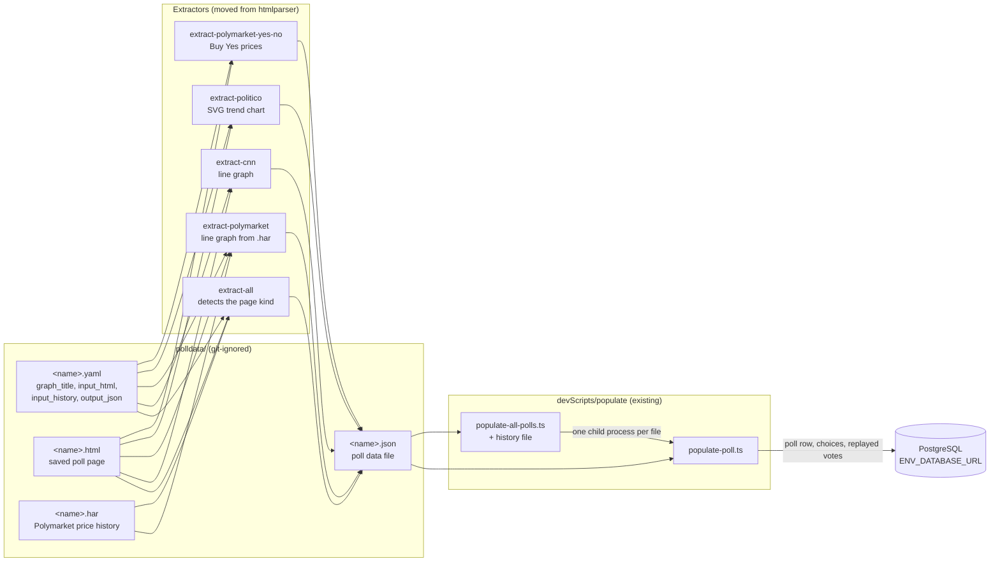
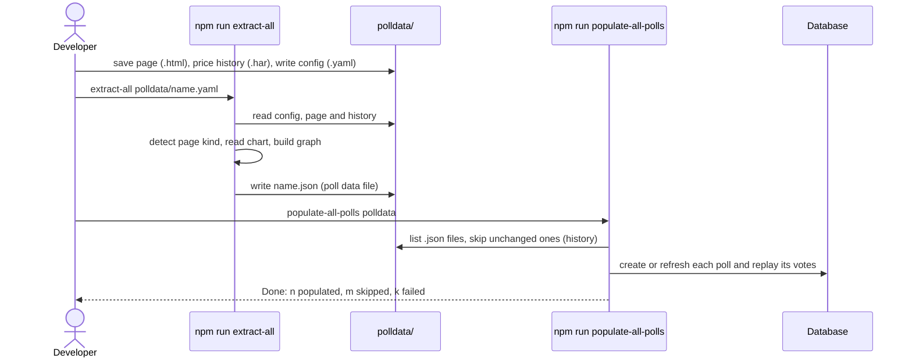
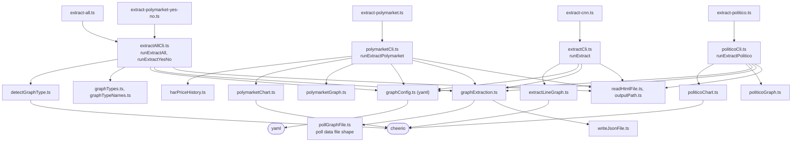

# High Level Requirements

Requirements: `requirements/20261112-124616-poll-data-extractors/requirements.md`  
External Files: none  
Generated: 2026-11-12 12:46 PM  

There is a repo called "htmlparser" on the same account (roadraceresults) as the "crowdpoll" repo that this project is in.  
The htmlparse project provides these 5 main scripts:  

| Command | Entry, then runner | What it does |
|---|---|---|
| `node dist/extract-cnn.js <config.yaml>` | `src/extract-cnn.ts` → `runExtract` in `src/extractCli.ts` | Line graph (CNN): pulls the data behind a line graph out of a saved poll page. |
| `node dist/extract-polymarket.js <config.yaml>` | `src/extract-polymarket.ts` → `runExtractPolymarket` in `src/polymarketCli.ts` | Polymarket line graph: takes the values from the `.har` price history saved beside the page. |
| `node dist/extract-politico.js <config.yaml>` | `src/extract-politico.ts` → `runExtractPolitico` in `src/politicoCli.ts` | POLITICO Poll of Polls: reads the trend chart off the drawn SVG. |
| `node dist/extract-polymarket-yes-no.js <config.yaml>` | `src/extract-polymarket-yes-no.ts` → `runExtractYesNo` in `src/extractAllCli.ts` | Polymarket yes/no: the current Buy Yes price of every outcome, as one data point. |
| `node dist/extract-all.js <config.yaml>` | `src/extract-all.ts` → `runExtractAll` in `src/extractAllCli.ts` | Any graph page: uses the config's `type`, or detects the page kind, and runs the matching extractor. |

Of course, the purpose of these scripts is to extract data from various types of poll pages to create json files that can then be used by the 
"devScripts\populate\populate-all-polls.ts" script
and the
-"devScripts\populate\populate-poll.ts" script  
to populate the poll data into the database specified in "env.ENV_DATABASE_URL".   

Please bring those scripts into this project so that the extraction and population can all be done in one place.

## Additional Requirements and Research Requests

**Instructions To The Developer**  
Enter any additional requirements or research requests under the ## Additional Requirements and Research Requests heading above.  
When you Type or Say: "Next" in the CC CLI terminal, the additional requirements and research requests will be applied to the report.  
  
You may leave these instructions here. They will be ignored when "Next" is executed.  

## 1. Overview and Scope

The feature moves the five poll-page extractors of the private `roadraceresults/htmlparser` repository into this repository, beside the poll populate scripts that consume their output.  
Today the two halves of one workflow live in two repositories:  

- **htmlparser** reads a saved poll page (HTML, plus a `.har` price history for Polymarket) named in a small YAML config, and writes a poll data JSON file;  
- **crowdpoll** reads that JSON file with `devScripts/populate/populate-poll.ts` (one file) or `populate-all-polls.ts` (a folder, with a history of what was already populated) and writes the poll and its replayed votes into the database at `ENV_DATABASE_URL`.  

The git-ignored `polldata/` folder of this repository already holds the inputs and outputs of both halves (for example `dancing-with-the-stars.yaml`, `.html`, `.har` and `.json`), so after the move one checkout runs the whole chain.  

**What was found in htmlparser** (read through the GitHub API):

- The five scripts exist only on the **`latest`** branch; `main` holds just the first feature (an HTML title extractor), and a third branch, `002-003-h1-config-url-inputs`, holds an intermediate state.  
- The five entries and their runners pull in about 30 modules under `src/` (chart readers, graph builders, config parsing, output writing).  
- Runtime dependencies: `cheerio` (^1.2.0, HTML parsing, used by six modules) and `yaml` (^2.9.1, config files).  
- Toolchain: Node `>=26`, TypeScript ^7, Vitest ^5, compiled with `tsc` to `dist/` and run with `node dist/<entry>.js`.  
- About 35 test files, with fixtures that include two large saved pages (4.2 MB and 1.0 MB).  
- The output is the poll data file `populate-poll.ts` reads: `title`, `subtitle` (default `Poll for Demonstration`), `poll_creator_email` (`devadmin01@crowdpoll.vote`), `vote_count` (1000), optional `type` and `url`, `choice_<letter>` labels and `data_points` (`date` plus one `choice_<letter>` value each).  

**In scope**: the five commands, the modules they need, their dependencies, their tests, and how they are run here.  
**Out of scope**: changes to `populate-poll.ts` and `populate-all-polls.ts`, the application under `src/`, and the database.  

## 2. Component Diagram

## 3. Workflow (Sequence)

## 4. Module Map (extractor side)

## 5. Research Results

The requirements document asks for no research.  

## 6. Findings

### 6.1 Inconsistencies

None found.  

### 6.2 Ambiguities

**AM1. Where do the extractors live in this repository, and how are they run?**  
<b>
✅ Resolved</b>  
✅ Requirements File Updated: 2026-11-12 12:57 PM  
**Notes**: Recommendation accepted in file 2026-11-12: Recommendation A, **`devScripts/extract/`, run with `tsx` through five `npm run` scripts**;  
the requirements' Decisions section now says so.  

> The requirements say "bring those scripts into this project" and name them by their compiled form, `node dist/extract-*.js`.  
> This project never compiles its development scripts: `devScripts/` files are TypeScript run with `tsx` through `npm run` scripts (`npm run populate-poll`, `npm run populate-all-polls`), and the root `tsconfig.json` compiles `src/` only.  
> A new dev script also needs a `!devScripts/<file>` line in `.gitignore` (a cross-feature invariant).  

  - **Recommendation A** _(recommended)_: **`devScripts/extract/`, run with `tsx` through five `npm run` scripts.**  

    [X] ➡️ **Accepted**

    - <u>Pros</u>: it matches `devScripts/populate/` exactly: `npm run extract-all polldata/name.yaml`, no build step, no `dist/`, one `package.json`.  
    - <u>Cons</u>: the folder needs a `.gitignore` exception (`!devScripts/extract/` with its files), and the modules are not under the root type-check (see TD2).  

  - **Recommendation B**: **a separate package, `tools/extract/`, with its own `package.json`, `tsconfig.json` and build to `dist/`.**  

    [ ] ➡️ **Not Accepted**

    - <u>Pros</u>: the commands stay exactly as documented today (`node dist/extract-all.js`), and htmlparser's toolchain versions can be kept.  
    - <u>Cons</u>: a second package to install and build, with its own dependency tree, and a different way to run it from the populate scripts beside it.  

  - **Developer Resolution C**:  

    [ ] ➡️ **Not Accepted**

### 6.3 Unspecified Aspects

**UA1. Which modules come along: the five extractors only, or the title extractor too?**  
<b>
✅ Resolved</b>  
✅ Requirements File Updated: 2026-11-12 12:57 PM  
**Notes**: Recommendation accepted in file 2026-11-12: Recommendation, **move only the five entries, their runners and the modules they import**;  
the requirements' Decisions section now lists what stays in htmlparser.  

> htmlparser also holds its first feature, the HTML title extractor (`src/index.ts`, `src/cli.ts`, `extractTitles.ts`, `pollsFile.ts`, `addTitles.ts`, `parseArguments.ts`, `loadConfig.ts` with URL inputs and `fetchPage.ts`).  
> The requirements name the five graph scripts only.  
> Its output (`{ polls: [{ title, choices: [{ label, bar_percentage }] }] }`) is not a file `populate-poll.ts` reads.  

  - **Recommendation**: **move only the five entries, their runners and the modules they import, found by following the imports from the five entry files; leave the title extractor in htmlparser.**  

    [X] ➡️ **Accepted**

    - Nothing in this project could use the title extractor's output, and the import closure keeps the move to the code the five commands actually run.  

  - **Developer Resolution B**:  

    [ ] ➡️ **Not Accepted**

**UA2. Dependencies and toolchain versions.**  
<b>
✅ Resolved</b>  
✅ Requirements File Updated: 2026-11-12 12:57 PM  
**Notes**: Recommendation accepted in file 2026-11-12: Recommendation, **`cheerio` and `yaml` as `devDependencies`, the code held to this project's toolchain**;  
added to the requirements' Decisions section.  

> The extractors need `cheerio` and `yaml`, which this project does not have.  
> htmlparser targets Node `>=26`, TypeScript ^7 and Vitest ^5; this project declares Node `>=22`, TypeScript ^5.8 and Vitest ^3.2.  
> The production image installs this project's `dependencies`; the extractors are development tools.  

  - **Recommendation**: **add `cheerio` and `yaml` as `devDependencies`, pinned to the versions htmlparser uses, and make the moved code type-check and test under this project's TypeScript, Vitest and Node 22.**  

    [X] ➡️ **Accepted**

    - Development dependencies keep both packages out of the production image.  
    - Holding the code to this project's toolchain avoids two compiler versions in one repository;  
      any language feature newer than TypeScript 5.8 or Node 22 is rewritten in the move.  

  - **Developer Resolution B**:  

    [ ] ➡️ **Not Accepted**

**UA3. Do the tests and their fixtures come along?**  
<b>
✅ Resolved</b>  
✅ Requirements File Updated: 2026-11-12 12:57 PM  
**Notes**: Recommendation accepted in file 2026-11-12: Recommendation A, **the tests move into `tests/extract/` without the two large reference pages**;  
added to the requirements' Decisions section.  

> htmlparser has about 35 test files (unit and integration) for these modules.  
> Its fixtures include two saved reference pages of 4.2 MB and 1.0 MB, used by one integration test (`reference.test.ts`), and the title extractor's tests, which would not move under UA1.  

  - **Recommendation A** _(recommended)_: **move the tests of the moved modules into `tests/extract/`, with their small fixtures, and leave out the two large reference pages and the test that reads them.**  

    [X] ➡️ **Accepted**

    - <u>Pros</u>: the extractors stay tested under `npm test`, while the repository grows by kilobytes, not 5 MB.  
    - <u>Cons</u>: the end-to-end check against the two real saved pages is lost (it stays in htmlparser's history).  

  - **Recommendation B**: **move every test of the moved modules, the large fixtures included.**  

    [ ] ➡️ **Not Accepted**

    - <u>Pros</u>: full coverage, including the real-page check.  
    - <u>Cons</u>: about 5 MB of HTML in the repository.  

  - **Recommendation C**: **move no tests.**  

    [ ] ➡️ **Not Accepted**

    - <u>Pros</u>: the smallest move.  
    - <u>Cons</u>: a change to an extractor would go untested.  

  - **Developer Resolution D**:  

    [ ] ➡️ **Not Accepted**

**UA4. Code style of the moved files.**  
<b>
✅ Resolved</b>  
✅ Requirements File Updated: 2026-11-12 12:57 PM  
**Notes**: Recommendation accepted in file 2026-11-12: Recommendation, **convert the moved files to this project's style**;  
added to the requirements' Decisions section.  

> htmlparser's code uses single quotes and its own comment conventions;  
> this project uses double quotes, and its code is expected to read like the code around it.  

  - **Recommendation**: **convert the moved files to this project's style (double quotes, the same import and comment habits) as part of the move, without changing their behaviour.**  

    [X] ➡️ **Accepted**

    - The project has no linter or formatter, so the conversion is done once in the move and the moved tests confirm nothing changed.  

  - **Developer Resolution B**:  

    [ ] ➡️ **Not Accepted**

### 6.4 Needs Clarifications

**NC1. Which htmlparser branch is the source?**  
<b>
✅ Resolved</b>  
✅ Requirements File Updated: 2026-11-12 12:57 PM  
**Notes**: Recommendation accepted in file 2026-11-12: Recommendation, **take the code from `latest` and name the commit**;  
added to the requirements' Decisions section.  

> The five scripts exist only on the `latest` branch.  
> `main` holds only the title extractor, and `002-003-h1-config-url-inputs` an earlier state.  

  - **Recommendation**: **take the code from `latest`, at the commit current when the move is made, and name that commit in the commit message.**  

    [X] ➡️ **Accepted**

    - It is the only branch with all five scripts, and naming the commit records exactly what was moved.  

  - **Developer Resolution B**:  

    [ ] ➡️ **Not Accepted**

**NC2. What happens to the htmlparser repository afterwards?**  
<b>
✅ Resolved</b>  
✅ Requirements File Updated: 2026-11-12 12:57 PM  
**Notes**: Recommendation accepted in file 2026-11-12: Recommendation B, **keep htmlparser active as it is**;  
added to the requirements' Decisions section;  
TD1 (two copies) stands.  

> "All done in one place" suggests this project becomes the only home of the extractors.  
> If htmlparser keeps changing, the two copies drift apart.  

  - **Recommendation A** _(recommended)_: **archive htmlparser on GitHub (read-only) once the move is merged, with a README line pointing here.**  

    [ ] ➡️ **Not Accepted**

    - <u>Pros</u>: one copy to change, and htmlparser's history stays readable.  
    - <u>Cons</u>: the title extractor (UA1) is then frozen with it.  

  - **Recommendation B**: **keep htmlparser active as it is.**  

    [X] ➡️ **Accepted**

    - <u>Pros</u>: nothing changes there.  
    - <u>Cons</u>: two copies of the extractors, which will diverge (TD1).  

  - **Developer Resolution C**:  

    [ ] ➡️ **Not Accepted**

**NC3. Does "in one place" also mean one command that extracts and then populates?**  
<b>
✅ Resolved</b>  
✅ Requirements File Updated: 2026-11-12 12:57 PM  
**Notes**: Recommendation accepted in file 2026-11-12: Recommendation A, **the extract and populate commands stay separate**;  
added to the requirements' Decisions section.  

> The requirements ask for extraction and population to be done in one place.  
> That could mean the same repository with the commands run one after the other, or a new command that runs an extractor and then populates its output.  

  - **Recommendation A** _(recommended)_: **the same repository only: the extract commands and the populate commands stay separate.**  

    [X] ➡️ **Accepted**

    - <u>Pros</u>: the smallest change; the JSON file stays a checkpoint you can inspect before it reaches the database, and `populate-all-polls` already handles a whole folder.  
    - <u>Cons</u>: two commands per refresh.  

  - **Recommendation B**: **also add one command, e.g. `npm run extract-and-populate <config.yaml>`, that runs `extract-all` and then `populate-poll` on its output.**  

    [ ] ➡️ **Not Accepted**

    - <u>Pros</u>: one step from a saved page to the database.  
    - <u>Cons</u>: a new script to write and test, and the database is written before the extracted file has been looked at.  

  - **Developer Resolution C**:  

    [ ] ➡️ **Not Accepted**

## 7. Breaking Changes

None.  
The application under `src/`, the populate scripts and the poll data file format are unchanged;  
the move only adds development scripts and two development dependencies.  

## 8. Technical Debt

- **TD1. Two copies of the extractors** while htmlparser stays active (see NC2).  
- **TD2. Development scripts are not type-checked by the root command.**  
  `tsconfig.json` includes `src/**/*.ts` only, so `npx tsc --noEmit` does not check `devScripts/`;  
  the populate scripts are checked only through what their tests exercise, and the moved extractors would be in the same position.  
- **TD3. Toolchain gap.**  
  htmlparser was written for Node 26 and TypeScript 7;  
  holding it to this project's Node 22 and TypeScript 5.8 (UA2) may mean small rewrites now, and the gap reappears when this project upgrades.  

## 9. Requirements Report Complete Report  
  
- **Requirements Report Document:** requirements/20261112-124616-poll-data-extractors/requirements-report.md  
- **Requirements Document:** requirements/new-20261112-124422/requirements.md → requirements/20261112-124616-poll-data-extractors/requirements.md  
- **Software Architecture Diagrams:** 3  
- **Inconsistencies:** 0  
- **Ambiguities:** 1  
- **Unspecified Aspects:** 4  
- **Needs Clarifications:** 3  
- **Research Results:** 0  
- **Breaking Changes:** 0  
- **Technical Debt items:** 3  
  
The requirements are ready for /speckit-specify.
To generate specs from the requirements document, use the `/speckit-specify` skill followed by the path (relative to the project root) to the requirements file.
At the prompt, Type:  
🟩 👉 /speckit-specify requirements/20261112-124616-poll-data-extractors/requirements.md  

