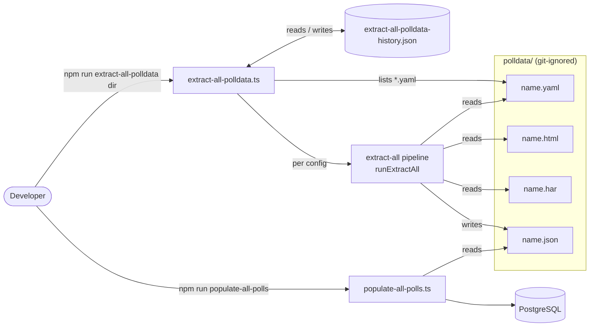
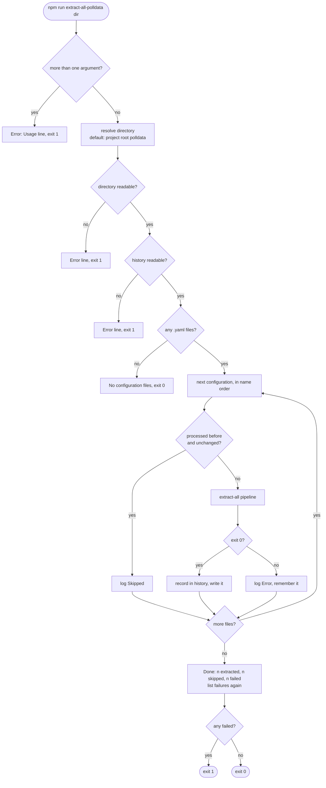
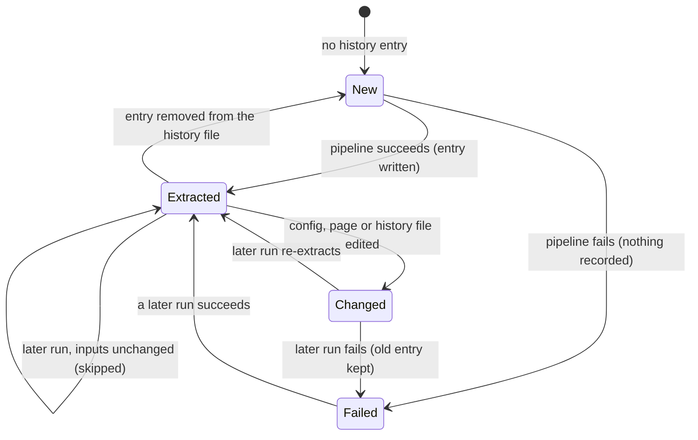

# High Level Requirements

Requirements: `requirements/20261112-152622-extract-all-polldata/requirements.md`  
External Files: none  
Generated: 2026-11-12 3:26 PM  

A previous feature of this project allowed the user to run the "populate-all-polls" script  
without specifying individual poll files, but rather the script iterates the ./polldata directory  
and works on the json files that haven't been marked as processed yet.  
The requirements for this feature are documented in "requirements\20261101-121236-populate-all-polls"  

We need the same convenience for the recently added extract-all script.  
The new script will be called "extract-all-polldata".
The only argument will be the optional directory name, that defaults to ./polldata.

## Additional Requirements and Research Requests

**Instructions To The Developer**  
Enter any additional requirements or research requests under the ## Additional Requirements and Research Requests heading above.  
When you Type or Say: "Next" in the CC CLI terminal, the additional requirements and research requests will be applied to the report.  
  
You may leave these instructions here. They will be ignored when "Next" is executed.  

## 1. Overview and Scope

`npm run extract-all <config.yaml>` (feature `20261112-124616-POLL-DATA-EXTRACTORS`) turns one saved poll page into one poll data file.  
Its configuration is a YAML list (`graph_title`, `title`, `subtitle`, `url`, `type`, `input_html`, `input_history`, `output_json`), and relative paths in it are read from the configuration's own folder.  
`polldata/` (git-ignored) holds, for each poll, the four files `<name>.yaml`, `<name>.html`, `<name>.har` and `<name>.json`.  

`npm run populate-all-polls [<directory>]` (feature `20261101-121236-POPULATE-ALL-POLLS`) already gives the population side the batch form:  

- it takes the `.json` files directly in the folder, in name order;  
- it skips a file whose history entry (`devScripts/populate/populate-all-polls-history.json`) has the same database, name and SHA-256;  
- it runs each of the others, logs failures and goes on, then prints `Done: <n> populated, <n> skipped, <n> failed` and exits 1 if any failed.  

This feature adds the same convenience on the extraction side:  

- **In scope**: a new dev script `devScripts/extract/extract-all-polldata.ts`, run as `npm run extract-all-polldata [<directory>]` (default `./polldata`);  
  it runs the existing `extract-all` pipeline once per configuration file not yet processed, records what it processed, and reports the result.  
- **Out of scope**: any change to the five existing extraction commands, their output or messages;  
  any change to `populate-all-polls`, `src/` or the production application.  

The intended developer workflow becomes two commands:  

```
npm run extract-all-polldata      # polldata/*.yaml → polldata/*.json (new or changed only)
npm run populate-all-polls        # polldata/*.json → database (new or changed only)
```

## 2. Context Diagram



## 3. Run Flow



## 4. State of One Configuration File



## 5. Findings

### 5.1 Inconsistencies

None found.  

### 5.2 Ambiguities

**AM1. Which files in the directory are extraction configurations?**  
<span style="font-size:large" ><b>
✅ Resolved</b></span>  
✅ Requirements File Updated: 2026-11-12 3:33 PM  
**Notes**: Recommendation accepted in file 2026-11-12: Recommendation, the `.yaml` and `.yml` files directly in the directory, in name order;  
  the requirements now say so under "Decisions".  

> The requirements say the script iterates the directory, as `populate-all-polls` does for `.json` files.  
> For extraction the inputs are the YAML configurations, but the folder also holds `.html`, `.har` and `.json` files, and could hold subfolders.  
> `populate-all-polls` took only the files directly in the folder, in name order (its AM2).  

  - **Recommendation**: **the files directly in the directory whose name ends in `.yaml` or `.yml` (any letter case), in name order; subfolders are not searched.**  

    [X] ➡️ **Accepted**

    - It mirrors `populate-all-polls` and matches the four-files-per-poll layout of `polldata/`.  
    - A `.yaml` file that is not an extraction configuration fails like any other bad configuration (see UA3).  


  - **Developer Resolution B**:  

    [ ] ➡️ **Not Accepted**


**AM2. What marks a configuration as already processed?**  
<span style="font-size:large" ><b>
✅ Resolved</b></span>  
✅ Requirements File Updated: 2026-11-12 3:33 PM  
**Notes**: Recommendation accepted in file 2026-11-12: Recommendation A, a history file with one SHA-256 over the configuration, its page and its history file;  
  the requirements now say so under "Decisions".  

> `populate-all-polls` skips a file when its history has an entry with the same database, name and SHA-256 of the file's contents.  
> An extraction has no database, and its result depends on three files, not one: the configuration, its `input_html` page and its optional `input_history` (`.har`).  
> A page saved again under the same name must be extracted again, even though the configuration did not change.  

  - **Recommendation A** _(recommended)_: **a history file, as for population: skip when the entry for the configuration's name has the same SHA-256 of the configuration, its page and its history file.**  

    [X] ➡️ **Accepted**

    - <u>Pros</u>: the same rule and file shape as `populate-all-polls`;  
      any edited input is extracted again, an unchanged one never is;  
      immune to file times changed by copying or `git checkout`.  
    - <u>Cons</u>: one more git-ignored file to know about;  
      a deleted output `.json` is not recreated until its entry is removed (see UA4).  


  - **Recommendation B**: **no history: extract when the `output_json` file is missing or older than any of its inputs (file modification times, as `make` does).**  

    [ ] ➡️ **Not Accepted**

    - <u>Pros</u>: no extra file; a deleted output is recreated by the next run.  
    - <u>Cons</u>: modification times are unreliable after copies, unzips and checkouts;  
      a different rule from `populate-all-polls`.  


  - **Recommendation C**: **skip when the `output_json` file exists, whatever its age.**  

    [ ] ➡️ **Not Accepted**

    - <u>Pros</u>: the simplest rule.  
    - <u>Cons</u>: a page saved again is never re-extracted until its `.json` is deleted by hand.  


  - **Developer Resolution D**:  

    [ ] ➡️ **Not Accepted**


**AM3. How is each configuration extracted?**  
<span style="font-size:large" ><b>
✅ Resolved</b></span>  
✅ Requirements File Updated: 2026-11-12 3:33 PM  
**Notes**: Recommendation accepted in file 2026-11-12: Recommendation A, in the same process through `runExtractAll`;  
  the requirements now say so under "Decisions".  

> The requirements say the new script gives "the same convenience" for `extract-all`, but not whether it calls it in the same process or as a child process.  
> `populate-all-polls` runs `populate-poll.ts` as a child process, because each population opens its own database connection and reads its summary from the child's output.  
> `extract-all` is pure file work that returns an exit status (`runExtractAll(args)` in `devScripts/extract/extractAllCli.ts`).  

  - **Recommendation A** _(recommended)_: **in the same process: call `runExtractAll([<config path>])` for each configuration, one after another; status 0 is success.**  

    [X] ➡️ **Accepted**

    - <u>Pros</u>: no process start-up per file (about a second each under `tsx`);  
      the messages, output files and status are exactly those of `npm run extract-all <config>`;  
      simple to test.  
    - <u>Cons</u>: the failure message for the final summary is not returned by `runExtractAll`, so the summary must capture the `Error:` line it prints, or name only the file.  


  - **Recommendation B**: **as a child process: `tsx devScripts/extract/extract-all.ts <config>`, reading its exit code and its last `Error:` line, as `populate-all-polls` does.**  

    [ ] ➡️ **Not Accepted**

    - <u>Pros</u>: the same shape as `populate-all-polls`; one failing file cannot disturb the next.  
    - <u>Cons</u>: a slower run (one `tsx` start per file);  
      parsing of another command's output.  


  - **Developer Resolution C**:  

    [ ] ➡️ **Not Accepted**


### 5.3 Unspecified Aspects

**UA1. Where is the history kept, and what does an entry hold?**  
<span style="font-size:large" ><b>
✅ Resolved</b></span>  
✅ Requirements File Updated: 2026-11-12 3:33 PM  
**Notes**: Recommendation accepted in file 2026-11-12: Recommendation, `devScripts/extract/extract-all-polldata-history.json` with its entry fields, atomic writes and error rules;  
  the requirements now say so under "Decisions".  

> The requirements say files "marked as processed" are skipped, but not where the mark is kept or what it records.  
> This applies when AM2 is resolved with a history file (Recommendation A).  

  - **Recommendation**: **`devScripts/extract/extract-all-polldata-history.json`, git-ignored (already, by `devScripts/extract/*`), holding `{ "entries": [ … ] }` with one entry per extracted configuration.**  

    [X] ➡️ **Accepted**

    - An entry holds `directory` (the folder's absolute path), `file` (the configuration's name), `sha256` (one hash over the configuration, page and history file contents), `outputJson` and `extractedAt` (ISO 8601);  
      entries are matched by `directory` and `file`, so two folders with a same-named configuration do not collide.  
    - It is written atomically after each configuration succeeds, so an interrupted run keeps what it finished.  
    - A missing history file is an empty history;  
      an unreadable one stops the run with an error before any configuration is extracted.  


  - **Developer Resolution B**:  

    [ ] ➡️ **Not Accepted**


**UA2. How are the directory argument, its errors and the console output defined?**  
<span style="font-size:large" ><b>
✅ Resolved</b></span>  
✅ Requirements File Updated: 2026-11-12 3:33 PM  
**Notes**: Recommendation accepted in file 2026-11-12: Recommendation, the same rules and messages as `populate-all-polls` with the prefix `[extract-all-polldata]`;  
  the requirements now say so under "Decisions".  

> The requirements give one optional argument, defaulting to `./polldata`, but not how a relative path is resolved, what happens when the folder is missing or empty, or what the console shows.  
> `populate-all-polls` settled each of these (its UA1, UA5, UA7).  

  - **Recommendation**: **the same rules and messages as `populate-all-polls`, with the prefix `[extract-all-polldata]`.**  

    [X] ➡️ **Accepted**

    - A relative directory is resolved from `INIT_CWD` (else the working directory);  
      the default `polldata` is always the project root's.  
    - Two or more arguments print `Usage: npm run extract-all-polldata [<directory>]` as one `[extract-all-polldata] Error:` line and exit 1.  
    - A missing or unreadable directory is one `[extract-all-polldata] Error:` line and exit 1 before anything is extracted;  
      a directory with no configuration file says so and exits 0.  
    - Each configuration is announced (`[extract-all-polldata] <file>: extracting`) before the `extract-all` messages, or logged as `Skipped <file> (extracted <time>)`;  
      the run ends with `[extract-all-polldata] Done: <n> extracted, <n> skipped, <n> failed`.  


  - **Developer Resolution B**:  

    [ ] ➡️ **Not Accepted**


**UA3. What happens when one configuration fails?**  
<span style="font-size:large" ><b>
✅ Resolved</b></span>  
✅ Requirements File Updated: 2026-11-12 3:33 PM  
**Notes**: Recommendation accepted in file 2026-11-12: Recommendation, log the failure, record nothing, go on, list failures again and exit 1;  
  the requirements now say so under "Decisions".  

> Two `polldata` pages are already known to fail in `extract-all` (a page with no graph markers, and a configuration with an unknown key).  
> The requirements do not say whether a failure stops the run.  

  - **Recommendation**: **log it, record nothing for it, go on with the next file; list every failure again at the end and exit 1 if any failed.**  

    [X] ➡️ **Accepted**

    - `extract-all`'s own `Error:` line is printed as usual, followed by `[extract-all-polldata] Error: <file>: <message>`.  
    - A configuration that failed after an earlier success keeps its old history entry, so it is tried again on every run until it succeeds;  
      its earlier output `.json` is left as `extract-all` leaves it.  
    - The final list repeats each failed file with its message, so no error is lost in the scroll.  


  - **Developer Resolution B**:  

    [ ] ➡️ **Not Accepted**


**UA4. How does a developer extract a recorded configuration again, and does a single `extract-all` run touch the history?**  
<span style="font-size:large" ><b>
✅ Resolved</b></span>  
✅ Requirements File Updated: 2026-11-12 3:33 PM  
**Notes**: Recommendation accepted in file 2026-11-12: Recommendation, a single `extract-all` run leaves the history alone, and re-extraction is by removing the entry or running `extract-all`;  
  the requirements now say so under "Decisions".  

> The requirements do not say how to force a re-extraction, nor whether `npm run extract-all <config>` marks the configuration as processed.  
> `populate-all-polls` answered both: a single run neither reads nor writes the history (its AM5), and an entry is removed by hand (its UA6).  

  - **Recommendation**: **a single `npm run extract-all <config>` neither reads nor writes the history;  
    to extract again, remove the entry (or delete the history file), or run `npm run extract-all <config>`; the README says both.**  

    [X] ➡️ **Accepted**

    - It keeps the existing command unchanged (the previous feature's rule that its output and messages stay htmlparser's).  
    - A configuration extracted singly is extracted again by the next batch run that has no entry for it, which rewrites the same `.json`.  
    - The extra option argument (`--force`) is left out, since the requirements allow only the directory argument.  


  - **Developer Resolution B**:  

    [ ] ➡️ **Not Accepted**


**UA5. Which files, tests and documents does the feature add?**  
<span style="font-size:large" ><b>
✅ Resolved</b></span>  
✅ Requirements File Updated: 2026-11-12 3:33 PM  
**Notes**: Recommendation accepted in file 2026-11-12: Recommendation, the script, npm script, `.gitignore` line, tests in `tests/extract/` and the README and ARCHITECTURE updates;  
  the requirements now say so under "Decisions".  

> The requirements name the command but not where the script lives, how it is tracked in git, or how it is tested and documented.  

  - **Recommendation**: **`devScripts/extract/extract-all-polldata.ts` with an npm script and a `!devScripts/extract/extract-all-polldata.ts` line in `.gitignore`; tests in `tests/extract/`; the README extraction section and ARCHITECTURE updated.**  

    [X] ➡️ **Accepted**

    - The tests use temporary folders built from the existing `tests/extract/fixtures/`, and need no database;  
      they cover skipping, a changed input, a failure that does not stop the run, the history file, the argument and directory errors.  
    - The README shows the two-command workflow (`extract-all-polldata`, then `populate-all-polls`).  


  - **Developer Resolution B**:  

    [ ] ➡️ **Not Accepted**


### 5.4 Needs Clarifications

**NC1. Should `extract-all-polldata` also populate the extracted files?**  
<span style="font-size:large" ><b>
✅ Resolved</b></span>  
✅ Requirements File Updated: 2026-11-12 3:33 PM  
**Notes**: Recommendation accepted in file 2026-11-12: Recommendation A, extraction only, with `populate-all-polls` shown as the next step;  
  the requirements now say so under "Decisions".  

> The requirements describe a convenience for extraction only, and the previous feature kept extraction and population as separate commands (its FR-011).  
> A developer could still expect one command to take `polldata/` from saved pages to the database.  

  - **Recommendation A** _(recommended)_: **no: extraction only; the README shows `npm run populate-all-polls` as the next step.**  

    [X] ➡️ **Accepted**

    - <u>Pros</u>: keeps the previous feature's separation;  
      extraction needs no `ENV_*` settings and no database;  
      the extracted files can be checked before they are populated.  
    - <u>Cons</u>: two commands to type.  


  - **Recommendation B**: **yes: after extracting, run `populate-all-polls` on the same directory.**  

    [ ] ➡️ **Not Accepted**

    - <u>Pros</u>: one command from pages to database.  
    - <u>Cons</u>: extraction would need the database settings;  
      it breaks the previous feature's separation, and an extraction error would have to decide whether population still runs.  


  - **Developer Resolution C**:  

    [ ] ➡️ **Not Accepted**


## 6. Breaking Changes

None.  
The five extraction commands, their output and messages, `populate-all-polls` and the application are unchanged.  

## 7. Technical Debt

- **`extract-all` resolves its configuration from the working directory, not `INIT_CWD`**: `path.resolve(args[0])` in `devScripts/extract/extractAllCli.ts`.  
  Under `npm run` the working directory is the project root, so `npm run extract-all x.yaml` typed in `polldata/` does not find `polldata/x.yaml`, unlike `populate-poll`.  
  The new script passes absolute paths, so it is not affected; changing `extract-all` itself is outside this feature.  
- **Batch-runner code repeated**: the folder listing, history reading and atomic writing of `populate-all-polls.ts` will exist a second time in `extract-all-polldata.ts`.  
  Sharing them would tie `devScripts/extract/` (a copy of htmlparser) to `devScripts/populate/`; the repetition is about 50 lines.

## 8. Requirements Report Complete Report  

- **Requirements Report Document:** requirements/20261112-152622-extract-all-polldata/requirements-report.md  
- **Requirements Document:** requirements/new-20261112-152449/requirements.md → requirements/20261112-152622-extract-all-polldata/requirements.md  
- **Software Architecture Diagrams:** 3  
- **Inconsistencies:** 0  
- **Ambiguities:** 3  
- **Unspecified Aspects:** 5  
- **Needs Clarifications:** 1  
- **Research Results:** 0  
- **Breaking Changes:** 0  
- **Technical Debt items:** 2  

The requirements are ready for /speckit-specify.  
To generate specs from the requirements document, use the `/speckit-specify` skill followed by the path (relative to the project root) to the requirements file.  
At the prompt, Type:  
🟩 👉 /speckit-specify requirements/20261112-152622-extract-all-polldata/requirements.md  
