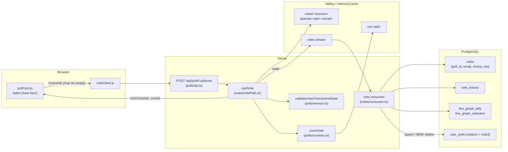
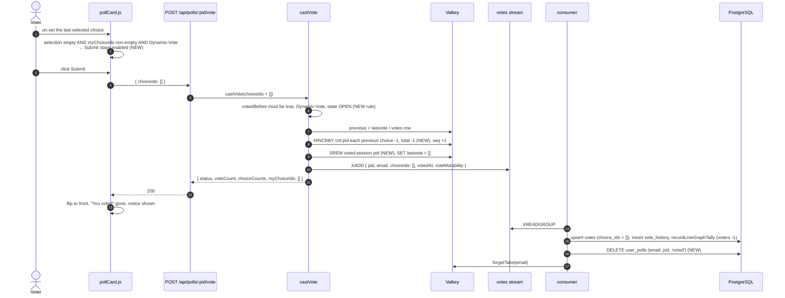

# High Level Requirements

Requirements: `requirements/20261112-173151-remove-vote/requirements.md`  
External Files: none  
Generated: 2026-11-12 5:32 PM  

During our extensive manual testing of the CrowdPoll.vote platform  
we have identifed that for dynamic polls (voters may change their vote) 
users have expected to be able to remove their vote.  
Currenly, when a checkbox, or radio button is clicked to un-set a choice,  
the "Submit Vote(s)" button is disabled. 

The requirement of this feature is to allow a user to remove their vote from a dynamic poll without being blocked by the disabled "Submit Vote(s)" button.

## Additional Requirements and Research Requests

**Instructions To The Developer**  
Enter any additional requirements or research requests under the ## Additional Requirements and Research Requests heading above.  
When you Type or Say: "Next" in the CC CLI terminal, the additional requirements and research requests will be applied to the report.  
  
You may leave these instructions here. They will be ignored when "Next" is executed.  

## 1. Overview and Scope

A voter on a **Dynamic-Vote Poll** ("You may change your vote") may today replace their selection, but not withdraw it.  
On the card's back face the ballot rows toggle: clicking a selected radio or checkbox un-sets it (`pollCard.js`, the `votingList` click handler), and `updateSubmitState` disables the Submit button as soon as no choice is selected (FR-023 of the original card).  
The server agrees: `validateVoteChoicesAndState` refuses an empty selection with "Select at least one choice." and the API contract declares `choiceIds` with `minItems: 1`.  
So a voter who un-sets every choice reaches a dead end.  

This feature lets such a voter **remove their vote**: submit an empty selection on a Dynamic-Vote poll on which they have a vote, so that their vote no longer counts, the poll no longer lists them as having voted, and they may vote again later as a new voter.  

In scope:  

- the ballot's Submit control when the selection is empty and the viewer holds a vote on a Dynamic-Vote poll;  
- one server path that records the removal through the existing vote machinery (live counters → vote stream → consumer), so every reader of votes sees it;  
- the places that derive "this voter has voted" from the vote: the live counters, the `voted:<session>` cache, the `user_polls` `voted` relation (Home and Your Votes tabs, "You voted" on the card), the line-graph tally, the Who Voted report, the invitation status;  
- the API contract (`postman/openapi.json`) and the tests.  

Out of scope (unless an accepted finding says otherwise): Final-Vote polls (a cast vote stays final), removing someone else's vote (bans and resets already do that through `replaceVotes`), and any change to how a vote is *changed*.  

### What the code already does for an empty selection

Several parts of the system already treat a `votes` row with an empty `choice_ids` as "a participant who has not voted":  

- an invitation inserts such a row (`invitations.ts`), and `computeResults` counts it under `totalNotYetVoted`;  
- `hasVotedBefore`, the voter limit, `reconcile`, the Who Voted report and the invitation status all filter on `cardinality(choice_ids) > 0`;  
- the line-graph tally already computes the voter delta from whether the new selection is empty (`tallyDeltas`, `TALLY_VOTERS`);  
- the consumer's Dynamic-Vote upsert writes whatever `choice_ids` it is given.  

The removal therefore has a natural representation: **the voter's `votes` row keeps its `choice_ids = []`**, exactly like an invitee who has not voted yet, and a `vote_history` row records the event.  

## 2. Context Diagram



The new behaviour touches three points: the card's Submit state, `validateVoteChoicesAndState` and `countVote` (plus the two caches), and the consumer's `user_polls` write.  
Everything downstream (results, Who Voted, line graph, invitation status) already reads an empty row as "not voted".  

## 3. Sequence: removing a vote



## 4. Submit button states (back face, Dynamic-Vote poll)

```mermaid
stateDiagram-v2
  [*] --> NoVote_Empty : viewer never voted, nothing selected
  NoVote_Empty --> Selected : pick a choice
  Selected --> NoVote_Empty : un-set the last choice
  Selected --> Voted : Submit vote(s), recorded
  Voted --> Voted_Changed : change the selection
  Voted_Changed --> Voted : Submit vote(s), recorded
  Voted --> Voted_Empty : un-set the last choice
  Voted_Changed --> Voted_Empty : un-set the last choice
  Voted_Empty --> Voted_Changed : pick a choice
  Voted_Empty --> NoVote_Empty : Submit (remove), recorded (NEW)

  note right of NoVote_Empty : Submit DISABLED (unchanged)
  note right of Selected : Submit ENABLED, "Submit vote(s)"
  note right of Voted_Empty : NEW: Submit ENABLED, label per NC1
```

On a **Final-Vote Poll** the back face is not reachable once a vote is cast (`mayAddChoice` and the server's `FINAL_VOTE_CAST` rule), so this feature changes nothing there: `Voted_Empty` never occurs.  

## 5. Counter and cache effects of one removal

| Store | Today, on a changed vote | On a removal (NEW) |
|---|---|---|
| `cnt:<pid>` hash, per choice | previous −1, new +1 | previous −1, nothing added |
| `cnt:<pid>` `total` | unchanged (not a new voter) | **−1** |
| `cnt:<pid>` `seq` | +1 | +1 |
| trending bucket | unchanged | unchanged (see UA2) |
| `voted:<session>` set | holds pid | **pid removed**, so a later vote is a new voter again |
| `lastvote:<pid>:<email>` | new choice ids | `[]` |
| `votes` row | upsert with new ids | upsert with `[]` (row kept) |
| `vote_history` | one row | one row with `choice_ids = []` |
| `line_graph_tally` | per-choice deltas, voters 0 | per-choice −1, voters **−1** (already computed by `tallyDeltas`) |
| `user_polls` `voted` | upserted | **deleted** |
| `polls.ever_voted` | true | stays true |

## 6. Findings

### 6.1 Inconsistencies

None found.

### 6.2 Ambiguities

**AM1. What counts as "removing" a vote on a multiple-choice poll?**  
<span style="font-size:large" ><b>
✅ Resolved</b></span>  
✅ Requirements File Updated: 2026-11-12 5:42 PM  
**Notes**: Recommendation accepted in file 2026-11-12: Recommendation, a removal is the submission of an empty selection; partial changes stay as they are;  
the requirements now say so under "Decisions from the requirements report".  

> The requirement says a voter "may remove their vote" and names the un-set checkbox as the blocked step.  
> On a Multiple-Choice poll a voter who had three choices and un-sets one is *changing* their vote, which already works: the Submit button stays enabled while one choice remains.  
> Only un-setting the *last* selected choice reaches the disabled button.  
> The feature can be read as "an empty selection may be submitted" or as "each individual choice may be withdrawn", and the second reading is already true.  

  - **Recommendation**: **a removal is the submission of an empty selection; partial changes stay as they are.**  

    [X] ➡️ **Accepted**

    - The requirements then say: on a Dynamic-Vote poll, a voter who holds a vote may submit with no choice selected, which removes their vote;  
      un-setting some of several choices remains a change of vote, submitted as today.  
    - This keeps one rule for both choice modes and matches the server's existing "empty row = not voted" convention.  


  - **Developer Resolution B**:  

    [ ] ➡️ **Not Accepted**

### 6.3 Unspecified Aspects

**UA1. How is a removed vote stored?**  
<span style="font-size:large" ><b>
✅ Resolved</b></span>  
✅ Requirements File Updated: 2026-11-12 5:42 PM  
**Notes**: Recommendation accepted in file 2026-11-12: Recommendation, keep the voter's `votes` row with `choice_ids = []`, write a `vote_history` row with the empty selection, and let every `cardinality(choice_ids) > 0` reader treat it as "not voted";  
the requirements now say so under "Decisions from the requirements report".  

> The requirements say what the voter can do, not what the server records.  
> Two storage shapes fit the current schema: delete the voter's `votes` row (as `replaceVotes` does for a ban or reset), or keep the row with `choice_ids = []` (as an invitation does for an invitee who has not voted yet).  
> The consumer's Dynamic-Vote upsert, `computeResults`, `hasVotedBefore`, the voter limit, `reconcile`, the Who Voted report and the invitation status all already treat an empty row as "has not voted".  
> Deleting the row instead would lose an invitee's `totalNotYetVoted` seat and would need a new consumer statement.  

  - **Recommendation**: **keep the voter's `votes` row with `choice_ids = []`, write a `vote_history` row with the empty selection, and let the tally and every `cardinality(choice_ids) > 0` reader treat it as "not voted".**  

    [X] ➡️ **Accepted**

    - The removal flows through the existing stream and the existing Dynamic-Vote upsert unchanged;  
      the line-graph tally already yields the per-choice −1 and the voters −1 for an empty selection (`tallyDeltas`), which keeps the "every writer of `vote_history` keeps the tally in its transaction" invariant.  
    - `polls.ever_voted` stays true, so the poll's edit and delete rules are unchanged.  


  - **Developer Resolution B**:  

    [ ] ➡️ **Not Accepted**


**UA2. Which live counters and caches change on a removal?**  
<span style="font-size:large" ><b>
✅ Resolved</b></span>  
✅ Requirements File Updated: 2026-11-12 5:42 PM  
**Notes**: Recommendation accepted in file 2026-11-12: Recommendation, decrement each previous choice and `total`, bump `seq`, remove the pid from `voted:<session>`, set `lastvote` to `[]`, leave the trending bucket alone; a later vote is a new vote in every respect;  
the requirements now say so under "Decisions from the requirements report".  

> `countVote` increments `total` for a new voter and never decrements it;  
> `hasVotedBefore` answers from the `voted:<session>` set, to which pids are only ever added;  
> `lastvote:<pid>:<email>` holds the previous choice ids for the per-choice decrement;  
> a new voter also bumps the trending bucket of the hour.  
> The requirements do not say what a removal does to any of these, nor whether a voter who removes and then votes again is a "new voter" (counted in `total` again, re-checked against the voter limit).  

  - **Recommendation**: **a removal decrements each previous choice and `total` by one, bumps `seq`, removes the pid from `voted:<session>`, sets `lastvote` to `[]`, and leaves the trending bucket alone; a later vote by the same voter is a new vote in every respect (total +1, voter limit re-checked, trending bucket +1).**  

    [X] ➡️ **Accepted**

    - The live counters then agree with what `reconcile` would compute from the `votes` table (`cardinality(choice_ids) > 0`), so the counter flush sweep and the reconcile script stay correct.  
    - Trending measures arrivals of new voters in an hour;  
      a removal is not an arrival, and reversing a bucket that may already have expired would be wrong more often than right.  
    - Removing the pid from the session set, not just the `lastvote` key, is what makes `hasVotedBefore` answer "no" afterwards;  
      other sessions of the same account rebuild their set from the `votes` table (`choice_ids != []`), which the consumer has by then emptied.  


  - **Developer Resolution B**:  

    [ ] ➡️ **Not Accepted**


**UA3. Does the poll stay on the voter's Home and Your Votes tabs, and does the card still say "You voted"?**  
<span style="font-size:large" ><b>
✅ Resolved</b></span>  
✅ Requirements File Updated: 2026-11-12 5:42 PM  
**Notes**: Recommendation accepted in file 2026-11-12: Recommendation A, a removal deletes the `voted` relation, as a ban or reset does;  
the requirements now say so under "Decisions from the requirements report".  

> The `user_polls` `voted` relation lists a poll on the Your Votes tab and in the Home tab's "voted" rule, and puts "You voted" on the card's front face (`listedBecause`).  
> The consumer upserts that relation for every vote it writes, and nothing else removes it except `replaceVotes`, where FIX020 decided that a participant whose vote is removed (a ban, a reset) no longer "voted".  
> The requirements do not say whether a voter who removes their own vote keeps the poll in those places.  

  - **Recommendation A** _(recommended)_: **a removal deletes the `voted` relation, as a ban or reset does: the poll leaves Your Votes, leaves the Home tab unless another relation keeps it, and the card stops saying "You voted".**  

    [X] ➡️ **Accepted**

    - <u>Pros</u>: one meaning of "voted" everywhere, matching FIX020 and the Who Voted report, which also drops the voter;  
      the consumer already calls `forgetTabs` for the voter, so their tabs refresh.  
    - <u>Cons</u>: a voter who removed by mistake must find the poll again (Search, Trending, a link, an invitation) to vote anew;  
      the consumer needs a delete statement beside its upsert.  


  - **Recommendation B**: **keep the `voted` relation, so the poll stays listed and reachable; only the vote itself goes.**  

    [ ] ➡️ **Not Accepted**

    - <u>Pros</u>: the voter can re-vote from where they are;  
      no consumer change.  
    - <u>Cons</u>: "You voted" and the Your Votes tab would then say something untrue, or need a new relation ("voted before") and new wording;  
      it contradicts FIX020's rule for removed votes.  


  - **Developer Resolution C**:  

    [ ] ➡️ **Not Accepted**


**UA4. When is a removal refused?**  
<span style="font-size:large" ><b>
✅ Resolved</b></span>  
✅ Requirements File Updated: 2026-11-12 5:42 PM  
**Notes**: Recommendation accepted in file 2026-11-12: Recommendation, a removal is accepted only on an OPEN Dynamic-Vote poll by a voter who currently holds a vote; every other empty submission is refused with today's messages;  
the requirements now say so under "Decisions from the requirements report".  

> A vote is refused when the poll is EDITING (`POLL_EDITING`, the card keeps the selection), WAITING TO OPEN or not OPEN, when the viewer is banned, not invited, or blocked, and on a Final-Vote poll after the first vote.  
> The requirements say "dynamic poll" but not what happens when a voter with no vote submits nothing, when the poll is not open, or when the request names a Final-Vote poll.  

  - **Recommendation**: **a removal is accepted only on an OPEN Dynamic-Vote poll by a voter who currently holds a vote; every other empty submission is refused with today's messages, and a Final-Vote poll answers 409 "You have already voted on this poll and cannot change your vote."**  

    [X] ➡️ **Accepted**

    - "Select at least one choice." stays the answer to an empty selection from a voter without a vote, so the card's rule (Submit disabled when nothing is selected and the viewer has no vote) and the server's agree.  
    - The state gates run first, as for a vote, so an EDITING poll still answers `POLL_EDITING` and the card keeps its (empty) selection and flips to the front message as it does today.  
    - The ban and invitation checks run as for a vote;  
      a banned voter's vote is already removed by the ban.  


  - **Developer Resolution B**:  

    [ ] ➡️ **Not Accepted**


**UA5. What does the card show after a removal?**  
<span style="font-size:large" ><b>
✅ Resolved</b></span>  
✅ Requirements File Updated: 2026-11-12 5:42 PM  
**Notes**: Recommendation accepted in file 2026-11-12: Recommendation, the card behaves as after a vote; the notice reads "Your vote was removed."; the next ballot opens with nothing selected;  
the requirements now say so under "Decisions from the requirements report".  

> After a vote the card flips to the front, holds the Vote button for `nextRefreshMs`, and shows a notice only when the vote was queued.  
> The response's `myChoiceIds` seeds the next ballot.  
> The requirements do not say what the voter sees once their vote is gone.  

  - **Recommendation**: **the card behaves as after a vote: flips to the front with the vote hold, the results show the new counts, "You voted" is gone, and the vote notice reads "Your vote was removed." (or the queued notice when the removal was queued); the next ballot opens with nothing selected.**  

    [X] ➡️ **Accepted**

    - The response already carries `myChoiceIds: []` and the live counts, so `applyPoll` and `rebuildData` need no new field;  
      only the notice text is new.  
    - The hold keeps the floor on votes per voter, which a removal shares.  


  - **Developer Resolution B**:  

    [ ] ➡️ **Not Accepted**

### 6.4 Needs Clarifications

**NC1. What does the Submit button say when the selection is empty and the viewer holds a vote?**  
<span style="font-size:large" ><b>
✅ Resolved</b></span>  
✅ Requirements File Updated: 2026-11-12 5:42 PM  
**Notes**: Recommendation accepted in file 2026-11-12: Recommendation A, the same button, enabled and relabelled "Remove vote" while the selection is empty and the viewer holds a vote on a Dynamic-Vote poll;  
the requirements now say so under "Decisions from the requirements report".  

> Today the button reads "Submit vote" or "Submit votes" (the front face's `.btn-vote-sizer` carries the same label so both faces size alike, 008 FR-007).  
> Enabling it with that label would let a voter submit "nothing" without being told that it removes their vote;  
> relabelling it tells them, at the cost of a third label the sizer must accommodate.  

  - **Recommendation A** _(recommended)_: **the same button, enabled and relabelled "Remove vote" while the selection is empty and the viewer holds a vote on a Dynamic-Vote poll; it returns to "Submit vote(s)" as soon as a choice is picked.**  

    [X] ➡️ **Accepted**

    - <u>Pros</u>: the voter is told what the click does, in the place they are already looking;  
      no new control, no new layout, one click.  
    - <u>Cons</u>: a third label;  
      the front face's sizer must be the widest of the three so the buttons keep one width.  


  - **Recommendation B**: **the same button, enabled, keeping its "Submit vote(s)" label.**  

    [ ] ➡️ **Not Accepted**

    - <u>Pros</u>: the smallest change;  
      the sizer is untouched.  
    - <u>Cons</u>: "Submit vote" with nothing selected reads as a bug, and the voter is not warned that their vote goes.  


  - **Recommendation C**: **a separate "Remove my vote" text button beside the Back arrow, shown only when the viewer holds a vote; Submit stays disabled on an empty selection.**  

    [ ] ➡️ **Not Accepted**

    - <u>Pros</u>: the voter need not un-set every choice first;  
      Submit keeps its one meaning.  
    - <u>Cons</u>: a new control in the action row, which already holds Back, Add Choice and Submit, and is tight at the smallest card sizes;  
      the un-set-everything path the testers took still ends at a disabled button.  


  - **Developer Resolution D**:  

    [ ] ➡️ **Not Accepted**


**NC2. How does the browser ask the server to remove a vote?**  
<span style="font-size:large" ><b>
✅ Resolved</b></span>  
✅ Requirements File Updated: 2026-11-12 5:42 PM  
**Notes**: Recommendation accepted in file 2026-11-12: Recommendation A, the same `POST /api/polls/:pid/vote` with `choiceIds: []`; `minItems` becomes 0;  
the requirements now say so under "Decisions from the requirements report".  

> `POST /api/polls/:pid/vote` takes `choiceIds` with `minItems: 1` in `postman/openapi.json`, and `castVote` is the one path for every vote: IP cap, shedding kind `vote`, the `vote` floor, the budget, device events.  
> A removal needs either that path with an empty list, or a route of its own.  

  - **Recommendation A** _(recommended)_: **the same `POST /api/polls/:pid/vote` with `choiceIds: []`; the contract's `minItems` becomes 0 with the removal described.**  

    [X] ➡️ **Accepted**

    - <u>Pros</u>: one path keeps the IP cap, shedding, floor, budget, the `voted` cache and the stream entry identical for a vote and a removal;  
      the client already sends the current selection, so only its "empty means disabled" guard changes.  
    - <u>Cons</u>: an empty list from a voter without a vote must still be refused, so the rule lives in `validateVoteChoicesAndState` rather than in the route shape.  


  - **Recommendation B**: **a new `DELETE /api/polls/:pid/vote`, answering the same body as a vote.**  

    [ ] ➡️ **Not Accepted**

    - <u>Pros</u>: the intent is explicit in the contract;  
      `minItems: 1` stays.  
    - <u>Cons</u>: a second route to mount under the same shedding, floor and budget, to add to the terms gate list and to `openapi.json`, and a second client function, for the same stream entry.  


  - **Developer Resolution C**:  

    [ ] ➡️ **Not Accepted**


**NC3. Is the voter asked to confirm before their vote is removed?**  
<span style="font-size:large" ><b>
✅ Resolved</b></span>  
✅ Requirements File Updated: 2026-11-12 5:42 PM  
**Notes**: Recommendation accepted in file 2026-11-12: Recommendation A, no confirmation: one click removes the vote, and the notice says so;  
the requirements now say so under "Decisions from the requirements report".  

> A vote is submitted with one click and can be changed again on a Dynamic-Vote poll;  
> a removal is just as reversible (the voter may vote again), but testers who reached the disabled button were not expecting an irreversible step either.  

  - **Recommendation A** _(recommended)_: **no confirmation: one click removes the vote, and the notice says so.**  

    [X] ➡️ **Accepted**

    - <u>Pros</u>: consistent with voting and changing a vote;  
      the voter can vote again at once (after the vote hold), so nothing is lost.  
    - <u>Cons</u>: with NC1 option B a voter could remove a vote without noticing.  


  - **Recommendation B**: **a confirmation step (the button changes to "Remove vote?" and a second click within a few seconds removes it).**  

    [ ] ➡️ **Not Accepted**

    - <u>Pros</u>: no accidental removals.  
    - <u>Cons</u>: a two-step control on a card that is otherwise single-click, and more client state to test.  


  - **Developer Resolution C**:  

    [ ] ➡️ **Not Accepted**

## 7. Breaking Changes

- **API contract**: `choiceIds` on `POST /api/polls/:pid/vote` loses `minItems: 1` (NC2 option A), and the response's `myChoiceIds` may now be `[]` after a success;  
  a client SDK generated from `postman/openapi.json` sees a relaxed request schema, which is backward compatible for callers but a contract change nonetheless.  
- **`VoteResponse.myChoiceIds` semantics**: today an empty `myChoiceIds` never follows a 200;  
  code that reads "non-empty `myChoiceIds` = has voted" from a vote response (the card's `applyPoll` does not, but tests may) must accept the empty case.  
- **Consumer `user_polls` write** (UA3 option A): the consumer, which today only ever upserts the `voted` relation, also deletes it;  
  a batch that holds a vote and a removal by the same voter must apply the later one, as the `votes` upsert already does.  
- No schema migration: `votes.choice_ids` and `vote_history.choice_ids` already allow `'{}'`.  

## 8. Technical Debt

- **`voted:<session>` is add-only**: `hasVotedBefore` caches the set of polls a session voted on with `sadd` and never removes a pid;  
  a removal must `srem` it, and the same gap will reappear for any future path that empties a vote (a ban already leaves the banned voter's session set stale until it expires, 24 h).  
- **`countVote`'s positional booleans**: `countVote(cache, pid, add, remove, isNewVoter, now)` grows a third mode ("voter leaves");  
  an options object or a signed `voterDelta` would read better than another flag.  
- **`validateVoteChoicesAndState` mixes two concerns**: the empty-selection check sits before the state checks, so today an empty selection on an EDITING poll answers "Select at least one choice." instead of `POLL_EDITING`;  
  moving the emptiness rule after the state gates (as UA4 needs) also fixes that ordering.  
- **Trending buckets count arrivals only**: a removal (and a ban) never adjusts them, which is acceptable for a trending signal but should be stated in `ARCHITECTURE.md` so no one "fixes" it later.  

## 9. Requirements Report Complete Report  
  
- **Requirements Report Document:** requirements/20261112-173151-remove-vote/requirements-report.md  
- **Requirements Document:** requirements/new-20261112-172726/requirements.md → requirements/20261112-173151-remove-vote/requirements.md  
- **Software Architecture Diagrams:** 3  
- **Inconsistencies:** 0  
- **Ambiguities:** 1  
- **Unspecified Aspects:** 5  
- **Needs Clarifications:** 3  
- **Research Results:** 0  
- **Breaking Changes:** 4  
- **Technical Debt items:** 4  
  
The requirements are ready for /speckit-specify.
To generate specs from the requirements document, use the `/speckit-specify` skill followed by the path (relative to the project root) to the requirements file.
At the prompt, Type:  
🟩 👉 /speckit-specify requirements/20261112-173151-remove-vote/requirements.md  
