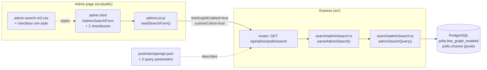
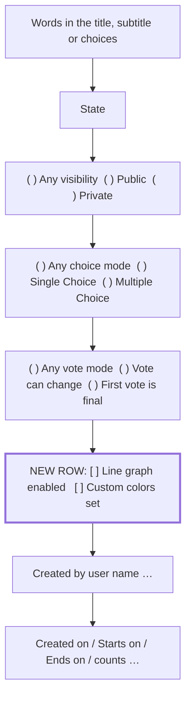

# High Level Requirements

Requirements: `requirements/20261112-173521-admin-search-checkboxes/requirements.md`  
External Files: none  
Generated: 2026-11-12 5:35 PM  

This feature will add two checkboxes to the Admin Search fields.  

On a new row, under the "Any vote mode", "Vote can change" "First vote is final" radio buttons,  
add two checkboxes:  

"Line graph enabled" and "Custom colors set"

## Additional Requirements and Research Requests

**Instructions To The Developer**  
Enter any additional requirements or research requests under the ## Additional Requirements and Research Requests heading above.  
When you Type or Say: "Next" in the CC CLI terminal, the additional requirements and research requests will be applied to the report.  
  
You may leave these instructions here. They will be ignored when "Next" is executed.  

## 1. Overview and Scope

The administrator's Search view (`src/public/admin.html`, form `#adminSearchForm`) narrows the poll list by every filled-in control, ANDed together.  
This feature adds two more filters, as checkboxes on a new row directly under the Vote mutability radio group:  

- **Line graph enabled**: only polls whose `polls.line_graph_enabled` is `true`.  
- **Custom colors set**: only polls where at least one choice carries a hand-picked color (a `color` key on an element of the `polls.choices` jsonb array; the "Select colors for the poll choices" switch saves no `color` when off).  

What already exists and is reused:  

- the form and its reader `readSearchForm` in `src/public/adminList.js`, which turns filled-in controls into query parameters;  
- `GET /api/admin/polls/search`, parsed by `parseAdminSearch` and run by `adminSearchQuery` in `src/search/adminSearch.ts` (one SQL statement, newest first, capped);  
- the M3 search styles in `src/public/admin-search-m3.css` (radio groups only; there is no checkbox style yet);  
- the contract `postman/openapi.json` and the tests `tests/search-admin.test.ts`, `tests/client-admin-search.test.ts` and `tests/openapi-contract.test.ts`.  

Out of scope: the Newest, Awaiting Approval and Rejected views, the home page's public search, OpenSearch, and any change to how line graphs or colors are set.  

## 2. Component Diagram



## 3. Sequence Diagram

```mermaid
sequenceDiagram
  actor Admin
  participant Page as admin.html + adminList.js
  participant API as GET /api/admin/polls/search
  participant SQL as adminSearchQuery (PostgreSQL)

  Admin->>Page: ticks "Line graph enabled" and/or "Custom colors set", submits
  Page->>Page: readSearchForm(): ticked boxes become parameters
  Page->>API: ?voteMutability=…&lineGraphEnabled=true&customColors=true
  API->>API: parseAdminSearch(): validates the new parameters
  API->>SQL: WHERE … AND line_graph_enabled AND jsonb_path_exists(choices, '$[*].color')
  SQL-->>API: rows (newest first, cap + 1)
  API-->>Page: polls, truncated flag
  Page-->>Admin: list narrowed; periodic refresh re-runs the same search
```

## 4. Form Layout



## 5. Filter Logic

| Control | Unticked | Ticked | SQL added when ticked |
|---|---|---|---|
| Line graph enabled | no filter | line graph on | `line_graph_enabled = true` |
| Custom colors set | no filter | at least one choice has a hand-picked color | `jsonb_path_exists(choices, '$[*].color')` |

Both ticked: both conditions apply (AND), as every other control does.  
This table holds the recommendations of AM1, AM2 and UA1 below; it changes if another option is accepted.  

## 6. Findings

### 6.1 Inconsistencies

None found.

### 6.2 Ambiguities

**AM1. What does an unticked checkbox mean?**  
<span style="font-size:large" ><b>
✅ Resolved</b></span>  
✅ Requirements File Updated: 2026-11-12 5:44 PM  
**Notes**: Recommendation accepted in file 2026-11-12: Recommendation A, **unticked means no filter; ticked keeps only polls that have it.**;  
the requirements now say so under Decisions.  

> Every other filter on the form has an "Any …" choice, so leaving it alone never narrows the list.  
> A checkbox has only two states, so "unticked" could mean "do not filter" or "only polls without it".  

  - **Recommendation A** _(recommended)_: **unticked means no filter; ticked keeps only polls that have it.**  

    [X] ➡️ **Accepted**

    - <u>Pros</u>: an untouched form searches exactly as today;  
      it is the usual meaning of a filter checkbox, and matches the requirement's "two checkboxes".  
    - <u>Cons</u>: there is no way to find polls *without* a line graph or *without* custom colors.  


  - **Recommendation B**: **two three-way radio groups instead (Any / On / Off), like the rows above.**  

    [ ] ➡️ **Not Accepted**

    - <u>Pros</u>: both directions can be searched, consistent with the other rows.  
    - <u>Cons</u>: it is not what the requirement asks for (checkboxes), and adds two full rows instead of one.  


  - **Developer Resolution C**:  

    [ ] ➡️ **Not Accepted**


**AM2. When does a poll count as "Custom colors set"?**  
<span style="font-size:large" ><b>
✅ Resolved</b></span>  
✅ Requirements File Updated: 2026-11-12 5:44 PM  
**Notes**: Recommendation accepted in file 2026-11-12: Recommendation A, **at least one choice has a hand-picked color.**;  
the requirements now define "Custom colors set" under Decisions.  

> Colors are stored per choice: a choice picked by hand carries a `color` in `polls.choices`;  
> with the "Select colors for the poll choices" switch off, no choice carries one.  
> A poll may have colors picked for some choices and Automatic for others.  

  - **Recommendation A** _(recommended)_: **at least one choice has a hand-picked color.**  

    [X] ➡️ **Accepted**

    - <u>Pros</u>: it matches the poll summary, which mentions colors exactly when some are set by hand;  
      it is the same as "the colors switch is on" for every poll saved since that switch was added.  
    - <u>Cons</u>: a poll with one picked color among many counts the same as a fully colored one.  


  - **Recommendation B**: **every choice has a hand-picked color.**  

    [ ] ➡️ **Not Accepted**

    - <u>Pros</u>: finds only fully custom-colored polls.  
    - <u>Cons</u>: misses partly colored polls, which the summary still reports as having colors set by hand;  
      a voter-added choice (no color) would drop a poll from the results.  


  - **Developer Resolution C**:  

    [ ] ➡️ **Not Accepted**


### 6.3 Unspecified Aspects

**UA1. How do the checkboxes combine with each other and with the other filters?**  
<span style="font-size:large" ><b>
✅ Resolved</b></span>  
✅ Requirements File Updated: 2026-11-12 5:44 PM  
**Notes**: Recommendation accepted in file 2026-11-12: Recommendation, **AND: a poll must meet every ticked box and every other filled-in control.**;  
the requirements now say so under Decisions.  

> The requirement does not say what ticking both boxes means.  
> Every existing control is ANDed with the others in `adminSearchQuery`.  

  - **Recommendation**: **AND: a poll must meet every ticked box and every other filled-in control.**  

    [X] ➡️ **Accepted**

    - It is how the whole form already works, so the search stays one rule: every control narrows the list.  


  - **Developer Resolution B**:  

    [ ] ➡️ **Not Accepted**


**UA2. How are the two filters sent to the server and described in the contract?**  
<span style="font-size:large" ><b>
✅ Resolved</b></span>  
✅ Requirements File Updated: 2026-11-12 5:44 PM  
**Notes**: Recommendation accepted in file 2026-11-12: Recommendation, **two optional query parameters, `lineGraphEnabled=true` and `customColors=true`, sent only when ticked.**;  
the requirements now name the parameters, their validation, the contract and the tests under Decisions.  

> The search runs on the server from query parameters, and `postman/openapi.json` must follow the routes.  
> The requirement names only the checkboxes.  

  - **Recommendation**: **two optional query parameters, `lineGraphEnabled=true` and `customColors=true`, sent only when ticked.**  

    [X] ➡️ **Accepted**

    - `readSearchForm` adds a parameter only for a ticked box;  
      `parseAdminSearch` accepts `true`, ignores a blank value, and answers `400` (an `AdminSearchError`) for anything else, as it does for a bad operator;  
      both parameters are added to `GET /api/admin/polls/search` in `postman/openapi.json`;  
      tests cover the server filter (`tests/search-admin.test.ts`), the form (`tests/client-admin-search.test.ts`) and the contract.  


  - **Developer Resolution B**:  

    [ ] ➡️ **Not Accepted**


**UA3. How do the checkboxes look and behave on the page?**  
<span style="font-size:large" ><b>
✅ Resolved</b></span>  
✅ Requirements File Updated: 2026-11-12 5:44 PM  
**Notes**: Recommendation accepted in file 2026-11-12: Recommendation, **one row of two M3 checkboxes, styled like the radio rows, unticked by default.**;  
the requirements now describe the row under Decisions.  

> The search form uses M3 radio groups styled in `admin-search-m3.css`;  
> it has no checkbox style, and `m3-assets.test.ts` allows only M3 tokens (no literal font sizes) in M3 layers.  

  - **Recommendation**: **one row of two M3 checkboxes, styled like the radio rows, unticked by default.**  

    [X] ➡️ **Accepted**

    - The row sits directly under the Vote mutability group, with the labels exactly "Line graph enabled" and "Custom colors set";  
      each option is at least 48 px tall with a visible focus ring, as the radios are;  
      the row takes the same grid as the radio groups and stacks to one column on narrow screens;  
      its style goes in `admin-search-m3.css` using M3 tokens only;  
      the boxes start unticked and are not remembered between visits, like the other controls.  


  - **Developer Resolution B**:  

    [ ] ➡️ **Not Accepted**


**UA4. Which colors and line graph setting count for a poll being edited?**  
<span style="font-size:large" ><b>
✅ Resolved</b></span>  
✅ Requirements File Updated: 2026-11-12 5:44 PM  
**Notes**: Recommendation accepted in file 2026-11-12: Recommendation, **the stored row only: `line_graph_enabled` and `choices` as saved, never the pending update.**;  
the requirements now say so under Decisions.  

> A poll in `EDITING`, or with a `pending_update`, may have colors in its unsaved or pending choices that differ from the stored `choices`.  

  - **Recommendation**: **the stored row only: `line_graph_enabled` and `choices` as saved, never the pending update.**  

    [X] ➡️ **Accepted**

    - Every other search filter reads the stored columns, and admin code reads the raw row;  
      a pending change counts once it is saved or approved.  


  - **Developer Resolution B**:  

    [ ] ➡️ **Not Accepted**


### 6.4 Needs Clarifications

None found.

## 7. Breaking Changes

None.  
The two parameters are optional; a search without them returns exactly what it does today.  

## 8. Technical Debt

- **The colors filter scans JSON.** `jsonb_path_exists(choices, '$[*].color')` has no index;  
  it is evaluated only on rows the other filters leave and the result is capped, so this is acceptable for an administrator's search, but a generated `has_custom_colors` column would be needed if the filter ever reached a public search.  
- **Two filter shapes on one form.** The rows above use an "Any / A / B" radio group, these use checkboxes (if AM1 A is accepted);  
  a later "polls without a line graph" filter would need the radio form after all.  

## 9. Requirements Report Complete Report  
  
- **Requirements Report Document:** requirements/20261112-173521-admin-search-checkboxes/requirements-report.md  
- **Requirements Document:** requirements/20261112-173521-admin-search-checkboxes/requirements.md  
- **Software Architecture Diagrams:** 3  
- **Inconsistencies:** 0  
- **Ambiguities:** 2  
- **Unspecified Aspects:** 4  
- **Needs Clarifications:** 0  
- **Research Results:** 0  
- **Breaking Changes:** 0  
- **Technical Debt items:** 2  
  
The requirements are ready for /speckit-specify.
To generate specs from the requirements document, use the `/speckit-specify` skill followed by the path (relative to the project root) to the requirements file.
At the prompt, Type:  
🟩 👉 /speckit-specify requirements/20261112-173521-admin-search-checkboxes/requirements.md  
