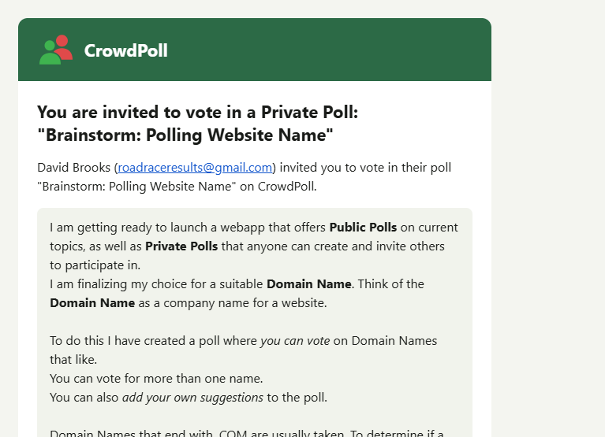
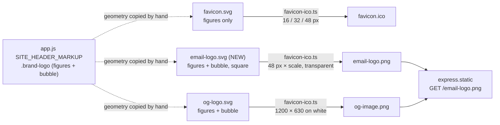
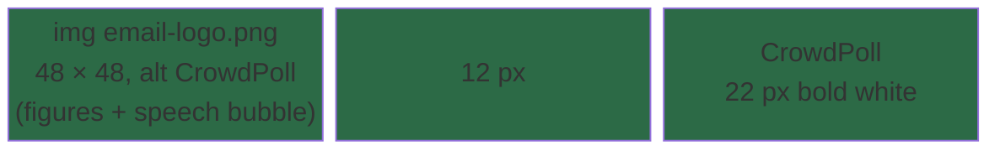

# High Level Requirements

Requirements: `requirements/20261112-175743-email-logo/requirements.md`  
External Files: `requirements/20261112-175743-email-logo/image.png`  
Generated: 2026-11-12 5:58 PM  

We realized that the fav-icon was created from the brand logo back in spec `specs\20261016-172002-FAVICON\research.md`:
```
## R4. Drawing the mark: `favicon.svg`

- **Decision**: Copy the figure geometry from `.brand-logo` in `SITE_HEADER_MARKUP` (`src/public/app.js`) — the mask `brand-logo-front`, the red group, the green circle and body — and drop both speech-bubble paths (fill and stroke). Use a cropped square `viewBox="10 4.5 96 96"`.
- **Rationale** (geometry from the logo):
  - The figures span x 16–100 and y 15–90 (84 × 75 units, the mockup's 23 × 20 ratio).
  - At 16 px one pixel is 6 units; filling the width with 1 px each side gives 84 + 12 = 96 units, so x 10–106; centring 75 units vertically in 96 gives y 4.5–100.5.
  - No background rectangle, so it is transparent (U1).
  - Give the mask a file-local id (`favicon-front`); the file is standalone.
- **Markup rules**: `<title>CrowdPoll</title>` as the first child (A2); no `role`/`aria-*` (a favicon is not in the accessibility tree); no comments (Constitution VI).
```

The fav-icon dropped the speech-bubble paths from the brand logo, keeping only the core figure geometry (mask, red group, green circle and body) for a simplified and recognizable mark at small sizes.  

For the logo in the invitation email, please add a speech bubble to the core figure geometry, while keeping the high quality.  
Create the SVG using the same technique you used for the current large link preview logo, ensuring that the speech bubble integrates seamlessly with the core figure geometry and maintains visual clarity at larger sizes.  

The following image shows the placement of the logo:  


## Additional Requirements and Research Requests

**Instructions To The Developer**  
Enter any additional requirements or research requests under the ## Additional Requirements and Research Requests heading above.  
When you Type or Say: "Next" in the CC CLI terminal, the additional requirements and research requests will be applied to the report.  
  
You may leave these instructions here. They will be ignored when "Next" is executed.  

## 1. Overview

The email header (green `#2C6A46` bar, logo and the word mark "CrowdPoll", see `image.png`) shows `<origin>/email-logo.png`.  
Today that PNG is rendered from `src/public/favicon.svg`: the two figures **without** the speech bubble, 96 × 96 px shown at 48 × 48.  
The feature gives the email logo the brand's speech bubble, as the link-preview image already has.  

What exists already (found in the codebase):

- `src/public/og-logo.svg` — the full brand logo, figures **and** speech bubble, as a standalone 120 × 120 master (`viewBox="0 0 120 120"`, file-local mask `og-logo-front`, bubble fill `#FAFAFA`, black outline 4.5 units, round joins).  
  It is "the technique used for the large link preview logo": a standalone SVG copied from `.brand-logo` in `SITE_HEADER_MARKUP` (`src/public/app.js`), rendered to PNG by a headless Chromium browser.
- `devScripts/favicon-ico.ts` — the hand-run script that renders `favicon.ico` (16/32/48 px), `email-logo.png` (48 px at 2×, from `favicon.svg`) and `og-image.png` (1200 × 630, from `og-logo.svg`).
- `src/email/templates.ts` `layout()` — the one layout shared by **every** message (login link, create account, email-change verification and notice, account deleted, poll invitation and its reminder); it writes `/email-logo.png" width="48" height="48" alt="CrowdPoll">`.
- `ENV_EMAIL_ASSET_ORIGIN` — the origin the logo is loaded from (development points at `https://crowdpoll.vote`).

## 2. Scope

- **In scope**
  - A standalone SVG master for the email logo: the figures plus the speech bubble, drawn like `og-logo.svg`.
  - `devScripts/favicon-ico.ts` renders `email-logo.png` from it instead of from `favicon.svg`.
  - The regenerated `src/public/email-logo.png`, committed.
  - Documentation that names the email logo (`ARCHITECTURE.md`, `CLAUDE_COMPLETE.md`, the OAuth `provider-setup.md`).
- **Out of scope**
  - The favicon (`favicon.svg`, `favicon.ico`) stays figures only.
  - The link-preview image (`og-logo.svg`, `og-image.png`) and the site header's logo are unchanged.
  - Email wording, colours and layout other than the logo image.

## 3. Architecture Diagrams

### 3.1 Asset pipeline (after the change)



### 3.2 Email header layout



### 3.3 How a recipient sees the logo

```mermaid
sequenceDiagram
  participant App as CrowdPoll web (mailer.ts)
  participant SES as Amazon SES
  participant Client as Mail client / Gmail image proxy
  participant Origin as ENV_EMAIL_ASSET_ORIGIN (crowdpoll.vote)
  App->>App: layout() writes &lt;img src="origin/email-logo.png" 48×48&gt;
  App->>SES: send message (no attachment)
  SES->>Client: deliver
  Client->>Origin: GET /email-logo.png (when the message is opened)
  Origin-->>Client: PNG (new drawing once deployed)
```

## 4. Breaking Changes

- `email-logo.png` changes drawing at the same URL: every message that uses the layout, including messages already sent, shows the new logo once production serves the new file (if every email keeps the shared layout, see AM1).
- `email-logo.png` is also the square logo named for the Google and Microsoft consent screens in `specs/20261022-131728-SOCIAL-OAUTH-PROVIDERS/provider-setup.md`; its description there ("the two figures") becomes wrong (see NC1).
- No route, setting, API or stored data changes.

## 5. Technical Debt

- The brand geometry is copied by hand into `app.js`, `favicon.svg`, `og-logo.svg` and now a fourth file; a change to the logo must be repeated in each.
- `devScripts/favicon-ico.ts` now writes three unrelated brand images; its name describes only the first.
- The dimension check in `renderPng` is the only automated check of the rendered PNG; no test looks at its drawing.

## 6. Assumptions

- "The same technique as the link preview logo" means a standalone SVG master (no comments, `<title>CrowdPoll</title>` first, a file-local mask id) rendered to PNG by the headless browser in `devScripts/favicon-ico.ts`.
- The bubble keeps the header logo's own colours and shape (see UA2).
- The PNG stays transparent outside the bubble, as now.
- `alt="CrowdPoll"`, the 12 px gap and the word mark stay as they are.

## 7. Findings

### 7.1 Inconsistencies

None found.

### 7.2 Ambiguities

**AM1. Does the new logo go in the invitation email only, or in every email?**  
<span style="font-size:large" ><b>
✅ Resolved</b></span>  
✅ Requirements File Updated: 2026-11-12 6:03 PM  
**Notes**: Recommendation accepted in file 2026-11-12: Recommendation A, every email, through the shared layout and the one `email-logo.png`;  
the requirements' Decisions section now lists every message that shows the new logo.  

> The requirements say "the logo in the invitation email".  
> Every message (login link, create account, email-change verification and notice, account deleted, invitation and reminder) shares one `layout()` and one `email-logo.png`.  

  - **Recommendation A** _(recommended)_: **every email, through the shared layout and the one `email-logo.png`.**  

    [X] ➡️ **Accepted**

    - <u>Pros</u>: one brand mark in every message;  
      no change to `templates.ts`, its tests or the byte-identical email fixtures.  
    - <u>Cons</u>: login and account emails change too, not only the invitation.  


  - **Recommendation B**: **the invitation and its reminder only, through a second image.**  

    [ ] ➡️ **Not Accepted**

    - <u>Pros</u>: exactly what the sentence says.  
    - <u>Cons</u>: two email logos to keep;  
      `layout()` gains a logo parameter, and the invitation tests change.  


  - **Developer Resolution C**:  

    [ ] ➡️ **Not Accepted**

**AM2. What does "visual clarity at larger sizes" ask for: a larger logo, or a sharper one?**  
<span style="font-size:large" ><b>
✅ Resolved</b></span>  
✅ Requirements File Updated: 2026-11-12 6:03 PM  
**Notes**: Recommendation accepted in file 2026-11-12: Recommendation B, show it at 56 × 56, rendered at 3× (168 × 168 px);  
the requirements now give the size, and the ``, its tests and the email fixtures change to 56.  

> The logo is shown at 48 × 48 px and rendered at 2× (96 px).  
> Inside the same square the bubble takes room from the figures: they shrink from about 42 px wide to about 35 px.  
> "Larger sizes" may mean a bigger image in the header, or a sharper image on high-density screens, which show 48 px at 3× (144 px).  

  - **Recommendation A** _(recommended)_: **keep 48 × 48 in the email, render the PNG at 3× (144 × 144 px).**  

    [ ] ➡️ **Not Accepted**

    - <u>Pros</u>: the header keeps its height and the email HTML is unchanged;  
      sharp on 3× phone screens.  
    - <u>Cons</u>: the figures are a little smaller than today.  


  - **Recommendation B**: **show it at 56 × 56, rendered at 3× (168 × 168 px).**  

    [X] ➡️ **Accepted**

    - <u>Pros</u>: the figures stay about as large as today, with the bubble around them.  
    - <u>Cons</u>: the header grows 8 px;  
      the `` size changes in `templates.ts`, its tests and the email fixtures.  


  - **Recommendation C**: **keep 48 × 48 at 2× (96 px), as now.**  

    [ ] ➡️ **Not Accepted**

    - <u>Pros</u>: the smallest change, and the smallest file.  
    - <u>Cons</u>: the thin bubble outline is softer on 3× screens.  


  - **Developer Resolution D**:  

    [ ] ➡️ **Not Accepted**

### 7.3 Unspecified Aspects

**UA1. Which SVG is the email logo's master?**  
<span style="font-size:large" ><b>
✅ Resolved</b></span>  
✅ Requirements File Updated: 2026-11-12 6:03 PM  
**Notes**: Recommendation accepted in file 2026-11-12: Recommendation B, render `email-logo.png` from `og-logo.svg` as it is;  
the requirements now say no new SVG file is made, and the favicon keeps `favicon.svg`.  

> The requirements ask to "create the SVG" like the link-preview logo.  
> `og-logo.svg` already draws the figures with the bubble, in a 120 × 120 box with room to spare around the outline.  

  - **Recommendation A** _(recommended)_: **a new standalone `src/public/email-logo.svg`, cropped square to the bubble.**  

    [ ] ➡️ **Not Accepted**

    - <u>Pros</u>: the geometry of `og-logo.svg` (figures, mask, bubble fill and outline) with a file-local mask id (`email-logo-front`) and a square `viewBox` cropped to the outline, stroke and tail included (about `2.5 3.75 115 115`), so the mark fills the 48 px square;  
      `favicon-ico.ts` renders `email-logo.png` from it; the favicon rules apply (`<title>CrowdPoll</title>` first, no comments, no `role`/`aria-*`).  
    - <u>Cons</u>: a fourth copy of the brand geometry.  


  - **Recommendation B**: **render `email-logo.png` from `og-logo.svg` as it is.**  

    [X] ➡️ **Accepted**

    - <u>Pros</u>: no new file; one master for both bubble images.  
    - <u>Cons</u>: its 120-unit box leaves margins, so the mark is about 4 % smaller;  
      the email and preview images can no longer be tuned apart.  


  - **Developer Resolution C**:  

    [ ] ➡️ **Not Accepted**

**UA2. What colours does the bubble take on the green email header?**  
<span style="font-size:large" ><b>
✅ Resolved</b></span>  
✅ Requirements File Updated: 2026-11-12 6:03 PM  
**Notes**: Recommendation accepted in file 2026-11-12: Recommendation, the same colours as the header logo;  
the requirements now name them.  

> The header logo and `og-logo.svg` fill the bubble `#FAFAFA` with a black 4.5-unit outline.  
> On the `#2C6A46` bar the near-white bubble stands out; the black outline is dark on dark.  

  - **Recommendation**: **the same colours as the header logo: `#FAFAFA` fill, black outline, round joins.**  

    [X] ➡️ **Accepted**

    - It keeps one brand mark everywhere, and the outline still separates the bubble from a dark-mode mail background where clients recolour the bar.  


  - **Developer Resolution B**:  

    [ ] ➡️ **Not Accepted**

**UA3. Does the logo keep its URL `/email-logo.png`, and when do recipients see it?**  
<span style="font-size:large" ><b>
✅ Resolved</b></span>  
✅ Requirements File Updated: 2026-11-12 6:03 PM  
**Notes**: Recommendation accepted in file 2026-11-12: Recommendation, keep the URL and file name;  
the requirements now say the new logo shows once `npm run deploy` serves it.  
The `` size still changes, by AM2.  

> Emails load the logo from `ENV_EMAIL_ASSET_ORIGIN`, which development also points at `https://crowdpoll.vote`.  
> Gmail's image proxy may keep showing a cached copy for a while after the file changes.  

  - **Recommendation**: **keep the URL and file name; the new logo shows once `npm run deploy` serves it.**  

    [X] ➡️ **Accepted**

    - No change to `templates.ts`, the mailer tests or the email fixtures;  
      development mail shows the new logo only after the next deploy, and a mail proxy's cached copy may lag;  
      the quickstart says so.  


  - **Developer Resolution B**:  

    [ ] ➡️ **Not Accepted**

**UA4. How is "keeping the high quality" checked?**  
<span style="font-size:large" ><b>
✅ Resolved</b></span>  
✅ Requirements File Updated: 2026-11-12 6:03 PM  
**Notes**: Recommendation accepted in file 2026-11-12: Recommendation, the script checks the size and a transparent corner, and a person checks the look;  
the requirements now say so, at 168 × 168 px.  

> The script checks only the PNG's pixel size; no test looks at the drawing.  

  - **Recommendation**: **the script checks the size and a transparent corner; a person checks the look in the rendered invitation.**  

    [X] ➡️ **Accepted**

    - `favicon-ico.ts` refuses a PNG of the wrong size or with an opaque top-left pixel (the background must stay transparent);  
      the developer reviews the logo in `devScripts/render-invitation-email.ts`'s output, in light and dark mail themes, before committing.  


  - **Developer Resolution B**:  

    [ ] ➡️ **Not Accepted**

### 7.4 Needs Clarifications

**NC1. What happens to the OAuth providers' square logo, which is `email-logo.png` today?**  
<span style="font-size:large" ><b>
✅ Resolved</b></span>  
✅ Requirements File Updated: 2026-11-12 6:03 PM  
**Notes**: Recommendation accepted in file 2026-11-12: Recommendation A, the providers use the new `email-logo.png`;  
the requirements now say `provider-setup.md` describes it, and uploaded logos stay until re-uploaded.  

> `provider-setup.md` tells the developer to upload `email-logo.png` ("the two figures, 96 × 96") as the Google and Microsoft consent logo.  
> Logos already uploaded are copies and do not change; the instructions would name a different drawing from now on.  

  - **Recommendation A** _(recommended)_: **the providers use the new `email-logo.png`; update `provider-setup.md`'s description.**  

    [X] ➡️ **Accepted**

    - <u>Pros</u>: the full brand mark on consent screens too;  
      nothing to re-upload unless the developer chooses to.  
    - <u>Cons</u>: the uploaded and documented logos differ until re-uploaded.  


  - **Recommendation B**: **keep a figures-only square icon for the providers, written by `favicon-ico.ts` as `app-icon.png`.**  

    [ ] ➡️ **Not Accepted**

    - <u>Pros</u>: the consent logo stays exactly as uploaded and documented.  
    - <u>Cons</u>: one more generated file to keep.  


  - **Developer Resolution C**:  

    [ ] ➡️ **Not Accepted**


## 8. Requirements Report Complete Report  
  
- **Requirements Report Document:** requirements/20261112-175743-email-logo/requirements-report.md  
- **Requirements Document:** requirements/new-20261112-175038/requirements.md → requirements/20261112-175743-email-logo/requirements.md  
- **Software Architecture Diagrams:** 3  
- **Inconsistencies:** 0  
- **Ambiguities:** 2  
- **Unspecified Aspects:** 4  
- **Needs Clarifications:** 1  
- **Research Results:** 0  
- **Breaking Changes:** 3  
- **Technical Debt items:** 3  
  
The requirements are ready for /speckit-specify.
To generate specs from the requirements document, use the `/speckit-specify` skill followed by the path (relative to the project root) to the requirements file.
At the prompt, Type:  
🟩 👉 /speckit-specify requirements/20261112-175743-email-logo/requirements.md  
