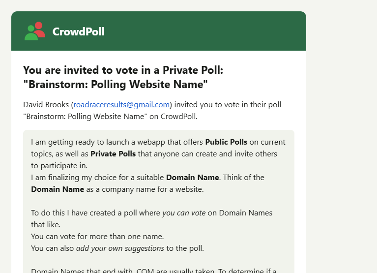

Start a new spec for these requirements called `20261112-175743-EMAIL-LOGO`  
!! THIS FILE IS GENERATED USING THE SKILL `/speckit-requirements`. DO NOT EDIT OR DELETE THIS FILE !!  

# Initial High-Level Requirements

We realized that the fav-icon was created from the brand logo back in spec `specs\20261016-172002-FAVICON\research.md`:
```
## R4. Drawing the mark: `favicon.svg`

- **Decision**: Copy the figure geometry from `.brand-logo` in `SITE_HEADER_MARKUP` (`src/public/app.js`) — the mask `brand-logo-front`, the red group, the green circle and body — and drop both speech-bubble paths (fill and stroke). Use a cropped square `viewBox="10 4.5 96 96"`.
- **Rationale** (geometry from the logo):
  - The figures span x 16–100 and y 15–90 (84 × 75 units, the mockup's 23 × 20 ratio).
  - At 16 px one pixel is 6 units; filling the width with 1 px each side gives 84 + 12 = 96 units, so x 10–106; centring 75 units vertically in 96 gives y 4.5–100.5.
  - No background rectangle, so it is transparent (U1).
  - Give the mask a file-local id (`favicon-front`); the file is standalone.
- **Markup rules**: `<title>CrowdPoll</title>` as the first child (A2); no `role`/`aria-*` (a favicon is not in the accessibility tree); no comments (Constitution VI).
```

The fav-icon dropped the speech-bubble paths from the brand logo, keeping only the core figure geometry (mask, red group, green circle and body) for a simplified and recognizable mark at small sizes.  

For the logo in the invitation email, please add a speech bubble to the core figure geometry, while keeping the high quality.  
Create the SVG using the same technique you used for the current large link preview logo, ensuring that the speech bubble integrates seamlessly with the core figure geometry and maintains visual clarity at larger sizes.  

The following image shows the placement of the logo:  



## Decisions (resolved findings, 2026-11-12 6:03 PM)

- **Which emails** (AM1): every email shows the new logo, through the one shared `layout()` in `src/email/templates.ts` and the one `email-logo.png`: the login link, create account, email-change verification and notice, account deleted, the poll invitation and its reminder.  
- **Size** (AM2): the email header shows the logo at 56 × 56 px (was 48 × 48), rendered at 3×, so `email-logo.png` is 168 × 168 px;  
  the `` width and height in `templates.ts`, its tests and the email fixtures change to 56.  
- **Master SVG** (UA1): no new SVG file;  
  `devScripts/favicon-ico.ts` renders `email-logo.png` from `src/public/og-logo.svg` as it is (the link-preview master: the figures and the speech bubble, 120 × 120), instead of from `favicon.svg`.  
  The favicon keeps `favicon.svg`, figures only.  
- **Colours** (UA2): the bubble keeps the header logo's colours, as `og-logo.svg` draws them: `#FAFAFA` fill, black outline, round joins.  
- **URL** (UA3): the logo keeps its URL, `<ENV_EMAIL_ASSET_ORIGIN>/email-logo.png`, and its file name;  
  recipients, development mail included, see the new logo once `npm run deploy` serves it, and a mail proxy's cached copy may lag;  
  the quickstart says so.  
- **Quality check** (UA4): `favicon-ico.ts` refuses an email logo that is not 168 × 168 px or whose top-left pixel is not transparent;  
  the developer reviews the logo in the output of `devScripts/render-invitation-email.ts`, in light and dark mail themes, before committing.  
- **OAuth consent logo** (NC1): the providers use the new `email-logo.png`;  
  `specs/20261022-131728-SOCIAL-OAUTH-PROVIDERS/provider-setup.md` describes it as the figures with the speech bubble, 168 × 168 px;  
  logos already uploaded to Google and Microsoft stay as they are until re-uploaded.  
