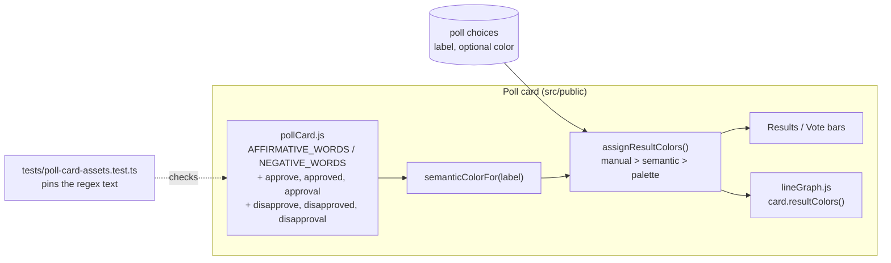
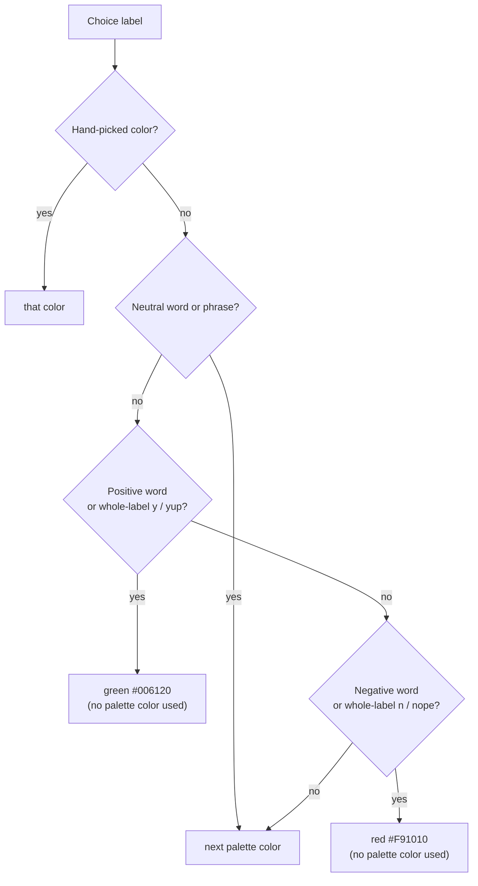

# High Level Requirements

Requirements: `requirements/20261112-191252-semantic-color-words/requirements.md`  
External Files: none  
Generated: 2026-11-12 7:12 PM  

Currently, there are semantic color assigned to Poll bars,  
such that when the bar label indicates a positive response, it is displayed in a color associated with positivity,  
and when it indicates a negative response, it is displayed in a color associated with negativity.  

Here is a description of the logic:
---------------
The rules are in `src/public/pollCard.js:96-119` (`semanticColorFor`). A positive label gets dark green `#006120`, a negative one gets red `#F91010`. Any other label gets the next color from the poll's palette. Letter case doesn't matter for any of them.

**Positive (green):**
- **The word anywhere in the label:** `yes`, `true`, `correct`, `agree`, `yay`
- **The whole label only:** `y`, `yup`

**Negative (red):**
- **The word anywhere in the label:** `no`, `false`, `incorrect`, `disagree`, `nay`
- **The whole label only:** `n`, `nope`

How a match works:
- **Whole words only.** A word matches only when no letter touches it on either side. A space, hyphen, digit or underscore all count as a break.
  - "Yes, definitely", "Agree2" and "yes_please" match.
  - "Yesterday", "Incorrect" (for `correct`) and "Notable" (for `no`) don't.
- **Short tokens need the whole label.** `y`, `n`, `yup` and `nope` count only when they are the entire label, trimmed. "Y" matches, but "Option Y" doesn't.
- **Positive wins a tie.** A label that matches both lists, such as "Yes and no", is green.
- **A hand-picked color wins.** A color chosen for a choice in the poll's colors step overrides the green or red. A green or red choice doesn't use up a palette color.
- **"Disagree" is red.** It contains "agree", but a letter comes right before it, so it doesn't count as positive; "disagree" is on the negative list.

------------------

Add to the list of positive words:
- approve
- approved
- approval

Add to the list of negative words:
- disapprove
- disapproved
- disapproval

Are there other labels that should be added to the positive or negative lists?

## Additional Requirements and Research Requests

**Instructions To The Developer**  
Enter any additional requirements or research requests under the ## Additional Requirements and Research Requests heading above.  
When you Type or Say: "Next" in the CC CLI terminal, the additional requirements and research requests will be applied to the report.  
  
You may leave these instructions here. They will be ignored when "Next" is executed.  

## 1. Overview and Scope

A poll bar whose label reads as a positive answer is drawn dark green (`#006120`), and one that reads as a negative answer is drawn red (`#F91010`), unless the choice has a hand-picked color.  
The rule is one browser function, `semanticColorFor` in `src/public/pollCard.js`, with two word lists (`AFFIRMATIVE_WORDS`, `NEGATIVE_WORDS`) and two whole-label lists (`AFFIRMATIVE_EXACT`, `NEGATIVE_EXACT`).  
This feature adds words to the two word lists:  

- **Positive**: `approve`, `approved`, `approval`.  
- **Negative**: `disapprove`, `disapproved`, `disapproval`.  

They follow the existing whole-word rule, so "approve" inside "Disapprove" never matches (a letter comes right before it), just as "agree" inside "Disagree" does not.  
The requirements also ask which other labels should be added; that is answered in RS1 below.  

What already exists and is reused:  

- `assignResultColors` in `pollCard.js`, which gives a manual color first, then the semantic color, then the next palette color;  
- the line graph (`src/public/lineGraph.js`), which takes its line colors from the card's `resultColors()`, so lines follow the bars with no change;  
- the asset test `tests/poll-card-assets.test.ts`, which pins the two word regexes as shipped text.  

Out of scope: the colors themselves, hand-picked colors and the colors step, the palette, and the server (no server code decides a semantic color; `src/polls/barPalette.ts` only validates hand-picked colors).  

## 2. Component Diagram

## 3. Color Decision Flow

The neutral list is tested first (UA1), then positive, so a label matching both the positive and negative lists, such as "Yes and no", is still green.  

## 4. Word Lists After This Feature

| List | Match | Words (new in bold) |
|---|---|---|
| Neutral (new, palette color) | whole word or phrase anywhere in the label | **neither**, **neutral**, **undecided**, **unsure**, **no opinion**, **no preference**, **don't know**, **do not know** |
| Positive | whole word anywhere in the label | yes, true, correct, agree, yay, **approve**, **approved**, **approval**, **support**, **favor**, **favour**, **accept**, **yeah**, **yep**, **aye** |
| Positive | whole label only | y, yup |
| Negative | whole word anywhere in the label | no, false, incorrect, disagree, nay, **disapprove**, **disapproved**, **disapproval**, **oppose**, **against**, **reject**, **nah** |
| Negative | whole label only | n, nope |

Examples with the new words:  

| Label | Color |
|---|---|
| Approve / Strongly approve / Approved | green |
| Disapprove / Somewhat disapprove / Disapproved | red |
| Approval rating up | green |
| Approves / Approving | palette (other forms are not listed, see UA2) |
| Strongly support / In favor / Accept | green |
| Oppose / Against / Reject | red |
| Neither approve nor disapprove / No opinion | palette (neutral list, UA1) |

This table holds the accepted recommendations of RS1, UA1 and UA2.  

## 5. Research Results

**RS1. Are there other labels that should be added to the positive or negative lists?**  
<b>
✅ Resolved</b>  
✅ Requirements File Updated: 2026-11-12 7:18 PM  
**Notes**: Recommendation accepted in file 2026-11-12: Recommendation A, **add the common poll-scale pairs**;  
the requirements now list the eleven added words, and the words left out, under Decisions.  

> The requirements ask whether more words should count as positive or negative.  
> Sources: the current lists in `src/public/pollCard.js:99-102`;  
> the answer scales most used in opinion polls (agree/disagree, approve/disapprove, support/oppose, favor/oppose, accept/reject), from general survey practice, not checked against a web source in this run.  
> A word is a good candidate only when it nearly always means yes or no inside a short answer label.  
> Words considered and left out: `sure` (would turn "Not sure" green), `for` (fires on "Vote for Alice"), `like`, `good`, `bad`, `right`, `wrong`, `ok` (too common in ordinary, non-yes/no labels).  

  - **Recommendation A** _(recommended)_: **add the common poll-scale pairs: positive `support`, `favor`, `favour`, `accept`, `yeah`, `yep`, `aye`; negative `oppose`, `against`, `reject`, `nah`.**  

    [X] ➡️ **Accepted**

    - <u>Pros</u>: it covers the support/oppose and favor/oppose scales pollsters use besides agree and approve;  
      the informal yes/no words (`yeah`, `yep`, `aye`, `nah`) are unambiguous.  
    - <u>Cons</u>: more words means more chance of a surprise color in a poll that is not yes/no, e.g. a choice "Customer support";  
      a hand-picked color still overrides it.  

  - **Recommendation B**: **add only the six words the requirements list.**  

    [ ] ➡️ **Not Accepted**

    - <u>Pros</u>: the smallest change, with no surprise colors.  
    - <u>Cons</u>: support/oppose and favor/oppose polls keep palette colors.  

  - **Developer Resolution C**:  

    [ ] ➡️ **Not Accepted**

## 6. Findings

### 6.1 Inconsistencies

None found.

### 6.2 Ambiguities

None found.

### 6.3 Unspecified Aspects

**UA1. What color does a neutral middle answer get?**  
<b>
✅ Resolved</b>  
✅ Requirements File Updated: 2026-11-12 7:18 PM  
**Notes**: Recommendation accepted in file 2026-11-12: Recommendation A, **a neutral list, tested first, gives a palette color**;  
the requirements now define the neutral words and phrases under Decisions.  

> Agree and approve scales usually have a middle answer.  
> Today "Neither agree nor disagree" is green: "agree" is a whole word in it, and positive wins a tie.  
> With the new words, "Neither approve nor disapprove" would be green too.  
> "No opinion" and "No preference" are red, because "no" is a whole word in them.  
> The requirements do not say whether a neutral answer should take a semantic color.  

  - **Recommendation A** _(recommended)_: **a neutral list, tested first, gives a palette color: the words `neither`, `neutral`, `undecided`, `unsure`, and the phrases `no opinion`, `no preference`, `don't know`, `do not know`.**  

    [X] ➡️ **Accepted**

    - <u>Pros</u>: middle answers read as neutral, so a five-point scale shows green, neutral, red;  
      it also fixes "No opinion" being red.  
    - <u>Cons</u>: a third list to keep;  
      existing polls with these labels change color (see Breaking Changes).  

  - **Recommendation B**: **a label matching both lists gets a palette color instead of green.**  

    [ ] ➡️ **Not Accepted**

    - <u>Pros</u>: no new list;  
      fixes "Neither agree nor disagree" and "Neither approve nor disapprove".  
    - <u>Cons</u>: "No opinion" stays red;  
      "Yes and no" changes from green to a palette color, against the documented tie rule.  

  - **Recommendation C**: **leave the tie rule as it is.**  

    [ ] ➡️ **Not Accepted**

    - <u>Pros</u>: no change beyond the new words.  
    - <u>Cons</u>: the middle of an approve scale is green, and "No opinion" is red;  
      a poll author must pick its color by hand.  

  - **Developer Resolution D**:  

    [ ] ➡️ **Not Accepted**

**UA2. Should other forms of the new words match?**  
<b>
✅ Resolved</b>  
✅ Requirements File Updated: 2026-11-12 7:18 PM  
**Notes**: Recommendation accepted in file 2026-11-12: Recommendation A, **exactly the six forms listed**;  
the requirements now say under Decisions that other forms are not added.  

> The word rule matches whole words only, so only the forms listed match.  
> "Approves", "Approving", "Disapproves" and "Disapproving" would get palette colors.  
> The existing lists have the same gap: "Agreed" and "Agrees" are not green today.  

  - **Recommendation A** _(recommended)_: **exactly the six forms listed.**  

    [X] ➡️ **Accepted**

    - <u>Pros</u>: matches the requirements word for word, and the lists stay short;  
      answer labels rarely use the -s or -ing forms.  
    - <u>Cons</u>: "Approves" and "Approving" stay in palette colors.  

  - **Recommendation B**: **also add the -s and -ing forms: `approves`, `approving`, `disapproves`, `disapproving`, and for the existing words `agrees`, `agreed`, `disagrees`, `disagreed`.**  

    [ ] ➡️ **Not Accepted**

    - <u>Pros</u>: every common form of the two scales is colored.  
    - <u>Cons</u>: eight more words;  
      "Agreed" and "Disagreed" change color in existing polls.  

  - **Developer Resolution C**:  

    [ ] ➡️ **Not Accepted**

### 6.4 Needs Clarifications

None found.

## 7. Breaking Changes

- **BC1. Existing polls change color without being edited.**  
  The colors are worked out in the browser each time a card is drawn, and nothing is stored, so after the release every choice without a hand-picked color whose label holds a new word turns green or red.  
  A green or red choice uses no palette color, so the other automatic choices of the same poll each move up one palette color;  
  the line graph follows the bars.  
- **BC2. Neutral labels change color** (only if UA1 A or B is accepted).  
  "Neither agree nor disagree" changes from green, and with A "No opinion" and "No preference" change from red, to a palette color.  

## 8. Technical Debt

- **TD1. The word rules are tested only as text.**  
  `tests/poll-card-assets.test.ts:178-186` checks that the shipped `pollCard.js` contains the two regexes word for word;  
  no test calls `semanticColorFor` on real labels, so cases such as "Disapprove" not matching `approve` are untested behaviour.  
  A jsdom client test (`client-*.test.ts`) of the labels in Section 4 would cover them.  
- **TD2. The lists are described in more than one place.**  
  The comment in `pollCard.js:59-85` and `ARCHITECTURE.md:798` ("a label that reads as Yes or No") describe the rule in prose, and must be kept in step with the lists by hand.  

## 9. Requirements Report Complete Report  
  
- **Requirements Report Document:** requirements/20261112-191252-semantic-color-words/requirements-report.md  
- **Requirements Document:** requirements/new-20261112-185052/requirements.md → requirements/20261112-191252-semantic-color-words/requirements.md  
- **Software Architecture Diagrams:** 2  
- **Inconsistencies:** 0  
- **Ambiguities:** 0  
- **Unspecified Aspects:** 2  
- **Needs Clarifications:** 0  
- **Research Results:** 1  
- **Breaking Changes:** 2  
- **Technical Debt items:** 2  
  
The requirements are ready for /speckit-specify.
To generate specs from the requirements document, use the `/speckit-specify` skill followed by the path (relative to the project root) to the requirements file.
At the prompt, Type:  
🟩 👉 /speckit-specify requirements/20261112-191252-semantic-color-words/requirements.md  

