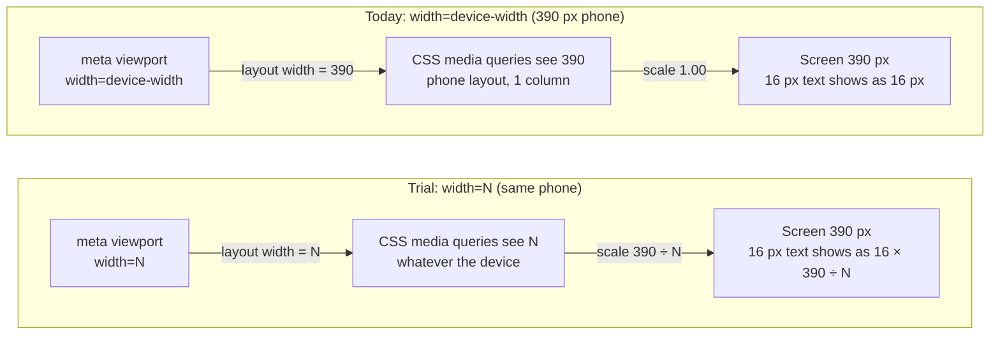
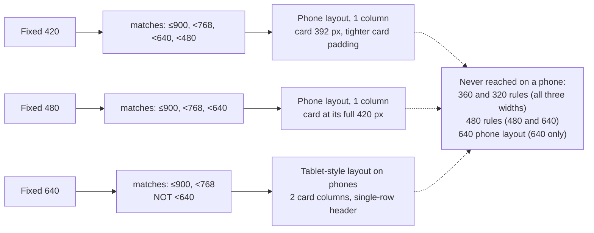
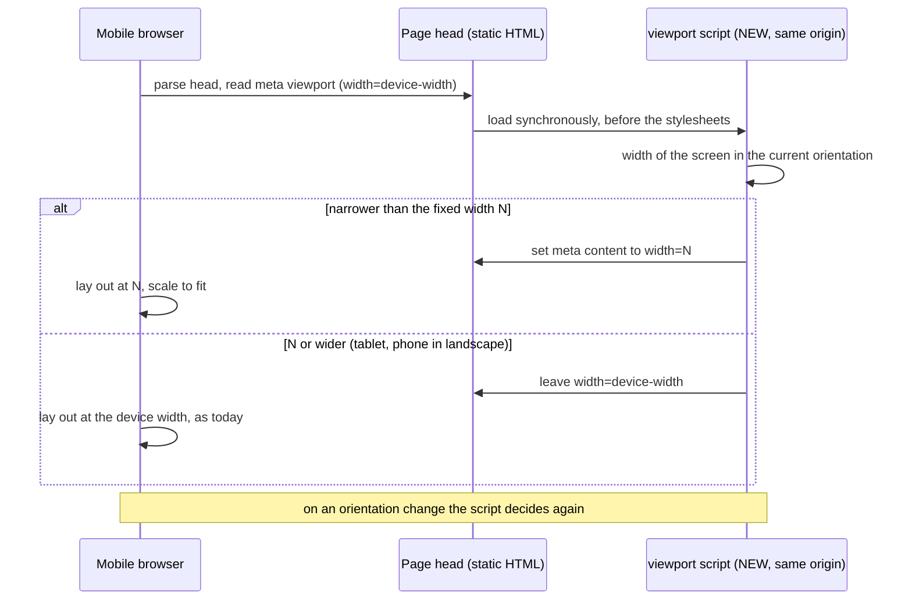

# High Level Requirements

Requirements: `requirements/20261113-085157-fixed-viewport-width/requirements.md`  
External Files: none (`image.png`, a phone screenshot of the home page at 356 px, is in the folder but the requirements do not link it)  
Generated: 2026-11-13 8:53 AM  

We did some research into how developers handle responsive design and viewport settings on websites,  
and found this technique:  
```
Site-side choices. Developers can set the viewport meta tag to a fixed width such as 640, and the browser will scale that to fit. Most sites use width=device-width and let responsive CSS handle the rest.
```

We would like to try this approach in our project to see if it improves the responsive design and overall user experience. 

## Additional Requirements and Research Requests

**Instructions To The Developer**  
Enter any additional requirements or research requests under the ## Additional Requirements and Research Requests heading above.  
When you Type or Say: "Next" in the CC CLI terminal, the additional requirements and research requests will be applied to the report.  
  
You may leave these instructions here. They will be ignored when "Next" is executed.  

## 1. Overview

Today every page tells a mobile browser to lay the page out at the device's own width, and the CSS adapts to that width.  
The feature tries the other technique: the page declares one fixed layout width, and the mobile browser lays the page out at that width and scales the result to fit the screen.  
Every phone then shows the same layout, larger or smaller, instead of a layout that reflows per device.  

What exists already (found in the codebase):

- All 13 pages in `src/public/*.html` carry the same line 5: `<meta name="viewport" content="width=device-width, initial-scale=1">`.  
  They are static files sent as they are (`res.sendFile` in `src/routes/pages.ts`), with no templating.
- `tests/pages.test.ts:241` pins that exact meta line on every page (the favicon test reads the icon links "right after the viewport meta").
- The CSS and two scripts switch behaviour at seven layout widths: 900, 768, 640, 560, 480, 360 and 320 px.  
  640 px is the phone layout (single-column card grid); 900 px is the compact, scrolling tab bar.  
  `headerFit.js` (`max-width: 639.98px`) and `tabBarScroll.js` (`max-width: 900px`) ask the same questions from JavaScript.
- A poll card is at most 420 px wide (`pollCard.css:68`); the card grid is `repeat(auto-fill, minmax(268px, 1fr))` above the phone layout.

How a fixed viewport width behaves (the mechanism the feature relies on):

- The fixed width becomes the **layout width** on every mobile device: media queries, `matchMedia` and percentage widths all see that number, not the device's width.  
  A breakpoint below the fixed width can never match on a phone; a breakpoint above it always does.
- The browser scales the finished layout by `device width ÷ fixed width`; text, images and touch targets all shrink or grow by that factor.
- Desktop browsers ignore the viewport meta tag, so desktop windows keep today's behaviour.
- `initial-scale=1` cannot stay beside a fixed width: it asks for a 1:1 zoom, which shows only the left part of a wider layout.

What each candidate width does on common phones (scale, then a 16 px text and a 48 px touch target as they appear on screen):

| Device width | Fixed 420 | Fixed 480 | Fixed 640 |
|---|---|---|---|
| 320 px | 0.76 → 12.2 px text, 37 px target | 0.67 → 10.7 px, 32 px | 0.50 → 8.0 px, 24 px |
| 360 px | 0.86 → 13.7 px, 41 px | 0.75 → 12.0 px, 36 px | 0.56 → 9.0 px, 27 px |
| 390 px | 0.93 → 14.9 px, 45 px | 0.81 → 13.0 px, 39 px | 0.61 → 9.8 px, 29 px |
| 430 px | 1.02 → 16.4 px, 49 px | 0.90 → 14.3 px, 43 px | 0.67 → 10.8 px, 32 px |
| 768 px (tablet) | 1.83 (scaled up) | 1.60 (scaled up) | 1.20 (scaled up) |

## 2. Scope

- **In scope**
  - The viewport declaration of the site's pages (see UA1 for which pages).
  - The fixed width itself (see NC1) and which devices receive it (see UA2, UA3).
  - The test that pins the viewport meta line.
  - A manual comparison, before and after, on a set of device widths (see AM2).
- **Out of scope**
  - Desktop browsers: they ignore the viewport meta tag.
  - Emails: they are not pages and have no viewport meta.
  - Redesigning the phone layout, the breakpoints or the tab bar; the trial changes how the existing layout is scaled, not the layout.
  - Server routes, the API, settings and stored data.

## 3. Architecture Diagrams

### 3.1 From the meta tag to what the phone shows (today and with a fixed width)



### 3.2 Which breakpoints a phone can still reach at each candidate width



### 3.3 Choosing the viewport per device (if the fixed width is limited to narrow devices, see UA2 and UA3)



## 4. Breaking Changes

- `tests/pages.test.ts` pins `<meta name="viewport" content="width=device-width, initial-scale=1">` on every page; any change to the line fails it until the expected text follows.
- On phones the layout width stops following the device: CSS rules and `matchMedia` checks below the fixed width (`headerFit.js`, the 320, 360 and possibly 480 and 640 rules) no longer apply on any phone.
- Text and touch targets on phones narrower than the fixed width are drawn smaller than they are designed (see the table in section 1, and NC2).
- No route, API, setting, cookie or stored data changes.

## 5. Technical Debt

- The `<head>` of the 13 pages is repeated by hand; a change to the viewport line is 13 edits, kept in step only by `tests/pages.test.ts`.
- Phone-only CSS for widths below the fixed width becomes unreachable on phones but stays in the sheets (it still applies to a narrow desktop window).
- The jsdom client tests cannot observe viewport scaling, so the trial's effect can only be checked by hand on devices or in a browser's device emulation.
- Seven breakpoints are spread over 20 style sheets and two scripts with no shared definition.

## 6. Assumptions

- "The browser will scale that to fit" is wanted for phones; desktop behaviour is not meant to change (and cannot, through this tag).
- The existing layout and breakpoints are kept as they are for the trial.
- Pinch-zoom stays available to the user (see UA4).
- The header, tab bar and footer are shared by the pages, so one viewport rule serves them all (see UA1).
- The screenshot `image.png` (356 px wide, tab bar overflowing) illustrates the kind of narrow-phone crowding the trial hopes to relieve.

## 7. Findings

### 7.1 Inconsistencies

**IN1. The 640 px width (NC1) cannot meet the size floor (NC2).**  
<span style="font-size:large" ><b>
✅ Resolved</b></span>  
✅ Requirements File Updated: 2026-11-13 9:04 AM  
**Notes**: Recommendation accepted in file 2026-11-13: Recommendation A, keep 640 px, the floor becomes a measurement to record, not a pass condition;  
the requirements' NC2 item now has no numeric floor and has the quickstart record the on-screen sizes at each device width.  

> NC1 was resolved with a fixed width of 640 px.  
> NC2 was resolved with a floor: on a 360 px phone 16 px text must show at 12 px or more and a 48 px control at 36 px or more, which needs a scale of 0.75.  
> At 640 px a 360 px phone is scaled by 0.56: 16 px text shows at 9 px and a 48 px control at 27 px.  
> The two requirements contradict each other, so the trial as written fails its own floor before it starts.  

  - **Recommendation A** _(recommended)_: **keep 640 px; the floor becomes a measurement to record, not a pass condition.**  

    [X] ➡️ **Accepted**

    - <u>Pros</u>: the trial runs at the width that was chosen; the quickstart records the size of 16 px text and a 48 px control at each device width, and readability is judged by the AM2 checklist ("every control can still be tapped without zooming", and the developer's preference).  
    - <u>Cons</u>: no numeric limit protects readability; text of about 9 px on a 360 px phone is likely to be judged too small.  


  - **Recommendation B**: **keep the floor; the fixed width becomes 480 px.**  

    [ ] ➡️ **Not Accepted**

    - <u>Pros</u>: 480 px meets the floor exactly (0.75 at 360 px) and keeps the single-column phone layout with the card at its full 420 px.  
    - <u>Cons</u>: it is not the width that was chosen; phones no longer get the two-column layout.  


  - **Developer Resolution C**:  

    [ ] ➡️ **Not Accepted**

### 7.2 Ambiguities

**AM1. Is "try this approach" a change made on a branch, or a switch that can be turned on and off?**  
<span style="font-size:large" ><b>
✅ Resolved</b></span>  
✅ Requirements File Updated: 2026-11-13 9:03 AM  
**Notes**: Recommendation accepted in file 2026-11-13: Recommendation A, change the pages on the feature branch;  
the requirements now say the branch is the trial, with no setting and no switch.  

> The requirements say "we would like to try this approach … to see if it improves" the experience.  
> That can mean changing the pages and judging the result before merging, or shipping both behaviours with a way to switch between them.  
> The pages are static files with no templating, and every setting is an `ENV_*` variable validated by `loadConfig`, so a switch needs new machinery.  

  - **Recommendation A** _(recommended)_: **change the pages on the feature branch; the branch is the trial, kept or dropped by merging or not.**  

    [X] ➡️ **Accepted**

    - <u>Pros</u>: no new setting, no server code, nothing to remove afterwards; the before and after are compared by running `main` and the branch side by side.  
    - <u>Cons</u>: production visitors never see the trial until it is merged; going back after a merge is a revert.  


  - **Recommendation B**: **a new setting, e.g. `ENV_VIEWPORT_WIDTH` (empty = `device-width`), read by the pages at run time.**  

    [ ] ➡️ **Not Accepted**

    - <u>Pros</u>: the width can be changed or turned off in production without a release of the pages.  
    - <u>Cons</u>: the static pages need a way to receive the value (a served script or server-side substitution), plus the setting's validation, table row, tests and Terraform entry; more to build than the change itself.  


  - **Developer Resolution C**:  

    [ ] ➡️ **Not Accepted**

**AM2. How is "improves the responsive design and overall user experience" judged?**  
<span style="font-size:large" ><b>
✅ Resolved</b></span>  
✅ Requirements File Updated: 2026-11-13 9:03 AM  
**Notes**: Recommendation accepted in file 2026-11-13: Recommendation, a manual before/after checklist at 320, 360, 390 and 430 px portrait, one phone in landscape and one 768 px tablet;  
the requirements now list the pages checked and the four pass conditions.  

> The requirements give no measure of improvement, so the trial has no pass or fail.  
> Automated tests cannot see viewport scaling (jsdom has no layout), so the judgement has to be a manual comparison.  

  - **Recommendation**: **a manual before/after checklist at 320, 360, 390 and 430 px portrait, one phone in landscape and one 768 px tablet.**  

    [X] ➡️ **Accepted**

    - The checklist is the feature's quickstart, run in a browser's device emulation and on at least one real phone.  
    - Each width is checked on the home page, a maximized card, the admin wizard and a legal page.  
    - It passes when: the page never scrolls sideways;  
      the layout is the same at all four phone widths apart from its size;  
      every control can still be tapped without zooming;  
      and the developer prefers the result to `main` at the same width.  
    - The outcome (kept, kept with a different width, or dropped) is recorded in the quickstart.  


  - **Developer Resolution B**:  

    [ ] ➡️ **Not Accepted**

### 7.3 Unspecified Aspects

**UA1. Which pages take the fixed viewport width?**  
<span style="font-size:large" ><b>
✅ Resolved</b></span>  
✅ Requirements File Updated: 2026-11-13 9:03 AM  
**Notes**: Recommendation accepted in file 2026-11-13: Recommendation, all 13 pages, with one identical viewport rule;  
the requirements now say so.  

> The requirements say "in our project" and name no page.  
> There are 13 pages (`index`, `login`, `create-account`, `confirm-signin`, `accept-terms`, `profile`, `settings`, `admin`, `admin-results`, `invite`, `not-authorized`, `privacy`, `terms`), all with the same viewport line and the same header and footer.  

  - **Recommendation**: **all 13 pages, with one identical viewport rule.**  

    [X] ➡️ **Accepted**

    - A visitor moving from the home page to login or settings would otherwise see the header and text change size between pages.  
    - `tests/pages.test.ts` keeps checking that every page carries the same line.  


  - **Developer Resolution B**:  

    [ ] ➡️ **Not Accepted**

**UA2. What happens on a mobile device that is wider than the fixed width?**  
<span style="font-size:large" ><b>
✅ Resolved</b></span>  
✅ Requirements File Updated: 2026-11-13 9:03 AM  
**Notes**: Recommendation accepted in file 2026-11-13: Recommendation A, only devices narrower than the fixed width get it, set by a small same-origin script;  
the requirements now say the static line stays `width=device-width, initial-scale=1` and the script rewrites it on a narrow device.  

> A fixed width applies to every mobile device, not only narrow phones.  
> A 768 px tablet given a 480 px layout shows the single-column phone layout enlarged 1.6 times, and loses the multi-column grid it has today.  
> A meta tag cannot be conditional, so limiting the fixed width to narrow devices needs a small script that sets the tag (diagram 3.3).  

  - **Recommendation A** _(recommended)_: **only devices narrower than the fixed width get it; wider ones keep `width=device-width`, set by a small same-origin script in each page's head.**  

    [X] ➡️ **Accepted**

    - <u>Pros</u>: tablets and large phones keep today's layout; the page is only ever scaled down, never blown up; without JavaScript the page falls back to today's behaviour.  
    - <u>Cons</u>: one new script file loaded first on all 13 pages, with its own client test; the static meta line stays `width=device-width` and the script rewrites it.  


  - **Recommendation B**: **every mobile device gets the fixed width, by changing the static meta line only.**  

    [ ] ➡️ **Not Accepted**

    - <u>Pros</u>: the simplest change possible, 13 identical one-line edits and one test string; exactly the technique as quoted.  
    - <u>Cons</u>: tablets show an enlarged phone layout and lose their columns; a phone in landscape is enlarged too.  


  - **Developer Resolution C**:  

    [ ] ➡️ **Not Accepted**

**UA3. What happens when a phone is turned to landscape?**  
<span style="font-size:large" ><b>
✅ Resolved</b></span>  
✅ Requirements File Updated: 2026-11-13 9:03 AM  
**Notes**: Recommendation accepted in file 2026-11-13: Recommendation, the rule follows the current orientation;  
the requirements now say the width of the screen as it is held decides, again on each turn.  

> A 390 px phone is about 844 px wide in landscape.  
> With a fixed width it would show the fixed layout enlarged (844 ÷ 480 = 1.76 times) instead of the wider layout it shows today.  
> This only needs an answer if UA2 limits the fixed width to narrow devices; with a static meta line the enlargement cannot be avoided.  

  - **Recommendation**: **the rule follows the current orientation: the width of the screen as it is held decides, and it is decided again when the phone is turned.**  

    [X] ➡️ **Accepted**

    - A phone in landscape that is as wide as the fixed width or wider shows today's `device-width` layout; turned back to portrait it returns to the fixed width.  
    - If UA2 is resolved with the static meta line (its Recommendation B), this finding is recorded as "landscape is enlarged, accepted for the trial".  


  - **Developer Resolution B**:  

    [ ] ➡️ **Not Accepted**

**UA4. Can the visitor still zoom, and what replaces `initial-scale=1`?**  
<span style="font-size:large" ><b>
✅ Resolved</b></span>  
✅ Requirements File Updated: 2026-11-13 9:03 AM  
**Notes**: Recommendation accepted in file 2026-11-13: Recommendation, the content is `width=N` alone and pinch-zoom is never restricted;  
the requirements now say so, with N = 640.  

> Today's line ends with `initial-scale=1`.  
> Beside a fixed width that opens the page zoomed in on its left part, so it cannot stay as it is.  
> The requirements do not say whether pinch-zoom must remain; with text drawn smaller than designed, zoom is the visitor's only remedy.  

  - **Recommendation**: **when the fixed width applies the content is `width=N` alone; pinch-zoom is never restricted.**  

    [X] ➡️ **Accepted**

    - No `initial-scale`, `user-scalable=no`, `minimum-scale` or `maximum-scale` is written with the fixed width, so the browser fits the layout to the screen and the visitor can zoom freely.  
    - Where `width=device-width` still applies, the line stays `width=device-width, initial-scale=1`, as today.  


  - **Developer Resolution B**:  

    [ ] ➡️ **Not Accepted**

### 7.4 Needs Clarifications

**NC1. Which fixed width?**  
<span style="font-size:large" ><b>
✅ Resolved</b></span>  
✅ Requirements File Updated: 2026-11-13 9:03 AM  
**Notes**: Recommendation accepted in file 2026-11-13: Recommendation B, 640 px, as in the quoted example;  
the requirements now name 640 px and say the phone layout does not apply on phones;  
640 px does not meet the floor accepted in NC2, see IN1.  

> The quoted technique says "a fixed width such as 640", as an example.  
> The number decides the layout, not only the size: the site's phone layout applies below 640 px, so at exactly 640 no phone ever shows it (diagram 3.2).  
> At 640 a 390 px phone shows two columns of cards at 61 % size, with 16 px text drawn at about 10 px.  
> A poll card is at most 420 px wide, so 480 is the narrowest width that shows the card at its full designed width inside the phone layout.  

  - **Recommendation A** _(recommended)_: **480 px.**  

    [ ] ➡️ **Not Accepted**

    - <u>Pros</u>: keeps the single-column phone layout; the card reaches its full 420 px and the tab bar gains a third more room on a 360 px phone; text is 81 % on a 390 px phone (16 px shows as 13 px).  
    - <u>Cons</u>: text and targets are still smaller than today on every phone under 480 px; on a 320 px phone 16 px text shows as 10.7 px.  


  - **Recommendation B**: **640 px, as in the quoted example.**  

    [X] ➡️ **Accepted**

    - <u>Pros</u>: the most room: two cards side by side and the single-row header on every phone; the number the research names.  
    - <u>Cons</u>: 16 px text shows as 8 to 11 px and a 48 px button as 24 to 32 px; the whole phone layout (everything under `max-width: 639.98px`, and `headerFit.js`'s phone mode) is never used on a phone.  


  - **Recommendation C**: **420 px, the card's own width.**  

    [ ] ➡️ **Not Accepted**

    - <u>Pros</u>: the gentlest scaling (93 % on a 390 px phone, 86 % on 360 px); text stays close to its designed size.  
    - <u>Cons</u>: the least gain in room; the card is 392 px, not its full 420 px; phones of 420 px and wider are unchanged or slightly enlarged.  


  - **Developer Resolution D**:  

    [ ] ➡️ **Not Accepted**

**NC2. Is smaller text and smaller touch targets on narrow phones acceptable, and down to what size?**  
<span style="font-size:large" ><b>
✅ Resolved</b></span>  
✅ Requirements File Updated: 2026-11-13 9:03 AM  
**Notes**: Recommendation accepted in file 2026-11-13: Recommendation A, accept the reduction for the trial, with a floor at 360 px;  
the requirements now state the floor (12 px text, 36 px control);  
the 640 px width accepted in NC1 does not meet it, see IN1.  

> Scaling shrinks everything by the same factor, text and buttons included (table in section 1).  
> The site's 48 px controls follow Material 3's minimum touch target; scaled, they fall below it.  
> A layout that must be zoomed and scrolled in two directions to be read is also what WCAG 2.2's Reflow criterion (1.4.10, level AA) asks sites to avoid; whether the site aims to meet it is not stated anywhere in the project.  

  - **Recommendation A** _(recommended)_: **accept the reduction for the trial, with a floor: on a 360 px phone 16 px text must show at 12 px or more and a 48 px control at 36 px or more.**  

    [X] ➡️ **Accepted**

    - <u>Pros</u>: gives the trial a measurable limit (a scale of 0.75 or more at 360 px, which 480 and 420 meet and 640 does not); no CSS changes.  
    - <u>Cons</u>: phones narrower than 360 px fall below the floor; controls are under the 48 px guideline on most phones.  


  - **Recommendation B**: **no reduction: sizes in the phone layout are raised so text and controls show at their designed size after scaling.**  

    [ ] ➡️ **Not Accepted**

    - <u>Pros</u>: readability and touch targets are as today.  
    - <u>Cons</u>: it undoes most of the room the fixed width gains, and it is a restyling of the phone layout across many sheets, which the trial otherwise leaves alone.  


  - **Developer Resolution C**:  

    [ ] ➡️ **Not Accepted**


## 8. Requirements Report Complete Report  
  
- **Requirements Report Document:** requirements/20261113-085157-fixed-viewport-width/requirements-report.md  
- **Requirements Document:** requirements/20261113-085157-fixed-viewport-width/requirements.md  
- **Software Architecture Diagrams:** 3  
- **Inconsistencies:** 1  
- **Ambiguities:** 2  
- **Unspecified Aspects:** 4  
- **Needs Clarifications:** 2  
- **Research Results:** 0  
- **Breaking Changes:** 4  
- **Technical Debt items:** 4  
  
The requirements are ready for /speckit-specify.
To generate specs from the requirements document, use the `/speckit-specify` skill followed by the path (relative to the project root) to the requirements file.
At the prompt, Type:  
🟩 👉 /speckit-specify requirements/20261113-085157-fixed-viewport-width/requirements.md  
