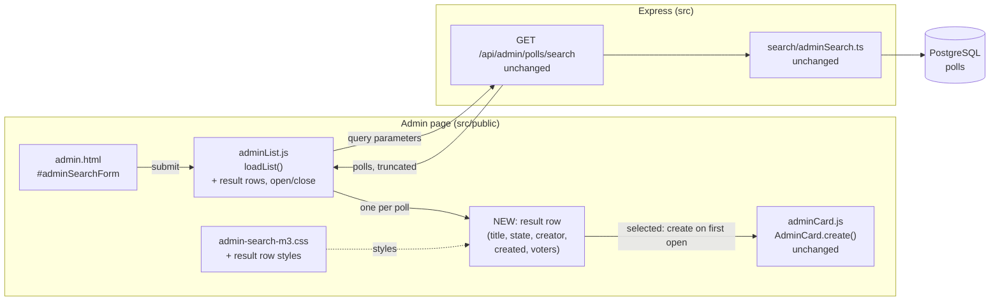
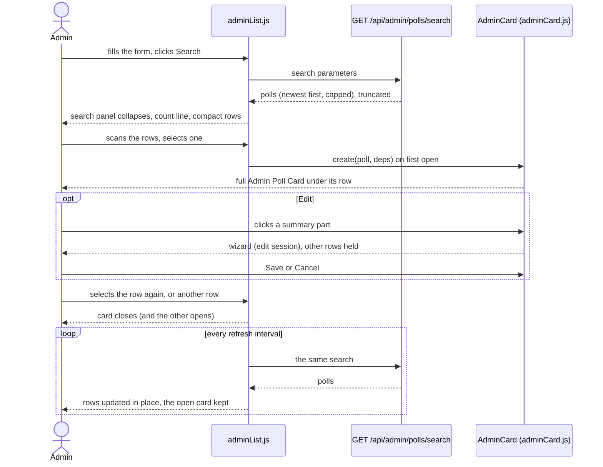
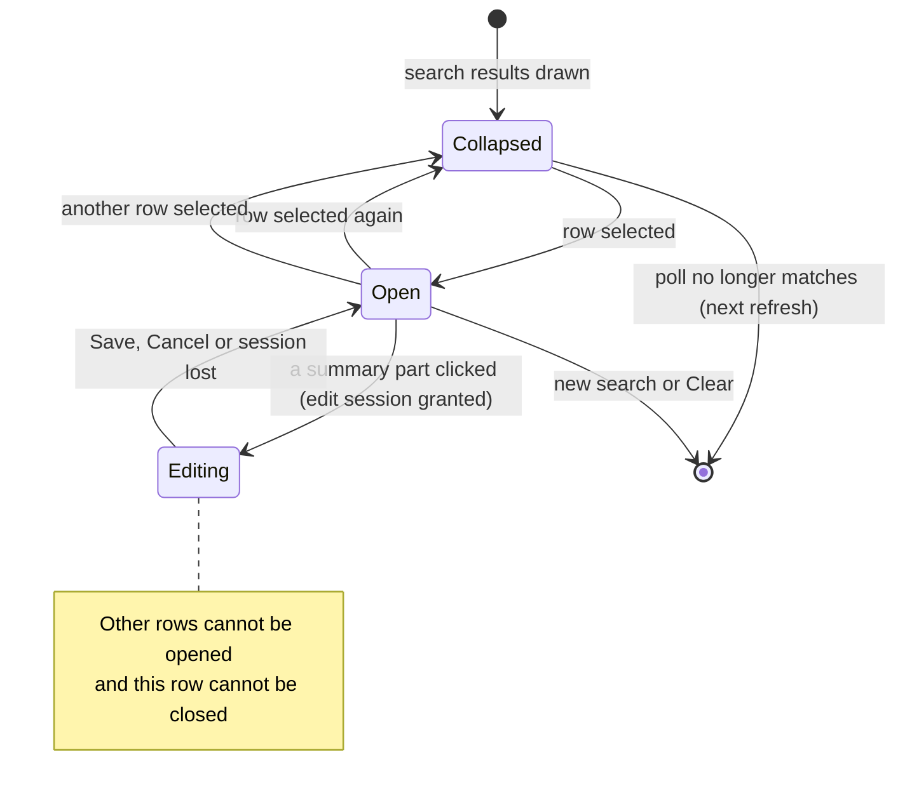
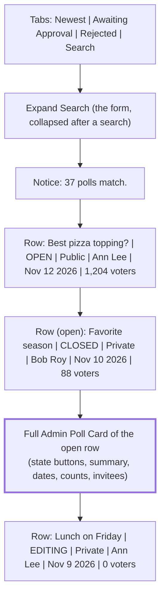

# High Level Requirements

Requirements: `requirements/20261113-102117-admin-search-results/requirements.md`  
External Files: none  
Generated: 2026-11-13 10:21 AM  

This feature improve the UIUX of the Admin Search feature.  

Currently, when the admin enters search terms and clicks "Search" button,  
all the results are listed in a full height Admin Poll Card, making it difficult to quickly scan through the search results.  

Please research and suggest a way for the admin to more easily see the search results and then select one of the polls to view the full Admin Poll Card then Edit it if needed.

## Additional Requirements and Research Requests

**Instructions To The Developer**  
Enter any additional requirements or research requests under the ## Additional Requirements and Research Requests heading above.  
When you Type or Say: "Next" in the CC CLI terminal, the additional requirements and research requests will be applied to the report.  
  
You may leave these instructions here. They will be ignored when "Next" is executed.  

## 1. Overview and Scope

The administrator's Search view (`src/public/admin.html`, tab `search`) runs `GET /api/admin/polls/search` and draws every matching poll as a full Admin Poll Card.  
A card holds the state header, the summary text, the dates panel, the counts panel and, on an invitation-only poll, the invitees panel, so one result fills most of a screen.  
The search returns up to `ENV_MAX_POLLS_ADMIN_SEARCH_RESULTS` polls (200 by default), so a broad search is a very long page.  

This feature changes how the results are shown, in two steps:  

- **Scan**: the results are a list of compact rows, one poll per row, short enough that many fit on a screen.  
- **Select**: choosing a row shows that poll's full Admin Poll Card, from which it is edited exactly as today.  

How the two steps are laid out is the research request, answered in RS1 below;  
the diagrams in sections 2 to 5 draw its recommended option (rows that expand in place) and change if another option is accepted.  

What already exists and is reused:  

- the search form, its reader `readSearchForm`, the views (`VIEWS`), the list loader `loadList` and its periodic refresh in `src/public/adminList.js`;  
- the card factory `window.AdminCard.create` in `src/public/adminCard.js` (read-only face, wizard, invitees, edit session);  
- the edit latch (`editingPid`): while one card is being edited, Create New Poll and the other views are held;  
- `GET /api/admin/polls/search` and its row shape `adminListRow` in `src/routes/pollsApi.ts`, which already carries every field a compact row needs;  
- the M3 search styles in `src/public/admin-search-m3.css`;  
- the tests `tests/client-admin-search.test.ts`, `tests/admin-search-assets.test.ts` and `tests/search-admin.test.ts`.  

Out of scope (as the requirements name only Search; see AM1): the search form's fields, the server's filters and ordering, the home page's public search, and the Admin Poll Card's own content.  

## 2. Component Diagram

## 3. Sequence Diagram

## 4. Result Row States

## 5. Page Layout

## 6. Research Results

### 6.1 A results layout that is easy to scan

**RS1. How can the administrator scan the search results and then select one poll to view its full Admin Poll Card and edit it?**  
<b>
✅ Resolved</b>  
✅ Requirements File Updated: 2026-11-13 10:43 AM  
**Notes**: Recommendation accepted in file 2026-11-13: Recommendation A, **compact rows that expand in place: selecting a row opens the poll's full card directly under it.**;  
the requirements now describe the layout under Decisions.  

> The requirements ask for research and a suggested way to show the search results so they are easy to scan, with the full card one selection away.  
> Sources: [Android — Canonical layouts (list-detail)](https://developer.android.com/design/ui/mobile/guides/layout-and-content/canonical-layouts), [NN/g — Accordions for complex content](https://www.nngroup.com/articles/accordions-complex-content/), [W3C APG — Disclosure pattern](https://www.w3.org/WAI/ARIA/apg/patterns/disclosure), [W3C APG — Accordion pattern](https://www.w3.org/WAI/ARIA/apg/patterns/accordion), and the codebase (`adminList.js`, `adminCard.js`, `pollsApi.ts`).  
> The list-detail layout shows a fixed-width list beside a flexible detail pane on wide windows, and only one of the two on narrow ones.  
> NN/g finds that expandable sections shorten long pages at the price of one more click, and fit when the reader needs one section at a time, not several side by side.  
> The APG disclosure pattern is a button with `aria-expanded` (and `aria-controls`), toggled by Enter or Space.  
> In the codebase, a search returns up to 200 polls, each drawn as a full card;  
> every invitation-only card also requests its invitees as soon as it is drawn;  
> the row payload already holds the title, state, visibility, creator, dates and counts;  
> the card's edit session, wizard and latch live in the card's own DOM and need a wide column.  
> The m3.material.io pages themselves could not be read, so the list-detail facts come from Android's page of the same layout.  

  - **Recommendation A** _(recommended)_: **compact rows that expand in place: selecting a row opens the poll's full card directly under it.**  

    [X] ➡️ **Accepted**

    - <u>Pros</u>: twenty or more results fit on a desktop screen instead of one or two;  
      the card is used unchanged, at its full width, so editing, the wizard, the invitees panel and the edit latch work as today;  
      it is one layout for phone and desktop;  
      the administrator edits one poll at a time, which is the case NN/g says expandable sections suit;  
      a card is built only when its row is opened, so 200 results no longer mean 200 cards and up to 200 invitee requests.  
    - <u>Cons</u>: the open card pushes the rows below it down, so the list is partly off screen while a card is open;  
      one more click before the card is seen.  

  - **Recommendation B**: **list-detail: the rows on the left, the selected poll's card in a pane on the right; on narrow windows the card replaces the list, with a back arrow.**  

    [ ] ➡️ **Not Accepted**

    - <u>Pros</u>: on a wide window the list stays in view while a card is open, so moving from poll to poll is one click.  
    - <u>Cons</u>: the page's single column would have to become two, leaving the card and its wizard a narrower pane than they are designed for;  
      it is two behaviours to build and test (side by side, and list-or-card on a phone);  
      the phone's back arrow must go through `window.SiteBack` and the discard dialog.  

  - **Recommendation C**: **a results table (one column per field, sortable); selecting a row opens the card in a dialog over the table.**  

    [ ] ➡️ **Not Accepted**

    - <u>Pros</u>: the densest view, and columns line up for comparing dates and counts.  
    - <u>Cons</u>: a wide table does not fit a phone;  
      the card's wizard, menus and confirmation dialogs would run inside a dialog, which the card was not built for;  
      sorting is new scope the requirements do not ask for.  

  - **Developer Resolution D**:  

    [ ] ➡️ **Not Accepted**

## 7. Findings

The recommendations below are written for RS1's Recommendation A (rows that expand in place).  
If another option of RS1 is accepted, the ones that no longer fit are reported again on the next run.  

### 7.1 Inconsistencies

None found.

### 7.2 Ambiguities

**AM1. Which views get the compact results list?**  
<b>
✅ Resolved</b>  
✅ Requirements File Updated: 2026-11-13 10:43 AM  
**Notes**: Recommendation accepted in file 2026-11-13: Recommendation A, **the Search view only; the other views keep their full cards.**;  
the requirements now limit the scope to the Search view under Decisions.  

> The requirements name the Admin Search feature only.  
> The Newest, Awaiting Approval and Rejected views draw the same full cards from the same list code, with the same cap, and are as hard to scan;  
> Awaiting Approval and Rejected are themselves searches by state.  
> A poll creator who is not an administrator has one list of their own polls and no Search view.  

  - **Recommendation A** _(recommended)_: **the Search view only; the other views keep their full cards.**  

    [X] ➡️ **Accepted**

    - <u>Pros</u>: it is what the requirements ask for;  
      Create New Poll, which opens the new card on Newest, and the creator's own list are untouched;  
      Awaiting Approval stays a queue worked card by card.  
    - <u>Cons</u>: the admin page then shows polls in two ways, rows in Search and cards elsewhere.  

  - **Recommendation B**: **every administrator view (Newest, Awaiting Approval, Rejected, Search); the creator's own list keeps full cards.**  

    [ ] ➡️ **Not Accepted**

    - <u>Pros</u>: one presentation on the whole page, and every long list becomes easy to scan.  
    - <u>Cons</u>: wider than the requirements;  
      Create New Poll must open the new poll's row as well as its wizard;  
      approving or rejecting a queue of polls takes one more click per poll.  

  - **Developer Resolution C**:  

    [ ] ➡️ **Not Accepted**

### 7.3 Unspecified Aspects

**UA1. What does a result row show?**  
<b>
✅ Resolved</b>  
✅ Requirements File Updated: 2026-11-13 10:43 AM  
**Notes**: Recommendation accepted in file 2026-11-13: Recommendation, **the title, the state, the visibility, the creator's name, the created date and the voter count, on one line on desktop.**;  
the requirements now list what a row shows under Decisions.  

> The requirements say the results should be easy to scan, not which facts a row carries.  
> The search payload already holds each poll's title, subtitle, state, visibility, creator, dates and counts.  

  - **Recommendation**: **the title, the state, the visibility, the creator's name, the created date and the voter count, on one line on desktop.**  

    [X] ➡️ **Accepted**

    - The title comes first and is cut with an ellipsis when it does not fit, with the full title as its tooltip;  
      a poll with no title yet shows "(untitled)".  
    - The state is the raw `pollState` (e.g. `OPEN`, `EDITING`), shown as a chip;  
      the visibility reads "Public" or "Private", as on the search form.  
    - The creator is the name the card's "Created By" field shows;  
      the created date is the administrator's local date;  
      the count reads "N voters".  
    - On a narrow screen the row wraps to two lines: the title, then the other facts.  
    - A row carries no buttons or actions menu: every action stays on the card.  
    - The order of the rows is the search's own, newest first; there is no sorting.  

  - **Developer Resolution B**:  

    [ ] ➡️ **Not Accepted**

**UA2. How are cards opened and closed?**  
<b>
✅ Resolved</b>  
✅ Requirements File Updated: 2026-11-13 10:43 AM  
**Notes**: Recommendation accepted in file 2026-11-13: Recommendation, **one card open at a time: selecting a row opens its card under it, selecting it again closes it, selecting another row moves the card there.**;  
the requirements now describe opening and closing under Decisions.  

> The requirements say "select one of the polls to view the full Admin Poll Card", not whether several may be open, how one is closed, or what a single result does.  

  - **Recommendation**: **one card open at a time: selecting a row opens its card under it, selecting it again closes it, selecting another row moves the card there.**  

    [X] ➡️ **Accepted**

    - Every row starts closed after a search, except that a search with exactly one result opens it at once.  
    - The open row stays visible above its card and is marked as selected, so the administrator sees which poll the card belongs to.  
    - When a row opens, the page scrolls only as far as needed to bring the row to the top of the visible area.  
    - A new search, Clear, or leaving the Search view closes the open card; which row was open is not remembered.  

  - **Developer Resolution B**:  

    [ ] ➡️ **Not Accepted**

**UA3. What may the administrator do with the rows while a card is being edited?**  
<b>
✅ Resolved</b>  
✅ Requirements File Updated: 2026-11-13 10:43 AM  
**Notes**: Recommendation accepted in file 2026-11-13: Recommendation, **the rows are held too: while a card is being edited, its row cannot be closed and no other row can be opened.**;  
the requirements now say the rows, Search and Clear are held during an edit, under Decisions.  

> Today, while one card is in the wizard, Create New Poll and the other views are held, because the draft lives in that card's DOM.  
> The requirements do not say whether a row may be closed, or another opened, during an edit.  

  - **Recommendation**: **the rows are held too: while a card is being edited, its row cannot be closed and no other row can be opened.**  

    [X] ➡️ **Accepted**

    - The held rows are disabled and carry the tooltip the held tabs already use, "Finish editing the open poll first".  
    - The Search and Clear buttons are held in the same way, since a new search would replace the list under the draft.  
    - Save, Cancel or a lost session releases them, as it releases the tabs.  
    - It is the page's existing rule (one edit at a time, finished or discarded on the card), applied to the new rows.  

  - **Developer Resolution B**:  

    [ ] ➡️ **Not Accepted**

**UA4. What happens to the rows and the open card on the periodic refresh?**  
<b>
✅ Resolved</b>  
✅ Requirements File Updated: 2026-11-13 10:43 AM  
**Notes**: Recommendation accepted in file 2026-11-13: Recommendation, **rows are updated in place; the open card stays open and keeps its focus and scroll position.**;  
the requirements now describe the refresh behaviour under Decisions.  

> The list re-runs the active search every `ENV_POLL_ADMIN_PAGE_REFRESH_INTERVAL` (5 s by default).  
> A poll may change, or stop matching, between two refreshes; a card action (Duplicate, Delete, a state button) also reloads the list.  

  - **Recommendation**: **rows are updated in place; the open card stays open and keeps its focus and scroll position.**  

    [X] ➡️ **Accepted**

    - A row's facts (state, voter count) and the open card follow each refresh, as the cards do today.  
    - A poll that no longer matches loses its row, and its card with it if it was open;  
      the poll being edited keeps its row and card until the edit ends, as its card does today.  
    - A poll that newly matches appears as a closed row in its place in the order.  
    - A refresh never opens, closes or moves a card by itself, and never opens the single result of a search a second time.  

  - **Developer Resolution B**:  

    [ ] ➡️ **Not Accepted**

**UA5. Does the page say how many polls matched?**  
<b>
✅ Resolved</b>  
✅ Requirements File Updated: 2026-11-13 10:43 AM  
**Notes**: Recommendation accepted in file 2026-11-13: Recommendation, **yes: the notice reads "N polls match." ("1 poll matches.") above the rows.**;  
the requirements now give the count messages under Decisions.  

> Today the notice above the list speaks only when nothing matched ("No polls match.") or the results were cut off ("More polls match than are shown. Narrow the search.").  
> With a compact list the number of results is the first thing to scan for.  

  - **Recommendation**: **yes: the notice reads "N polls match." ("1 poll matches.") above the rows.**  

    [X] ➡️ **Accepted**

    - The empty and cut-off messages stay as they are;  
      the cut-off message already says that more polls match than are shown.  
    - The count follows each refresh, in the existing `#adminSearchNotice` (`role="status"`).  
    - The search panel still collapses by itself once a search has put results on screen.  

  - **Developer Resolution B**:  

    [ ] ➡️ **Not Accepted**

**UA6. How do the rows look, and how are they used from the keyboard?**  
<b>
✅ Resolved</b>  
✅ Requirements File Updated: 2026-11-13 10:43 AM  
**Notes**: Recommendation accepted in file 2026-11-13: Recommendation, **each row is one M3 list-item button following the APG disclosure pattern.**;  
the requirements now describe the row as a button and its styles under Decisions.  

> The admin page is Material 3, with M3 layers that may hold only M3 tokens (`m3-assets.test.ts`).  
> The requirements do not describe the rows' style or their keyboard and screen-reader behaviour.  

  - **Recommendation**: **each row is one M3 list-item button following the APG disclosure pattern.**  

    [X] ➡️ **Accepted**

    - The whole row is a `<button>` with `aria-expanded` and `aria-controls` naming its card; Enter and Space toggle it, Tab moves from row to row.  
    - It is at least 48 px tall, with a hover state, a visible focus ring, a ripple and a chevron that turns when the row is open.  
    - Opening a row leaves the focus on the row; the card follows it in the tab order.  
    - Its styles go in `admin-search-m3.css`, M3 tokens only, with no new stylesheet and no change to `LAYER_ORDER`.  
    - It works in the light and dark color schemes, as the rest of the page does.  

  - **Developer Resolution B**:  

    [ ] ➡️ **Not Accepted**

**UA7. Does the server or its contract change?**  
<b>
✅ Resolved</b>  
✅ Requirements File Updated: 2026-11-13 10:43 AM  
**Notes**: Recommendation accepted in file 2026-11-13: Recommendation, **no: `GET /api/admin/polls/search` and `postman/openapi.json` stay as they are; the rows and the card are drawn from the same response.**;  
the requirements now say the server and the contract are unchanged, under Decisions.  

> The search answers with the full card data of every matching poll (choices included), which the rows need only in part.  
> The requirements do not say whether the rows get a lighter response, with the card fetched when a row is opened.  

  - **Recommendation**: **no: `GET /api/admin/polls/search` and `postman/openapi.json` stay as they are; the rows and the card are drawn from the same response.**  

    [X] ➡️ **Accepted**

    - A card opens at once, with no second request and no loading state;  
      the feature is a browser-only change (`admin.html`, `adminList.js`, `admin-search-m3.css` and their tests).  
    - The card is created when its row is first opened, so the invitees of a poll are requested only then.  
    - No setting, cookie or browser storage key is added.  
    - The larger-than-needed response is recorded as technical debt in section 9.  

  - **Developer Resolution B**:  

    [ ] ➡️ **Not Accepted**

### 7.4 Needs Clarifications

None found.

## 8. Breaking Changes

- **The Search view no longer draws a card per result.**  
  Code and tests that look for `#pollList .poll-admin-card` after a search find a card only once a row is opened:  
  the search panel's own auto-collapse check in `adminList.js`, and the Search cases of `tests/client-admin-search.test.ts`.  
- No API, database, setting or stored value changes; the other views are unchanged unless AM1's Recommendation B is accepted.  

## 9. Technical Debt

- **The search response is heavier than the rows need.**  
  Up to 200 polls with their choices, notes preview and capabilities are sent every refresh interval, although only the open card uses most of it;  
  a lighter row response with the card fetched on demand would cut it, at the price of a second request and a new contract entry.  
- **Two presentations of a poll list on one page** (if AM1's Recommendation A is accepted): rows in Search, full cards in Newest, Awaiting Approval and Rejected, both driven by `loadList`.  
- **`adminCard.js` is about 3,200 lines** and draws only the full card;  
  the compact row is new list code in `adminList.js` and repeats a few of the card's formatters (creator name, dates) unless they are shared.  

## 10. Requirements Report Complete Report  
  
- **Requirements Report Document:** requirements/20261113-102117-admin-search-results/requirements-report.md  
- **Requirements Document:** requirements/20261113-102117-admin-search-results/requirements.md  
- **Software Architecture Diagrams:** 4  
- **Inconsistencies:** 0  
- **Ambiguities:** 1  
- **Unspecified Aspects:** 7  
- **Needs Clarifications:** 0  
- **Research Results:** 1  
- **Breaking Changes:** 1  
- **Technical Debt items:** 3  
  
The requirements are ready for /speckit-specify.
To generate specs from the requirements document, use the `/speckit-specify` skill followed by the path (relative to the project root) to the requirements file.
At the prompt, Type:  
🟩 👉 /speckit-specify requirements/20261113-102117-admin-search-results/requirements.md  
