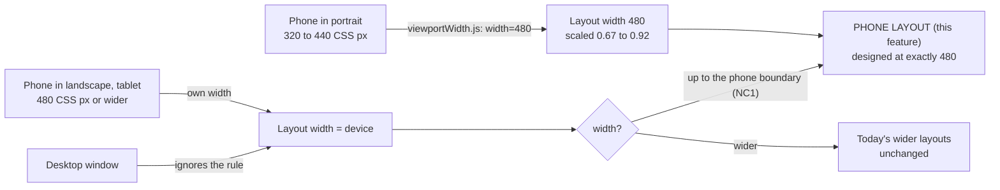
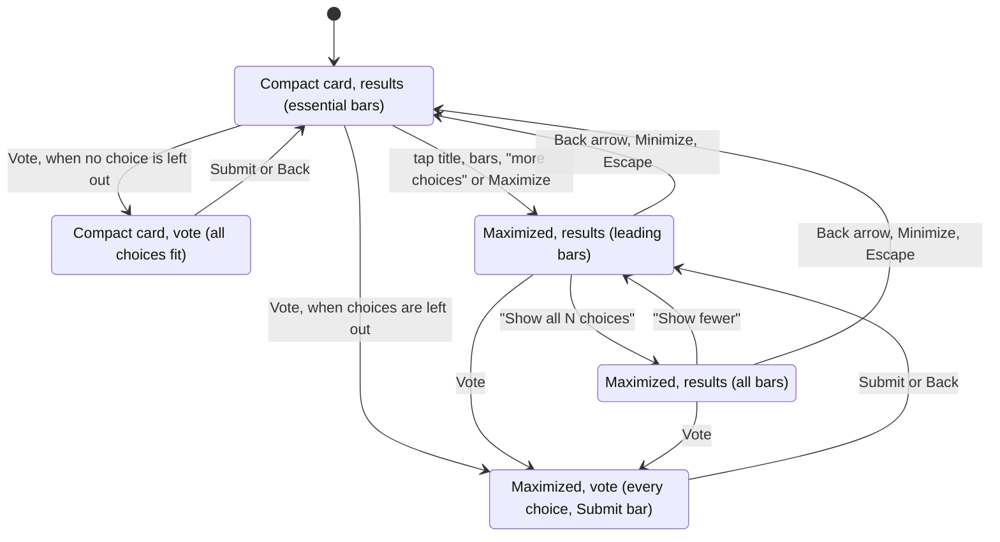
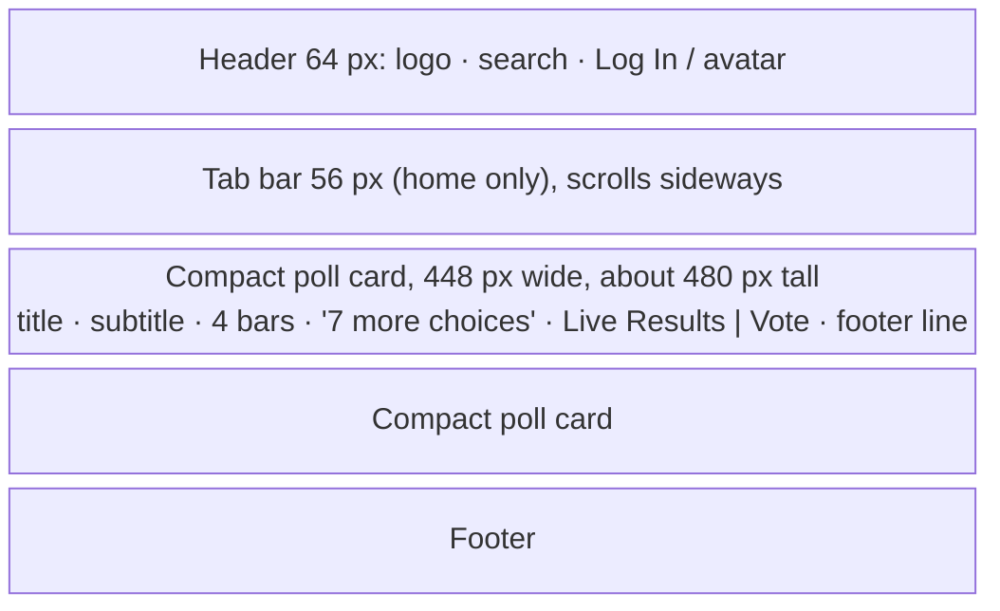
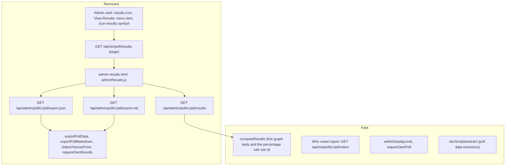

# High Level Requirements

Requirements: `requirements/20261113-140600-phone-layout-redesign/requirements.md`  
External Files: none  
Generated: 2026-11-13 2:13 PM  

This feature is a redesign of the UI/UX at 480px.  
We are challenging the AI to propose a great solution.  
We are using Fable 5.2 for this challenging problem.

**REQUIREMENTS**

- The UI/UX must be redesigned specifically for a viewport width of 480px, using FIXED_WIDTH = 480 in `src/public/viewportWidth.js` and the CSS Pixel technique from "specs\20261113-085157-FIXED-VIEWPORT-WIDTH"
- The layout should be optimized for readability and usability on phones at this width.
- All controls must be easily tappable without requiring zoom.
- The design should use the Material 3 design principles followed in the existing CrowdPoll webapp
- the color pallette will be consistent with the existing CrowdPoll webapp
- The implementation will be manually validated on real devices and through BrowserStack to ensure proper rendering and functionality

The single card layout will be used for Poll Cards and for Admin Poll Cards in the Poll Administration section.  
The Maximized Poll layout will be single column.  

The height of Poll Cards will be kept to a minimum for Poll Cards not in Maximized view.  
This could be accomplished by minimizing the number of bars shown when those bars are not essential for the immediate understanding of the poll's results.  

The Maximized Poll layout will also minimize the number of non-essential bars and elements, focusing on the immediate understanding of the poll's results.  
Then the user can have a way of expanding the Maximized Poll Card to view additional details and bars as needed.  
The preference is not to use scrolling within the Poll Cards, as is done now with a top bar and bottom bar that shown "^" and "V" respectively.  We have found that this approach can be cumbersome for users.  

We would like to make the MAXIMIZED Poll Card the view that the user can easily switch to when the standard Poll Card (that appears in all home page tabs by default) does not provide the user with a sufficient view to Vote or see results. This is typically the case when there are too many choices.  

We still want to continue to use the two-sided Poll Card with voting on the back side.   
This has received great feedback from users as a quick way to cast votes, whether in the standard view or the Maximized view.  

This redesign will target every page of the CrowdPoll webapp, ensuring a consistent and optimized experience for users on devices with a viewport width of 480px.  
Fortunately, there is a small finite number of pages, and they are already quite consistent in their layout and design patterns.  
If there are ways to make the design of pages even more consistent then that should be pursued.  

The one current page that is an outlier is what is called the Poll Results page which can be navigated to from the Admin Poll Card by clicking the Report icon, or selecting "View Results" from the Admin Poll Card kebab menu.  That page, the Results page, can be removed from the webapp.  Along with it, the Export JSON and Export Markdown features.  
It is a leftover from the first days of development and no longer aligns with the primary goals of the system.

## Additional Requirements and Research Requests

**Instructions To The Developer**  
Enter any additional requirements or research requests under the ## Additional Requirements and Research Requests heading above.  
When you Type or Say: "Next" in the CC CLI terminal, the additional requirements and research requests will be applied to the report.  
  
You may leave these instructions here. They will be ignored when "Next" is executed.  

## 1. Overview

Since the fixed-viewport feature, every phone in portrait lays the site out exactly 480 CSS pixels wide and scales it to the screen (scale 0.75 on a 360 px phone, 0.81 on 390 px, 0.90 on 430 px).  
That makes it possible to design the phone layout once, at one width.  
This feature is that design, for every page, and it removes one page that no longer belongs.  

What the phone shows today, at 480 px (found in the codebase):

- **The phone layout is the old "below 640 px" layout**, written when a phone was laid out at its own 320 to 430 px.  
  To fit those widths it shrinks things: the Vote button and the Live Results chip are 21 px tall, the card's icon buttons 24 px, the vote count and subtitle 10.5 px, the header buttons 21 to 24 px (`single-column-m3.css:42-62`, `header-single-column-m3.css:4-30`).  
  Scaled to a 390 px phone these appear at 17 px, 19.5 px and 8.5 px.  
  No control on the phone poll card reaches a comfortable touch size.  
- **A phone card already shows every choice and never scrolls inside.**  
  Below 640 px each choice is a 30 px bar with a 6 px gap and the card simply grows (`pollCard.js:240-256`, `single-column-m3.css:35-40`).  
  A poll may have 2 to 50 choices (`ENV_MIN_CHOICES`, `ENV_MAX_CHOICES`), so a card can be about 1,900 px tall.  
  The "^" and "V" arrow rows the requirements mention exist only at 640 px and wider, where the card is a fixed 556 px and the bars scroll inside it.  
- **Both faces of the card share one grid cell**, so the front and the back are always the same height (`pollCard.css:79-93`).  
- **The maximized view** moves the same card into a one-card view with a panel beside or below it holding the notes, the Who voted report and the line graph, all open at once (`tabs.js:267-337`).  
  It shows every choice, 50 px bars at 2 choices down to 25 px at 50.  
  It does not change the address or the browser history, so the phone's Back gesture leaves the site.  
- **Thirteen pages** share one header, footer, cookie banner and Back-to-top button.  
  Eight are "card shell" pages (login, create account, confirm sign-in, invite, accept terms, not authorized, profile, settings), all a 420 px card.  
  The others are the home page, the two legal pages, the admin page and the Poll Results page.  
- **The admin card** already has 40 px icon buttons and 48 px menu items; its search form and wizard have their own rules at 360 and 320 px.  
- **The Poll Results page** (`admin-results.html`, `adminResults.js`) is the only page with no card and no back control.  
  It is reached from the admin card's results icon and its "View Results" menu item, and it holds the only links to Export JSON and Export Markdown.  

## 2. Scope

- **In scope**
  - A phone layout designed at exactly 480 px for all pages that remain: the home page and its poll cards, the maximized view, the eight card-shell pages, the two legal pages and the admin page (list, card, search, wizard).
  - A phone sizing system: one touch-target minimum and one type scale, applied through the existing Material 3 tokens.
  - The compact poll card: fewer bars, a way to the maximized view, the two-sided vote kept.
  - The maximized view in one column: essential results first, the rest expandable.
  - Removing the Poll Results page, Export JSON and Export Markdown.
  - Manual validation on real phones and on BrowserStack.
- **Out of scope**
  - Layouts wider than the phone layout (see NC1 for where the boundary is).
  - The color palette, the fonts and the dark and light schemes themselves; both schemes keep working.
  - `viewportWidth.js` and the 480 px rule, which stay as they are.
  - Server behaviour other than the removed routes: voting, tabs, refresh and access rules are unchanged.

## 3. Proposed Design

This section is the proposal the requirements ask for.  
Every choice in it that the requirements do not settle is a finding in section 8.  

### 3.1 The phone sizing system

A size on the phone is what the visitor's finger and eye meet after scaling, so the design sets sizes in layout pixels and checks them in on-screen pixels.  

| Element | Layout px at 480 | On a 360 px phone | On a 390 px phone | On a 430 px phone | Today at 480 |
|---|---|---|---|---|---|
| Touch target, minimum (UA1) | 64 × 64 | 48 | 52 | 57 | 21 to 40 |
| Button and chip, visible height | 48 | 36 | 39 | 43 | 21 |
| Icon button, visible | 48 (icon 28) | 36 | 39 | 43 | 24 |
| Body text (UA2) | 18 | 13.5 | 14.6 | 16.1 | 10.5 to 14 |
| Small text, minimum | 15 | 11.3 | 12.2 | 13.4 | 10.5 to 12 |
| Card title | 25 | 18.8 | 20.3 | 22.4 | 15 |
| Result bar height | 44 | 33 | 36 | 39 | 30 |
| Page gutter | 16 | 12 | 13 | 14 | 14 |

- The touch target is the tappable area; a 48 px button reaches 64 px with invisible padding, as Material 3 does with its 40 dp buttons in 48 dp targets.
- The type scale is the Material 3 scale the site already uses, multiplied by 1.25 in the phone layout, so every sheet that uses the tokens follows.
- The old shrink rules (0.75 × sizes, 21 px and 24 px controls) are removed from the phone layout.

### 3.2 One page frame

Every page uses the same frame at 480 px:

- header, 64 px: logo, then Search and Log In or the avatar, each a 64 px target;
- the home page's tab bar under it, 56 px, scrolling sideways within itself as today;
- content in one column, 448 px wide (480 minus two 16 px gutters), for the poll card, the card-shell card, the admin card and the legal text alike; the 420 px cap does not apply in the phone layout;
- the footer and the cookie banner at the same width; the Back-to-top button 64 px.

### 3.3 The compact poll card (every home tab)

Front, top to bottom:

1. Title (up to three lines) with Watch and Maximize at the right, 64 px targets.
2. Subtitle, one line.
3. Notes, one line, when the poll has notes.
4. The essential bars (AM2): the leading choices by share, and always the viewer's own choice.  
   When choices are left out, one last row reads "7 more choices · 18%" (their count and combined share) and opens the maximized view.
5. Live Results chip and Vote button, 48 px.
6. One footer line: votes, "You voted", why the poll is listed.

- Tapping the title, the bars or the "more choices" row opens the maximized view; the Maximize icon stays.
- With four bars and the "more" row the card is about 480 px tall: roughly two cards per phone screen instead of one card several screens long.
- The back keeps the two-sided vote.  
  When every choice is on the front, Vote flips the card in place, as today.  
  When choices are left out, the ballot would be incomplete, so Vote opens the maximized view already flipped to its voting face (NC2).

### 3.4 The maximized view (one column)

1. The Back arrow under the tab bar, as today, and the Minimize icon on the card.
2. The card's front: title in full, subtitle, then the leading bars (UA3) and a "Show all 37 choices" row that opens the rest in place, with no scrolling inside the card.
3. Live Results and Vote, footer.
4. Under the card, one expandable row per extra: Notes, Who voted, Vote history graph.  
   Each is a 64 px header that opens its content in place; all are closed when the view opens (UA4).

- The voting face in the maximized view lists every choice, one 56 px row each inside a 64 px target, and the page scrolls.
- While the voting face is showing, Submit and Back stay in a bar at the bottom of the screen, so a 50-choice ballot does not have to be scrolled to its end to submit (UA5).
- In the maximized view the card's height follows the face being shown; the front is not stretched to the height of a long ballot.

### 3.5 The other pages

- **Card-shell pages**: the same card, 448 px wide; text fields 64 px tall with 20 px text; one 48 px primary button per card, full width; provider buttons 56 px.
- **Legal pages**: the text column at 448 px in the body size, headings on the phone scale, the back arrow in the frame's place.
- **Admin page**: the toolbar in one row (Back, Create New Poll); the view tabs as the home tab bar; the search form in one column, one field per row; cards 448 px wide.
- **Admin card**: icon buttons and the menu button at 64 px targets (three icons and the menu once the results icon goes); panels stacked; Open, Close and Archive at 48 px; invitee rows 64 px.
- **Admin wizard**: the six step circles across the card at 48 px with 64 px targets; fields and switches one per row; the footer's buttons in one row at 48 px.

## 4. Architecture Diagrams

### 4.1 Which layout a device gets

### 4.2 The compact card and the maximized view

### 4.3 The phone page at 480 px

### 4.4 What goes with the Poll Results page

## 5. Breaking Changes

- `GET /admin/poll/results`, `GET /api/admin/polls/:pid/results`, `GET /api/admin/polls/:pid/export.json` and `GET /api/admin/polls/:pid/export.md` are removed, with their entries and the `PollResults` and `Participant` schemas in `postman/openapi.json` (see UA6).
- A poll's creator loses the page that listed who voted and who has not yet voted, and the JSON and Markdown downloads; nothing replaces them.
- A phone poll card no longer shows every choice; choices beyond the essential ones are one tap away.
- Vote on a compact card with left-out choices opens the maximized view instead of flipping in place (if NC2 is resolved that way).
- The phone layout's sizes change everywhere; tests that pin today's phone values fail until rewritten: `single-column-sheets.test.ts` (21 px and 24 px controls, 0.75 title), `m3-assets.test.ts` (title clamp, 20 px title token, maximize pulse query), `client-maximized.test.ts` (all choices shown, the side panel's contents), `client-poll-notes.test.ts` (two-line notes).
- Tests that count or list pages change: `viewport-width-pages.test.ts` (13 pages), `m3-assets.test.ts` (`PAGES`), `pages.test.ts`, `poll-card-assets.test.ts` (`icon-results`), `polls-admin-participants.test.ts`, `polls-admin-crud.test.ts`, `polls-discovery.test.ts`, `who-voted-route.test.ts`, `client-delete-account.test.ts`.
- `README.md` says administrators "export polls" and describes the results; those sentences go.

## 6. Technical Debt

- Seven width thresholds (900, 768, 640, 560, 480, 360, 320) spread over 20 sheets; three of them (480, 360, 320) can no longer be reached by a phone.
- The phone layout is built as subtractions from the desktop sheets (`:not(.maximized-card-flip)` on every rule, 0.75 multipliers); the redesign is the moment to state it positively.
- The card's two faces are forced to one height by sharing a grid cell; a short front beside a long ballot needs the height to follow the visible face.
- The bar layout has three separate rules in `pollCard.js` (grid, phone, maximized); the phone and maximized rules are replaced by this feature.
- Literal font sizes sit in three Material 3 layers no test covers (`admin-card-m3.css:258`, `:287`, `card-shell-m3.css:41`).
- `styles.css` is loaded only by the admin pages and styles every `<button>`; with the Results page gone it serves one page.
- `tests/poll-card-assets.test.ts:363` requires an `.admin-field input` rule that only the Results page uses.
- After the removal `computeResults` has no caller in `src/`; tests and the line graph's documentation still rely on it.

## 7. Assumptions

- "Phone" means a device held narrower than 480 CSS pixels, which `viewportWidth.js` lays out at 480; the design is judged at that width only.
- Material 3 stays the design language: its components, shape and state layers, with sizes raised for the scaled phone rather than new components invented.
- Both color schemes keep their palettes; every new element takes its colors from the existing tokens.
- Bars stay ordered by share, largest first, on both faces, as today.
- A poll's notes show one line on the compact card and in full in the maximized view.
- The home page keeps its scrolling tab bar at the top; no bottom navigation is introduced.
- The fixed header and tab bar stay fixed while the page scrolls.
- No server data, route or setting is added; the only server change is the removal in UA6.
- Text is never smaller than 15 layout px in the phone layout.

## 8. Findings

### 8.1 Inconsistencies

None found.

### 8.2 Ambiguities

**AM1. What does "the single card layout will be used for Poll Cards and for Admin Poll Cards" mean?**  
<b>
✅ Resolved</b>  
✅ Requirements File Updated: 2026-11-13 2:46 PM  
**Notes**: Recommendation accepted in file 2026-11-13: Recommendation, one card per row and one card frame (448 px wide, 16 px gutter, 20 px padding, 20 px radius);  
the requirements now say so under Resolved Requirements.  

> It can mean one card per row (a single column of cards), or one shared card design for both kinds of card.  
> Poll cards are already one per row below 640 px, and admin cards are a single column at every width.  
> The two differ in width rules (both capped at 420 px), padding (18 / 22 / 16 px against 16 / 18 px, 14 px on a phone) and corner radius rules.  

  - **Recommendation**: **one card per row, and one card frame: poll cards, admin cards and card-shell cards share the same width (448 px), gutter (16 px), padding (20 px) and corner radius (20 px) in the phone layout.**  

    [X] ➡️ **Accepted**

    - It covers both readings: a single column, and the consistency between pages the requirements ask to pursue.  
    - The cards' contents stay their own; only the frame is shared.  

  - **Developer Resolution B**:  

    [ ] ➡️ **Not Accepted**

**AM2. Which bars are "essential for the immediate understanding of the poll's results" on the compact card?**  
<b>
✅ Resolved</b>  
✅ Requirements File Updated: 2026-11-13 2:46 PM  
**Notes**: Recommendation accepted in file 2026-11-13: Recommendation A, the four leading choices, all when five or fewer, the viewer's own always, the rest as one "more choices" row;  
the requirements now state the rule.  

> The requirements ask for fewer bars but do not say which, or how many.  
> A poll has 2 to 50 choices; today a phone card shows them all, 36 px each.  
> Bars are ordered by share, so "the first few" are the leaders.  
> The rule also has to say what happens to the viewer's own choice when it is not among the leaders, and what stands in for the bars left out.  

  - **Recommendation A** _(recommended)_: **the four leading choices; all of them when the poll has five or fewer; the viewer's own choice always shown; the rest as one row, "7 more choices · 18%".**  

    [X] ➡️ **Accepted**

    - <u>Pros</u>: the card is about 480 px tall, two per phone screen; a five-choice poll is never cut to four plus "1 more"; the combined share tells the viewer how much of the result is hidden; a voter always sees their own choice.  
    - <u>Cons</u>: with a multiple-choice poll and several own choices not among the leaders, the card grows by one bar each.  

  - **Recommendation B**: **the three leading choices; all when four or fewer; otherwise as A.**  

    [ ] ➡️ **Not Accepted**

    - <u>Pros</u>: the shortest card, about 430 px.  
    - <u>Cons</u>: common five- and six-choice polls are always cut; a three-way summary hides close fourth places.  

  - **Recommendation C**: **the five leading choices; all when six or fewer; otherwise as A.**  

    [ ] ➡️ **Not Accepted**

    - <u>Pros</u>: more polls are shown whole on the card.  
    - <u>Cons</u>: about 530 px; less than two cards per screen on shorter phones.  

  - **Developer Resolution D**:  

    [ ] ➡️ **Not Accepted**

### 8.3 Unspecified Aspects

**UA1. How large is "easily tappable without requiring zoom"?**  
<b>
✅ Resolved</b>  
✅ Requirements File Updated: 2026-11-13 2:46 PM  
**Notes**: Recommendation accepted in file 2026-11-13: Recommendation A, 64 × 64 layout px touch targets with 48 px visible controls;  
the requirements now state the sizes.  

> The requirements give no size.  
> Because the 480 px layout is scaled to the screen, a size in the layout is smaller under the finger: 48 layout px is 36 px on a 360 px phone.  
> Material 3 asks for 48 dp touch targets and Apple for 44 pt.  
> Today the phone card's controls are 21 to 24 px in the layout, about 16 to 19 px on screen.  

  - **Recommendation A** _(recommended)_: **every control has a touch target of at least 64 × 64 layout px; its visible shape may be smaller, 48 px for buttons, chips and icon buttons.**  

    [X] ➡️ **Accepted**

    - <u>Pros</u>: 48 px under the finger on a 360 px phone and more on larger ones, which meets Material 3 on every common phone; visible controls stay compact because the target extends invisibly around them.  
    - <u>Cons</u>: controls need 64 px of room each, so a row holds at most seven; neighbouring targets must not overlap.  

  - **Recommendation B**: **56 × 56 layout px targets, 44 px visible.**  

    [ ] ➡️ **Not Accepted**

    - <u>Pros</u>: denser rows and shorter cards.  
    - <u>Cons</u>: 42 px under the finger on a 360 px phone, below both guidelines on the smallest common phones.  

  - **Developer Resolution C**:  

    [ ] ➡️ **Not Accepted**

**UA2. What type sizes make the phone layout "optimized for readability"?**  
<b>
✅ Resolved</b>  
✅ Requirements File Updated: 2026-11-13 2:46 PM  
**Notes**: Recommendation accepted in file 2026-11-13: Recommendation, the Material 3 type scale × 1.25, no text under 15 px, the 0.75 shrink rules gone from the phone layout;  
the requirements now state the scale.  

> The requirements give no sizes.  
> The site's Material 3 scale (body 14 and 16 px, labels 11 to 14 px, title 20 px) was sized for an unscaled screen, and the old phone rules shrink parts of it by 0.75.  
> At 480 px a 14 px text appears at 10.5 px on a 360 px phone.  

  - **Recommendation**: **the Material 3 type scale multiplied by 1.25 in the phone layout (body 18 and 20 px, labels 14 to 18 px, card title 25 px), no text under 15 px, and the 0.75 shrink rules removed.**  

    [X] ➡️ **Accepted**

    - On a 390 px phone the body text then appears at 14.6 and 16.3 px, the size the same text has on a desktop today.  
    - Applied as one override of the type tokens for the phone layout, every sheet that uses the tokens follows without its own rule.  
    - It is the "about 20 % above today's" advised when 480 px was chosen, rounded to keep whole pixels.  

  - **Developer Resolution B**:  

    [ ] ➡️ **Not Accepted**

**UA3. How many bars does the maximized view show before it is expanded?**  
<b>
✅ Resolved</b>  
✅ Requirements File Updated: 2026-11-13 2:46 PM  
**Notes**: Recommendation accepted in file 2026-11-13: Recommendation, ten leading choices, all when twelve or fewer, "Show all N choices" in place;  
the requirements now state the rule.  

> The requirements say the maximized view "will also minimize the number of non-essential bars", with a way to expand, but give no number.  
> Today it shows every choice.  
> It has to show clearly more than the compact card, or opening it gains nothing.  

  - **Recommendation**: **the ten leading choices, all of them when the poll has twelve or fewer, the viewer's own choice always shown; one row, "Show all 37 choices", opens the rest in place and becomes "Show fewer".**  

    [X] ➡️ **Accepted**

    - Ten 44 px bars fill about one phone screen under the title, so the leaders are read without scrolling.  
    - Twelve or fewer are shown whole, so the expander never hides only one or two bars.  
    - Expanding lengthens the card and the page scrolls; nothing scrolls inside the card.  

  - **Developer Resolution B**:  

    [ ] ➡️ **Not Accepted**

**UA4. How are the maximized view's "additional details" shown and expanded?**  
<b>
✅ Resolved</b>  
✅ Requirements File Updated: 2026-11-13 2:46 PM  
**Notes**: Recommendation accepted in file 2026-11-13: Recommendation, one expandable row each for Notes, Who voted and Vote history, all closed at first;  
the requirements now describe the rows.  

> Today the notes, the Who voted report and the vote-history graph sit in one panel, all open, below the card on a phone.  
> The requirements want non-essential elements minimized and expandable, without saying how.  

  - **Recommendation**: **one expandable row per extra, under the card, in the order Notes, Who voted, Vote history; each a 64 px header that opens its content in place; all closed when the view opens; a row is absent when the poll has no such content.**  

    [X] ➡️ **Accepted**

    - The results and the Vote button are what the view opens on; each extra is one tap away and several may be open together.  
    - The Who voted report and the graph are fetched when their row is first opened, not when the view opens.  
    - A card's notes line still opens the view with Notes already open.  

  - **Developer Resolution B**:  

    [ ] ➡️ **Not Accepted**

**UA5. Where are Submit and Back while voting on a long ballot?**  
<b>
✅ Resolved</b>  
✅ Requirements File Updated: 2026-11-13 2:46 PM  
**Notes**: Recommendation accepted in file 2026-11-13: Recommendation, Back and Submit in a bar at the bottom of the screen on the maximized voting face;  
the requirements now say so.  

> The requirements ask for voting "with minimal scrolling and friction".  
> In the maximized view the ballot lists every choice, up to 50 rows of 64 px, about three phone screens; today Submit is at the end of the list.  

  - **Recommendation**: **while the maximized view's voting face is showing, Back and Submit stay in a bar at the bottom of the screen; on the compact card they stay in the card.**  

    [X] ➡️ **Accepted**

    - A voter can submit from anywhere in the list; the bar shows how many choices are selected.  
    - The bar sits above the cookie banner and replaces the Back-to-top button while it is shown.  
    - On the compact card every choice is in view, so the card's own row is enough.  

  - **Developer Resolution B**:  

    [ ] ➡️ **Not Accepted**

**UA6. Exactly what is removed with the Poll Results page?**  
<b>
✅ Resolved</b>  
✅ Requirements File Updated: 2026-11-13 2:46 PM  
**Notes**: Recommendation accepted in file 2026-11-13: Recommendation, remove the page, its routes, the two exports, the unused service functions and the admin card's entry points, keeping `computeResults`;  
the requirements now list what is removed and what is kept.  

> The requirements name the page, Export JSON and Export Markdown.  
> The page is also the only user of `GET /api/admin/polls/:pid/results`, and the exports are the only users of `exportPollData`, `exportPollMarkdown` and, with that route, `hidesChoicesFrom`.  
> What a creator loses: the list of who voted and who has not yet voted, and a download of a poll's data.  
> The Who voted report on the card remains for private polls whose votes are not anonymous, and the admin card keeps its counts and its invitee list.  

  - **Recommendation**: **remove the page, its script, its page route, the results route and both export routes, the three service functions left without a caller, the admin card's results icon and "View Results" item, and their tests, OpenAPI entries and documentation; keep `computeResults`; add nothing in their place.**  

    [X] ➡️ **Accepted**

    - Leaving the results route with no page would keep code and tests for a feature that no longer exists.  
    - `computeResults` stays because the line graph's tests and the documented percentage rule rely on it.  
    - The developer scripts that extract poll data do not use these routes and are unaffected.  

  - **Developer Resolution B**:  

    [ ] ➡️ **Not Accepted**

**UA7. Which devices and checks make up the validation on real devices and BrowserStack?**  
<b>
✅ Resolved</b>  
✅ Requirements File Updated: 2026-11-13 2:46 PM  
**Notes**: Recommendation accepted in file 2026-11-13: Recommendation, a written checklist on a fixed set of phones and browsers in both color schemes;  
the requirements now list the devices and the checks.  

> The requirements say the implementation "will be manually validated" but not on what, or what passes.  

  - **Recommendation**: **a written checklist run on a fixed set: phones 320, 360, 375, 390 to 393, 412 and 430 to 440 CSS px wide, in Safari on iOS, Chrome on Android and Samsung Internet, in both color schemes; one phone in landscape and one tablet to confirm they are unchanged.**  

    [X] ➡️ **Accepted**

    - Each page is checked for: no sideways scrolling; every control tappable at first try; no text under the minimum; the compact card, the maximized view, a vote on a short poll and on a 50-choice poll; the admin wizard from start to Publish.  
    - The checklist is the feature's quickstart and records the device, the browser and the result of each run.  
    - Two points left open by the fixed-viewport feature are checked here: whether iOS zooms into a focused text field, and whether a visitor's own text-size setting still takes effect.  

  - **Developer Resolution B**:  

    [ ] ➡️ **Not Accepted**

**UA8. What does an unscaled window narrower than 480 px show, and what becomes of the 480, 360 and 320 px rules?**  
<b>
✅ Resolved</b>  
✅ Requirements File Updated: 2026-11-13 2:50 PM  
**Notes**: Recommendation accepted in file 2026-11-13: Recommendation, a minimum page width of 480 px and the 480, 360 and 320 px rules deleted;  
the requirements now say so and list the five remaining thresholds.  

> NC1 was resolved so that the new phone layout applies at 480 px and narrower, and today's phone layout stays for 481 to 639 px.  
> A phone is always exactly 480 px, but a desktop browser ignores the fixed width, so a desktop window dragged narrower than 480 px also falls in the new layout's range, at its own width.  
> The new layout is designed at exactly 480 px, with a 448 px card.  
> Today's rules for under 480, 360 and 320 px (tighter card padding, stacked admin search fields, a tighter wizard) lie wholly inside that range and were written for the layout being replaced.  

  - **Recommendation**: **the phone layout has a minimum page width of 480 px, so a narrower desktop window scrolls sideways; the 480, 360 and 320 px rules are deleted, since the new layout replaces everything in their range.**  

    [X] ➡️ **Accepted**

    - A phone is never narrower than 480 px in layout, so only desktop windows are affected, and common desktop browsers do not go much below 500 px.  
    - Designing the new layout to reflow down to 320 px as well would bring back the thresholds the fixed width was meant to remove.  
    - Seven thresholds become five: 900, 768, 640, 560 and the new 480.  

  - **Developer Resolution B**:  

    [ ] ➡️ **Not Accepted**

### 8.4 Needs Clarifications

**NC1. Where does the phone layout end, and what happens to today's rules below it?**  
<b>
✅ Resolved</b>  
✅ Requirements File Updated: 2026-11-13 2:46 PM  
**Notes**: Recommendation accepted in file 2026-11-13: Recommendation B, the new layout applies only at 480 px and narrower and today's phone layout stays for 481 to 639 px;  
the requirements now say so;  
what an unscaled window narrower than 480 px shows, and the 480, 360 and 320 px rules inside the new layout's range, are left to UA8.  

> The requirements design for 480 px only.  
> Phones in portrait are always exactly 480, but a small phone in landscape (568 px) and a narrow desktop window (about 500 to 639 px) fall in today's "below 640 px" phone range without being scaled.  
> The rules for 480, 360 and 320 px can no longer be reached by a phone.  
> The "^" and "V" bar scrolling the requirements dislike exists only at 640 px and wider.  

  - **Recommendation A** _(recommended)_: **the new phone layout replaces today's phone layout over its whole range, below 640 px; the 480, 360 and 320 px rules are deleted; 640 px and wider is unchanged, bar scrolling included.**  

    [ ] ➡️ **Not Accepted**

    - <u>Pros</u>: one phone layout and no dead zone between 481 and 639 px; three thresholds go (480, 360, 320); wider layouts and their tests are untouched.  
    - <u>Cons</u>: an unscaled 568 px landscape phone or narrow desktop window shows the larger phone sizes at face value, a little big; desktop windows under 480 px scroll sideways; the arrow rows remain at 640 px and wider until a later feature.  

  - **Recommendation B**: **the new layout applies only at 480 px and narrower; today's phone layout stays for 481 to 639 px.**  

    [X] ➡️ **Accepted**

    - <u>Pros</u>: nothing changes for any unscaled device.  
    - <u>Cons</u>: two phone layouts to maintain and an eighth threshold; the old shrunken layout lives on for landscape phones.  

  - **Recommendation C**: **as A, and the compact-card rule (essential bars, no arrow rows) also replaces bar scrolling at 640 px and wider.**  

    [ ] ➡️ **Not Accepted**

    - <u>Pros</u>: the cumbersome arrows go everywhere; one bar rule for every width.  
    - <u>Cons</u>: it redesigns the desktop grid card, whose fixed 556 px height and tests assume scrolling bars; a much larger feature than "the UI/UX at 480px".  

  - **Developer Resolution D**:  

    [ ] ➡️ **Not Accepted**

**NC2. What does Vote do on a compact card that does not show every choice?**  
<b>
✅ Resolved</b>  
✅ Requirements File Updated: 2026-11-13 2:46 PM  
**Notes**: Recommendation accepted in file 2026-11-13: Recommendation A, Vote flips in place when every choice is on the card and otherwise opens the maximized view on its voting face;  
the requirements now say so.  

> The requirements keep the two-sided card "whether in the standard view or the Maximized view", keep card height to a minimum, and make the maximized view the place to go "when there are too many choices".  
> A ballot must offer every choice, so a compact card that shows four of twelve cannot simply flip.  

  - **Recommendation A** _(recommended)_: **when every choice is on the card, Vote flips it in place; when choices are left out, Vote opens the maximized view already on its voting face.**  

    [X] ➡️ **Accepted**

    - <u>Pros</u>: short polls keep the quick flip users like; long polls get a full ballot with room to tap and the Submit bar; the compact card never changes height.  
    - <u>Cons</u>: Vote does two different things depending on the poll, though both end on the same voting face.  

  - **Recommendation B**: **Vote always flips in place, and the compact card grows to show every choice on its back.**  

    [ ] ➡️ **Not Accepted**

    - <u>Pros</u>: one behaviour for Vote.  
    - <u>Cons</u>: a 50-choice card becomes three screens tall inside the list and pushes the other cards away; the front must stretch to match or the card jumps in height.  

  - **Developer Resolution C**:  

    [ ] ➡️ **Not Accepted**

**NC3. Should the phone's Back gesture close the maximized view?**  
<b>
✅ Resolved</b>  
✅ Requirements File Updated: 2026-11-13 2:50 PM  
**Notes**: Recommendation accepted in file 2026-11-13: Recommendation B, opening the maximized view adds one history entry so the phone's Back closes it;  
the requirements now say so;  
at which widths this applies, and what Back does for a poll opened from a direct link, are left to NC4.  

> The requirements want the maximized view to be something the user "can easily switch to", which on a phone includes leaving it.  
> Today the view changes neither the address nor the browser history (a tested rule), so the phone's Back button or swipe leaves CrowdPoll instead of returning to the list.  
> The view is left with the Back arrow under the tab bar, the Minimize icon or the active tab.  

  - **Recommendation A** _(recommended)_: **keep today's behaviour in this feature: no history entry; the Back arrow and Minimize, at 64 px targets, close the view.**  

    [ ] ➡️ **Not Accepted**

    - <u>Pros</u>: no change to navigation, to `SiteBack` or to the rule that tab and view changes do not add history; the redesign stays a layout feature.  
    - <u>Cons</u>: a visitor who swipes Back out of habit leaves the site; with the maximized view used more often, that will happen more.  

  - **Recommendation B**: **opening the maximized view adds one history entry, so the phone's Back closes it; the on-screen Back arrow does the same.**  

    [X] ➡️ **Accepted**

    - <u>Pros</u>: the behaviour phone users expect of a full-screen view.  
    - <u>Cons</u>: it reverses a tested rule at every width, touches links that open a poll directly, and needs its own tests; it is a navigation change inside a layout feature.  

  - **Developer Resolution C**:  

    [ ] ➡️ **Not Accepted**

**NC4. At which widths does the maximized view add a history entry, and what does Back do for a poll opened from a link?**  
<b>
✅ Resolved</b>  
✅ Requirements File Updated: 2026-11-13 2:51 PM  
**Notes**: Recommendation accepted in file 2026-11-13: Recommendation A, at every width a view opened from a card adds one history entry and Back closes it, and a poll opened from a link adds none;  
the requirements now say so.  

> NC3 was resolved so that opening the maximized view adds one history entry and the phone's Back closes it.  
> NC1 keeps every layout wider than 480 px as it is today, and today the view changes neither the address nor the history at any width, a rule the tests pin.  
> A history entry is behaviour, not layout: it can follow the phone layout only, or be the same everywhere.  
> A poll opened from a shared link (`/?PID=…`) arrives already maximized, with no list behind it in the history.  

  - **Recommendation A** _(recommended)_: **at every width: a view opened from a card adds one entry and Back closes it; a poll opened from a link adds none, so Back leaves as it does today, while the on-screen arrow closes the view to the list.**  

    [X] ➡️ **Accepted**

    - <u>Pros</u>: one behaviour to build, explain and test; a desktop visitor's Back closes the view too; no code path depends on the window's width at the moment of the tap.  
    - <u>Cons</u>: it changes behaviour above 480 px, which NC1 otherwise leaves alone, and the test that the view never touches the history is rewritten for every width.  

  - **Recommendation B**: **only in the phone layout (480 px and narrower); wider layouts keep today's rule; a poll opened from a link as in A.**  

    [ ] ➡️ **Not Accepted**

    - <u>Pros</u>: nothing changes for any unscaled device, in line with NC1.  
    - <u>Cons</u>: two behaviours and two sets of tests; a window resized across 480 px while a view is open can be left with an entry that no longer matches.  

  - **Developer Resolution C**:  

    [ ] ➡️ **Not Accepted**

## 9. Requirements Report Complete Report  
  
- **Requirements Report Document:** requirements/20261113-140600-phone-layout-redesign/requirements-report.md  
- **Requirements Document:** requirements/20261113-140600-phone-layout-redesign/requirements.md  
- **Software Architecture Diagrams:** 4  
- **Inconsistencies:** 0  
- **Ambiguities:** 2  
- **Unspecified Aspects:** 8  
- **Needs Clarifications:** 4  
- **Research Results:** 0  
- **Breaking Changes:** 7  
- **Technical Debt items:** 8  
  
The requirements are ready for /speckit-specify.
To generate specs from the requirements document, use the `/speckit-specify` skill followed by the path (relative to the project root) to the requirements file.
At the prompt, Type:  
🟩 👉 /speckit-specify requirements/20261113-140600-phone-layout-redesign/requirements.md  
