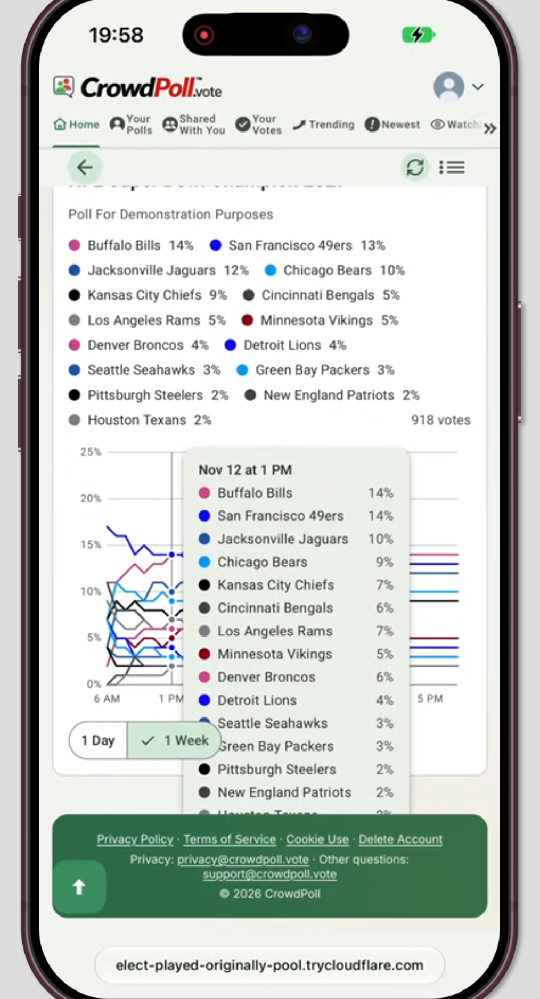
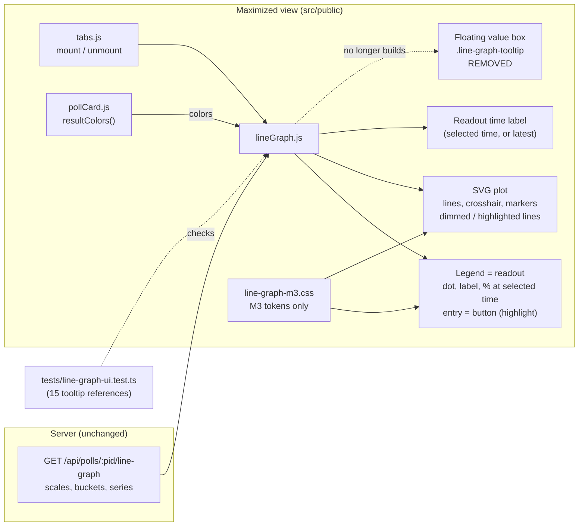
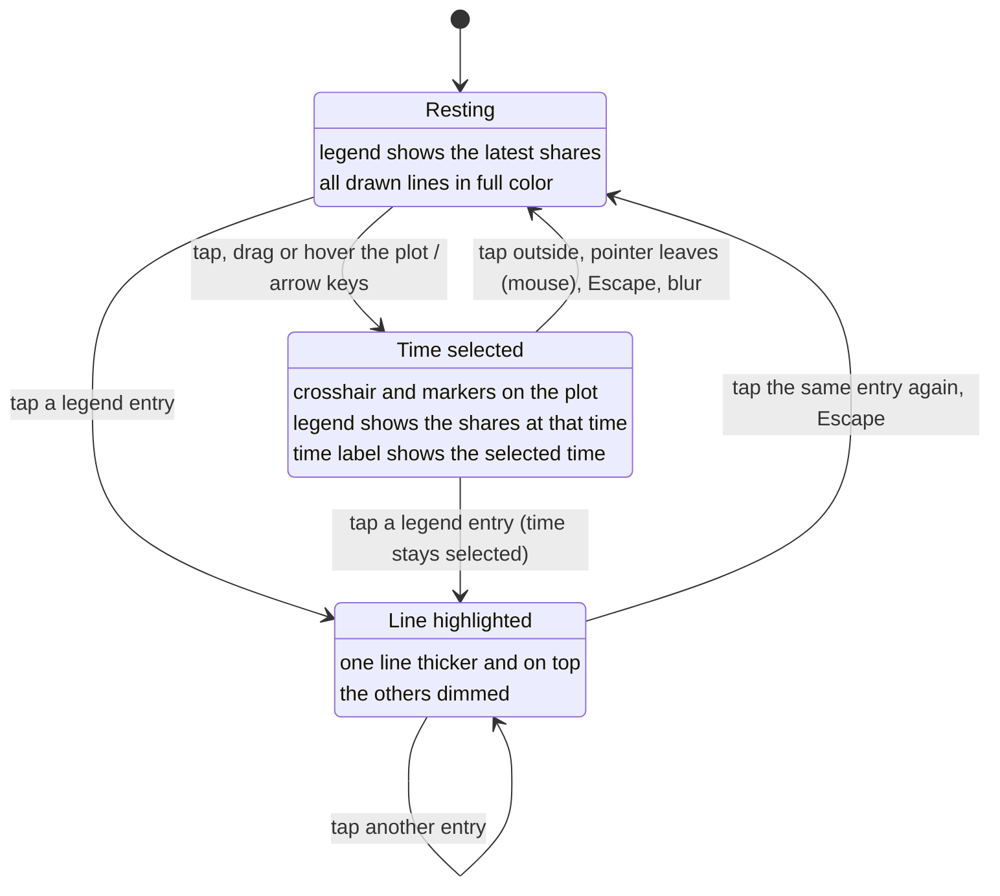
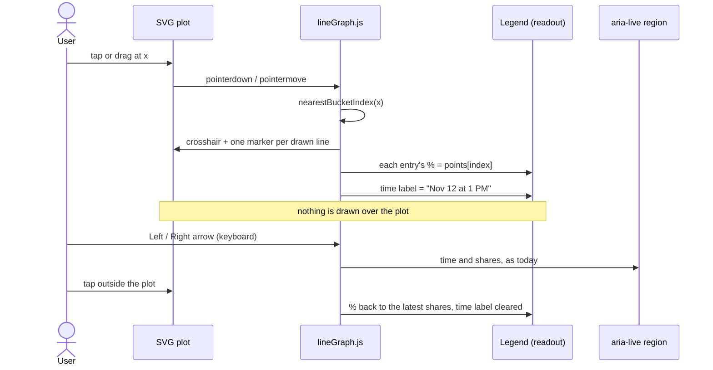

# High Level Requirements

Requirements: `requirements/20261113-150353-line-graph-readability/requirements.md`  
External Files: `requirements/20261113-150353-line-graph-readability/image.png`  
Generated: 2026-11-13 3:03 PM  

The requirement of this feature is to improve the Line Graph, especially when rendered at phone widths.  

When there are many lines (over 10) displayed, the graph becomes cluttered and difficult to read.  
It is especially problematic when the user selects a time on the graph and the box with the values at the time is displayed over the graph.

This screenshot illustrates the problem:


Please propose a solution to this that is used by popular data visualization libraries or applications.  

## Additional Requirements and Research Requests

**Instructions To The Developer**  
Enter any additional requirements or research requests under the ## Additional Requirements and Research Requests heading above.  
When you Type or Say: "Next" in the CC CLI terminal, the additional requirements and research requests will be applied to the report.  
  
You may leave these instructions here. They will be ignored when "Next" is executed.  

## 1. Overview and Scope

The maximized poll view draws a vote-history line graph (`src/public/lineGraph.js`, styled by `src/public/line-graph-m3.css`), one line per choice.  
With many choices it is hard to read, most of all on a phone.  
The screenshot (15 lines, phone width) shows four separate problems:  

- **The value box covers the plot.**  
  Selecting a time opens a floating box (`.line-graph-tooltip`) listing every choice;  
  with 15 rows it is wider than half the plot and hides every line on one side of the crosshair.  
- **The value box overflows.**  
  It has a maximum width but no maximum height, so it runs past the bottom of the plot, over the 1 Day / 1 Week buttons, and is cut off at the card's edge (the last row, "Houston Texans", is unreadable).  
- **The same list is shown twice.**  
  The legend above the plot already lists every choice with a dot, a label and a percentage;  
  the value box repeats all of it with the percentages of the selected time.  
- **The lines cannot be told apart.**  
  Fifteen 2 px lines cross between 0% and 15%, and several have the same or nearly the same color (in the screenshot, Buffalo Bills and Denver Broncos; three blues; three greys).  

This feature changes how the graph presents many lines; the proposal is RS1 below.  
In short: the selected time's values are shown **in the legend** in place of the floating box, and one line can be **highlighted** while the others are dimmed.  

What already exists and is reused:  

- the series response of `GET /api/polls/:pid/line-graph` (every available scale, `buckets`, `series[].points`), unchanged;  
- the legend (`renderLegend`), the crosshair and markers (`placeCrosshair`), the keyboard reading (Left / Right / Home / End / Escape) and the `aria-live` announcement;  
- the line colors, which come from the card's `resultColors()` so the lines agree with the bars;  
- the server's filter `ENV_LINE_GRAPH_MIN_VOTE_PERCENTAGE` (default 1), which already drops choices whose current share is not above the threshold.  

Out of scope: the series computation and its route, the time scales, the y-axis steps, the color palette and the color assignment, the poll card's bars, and the server.  
The whole change is in the browser: `lineGraph.js`, `line-graph-m3.css` and their tests.  

## 2. Component Diagram



## 3. Interaction States



A selected time and a highlighted line are independent: either, both or neither may be active.  

## 4. Selecting a Time (sequence)



## 5. Phone Layout (proposed)

```text
 Poll title
 Poll For Demonstration Purposes
 ┌───────────────────────────────────────────┐
 │ Nov 12 at 1 PM                  918 votes │  <- time label (only while a time is selected)
 │ ● Buffalo Bills 14%  ● San Francisco 14%  │
 │ ● Jacksonville 10%   ● Chicago Bears 9%   │  <- legend = readout: the % follow the crosshair
 │ ● Kansas City 7%     ● Cincinnati 6%  …   │     tap an entry to highlight its line
 ├───────────────────────────────────────────┤
 │ 25% ─────────────┬─────────────────────── │
 │ 15% ━━━━━╲━━━━━━━●━━━━━━━━━━━━━━━━━━━━━━━ │  <- plot stays fully visible:
 │  5% ─ ─ ─ ─ ─ ─ ─●─ ─ ─ ─ ─ ─ ─ ─ ─ ─ ─ ─ │     crosshair + markers only, no box
 │  0% ─────────────┴─────────────────────── │
 │     6 AM        1 PM              5 PM    │
 └───────────────────────────────────────────┘
 ( 1 Day | ✓ 1 Week )
```

## 6. Research Results

**RS1. Which solution do popular data visualization libraries and applications use for many lines and a crowded value box?**  
<span style="font-size:large" ><b>
✅ Resolved</b></span>  
✅ Requirements File Updated: 2026-11-13 3:09 PM  
**Notes**: Recommendation accepted in file 2026-11-13: Recommendation A, **the legend becomes the readout, and a tapped legend entry highlights its line**;  
the requirements now describe the legend readout and the removal of the floating box under Decisions.  

> The requirements ask for a solution that is used by popular data visualization libraries or applications.  
> Sources: [Grafana — time series, tooltip options](https://grafana.com/docs/grafana/latest/panels-visualizations/visualizations/time-series/), [Grafana — configure tooltips](https://grafana.com/docs/grafana-cloud/learn-and-build/visualizations/panels-visualizations/configure-tooltips.md), [dygraphs — legend values](https://dygraphs.com/tests/legend-values.html), [dygraphs — labels in a separate div](https://dygraphs.com/tests/label-div.html), [Apache ECharts — legend](https://echarts.apache.org/handbook/en/concepts/legend), [Datawrapper — what to consider when creating line charts](https://www.datawrapper.de/academy/what-to-consider-when-creating-line-charts), [Nightingale — when charts look like spaghetti](https://nightingaledvs.com/spaghetti-dashboard-chart-solutions), [EU Data Visualisation Guide — number of series](https://data.europa.eu/apps/data-visualisation-guide/number-of-series).  
> Four patterns are in common use:  
> 1. **Values in the legend, not in a floating box.**  
>    dygraphs shows the hovered point's values in its legend (`legend: 'always'`), which can live in a separate element outside the plot (`labelsDiv`), so nothing covers the lines.  
>    Phone stock and health apps that let a finger scrub along a chart show the value in a header above it for the same reason;  
>    that part is from general knowledge and was not checked against a source in this run.  
> 2. **Highlight one, dim the rest.**  
>    Datawrapper's guidance for crowded line charts is to use grey for the lines that are context and color, width and a front position for the ones that matter;  
>    dashboards do the same on demand, dimming the unselected lines when the user picks one.  
> 3. **A bounded, sorted tooltip.**  
>    Grafana keeps the floating tooltip but bounds it: a values sort order (ascending or descending), a maximum height and width, a limit on the number of series listed with a "Show all" link, and a "Single" mode that lists only the hovered series.  
> 4. **Fewer lines.**  
>    The guides agree a line chart reads well with only a few lines, and suggest showing a subset (or small multiples);  
>    ECharts pages a long legend (`legend.type: 'scroll'`) rather than letting it grow.  
> Not confirmed in this run: Plotly's unified hover and its legend click (toggle) and double-click (isolate), and Highcharts' tooltip placed outside the chart;  
> they are not relied on below.  

  - **Recommendation A** _(recommended)_: **the legend becomes the readout, and a tapped legend entry highlights its line: patterns 1 and 2.**  

    [X] ➡️ **Accepted**

    - The floating value box is removed.  
      While a time is selected, each legend entry's percentage is that time's share, and a time label (e.g. "Nov 12 at 1 PM") is shown with the legend;  
      with no time selected the legend shows the latest shares, as today.  
    - The crosshair and the markers stay on the plot.  
    - Each legend entry is a button;  
      tapping it draws that line thicker and on top and dims the other lines and legend entries, and tapping it again clears the highlight.  
    - <u>Pros</u>: nothing ever covers the plot or overflows the card, at any width and any number of lines;  
      the duplicate list goes away;  
      the highlight makes a line readable even when two lines share a color;  
      it is the smallest set of new parts (no new box, no scrolling area).  
    - <u>Cons</u>: on a phone the values are above the finger, not beside it;  
      with a very long legend the entry being read may be off screen (see NC1);  
      the tooltip tests are rewritten (BC1).  


  - **Recommendation B**: **keep the floating box, but bound and sort it: pattern 3.**  

    [ ] ➡️ **Not Accepted**

    - The box lists the choices sorted by their share at the selected time, the top 5 only, with a last row "+10 more";  
      it gets a maximum height and never leaves the plot.  
    - <u>Pros</u>: the values stay beside the crosshair;  
      the smallest change to the code and the tests.  
    - <u>Cons</u>: at phone width even a 6-row box hides about half the plot;  
      ten of fifteen values cannot be read at all at the selected time;  
      the lines are as tangled as before.  


  - **Recommendation C**: **move the value box below the plot as a fixed panel: pattern 1, keeping the legend as it is.**  

    [ ] ➡️ **Not Accepted**

    - <u>Pros</u>: nothing covers the plot;  
      the legend keeps showing the latest shares while the panel shows the selected time, so the two can be compared.  
    - <u>Cons</u>: the list is still shown twice, and on a phone the legend, the plot and the panel do not fit on one screen with 15 choices;  
      the page jumps in height each time a time is selected or cleared;  
      the lines are as tangled as before.  


  - **Developer Resolution D**:  

    [ ] ➡️ **Not Accepted**

## 7. Findings

### 7.1 Inconsistencies

None found.

### 7.2 Ambiguities

**AM1. Is "over 10" a threshold at which the graph behaves differently?**  
<span style="font-size:large" ><b>
✅ Resolved</b></span>  
✅ Requirements File Updated: 2026-11-13 3:09 PM  
**Notes**: Recommendation accepted in file 2026-11-13: Recommendation A, **no threshold**;  
the requirements now say the graph behaves the same for any number of lines.  

> The requirements say the graph is cluttered "when there are many lines (over 10)".  
> That can be read as a description of when the problem shows, or as a rule: 10 lines or fewer keep today's graph, 11 or more get the new one.  

  - **Recommendation A** _(recommended)_: **no threshold: the same behaviour for any number of lines.**  

    [X] ➡️ **Accepted**

    - <u>Pros</u>: one behaviour to learn, build and test;  
      a poll does not change how it reads when an eleventh choice gets its first votes;  
      the floating box already crowds a phone plot at 6 or 7 lines.  
    - <u>Cons</u>: a 2-line graph loses its small floating box, which was not a problem.  


  - **Recommendation B**: **a threshold: 10 lines or fewer keep today's floating box.**  

    [ ] ➡️ **Not Accepted**

    - <u>Pros</u>: small polls look exactly as they do today.  
    - <u>Cons</u>: two code paths and two sets of tests;  
      the graph switches behaviour as lines cross the threshold, also while it refreshes.  


  - **Developer Resolution C**:  

    [ ] ➡️ **Not Accepted**


**AM2. Does the change apply at every width, or only at phone widths?**  
<span style="font-size:large" ><b>
✅ Resolved</b></span>  
✅ Requirements File Updated: 2026-11-13 3:09 PM  
**Notes**: Recommendation accepted in file 2026-11-13: Recommendation A, **every width**;  
the requirements now say the change applies at phone and desktop widths alike.  

> The requirements say "especially when rendered at phone widths".  
> They do not say whether the wide (desktop) maximized view, where the graph is the right-hand column, changes too.  

  - **Recommendation A** _(recommended)_: **every width.**  

    [X] ➡️ **Accepted**

    - <u>Pros</u>: one behaviour;  
      a 15-row box also covers a large part of the desktop plot;  
      no width breakpoint in the script (the graph has none today).  
    - <u>Cons</u>: on desktop the pointer and the values are further apart than with a box beside the crosshair.  


  - **Recommendation B**: **phone widths only; wide views keep the floating box.**  

    [ ] ➡️ **Not Accepted**

    - <u>Pros</u>: desktop is unchanged.  
    - <u>Cons</u>: two behaviours, switched by a breakpoint that must also react to a window being resized or a phone being turned;  
      the box still overflows on desktop with enough choices (a poll may have up to `ENV_MAX_CHOICES`, default 50).  


  - **Developer Resolution C**:  

    [ ] ➡️ **Not Accepted**

### 7.3 Unspecified Aspects

**UA1. In which order are the legend entries while a time is selected?**  
<span style="font-size:large" ><b>
✅ Resolved</b></span>  
✅ Requirements File Updated: 2026-11-13 3:09 PM  
**Notes**: Recommendation accepted in file 2026-11-13: Recommendation A, **a fixed order**;  
the requirements now say the legend never re-sorts while a time is selected.  

> The legend lists the choices in the order of the series response (highest current share first).  
> At an earlier time the shares differ, so the list is no longer in descending order: in the screenshot Cincinnati Bengals (6%) is above Los Angeles Rams (7%).  
> If the legend becomes the readout (RS1 A), the requirements do not say whether it re-sorts as the crosshair moves.  

  - **Recommendation A** _(recommended)_: **a fixed order: the legend never re-sorts; only the percentages change.**  

    [X] ➡️ **Accepted**

    - <u>Pros</u>: each choice stays where the eye left it while the finger drags, and the buttons do not move under a tap;  
      the order keeps matching the poll's bars.  
    - <u>Cons</u>: at an earlier time the list is not in descending order.  


  - **Recommendation B**: **re-sort by the share at the selected time.**  

    [ ] ➡️ **Not Accepted**

    - <u>Pros</u>: the leader at that time is always first.  
    - <u>Cons</u>: entries jump about while dragging, which makes a single choice hard to follow.  


  - **Developer Resolution C**:  

    [ ] ➡️ **Not Accepted**


**UA2. How does highlighting a line work in detail?**  
<span style="font-size:large" ><b>
✅ Resolved</b></span>  
✅ Requirements File Updated: 2026-11-13 3:09 PM  
**Notes**: Recommendation accepted in file 2026-11-13: Recommendation, **one line at a time, toggled from its legend entry, by pointer or keyboard**;  
the requirements now hold the highlight rules under Decisions.  

> RS1 A introduces a highlight, which the requirements do not describe: how many lines at once, how it is cleared, how it looks, and how it is reached without a pointer.  

  - **Recommendation**: **one line at a time, toggled from its legend entry, by pointer or keyboard.**  

    [X] ➡️ **Accepted**

    - Each legend entry is a `<button>` with `aria-pressed`;  
      Enter, Space, a click or a tap toggles it.  
    - Highlighting an entry clears any other highlight;  
      activating the highlighted entry again, or pressing Escape while it has focus, clears it.  
    - The highlighted line is drawn last (on top) with a wider stroke;  
      the other lines, their markers and the other legend entries are drawn at a reduced opacity, and keep their own colors.  
    - The highlight survives a refresh, a time scale change and a selected time;  
      it is cleared when its choice is no longer in the series, and when the view is closed.  
    - It is not stored: no cookie and no browser storage key.  
    - Hovering a legend entry does nothing, so desktop and touch behave alike.  


  - **Developer Resolution B**:  

    [ ] ➡️ **Not Accepted**


**UA3. Are lines that share a color in scope?**  
<span style="font-size:large" ><b>
✅ Resolved</b></span>  
✅ Requirements File Updated: 2026-11-13 3:09 PM  
**Notes**: Recommendation accepted in file 2026-11-13: Recommendation A, **the palette and the color assignment stay as they are**;  
the requirements now say the highlight identifies a line and no line styles are added.  

> In the screenshot several lines have the same or nearly the same color, so color alone cannot identify a line.  
> The line colors are the bar colors by design (`card.resultColors()`), and the palette has 14 base colors, repeated for polls with more choices.  
> The requirements do not mention color.  

  - **Recommendation A** _(recommended)_: **the palette and the color assignment stay as they are; the highlight (UA2) is how a line is identified.**  

    [X] ➡️ **Accepted**

    - <u>Pros</u>: the lines keep agreeing with the bars;  
      no existing poll changes color;  
      no palette can give 15 to 50 lines distinct colors anyway.  
    - <u>Cons</u>: without a tap, two same-colored lines still look alike.  


  - **Recommendation B**: **also vary the line style (solid, dashed, dotted) each time the palette repeats, with the same style on the legend's dot.**  

    [ ] ➡️ **Not Accepted**

    - <u>Pros</u>: same-colored lines differ at rest.  
    - <u>Cons</u>: dashed 2 px lines add visual noise to an already crowded plot;  
      the legend needs a line sample in place of a dot;  
      it does not help the near-identical colors inside one pass of the palette.  


  - **Developer Resolution C**:  

    [ ] ➡️ **Not Accepted**


**UA4. What is the measure of success?**  
<span style="font-size:large" ><b>
✅ Resolved</b></span>  
✅ Requirements File Updated: 2026-11-13 3:09 PM  
**Notes**: Recommendation accepted in file 2026-11-13: Recommendation, **three checks on a 15-line poll at a 360 px wide viewport, and the same at desktop width**;  
the requirements now list the success checks.  

> The requirements name no success metric, so "improved" cannot be tested.  

  - **Recommendation**: **three checks on a 15-line poll at a 360 px wide viewport, and the same at desktop width.**  

    [X] ➡️ **Accepted**

    - With a time selected, no element other than the crosshair and the markers is drawn over the plot area.  
    - With a time selected, every drawn choice's share at that time can be read, and nothing extends outside the graph's card.  
    - With one line highlighted, that line can be followed from the first bucket to the last.  
    - The keyboard reading (arrow keys, Home, End, Escape) and the screen reader announcement work as they do today.  


  - **Developer Resolution B**:  

    [ ] ➡️ **Not Accepted**

### 7.4 Needs Clarifications

**NC1. How many lines does the graph draw before the user touches it?**  
<span style="font-size:large" ><b>
✅ Resolved</b></span>  
✅ Requirements File Updated: 2026-11-13 3:09 PM  
**Notes**: Recommendation accepted in file 2026-11-13: Recommendation A, **the top 10 by current share, with a "Show all" button**;  
the requirements now describe the top 10 and the "Show all N" / "Show top 10" button.  

> The readout and the highlight (RS1 A) fix the value box and let one line be followed, but at rest 15 lines are still drawn in full color, and the legend is 8 rows tall on a phone.  
> A poll may have up to 50 choices (`ENV_MAX_CHOICES`); the server only drops choices at or below `ENV_LINE_GRAPH_MIN_VOTE_PERCENTAGE` (default 1%).  
> The requirements call "over 10" lines cluttered but do not say whether lines may be left out.  

  - **Recommendation A** _(recommended)_: **the top 10 by current share, with a "Show all 15" button that draws the rest ("Show top 10" to go back).**  

    [X] ➡️ **Accepted**

    - The legend lists only the lines that are drawn, so it is at most 10 entries (5 rows on a phone) until the user asks for more.  
      The button is shown only when there are more than 10 lines;  
      the choice is not stored, and is done in the browser from the same response.  
    - <u>Pros</u>: the graph is readable at rest, which is the complaint;  
      the leaders are what a reader looks for first;  
      nothing is lost, since every line is one tap away and the bars still show every choice.  
    - <u>Cons</u>: the trailing choices are hidden by default;  
      a line can enter or leave the top 10 between refreshes.  


  - **Recommendation B**: **all lines, as today; the highlight is the only aid.**  

    [ ] ➡️ **Not Accepted**

    - <u>Pros</u>: every choice is visible without a tap;  
      nothing new to build.  
    - <u>Cons</u>: at rest the plot is as cluttered as in the screenshot;  
      with 30 or more choices the legend alone is taller than a phone screen, so the readout cannot be seen while dragging on the plot.  


  - **Recommendation C**: **all lines, but only the top 5 in color; the others thin and grey until highlighted.**  

    [ ] ➡️ **Not Accepted**

    - <u>Pros</u>: the usual editorial treatment (Datawrapper): context in grey, the story in color;  
      every line is still on the plot.  
    - <u>Cons</u>: a grey line no longer matches its colored bar and legend dot;  
      the legend stays as long as today.  


  - **Developer Resolution D**:  

    [ ] ➡️ **Not Accepted**

## 8. Breaking Changes

- **BC1. The floating value box goes** (if RS1 A or C is accepted).  
  `.line-graph-tooltip` and its rows are no longer built;  
  `tests/line-graph-ui.test.ts` refers to it 15 times and is rewritten against the legend readout.  
  `ARCHITECTURE.md:780` describes "a rich tooltip at the nearest bucket" and is updated.  
- **BC2. The legend's markup changes** (if RS1 A is accepted).  
  Legend entries change from `<span>` to `<button>`, and their percentage is no longer always the latest share.  
- **BC3. Trailing lines are hidden by default** (if NC1 A is accepted).  
  A poll with more than 10 graphed choices shows fewer lines than before until "Show all" is pressed.  

No API, database, setting, cookie or stored value changes.  

## 9. Technical Debt

- **TD1. The value box has no height bound.**  
  `.line-graph-tooltip` (`src/public/line-graph-m3.css:191-207`) has `max-width:min(240px, 80%)` and no `max-height`, and `positionTooltip` (`src/public/lineGraph.js:203-213`) clamps it horizontally only;  
  that is the overflow in the screenshot.  
  It disappears with RS1 A or C, and must be fixed with RS1 B.  
- **TD2. The palette has near-identical neighbours.**  
  `RESULTS_PALETTE_ENTRIES` (`src/public/pollCard.js:21-36`) holds three blues and three greys;  
  they are distinguishable as wide bars but not as 2 px lines.  
  Left as it is by UA3 A.  
- **TD3. The plot is stretched below 320 px.**  
  `renderSvg` uses `Math.max(clientWidth, 320)` with `preserveAspectRatio: 'none'`, so in a narrower container the text and markers are squeezed horizontally.  
  Not part of this feature.  

## 10. Requirements Report Complete Report  
  
- **Requirements Report Document:** requirements/20261113-150353-line-graph-readability/requirements-report.md  
- **Requirements Document:** requirements/new-20261113-141918/requirements.md → requirements/20261113-150353-line-graph-readability/requirements.md  
- **Software Architecture Diagrams:** 3  
- **Inconsistencies:** 0  
- **Ambiguities:** 2  
- **Unspecified Aspects:** 4  
- **Needs Clarifications:** 1  
- **Research Results:** 1  
- **Breaking Changes:** 3  
- **Technical Debt items:** 3  
  
The requirements are ready for /speckit-specify.
To generate specs from the requirements document, use the `/speckit-specify` skill followed by the path (relative to the project root) to the requirements file.
At the prompt, Type:  
🟩 👉 /speckit-specify requirements/20261113-150353-line-graph-readability/requirements.md  
