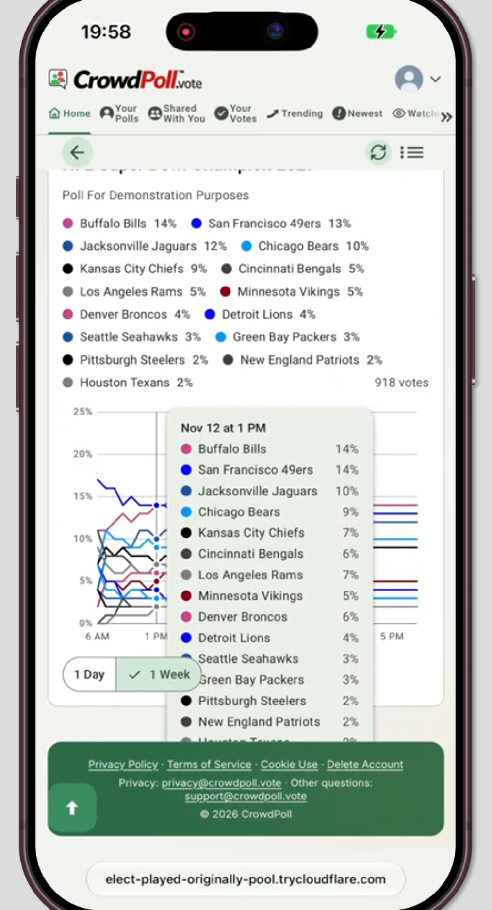

Start a new spec for these requirements called `20261113-150353-LINE-GRAPH-READABILITY`  
!! THIS FILE IS GENERATED USING THE SKILL `/speckit-requirements`. DO NOT EDIT OR DELETE THIS FILE !!  

# Initial High-Level Requirements

The requirement of this feature is to improve the Line Graph, especially when rendered at phone widths.  

When there are many lines (over 10) displayed, the graph becomes cluttered and difficult to read.  
It is especially problematic when the user selects a time on the graph and the box with the values at the time is displayed over the graph.

This screenshot illustrates the problem:

Please propose a solution to this that is used by popular data visualization libraries or applications.  

## Decisions

These decisions were accepted in `requirements-report.md` on 2026-11-13.  

### The legend is the readout (RS1)

- The floating box with the values at the selected time is removed.  
- While a time is selected, each legend entry's percentage is that choice's share at that time, and a time label (e.g. "Nov 12 at 1 PM") is shown with the legend.  
- With no time selected, the legend shows the latest shares, as today.  
- The crosshair and the markers stay on the plot;  
  nothing else is drawn over the plot.  
- The keyboard reading (Left, Right, Home, End, Escape) and the screen reader announcement stay as they are.  

### One behaviour everywhere (AM1, AM2)

- There is no threshold: the graph behaves the same for any number of lines.  
  "Over 10" describes when the problem shows, not a rule.  
- The change applies at every width, phone and desktop alike.  

### Legend order (UA1)

- The legend keeps a fixed order (highest current share first) and never re-sorts while a time is selected;  
  only the percentages change.  
- The lines arrive in the poll's choice order, so the graph puts them in share order itself, with ties in choice order;  
  on a poll whose choice order is not its share order, the legend's order changes with this feature.  
- A time selected by a click or a touch on the plot stays selected when the pointer leaves the plot, until a press outside the graph, Escape or a change of time scale;  
  a time shown by mouse hover alone is cleared when the mouse leaves the plot.  

### Highlighting a line (UA2)

- Each legend entry is a `<button>` with `aria-pressed`;  
  Enter, Space, a click or a tap toggles it.  
- One line is highlighted at a time: highlighting an entry clears any other highlight;  
  activating the highlighted entry again, or pressing Escape while it has focus, clears it.  
- The highlighted line is drawn last (on top) with a wider stroke;  
  the other lines, their markers and the other legend entries are drawn at a reduced opacity, and keep their own colors.  
- The highlight survives a refresh, a time scale change and a selected time;  
  it is cleared when its choice is no longer in the series, and when the view is closed.  
- It is not stored: no cookie and no browser storage key.  
- Hovering a legend entry does nothing, so desktop and touch behave alike.  

### Colors (UA3)

- The palette and the color assignment stay as they are, so the lines keep agreeing with the bars.  
- The highlight is how a line is told apart from another of the same color;  
  line styles (dashed, dotted) are not added.  

### How many lines are drawn (NC1)

- At rest the graph draws the top 10 choices by current share, and the legend lists only the lines that are drawn.  
- When the series holds more than 10 lines, a button "Show all N" (N = the number of lines, e.g. "Show all 15") draws the rest;  
  it then reads "Show top 10" and goes back.  
- With 10 lines or fewer there is no button.  
- The choice is made in the browser from the same response, and is not stored.  

### Success checks (UA4)

On a poll with 15 graphed lines, at a 360 px wide viewport and again at desktop width:  

- With a time selected, no element other than the crosshair and the markers is drawn over the plot area.  
- With a time selected, every drawn choice's share at that time can be read, and nothing extends outside the graph's card.  
- With one line highlighted, that line can be followed from the first bucket to the last.  
- The keyboard reading (arrow keys, Home, End, Escape) and the screen reader announcement work as they do today.  

### Scope

- The whole change is in the browser (`src/public/lineGraph.js`, `src/public/line-graph-m3.css`) and their tests and documentation.  
- No API, database, setting, cookie or stored value changes.  
