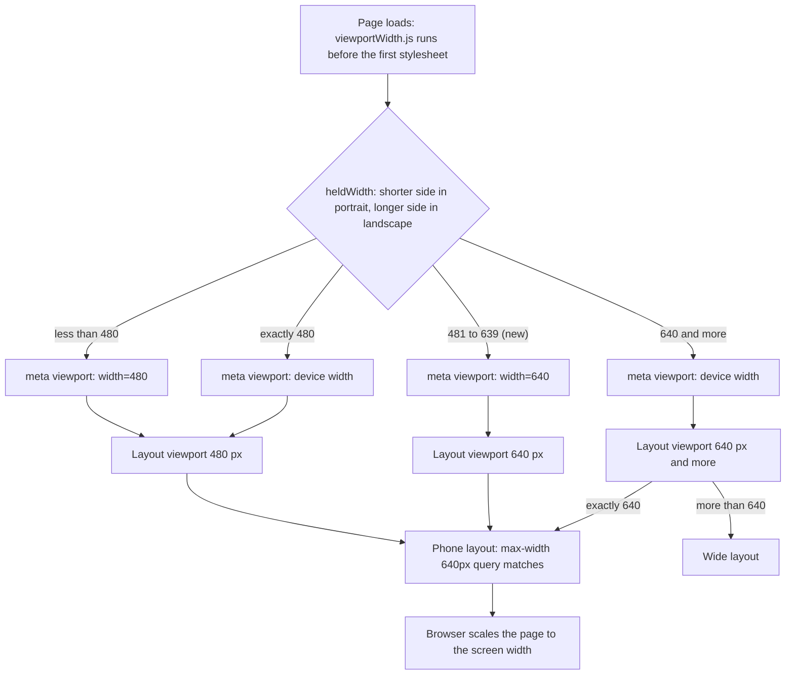
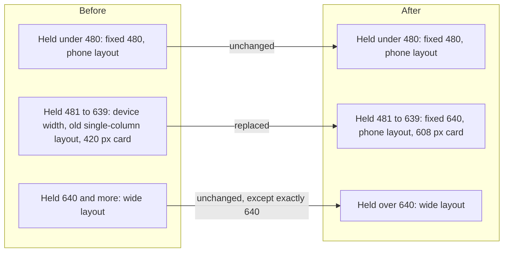
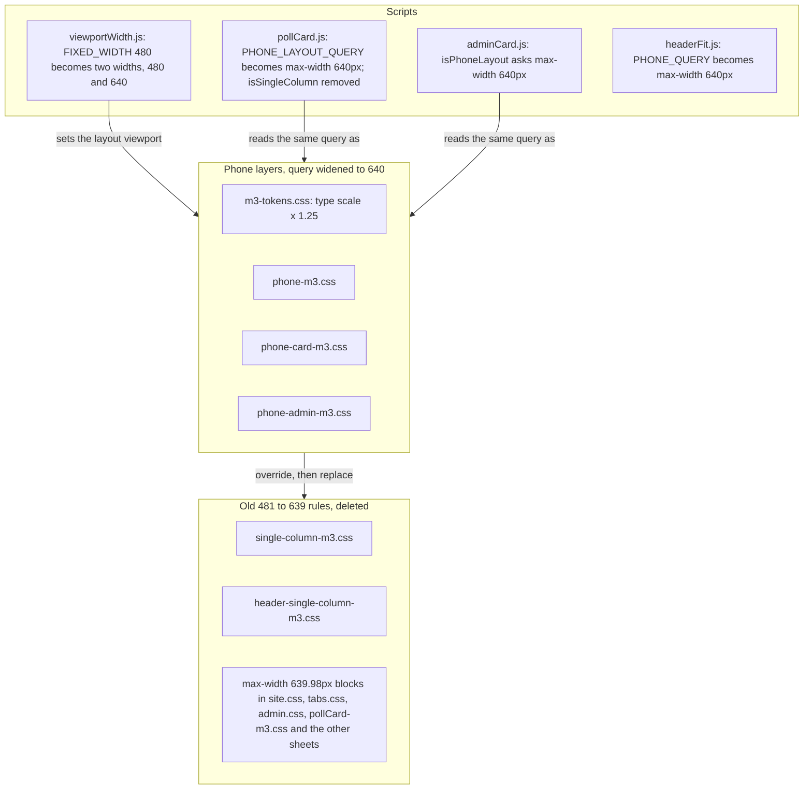
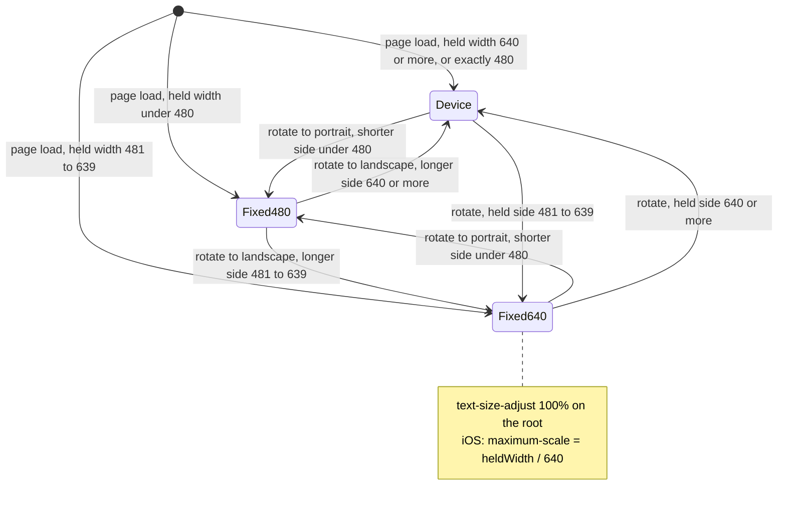

# High Level Requirements

Requirements: `requirements/20261117-050854-fixed-width-640/requirements.md`  
External Files: none  
Generated: 2026-11-17 5:08 AM  

This feature will implement the UI/UX for viewports from 481px-640px.  

Currently, the UI/UX for 480px and less is already implemented and optimized for smaller screens.  

All the following requirements apply to viewports from 481px-640px.  

The UI/UX must be redesigned specifically for a viewport width of 640px, using FIXED_WIDTH = 640   
and the CSS Pixel technique from "specs\20261113-085157-FIXED-VIEWPORT-WIDTH"
Similar to how the 488px and under viewports are handled, the UI/UX for 481px-640px will follow the fixed width and CSS Pixel technique.

All the CSS and layout and controls will be the same as those used for 480px and less. 

Every page uses the same frame at 640 px:
- Poll Cards
- legal pages
- Poll Administration section: Admin Card, Admin Page, Admin Wizard

Assumptions
- Material 3 stays the design language: its components, shape and state layers, with sizes raised for the scaled phone rather than new components invented.
- Both color schemes keep their palettes; every new element takes its colors from the existing tokens.
- Bars stay ordered by share, largest first, on both faces, as today.
- A poll's notes show one line on the compact card and in full in the maximized view.
- The home page keeps its scrolling tab bar at the top; no bottom navigation is introduced.
- The fixed header and tab bar stay fixed while the page scrolls.
- Text is never smaller than 15 layout px in the phone layout.

## Additional Requirements and Research Requests

**Instructions To The Developer**  
Enter any additional requirements or research requests under the ## Additional Requirements and Research Requests heading above.  
When you Type or Say: "Next" in the CC CLI terminal, the additional requirements and research requests will be applied to the report.  
  
You may leave these instructions here. They will be ignored when "Next" is executed.  

## 1. Overview

CrowdPoll has three layouts today, chosen by the width of the layout viewport:

| Layout viewport | Layout today | How a device reaches it |
|---|---|---|
| 480 px and less | The phone layout: `phone-m3.css`, `phone-card-m3.css`, `phone-admin-m3.css`, type scale × 1.25 | A device held narrower than 480 px is given `width=480` by `viewportWidth.js` and scaled to fit |
| 481–639 px | The older single-column layout: the `max-width: 639.98px` rules, a 420 px card column | The device's own width |
| 640 px and more | The wide layout: single-row header, card grid | The device's own width |

This feature retires the middle row.  
A device held between 481 and 639 px wide is given a layout viewport of exactly 640 px, by the same technique that gives narrower devices 480 px, and is drawn with the phone layout.  
The phone layout's rules, components and controls are reused, not redesigned;  
what changes is the width they are laid out in.  

After the feature there are two layouts and two fixed widths:

| Device held width | Layout viewport | Layout |
|---|---|---|
| less than 480 px | 480 px, fixed | Phone layout (unchanged) |
| 481–639 px | 640 px, fixed | Phone layout, in a 640 px frame (new) |
| 640 px and more | the device's own width | Wide layout (unchanged above 640 px) |

It applies to every page: the home page and its poll cards, the legal pages, the sign-in and account pages, and Poll Administration (the admin page, the admin card and the wizard).  

## 2. Scope

**In scope**

- `viewportWidth.js`: a second fixed width, 640, for devices held between 481 and 639 px.  
- The three phone layers and the phone block of `m3-tokens.css`: applied up to 640 px instead of 480 px.  
- The scripts that ask whether the phone layout is on (`PollCard.isPhoneLayout()` in `pollCard.js`, its twin in `adminCard.js`, `headerFit.js`).  
- The older `max-width: 639.98px` rules, which no viewport reaches once the phone layers cover the range.  
- Every page in `src/public/*.html`, since each loads `viewportWidth.js` and the phone layers.  
- The tests that pin the breakpoints, the viewport rule and the sheets.  

**Out of scope**

- The phone layout at 480 px and less: a device held narrower than 480 px sees no change.  
- The wide layout above 640 px.  
- New components, new colors, new API routes, new settings, new cookies or storage keys: none is needed.  
- The server: the feature is client-side CSS and JavaScript only.  

## 3. Proposed Design

The design below is what the requirements say plus the defaults the findings in section 8 recommend.  
Where a finding is resolved differently, `requirements.md` is right and this section is not rewritten.  

### 3.1 The viewport rule

`viewportWidth.js` holds one constant today, `FIXED_WIDTH = 480`, and fixes the viewport when the held width is below it.  
It becomes a small table of two widths:

| Held width (`heldWidth()`) | Viewport meta `content` |
|---|---|
| less than 480 | `width=480` (as today) |
| exactly 480 | the device content (as today) |
| 481–639 | `width=640` |
| 640 and more | the device content (as today) |

Everything else in the technique is unchanged and applies to 640 as it does to 480:  
the held width is the screen's shorter side in portrait and its longer side in landscape;  
`text-size-adjust: 100%` is set on the root while a fixed width is in force;  
iOS gets `maximum-scale` equal to the fitted scale (`heldWidth / 640`), so a focused field does not zoom;  
the rule is applied again on `resize`, `pageshow` and an orientation change.  

A page fixed at 640 px is drawn at between 75% (a 481 px device) and 100% (a 639 px device) of its CSS sizes.  
The 480 px band is drawn at between 67% (320 px) and 100% (479 px), so the two bands scale alike.  

### 3.2 One phone layout, two frame widths

The phone layers' query changes from `@media (max-width: 480px)` to `@media (max-width: 640px)`.  
The layout is already fluid inside its frame (16 px gutters, cards that fill the column), so in a 640 px frame it fills 640 px:  
a poll card is 608 px wide instead of 448 px, its bars and labels are longer, and nothing else moves.  

The type scale × 1.25 block in `m3-tokens.css` moves to the same query, so text, targets (48 px controls with a 64 px halo, 64 px rows) and spacing are identical in both frames.  

### 3.3 Scripts

`PollCard.isPhoneLayout()` and the copy in `adminCard.js` ask `matchMedia("(max-width: 640px)")`.  
Every phone behaviour then applies in the 640 px frame:  
`essentialChoices` on the compact card and the maximized view, Vote opening the maximized view when choices are hidden, notes opening maximized, the wizard's phone footer and brief summary.  

### 3.4 What is removed

With the phone layers covering every viewport up to 640 px, the older phone rules are unreachable:  
the `max-width: 639.98px` blocks in twelve sheets, `single-column-m3.css`, `header-single-column-m3.css`, the `--single-column` marker and `isSingleColumn()` in `pollCard.js`.  
They are deleted, and the wide-layout rules that began at 640 px begin just above it.  

## 4. Architecture Diagrams

### 4.1 Which layout a device gets

### 4.2 Before and after, by device width

### 4.3 What changes in the files

### 4.4 The rule applied again

## 5. Breaking Changes

- **Devices held 481–639 px wide get a different page.**  
  Small tablets in portrait (600 px), folding phones' inner or cover screens, and small phones in landscape (568 px) move from the single-column layout at their own width to the phone layout fixed at 640 px and scaled down.  
- **A viewport of exactly 640 px moves from the wide layout to the phone layout** (finding AM4), because a page fixed at `width=640` has a 640 px viewport and must match the phone query.  
- **The viewport contract changes**: `specs/20261113-085157-FIXED-VIEWPORT-WIDTH/contracts/viewport.md` V2 (the rows 568 × 320 landscape and every held width from 481 to 639) and V5 ("the width is the constant 480").  
- **Decisions recorded in `CLAUDE.md` are reversed**: "the phone layout is `@media (max-width: 480px)` only", "nothing changes at 481 px and wider except Back", "`--single-column` stays for 481–639 px", and `isPhoneLayout()` being `matchMedia("(max-width: 480px)")`.  
- **Tests pinned to the old breakpoints change**: `client-viewport-width.test.ts`, `viewport-width-pages.test.ts`, `phone-sheets.test.ts`, `single-column-sheets.test.ts`, `single-row-header-sheet.test.ts`, `header-fixed-sheet.test.ts`, `back-arrow-sheet.test.ts`, `back-to-top-sheet.test.ts`, `client-phone-card.test.ts`, `client-admin-wizard.test.ts`, `client-footer.test.ts`, `client-search-tab-field.test.ts`, `admin-search-assets.test.ts`, `m3-assets.test.ts` (`LAYER_ORDER`, if sheets are deleted) and the helpers `phone-page.ts` and `single-column-page.ts`.  
- No API, database, cookie or configuration change.  

## 6. Technical Debt

- **The phone layers override rather than replace.**  
  They are loaded last to undo the `639.98px` rules.  
  Once those rules are deleted, some phone declarations only reset values nothing sets any more.  
- **The phone query is a literal in seven places** (`m3-tokens.css`, three phone layers, `admin.css`, `pollCard.js`, `adminCard.js`), and `639.98px` in twelve sheets and `headerFit.js`.  
  CSS custom properties cannot be used in a media query, so the breakpoint stays a repeated literal; a test that pins all of them to one value is the available guard.  
- **`isPhoneLayout()` exists twice**: `pollCard.js` exports it as `PollCard.isPhoneLayout()`, and `adminCard.js` has its own copy because the admin page does not load `pollCard.js`.  
- **`.page{ min-width:480px }`** in `phone-m3.css` stays the floor for a desktop window narrower than 480 px, which scrolls sideways.  
- **`tabBarScroll.js` has a third breakpoint**, `(max-width: 900px)`, unrelated to either fixed width.  

## 7. Assumptions

- The assumptions listed in the requirements were written for the 480 px redesign and carry over unchanged; "the scaled phone" now also means the 640 px frame, and no new element is introduced.  
- A phone in landscape whose longer side is 640 px or more (most current phones: 667–932 px) keeps the wide layout at its own width, as today.  
- A device held exactly 480 px wide keeps its own width and the phone layout, as today.  
- The iOS focus-zoom guard (`maximum-scale`) is computed from the fixed width in force, 480 or 640.  
- Pinch zoom stays available in both fixed widths.  
- `README.md`, `ARCHITECTURE.md`, `CLAUDE.md` and `CLAUDE_COMPLETE.md` are updated where they describe the breakpoints.  

## 8. Findings

### 8.1 Inconsistencies

**IN1. "488px and under" against "480px and less"**  
<b>
✅ Resolved</b>  
✅ Requirements File Updated: 2026-11-17 5:20 AM  
**Notes**: Recommendation accepted in file 2026-11-17: Recommendation, read "488px" as "480px";  
the requirements now say "480px and under".  

> The requirements say twice that the existing layout is for "480px and less", and once "Similar to how the 488px and under viewports are handled".  
> The code and every earlier document use 480: `FIXED_WIDTH = 480` and `@media (max-width: 480px)`.  
> No 488 px boundary exists anywhere.  

  - **Recommendation**: **read "488px" as "480px".**  

    [X] ➡️ **Accepted**

    - It is a typing slip; the requirements are corrected to "480px and under".  

  - **Developer Resolution B**:  

    [ ] ➡️ **Not Accepted**

**IN2. "Must be redesigned specifically for 640px" against "all the CSS and layout and controls will be the same"**  
<b>
✅ Resolved</b>  
✅ Requirements File Updated: 2026-11-17 5:20 AM  
**Notes**: Recommendation accepted in file 2026-11-17: Recommendation A, no new design: the phone layout is reused as it is, laid out in a 640 px frame;  
the requirements now say so under Resolved Findings, "No new design".  

> One sentence asks for a UI/UX "redesigned specifically for a viewport width of 640px".  
> Another says "All the CSS and layout and controls will be the same as those used for 480px and less".  
> A redesign for 640 px could mean a new arrangement that uses the extra 160 px (two columns of cards, a side-by-side maximized view);  
> "the same" rules that out.  

  - **Recommendation A** _(recommended)_: **no new design: the phone layout is reused as it is, laid out in a 640 px frame.**  

    [X] ➡️ **Accepted**

    - <u>Pros</u>: one layout to maintain and test; it matches the more specific sentence and the list "every page uses the same frame at 640 px"; the feature stays small.  
    - <u>Cons</u>: the extra width only makes cards and bars wider; nothing new is shown in it.  

  - **Recommendation B**: **a design of its own for 640 px, starting from the phone layout's components.**  

    [ ] ➡️ **Not Accepted**

    - <u>Pros</u>: the width could carry more, for example more leading choices on the compact card.  
    - <u>Cons</u>: a third layout to design, build and keep in step; the requirements describe none of it, so every detail would be a new finding.  

  - **Developer Resolution C**:  

    [ ] ➡️ **Not Accepted**

### 8.2 Ambiguities

**AM1. Which devices are fixed at 640 px, and does 480 stay?**  
<b>
✅ Resolved</b>  
✅ Requirements File Updated: 2026-11-17 5:20 AM  
**Notes**: Recommendation accepted in file 2026-11-17: Recommendation A, two fixed widths, 480 (held under 480) and 640 (held 481–639);  
the requirements now list the three cases under Resolved Findings, "Two fixed widths".  

> "Using FIXED_WIDTH = 640" can be read as replacing the constant, so every device narrower than 640 px is fixed at 640, or as adding a second fixed width beside 480.  
> `viewportWidth.js` has one constant today and fixes the viewport when `heldWidth() < FIXED_WIDTH`.  
> The requirements also say the 480 px layout "is already implemented and optimized" and that these requirements apply to 481–640 px only.  

  - **Recommendation A** _(recommended)_: **two fixed widths: held under 480 → `width=480` (unchanged); held 481–639 → `width=640`; held exactly 480, or 640 and more → the device's own width.**  

    [X] ➡️ **Accepted**

    - <u>Pros</u>: phones keep exactly what they have; the new band is drawn at 75–100% of its CSS sizes, much as the 480 band is (67–100%).  
    - <u>Cons</u>: the script holds a small table instead of one constant, and its contract (V2, V5) is rewritten.  

  - **Recommendation B**: **one fixed width: every device held under 640 px gets `width=640`.**  

    [ ] ➡️ **Not Accepted**

    - <u>Pros</u>: one constant, one frame width to test.  
    - <u>Cons</u>: a 360 px phone would be drawn at 56% instead of 75%, so 15 px text becomes about 8 physical px; it undoes the tuning of the 480 px redesign, which the requirements exclude.  

  - **Developer Resolution C**:  

    [ ] ➡️ **Not Accepted**

**AM2. How "the same CSS" reaches a 640 px viewport**  
<b>
✅ Resolved</b>  
✅ Requirements File Updated: 2026-11-17 5:20 AM  
**Notes**: Recommendation accepted in file 2026-11-17: Recommendation A, widen the phone query to `max-width: 640px` and delete the older 481–639 px rules;  
the requirements now say so under Resolved Findings, "One phone layout up to 640 px".  

> The phone layers and the phone type scale are inside `@media (max-width: 480px)`, so none of them applies in a 640 px viewport.  
> What applies there today is the older single-column layout, the `max-width: 639.98px` rules (`single-column-m3.css`, `header-single-column-m3.css` and blocks in ten other sheets).  
> "The same CSS" can be had by widening the existing query or by copying the rules into a second block for 481–640 px.  

  - **Recommendation A** _(recommended)_: **widen the query of the phone layers and of the phone type scale to `max-width: 640px`, and delete the older 481–639 px rules they make unreachable.**  

    [X] ➡️ **Accepted**

    - <u>Pros</u>: literally the same CSS, so the two frames cannot drift apart; about 230 lines of single-column sheets and the `639.98px` blocks go; `--single-column` and `isSingleColumn()` go with them.  
    - <u>Cons</u>: the 640 px frame cannot be tuned separately without adding a narrower query later; deleting the old rules touches twelve sheets and their tests.  

  - **Recommendation B**: **widen the query but keep the older `639.98px` rules in place, overridden as they are today.**  

    [ ] ➡️ **Not Accepted**

    - <u>Pros</u>: the smallest change; fewer tests move.  
    - <u>Cons</u>: rules no viewport can reach on their own stay in twelve sheets, and the phone layers keep overriding them; it is recorded as technical debt.  

  - **Recommendation C**: **copy the phone layers into a second set under `(min-width: 480.02px) and (max-width: 640px)`.**  

    [ ] ➡️ **Not Accepted**

    - <u>Pros</u>: each frame can be tuned alone.  
    - <u>Cons</u>: about 830 lines duplicated; every later phone change is made twice; it contradicts "the same CSS".  

  - **Developer Resolution D**:  

    [ ] ➡️ **Not Accepted**

**AM3. A desktop browser window between 481 and 640 px wide**  
<b>
✅ Resolved</b>  
✅ Requirements File Updated: 2026-11-17 5:20 AM  
**Notes**: Recommendation accepted in file 2026-11-17: Recommendation A, a desktop window 481–640 px wide gets the phone layout, fluid at its own width;  
the requirements now say so under Resolved Findings, "Desktop windows".  

> The fixed-width technique acts on the device's screen (`screen.width`, the viewport meta), and desktop browsers ignore the viewport meta.  
> A desktop window narrowed to, say, 560 px therefore has a 560 px viewport, not 640.  
> "Viewports from 481px-640px" includes it, but "a viewport width of 640px" cannot be given to it.  

  - **Recommendation A** _(recommended)_: **it gets the phone layout, fluid at the window's own width.**  

    [X] ➡️ **Accepted**

    - <u>Pros</u>: it follows from the widened query with no extra rule; the phone layout is fluid above its 480 px floor; no sideways scrolling.  
    - <u>Cons</u>: text is drawn at full size (the type scale × 1.25 unscaled), larger than on a device; that is already so below 480 px.  

  - **Recommendation B**: **the page keeps a 640 px minimum width and the window scrolls sideways.**  

    [ ] ➡️ **Not Accepted**

    - <u>Pros</u>: the frame is exactly 640 px wherever it is seen.  
    - <u>Cons</u>: a sideways scrollbar in a narrow desktop window; and `min-width: 640px` cannot sit in the shared query, since the 480 px frame must not have it.  

  - **Developer Resolution C**:  

    [ ] ➡️ **Not Accepted**

**AM4. Which layout a viewport of exactly 640 px gets**  
<b>
✅ Resolved</b>  
✅ Requirements File Updated: 2026-11-17 5:20 AM  
**Notes**: Recommendation accepted in file 2026-11-17: Recommendation, the phone layout applies up to and including 640 px and the wide layout starts above it;  
the requirements now say so under Resolved Findings, "Exactly 640 px is the phone layout".  

> "481px-640px" includes 640 px.  
> Today the boundary is 639.98 px: `@media (max-width: 639.98px)` is the single-column layout, and at exactly 640 px the wide layout applies (`header-single-row-m3.css`, `legal-m3.css` `min-width: 640px`).  
> A page fixed at `width=640` has a viewport of exactly 640 px, so with today's boundary it would be given the wide layout, not the phone layout.  

  - **Recommendation**: **the phone layout applies up to and including 640 px (`max-width: 640px`); the wide layout starts above it (`min-width: 640.02px`, `not all and (max-width: 640px)`).**  

    [X] ➡️ **Accepted**

    - It is what the technique needs, and it mirrors 480, where `max-width: 480px` includes 480.  
    - Every remaining `639.98px` query, `headerFit.js` included, moves to 640 px with it.  
    - A device or window exactly 640 px wide changes from the wide layout to the phone layout; this is listed under Breaking Changes.  

  - **Developer Resolution B**:  

    [ ] ➡️ **Not Accepted**

### 8.3 Unspecified Aspects

**UA1. How wide the content is inside the 640 px frame**  
<b>
✅ Resolved</b>  
✅ Requirements File Updated: 2026-11-17 5:20 AM  
**Notes**: Recommendation accepted in file 2026-11-17: Recommendation A, the content fills the frame, 608 px wide inside 16 px gutters;  
the requirements now say so under Resolved Findings, "The content fills the frame".  

> "Every page uses the same frame at 640 px" does not say whether the content fills it.  
> In the 480 px frame the page has 16 px gutters and a card fills the rest, 448 px.  
> The older 481–639 px layout centres a 420 px card column.  
> The admin search list is `min(840px, 100%)` and the admin card is 420 px in the wide layout.  

  - **Recommendation A** _(recommended)_: **the content fills the frame: 16 px gutters, cards, legal text, the admin list, the admin card and the wizard 608 px wide.**  

    [X] ➡️ **Accepted**

    - <u>Pros</u>: it is what the same CSS does with no new rule; longer bars and labels truncate less; on the device nothing is wasted.  
    - <u>Cons</u>: legal text lines reach about 60–65 characters at 20 px body text, the upper end of comfortable; bars are long for short labels.  

  - **Recommendation B**: **the content keeps the 480 px frame's widths (448 px), centred in the 640 px frame.**  

    [ ] ➡️ **Not Accepted**

    - <u>Pros</u>: every card looks exactly as in the 480 px frame.  
    - <u>Cons</u>: 96 px of empty margin each side, then scaled down further on the device; there would be no reason to fix the width at 640 rather than 480.  

  - **Developer Resolution C**:  

    [ ] ➡️ **Not Accepted**

**UA2. Whether the phone behaviours of the scripts apply at 481–640 px**  
<b>
✅ Resolved</b>  
✅ Requirements File Updated: 2026-11-17 5:20 AM  
**Notes**: Recommendation accepted in file 2026-11-17: Recommendation, every phone behaviour applies up to 640 px;  
the requirements now say so under Resolved Findings, "Scripts".  

> "CSS and layout and controls will be the same" does not mention behaviour.  
> Several behaviours are switched by `isPhoneLayout()`, which asks `matchMedia("(max-width: 480px)")` in `pollCard.js` and in `adminCard.js`:  
> `essentialChoices` (four leaders on the card, ten maximized), Vote opening the maximized view when choices are hidden, notes opening maximized, the fixed 44 px bars, the wizard's top footer and brief summary.  
> `headerFit.js` uses `(max-width: 639.98px)`, and the single-column bar layout reads the `--single-column` marker.  

  - **Recommendation**: **every phone behaviour applies up to 640 px: both `isPhoneLayout()` functions and `headerFit.js` ask `(max-width: 640px)`.**  

    [X] ➡️ **Accepted**

    - The phone CSS is written for these behaviours; with the CSS on and the scripts off, a card would list every choice in a layout sized for four.  
    - The limits of `essentialChoices` (4 and 10, TWEAK05) are the same in both frames.  
    - Back is unchanged: it already works at every width.  
    - When the older rules are deleted (AM2, A), `--single-column`, `isSingleColumn()` and `singleColumnBarLayout()` are deleted too.  

  - **Developer Resolution B**:  

    [ ] ➡️ **Not Accepted**

**UA3. How the result is verified**  
<b>
✅ Resolved</b>  
✅ Requirements File Updated: 2026-11-17 5:20 AM  
**Notes**: Recommendation accepted in file 2026-11-17: Recommendation, a device checklist and updated automated tests;  
the requirements now list the measures under Resolved Findings, "Verification".  

> The requirements name no success measure and no device list.  
> The 480 px redesign has a device checklist as its quickstart, and the viewport rule has a table of screens (contract V2).  

  - **Recommendation**: **a device checklist and updated automated tests, with these measures.**  

    [X] ➡️ **Accepted**

    - Held widths checked: 481, 540, 600 and 639 px in portrait, 568 px in landscape, and rotation between a fixed 480, a fixed 640 and the device width.  
    - On each, every page (home tabs, a maximized poll, privacy, terms, login, profile, settings, the admin page, the admin card, the wizard) shows the phone layout with no sideways scrolling and no text under 15 layout px.  
    - A device held under 480 px and a viewport over 640 px render exactly as before the feature.  
    - A focused field does not zoom the page on iOS.  
    - `npm test` and `npx tsc --noEmit` pass, with the viewport table (V2) extended by the new rows.  

  - **Developer Resolution B**:  

    [ ] ➡️ **Not Accepted**

### 8.4 Needs Clarifications

**NC1. The size of text and targets in the 640 px frame**  
<b>
✅ Resolved</b>  
✅ Requirements File Updated: 2026-11-17 5:20 AM  
**Notes**: Recommendation accepted in file 2026-11-17: Recommendation A, the same sizes in both frames (type scale × 1.25, 48 px controls, 64 px rows);  
the requirements now say so under Resolved Findings, "Sizes".  

> The phone layout raises the Material 3 type scale by 1.25 (`m3-tokens.css`, `label-small` held at 15 px) because a 480 px page is drawn smaller than its CSS sizes on a phone.  
> The same is true of a 640 px page on a 481–639 px device, which is drawn at 75–100%.  
> "The same CSS" implies the same × 1.25, but the assumption "sizes raised for the scaled phone" was written for 480 px and the requirements do not say it again for 640.  
> Physical sizes of 15 px text: 10 px on a 320 px phone and 12.2 px on a 390 px phone today; with × 1.25 kept, 11.3 px on a 481 px device and 14.1 px on a 600 px tablet.  

  - **Recommendation A** _(recommended)_: **the same sizes in both frames: type scale × 1.25, 48 px controls with a 64 px halo, 64 px rows, no text under 15 layout px.**  

    [X] ➡️ **Accepted**

    - <u>Pros</u>: the same CSS, as required; physical text sizes land in the same range as on phones today; one token block.  
    - <u>Cons</u>: on a 600 px tablet text is a little larger than on a phone (14 against 12 physical px for the smallest text).  

  - **Recommendation B**: **the unraised Material 3 type scale between 481 and 640 px.**  

    [ ] ➡️ **Not Accepted**

    - <u>Pros</u>: more content per screen on the larger devices.  
    - <u>Cons</u>: 11–12 px labels drawn at 75% are about 8–9 physical px on a 481 px device; it breaks "text is never smaller than 15 layout px"; the phone layers' spacing assumes the raised sizes, so they would need a second tuning.  

  - **Developer Resolution C**:  

    [ ] ➡️ **Not Accepted**

## 9. Requirements Report Complete Report  
  
- **Requirements Report Document:** requirements/20261117-050854-fixed-width-640/requirements-report.md  
- **Requirements Document:** requirements/20261117-050854-fixed-width-640/requirements.md  
- **Software Architecture Diagrams:** 4  
- **Inconsistencies:** 2  
- **Ambiguities:** 4  
- **Unspecified Aspects:** 3  
- **Needs Clarifications:** 1  
- **Research Results:** 0  
- **Breaking Changes:** 5  
- **Technical Debt items:** 5  
  
The requirements are ready for /speckit-specify.
To generate specs from the requirements document, use the `/speckit-specify` skill followed by the path (relative to the project root) to the requirements file.
At the prompt, Type:  
🟩 👉 /speckit-specify requirements/20261117-050854-fixed-width-640/requirements.md  
