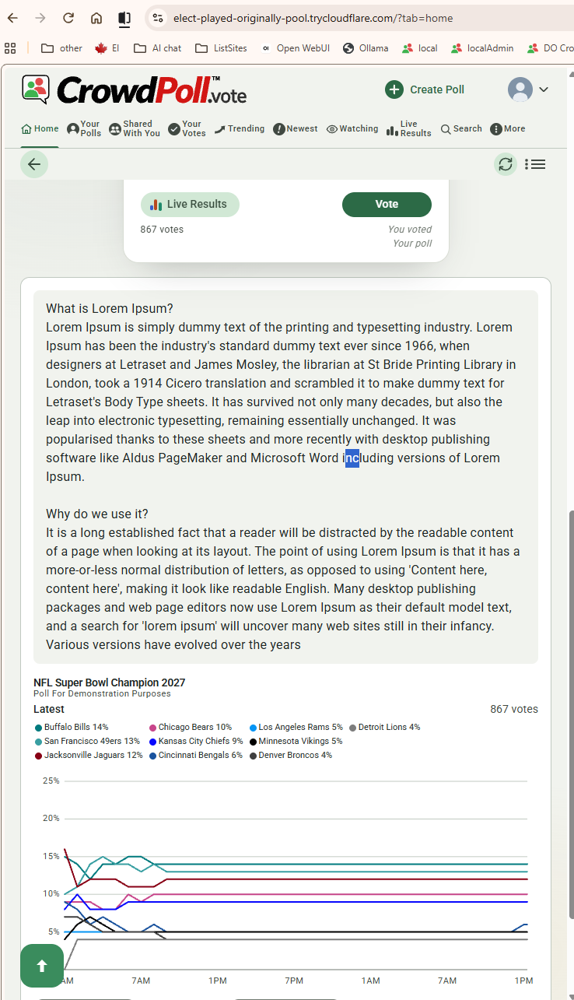
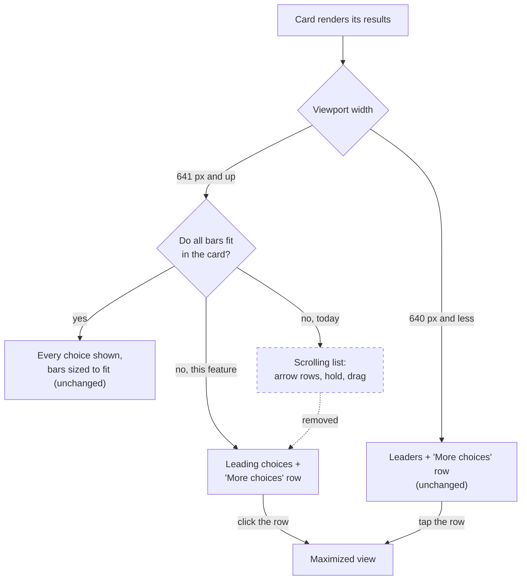
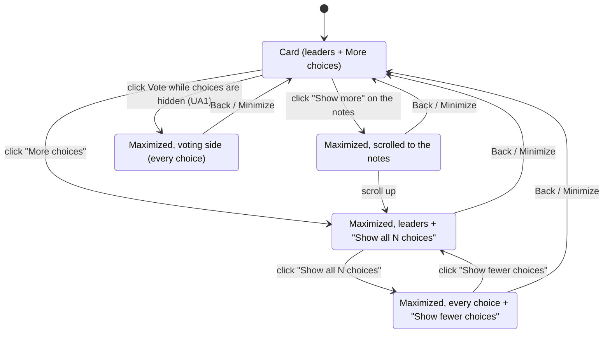
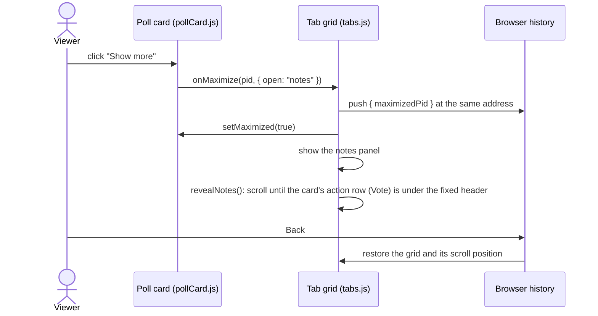

# High Level Requirements

Requirements: `requirements/20261117-131915-wide-more-choices/requirements.md`  
External Files: `requirements/20261117-131915-wide-more-choices/image.png`  
Generated: 2026-11-17 1:20 PM  

This feature will apply to viewport widths 641px and up.  

The functionality of scrolling the bars in a row when the bars dont't all fit,   
is being deprecated because users find it cumbersome.  

The "More choices - p%" clickable bar will be used, as is currently used for 640px and less.  

This "More choices..." bar naviagates to the Maximize Poll Card.  
When on the Maximized Poll Card, the same "Show all..." and "Show fewer choices" bars will be used,  
as with 640px and less. 

Also, as with 640px and less, when a Poll has Notes, and the "Show more" button is clicked,  
navigate to notes panel on the Maximized view with the "Vote button visible above it.  

An example of this is seen in this screenshot:  

## Additional Requirements and Research Requests

**Instructions To The Developer**  
Enter any additional requirements or research requests under the ## Additional Requirements and Research Requests heading above.  
When you Type or Say: "Next" in the CC CLI terminal, the additional requirements and research requests will be applied to the report.  
  
You may leave these instructions here. They will be ignored when "Next" is executed.  

## 1. Overview and Scope

The poll card behaves in two ways today, split at 640 px.  

- **640 px and less (the phone layout)**:  
  the card shows its leading choices and a last row, "More choices · p%", which opens the maximized view;  
  the maximized view shows up to ten leaders and a "Show all N choices" row, which turns into "Show fewer choices";  
  "Show more" on the notes opens the maximized view with the notes in sight under the card's Vote button.  
- **641 px and up (the wide layout)**:  
  the card has a fixed height and fits every choice into it by shrinking the bars;  
  when they do not fit even at the smallest bar height, the list scrolls inside the card, with an up and a down arrow row, press-and-hold, and drag with the mouse;  
  the maximized view lists every choice;  
  "Show more" on the notes opens the maximized view at its top.  

This feature brings the three phone behaviours to the wide layout and removes the scrolling list.  

**In scope** (all in the browser, `src/public/`):  

- `pollCard.js`: the card's choice of rows, its last row, the click handlers that are limited to the phone layout today, and the scrolling code.  
- `tabs.js`: opening the maximized view on its notes at every width.  
- The style sheets: the "More choices" and "Show all" rows are styled only inside the `max-width: 640px` layers today.  
- The client tests for the card and the pinned style sheets.  

**Out of scope**:  

- The server, the API, `postman/openapi.json` and the database: nothing is stored, and no payload changes.  
- The 640 px and less layout, which already behaves this way.  
- The sideways scrolling of the tab bar, which is a different control.  
- The line graph and the Who voted report.  

## 2. Architecture Diagrams

### 2.1 What a card shows, before and after

The decision that changes is the right-hand branch: a list that does not fit no longer scrolls.  

### 2.2 The card's view states at 641 px and up, after the feature

These are the phone layout's states, now reached at every width.  
Nothing is stored: the state lives in the card (`isMaximized`, `choiceView`) and in one history entry.  

### 2.3 "Show more" on the notes

The same calls the phone layout makes today; only the width test on them goes.  

## 3. Assumptions

- The feature applies to every tab whose cards come from `tabs.js`, which is every card on the site.  
- Back works as it does today at every width: a view opened from a card pushes one history entry, and every way of closing it goes back.  
- A card is drawn again when the window crosses 640 px or changes size, as today, so the rows shown follow the width in use.  
- The voting side of the maximized view lists every choice, as it does at every width today.  
- No setting, cookie or stored value is added.  
- The mis-spelled words in the requirements ("dont't", "naviagates") are typing slips and carry no meaning.  

## 4. Findings

### 4.1 Inconsistencies

None found.

### 4.2 Ambiguities

**AM1. Does "deprecated" mean the scrolling list is removed?**  
<b>
✅ Resolved</b>  
✅ Requirements File Updated: 2026-11-17 1:29 PM  
**Notes**: Recommendation accepted in file 2026-11-17: Recommendation, the scrolling list is removed at 641 px and up, on this release;  
the requirements now say so under Clarifications (AM1).  

> The requirements say the scrolling of the bars "is being deprecated".  
> Deprecated can mean removed now, or kept working and discouraged until a later release.  
> The second reading leaves two ways to reach hidden choices on one card, and all of the scrolling code in place.  

  - **Recommendation**: **the scrolling list is removed at 641 px and up, on this release.**  

    [X] ➡️ **Accepted**

    - The up and down arrow rows, press-and-hold, and drag with the mouse all go, with their code and styles.  
    - A card never scrolls inside itself at any width;  
      the "More choices" row is the only way from a card to its hidden choices.  

  - **Developer Resolution B**:  

    [ ] ➡️ **Not Accepted**

**AM2. Which choices does a card show at 641 px and up?**  
<b>
✅ Resolved</b>  
✅ Requirements File Updated: 2026-11-17 1:29 PM  
**Notes**: Recommendation accepted in file 2026-11-17: Recommendation A, as many as fit: the row appears only when the bars do not all fit;  
the requirements now say so under Clarifications (AM2).  

> The requirements name the trigger as "when the bars don't all fit", and the row as the one "currently used for 640px and less".  
> Those are two different rules.  
> The wide card has a fixed height and fits as many bars as its height allows, so a poll of eight choices shows all eight today.  
> The phone card has no fixed height and always shows four leaders (all of them when the poll has five or fewer), plus the viewer's own choices.  

  - **Recommendation A** _(recommended)_: **as many as fit: the row appears only when the bars do not all fit.**  

    [X] ➡️ **Accepted**

    - A poll whose bars all fit looks exactly as it does today.  
    - Otherwise the card shows the leading choices that fit at the smallest bar height, with the last place given to the "More choices" row;  
      the viewer's own choices are always among them, taking the place of the lowest leaders when needed.  
    - <u>Pros</u>: it matches the trigger the requirements name, changes only the cards that scroll today, and wastes no room in the card.  
    - <u>Cons</u>: the number of choices shown depends on the card's height, so it differs from the phone's four, and it needs its own tests.  

  - **Recommendation B**: **the phone rule: four leaders (all when five or fewer), plus the viewer's own choices.**  

    [ ] ➡️ **Not Accepted**

    - <u>Pros</u>: one rule at every width, and the existing `essentialChoices` limits are used unchanged.  
    - <u>Cons</u>: polls of six choices or more that fit today lose bars from the card, and the fixed-height card shows a few tall bars where it showed the whole poll.  

  - **Developer Resolution C**:  

    [ ] ➡️ **Not Accepted**

**AM3. What does "navigate to notes panel" mean at 641 px and up?**  
<b>
✅ Resolved</b>  
✅ Requirements File Updated: 2026-11-17 1:29 PM  
**Notes**: Recommendation accepted in file 2026-11-17: Recommendation A, as in the screenshot: the panels stay stacked, and the page scrolls to the notes;  
the requirements now say so under Clarifications (AM3).  

> At 640 px and less the maximized view has a tab bar (Notes, Who voted, Graph) and shows one panel at a time, so "Show more" selects the Notes tab.  
> At 641 px and up there is no tab bar: the panels are stacked under the card, as in the screenshot.  
> The screenshot shows the page scrolled so that the card's action row, with Vote, is at the top and the notes follow it.  
> "The Vote button" is read as the card's own Vote button, in that action row.  

  - **Recommendation A** _(recommended)_: **as in the screenshot: the panels stay stacked, and the page scrolls to the notes.**  

    [X] ➡️ **Accepted**

    - "Show more" opens the maximized view and scrolls until the card's action row is the first thing under the fixed header, with the notes panel beneath it.  
    - When the notes are already in the upper half of the window, nothing scrolls, as on the phone.  
    - <u>Pros</u>: it is what the screenshot shows, and it reuses the phone's scrolling step as it is.  
    - <u>Cons</u>: none known.  

  - **Recommendation B**: **the phone's tab bar is used at 641 px and up too.**  

    [ ] ➡️ **Not Accepted**

    - <u>Pros</u>: one maximized view at every width.  
    - <u>Cons</u>: it is not what the screenshot shows, it hides the graph and the Who voted report behind tabs on screens with room for them, and it is a larger change than the requirements ask for.  

  - **Developer Resolution C**:  

    [ ] ➡️ **Not Accepted**

### 4.3 Unspecified Aspects

**UA1. What happens to the voting side of a card whose choices do not fit?**  
<b>
✅ Resolved</b>  
✅ Requirements File Updated: 2026-11-17 1:29 PM  
**Notes**: Recommendation accepted in file 2026-11-17: Recommendation A, Vote opens the maximized view on its voting side, as on the phone;  
the requirements now say so under Clarifications (UA1).  

> The requirements speak of the bars, which are on the results side.  
> The voting side of a wide card scrolls in the same way today when its choices do not fit.  
> At 640 px and less, Vote on a card with hidden choices opens the maximized view on its voting side, where every choice is listed.  

  - **Recommendation A** _(recommended)_: **Vote opens the maximized view on its voting side, as on the phone.**  

    [X] ➡️ **Accepted**

    - This applies only to a card that shows the "More choices" row;  
      a card whose choices all fit turns over in place, as today.  
    - <u>Pros</u>: no card scrolls inside itself on either side, so all of the scrolling code can go, and it is the behaviour phone users already have.  
    - <u>Cons</u>: voting on a long poll takes the viewer away from the grid.  

  - **Recommendation B**: **the voting side keeps its scrolling list.**  

    [ ] ➡️ **Not Accepted**

    - <u>Pros</u>: voting stays in the grid.  
    - <u>Cons</u>: the control users find cumbersome stays on one side of the card, and its code stays with it.  

  - **Developer Resolution C**:  

    [ ] ➡️ **Not Accepted**

**UA2. Which choices does the maximized view show at 641 px and up?**  
<b>
✅ Resolved</b>  
✅ Requirements File Updated: 2026-11-17 1:29 PM  
**Notes**: Recommendation accepted in file 2026-11-17: Recommendation, the phone's rules, unchanged, at every width;  
the requirements now say so under Clarifications (UA2).  

> The requirements say the same "Show all..." and "Show fewer choices" rows are used, but not when they appear.  
> At 641 px and up the maximized view lists every choice today.  
> At 640 px and less it shows ten leaders (all when twelve or fewer), of which only those above 2% when any is, plus the viewer's own choices;  
> opened from "More choices", it first shows every choice with a vote and a "Remaining choices · 0%" row.  

  - **Recommendation**: **the phone's rules, unchanged, at every width.**  

    [X] ➡️ **Accepted**

    - The same limits, the same three rows ("Show all N choices", "Show fewer choices", "Remaining choices · 0%") and the same view on arrival from "More choices".  
    - The maximized view has no fixed height, so nothing about fit applies to it.  

  - **Developer Resolution B**:  

    [ ] ➡️ **Not Accepted**

**UA3. What does the "More choices" row say?**  
<b>
✅ Resolved</b>  
✅ Requirements File Updated: 2026-11-17 1:29 PM  
**Notes**: Recommendation accepted in file 2026-11-17: Recommendation, the phone's text and rule, unchanged;  
the requirements now say so under Clarifications (UA3).  

> The requirements write it as "More choices - p%".  
> The phone's row reads "More choices · p%", with a middle dot, where p is the combined share of the hidden choices.  
> It shows the share on single-choice polls only, since the shares of a multiple-choice poll do not add up;  
> there the row reads "More choices".  

  - **Recommendation**: **the phone's text and rule, unchanged.**  

    [X] ➡️ **Accepted**

    - "More choices · p%" on a single-choice poll, "More choices" on any other.  

  - **Developer Resolution B**:  

    [ ] ➡️ **Not Accepted**

**UA4. What do the three rows look like at 641 px and up?**  
<b>
✅ Resolved</b>  
✅ Requirements File Updated: 2026-11-17 1:29 PM  
**Notes**: Recommendation accepted in file 2026-11-17: Recommendation, the phone's appearance, at the wide layout's own sizes;  
the requirements now say so under Clarifications (UA4).  

> The "More choices", "Show all" and "Show fewer choices" rows are styled only inside the `max-width: 640px` layers, at the phone's enlarged type sizes and 30 px bar height.  
> The requirements give no appearance for them in the wide layout, where the bar height varies with the number of choices.  

  - **Recommendation**: **the phone's appearance, at the wide layout's own sizes.**  

    [X] ➡️ **Accepted**

    - The same shape, colours and chevron, from the same Material 3 tokens.  
    - The row takes the place of one bar: its height is the card's bar height, and its text is the size of a bar's label at that width.  
    - It is a button, reached with Tab and worked with Enter or Space, with a pointer cursor and the hover and focus states of the card's other controls.  

  - **Developer Resolution B**:  

    [ ] ➡️ **Not Accepted**

### 4.4 Needs Clarifications

**NC1. Do the phone's other ways of opening the maximized view come to 641 px and up?**  
<b>
✅ Resolved</b>  
✅ Requirements File Updated: 2026-11-17 1:29 PM  
**Notes**: Recommendation accepted in file 2026-11-17: Recommendation A, no: only the "More choices" row and "Show more" are added;  
the requirements now say so under Clarifications (NC1).  

> At 640 px and less, a tap on any result bar opens the maximized view, and a tap anywhere on the notes box opens it on the notes.  
> At 641 px and up neither does anything today.  
> The requirements name only the "More choices" row and the "Show more" button.  

  - **Recommendation A** _(recommended)_: **no: only the "More choices" row and "Show more" are added.**  

    [X] ➡️ **Accepted**

    - <u>Pros</u>: it is what the requirements ask for, and a click on a bar or on the notes text, for instance to select it, keeps doing nothing.  
    - <u>Cons</u>: the card responds to fewer clicks than on a phone.  

  - **Recommendation B**: **yes: a click on any bar, or on the notes box, opens the maximized view, as on the phone.**  

    [ ] ➡️ **Not Accepted**

    - <u>Pros</u>: one set of handlers at every width, and a larger target.  
    - <u>Cons</u>: bars are not visibly clickable with a mouse, text in the notes can no longer be selected on the card, and it goes beyond the requirements.  

  - **Developer Resolution C**:  

    [ ] ➡️ **Not Accepted**

## 5. Breaking Changes

- **BC1. The scrolling list is gone at 641 px and up.**  
  The up and down arrow rows, press-and-hold and drag with the mouse no longer exist on a card.  
- **BC2. A long poll shows fewer bars.**  
  A card whose bars do not fit shows its leaders and a "More choices" row in place of a list that scrolls to every choice.  
- **BC3. The maximized view no longer lists every choice at once at 641 px and up.**  
  A poll of more than twelve choices opens on its leaders, with "Show all N choices" one click away (UA2).  
- **BC4. "Show more" on the notes lands lower on the page.**  
  The maximized view opens scrolled to the notes, where it opened at its top.  
- **BC5. Vote on a long poll leaves the grid** (when UA1, A is accepted).  
  The card opens the maximized view on its voting side where it turned over in place.  
- No route, payload, stored value, cookie or setting changes.  

## 6. Technical Debt

- **TD1. Phone-named code will serve every width.**  
  `phoneResultsView`, `hiddenChoiceCount` and the click handlers in `pollCard.js`, and `notesAsked` in `tabs.js`, test `isPhoneLayout()` before doing what this feature needs at every width;  
  the tests go and the names should follow.  
- **TD2. The rows' styles live in the phone layers.**  
  `.more-row` and `.show-all-row` are styled in `phone-card-m3.css` under `max-width: 640px`;  
  the shared part moves to a sheet loaded at every width, which `m3-assets.test.ts` (`LAYER_ORDER`) and `phone-sheets.test.ts` pin.  
- **TD3. Code left behind by the scrolling list.**  
  The scrolling branch of `computeBarLayout`, the arrow rows in the card's markup, the hold and drag handlers, their rules in `pollCard.css` and the `.bar-scroll-inner` reference in `m3-ripple.js` have no use once no card scrolls (all of it when UA1, A is accepted).  
- **TD4. Tests named for the phone.**  
  `client-phone-card.test.ts` holds the tests for these rows;  
  the wide layout needs the same cases, and the tests of the scrolling list go.  
- **TD5. Documents that describe the old behaviour.**  
  `README.md`, `CLAUDE.md` and `CLAUDE_COMPLETE.md` describe `essentialChoices` and the notes step as phone-only, and the scrolling list where they mention it.  

## 7. Requirements Report Complete Report  
  
- **Requirements Report Document:** requirements/20261117-131915-wide-more-choices/requirements-report.md  
- **Requirements Document:** requirements/20261117-131915-wide-more-choices/requirements.md  
- **Software Architecture Diagrams:** 3  
- **Inconsistencies:** 0  
- **Ambiguities:** 3  
- **Unspecified Aspects:** 4  
- **Needs Clarifications:** 1  
- **Research Results:** 0  
- **Breaking Changes:** 5  
- **Technical Debt items:** 5  
  
The requirements are ready for /speckit-specify.
To generate specs from the requirements document, use the `/speckit-specify` skill followed by the path (relative to the project root) to the requirements file.
At the prompt, Type:  
🟩 👉 /speckit-specify requirements/20261117-131915-wide-more-choices/requirements.md  
