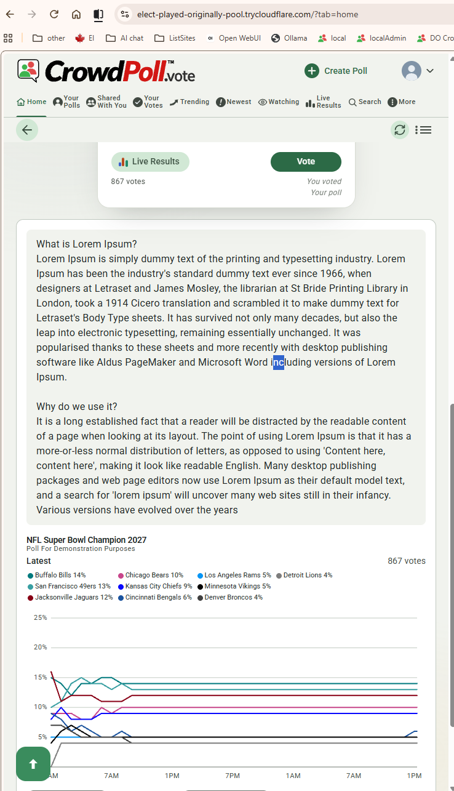

Start a new spec for these requirements called `20261117-131915-WIDE-MORE-CHOICES`  
!! THIS FILE IS GENERATED USING THE SKILL `/speckit-requirements`. DO NOT EDIT OR DELETE THIS FILE !!  

# Initial High-Level Requirements

This feature will apply to viewport widths 641px and up.  

The functionality of scrolling the bars in a row when the bars dont't all fit,   
is being deprecated because users find it cumbersome.  

The "More choices - p%" clickable bar will be used, as is currently used for 640px and less.  

This "More choices..." bar naviagates to the Maximize Poll Card.  
When on the Maximized Poll Card, the same "Show all..." and "Show fewer choices" bars will be used,  
as with 640px and less. 

Also, as with 640px and less, when a Poll has Notes, and the "Show more" button is clicked,  
navigate to notes panel on the Maximized view with the "Vote button visible above it.  

An example of this is seen in this screenshot:  

## Clarifications (2026-11-17 1:29 PM)

Decisions accepted in `requirements-report.md`.  

- **The scrolling list is removed (AM1).**  
  "Deprecated" means removed on this release, at 641 px and up: the up and down arrow rows, press-and-hold, and drag with the mouse all go, with their code and styles.  
  A card never scrolls inside itself at any width;  
  the "More choices" row is the only way from a card to its hidden choices.  
- **A card shows as many choices as fit (AM2).**  
  A poll whose bars all fit in the card looks exactly as it does today, with no "More choices" row.  
  Otherwise the card shows the leading choices that fit at the smallest bar height, with the last place given to the "More choices" row;  
  the viewer's own choices are always among them, taking the place of the lowest leaders when needed.  
  The phone's rule of four leaders is not used at 641 px and up.  
- **"Show more" scrolls to the notes; the panels stay stacked (AM3).**  
  At 641 px and up the maximized view keeps its stacked panels, with no tab bar, as in the screenshot.  
  "Show more" opens the maximized view and scrolls until the card's action row, with its Vote button, is the first thing under the fixed header, with the notes panel beneath it.  
  When the notes are already in the upper half of the window, nothing scrolls, as on the phone.  
- **Vote on a card with hidden choices opens the maximized view on its voting side (UA1).**  
  This applies only to a card that shows the "More choices" row;  
  a card whose choices all fit turns over in place, as today.  
  The voting side of a card does not scroll either.  
- **The maximized view follows the phone's rules at every width (UA2).**  
  Ten leaders (all when twelve or fewer), of which only those above 2% when any is, plus the viewer's own choices;  
  the same three rows: "Show all N choices", "Show fewer choices" and "Remaining choices · 0%";  
  and the same view on arrival from "More choices": every choice with a vote first.  
- **The row's text is the phone's (UA3).**  
  "More choices · p%" on a single-choice poll, where p is the combined share of the hidden choices, and "More choices" on any other poll.  
- **The rows look as on the phone, at the wide layout's own sizes (UA4).**  
  The same outlined shape and colours, from the same Material 3 tokens.  
  The row takes the place of one bar: its height is the card's bar height, and its text is the size of a bar's label at that width.  
  It is a button, reached with Tab and worked with Enter or Space, with a pointer cursor and the hover and focus states of the card's other controls.  
- **Nothing else opens the maximized view (NC1).**  
  Only the "More choices" row and "Show more" are added at 641 px and up;  
  a click on a result bar or on the notes box does nothing there, as today.  
