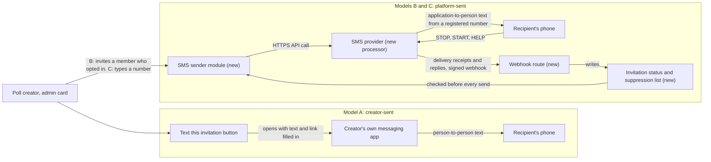
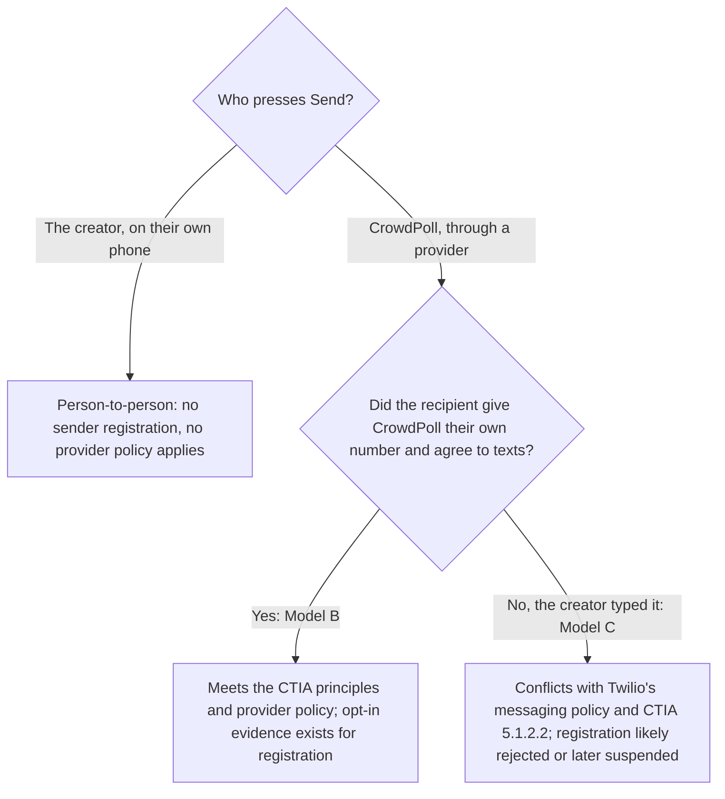
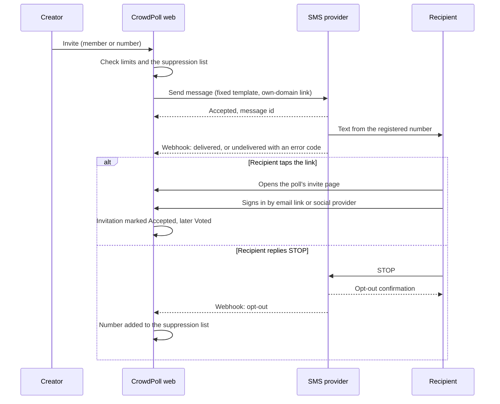
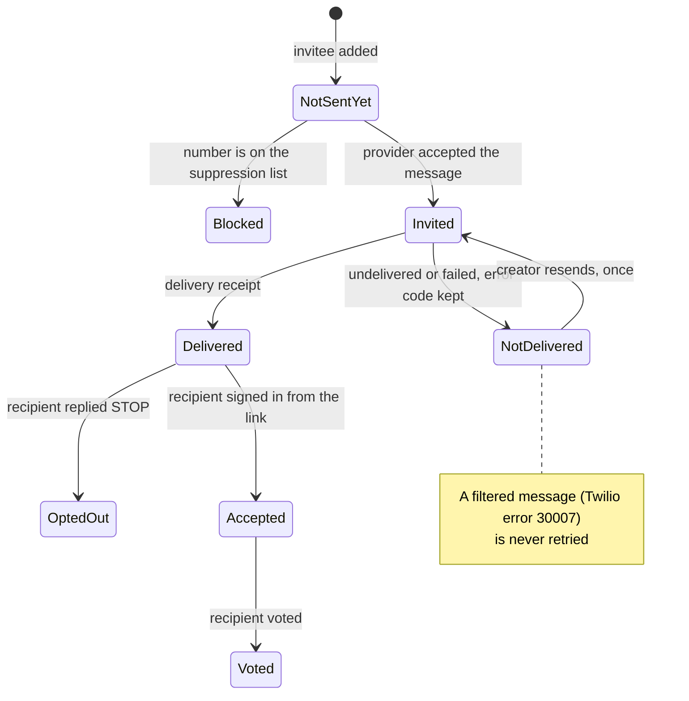
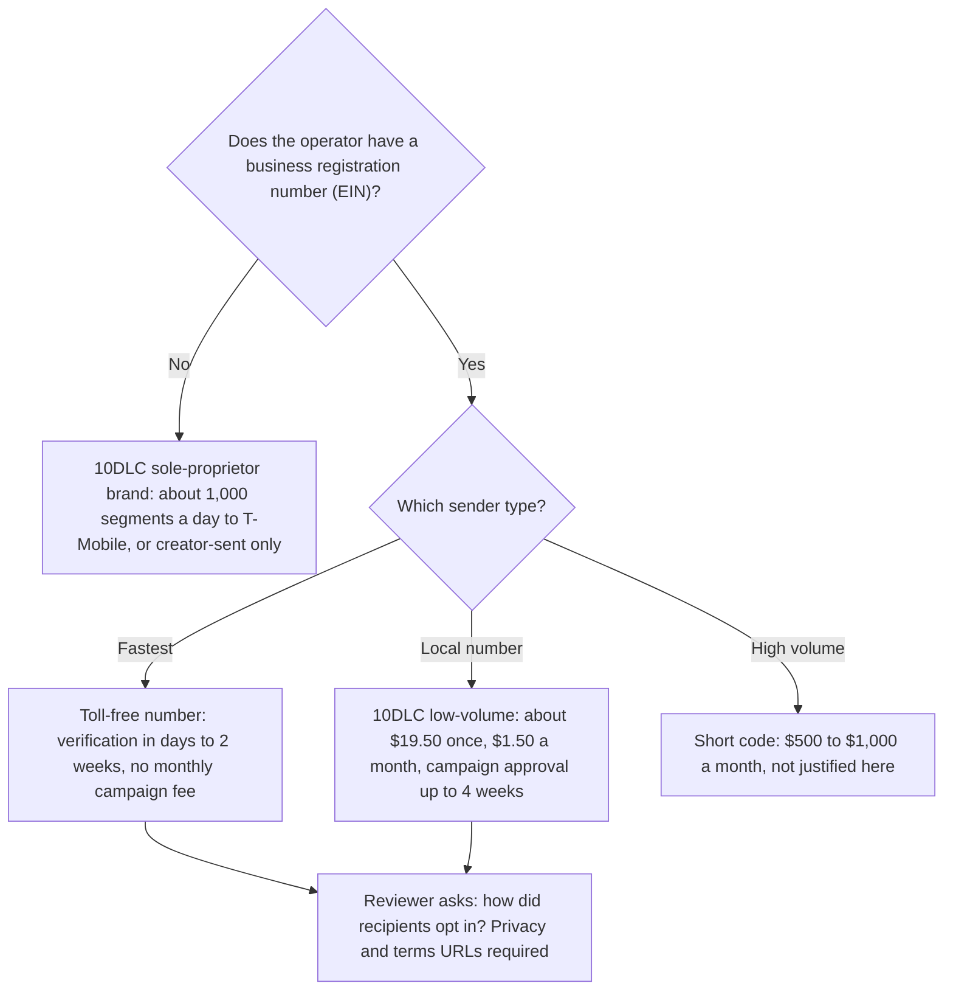

# High Level Requirements

Requirements: `requirements/20261117-154627-sms-invitation-research/requirements.md`  
External Files: none  
Generated: 2026-11-17 3:49 PM  

The goal of these requirements are to research the details of how to add  
SMS invitation functionality to the system.  

What are some of the leading providers?  
Does Digital Ocean provide SMS invitation services, or would we need to integrate with a third-party provider?  
If DO does not provide SMS services, is there a provider that integrates well with Digital Ocean?  

What are the costs? 

How will this affect the legal documents and privacy policies?  
What are the security implications of sending SMS invitations?  
How will we handle opt-in and opt-out mechanisms for users?  

How will we track and report the status of sent SMS invitations?  
How will we handle user feedback and complaints related to SMS invitations?
What are the reporting and analytics requirements for SMS invitations?
How will we ensure compliance with relevant regulations and standards for SMS communications?   
What are the requirements for message content and formatting to comply with regulations?

Based on the outcome of this research, we may decide to start a new feature to implement SMS invitation functionality in the system.  

## Additional Requirements and Research Requests

**Instructions To The Developer**  
Enter any additional requirements or research requests under the ## Additional Requirements and Research Requests heading above.  
When you Type or Say: "Next" in the CC CLI terminal, the additional requirements and research requests will be applied to the report.  
  
You may leave these instructions here. They will be ignored when "Next" is executed.  

## 1. Overview

The requirements ask twelve research questions about inviting people to a poll by text message, beside the email invitations CrowdPoll sends today.  
Nothing is built by this feature: its result is this report, and a decision whether to start an implementation feature.  

The research gives one result that shapes every other answer.  
**A text that CrowdPoll itself sends to a number a poll creator typed in is the hard case.**  
US federal law probably allows a single, non-marketing invitation text, although that reading is contested.  
The stricter limit is contractual: the CTIA messaging principles and the providers' own policies (Twilio, Telnyx) require the consent of the person receiving the text, and do not accept consent given by someone else on their behalf.  
A sender registration (10DLC or toll-free) that cannot show how recipients opted in is likely to be rejected, and a sender that is approved and then draws complaints can be suspended.  

Three ways of sending an invitation by text follow from that, and research result RS11 asks which one to carry forward:

| Model | Who sends the text | Provider, cost, registration | Consent position |
|---|---|---|---|
| A. Creator-sent | The creator's own phone, from a "Text this invitation" button that opens their messaging app with the text filled in | None | Person-to-person; outside the application-to-person rules |
| B. Platform-sent, opted-in numbers only | CrowdPoll, through a provider, only to members who added and verified their own mobile number | Provider, registration, about $15 a month at 1,000 texts | The recipient's own consent, with evidence |
| C. Platform-sent, typed numbers | CrowdPoll, through a provider, to any number a creator types | Same as B | No recipient consent; conflicts with provider policy as written |

**What exists today** (from the code on branch `sms-invite`):

- Email invitations: `src/invitations/` (`invitations.ts`, `sender.ts`, `tokens.ts`), the table `poll_invitations` keyed on (`poll_id`, `email`), and the admin card's invitee panel in `adminCard.js`.  
- An invitee's status is one of "Not sent yet", "Not delivered", "Invited", "Accepted", "Voted", worked out from timestamp columns.  
- A creator may send 200 invitations in a rolling 24 hours (`ENV_MAX_INVITATIONS_PER_DAY`), and one reminder per invitee.  
- The admin card copies the poll link to the clipboard (`adminCard.js`); there is no share sheet and no `sms:` link.  
- No phone number is stored anywhere: not on the account, not in BetterAuth's configuration, not in any form.  
- There is no opt-out, unsubscribe or suppression list for invitation emails, and no bounce or complaint tracking from Amazon SES.  
- The email sender (`src/email/mailer.ts`) is a module around a nodemailer transport, not a provider interface.  
- The privacy policy already has "Addresses other people give us" and an invitations section, and lists Amazon SES among the processors; the terms say "Invite only people who would expect to hear from a poll".  

## 2. Scope

**In scope**

- Answering the twelve research questions, each as a research result (RS1 to RS12) with a recommendation.  
- Recording in `requirements.md` the decisions an implementation feature would start from.  

**Out of scope**

- Any change to code, database, settings, legal pages or infrastructure.  
- Opening a provider account, buying a number or registering a sender.  
- Legal advice: the regulatory results are research, and the points marked contested or unconfirmed need a lawyer's review before a platform-sent model goes live.  

## 3. Proposed Design

This section sketches what each model would add, so the choice in RS11 can be seen.  
It is a sketch for the decision, not a design to implement.  
Where a finding is resolved differently, `requirements.md` is right and this section is not rewritten.  

### 3.1 Model A: the creator sends the text

- The admin card gains a "Text this invitation" action beside the existing copy-link action.  
- On a phone it opens the device's share sheet, or the messaging app through an `sms:` link, with the invitation text and the poll link filled in; the creator picks the recipients from their own contacts and presses Send.  
- CrowdPoll never sees a phone number.  
- The person who taps the link signs in as anyone does today, by email link or a social provider.  
- Nothing is tracked per recipient, because CrowdPoll does not know who was texted.  

### 3.2 Models B and C: CrowdPoll sends the text

Both need the same new parts:

- An SMS sender module beside `src/email/`, with a provider behind an interface and a console stand-in for development and tests.  
- Provider credentials as `ENV_*` secrets in `infra/app.tf`, declared in `infra/variables.tf` and set in `infra/secrets.auto.tfvars`, as the SES keys are.  
- A registered sender: one verified toll-free number or one low-volume 10DLC campaign.  
- Phone numbers in the data model, normalized to E.164, encrypted at rest and masked in logs.  
- A webhook route for delivery receipts and inbound replies (STOP, START, HELP), with the provider's signature checked.  
- A site-wide suppression list, checked before every send.  
- Limits: per creator per day, per destination number across all creators, and a monthly spend ceiling.  
- New sections in `privacy.html` and `terms.html`, and a new `TERMS_VERSION`.  

They differ in where the numbers come from:

- **Model B**: a member adds a mobile number to their own account, proves it with a code sent to it, and ticks a box to receive poll invitations by text.  
  A creator invites by email address as today; a member who opted in also gets the text.  
- **Model C**: a creator types numbers into the invitee panel, as they type email addresses today.  

## 4. Architecture Diagrams

### 4.1 The three models, and what each adds to the system

### 4.2 Where the recipient's consent comes from

### 4.3 A platform-sent invitation, from invite to vote (Models B and C)

### 4.4 The status of a platform-sent invitation

### 4.5 Registering a sender (Models B and C)

## 5. Research Results

The research was done on 2026-11-17 from the providers' and regulators' own pages where they could be read.  
Prices change; each should be checked again before a provider is chosen.  
The regulatory results are not legal advice.  
A fact that could not be confirmed from a primary page is marked "unconfirmed".  

### 5.1 Leading providers

**RS1. What are some of the leading providers?**  

> The requirements ask which providers lead in sending SMS from an application.  
> Sources: [Twilio US pricing](https://www.twilio.com/en-us/sms/pricing/us), [AWS End User Messaging pricing](https://aws.amazon.com/end-user-messaging/pricing/), [Telnyx messaging pricing](https://telnyx.com/pricing/messaging), [Plivo US pricing](https://www.plivo.com/sms/pricing/us/), [Bandwidth pricing](https://www.bandwidth.com/pricing/), [Bird SMS fees](https://bird.com/pricing/sms/fees), [Vonage SMS pricing](https://www.vonage.com/communications-apis/sms/pricing), [Sinch pricing](https://sinch.com/engage/pricing), [Twilio Verify pricing](https://www.twilio.com/en-us/verify/pricing).  
> Eight providers were compared for US outbound texts, price per message segment in USD before carrier fees:  
>
> | Provider | 10DLC / toll-free / short code | Number per month | Notes |
> |---|---|---|---|
> | Twilio | 0.0083 / 0.0083 / 0.0083 | 10DLC 1.15, toll-free 2.15 | Most complete documentation; SMS pumping protection; automatic STOP handling |
> | AWS End User Messaging (with SNS) | unconfirmed (the rate table did not load) | 10DLC 1, toll-free 2 | Same AWS account, IAM and bill as SES; 10DLC campaign approval "up to 4 weeks" |
> | Telnyx | 0.004 / 0.0055 / 0.007 | 1.00 | Cheapest published rates |
> | Plivo | 0.0077 / 0.0079 / 0.0077 | 10DLC 0.50, toll-free 1.00 | |
> | Bandwidth | 0.004 / 0.007 / 0.008 | not published | Quote-based, aimed at larger senders |
> | Vonage | about 0.0081 (third-party figure) | about 1 | Official page did not load |
> | Sinch | about 0.0078 (third-party figure) | unconfirmed | |
> | Bird (formerly MessageBird) | about 0.0033 (third-party figure) | unconfirmed | One report says its SMS pricing showed "Coming soon" in August 2026 |
>
> Carrier fees are added by every provider at about the same amounts: AT&T $0.0035, T-Mobile $0.0045, Verizon $0.0045 to $0.005 per segment.  
> Twilio Verify is a different product, for one-time codes, at $0.05 per verification plus the text; it is not for invitations.  
> Not confirmed in this research: that all eight offer a Node SDK, delivery-receipt webhooks and automatic STOP handling; this is expected, and is to be checked in the chosen provider's documentation.  

❌ NOT Resolved

  - **Recommendation**: **record a shortlist of three: Twilio, AWS End User Messaging and Telnyx.**  

    [ ] ➡️ **Accept** (To Accept, you may: mark <b>[X]</b> on this line, save the file, then Type/Say "<b>next</b>" in the CC CLI terminal, OR Type/Say "<b>Accept RS1</b>" in CC CLI)

    - Twilio has the best documentation and fraud tools, AWS reuses the account CrowdPoll already has for SES, and Telnyx has the lowest published prices.  
    - Bandwidth is aimed at larger senders, Bird's SMS offer is uncertain, and Plivo, Vonage and Sinch offer nothing the three do not.  
    - A provider is needed only if CrowdPoll sends the texts itself (see RS11).  

  - **Developer Resolution B**:  

    [ ] ➡️ **Accept** (To Accept, you may: mark <b>[X]</b> on this line, save the file, then Type/Say "<b>next</b>" in the CC CLI terminal, OR Type/Say "<b>Accept RS1, B</b>" in CC CLI)

    - you may enter your own resolution here  

### 5.2 DigitalOcean's own SMS service

**RS2. Does DigitalOcean provide SMS services, or is a third-party provider needed?**  

> The requirements ask whether DigitalOcean can send the texts itself.  
> Sources: [DigitalOcean products](https://www.digitalocean.com/products), [DigitalOcean Marketplace add-ons](https://marketplace.digitalocean.com/category/add-ons), [DigitalOcean sample functions](https://docs.digitalocean.com/products/functions/getting-started/sample-functions).  
> DigitalOcean has no SMS or messaging product in its product list.  
> The Marketplace add-ons that could be read (Plesk, SnapShooter, JetBackup, Uptime) include no SMS service; the full catalogue could not be read.  
> DigitalOcean's own material points to third parties: its sample function for sending a text uses Twilio.  

❌ NOT Resolved

  - **Recommendation**: **record that DigitalOcean offers no SMS service and a third-party provider is required for platform-sent texts.**  

    [ ] ➡️ **Accept** (To Accept, you may: mark <b>[X]</b> on this line, save the file, then Type/Say "<b>next</b>" in the CC CLI terminal, OR Type/Say "<b>Accept RS2</b>" in CC CLI)

    - This is the same position as email, which already goes through Amazon SES and not through DigitalOcean.  

  - **Developer Resolution B**:  

    [ ] ➡️ **Accept** (To Accept, you may: mark <b>[X]</b> on this line, save the file, then Type/Say "<b>next</b>" in the CC CLI terminal, OR Type/Say "<b>Accept RS2, B</b>" in CC CLI)

    - you may enter your own resolution here  

### 5.3 A provider that works well with DigitalOcean

**RS3. Is there a provider that integrates well with DigitalOcean?**  

> The requirements ask which provider fits a DigitalOcean deployment.  
> Sources: [DigitalOcean sample functions](https://docs.digitalocean.com/products/functions/getting-started/sample-functions), [Twilio's DigitalOcean Functions tutorial](https://www.twilio.com/en-us/blog/developers/community/send-scheduled-sms-twilio-digital-ocean-functions), [DigitalOcean's Nexmo tutorial](https://www.digitalocean.com/community/tutorials/send-sms-from-the-browser-with-web-apis-node-and-nexmo), [AWS 10DLC registration](https://docs.aws.amazon.com/sms-voice/latest/userguide/registrations-10dlc.html).  
> No provider has an official DigitalOcean integration, and none is needed.  
> Sending a text is an HTTPS call from the `web` service, and receipts come back to a public webhook route; App Platform supports both without anything extra.  
> Credentials would be added as the SES keys are: a variable in `infra/variables.tf`, a `SECRET` entry in `infra/app.tf` and a line in `infra/secrets.auto.tfvars`.  
> Twilio is the only provider with tutorials on both sides (DigitalOcean's sample and Twilio's own); the Nexmo (Vonage) tutorial is old and unmaintained.  
> The choice therefore rests on price, documentation and account reuse, not on DigitalOcean.  

❌ NOT Resolved

  - **Recommendation A** _(recommended)_: **Twilio as the first choice, if CrowdPoll sends texts itself.**  

    [ ] ➡️ **Accept** (To Accept, you may: mark <b>[X]</b> on this line, save the file, then Type/Say "<b>next</b>" in the CC CLI terminal, OR Type/Say "<b>Accept RS3, A</b>" in CC CLI)

    - <u>Pros</u>: the most complete documentation, automatic STOP, START and HELP handling, SMS pumping protection, toll-free verification in 3 to 5 business days, and the only DigitalOcean examples.  
    - <u>Cons</u>: about 40% dearer than Telnyx (about $4 a month more at 1,000 texts, $40 at 10,000), and one more processor and bill.  

  - **Recommendation B**: **AWS End User Messaging.**  

    [ ] ➡️ **Accept** (To Accept, you may: mark <b>[X]</b> on this line, save the file, then Type/Say "<b>next</b>" in the CC CLI terminal, OR Type/Say "<b>Accept RS3, B</b>" in CC CLI)

    - <u>Pros</u>: the AWS account, IAM user and bill already exist for SES, and no new company joins the list of processors.  
    - <u>Cons</u>: its per-message rate could not be confirmed, 10DLC campaign approval is documented as up to 4 weeks, and receipts and replies arrive through SNS topics, which is more to set up than a webhook.  

  - **Recommendation C**: **Telnyx.**  

    [ ] ➡️ **Accept** (To Accept, you may: mark <b>[X]</b> on this line, save the file, then Type/Say "<b>next</b>" in the CC CLI terminal, OR Type/Say "<b>Accept RS3, C</b>" in CC CLI)

    - <u>Pros</u>: the lowest published prices.  
    - <u>Cons</u>: less documentation, its 10DLC fees are not on its pricing page, and toll-free verification takes 1 to 2 weeks.  

  - **Developer Resolution D**:  

    [ ] ➡️ **Accept** (To Accept, you may: mark <b>[X]</b> on this line, save the file, then Type/Say "<b>next</b>" in the CC CLI terminal, OR Type/Say "<b>Accept RS3, D</b>" in CC CLI)

    - you may enter your own resolution here  

### 5.4 Costs

**RS4. What are the costs?**  

> The requirements ask what sending invitation texts costs.  
> Sources: [Twilio US pricing](https://www.twilio.com/en-us/sms/pricing/us), [Telnyx messaging pricing](https://telnyx.com/pricing/messaging), [AWS End User Messaging pricing](https://aws.amazon.com/end-user-messaging/pricing/), [Twilio A2P 10DLC fees](https://support.twilio.com/hc/en-us/articles/1260803965530-Pricing-and-Fees-for-A2P-10DLC-Service), [Twilio sole proprietor FAQ](https://support.twilio.com/hc/en-us/articles/9550596959643-A2P-10DLC-Sole-Proprietor-Brands-FAQ), [Twilio toll-free verification](https://help.twilio.com/articles/5377174717595-Toll-Free-Message-Verification-for-US-Canada), [Twilio character limits](https://www.twilio.com/docs/glossary/what-sms-character-limit), [Twilio Canada](https://www.twilio.com/en-us/sms/pricing/ca), [UK](https://www.twilio.com/en-us/sms/pricing/gb), [Germany](https://www.twilio.com/en-us/sms/pricing/de) and [India](https://www.twilio.com/en-us/sms/pricing/in) pricing.  
> A creator-sent text (Model A) costs CrowdPoll nothing.  
> A platform-sent text has four parts: the provider's price per segment, the carrier fee per segment (about $0.0045), the number's monthly rent, and registration.  
>
> | Option, US only | 1,000 segments a month | 10,000 segments a month | One-time |
> |---|---|---|---|
> | Twilio, toll-free number | about $15 | about $130 | none found |
> | Twilio, 10DLC low-volume | about $15.45 | about $131 | $19.50 |
> | Telnyx, toll-free number | about $11 | about $101 | none found |
> | Telnyx, 10DLC low-volume | about $11 | about $88 | about $19.50 (assumed pass-through) |
> | AWS, 10DLC low-volume | $3 fixed plus messages (rate unconfirmed) | same | $4.50 |
>
> 10DLC registration is $4.50 for the brand and $15 for campaign vetting, then $1.50 a month for a low-volume campaign.  
> No toll-free verification fee was found, but no page states that it is free.  
> A short code costs $500 to $1,000 a month and is not justified at this volume.  
> Both 10DLC and toll-free have required a business registration number (EIN) since 2026-02-17; a sole proprietor without one is limited to a 10DLC sole-proprietor brand of about 1,000 segments a day to T-Mobile.  
> A segment is 160 plain (GSM-7) characters; one emoji or curly quote makes the whole text UCS-2, where a segment is 70 characters, so the same text can cost twice as much.  
> Twilio bills $0.001 for a failed message.  
> Outside the US and Canada a text costs 7 to 14 times as much: UK $0.056, Germany $0.112, India $0.083, against about $0.013 in the US; Canada is about $0.015 to $0.017 from the same number.  

❌ NOT Resolved

  - **Recommendation**: **record a budget of about $15 a month per 1,000 US texts, about $20 once for registration, and three cost controls.**  

    [ ] ➡️ **Accept** (To Accept, you may: mark <b>[X]</b> on this line, save the file, then Type/Say "<b>next</b>" in the CC CLI terminal, OR Type/Say "<b>Accept RS4</b>" in CC CLI)

    - The budget uses Twilio's prices, the dearest of the shortlist, so it is an upper figure; Telnyx is about a quarter less.  
    - Control 1: the invitation text is one segment, plain ASCII, with a short link (see RS12).  
    - Control 2: a daily cap per creator, as `ENV_MAX_INVITATIONS_PER_DAY` is for email, and a monthly spend ceiling for the whole site, both as `ENV_*` settings.  
    - Control 3: sending is limited to the countries chosen in UA1, with every other country switched off at the provider.  
    - Model A has no cost, and this result then records only that.  

  - **Developer Resolution B**:  

    [ ] ➡️ **Accept** (To Accept, you may: mark <b>[X]</b> on this line, save the file, then Type/Say "<b>next</b>" in the CC CLI terminal, OR Type/Say "<b>Accept RS4, B</b>" in CC CLI)

    - you may enter your own resolution here  

### 5.5 Legal documents and privacy policy

**RS5. How will this affect the legal documents and privacy policies?**  

> The requirements ask what changes in the Privacy Policy and the Terms.  
> Sources: [CTIA Messaging Principles and Best Practices, May 2023](https://api.ctia.org/wp-content/uploads/2023/05/230523-CTIA-Messaging-Principles-and-Best-Practices-FINAL.pdf) (section 5.2.1), [Twilio toll-free verification policy](https://www.twilio.com/en-us/blog/toll-free-verification-policy), [Twilio messaging policy](https://www.twilio.com/en-us/legal/messaging-policy); the code: `src/public/privacy.html`, `src/public/terms.html`, `src/legal/version.ts`.  
> Today the privacy policy covers "Addresses other people give us" (email addresses a creator types), the invitation email with one reminder, and lists Amazon SES as a processor; the terms say "Invite only people who would expect to hear from a poll".  
> For platform-sent texts, the carriers and providers expect the privacy policy to say:  
> which phone numbers are collected and from whom;  
> that they are used for the invitation only;  
> who the SMS provider is, as a processor;  
> how long numbers and the opt-out list are kept;  
> how often texts are sent, that "message and data rates may apply", and how STOP and HELP work;  
> and that mobile numbers and opt-in data are not shared with third parties or affiliates for marketing.  
> Twilio has required privacy-policy and terms URLs for toll-free verification since 2026-09-15, and a reviewer reads them.  
> A phone number is personal information under California's CCPA (from memory, not re-read) and personal data under GDPR.  
> The terms would add what a creator promises when they invite by text, and the limits and the ban on abuse; a creator's promise does not create the recipient's consent.  
> Any change to either page moves `TERMS_VERSION`, so every account must accept the terms again.  
> Under Model A CrowdPoll collects no numbers, and only the terms' sentence about inviting people who expect it needs to mention texts.  

❌ NOT Resolved

  - **Recommendation**: **record the legal-page changes as requirements of the implementation feature, sized by the model chosen in RS11.**  

    [ ] ➡️ **Accept** (To Accept, you may: mark <b>[X]</b> on this line, save the file, then Type/Say "<b>next</b>" in the CC CLI terminal, OR Type/Say "<b>Accept RS5</b>" in CC CLI)

    - Model A: one sentence in the terms; no privacy change; `TERMS_VERSION` moves.  
    - Models B and C: a new privacy section for mobile numbers and texts with the six points above, the provider added to "Who processes your data for us", a new terms section for text invitations, and `TERMS_VERSION` moves.  
    - The legal pages are published before the sender registration is submitted, because the reviewer reads them.  
    - A lawyer reviews the wording before a platform-sent model goes live.  

  - **Developer Resolution B**:  

    [ ] ➡️ **Accept** (To Accept, you may: mark <b>[X]</b> on this line, save the file, then Type/Say "<b>next</b>" in the CC CLI terminal, OR Type/Say "<b>Accept RS5, B</b>" in CC CLI)

    - you may enter your own resolution here  

### 5.6 Security

**RS6. What are the security implications of sending SMS invitations?**  

> The requirements ask what risks an invite-by-text feature brings.  
> Sources: [Twilio: preventing messaging fraud](https://www.twilio.com/docs/messaging/guides/preventing-messaging-fraud), [Twilio webhook security](https://www.twilio.com/docs/usage/webhooks/webhooks-security).  
> The risks of a platform-sent model are:  
> SMS pumping, where an attacker makes the site text numbers that earn them money, at the site's cost;  
> harassment or spam, where a creator uses the form to text people who do not want it;  
> phishing look-alikes, because a text with a link from an unknown number is what a scam looks like;  
> forged webhooks, where someone posts false delivery receipts or opt-outs;  
> number enumeration, where the form's answers reveal whether a number is known or blocked;  
> recycled and SIM-swapped numbers, where the person holding the number is no longer the person invited;  
> and a new store of personal data, the numbers themselves.  
> Twilio's guidance is to switch off unused countries, turn on SMS Pumping Protection, put a CAPTCHA or bot check on the form, rate-limit per user, IP address and number prefix, and send only to mobile numbers.  
> Webhooks carry an `X-Twilio-Signature` to verify; a proxy that changes the URL breaks the check.  
> The remaining controls below are design conclusions from those risks, not quoted rules.  
> Model A has none of these risks for CrowdPoll: it sends nothing and stores no number.  

❌ NOT Resolved

  - **Recommendation**: **record nine security controls as requirements for any platform-sent model.**  

    [ ] ➡️ **Accept** (To Accept, you may: mark <b>[X]</b> on this line, save the file, then Type/Say "<b>next</b>" in the CC CLI terminal, OR Type/Say "<b>Accept RS6</b>" in CC CLI)

    - 1. Limits: per creator per day, per destination number across all creators, and a site-wide monthly spend ceiling.  
    - 2. Countries not chosen in UA1 are switched off at the provider, and the provider's pumping protection is on.  
    - 3. The existing human check (fcaptcha) guards the invite form.  
    - 4. The text is a fixed template; a creator writes none of it, and the creator's display name is cleaned and shortened before it is used.  
    - 5. The link is on CrowdPoll's own domain and never signs anyone in; the person signs in as usual after opening it.  
    - 6. Every webhook's signature is verified, and an unsigned call is refused.  
    - 7. The form answers the same way whether or not a number is on the suppression list.  
    - 8. Numbers are stored encrypted, the suppression list holds keyed hashes, and logs show a masked number, as `maskAddress` does for email.  
    - 9. A creator whose texts draw opt-outs loses the ability to invite by text (see RS9).  

  - **Developer Resolution B**:  

    [ ] ➡️ **Accept** (To Accept, you may: mark <b>[X]</b> on this line, save the file, then Type/Say "<b>next</b>" in the CC CLI terminal, OR Type/Say "<b>Accept RS6, B</b>" in CC CLI)

    - you may enter your own resolution here  

### 5.7 Opt-in and opt-out

**RS7. How will we handle opt-in and opt-out mechanisms for users?**  

> The requirements ask how people agree to, and refuse, invitation texts.  
> Sources: [CTIA Messaging Principles](https://api.ctia.org/wp-content/uploads/2023/05/230523-CTIA-Messaging-Principles-and-Best-Practices-FINAL.pdf) (sections 5.1.2.2, 5.1.3, 5.1.5), [Twilio messaging policy](https://www.twilio.com/en-us/legal/messaging-policy), [Twilio opt-out keywords](https://support.twilio.com/hc/en-us/articles/223134027-Twilio-Support-for-Opt-out-Keywords-SMS-STOP-Filtering), [Twilio Advanced Opt-Out](https://www.twilio.com/docs/messaging/tutorials/advanced-opt-out), [Twilio error 21610](https://www.twilio.com/docs/api/errors/21610), [FCC revocation rules, law-firm alert](https://www.nelsonmullins.com/insights/alerts/fcc-download/all/fcc-adopts-overhaul-of-tcpa-consent-revocation-rules-revoke-all-narrowed-exclusive-opt-out-methods-permitted-and-fraud-alert-exemption-expanded).  
> Opt-in: the CTIA principles and Twilio's policy require the recipient's own consent, which "should not be transferable"; a creator cannot opt a friend in.  
> The only opt-in that satisfies them is the recipient giving CrowdPoll their own number and agreeing to texts (Model B).  
> Opt-out: it must work whatever the consent, and one confirmation text is allowed.  
> Twilio handles STOP, START and HELP by itself: after STOP, a send to that number fails with error 21610 until the person texts START.  
> That block is per sending number, so the site still needs its own list, and a request in ordinary words ("please stop texting me") is to be honoured too.  
> The FCC's revised revocation rule is reported to take effect on 2026-11-25: seven words must be honoured (stop, quit, end, revoke, opt out, cancel, unsubscribe) within 10 business days; the date comes from one law-firm alert and is unconfirmed.  
> No registry exists where a person can refuse non-marketing texts in advance, so a person who has never been texted can only be protected by the site's own list.  
> CrowdPoll has no opt-out for invitation emails today.  

❌ NOT Resolved

  - **Recommendation**: **record the opt-in and opt-out rules for a platform-sent model: opt-in is the recipient's own, opt-out is honoured at once and site-wide.**  

    [ ] ➡️ **Accept** (To Accept, you may: mark <b>[X]</b> on this line, save the file, then Type/Say "<b>next</b>" in the CC CLI terminal, OR Type/Say "<b>Accept RS7</b>" in CC CLI)

    - Opt-in (Model B): a member adds a mobile number on their account, proves it with a code texted to it, and ticks an unticked box to receive poll invitations by text; the date, the wording shown and the number are kept as evidence.  
    - Opt-out by reply: STOP and the other standard words are handled by the provider, and its webhook adds the number to CrowdPoll's suppression list.  
    - Opt-out on the site: a member unticks the box; anyone, member or not, can block a number on a public page after proving it with a code.  
    - The suppression list is checked before every send, applies to every creator and poll, and is kept after an account is deleted, as a keyed hash.  
    - START (to the sending number) or the site page lifts a block; a creator never can.  
    - Model A needs none of this: the recipient answers, or blocks, the friend who texted them.  

  - **Developer Resolution B**:  

    [ ] ➡️ **Accept** (To Accept, you may: mark <b>[X]</b> on this line, save the file, then Type/Say "<b>next</b>" in the CC CLI terminal, OR Type/Say "<b>Accept RS7, B</b>" in CC CLI)

    - you may enter your own resolution here  

### 5.8 Tracking the status of sent invitations

**RS8. How will we track and report the status of sent SMS invitations?**  

> The requirements ask how the fate of each text is known and shown.  
> Sources: [Twilio Message resource](https://www.twilio.com/docs/messaging/api/message-resource), [Twilio error 30007](https://www.twilio.com/docs/api/errors/30007), [Twilio webhook security](https://www.twilio.com/docs/usage/webhooks/webhooks-security); the code: `src/invitations/invitations.ts` (`InviteeStatus`, `statusOf`), `src/invitations/sender.ts` (`deliver`).  
> A provider reports each message's progress to a webhook: for Twilio, accepted, queued, sending, sent, delivered, undelivered, failed.  
> An error code comes only with undelivered or failed; 30007 means the carrier or Twilio filtered the text, and it must not be retried.  
> "Delivered" means the handset's carrier accepted it, not that it was read.  
> Email invitations today record only that the send call did not throw: "Not delivered" means the call failed, and bounces from SES are not tracked.  
> So texts would be tracked more closely than email is.  
> Under Model A nothing can be tracked: CrowdPoll does not know who was texted.  

❌ NOT Resolved

  - **Recommendation**: **record that a platform-sent text is tracked by delivery receipt and shown in the existing invitee list with the existing statuses, plus "Delivered" and "Opted out".**  

    [ ] ➡️ **Accept** (To Accept, you may: mark <b>[X]</b> on this line, save the file, then Type/Say "<b>next</b>" in the CC CLI terminal, OR Type/Say "<b>Accept RS8</b>" in CC CLI)

    - Each sent text keeps the provider's message id, its last status, the time, and the error code if any.  
    - A signed webhook route receives the receipts; it is listed in the terms gate's exceptions and in `postman/openapi.json`.  
    - The creator sees, per invitee: Not sent yet, Invited, Delivered, Not delivered, Opted out, Accepted, Voted (diagram 4.4).  
    - "Opted out" tells the creator only that this invitee cannot be texted, not why.  
    - A filtered text (30007) is never resent; other failures may be resent once, as email reminders are.  
    - Model A: the creator's own messaging app is the record, and CrowdPoll shows nothing.  

  - **Developer Resolution B**:  

    [ ] ➡️ **Accept** (To Accept, you may: mark <b>[X]</b> on this line, save the file, then Type/Say "<b>next</b>" in the CC CLI terminal, OR Type/Say "<b>Accept RS8, B</b>" in CC CLI)

    - you may enter your own resolution here  

### 5.9 Feedback and complaints

**RS9. How will we handle user feedback and complaints related to SMS invitations?**  

> The requirements ask how complaints about invitation texts arrive and are handled.  
> Sources: [AT&T on forwarding to 7726](https://about.att.com/pages/cyberaware/ni/blog/forward_7726), [Verizon on reporting suspicious texts](https://www.verizon.com/about/account-security/reporting-suspicious-text-messages-to-verizon), [Twilio error 30007](https://www.twilio.com/docs/api/errors/30007), [CTIA Messaging Principles](https://api.ctia.org/wp-content/uploads/2023/05/230523-CTIA-Messaging-Principles-and-Best-Practices-FINAL.pdf).  
> A recipient complains in one of four ways:  
> replying STOP;  
> replying in words;  
> forwarding the text to 7726 or pressing "Report junk", which goes to their carrier;  
> or writing to the site.  
> The site sees the first two through the provider's webhook and the last through its contact address.  
> It never sees a 7726 report: no primary document was found describing how those reach a sender, and in practice they show up as more filtered texts (30007) and as compliance notices from the provider.  
> Vendor pages quote carrier thresholds of about 4 to 5% opt-outs in a day and about 0.1% complaints; they conflict and are unverified.  
> Sustained complaints lead to filtering, then suspension of the sender, which stops texts for every creator.  
> The privacy policy already promises removal on request for addresses other people give.  

❌ NOT Resolved

  - **Recommendation**: **record a complaint path for a platform-sent model: every reply is read by the system, HELP names a contact, and a creator who draws opt-outs is stopped.**  

    [ ] ➡️ **Accept** (To Accept, you may: mark <b>[X]</b> on this line, save the file, then Type/Say "<b>next</b>" in the CC CLI terminal, OR Type/Say "<b>Accept RS9</b>" in CC CLI)

    - STOP and its synonyms are treated as a complaint against the creator who invited that number.  
    - Any other reply is kept and shown to the operator; a reply that reads as a refusal is added to the suppression list by the operator.  
    - The HELP reply names CrowdPoll, says the text was a poll invitation from a member, and gives the contact email address.  
    - A creator's ability to invite by text is suspended automatically when their texts draw more than a set number of opt-outs in a rolling period, an `ENV_*` setting; the operator can restore it.  
    - The provider's compliance notices go to a monitored mailbox, and the 30007 rate is watched (see RS10).  
    - Model A: a complaint goes to the friend who sent the text; CrowdPoll's existing contact address is unchanged.  

  - **Developer Resolution B**:  

    [ ] ➡️ **Accept** (To Accept, you may: mark <b>[X]</b> on this line, save the file, then Type/Say "<b>next</b>" in the CC CLI terminal, OR Type/Say "<b>Accept RS9, B</b>" in CC CLI)

    - you may enter your own resolution here  

### 5.10 Reporting and analytics

**RS10. What are the reporting and analytics requirements for SMS invitations?**  

> The requirements ask what must be reported about invitation texts.  
> Sources: [Twilio Message resource](https://www.twilio.com/docs/messaging/api/message-resource), [Twilio error 30007](https://www.twilio.com/docs/api/errors/30007), [Twilio error 21610](https://www.twilio.com/docs/api/errors/21610), [Twilio messaging policy](https://www.twilio.com/en-us/legal/messaging-policy), [CTIA Messaging Principles](https://api.ctia.org/wp-content/uploads/2023/05/230523-CTIA-Messaging-Principles-and-Best-Practices-FINAL.pdf) (section 5.1.5).  
> No regulation was found that requires a sender to publish or file reports.  
> What is required is record-keeping: Twilio's policy says proof of consent must be retained, and the CTIA principles say opt-outs are to be retained.  
> What a sender needs for its own protection is early warning, from five figures: the delivery rate, the filtered rate (30007), the opt-out rate, the count of sends refused because the number had opted out (21610), and opt-outs per creator.  
> Cost needs a sixth: segments sent in the month.  
> CrowdPoll has no analytics page for email invitations; the creator sees per-invitee status and the count of accepted invitations.  

❌ NOT Resolved

  - **Recommendation**: **record two kinds of record and one operator report; no analytics for creators beyond the invitee list.**  

    [ ] ➡️ **Accept** (To Accept, you may: mark <b>[X]</b> on this line, save the file, then Type/Say "<b>next</b>" in the CC CLI terminal, OR Type/Say "<b>Accept RS10</b>" in CC CLI)

    - Record 1: consent evidence for each opted-in number (when, the wording shown, how it was verified), kept while the opt-in stands and for a period after.  
    - Record 2: the suppression list and, per text, its status history.  
    - The operator report: per day and per month, texts sent, segments, delivered, not delivered, filtered (30007), opted out, and the creators with the most opt-outs; produced by a dev script in `devScripts/`, like the poll data extractors, not a new page.  
    - The creator sees per-invitee status only (RS8), as for email.  
    - Model A: nothing to report.  

  - **Developer Resolution B**:  

    [ ] ➡️ **Accept** (To Accept, you may: mark <b>[X]</b> on this line, save the file, then Type/Say "<b>next</b>" in the CC CLI terminal, OR Type/Say "<b>Accept RS10, B</b>" in CC CLI)

    - you may enter your own resolution here  

### 5.11 Compliance with regulations and standards

**RS11. How will we ensure compliance with relevant regulations and standards for SMS communications?**  

> The requirements ask how invitation texts can comply with the rules; the answer depends on who sends the text, so this result asks which model to carry forward.  
> Sources: [FCC 2015 Omnibus Ruling, Federal Register](https://www.govinfo.gov/content/pkg/FR-2015-10-09/html/2015-25682.htm), [summary of the 2015 ruling](https://www.loeb.com/-/media/files/publications/2015/07/fcc-order-clarifies-many-details-in-tcpa-and-fcc-rules-regarding-call-and-text-message-marketing-july-2015.pdf), [McLaughlin v. McKesson](https://www.huschblackwell.com/newsandinsights/supreme-court-clarifies-district-courts-independence-from-fccs-tcpa-interpretations), [one-to-one consent rule vacated](https://wiley.law/alert-UPDATE-11th-Circuit-Vacates-FCCs-One-to-One-TCPA-Consent-Rule), [Do Not Call rules and texts](https://www.duanemorris.com/alerts/fcc_order_requires_one_to_one_consent_codifies_do_not_call_rule_texting_0124.html), [Florida FTSA amendment](https://www.goodwinlaw.com/en/insights/publications/2023/06/alerts-otherindustries-dpc-florida-amends-mini-tcpa), [Washington RCW 19.190](https://app.leg.wa.gov/rcw/default.aspx?cite=19.190), [Oklahoma OTSA](https://oklegislature.gov/cf_pdf/2021-22%20ENR/hB/HB3168%20ENR.PDF), [CTIA Messaging Principles](https://api.ctia.org/wp-content/uploads/2023/05/230523-CTIA-Messaging-Principles-and-Best-Practices-FINAL.pdf), [Twilio messaging policy](https://www.twilio.com/en-us/legal/messaging-policy), [Telnyx acceptable use policy for messaging](https://support.telnyx.com/en/articles/1310359-acceptable-use-policy-for-messaging), [Canada's CASL regulations](https://laws-lois.justice.gc.ca/eng/regulations/SOR-2013-221/FullText.html), [ICO email marketing guidance, summary](https://dwfgroup.com/en/news-and-insights/insights/2022/11/direct-marketing-using-email-ico-publishes-new-guidance).  
> This is research, not legal advice.  
> **US federal law (TCPA).**  
> Prior consent is required for texts sent with an autodialer; since Facebook v. Duguid (2021) an autodialer must use a random or sequential number generator, which a site texting typed-in numbers probably does not (from memory, not re-read).  
> The FCC's 2015 ruling treated an app's user as the sender of an invitation text when the user took the deciding steps (TextMe) and the platform as the sender when users had little control (Glide); CrowdPoll would write and send the text, which weakens the argument that the creator is the sender.  
> Since McLaughlin v. McKesson (2025) courts are not bound by FCC interpretations, so that ruling is only persuasive.  
> The Do Not Call list and the 8 am to 9 pm rule apply to solicitations; a poll invitation is arguably not one, which is untested.  
> Damages are $500 per text, up to $1,500 if wilful, with a private right to sue (from memory).  
> **US state laws.**  
> Florida, Washington and Oklahoma restrict unconsented commercial texts; whether an invitation is commercial is untested.  
> **Industry rules, enforced by carriers and providers.**  
> The CTIA principles require express consent for any text the consumer did not start, and say an opt-in "should not be transferable or assignable".  
> Twilio's policy (updated 2026-04-13) requires consent "freely given by each recipient to each sender", not transferable, with proof kept; its only exception is a recipient who texts first.  
> Telnyx's policy restricts numbers obtained from a third party.  
> No "friend invitation" use case was found in the 10DLC campaign registry, and one provider lists referral campaigns as prohibited.  
> A registration with no recipient opt-in is likely to be rejected.  
> **Other countries.**  
> Canada's referral exemption covers one message, needs the referrer to have a relationship with both sides, and the message must name the referrer.  
> The UK regulator advises against asking users for friends' contact details.  
> In the EU a non-user's number is personal data needing a lawful basis and a notice at first contact (from memory).  
> **Conclusion.**  
> A text CrowdPoll sends to a typed-in number is probably lawful in the US as a single non-marketing text, but breaks the providers' policies as written; a text the creator sends from their own phone is outside these rules; a text CrowdPoll sends to a member who opted in meets them.  

❌ NOT Resolved

  - **Recommendation A** _(recommended)_: **Model A, creator-sent: a "Text this invitation" button opens the creator's own messaging app with the invitation filled in.**  

    [ ] ➡️ **Accept** (To Accept, you may: mark <b>[X]</b> on this line, save the file, then Type/Say "<b>next</b>" in the CC CLI terminal, OR Type/Say "<b>Accept RS11, A</b>" in CC CLI)

    - <u>Pros</u>: no provider, no cost, no registration, no phone numbers stored, no opt-out list, no new processor; a text from a known contact is more likely to be opened than one from an unknown number; it works in every country; it is a small client-side change.  
    - <u>Cons</u>: it works only on a device that can send texts, so a creator at a desktop copies the link instead; CrowdPoll cannot track who was invited or delivered to; the creator sends from their own number and plan.  

  - **Recommendation B**: **Model B, platform-sent to members who opted in: CrowdPoll texts only numbers their owners added, verified and agreed to.**  

    [ ] ➡️ **Accept** (To Accept, you may: mark <b>[X]</b> on this line, save the file, then Type/Say "<b>next</b>" in the CC CLI terminal, OR Type/Say "<b>Accept RS11, B</b>" in CC CLI)

    - <u>Pros</u>: it meets the CTIA principles and provider policy, with evidence for registration; delivery is tracked; it can be added later beside Model A.  
    - <u>Cons</u>: it cannot reach someone who is not yet a member, which is the main purpose of an invitation; it needs everything in section 3.2, a provider, a registered sender and the legal changes; about $15 a month per 1,000 texts.  

  - **Recommendation C**: **Model C, platform-sent to numbers a creator types.**  

    [ ] ➡️ **Accept** (To Accept, you may: mark <b>[X]</b> on this line, save the file, then Type/Say "<b>next</b>" in the CC CLI terminal, OR Type/Say "<b>Accept RS11, C</b>" in CC CLI)

    - <u>Pros</u>: it is the closest to email invitations today, reaches non-members, and is tracked.  
    - <u>Cons</u>: it conflicts with Twilio's and Telnyx's policies as written and with the CTIA principles; sender registration is likely to be rejected, or the sender suspended after complaints, stopping texts for everyone; it carries the contested legal exposure of $500 to $1,500 per text; it needs a lawyer's opinion first.  

  - **Developer Resolution D**:  

    [ ] ➡️ **Accept** (To Accept, you may: mark <b>[X]</b> on this line, save the file, then Type/Say "<b>next</b>" in the CC CLI terminal, OR Type/Say "<b>Accept RS11, D</b>" in CC CLI)

    - you may enter your own resolution here  

### 5.12 Message content and formatting

**RS12. What are the requirements for message content and formatting to comply with regulations?**  

> The requirements ask what an invitation text must and must not contain.  
> Sources: [Twilio messaging policy](https://www.twilio.com/en-us/legal/messaging-policy), [CTIA Messaging Principles](https://api.ctia.org/wp-content/uploads/2023/05/230523-CTIA-Messaging-Principles-and-Best-Practices-FINAL.pdf) (sections 5.1.3, 5.3.2), [Twilio character limits](https://www.twilio.com/docs/glossary/what-sms-character-limit), [Twilio error 30963](https://www.twilio.com/docs/api/errors/30963), [Twilio error 30525](https://www.twilio.com/docs/api/errors/30525), [Twilio on shortened links](https://help.twilio.com/articles/1260804572090-How-can-I-send-shortened-links-in-my-messages-), [Dialpad on content compliance](https://help.dialpad.com/v1/docs/sms-content-compliance).  
> For a platform-sent text:  
> the first message must name the sender and say how to opt out, "Reply STOP to unsubscribe" or equivalent (Twilio's policy);  
> registration reviewers also expect "Msg & data rates may apply" and HELP to be shown where the person opts in;  
> links must not hide who the sender is, and public shorteners (bit.ly, tinyurl) get registrations rejected and texts filtered; even a custom domain that only redirects can be rejected;  
> content about sex, hate, alcohol, firearms or tobacco is prohibited, which matters because a poll's title is written by a creator;  
> a text is one segment up to 160 plain (GSM-7) characters, and 153 per segment beyond that; one emoji, curly quote or non-Latin letter makes it UCS-2 at 70 characters a segment.  
> For a creator-sent text none of these are rules, but a short plain text with a link on CrowdPoll's own domain is still the one most likely to arrive and be trusted.  

❌ NOT Resolved

  - **Recommendation**: **record one fixed template, plain ASCII, one segment, with the link on CrowdPoll's own domain and no text written by the creator.**  

    [ ] ➡️ **Accept** (To Accept, you may: mark <b>[X]</b> on this line, save the file, then Type/Say "<b>next</b>" in the CC CLI terminal, OR Type/Say "<b>Accept RS12</b>" in CC CLI)

    - Platform-sent: `CrowdPoll: <Name> invited you to vote in a poll. <link> Reply STOP to opt out, HELP for help.`  
    - Creator-sent: `I'd like your vote in my CrowdPoll poll: <link>`, which the creator may edit before sending, since it is their own message.  
    - `<Name>` is the creator's display name reduced to plain ASCII letters, digits and spaces and cut to 20 characters; the poll's title is not in the text.  
    - `<link>` is on the site's own domain, with no shortener, and short enough that the whole platform-sent text is 160 characters or fewer.  
    - No emoji, no curly quotes, no accented letters in the template.  

  - **Developer Resolution B**:  

    [ ] ➡️ **Accept** (To Accept, you may: mark <b>[X]</b> on this line, save the file, then Type/Say "<b>next</b>" in the CC CLI terminal, OR Type/Say "<b>Accept RS12, B</b>" in CC CLI)

    - you may enter your own resolution here  

## 6. Breaking Changes

This feature is research and changes nothing, so it breaks nothing.  
An implementation feature that follows would bring these, depending on the model:

- **Every model: `TERMS_VERSION` moves**, so every account is asked to accept the terms again before using the site.  
- **Models B and C: `poll_invitations` is keyed on (`poll_id`, `email`)**; an invitee known only by a phone number (Model C) has no email, so the key and every query on it would change.  
- **Models B and C: the admin invitee route** `POST /api/admin/polls/:pid/invitees` takes email addresses in `add`; accepting numbers changes its contract and `postman/openapi.json`.  
- **Models B and C: a new processor** joins the privacy policy, and a new public webhook route joins the terms gate's exceptions.  
- **Model B: the account gains a phone number**, the first personal detail on it beyond the email address and name.  
- **Model A: none** beyond the terms version.  

## 7. Technical Debt

Found in the existing invitation code while researching, and relevant to any SMS work:

- **Invitation emails have no opt-out.**  
  There is no unsubscribe link, no `List-Unsubscribe` header and no suppression list; the email says only to ignore it.  
  A suppression list built for texts should cover email addresses too.  
- **Email delivery is not tracked.**  
  "Not delivered" means the send call threw; SES bounces and complaints are not received.  
  Texts would be tracked more closely than email, which the invitee list would then show unevenly.  
- **The mailer is not a provider interface.**  
  `src/email/mailer.ts` is a module around a nodemailer transport with `setTransport` as the test hook; an SMS sender has nothing to mirror and would set the pattern.  
- **`maskAddress` lives in `mailer.ts`.**  
  A phone-number mask would want a shared home for both.  
- **The daily cap counts emails** (`invitation_emails`, `ENV_MAX_INVITATIONS_PER_DAY`); texts would need their own count or a shared one.  

## 8. Assumptions

- The operator is in the United States, and the first audience is too.  
- "SMS" means plain text messages; RCS, WhatsApp and MMS are not considered.  
- Email invitations stay as they are; a text invitation is an addition.  
- Sign-in stays passwordless by email link or social provider; a phone number is never a way to sign in.  
- Prices are those published on 2026-11-17 and are checked again before a provider is chosen.  
- A platform-sent model is reviewed by a lawyer before it goes live.  

## 9. Findings

### 9.1 Inconsistencies

None found.

### 9.2 Ambiguities

**AM1. What does this feature deliver: the research alone, or a specification too?**  

> The requirements say the goal is "to research the details of how to add SMS invitation functionality", and that "we may decide to start a new feature to implement" it.  
> The requirements journey normally continues to `/speckit-specify`, which writes a specification for something to build.  
> It is not said whether this feature stops at the report, or goes on to specify the model chosen in RS11.  

❌ NOT Resolved

  - **Recommendation A** _(recommended)_: **research only: the feature ends with this report, and an implementation is a new feature started with `/speckit-requirements NEW`.**  

    [ ] ➡️ **Accept** (To Accept, you may: mark <b>[X]</b> on this line, save the file, then Type/Say "<b>next</b>" in the CC CLI terminal, OR Type/Say "<b>Accept AM1, A</b>" in CC CLI)

    - <u>Pros</u>: it is what the requirements say; the new feature starts from requirements written for the chosen model, citing this report, and not from twelve questions.  
    - <u>Cons</u>: one more `/speckit-requirements` pass before anything is built.  

  - **Recommendation B**: **continue: once the findings are resolved, run `/speckit-specify` on these requirements to specify the chosen model.**  

    [ ] ➡️ **Accept** (To Accept, you may: mark <b>[X]</b> on this line, save the file, then Type/Say "<b>next</b>" in the CC CLI terminal, OR Type/Say "<b>Accept AM1, B</b>" in CC CLI)

    - <u>Pros</u>: no second requirements pass.  
    - <u>Cons</u>: the requirements document would be questions plus recorded answers, a poor base for a specification, and the spec's name would say "research".  

  - **Developer Resolution C**:  

    [ ] ➡️ **Accept** (To Accept, you may: mark <b>[X]</b> on this line, save the file, then Type/Say "<b>next</b>" in the CC CLI terminal, OR Type/Say "<b>Accept AM1, C</b>" in CC CLI)

    - you may enter your own resolution here  

**AM2. Who are the "users" in "opt-in and opt-out mechanisms for users"?**  

> The requirements ask "How will we handle opt-in and opt-out mechanisms for users?".  
> "Users" could mean the people who receive a text, who are often not members;  
> the members who might agree to be texted;  
> or the creators who send invitations.  
> The research (RS7) shows the three need different things.  

❌ NOT Resolved

  - **Recommendation**: **read "users" as everyone who can receive a text: opt-out for any recipient, member or not, and opt-in for members.**  

    [ ] ➡️ **Accept** (To Accept, you may: mark <b>[X]</b> on this line, save the file, then Type/Say "<b>next</b>" in the CC CLI terminal, OR Type/Say "<b>Accept AM2</b>" in CC CLI)

    - Opt-out must work for a person who has never had an account, since they are the ones invited.  
    - Opt-in can only be a member's, since it needs somewhere to record it.  
    - Creators neither opt in nor out; their ability to invite by text is governed by the limits in RS6 and RS9.  

  - **Developer Resolution B**:  

    [ ] ➡️ **Accept** (To Accept, you may: mark <b>[X]</b> on this line, save the file, then Type/Say "<b>next</b>" in the CC CLI terminal, OR Type/Say "<b>Accept AM2, B</b>" in CC CLI)

    - you may enter your own resolution here  

### 9.3 Unspecified Aspects

**UA1. Which countries' numbers may be texted?**  

> The requirements do not say where recipients are.  
> It decides cost (a UK text is about 4 times a US one, a German one about 8 times), the rules that apply (CASL in Canada, PECR in the UK, ePrivacy and GDPR in the EU, template registration in India), and whether STOP replies work at all, since many countries' sender IDs cannot receive replies.  
> Under Model A the question does not arise: the creator texts whom they like from their own phone.  

❌ NOT Resolved

  - **Recommendation A** _(recommended)_: **United States only, for a platform-sent model.**  

    [ ] ➡️ **Accept** (To Accept, you may: mark <b>[X]</b> on this line, save the file, then Type/Say "<b>next</b>" in the CC CLI terminal, OR Type/Say "<b>Accept UA1, A</b>" in CC CLI)

    - <u>Pros</u>: one set of rules, the lowest price, STOP works, and every other country is switched off at the provider, which is also the main defence against SMS pumping.  
    - <u>Cons</u>: a creator cannot text an invitation to someone abroad; email still reaches them.  

  - **Recommendation B**: **United States and Canada (all +1 numbers).**  

    [ ] ➡️ **Accept** (To Accept, you may: mark <b>[X]</b> on this line, save the file, then Type/Say "<b>next</b>" in the CC CLI terminal, OR Type/Say "<b>Accept UA1, B</b>" in CC CLI)

    - <u>Pros</u>: the same number and nearly the same price reach Canada.  
    - <u>Cons</u>: Canada's anti-spam law (CASL) applies, and its referral exemption is narrow; +1 also covers Caribbean countries with high rates, which must be switched off one by one.  

  - **Developer Resolution C**:  

    [ ] ➡️ **Accept** (To Accept, you may: mark <b>[X]</b> on this line, save the file, then Type/Say "<b>next</b>" in the CC CLI terminal, OR Type/Say "<b>Accept UA1, C</b>" in CC CLI)

    - you may enter your own resolution here  

**UA2. How many invitation texts a month are expected?**  

> "What are the costs?" cannot be answered as a figure without a volume, and the volume also decides the sender type: a low-volume 10DLC campaign allows about 2,000 segments a day to T-Mobile, a sole-proprietor brand about 1,000.  
> The requirements give no volume.  
> Email invitations are capped at 200 per creator per day.  

❌ NOT Resolved

  - **Recommendation**: **plan for up to 1,000 texts a month at first, with 10,000 a month as the ceiling the first design must carry.**  

    [ ] ➡️ **Accept** (To Accept, you may: mark <b>[X]</b> on this line, save the file, then Type/Say "<b>next</b>" in the CC CLI terminal, OR Type/Say "<b>Accept UA2</b>" in CC CLI)

    - At 1,000 a month the cost is about $15; at 10,000 about $130 (RS4).  
    - 10,000 a month is about 330 a day, inside a low-volume campaign's and a toll-free number's limits, so one number of either kind is enough.  
    - The site-wide monthly ceiling in RS4 is set from this figure.  

  - **Developer Resolution B**:  

    [ ] ➡️ **Accept** (To Accept, you may: mark <b>[X]</b> on this line, save the file, then Type/Say "<b>next</b>" in the CC CLI terminal, OR Type/Say "<b>Accept UA2, B</b>" in CC CLI)

    - you may enter your own resolution here  

**UA3. How is a person invited by text recognised when they sign in?**  

> An email invitation is tied to the invitee's email address: `adoptInvitations` matches it to the account that signs in, and the invitation link can sign the invitee in by that address.  
> A person invited by text has no email address on record, and sign-in is by email link or social provider only.  
> The requirements do not say how the texted invitation becomes that person's access to the poll, which matters most for a private poll.  
> A phone number can pass to another person (recycled or SIM-swapped), so a link in a text is weaker proof of identity than a link in an email.  

❌ NOT Resolved

  - **Recommendation**: **the text's link identifies the invitation, not the person: it opens the poll's invite page, the person signs in as usual, and the invitation is then attached to that account, once.**  

    [ ] ➡️ **Accept** (To Accept, you may: mark <b>[X]</b> on this line, save the file, then Type/Say "<b>next</b>" in the CC CLI terminal, OR Type/Say "<b>Accept UA3</b>" in CC CLI)

    - The link never signs anyone in, unlike the email invitation's link.  
    - It carries a single-use invitation token with the same lifetime as today's (30 days, or until the poll ends); the first account to redeem it takes the invitation.  
    - Under Model B the invitee is already a member, so the text is only a notice and the link is the poll's ordinary link.  
    - Under Model A the link is the poll's ordinary link, as copied today; a private poll would still need the creator to add the person by email.  

  - **Developer Resolution B**:  

    [ ] ➡️ **Accept** (To Accept, you may: mark <b>[X]</b> on this line, save the file, then Type/Say "<b>next</b>" in the CC CLI terminal, OR Type/Say "<b>Accept UA3, B</b>" in CC CLI)

    - you may enter your own resolution here  

### 9.4 Needs Clarifications

**NC1. Does CrowdPoll's operator have a registered business with a tax number (EIN)?**  

> Both ways of registering a US sender have required a business registration number since 2026-02-17, and the registration names the legal entity, its address and its website.  
> Without one, the only platform-sent route is a 10DLC sole-proprietor brand, limited to about 1,000 segments a day to T-Mobile, and not offered by every provider.  
> The requirements do not say what entity operates CrowdPoll, and the code does not show it.  
> Only the developer knows this.  

❌ NOT Resolved

  - **Recommendation A** _(recommended)_: **yes, there is a registered business with an EIN: a platform-sent model would register one toll-free number under it.**  

    [ ] ➡️ **Accept** (To Accept, you may: mark <b>[X]</b> on this line, save the file, then Type/Say "<b>next</b>" in the CC CLI terminal, OR Type/Say "<b>Accept NC1, A</b>" in CC CLI)

    - <u>Pros</u>: toll-free verification takes days to two weeks, has no monthly campaign fee, and one number carries the expected volume.  
    - <u>Cons</u>: a toll-free sender looks less personal than a local number.  

  - **Recommendation B**: **no, the operator is an individual without an EIN: a platform-sent model is limited to a sole-proprietor 10DLC brand, or waits until a business is registered.**  

    [ ] ➡️ **Accept** (To Accept, you may: mark <b>[X]</b> on this line, save the file, then Type/Say "<b>next</b>" in the CC CLI terminal, OR Type/Say "<b>Accept NC1, B</b>" in CC CLI)

    - <u>Pros</u>: it records the real constraint; Model A is unaffected by it.  
    - <u>Cons</u>: lower limits, fewer providers, and a personal name and address on the registration.  

  - **Developer Resolution C**:  

    [ ] ➡️ **Accept** (To Accept, you may: mark <b>[X]</b> on this line, save the file, then Type/Say "<b>next</b>" in the CC CLI terminal, OR Type/Say "<b>Accept NC1, C</b>" in CC CLI)

    - you may enter your own resolution here  
