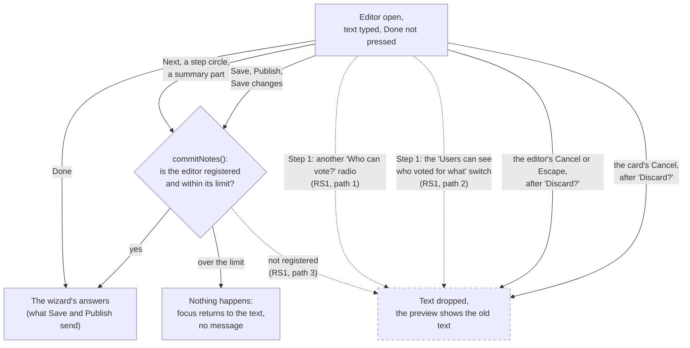
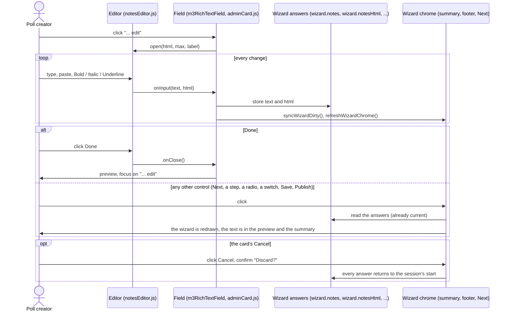
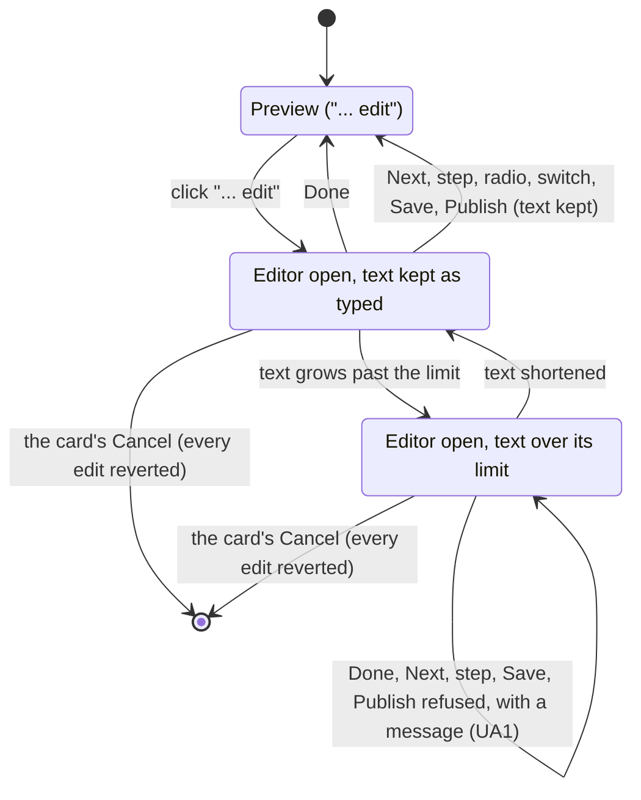

# High Level Requirements

Requirements: `requirements/20261118-074312-keep-notes-edits/requirements.md`  
External Files: none  
Generated: 2026-11-18 7:45 AM  

During our user testing, we observed that  
when using the Admin Poll Card editor to enter invitation email notes, shared link notes,  poll notes, without clicking "Done" before clicking "Next" loses the edits.

Please propose a solution to this issue.

It is acceptable that the only way to revert the edits would be to click "Cancel" on the entire Editing card.  
This is the same way that edits on any of the other fields would be reverted.  
This provides a consistent and predictable way for users to edit and revert changes within the Admin Poll Card editor. 

Based on the proposed solution,  
we may decide to proceed to implementation.

## Additional Requirements and Research Requests

**Instructions To The Developer**  
Enter any additional requirements or research requests under the ## Additional Requirements and Research Requests heading above.  
When you Type or Say: "Next" in the CC CLI terminal, the additional requirements and research requests will be applied to the report.  
  
You may leave these instructions here. They will be ignored when "Next" is executed.  

✅ Applied 2026-11-18 7:54 AM: 1 requirement added to requirements.md ("Our mistake in testing. This feature is done with no changes."); the feature is withdrawn, so no finding was added and the 6 findings below are left open, unanswered.  

## 1. Overview and Scope

The admin poll card's editor (the wizard in `src/public/adminCard.js`) has three formatted text fields.  
Each one shows a preview with an "... edit" button, and opens the same small editor (`src/public/notesEditor.js`) with its own **Cancel** and **Done** buttons.  

| The requirements call it | The field's label in the editor | Step | Limit |
|---|---|---|---|
| shared link notes | Link Preview Message | 1 · Who can vote ("Anyone with the link") | 100 |
| invitation email notes | Custom Email Message | 1 · Who can vote ("Only people you invite") | 1000 |
| poll notes | Notes | 2 · Title & Tags | 6000 |

Every other field of the wizard (Title, Subtitle, Choices, the radio buttons and switches) keeps what is typed as it is typed.  
These three are the only fields with a second, inner confirmation: the text reaches the wizard's answers only when the editor is closed with **Done**, or when a control remembers to close it first.  
Text typed into an open editor lives only in the editor until then, and that is where it can be lost.  

The feature removes that gap: text typed into any of the three editors is kept, whatever the user presses next, and is reverted only by the editing card's own **Cancel**.  

**In scope** (all in the browser, `src/public/`):  

- `notesEditor.js`: when the editor hands its text over, and what its own buttons do.  
- `adminCard.js`: the three fields (`m3RichTextField`), the controls that redraw the wizard, and the messages shown when a text is too long.  
- The client tests: `tests/client-admin-wizard.test.ts` and `tests/client-notes-editor.test.ts`.  

**Out of scope**:  

- The server, the API, `postman/openapi.json` and the database: the same three fields are sent in the same requests.  
- How notes are stored, escaped and shown to voters (`src/polls/notes.ts`).  
- The poll card voters see, the invitation email and the link preview.  
- The other fields of the wizard, which already keep what is typed.  

## 2. Architecture Diagrams

### 2.1 Where an open editor's text goes today

Solid arrows keep the text; the dashed ones are the paths found in the code that drop it (see RS1).  

### 2.2 The proposed flow: the text is kept as it is typed

The editor hands its text to the wizard on every change, as the Title and Subtitle fields do.  
A redraw then reads the wizard's answers, which are already current, so no control has to remember the editor.  

### 2.3 One field's states, after the feature

Nothing is stored: the state lives in the open wizard.  
The over-limit state is settled by UA1, and the editor's own Cancel by AM2.  

## 3. Assumptions

- "The Admin Poll Card editor" is the wizard that opens on a poll's admin card, for a new poll and for an existing one alike.  
- "Invitation email notes" is the field labelled **Custom Email Message**, "shared link notes" is **Link Preview Message**, and "poll notes" is **Notes**.  
- The labels, limits, formatting marks (bold, italic, underline) and stored form of the three fields do not change.  
- The card's **Cancel** keeps asking "Discard?" when anything changed, as it does today; text typed into an open editor already counts as a change (`wizardDirty`).  
- Leaving the page with unsaved edits keeps its warning; typing in an open editor already arms it.  
- Nothing is stored in the browser, and no cookie or setting is added.  

## 4. Research Results

### 4.1 "Please propose a solution to this issue": the cause

**RS1. Where is an open editor's text lost today?**  

> The requirements report that text typed into an editor is lost when Next is clicked without Done first.  
> Sources: the code, [`src/public/adminCard.js`](../../src/public/adminCard.js) and [`src/public/notesEditor.js`](../../src/public/notesEditor.js), and the tests in [`tests/client-admin-wizard.test.ts`](../../tests/client-admin-wizard.test.ts).  
> **Next itself already keeps the text, by design.**  
> `goToStep` (`adminCard.js:780`), which Next, the step circles and the summary's parts all use, starts with `commitNotes()`, and so do Save, Publish and Save changes (`:2425`, `:2439`, `:2460`).  
> A test covers it for the Notes field: "keeps an open editor's changes on Next and on a numbered step" (`client-admin-wizard.test.ts:1499`).  
> The tests could not be run for this report: this checkout has no `node_modules`.  
> So the loss the testers saw was not reproduced from the code as "type, then Next" alone.  
> Reading every path that redraws the wizard found these ways the text is dropped:  
> **Path 1**: on Step 1, choosing another "Who can vote?" radio redraws the wizard without closing the editor first (`adminCard.js:1161`–`1166`);  
> the open editor is thrown away with its text, with no question asked.  
> **Path 2**: on Step 1, the "Users can see who voted for what" switch does the same (`:1221`–`1223`, through `howChanged`, `:1921`).  
> Both Step 1 messages sit beside these two controls, which matches two of the three fields named in the requirements.  
> **Path 3**: an editor is registered by its field's name and removed by that name when it closes (`:1454`, `:1468`), not by which editor it is.  
> An editor thrown away by path 1 or 2 only notices later, on the browser's next `selectionchange` (`notesEditor.js:176`–`181`), and then removes the registration;  
> if the user has reopened the same field by then, the new editor is no longer registered, `commitNotes()` does not see it, and **Next, Save and Publish drop its text**.  
> This depends on the browser's timing, so it does not happen in the jsdom tests.  
> **Not a loss, but it looks like one**: above the limit, Next, Save and Publish do nothing but return the focus to the text (`notesEditor.js:216`–`221`);  
> the only sign is the counter turning red.  
> No path was found that loses the **Notes** field's text on Step 2 by Next alone.  

❌ NOT Resolved

  - **Recommendation**: **record these paths in the requirements as the known causes, and require that no control of the editing card loses an editor's text, whichever path the testers took.**  

    [ ] ➡️ **Accept** (To Accept, you may: mark <b>[X]</b> on this line, save the file, then Type/Say "<b>next</b>" in the CC CLI terminal, OR Type/Say "<b>Accept RS1</b>" in CC CLI)

    - The requirement is then stated as an outcome, so it also covers a path this reading missed.  
    - The fix is checked in a real browser on the three fields, since path 3 cannot be seen in jsdom.  

  - **Developer Resolution B**:  

    [ ] ➡️ **Accept** (To Accept, you may: mark <b>[X]</b> on this line, save the file, then Type/Say "<b>next</b>" in the CC CLI terminal, OR Type/Say "<b>Accept RS1, B</b>" in CC CLI)

    - you may enter your own resolution here  

### 4.2 "Please propose a solution to this issue": the solution

**RS2. How should the editor keep what is typed?**  

> The requirements ask for a proposed solution, and accept that the editing card's Cancel is the only way to revert.  
> Sources: the code named in RS1, and how the wizard's other fields work (`m3TextField`: Title and Subtitle store each change as it is typed, `adminCard.js:1487`–`1511`).  
> The loss comes from one design choice: the editor holds its text until Done, so every control that redraws the wizard must remember to collect it first, and two do not.  
> Three ways to remove the loss were compared.  

❌ NOT Resolved

  - **Recommendation A** _(recommended)_: **keep the text as it is typed: the editor hands every change to the wizard's answers at once, and Done only closes the editor.**  

    [ ] ➡️ **Accept** (To Accept, you may: mark <b>[X]</b> on this line, save the file, then Type/Say "<b>next</b>" in the CC CLI terminal, OR Type/Say "<b>Accept RS2, A</b>" in CC CLI)

    - <u>Pros</u>: no control can lose the text, today's or a future one, because a redraw reads answers that are already current.  
    - <u>Pros</u>: the three fields behave like every other field of the wizard, which is what the requirements ask for: typed is kept, the card's Cancel reverts.  
    - <u>Pros</u>: paths 1, 2 and 3 of RS1 all go; the registration that path 3 breaks is no longer what keeps the text.  
    - <u>Cons</u>: the editor's own Cancel no longer has an obvious meaning (AM2), and a text over its limit needs a rule (UA1).  
    - <u>Cons</u>: the editor's tests that expect Cancel and Escape to drop a change are rewritten.  

  - **Recommendation B**: **keep Done as the moment the text is handed over, and repair the gaps: collect every open editor before any redraw, and register editors by which editor they are.**  

    [ ] ➡️ **Accept** (To Accept, you may: mark <b>[X]</b> on this line, save the file, then Type/Say "<b>next</b>" in the CC CLI terminal, OR Type/Say "<b>Accept RS2, B</b>" in CC CLI)

    - <u>Pros</u>: the smallest change, and the editor's Cancel keeps its meaning.  
    - <u>Cons</u>: the gap stays in the design: the next control added to a step with an editor can lose the text again.  
    - <u>Cons</u>: a redraw cannot collect a text that is over its limit, so on Step 1 the radio and the switch would have to be refused, or drop it.  
    - <u>Cons</u>: the three fields stay different from the others, with two Cancel buttons on the card that mean different things.  

  - **Recommendation C**: **make the editor modal: while it is open, every other control of the card is disabled until Done or Cancel.**  

    [ ] ➡️ **Accept** (To Accept, you may: mark <b>[X]</b> on this line, save the file, then Type/Say "<b>next</b>" in the CC CLI terminal, OR Type/Say "<b>Accept RS2, C</b>" in CC CLI)

    - <u>Pros</u>: nothing can be lost, and nothing else changes.  
    - <u>Cons</u>: it is the opposite of what the testers did naturally (type, then Next), and adds a press to every edit.  
    - <u>Cons</u>: a disabled Next with no visible reason is its own usability problem.  

  - **Developer Resolution D**:  

    [ ] ➡️ **Accept** (To Accept, you may: mark <b>[X]</b> on this line, save the file, then Type/Say "<b>next</b>" in the CC CLI terminal, OR Type/Say "<b>Accept RS2, D</b>" in CC CLI)

    - you may enter your own resolution here  

## 5. Findings

### 5.1 Inconsistencies

None found.

### 5.2 Ambiguities

**AM1. Does "clicking Next" mean the Next button only, or every control of the editing card?**  

> The requirements name one control, Next.  
> RS1 found that Next already keeps the text, and that the text is dropped by two other controls on Step 1, and after them by Next, Save and Publish.  
> A fix limited to the Next button would leave the loss the testers most likely met.  

❌ NOT Resolved

  - **Recommendation**: **every control of the editing card keeps the text of an open editor.**  

    [ ] ➡️ **Accept** (To Accept, you may: mark <b>[X]</b> on this line, save the file, then Type/Say "<b>next</b>" in the CC CLI terminal, OR Type/Say "<b>Accept AM1</b>" in CC CLI)

    - The controls are: Next (both of them on the phone layout), the step circles, the summary's parts, the "Who can vote?" radios, the "Users can see who voted for what" switch, Save, Publish and Save changes.  
    - The only controls that drop it are the card's Cancel, after its "Discard?" question, and whatever AM2 decides for the editor's own Cancel.  
    - Each control gets a test on each of the three fields it can be pressed beside.  

  - **Developer Resolution B**:  

    [ ] ➡️ **Accept** (To Accept, you may: mark <b>[X]</b> on this line, save the file, then Type/Say "<b>next</b>" in the CC CLI terminal, OR Type/Say "<b>Accept AM1, B</b>" in CC CLI)

    - you may enter your own resolution here  

**AM2. What becomes of the editor's own Cancel button and the Escape key?**  

> Today the editor has Cancel and Done; Cancel and Escape drop what was typed since the editor opened, after asking "Discard?".  
> The requirements say it is *acceptable* that the card's Cancel be the only way to revert, which permits removing the editor's Cancel but does not ask for it.  
> If the text is kept as typed (RS2, A), the editor's Cancel would have to put back a text the wizard has already taken.  

❌ NOT Resolved

  - **Recommendation A** _(recommended)_: **the editor keeps Done only; its Cancel button is removed, and Escape closes the editor as Done does, keeping the text.**  

    [ ] ➡️ **Accept** (To Accept, you may: mark <b>[X]</b> on this line, save the file, then Type/Say "<b>next</b>" in the CC CLI terminal, OR Type/Say "<b>Accept AM2, A</b>" in CC CLI)

    - <u>Pros</u>: one Cancel on the card, with one meaning, as the requirements describe: consistent and predictable.  
    - <u>Pros</u>: no second "Discard?" question inside the card, and no way to press the wrong Cancel.  
    - <u>Cons</u>: a slip in one long note can be undone only with the browser's undo (Ctrl+Z) or by cancelling the whole edit.  

  - **Recommendation B**: **the editor keeps Cancel and Escape, which put back the text as it was when the editor opened, after asking "Discard?".**  

    [ ] ➡️ **Accept** (To Accept, you may: mark <b>[X]</b> on this line, save the file, then Type/Say "<b>next</b>" in the CC CLI terminal, OR Type/Say "<b>Accept AM2, B</b>" in CC CLI)

    - <u>Pros</u>: a way to undo one field's edit without losing the others.  
    - <u>Cons</u>: two Cancel buttons on one card, a few centimetres apart, that revert different amounts.  
    - <u>Cons</u>: it only works while the editor stays open: after Next, the editor's Cancel is gone and only the card's remains, which is hard to predict.  

  - **Developer Resolution C**:  

    [ ] ➡️ **Accept** (To Accept, you may: mark <b>[X]</b> on this line, save the file, then Type/Say "<b>next</b>" in the CC CLI terminal, OR Type/Say "<b>Accept AM2, C</b>" in CC CLI)

    - you may enter your own resolution here  

### 5.3 Unspecified Aspects

**UA1. What happens to a text that is over its limit when the user moves on?**  

> The limits are 100, 1000 and 6000 characters.  
> Today Done is refused above the limit, and Next, Save and Publish silently do nothing but return the focus to the text.  
> The requirements do not say what "keeping the edits" means for a text that cannot be saved, nor what the Step 1 radios and switch should do beside one.  

❌ NOT Resolved

  - **Recommendation**: **the text is never cut or dropped: moving on is refused with a visible message, and the Step 1 radios and switch keep working with the editor and its text left as they are.**  

    [ ] ➡️ **Accept** (To Accept, you may: mark <b>[X]</b> on this line, save the file, then Type/Say "<b>next</b>" in the CC CLI terminal, OR Type/Say "<b>Accept UA1</b>" in CC CLI)

    - Done, Next, a step circle, a summary part, Save, Publish and Save changes are refused while any editor is over its limit; the editor stays open with the focus in its text.  
    - The editor shows an error under its text, beside the red counter, e.g. "Shorten this to 6000 characters or fewer.", with the field's own limit, announced to screen readers.  
    - A "Who can vote?" radio or the "Users can see who voted for what" switch still takes effect; when the wizard is redrawn, the over-limit text is shown again in its open editor, or kept unseen while its field is hidden, as a message within its limit is today.  
    - The card's Cancel works as always.  

  - **Developer Resolution B**:  

    [ ] ➡️ **Accept** (To Accept, you may: mark <b>[X]</b> on this line, save the file, then Type/Say "<b>next</b>" in the CC CLI terminal, OR Type/Say "<b>Accept UA1, B</b>" in CC CLI)

    - you may enter your own resolution here  

### 5.4 Needs Clarifications

**NC1. Is this feature the proposal only, or the proposal and its implementation?**  

> The requirements end with "Based on the proposed solution, we may decide to proceed to implementation".  
> A requirements document that stops at a proposal has nothing for `/speckit-specify` to specify.  
> The proposal is RS2 in this report.  

❌ NOT Resolved

  - **Recommendation A** _(recommended)_: **accepting a solution in RS2 is the decision to proceed: the requirements then describe that solution as the behaviour to build.**  

    [ ] ➡️ **Accept** (To Accept, you may: mark <b>[X]</b> on this line, save the file, then Type/Say "<b>next</b>" in the CC CLI terminal, OR Type/Say "<b>Accept NC1, A</b>" in CC CLI)

    - <u>Pros</u>: one pass from the report to `/speckit-specify`, with the proposal on record in this report.  
    - <u>Cons</u>: none, if RS2 is accepted; the decision is still the developer's, made by accepting it.  

  - **Recommendation B**: **the feature ends with this report: nothing is built, and the requirements say so.**  

    [ ] ➡️ **Accept** (To Accept, you may: mark <b>[X]</b> on this line, save the file, then Type/Say "<b>next</b>" in the CC CLI terminal, OR Type/Say "<b>Accept NC1, B</b>" in CC CLI)

    - <u>Pros</u>: time to show the proposal to others before committing to it.  
    - <u>Cons</u>: the loss stays in the product, and a new requirements run is needed to build the fix.  

  - **Developer Resolution C**:  

    [ ] ➡️ **Accept** (To Accept, you may: mark <b>[X]</b> on this line, save the file, then Type/Say "<b>next</b>" in the CC CLI terminal, OR Type/Say "<b>Accept NC1, C</b>" in CC CLI)

    - you may enter your own resolution here  

## 6. Breaking Changes

No API, payload, database or stored value changes.  
The changes a user or a test can see, if the recommended options are accepted:  

- **The editor's Cancel button goes** (AM2, A), and Escape keeps the text instead of offering to drop it.  
- **"Discard?" is no longer asked inside an editor**; it is asked only by the card's Cancel and on leaving the page.  
- **Moving on with a text over its limit shows a message** (UA1) where it silently did nothing.  
- **Tests that pin today's behaviour are rewritten**: "asks before the editor's own Cancel drops a change, and keeps Escape from the card" (`client-admin-wizard.test.ts:1533`), and the Cancel, Escape and `onDone` cases of `client-notes-editor.test.ts`.  

## 7. Technical Debt

- **The wizard redraws from five places without one rule for open editors** (`renderWizard()` callers at `adminCard.js:831`, `:1165`, `:1718`, `:1921`, `:3174`); only `goToStep` and the three save paths collect them.  
  Keeping the text as typed (RS2, A) removes the need for the rule.  
- **Editors are registered by field name and removed by field name** (`richEditors`, `adminCard.js:465`, `:1454`, `:1468`), so a late close of an old editor can remove a new one's registration (RS1, path 3).  
- **A discarded editor is only noticed on the next `selectionchange`** (`notesEditor.js:176`–`181`): its document listener stays until then.  
- **Refusals above the limit are silent** (`notesEditor.js:216`–`221`, `:244`–`246`): `aria-disabled` on Done and a red counter, with no message.  
- **`notesEditor.js` formats with `document.execCommand`**, which is deprecated; it is noted at the top of the file and is not part of this feature.  
