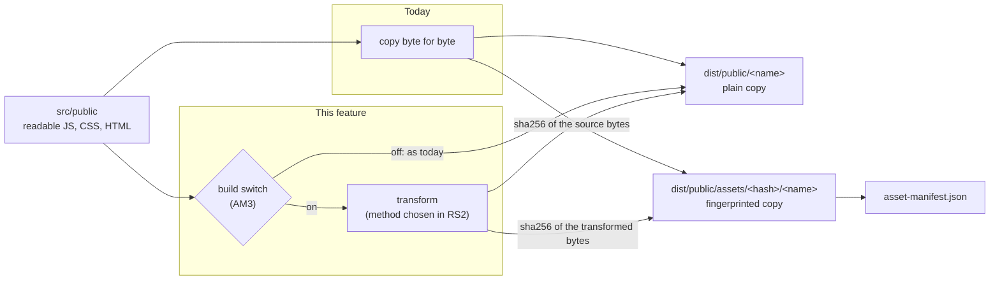
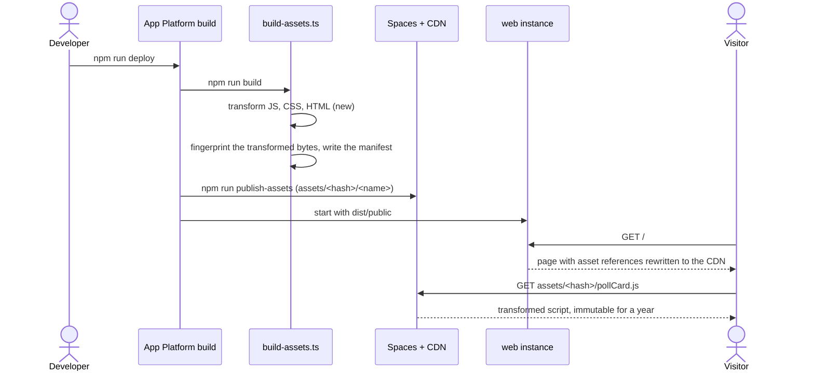
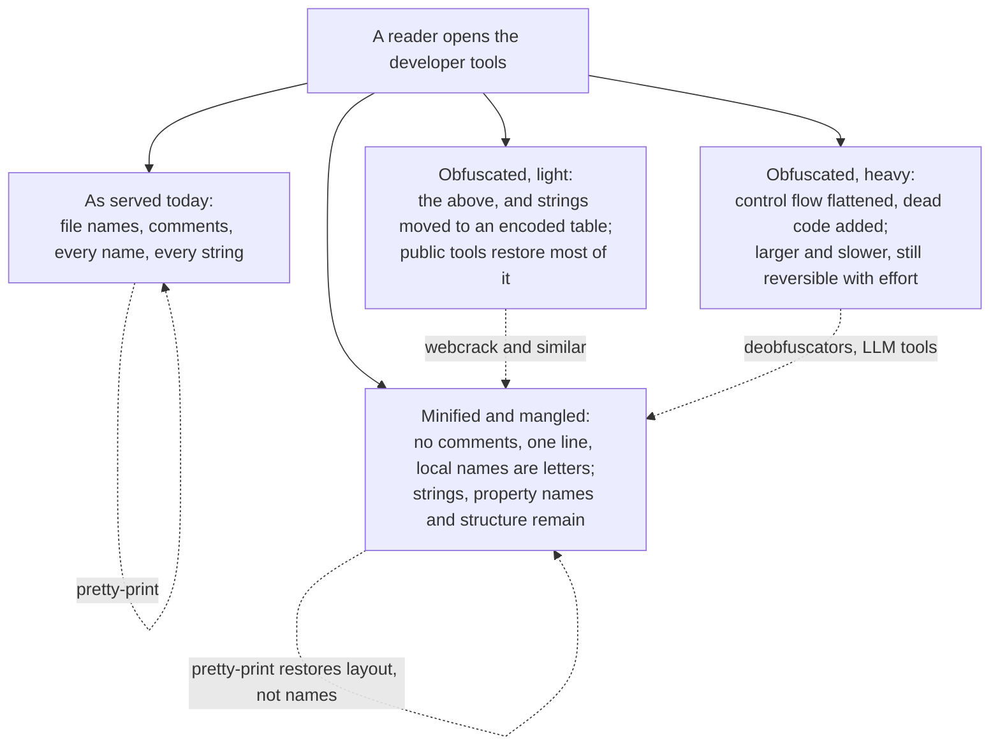

# High Level Requirements

Requirements: `requirements/20261118-160304-client-code-obfuscation/requirements.md`  
External Files: none  
Generated: 2026-11-18 4:03 PM  

The CrowdPoll webapp is getting closer to its initial release.  
It is still restricted to a limited set of users for initial testing and feedback collection.  

The purpose of this feature journey is to obfuscate the client-side code, include js, and css and html if possible.  

Requirement 1: research the methods available.   

Requirement 2: evaluate the effectiveness and limitations of each method.  

Requirement 3: implement the chosen obfuscation method for the client-side code, including js, css, and html if possible.

Requirement 4: verify that the obfuscated code functions correctly and does not break the webapp's functionality.

Requirement 5: document the obfuscation process, including the chosen method, configuration, and any limitations or considerations for future maintenance.

Requirement 6: ensure that the obfuscation process is repeatable and can be integrated into the build or deployment pipeline for future updates.

Requirement 7: assess the performance impact of the obfuscation on the webapp and optimize if necessary to maintain a smooth user experience.

Requirement 8: ensure that the obfuscation does not compromise the security of the webapp, and that sensitive information is adequately protected.

Requirement 9: provide a mechanism to easily revert the obfuscation if issues arise, allowing for quick debugging and maintenance.

Requirement 10: ensure that the obfuscation process is compatible with all major browsers and does not introduce cross-browser issues.

## Additional Requirements and Research Requests

**Instructions To The Developer**  
Enter any additional requirements or research requests under the ## Additional Requirements and Research Requests heading above.  
When you Type or Say: "Next" in the CC CLI terminal, the additional requirements and research requests will be applied to the report.  
  
You may leave these instructions here. They will be ignored when "Next" is executed.  

## 1. Overview and Scope

Everything the browser runs is served as it is written.  
`src/public/` holds plain HTML, vanilla JS and CSS, with no framework and no bundler:  

- about 614 KB of first-party JavaScript in 36 files, with their comments;  
- about 264 KB of CSS in 35 sheets;  
- about 69 KB of HTML in 12 pages;  
- one vendored library, `vendor/fingerprintjs-5.3.0.min.js`, already minified.  

`npm run build` runs `tsc` and then `devScripts/build-assets.ts`, which copies `src/public` to `dist/public` byte for byte and adds a content-addressed copy of each top-level asset under `dist/public/assets/<hash>/<name>`, with `asset-manifest.json`.  
The page routes (`src/routes/assets.ts`) rewrite each page's asset references to the fingerprinted copies, on the CDN when Spaces is configured.  
The App Platform build command is `npm ci --include=dev && npm run build && npm run publish-assets && npm prune --omit=dev`.  

This feature adds one step to that build: the client files are transformed before they are copied and fingerprinted, so a visitor's browser receives code that is hard to read, and the source in `src/public/` stays as it is.  

**In scope**:  

- Research and evaluation of the methods (Requirements 1 and 2), reported in section 4.  
- `devScripts/build-assets.ts` and its new development dependencies.  
- A way to build without the transformation (Requirement 9).  
- Verification of the built output: function, performance, browsers (Requirements 4, 7 and 10).  
- Documentation (Requirement 5).  

**Out of scope**:  

- The server code under `src/` other than what serves the built files: it never reaches the browser.  
- The API, `postman/openapi.json`, the database, cookies and stored values: nothing changes.  
- `npm run dev` and the test suites, which read `src/public/` directly (see UA2).  
- The fcaptcha service and the prototypes pages.  

## 2. Architecture Diagrams

### 2.1 The build, before and after

The transformation is one new step between the source and the two copies the build already writes.  
Both copies must take the transformed bytes: `express.static` serves `dist/public` as well as `/assets`, so an untransformed plain copy would stay readable at `/pollCard.js` (see UA3).  

### 2.2 From a release to a visitor's browser

Nothing in the request path changes: the hash in each asset's address changes because its bytes do, so browsers and the CDN fetch each file once more after the first release.  

### 2.3 What each method leaves a reader

The methods differ in what a person with the browser's developer tools still sees.  
RS1 and RS2 describe them; this is the comparison the choice turns on.  

## 3. Assumptions

- The source of truth stays `src/public/`, readable and committed; no transformed file is committed.  
- The transformation runs in `npm run build`, so it is part of every release without a new step (Requirement 6).  
- The new packages are development dependencies with exact versions, as the repository pins its others; the build already installs them (`npm ci --include=dev`) and prunes them before the app starts.  
- No transformed page makes a request to a third party, which keeps the invariant "no third-party request from a page".  
- The poll notes and invitation messages keep reaching HTML only through `notesPreviewHtml`, `notesHtml` and `invitationMessageHtml`; the transformation changes how the code reads, not what it does.  
- The scripts stay classic scripts that publish their interface on `window` (24 such names, e.g. `window.PollCard`); those names and every property name are left as they are, since other files, the HTML and the API payloads use them.  
- "Requirement 1" and "Requirement 2" are research requests, answered in section 4.  

## 4. Research Results

**RS1. Which methods are available to obfuscate client-side JavaScript, CSS and HTML?**  
<b>
✅ Resolved</b>  
✅ Requirements File Updated: 2026-11-18 4:21 PM  
**Notes**: Recommendation accepted in file 2026-11-18: Recommendation, record these seven methods in the requirements as the candidates Requirement 2 evaluates;  
the requirements now list the seven methods under Requirement 1.  

> Requirement 1 asks for the methods available.  
> Sources: [javascript-obfuscator](https://github.com/javascript-obfuscator/javascript-obfuscator), [obfuscator.io options reference](https://obfuscator.io/docs/options), [Terser options](https://terser.org/docs/options/), [esbuild minify](https://esbuild.github.io/api/#minify), [Lightning CSS minification](https://lightningcss.dev/minification.html), [html-minifier-terser](https://github.com/terser/html-minifier-terser), [postcss-rename](https://npmjs.com/package/postcss-rename), [js-confuser](https://socket.dev/npm/package/js-confuser/overview/1.5.7), and the codebase (`devScripts/build-assets.ts`, `src/routes/assets.ts`, `src/public/`).  
> Seven methods apply to a site built like this one.  
> 1. **Minify and mangle the JavaScript** (Terser, esbuild): comments and white space go, local names become single letters; top-level and property names stay by default.  
> 2. **Obfuscate the JavaScript** (`javascript-obfuscator`, open source; `js-confuser` is a smaller alternative): on top of renaming, strings move to an encoded table, and optional transforms flatten the control flow, add dead code, and add self-defending, debug-protection and domain-lock code; its presets are named by their trade-off, from "low obfuscation, high performance" to "high obfuscation, low performance".  
> 3. **Commercial protection** (Jscrambler, the paid tier of obfuscator.io): the same ideas with polymorphic output and code run in a virtual machine, for a subscription; prices and current features were not confirmed.  
> 4. **Minify the CSS** (Lightning CSS, esbuild, cssnano): comments and white space go, values are shortened; selectors stay readable.  
> 5. **Rename CSS classes and ids** (`postcss-rename`, `postcss-mangle-css-class`): `.poll-card` becomes `.a`; the tools found rewrite the CSS only, and the one that also rewrites HTML and JS is a webpack plugin, so here the 12 pages and about 300 class and selector uses in the scripts would need a rewriter of our own.  
> 6. **Minify the HTML** (`html-minifier-terser`): comments and white space go; the structure, text, ids and classes stay, and the browser shows the live DOM in any case, so HTML cannot be hidden.  
> 7. **Bundle the scripts into one file** (esbuild): file names and file boundaries go; the scripts are classic scripts loaded in order by each page, so this changes how pages load them and is a larger change than the others.  
> Apart from all of these, logic that must stay secret can only be kept on the server.  

  - **Recommendation**: **record these seven methods in the requirements as the candidates Requirement 2 evaluates.**  

    [X] ➡️ **Accepted**

    - This result informs; the choice between the methods is RS2, AM1 and NC1.  

  - **Developer Resolution B**:  

    [ ] ➡️ **Not Accepted**

**RS2. How effective is each method, what are its limits, and which should the JavaScript use?**  
<b>
✅ Resolved</b>  
✅ Requirements File Updated: 2026-11-18 4:21 PM  
**Notes**: Recommendation accepted in file 2026-11-18: Recommendation A, minify and mangle every first-party script, then `javascript-obfuscator` at its light setting;  
the requirements now name that method under Requirements 2 and 3, with the transforms that stay off.  

> Requirement 2 asks for the effectiveness and limitations of each method, and Requirement 3 needs one chosen.  
> Sources: [webcrack](https://github.com/j4k0xb/webcrack), [obfuscator-io-deobfuscator](https://osrepos.com/repo/ben-sb-obfuscator-io-deobfuscator), [From Obfuscated to Obvious, NDSS 2026](https://arxiv.org/abs/2512.14070), [CASCADE: LLM-powered JavaScript Deobfuscator at Google](https://arxiv.org/html/2507.17691v1), [obfuscator.io options reference](https://obfuscator.io/docs/options), [a user report on control-flow flattening and run time](https://lightrun.com/answers/javascript-obfuscator-javascript-obfuscator-allow-identifying-parts-of-code-that-are-performance-critical-and-dont-apply-performance-affecting).  
> No method prevents reading: the browser must be able to run the code, so a determined reader can always recover what it does.  
> Every method only raises the effort.  
> **Minify and mangle** removes what cannot be recovered at all, the comments and the local names, and makes files smaller and faster to load; a pretty-printer restores the layout only.  
> **Obfuscation** adds an encoded string table and, optionally, flattened control flow; public tools are written against exactly this output: webcrack lists string-array rotation, control-flow flattening, dead code, self-defending, debug protection and domain lock among what it undoes, and the 2025 and 2026 papers report that LLM-based tools outperform the older ones.  
> After such a tool has run, the reader is left with roughly what minification alone leaves.  
> The obfuscator's own documentation warns that control-flow flattening slows code and that debug protection "can freeze your browser"; no reliable figures for size or run time were found, so they must be measured on this code.  
> Its self-defending and debug-protection options build code from strings at run time, which a Content-Security-Policy without `unsafe-eval` refuses; the app sends no such policy today, but these options would stand in the way of adding one.  
> **Commercial protection** is the strongest and the only kind not undone by the free tools, at a recurring cost and with a vendor's code in the build.  
> The obfuscator pulls in a large tree of packages at build time; the minifiers are one package each.  

  - **Recommendation A** _(recommended)_: **minify and mangle every first-party script, then apply `javascript-obfuscator` at its light setting (encoded string table; no control-flow flattening, dead code, self-defending, debug protection or domain lock).**  

    [X] ➡️ **Accepted**

    - <u>Pros</u>: comments, names and readable strings are all gone, which stops casual reading and copying; the run-time cost of this setting is the lowest the tool offers; nothing is built from strings at run time.  
    - <u>Cons</u>: public tools undo the string table, leaving minified code; files grow compared with minification alone; the obfuscator's package tree joins the build.  

  - **Recommendation B**: **minify and mangle only (esbuild or Terser), with no obfuscator.**  

    [ ] ➡️ **Not Accepted**

    - <u>Pros</u>: the smallest and fastest output, one small dependency, the least that can break, and what remains after a deobfuscator has run on the other options anyway.  
    - <u>Cons</u>: strings, property names and structure stay readable, so it is not obfuscation in the usual sense of the word.  

  - **Recommendation C**: **`javascript-obfuscator` at its medium or high setting, with control-flow flattening and dead code.**  

    [ ] ➡️ **Not Accepted**

    - <u>Pros</u>: the most effort to read that a free tool gives.  
    - <u>Cons</u>: larger and slower code on every device, phones most of all, against Requirement 7; more ways for a script to break, against Requirement 4; still undone by the same public tools.  

  - **Recommendation D**: **a commercial product (Jscrambler or equivalent).**  

    [ ] ➡️ **Not Accepted**

    - <u>Pros</u>: the strongest protection, with support.  
    - <u>Cons</u>: a subscription, a vendor in the build of every release, and a cost that is hard to justify while the site is in limited testing.  

  - **Developer Resolution E**:  

    [ ] ➡️ **Not Accepted**

## 5. Findings

### 5.1 Inconsistencies

None found.

### 5.2 Ambiguities

**AM1. What does "css and html if possible" ask for?**  
<b>
✅ Resolved</b>  
✅ Requirements File Updated: 2026-11-18 4:21 PM  
**Notes**: Recommendation accepted in file 2026-11-18: Recommendation A, minify the CSS and the HTML, class names and ids stay;  
the requirements now say so under Requirement 3.  

> The purpose and Requirement 3 include CSS and HTML "if possible".  
> Both can be minified with little risk.  
> Neither can be obfuscated in the sense JavaScript can: the browser's developer tools show the live DOM and the applied rules whatever was served.  
> The one further step is renaming classes and ids, which must change the 35 sheets, the 12 pages and about 300 class and selector uses in the scripts in step, including names the scripts build at run time, and no tool found does that without a bundler (RS1).  
> The tests that pin the sheets (`m3-assets.test.ts`, `phone-sheets.test.ts`) read the source, so they would not see a renaming mistake.  

  - **Recommendation A** _(recommended)_: **minify the CSS and the HTML (comments and white space removed); class names and ids stay.**  

    [X] ➡️ **Accepted**

    - <u>Pros</u>: the comments, which explain the design decisions, are gone; pages get smaller; almost nothing can break.  
    - <u>Cons</u>: selectors and structure stay readable.  

  - **Recommendation B**: **also rename classes and ids across CSS, HTML and JS with a rewriter written for this project.**  

    [ ] ➡️ **Not Accepted**

    - <u>Pros</u>: the sheets and the markup no longer describe themselves.  
    - <u>Cons</u>: a custom tool to write and maintain; a name missed in a script breaks a page silently; every later feature must follow its naming rules; the DOM still shows the structure.  

  - **Recommendation C**: **leave CSS and HTML as they are; transform JavaScript only.**  

    [ ] ➡️ **Not Accepted**

    - <u>Pros</u>: the least work.  
    - <u>Cons</u>: the comments in the sheets and pages stay public.  

  - **Developer Resolution D**:  

    [ ] ➡️ **Not Accepted**

**AM2. What does Requirement 8 require: "does not compromise the security" and "sensitive information is adequately protected"?**  
<b>
✅ Resolved</b>  
✅ Requirements File Updated: 2026-11-18 4:21 PM  
**Notes**: Recommendation accepted in file 2026-11-18: Recommendation, state it as four checkable rules;  
the requirements now give the four rules under Requirement 8.  

> Obfuscation cannot protect a secret: anything in a served file can be recovered.  
> Read one way, the requirement asks that obfuscation hide sensitive values, which it cannot do.  
> Read the other way, it asks that the feature add no weakness and that nothing sensitive is in the client files to begin with.  

  - **Recommendation**: **state it as four checkable rules.**  

    [X] ➡️ **Accepted**

    - The client files are reviewed once for keys, tokens, addresses and internal notes that should not be public, and any found are removed from the source, not hidden.  
    - Every rule the server enforces today stays enforced on the server; no check moves to the client or relies on the code being unreadable.  
    - The transformed code makes no third-party request and builds no code from strings at run time (no `eval`, no `Function`), so a Content-Security-Policy can be added later.  
    - The new packages are development dependencies with exact versions, absent from the running app.  

  - **Developer Resolution B**:  

    [ ] ➡️ **Not Accepted**

**AM3. What is the "mechanism to easily revert" of Requirement 9?**  
<b>
✅ Resolved</b>  
✅ Requirements File Updated: 2026-11-18 4:21 PM  
**Notes**: Recommendation accepted in file 2026-11-18: Recommendation A, a build-time switch read by `build-assets.ts`, followed by `npm run deploy`;  
the requirements now say so under Requirement 9.  

> It could be a switch at build time, a switch on the running app, or a git revert of the feature.  
> The source in `src/public/` is never changed, so the readable code is always one build away.  
> On App Platform, changing an environment variable starts a new deployment in any case, so a run-time switch is no faster than a build-time one.  

  - **Recommendation A** _(recommended)_: **a build-time switch: one environment variable read by `build-assets.ts` (on by default in production builds), turned off and followed by `npm run deploy` to release the readable files.**  

    [X] ➡️ **Accepted**

    - <u>Pros</u>: one setting, no code change to revert; the same switch builds a readable copy locally for debugging; the asset addresses change with the bytes, so no cache needs clearing.  
    - <u>Cons</u>: a revert takes one release, a few minutes.  

  - **Recommendation B**: **build both sets and let a run-time setting choose which manifest the pages use.**  

    [ ] ➡️ **Not Accepted**

    - <u>Pros</u>: both sets are already on the CDN when the switch is thrown.  
    - <u>Cons</u>: the readable files are published with every release, at guessable addresses only if the manifest leaks, but published all the same, which defeats the purpose; the build and the page routes get more complicated; changing the setting still redeploys.  

  - **Developer Resolution C**:  

    [ ] ➡️ **Not Accepted**

**AM4. What is the build switch called, what are its values, and what is a "production build"?**  
<b>
✅ Resolved</b>  
✅ Requirements File Updated: 2026-11-18 4:26 PM  
**Notes**: Recommendation accepted in file 2026-11-18: Recommendation, `ENV_OBFUSCATE_ASSETS`, `on` or `off`, `on` when unset, for every run of `npm run build`;  
the requirements now name the variable, its values, its default and what an invalid value does, under Requirement 9.  

> The resolution of AM3 put into the requirements "one environment variable read by `build-assets.ts`, on by default in production builds".  
> The variable has no name and no values.  
> "Production builds" can be read two ways: every run of `npm run build`, or only the build App Platform makes;  
> there is one build command today, and nothing tells a local run from a release.  
> The project's rule is that every setting is an `ENV_*` variable validated by `loadConfig`, where an invalid value stops the app;  
> this one is read by the build and never by the app, so the requirements do not say what an invalid value does.  

  - **Recommendation**: **`ENV_OBFUSCATE_ASSETS`, `on` or `off`, `on` when unset, for every run of `npm run build`.**  

    [X] ➡️ **Accepted**

    - "Production build" means any run of `npm run build`, local or on App Platform; there is no second kind.  
    - Any other value stops the build with a message naming the variable, as `loadConfig` does for the app's settings.  
    - The build reads it and the app does not, so it is not added to `loadConfig`; it is listed in `.claude/rules/environment.md` as a build-time setting.  
    - It is left unset in `infra/app.tf`; a revert sets it to `off` there and runs `npm run deploy`, and the build log says which mode it used.  

  - **Developer Resolution B**:  

    [ ] ➡️ **Not Accepted**

### 5.3 Unspecified Aspects

**UA1. Which files are transformed?**  
<b>
✅ Resolved</b>  
✅ Requirements File Updated: 2026-11-18 4:21 PM  
**Notes**: Recommendation accepted in file 2026-11-18: Recommendation, every first-party `.js`, `.css` and `.html` file at the top level of `src/public/`, nothing else;  
the requirements now list what is transformed and what is copied as it is.  

> "The client-side code" is not listed.  
> `src/public/` holds first-party scripts, sheets and pages, the vendored `vendor/fingerprintjs-5.3.0.min.js`, the legal pages (`privacy.html`, `terms.html`), images, SVG files and fonts.  
> The build fingerprints only the files at the top level of `src/public/`.  

  - **Recommendation**: **every first-party `.js`, `.css` and `.html` file at the top level of `src/public/`; nothing else.**  

    [X] ➡️ **Accepted**

    - The vendored library is copied as it is: it is already minified, and it is another project's code.  
    - Images, SVG files, fonts and `favicon.ico` are copied as they are.  
    - The legal pages are minified like the other pages; their text, headings and anchors (`/privacy#cookies`) are unchanged, so search engines and the Cookie Use list read them as before.  
    - The `{{PRIVACY_UPDATED}}` and `{{TERMS_UPDATED}}` markers, `</head>`, and the `href="/name.ext"` and `src="/name.ext"` forms the page routes rewrite must survive the HTML step unchanged.  

  - **Developer Resolution B**:  

    [ ] ➡️ **Not Accepted**

**UA2. Where does the transformation run: production only, or development and tests too?**  
<b>
✅ Resolved</b>  
✅ Requirements File Updated: 2026-11-18 4:21 PM  
**Notes**: Recommendation accepted in file 2026-11-18: Recommendation, only in `npm run build`, development and the existing suites keep the readable source;  
the requirements now say so under Requirement 6.  

> `npm run dev` serves `src/public/` directly, and the client test suites load the source scripts in jsdom.  
> The requirements do not say whether those see transformed code.  

  - **Recommendation**: **only in `npm run build`; development and the existing suites keep the readable source.**  

    [X] ➡️ **Accepted**

    - Development stays as fast and as debuggable as it is, with no build step added to it.  
    - The built output is checked separately (UA4).  

  - **Developer Resolution B**:  

    [ ] ➡️ **Not Accepted**

**UA3. The readable copies stay reachable beside the fingerprinted ones.**  
<b>
✅ Resolved</b>  
✅ Requirements File Updated: 2026-11-18 4:21 PM  
**Notes**: Recommendation accepted in file 2026-11-18: Recommendation, the same transformed bytes in both places, fingerprinted by their own hash, with no readable copy or source map under `dist/public`;  
the requirements now say so under Requirement 3.  

> The build writes each asset twice: a plain copy at `dist/public/<name>` and a fingerprinted copy under `dist/public/assets/`.  
> `express.static` serves the plain copies, so `/pollCard.js` answers with whatever is there.  
> The requirements do not say that both must be transformed, and transforming only the fingerprinted copy would leave the readable source one request away.  

  - **Recommendation**: **the build transforms each file once and writes the same transformed bytes to both places; the fingerprint is the hash of the transformed bytes; no readable copy and no source map is written under `dist/public`.**  

    [X] ➡️ **Accepted**

    - A test of the build asserts that no file under `dist/public` equals its source, for the file types in scope, when the switch is on.  

  - **Developer Resolution B**:  

    [ ] ➡️ **Not Accepted**

**UA4. How is "functions correctly" verified (Requirement 4)?**  
<b>
✅ Resolved</b>  
✅ Requirements File Updated: 2026-11-18 4:21 PM  
**Notes**: Recommendation accepted in file 2026-11-18: Recommendation, three checks, all on the built output;  
the requirements now give the three checks under Requirement 4.  

> No method or pass mark is given.  
> The existing client suites exercise the source files, not what ships.  

  - **Recommendation**: **three checks, all on the built output.**  

    [X] ➡️ **Accepted**

    - The jsdom client suites (`client-*.test.ts`) can be run against `dist/public` as well as `src/public`, and pass on both.  
    - Every built script parses, and every page's references resolve to a file in the manifest.  
    - A manual checklist in the quickstart, on the built app: sign in, vote, change a vote, add a choice, open the maximized view, the line graph, Who voted, search, the admin editor, the settings and profile pages, and the legal pages, with the browser console free of errors.  

  - **Developer Resolution B**:  

    [ ] ➡️ **Not Accepted**

**UA5. What performance is acceptable (Requirement 7)?**  
<b>
✅ Resolved</b>  
✅ Requirements File Updated: 2026-11-18 4:21 PM  
**Notes**: Recommendation accepted in file 2026-11-18: Recommendation, two limits, measured by the build and by one manual comparison;  
the requirements now give the size and speed limits under Requirement 7.  

> "Assess" and "optimize if necessary" name no measure and no limit.  

  - **Recommendation**: **two limits, measured by the build and by one manual comparison.**  

    [X] ➡️ **Accepted**

    - Size: the compressed (gzip) total of the built scripts, sheets and pages is no larger than that of the source; the build prints both totals.  
    - Speed: on the home page with a full tab of cards, the first usable card and the drawing of the line graph are not noticeably slower in use than on the readable build, on a phone and on a desktop.  
    - A script that fails either limit is given a lighter setting or left at minification, and the exception is documented.  

  - **Developer Resolution B**:  

    [ ] ➡️ **Not Accepted**

**UA6. Which browsers are "all major browsers" (Requirement 10)?**  
<b>
✅ Resolved</b>  
✅ Requirements File Updated: 2026-11-18 4:21 PM  
**Notes**: Recommendation accepted in file 2026-11-18: Recommendation, no syntax newer than the source, checked on six named browsers;  
the requirements now name them under Requirement 10.  

> No browsers or versions are named.  
> A transformation can introduce a browser problem in two ways: by emitting syntax newer than the source uses, or by run-time tricks some engines handle differently.  

  - **Recommendation**: **the output uses no syntax newer than the source does, and is checked on the current versions of Chrome, Edge, Firefox and Safari on the desktop, Safari on iOS and Chrome on Android.**  

    [X] ➡️ **Accepted**

    - The tools are set to keep the source's language level, neither raising nor lowering it.  
    - The UA4 checklist is run once on each of the six.  

  - **Developer Resolution B**:  

    [ ] ➡️ **Not Accepted**

**UA7. How is a production error traced back to the source, and where is the process documented (Requirements 5 and 9)?**  
<b>
✅ Resolved</b>  
✅ Requirements File Updated: 2026-11-18 4:21 PM  
**Notes**: Recommendation accepted in file 2026-11-18: Recommendation, a repeatable build, private source maps on request, and documentation in the project's existing files;  
the requirements now say so under Requirements 5 and 9.  

> An error reported from a visitor's browser will name a position in transformed code.  
> The requirements ask for "quick debugging" but name no way to map it back, and for documentation without saying where.  
> A published source map would undo the feature.  

  - **Recommendation**: **a repeatable build and private source maps on request; documentation in the project's existing files.**  

    [X] ➡️ **Accepted**

    - The same commit always builds the same bytes (a fixed seed, no time or random input), so a developer can rebuild a release locally.  
    - A local option of the build writes source maps to a git-ignored folder outside `dist/public`; they are never published.  
    - The method, its settings, the switch, the limits and how to trace an error are described in `ARCHITECTURE.md` and `CLAUDE_COMPLETE.md`, with the switch in `.claude/rules/environment.md` and a short entry in `CLAUDE.md`.  

  - **Developer Resolution B**:  

    [ ] ➡️ **Not Accepted**

### 5.4 Needs Clarifications

**NC1. Should the anti-abuse scripts get stronger protection than the rest?**  
<b>
✅ Resolved</b>  
✅ Requirements File Updated: 2026-11-18 4:21 PM  
**Notes**: Recommendation accepted in file 2026-11-18: Recommendation A, one setting for every script, the goal being to deter casual reading and copying;  
the requirements now state that goal and the single setting.  

> Two scripts carry logic an abuser would want to read: `deviceEvidence.js` (88 lines, the evidence used against multiple accounts) and `humanCheck.js` (202 lines, the human check).  
> The requirements do not say what the obfuscation is to protect against: casual reading and copying of the whole client, or study of these two by someone trying to defeat them.  
> The answer decides whether one setting serves every file.  

  - **Recommendation A** _(recommended)_: **one setting for every script; the goal is to deter casual reading and copying.**  

    [X] ➡️ **Accepted**

    - <u>Pros</u>: one configuration to test and maintain; the server already decides whether a vote or an account is accepted, so the protection does not rest on these scripts being unreadable.  
    - <u>Cons</u>: someone determined reads these two scripts with a public tool in minutes.  

  - **Recommendation B**: **a stronger setting (control-flow flattening) for these two scripts only.**  

    [ ] ➡️ **Not Accepted**

    - <u>Pros</u>: more effort for an abuser, on small files that run rarely, so the cost in speed is small.  
    - <u>Cons</u>: two configurations; these are the scripts where a break locks people out of signing in or voting; the same tools still undo it.  

  - **Developer Resolution C**:  

    [ ] ➡️ **Not Accepted**

## 6. Breaking Changes

- **Every asset address changes once.**  
  The fingerprint is taken from the transformed bytes, so the first release with the feature gives every script and sheet a new address; browsers and the CDN fetch each once more.  
- **`dist/public` no longer equals `src/public`.**  
  Anything that compares the two, or reads a built file expecting the source text, must change.  
- **Production code in the developer tools is no longer readable.**  
  Debugging a live problem needs a local rebuild of the same commit (UA7) or a release with the switch off (AM3).  
- **The build needs the new development dependencies.**  
  A build made with `npm ci --omit=dev` fails or, with the switch off, ships readable files.  

## 7. Technical Debt

- **The tests exercise the source, not what ships.**  
  The client suites and the pinned-sheet tests read `src/public/`; until now the two were the same bytes.  
- **Only top-level files are fingerprinted.**  
  `vendor/`, `oauth/` and `fonts/` are served from the instance at fixed addresses, without the immutable cache header.  
- **Plain copies are served beside the fingerprinted ones.**  
  `express.static(publicDir)` answers `/name.js` for every asset although no page refers to it.  
- **The client is 36 classic scripts sharing 24 `window` names.**  
  Without modules, a tool cannot tell which top-level names are private, so only local names can be renamed.  
- **No Content-Security-Policy header was found in `src/`.**  
  It is not part of this feature, but AM2 keeps the output compatible with adding one.  
- **The build script lives in `devScripts/`.**  
  It becomes a larger part of every release while sitting beside one-off developer tools.

## 8. Requirements Report Complete Report  
  
- **Requirements Report Document:** requirements/20261118-160304-client-code-obfuscation/requirements-report.md  
- **Requirements Document:** requirements/20261118-160304-client-code-obfuscation/requirements.md  
- **Software Architecture Diagrams:** 3  
- **Inconsistencies:** 0  
- **Ambiguities:** 4  
- **Unspecified Aspects:** 7  
- **Needs Clarifications:** 1  
- **Research Results:** 2  
- **Breaking Changes:** 4  
- **Technical Debt items:** 6  
  
The requirements are ready for /speckit-specify.
To generate specs from the requirements document, use the `/speckit-specify` skill followed by the path (relative to the project root) to the requirements file.
At the prompt, Type:  
🟩 👉 /speckit-specify requirements/20261118-160304-client-code-obfuscation/requirements.md  
