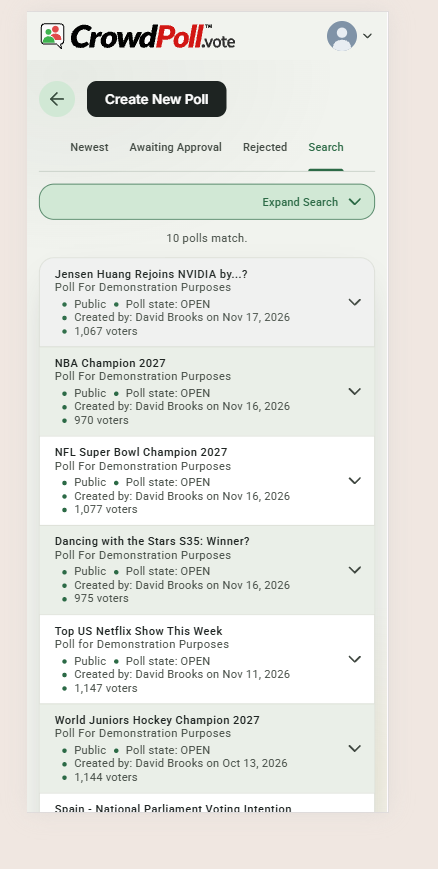
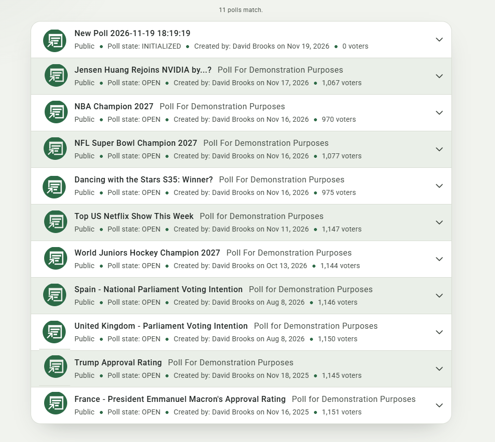
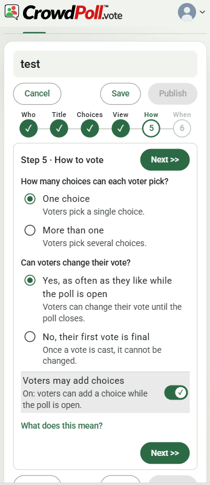
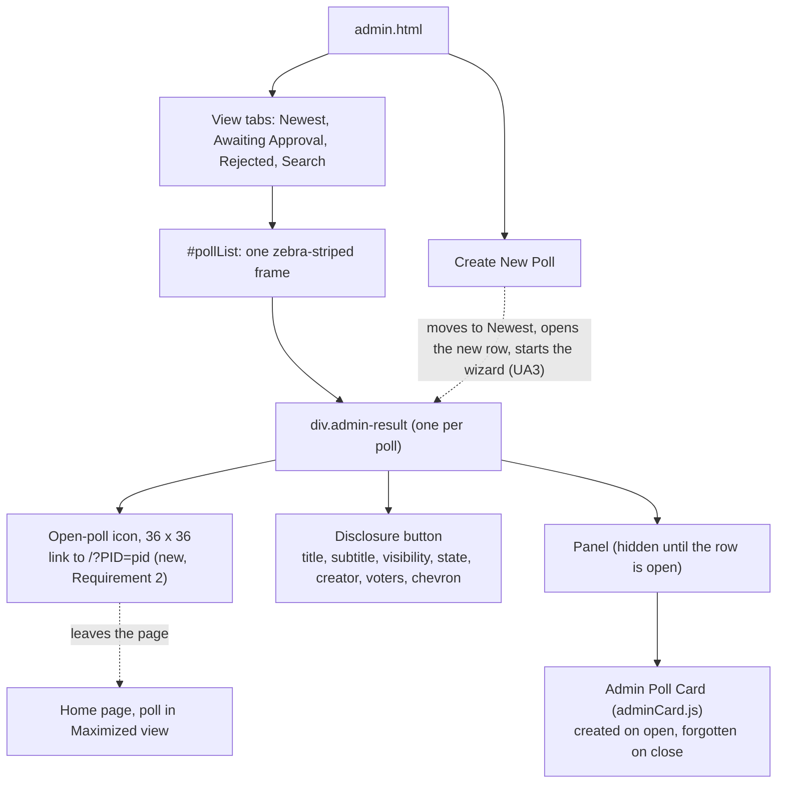
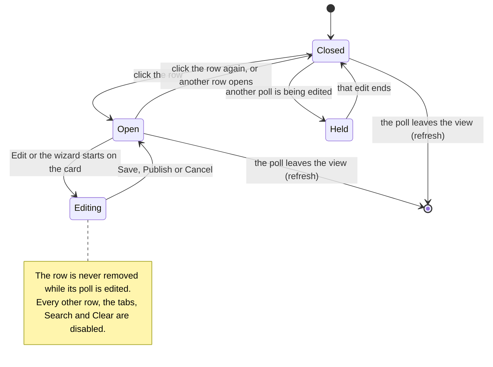
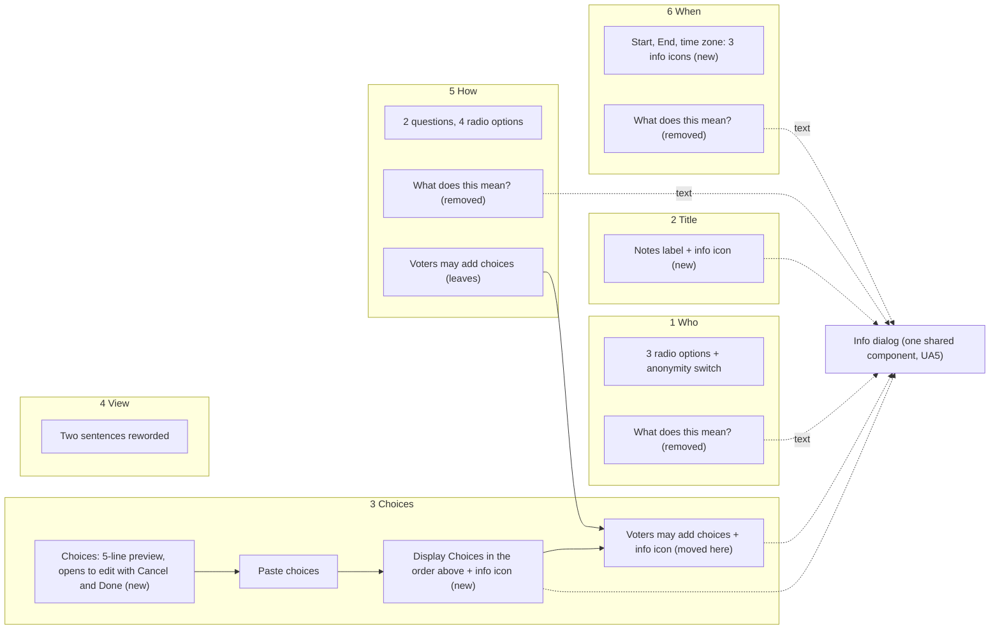
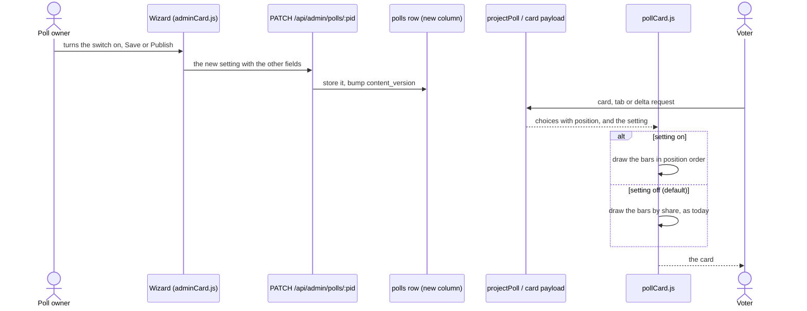
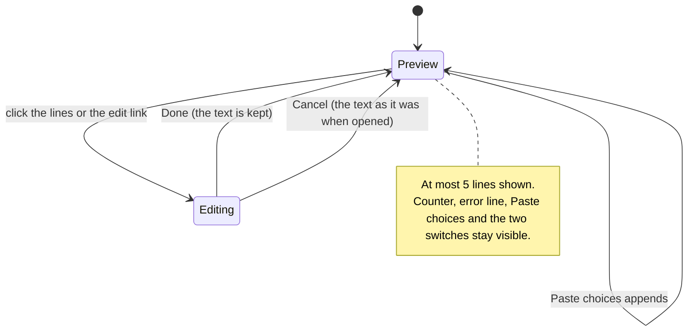

# High Level Requirements

Requirements: `requirements/20261119-144614-poll-admin-improvements/requirements.md`  
External Files: `image.png`, `image-1.png`, `image-3.png`, `launchPoll-circle.svg` (linked); `image-2.png`, `launchPoll.svg` (in the folder, not linked)  
Generated: 2026-11-19 2:46 PM  

# Initial High-Level Requirements

This feature will make improvements to the Poll Administration section.  

**Requirement 1:**  
In Poll Administration section,  
display the polls in the Newest, Awaiting Approval, Rejected using the same zebra stripping table-like list as the results of Admin Search.

  

Clicking one of the rows will open the Admin Poll Card for that specific poll.  
Then the UX will be identical on all the Poll Admin tabs.  

This applies to all widths.

**Requirement 2:**  

Render the SVG in the file  
"requirements\new-20261119-121549\launchPoll-circle.svg"  
on each row of the zebra-striped poll list, to the left of the text,  
as mocked-up in:   


Scale it to 36X36.

Whenb clicking the icon, navigate to the poll in Maximized view, using the URL with pid=<poll_id>  
"/?PID=f55d192e-07ca-4839-b158-7ef33a0ff7a4"  
which is the url copied to the clipboard on the Admin Poll Card.  


**Requirement 3:**  

Add a toggle to the 3-Choice tab 
called 
"Display Choices in the order above".   
The toggle is "off" by default.  

There will be a typical "info icon" ( lower case i in a circle) at the end of the toggle's label.  

Clicking the icon will launch a modal information dialog:  
```markdown
**Display Choices in the order above**  
This toggle allows you override the default order of the Poll Choices which is most votes to least votes.  
Using the order you enter the Choices makes sense when the Choices have a logical order, such as consecutive dates, or a sequence of numbers (1 Star, 2 Star, 3 Star, etc.).  
```


Similar to how the "Voters may add choices" toggle,  
there will be a sentence under the label explaining the current state of the toggle:  
either
`Off: choices are displayed from most votes to least votes.`
or
`On: choices are displayed in the order entered above.`

Render the label and toggle in the position under the "Adds choices copied..." text.  

**Requirement 4:**  

Move the "Voters may add choices" toggle to the 3-Choices tab.



Move it, to the position under the new toggle "Display Choices in the order above".

Also, add an info icon to the right of the "Voters may add choices" label.  
The dialog will read:  
```
Voters may add choices
Off (the default): only you set the choices. On: anyone who may vote on your poll can add a choice while it is open, up to the most choices a poll may have. This is only available for Private polls.
```

Also, remove the paragraph from the "What does this mean?" section on the 5-How tab:  
```
Voters may add choices
Off (the default): only you set the choices. On: anyone who may vote on your poll can add a choice while it is open, up to the most choices a poll may have.
``` 


**Requirement 5:**  
On tab 1-Who,  
the "What does this mean?" will be removed,  
and the relevant text will be available by clicking an info icon next to the corresponding label.  

There is a section for each label on the 1-Who tab,  
```
Anyone you send the link to
Your poll is private: it is listed only in the "Shared With You" tab for the people you share it with, and is not listed in Trending, Newest or Search. Anyone who has the link can open it and vote.
Only people you invite
Your poll is private: it is listed only in the "Shared With You" tab for the people you share it with, and is not listed in Trending, Newest or Search. Only the people whose email addresses you invite can vote. You add them after your poll is created.
Everyone on CrowdPoll
Your poll is public: anyone on CrowdPoll can find it and vote. Public polls appear after they are reviewed and approved.
Users can see who voted for what
Off (the default): votes are anonymous. Everyone sees how many votes each choice has, but not who cast them. On: the names of voters are shown next to the choices they picked. Turn it on only if your voters expect it, and tell them. It can't be changed once your poll has votes.
```

**Requirement 6:**    
On the 2-Title tab,  
render an info icon to the right of the "Notes" label:  
The dialog will read:  
```
Notes
These notes appear on the Maximized view of your poll.  
```

**Requirement 7:**    
Similar to how the Notes field on the 2-Title tab only renders 2 lines of the notes,  
for the Step 3:Choices field render only 5 lines of the choices,  
and then provide the same "...edit View" link to expand and edit the full list of choices.  
Also, clicking anywhere on the first 5 lines of the choices will expand and edit the full list of choices.  

Also, similar to the Notes editing, there will be a "Cancel" and "Done" link at the top of the expanded edit choices view.  

**Requirement 8:**  
On the 4-View tab,  
change the text  
"Optional. Leave a choice on Automatic to color it for you."  
to  
"Optional. Leave a choice on Automatic and an appropriate color is automatically assigned."

**Requirement 9:**  

On the 4-View tab:  
Change the text:  
"On: the line graph is drawn beside your poll when it is maximized."  
to:
"On: the line graph is drawn on the Maximized view of a poll."

**Requirement 10:**  

For the 5-How tab:  
Similar to Requirement 5,  
the "What does this mean?" will be removed,  
and the relevant text will be available by clicking an info icon next to the corresponding label.  

**Requirement 11:**  

For the 6-When tab:  
Render an info icon to the right of:  
- When does voting start?  (i)
- When does voting end?  (i)
- your time zone (xxxxxxx)  (i) 

Clicking any of those icons will launch a modal dialog with the complete text currently shown when "What does this mean?" is clicked.  
Then remove the "What does this mean?" link from the 6-When tab.

## Additional Requirements and Research Requests

**Instructions To The Developer**  
Enter any additional requirements or research requests under the ## Additional Requirements and Research Requests heading above.  
When you Type or Say: "Next" in the CC CLI terminal, the additional requirements and research requests will be applied to the report.  
  
You may leave these instructions here. They will be ignored when "Next" is executed.  

## 1. Overview and Scope

The feature has three parts, all in the Poll Administration page (`admin.html`).  

- **The lists (Requirements 1 and 2).**  
  Today only the Search view draws its polls as rows (`div.admin-result`: a disclosure button and a panel, in `adminList.js`);  
  Newest, Awaiting Approval, Rejected and the creator-only page draw one full Admin Poll Card per poll (`cardElements`).  
  The three views take the Search view's rows, and every row gains an icon that opens the poll itself at `/?PID=<pid>`.  
- **The wizard's help (Requirements 4, 5, 6, 10 and 11).**  
  The three "What does this mean?" blocks (`details.wizard-help` on steps 1, 5 and 6 in `adminCard.js`) go;  
  their text moves behind info icons beside the labels, each opening a modal dialog.  
  The Notes label gains one too.  
- **The Choices step (Requirements 3, 4 and 7).**  
  A new poll setting, "Display Choices in the order above", with its switch;  
  the "Voters may add choices" switch moves there from step 5;  
  and the choices box shows five lines until it is opened, as the Notes field shows two.  

Requirements 8 and 9 change one sentence each on step 4.  

**In scope**:  

- `src/public/adminList.js`, `adminCard.js`, `admin.css`, `admin-search-m3.css`, `admin-card-m3.css`, `phone-admin-m3.css`.  
- `src/public/pollCard.js`: the order the choices are drawn in (Requirement 3).  
- One new stored poll setting: a migration, `src/db/schema.ts`, the poll service and store, the card payloads and `postman/openapi.json` (see UA2).  
- The client and server test suites that cover the above.  

**Out of scope**:  

- The Search view's form, its filters and the search route.  
- The Admin Poll Card's read-only side, its actions menu and the invitee list.  
- The line graph, the who-voted report and the home tabs, except for the order of the bars on a poll card.  
- The profile, settings and legal pages.  

## 2. Architecture Diagrams

### 2.1 The Poll Administration page after this feature

Every view draws the same list; the card exists only inside the open row's panel.  



### 2.2 The states of a row

These are the Search view's states today (ADMIN-SEARCH-RESULTS R5 to R8); Requirement 1 extends them to the other views.  



### 2.3 What moves in the wizard



### 2.4 The display-order setting, from the wizard to a voter's card

The choices already carry their entered order (`position`); only the choice between the two orders is new.  



### 2.5 The Choices field



## 3. Assumptions

- The rows keep their present content and layout: title and subtitle, then visibility, state, creator and voters, one zebra-striped frame `min(840px, 100%)` wide, the card inside at 420 px.  
- `image-2.png` ("Voters may add choices goes here") illustrates Requirement 4, although no requirement links it.  
- `launchPoll.svg` (the mark without its circle) is not used.  
- The typing slip "Whenb" in Requirement 2 is "When".  
- Requirement 9's sentence today reads "On: the line graph is drawn beside the poll when it is maximized." ("the poll", not "your poll"); that sentence is the one replaced.  
- The info icon beside "Users can see who voted for what" and the one beside "Voters may add choices" appear only where their switch does: on private polls.  
- "Link Preview Message" and "Custom Email Message" on step 1 get no info icon: they have no entry in "What does this mean?" today.  
- The short support line under each radio option and switch stays; only the "What does this mean?" blocks go.  
- Nothing is stored in the browser: which row is open, and whether the choices are being edited, are in memory only, so `privacy.html` needs no new Cookie Use row.  
- The new dialogs make no request, and nothing in them is assigned to `innerHTML`: their text is fixed and set as text.  

## 4. Findings

### 4.1 Inconsistencies

None found.

### 4.2 Ambiguities

**AM1. Does the creator-only page take the rows too?**  
<span style="font-size:large" ><b>
✅ Resolved</b></span>  
✅ Requirements File Updated: 2026-11-19 3:25 PM  
**Notes**: Recommendation accepted in file 2026-11-19: Recommendation A, rows everywhere, the creator-only page included;  
the requirements now say so under Resolved Findings, Requirement 1.  

> Requirement 1 names the Newest, Awaiting Approval and Rejected views, which only an administrator sees.  
> A poll creator who is not an administrator gets one list of their own polls, with no tabs (`becomeCreatorView` in `adminList.js`); today it draws cards.  
> "Then the UX will be identical on all the Poll Admin tabs" can be read to include it or not.  

  - **Recommendation A** _(recommended)_: **rows everywhere, the creator-only page included.**  

    [X] ➡️ **Accepted**

    - <u>Pros</u>: one way of drawing a list, so `cardElements` and its refresh path can be removed;  
      a creator with a single poll still sees its card at once, because a fresh load opens a single row by itself.  
    - <u>Cons</u>: a creator with two or three polls needs one more click to reach a card.  


  - **Recommendation B**: **the three administrator views only; the creator-only page keeps cards.**  

    [ ] ➡️ **Not Accepted**

    - <u>Pros</u>: it is the literal reading, and creators with few polls see everything without a click.  
    - <u>Cons</u>: two list implementations stay, and the open-poll icon of Requirement 2 has no row to sit on there.  


  - **Developer Resolution C**:  

    [ ] ➡️ **Not Accepted**


**AM2. What does the link under the choices say: "...edit View"?**  
<span style="font-size:large" ><b>
✅ Resolved</b></span>  
✅ Requirements File Updated: 2026-11-19 3:25 PM  
**Notes**: Recommendation accepted in file 2026-11-19: Recommendation, "... edit" with the chevron, as on Notes, and "... view" when the choices are locked;  
the requirements now say so under Resolved Findings, Requirement 7.  

> Requirement 7 asks for "the same \"...edit View\" link" as the Notes field.  
> The Notes link reads "... edit" followed by a chevron (`wizard-notes-edit` in `adminCard.js`); there is no "View" in it.  
> On a poll that has votes the choices cannot change (`canChange("labels")`), so there the list can only be viewed.  

  - **Recommendation**: **"... edit" with the chevron, as on Notes; "... view" when the choices are locked.**  

    [X] ➡️ **Accepted**

    - The link is the Notes link, with the accessible name "Edit choices".  
    - When the step is locked it reads "... view", named "View all choices", and opens the full list read-only with a single "Done".  
    - The link is always shown, as it is on Notes, whatever the number of choices (see UA6).  


  - **Developer Resolution B**:  

    [ ] ➡️ **Not Accepted**


**AM3. On the 5-How tab, is there an info icon per option or per question?**  
<span style="font-size:large" ><b>
✅ Resolved</b></span>  
✅ Requirements File Updated: 2026-11-19 3:25 PM  
**Notes**: Recommendation accepted in file 2026-11-19: Recommendation A, one icon per radio option, four in all;  
the requirements now say so under Resolved Findings, Requirement 10.  

> Requirement 10 says "an info icon next to the corresponding label", similar to Requirement 5, where each radio option has its own section.  
> Step 5's help has four entries: "One choice", "More than one", "They can change their vote" and "Their first vote is final".  
> The last two do not match the option labels word for word ("Yes, as often as they like while the poll is open", "No, their first vote is final").  
> Requirement 11 puts its icons on the questions instead.  

  - **Recommendation A** _(recommended)_: **one icon per radio option, four in all.**  

    [X] ➡️ **Accepted**

    - <u>Pros</u>: it is what Requirement 5 does on step 1, and each dialog is one short paragraph;  
      each dialog is titled with its option's own label, so the two mismatched headings disappear.  
    - <u>Cons</u>: four icons on a short step, each explaining little more than the support line under its option.  


  - **Recommendation B**: **one icon per question, two in all, each dialog holding both of its options' entries.**  

    [ ] ➡️ **Not Accepted**

    - <u>Pros</u>: fewer icons, and the two options are explained side by side, as Requirement 11 does on step 6.  
    - <u>Cons</u>: steps 1 and 5 then follow different rules.  


  - **Developer Resolution C**:  

    [ ] ➡️ **Not Accepted**


**AM4. On the 6-When tab, do the three icons show the same text?**  
<span style="font-size:large" ><b>
✅ Resolved</b></span>  
✅ Requirements File Updated: 2026-11-19 3:25 PM  
**Notes**: Recommendation accepted in file 2026-11-19: Recommendation B, all three icons open the same dialog, with the five entries;  
the requirements now say so under Resolved Findings, Requirement 11.  

> Requirement 11 says that clicking any of the three icons opens "the complete text currently shown".  
> That text has five entries: "Poll starts immediately", "Poll starts on", "Poll has no end date", "Poll ends on" and "Time zone".  
> Read literally, the three icons open three identical dialogs.  

  - **Recommendation A** _(recommended)_: **each icon shows its own part.**  

    [ ] ➡️ **Not Accepted**

    - <u>Pros</u>: the start icon shows the two start entries, the end icon the two end entries, the time-zone icon the time-zone entry;  
      nothing of the present text is lost, and each dialog answers the question beside it.  
    - <u>Cons</u>: it is not the literal reading.  


  - **Recommendation B**: **all three icons open the same dialog, with the five entries.**  

    [X] ➡️ **Accepted**

    - <u>Pros</u>: the literal reading, and one dialog to maintain.  
    - <u>Cons</u>: three icons for one dialog, which is longer than a phone screen at the phone type sizes.  


  - **Developer Resolution C**:  

    [ ] ➡️ **Not Accepted**


**AM5. Does the open-poll icon open the poll in the same tab or a new one?**  
<span style="font-size:large" ><b>
✅ Resolved</b></span>  
✅ Requirements File Updated: 2026-11-19 3:25 PM  
**Notes**: Recommendation accepted in file 2026-11-19: Recommendation A, the same tab, as an ordinary link;  
the requirements now say so under Resolved Findings, Requirement 2.  

> Requirement 2 says "navigate to the poll in Maximized view".  
> It does not say whether the administration page is left.  
> The row itself is a `<button>`, which may not contain another control, so the icon has to be a link beside it, not inside it.  
> The page already intercepts every same-site link while a poll is being edited (`guardNavigation`), asking before a draft is discarded.  

  - **Recommendation A** _(recommended)_: **the same tab, as an ordinary link.**  

    [X] ➡️ **Accepted**

    - <u>Pros</u>: the browser's Back returns to the administration page, a modified click still opens a new tab, and it works the same on a phone;  
      during an edit the existing guard asks before leaving, so the icon needs no rule of its own.  
    - <u>Cons</u>: the list's open row and scroll position are not kept on return (the view tab is).  


  - **Recommendation B**: **a new tab.**  

    [ ] ➡️ **Not Accepted**

    - <u>Pros</u>: the administration page stays as it is, open row and draft included.  
    - <u>Cons</u>: tabs pile up on a phone, and every other link on the site stays in its tab.  


  - **Developer Resolution C**:  

    [ ] ➡️ **Not Accepted**


**AM6. Is the dialog text of Requirement 3 shown exactly as written?**  
<span style="font-size:large" ><b>
✅ Resolved</b></span>  
✅ Requirements File Updated: 2026-11-19 3:25 PM  
**Notes**: Recommendation accepted in file 2026-11-19: Recommendation, correct the sentence, and treat the first line of every dialog text as its title;  
the dialog's sentence is corrected in Requirement 3, and the title rule is under Resolved Findings.  

> The dialog's first sentence reads "This toggle allows you override the default order of the Poll Choices which is most votes to least votes."  
> "allows you override" is missing a "to".  
> The text is written as Markdown, with the title in bold and two trailing spaces, where the other dialogs are plain text.  

  - **Recommendation**: **correct the sentence, and treat the first line of every dialog text as its title.**  

    [X] ➡️ **Accepted**

    - The sentence becomes "This toggle allows you to override the default order of the poll's choices, which is most votes to least votes."  
    - The second sentence stays as written.  
    - In every dialog of this feature the first line is the dialog's title and the rest its body, as plain text.  


  - **Developer Resolution B**:  

    [ ] ➡️ **Not Accepted**


### 4.3 Unspecified Aspects

**UA1. Where does the entered order apply?**  
<span style="font-size:large" ><b>
✅ Resolved</b></span>  
✅ Requirements File Updated: 2026-11-19 3:25 PM  
**Notes**: Recommendation accepted in file 2026-11-19: Recommendation, the results bars and the voting side, on the card and in the Maximized view, at every width, and nothing else;  
the requirements now say so under Resolved Findings, Requirement 3.  

> Requirement 3 says the choices are "displayed in the order entered above", without saying where.  
> A poll's choices are drawn in several places: the card's results bars and its voting side, the Maximized view, the line graph's legend and the who-voted report.  
> `pollCard.js` sorts by share once (`rebuildData`), and that order also decides which choices a short card keeps: the leaders (`essentialChoices` on a phone and in the Maximized view, `fittingChoices` on a wide card).  
> A choice a voter adds takes the last position.  

  - **Recommendation**: **the results bars and the voting side, on the card and in the Maximized view, at every width; nothing else.**  

    [X] ➡️ **Accepted**

    - Which choices a short card keeps does not change: the viewer's own choices and the leaders by share, with the "More choices" and "Show all N choices" rows as today.  
    - The choices kept are then drawn in the entered order when the setting is on.  
    - The line graph keeps ordering its legend by current share, and the who-voted report keeps its own order.  
    - A choice added by a voter is last in the entered order; the owner can move it in the wizard.  


  - **Developer Resolution B**:  

    [ ] ➡️ **Not Accepted**


**UA2. How is the display-order setting kept, and when may it change?**  
<span style="font-size:large" ><b>
✅ Resolved</b></span>  
✅ Requirements File Updated: 2026-11-19 3:25 PM  
**Notes**: Recommendation accepted in file 2026-11-19: Recommendation, one new boolean poll setting, off by default, on every poll, changeable at any time;  
the requirements now say so under Resolved Findings, Requirement 3.  

> Requirement 3 describes the switch only.  
> Nothing stores such a setting today: the choices have a `position`, but no field says which order to draw them in.  
> The requirements do not say whether public polls have it, whether it may change once a poll has votes, or where else it shows.  

  - **Recommendation**: **one new boolean poll setting, off by default, on every poll, changeable at any time.**  

    [X] ➡️ **Accepted**

    - It is a new column on the poll (a migration, off for every existing poll), carried in the admin payload and in the card, tab and delta payloads, and described in `postman/openapi.json`.  
    - Public and private polls both have it, and it may change after votes, since it changes no count.  
    - A change bumps `content_version`, so open cards redraw; while a poll is `EDITING`, voters keep the stashed value.  
    - Duplicate copies it.  
    - The Settings Summary says "Choices are shown in the order entered." when it is on, and the part opens step 3.  
    - It is not a Search filter.  


  - **Developer Resolution B**:  

    [ ] ➡️ **Not Accepted**


**UA3. Which of the Search view's row rules apply to the other views, and what does Create New Poll do?**  
<span style="font-size:large" ><b>
✅ Resolved</b></span>  
✅ Requirements File Updated: 2026-11-19 3:25 PM  
**Notes**: Recommendation accepted in file 2026-11-19: Recommendation, all of the Search view's row rules, in every view, and Create New Poll opens the new poll's row;  
the requirements now say so under Resolved Findings, Requirement 1.  

> Requirement 1 says the UX is identical on all tabs.  
> The Search view's rows follow rules the requirements do not repeat: one open row; a card created on open and forgotten on close; a fresh load opening a single result by itself; the periodic refresh never opening, closing or moving a card; every row disabled during an edit.  
> Create New Poll today moves to Newest, scrolls to the new poll's card and starts its wizard; with rows there is no card until a row is open.  
> The Search view also shows a count ("10 polls match."), which the other views do not.  

  - **Recommendation**: **all of the Search view's row rules, in every view; Create New Poll opens the new poll's row.**  

    [X] ➡️ **Accepted**

    - Selecting a view tab closes the open row, and opens the row by itself when the view holds exactly one poll.  
    - A poll that leaves a view on a refresh (approved in Awaiting Approval, say) loses its row, and its card with it, unless it is being edited.  
    - Create New Poll moves to Newest, opens the new poll's row, scrolls it into view and starts the wizard.  
    - Each view keeps its own messages: the empty and cut-off lines as today, and the count line in Search only.  


  - **Developer Resolution B**:  

    [ ] ➡️ **Not Accepted**


**UA4. How is the open-poll icon delivered, sized for touch and named?**  
<span style="font-size:large" ><b>
✅ Resolved</b></span>  
✅ Requirements File Updated: 2026-11-19 3:25 PM  
**Notes**: Recommendation accepted in file 2026-11-19: Recommendation, drawn by `adminList.js` from the SVG's paths, on every view's rows, as a named link with a full-size target;  
the path in Requirement 2 is corrected, and the rest is under Resolved Findings.  

> Requirement 2 points at `requirements\new-20261119-121549\launchPoll-circle.svg`; the folder is now `requirements/20261119-144614-poll-admin-improvements`, and a file under `requirements/` is not served.  
> The SVG is 46 × 46 with literal colors (`#2C6A46`, `#FFFFFF`), where the site's sheets take colors from the Material 3 tokens.  
> At 36 × 36 it is smaller than the 48 px controls the site uses, and the 64 px targets of the phone layout.  
> The requirements give it no accessible name.  
> They also do not say whether the Search view's rows get it; "each row of the zebra-striped poll list" suggests they do.  

  - **Recommendation**: **drawn by `adminList.js` from the SVG's paths, on every view's rows, as a named link with a full-size target.**  

    [X] ➡️ **Accepted**

    - The script builds the SVG as it builds the row's chevron, so there is no new file to serve, fingerprint or transform.  
    - The circle and the mark take the primary and on-primary color tokens, which are the mockup's green and white.  
    - It is drawn at 36 × 36 inside a 48 px target, with the phone layout's transparent 64 px halo.  
    - Its accessible name is "Open poll: <title>", and its tooltip "Open poll".  
    - The requirement's path is corrected to `requirements/20261119-144614-poll-admin-improvements/launchPoll-circle.svg`.  


  - **Developer Resolution B**:  

    [ ] ➡️ **Not Accepted**


**UA5. How does the information dialog behave?**  
<span style="font-size:large" ><b>
✅ Resolved</b></span>  
✅ Requirements File Updated: 2026-11-19 3:25 PM  
**Notes**: Recommendation accepted in file 2026-11-19: Recommendation, one shared dialog in `adminCard.js`, with one "Close" button;  
the requirements now say so under Resolved Findings.  

> Requirements 3 to 6, 10 and 11 ask for a "modal information dialog" and a "typical info icon", and no more.  
> The site has no such component: its dialogs are built by hand in five scripts (`role="dialog"` or `alertdialog` with a scrim), and none is a plain information dialog.  
> Most of the labels concerned sit inside a `<label>` element, where a press on a nested button would also switch the radio option or toggle.  

  - **Recommendation**: **one shared dialog in `adminCard.js`, in the pattern of the existing in-page dialogs, with one "Close" button.**  

    [X] ➡️ **Accepted**

    - The dialog has a title (the label), the text, and "Close"; Escape and a press on the scrim close it too, and focus returns to the icon.  
    - The icon is a button named "About: <label>", a lower-case i in a circle in the label's color, with a 48 px target (64 px halo on the phone layout).  
    - It is placed beside the label, outside the `<label>` element, so pressing it changes no setting.  
    - It stays usable on a locked step, and opening it does not make the wizard dirty.  


  - **Developer Resolution B**:  

    [ ] ➡️ **Not Accepted**


**UA6. What does the Choices field show when there are five choices or fewer, or none?**  
<span style="font-size:large" ><b>
✅ Resolved</b></span>  
✅ Requirements File Updated: 2026-11-19 3:25 PM  
**Notes**: Recommendation accepted in file 2026-11-19: Recommendation A, always the preview and the link, as on Notes;  
the requirements now say so under Resolved Findings, Requirement 7.  

> Requirement 7 describes a list longer than five lines.  
> A new poll starts with an empty box and the placeholder "Enter your choices here"; many polls have two to five choices.  
> The Notes field it is modelled on always shows its preview and its link, even when empty.  

  - **Recommendation A** _(recommended)_: **always the preview and the link, as on Notes.**  

    [X] ➡️ **Accepted**

    - <u>Pros</u>: one way of editing whatever the number of choices, with Cancel and Done every time;  
      an empty list shows the placeholder, and a press on it opens the editor.  
    - <u>Cons</u>: one press more before typing the choices of a new poll.  


  - **Recommendation B**: **the preview only above five lines; a shorter list is edited in place, as today.**  

    [ ] ➡️ **Not Accepted**

    - <u>Pros</u>: nothing changes for a short list, which is the common case.  
    - <u>Cons</u>: two ways of editing the same field, and the box changes mode as the sixth line is typed.  


  - **Developer Resolution C**:  

    [ ] ➡️ **Not Accepted**


**UA7. What do Cancel, Done and Paste choices do around the expanded list?**  
<span style="font-size:large" ><b>
✅ Resolved</b></span>  
✅ Requirements File Updated: 2026-11-19 3:25 PM  
**Notes**: Recommendation accepted in file 2026-11-19: Recommendation, Cancel and Done as on Notes, and the counter, the error line and Paste choices stay in both states;  
the requirements now say so under Resolved Findings, Requirement 7.  

> Requirement 7 asks for "Cancel" and "Done" as on Notes, and says nothing of the controls around the box.  
> On Notes, Done keeps the text, Cancel asks before discarding a change, and leaving the step, Save and Publish commit an open editor (`commitNotes`).  
> The Choices box also has a counter ("2 / 50 choices"), an error line (duplicates, too long a label) and the "Paste choices" button, which appends from the clipboard.  

  - **Recommendation**: **Cancel and Done as on Notes; the counter, the error line and Paste choices stay in both states.**  

    [X] ➡️ **Accepted**

    - Done keeps the text and returns to the preview; Cancel restores the text as it was when the list was opened, asking first when it changed.  
    - Next, a step circle, Save and Publish act as Done on an open list.  
    - Paste choices appends in either state, and does not open the list.  
    - The preview shows the first five lines as plain text; the counter and any error stay under it.  


  - **Developer Resolution B**:  

    [ ] ➡️ **Not Accepted**


**UA8. What follows from moving "Voters may add choices" to the Choices step?**  
<span style="font-size:large" ><b>
✅ Resolved</b></span>  
✅ Requirements File Updated: 2026-11-19 3:25 PM  
**Notes**: Recommendation accepted in file 2026-11-19: Recommendation, the switch keeps its rules and only changes step;  
the requirements now say so under Resolved Findings, Requirement 4.  

> Requirement 4 moves the switch and its help.  
> The switch is shown for private polls only; the dialog's added sentence, "This is only available for Private polls.", says so.  
> Step 3 is locked once a poll has votes: its box and Paste choices are disabled (`lockStep`), while this switch may change after votes.  
> The Settings Summary's "Voters may add choices: Yes/No" part opens step 5 today.  

  - **Recommendation**: **the switch keeps its rules and only changes step.**  

    [X] ➡️ **Accepted**

    - It is still shown for private polls only; a public poll's step 3 ends with the display-order switch.  
    - Neither switch on step 3 is locked by votes: the lock covers the choices box and Paste choices only.  
    - The Settings Summary's part opens step 3.  
    - The stored setting, its route and the voter's "add a choice" dialog do not change.  


  - **Developer Resolution B**:  

    [ ] ➡️ **Not Accepted**


**UA9. Which polls can the viewer open, and how does the list know?**  
<span style="font-size:large" ><b>
✅ Resolved</b></span>  
✅ Requirements File Updated: 2026-11-19 3:37 PM  
**Notes**: Recommendation accepted in file 2026-11-19: Recommendation B, `mayWatchMany` as it stands;  
the requirements now say so under Resolved Findings, Requirement 2.  

> NC1 was resolved with the icon "only on the polls the viewer can open at `/?PID=<pid>`", and "the list must be told which polls those are".  
> Neither is defined yet.  
> The server's rule for watching a poll is `mayWatchMany` in `src/polls/access.ts`: the poll is published, the viewer is not banned, and it is public or a private poll the viewer reaches.  
> For a private "Anyone With The Link" poll, "reaches" means the viewer already holds a relation to it (creator, linked, voted or invited); an administrator who has never opened it holds none, although the link itself is meant to work for anyone who has it.  
> The administration lists (`GET /api/admin/polls` and `/api/admin/polls/search`) carry no such fact today.  
> What the home page shows for a link the viewer may not watch, and whether following a link creates the relation, were not confirmed in the code read for this report.  

  - **Recommendation A** _(recommended)_: **what following the link would give: one `canOpen` boolean per poll, computed by the server.**  

    [ ] ➡️ **Not Accepted**

    - <u>Pros</u>: the icon shows exactly when the link works for this viewer: the poll is published, the viewer is not banned, and it is public, or the viewer created it, or it is "Anyone With The Link", or it is "Invitation Only" and the viewer is invited;  
      a poll being edited counts by the state it held before the edit;  
      both list routes carry the boolean, `postman/openapi.json` describes it, and the client decides nothing.  
    - <u>Cons</u>: it is a new rule beside `mayWatchMany`, to be kept in step with what the home page really does, which the plan must confirm;  
      an administrator who opens a link-only poll through the icon may become one of its "linked" viewers, as anyone following the link does.  


  - **Recommendation B**: **`mayWatchMany` as it stands.**  

    [X] ➡️ **Accepted**

    - <u>Pros</u>: no new access rule; the boolean is the existing function's answer.  
    - <u>Cons</u>: an administrator sees no icon on another person's link-only poll until they have opened it some other way, which is most private polls in the lists.  


  - **Developer Resolution C**:  

    [ ] ➡️ **Not Accepted**


**UA10. What is the title of the 6-When dialog, and what do Requirement 9's words replace?**  
<span style="font-size:large" ><b>
✅ Resolved</b></span>  
✅ Requirements File Updated: 2026-11-19 3:37 PM  
**Notes**: Recommendation accepted in file 2026-11-19: Recommendation, the dialog is titled "When to vote", and Requirement 9 replaces the "beside the poll" sentence;  
the requirements now say so under Resolved Findings, Requirements 9 and 11.  

> AM4 was resolved with one dialog for the three icons of step 6, and AM6 and UA5 with "the dialog's title is the label".  
> The three icons sit beside three different labels, so the shared dialog has no single label to take.  
> Separately, Requirement 9 quotes the sentence to replace as "On: the line graph is drawn beside your poll when it is maximized."; the page says "beside the poll", so the quoted sentence does not exist as written.  

  - **Recommendation**: **the dialog is titled "When to vote", the step's own name; Requirement 9 replaces the "beside the poll" sentence.**  

    [X] ➡️ **Accepted**

    - Each of the three icons keeps its own name ("About: When does voting start?", and so on), and all open the dialog titled "When to vote".  
    - Its body is the five entries, each heading followed by its text, in the present order.  
    - On step 4, "On: the line graph is drawn beside the poll when it is maximized." becomes "On: the line graph is drawn on the Maximized view of a poll."  


  - **Developer Resolution B**:  

    [ ] ➡️ **Not Accepted**


### 4.4 Needs Clarifications

**NC1. Does the open-poll icon appear on polls that are not open to voters?**  
<span style="font-size:large" ><b>
✅ Resolved</b></span>  
✅ Requirements File Updated: 2026-11-19 3:25 PM  
**Notes**: Recommendation accepted in file 2026-11-19: Recommendation B, only on polls the viewer can open, the place left empty on the others;  
the requirements now say so under Resolved Findings, Requirement 2.  

> Requirement 2 puts the icon on each row.  
> The lists hold polls in every state: `INITIALIZED` drafts, `AWAITING APPROVAL`, `REJECTED`, `EDITING`, `CLOSED` and `ARCHIVED`, as the mockup's first row shows.  
> The card's "Copy poll link" is offered on any of them, and a comment in `adminCard.js` says a copied link "previews the poll as it was last saved".  
> What `/?PID=<pid>` shows an administrator for another person's unpublished poll was not confirmed in the code read for this report; the plan must check it against `src/polls/access.ts`.  

  - **Recommendation A** _(recommended)_: **on every row, whatever the poll's state.**  

    [ ] ➡️ **Not Accepted**

    - <u>Pros</u>: it matches the mockup and "Copy poll link", and previewing a poll awaiting approval is the reviewer's main use of it;  
      the rows keep one layout.  
    - <u>Cons</u>: if the home page refuses a state to this viewer, the icon leads to its "not available" message;  
      the plan must confirm what each state shows, and the access rules are not changed by this feature.  


  - **Recommendation B**: **only on polls the viewer can open; the place is left empty on the others.**  

    [X] ➡️ **Accepted**

    - <u>Pros</u>: the icon never leads to a refusal.  
    - <u>Cons</u>: the list must know what the home page would answer, which the payload does not say today, and the mockup's first row contradicts it.  


  - **Developer Resolution C**:  

    [ ] ➡️ **Not Accepted**


**NC2. Is the Notes dialog's text right about where the notes appear?**  
<span style="font-size:large" ><b>
✅ Resolved</b></span>  
✅ Requirements File Updated: 2026-11-19 3:25 PM  
**Notes**: Recommendation accepted in file 2026-11-19: Recommendation A, a dialog text that names both places, and the line under the field stays;  
the dialog text in Requirement 6 is replaced, and the decision is under Resolved Findings.  

> Requirement 6's dialog reads "These notes appear on the Maximized view of your poll."  
> The notes also appear on the card itself: its front shows their first lines with "Show more" (`.card-front .poll-notes` in `pollCard.js`), which opens the Maximized view.  
> The line under the Notes field says today "Optional. Shown under the title on the poll card."  
> The dialog and that line would then say different things, one field apart.  

  - **Recommendation A** _(recommended)_: **a dialog text that names both places; the line under the field stays.**  

    [X] ➡️ **Accepted**

    - <u>Pros</u>: the dialog reads "The first lines of your notes appear under the title on your poll's card. All of them appear on its Maximized view.", which is what happens.  
    - <u>Cons</u>: it is not the text as written.  


  - **Recommendation B**: **the text as written, and the line under the field changed to agree.**  

    [ ] ➡️ **Not Accepted**

    - <u>Pros</u>: the requirement's wording is kept, and the line becomes "Optional. Shown on the Maximized view of your poll."  
    - <u>Cons</u>: neither text then mentions the lines shown on the card.  


  - **Developer Resolution C**:  

    [ ] ➡️ **Not Accepted**


## 5. Breaking Changes

- **The Newest, Awaiting Approval and Rejected views no longer hold a card per poll.**  
  ADMIN-SEARCH-RESULTS decided "Search view only" (its R1 and contract U1), and `CLAUDE.md` repeats it; this feature supersedes that.  
  The client suites that look for cards in those views (`client-admin-wizard`, `client-admin-discard`, `client-admin-invitees`, `client-admin-creator`) must open a row first.  
- **"What does this mean?" is gone from steps 1, 5 and 6.**  
  `tests/client-admin-wizard.test.ts` reads it.  
- **"Voters may add choices" is on step 3.**  
  Tests and the Settings Summary link that expect it on step 5 change.  
- **A new poll field** in the database, the admin and card payloads and `postman/openapi.json`.  
  It is additive: existing polls read as off, and a client that ignores it draws the choices as today.  
- **The Choices box is no longer an always-open textarea** (UA6): tests that type into it directly must open it first.  
- **The administration lists gain a per-poll fact** saying whether the viewer can open the poll (NC1, UA9), in both list routes and `postman/openapi.json`.  
  It is additive.  

## 6. Technical Debt

- `adminList.js` keeps two ways of drawing a list (`cardElements` and `resultElements`) unless AM1 is resolved with rows everywhere; then the card path, and the "result" names that now cover every view, are worth tidying.  
- The in-page dialogs are written by hand in five scripts (`adminCard.js` twice, `addChoiceDialog.js`, `liveResults.js`, `profileCard.js`, `tabs.js`); the information dialog is a sixth unless it is written to be shared.  
- `adminCard.js` is 3,225 lines and takes most of this feature.  
- The `.wizard-help` rules in `admin-card-m3.css` are unused once the three blocks go.  
- `pollCard.js` uses one sorted array both to rank the choices (which ones a short card keeps) and to draw them; the display-order setting needs the two separated.  
- The help texts are kept as constants beside each step's builder; with the dialogs they would sit better in one table of label and text.  

## 7. Requirements Report Complete Report  
  
- **Requirements Report Document:** requirements/20261119-144614-poll-admin-improvements/requirements-report.md  
- **Requirements Document:** requirements/20261119-144614-poll-admin-improvements/requirements.md  
- **Software Architecture Diagrams:** 5  
- **Inconsistencies:** 0  
- **Ambiguities:** 6  
- **Unspecified Aspects:** 10  
- **Needs Clarifications:** 2  
- **Research Results:** 0  
- **Breaking Changes:** 6  
- **Technical Debt items:** 6  
  
The requirements are ready for /speckit-specify.
To generate specs from the requirements document, use the `/speckit-specify` skill followed by the path (relative to the project root) to the requirements file.
At the prompt, Type:  
🟩 👉 /speckit-specify requirements/20261119-144614-poll-admin-improvements/requirements.md  
