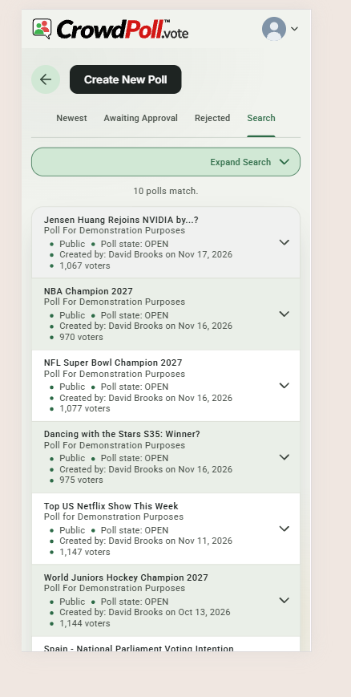
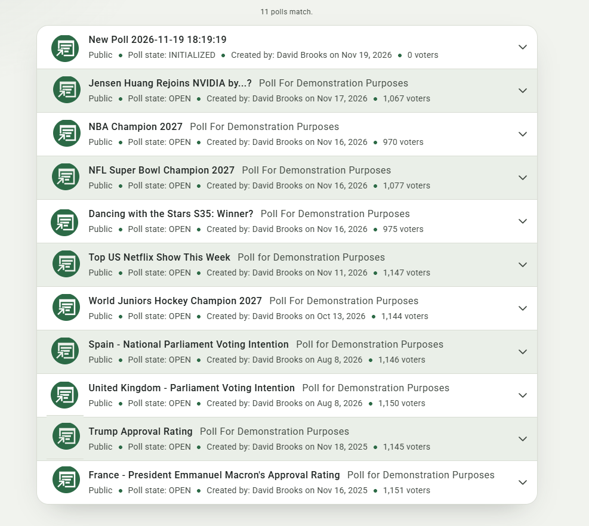
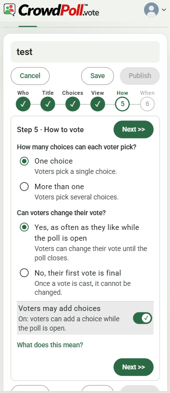

Start a new spec for these requirements called `20261119-144614-POLL-ADMIN-IMPROVEMENTS`  
!! THIS FILE IS GENERATED USING THE SKILL `/speckit-requirements`. DO NOT EDIT OR DELETE THIS FILE !!  

# Initial High-Level Requirements

This feature will make improvements to the Poll Administration section.  

**Requirement 1:**  
In Poll Administration section,  
display the polls in the Newest, Awaiting Approval, Rejected using the same zebra stripping table-like list as the results of Admin Search.

  

Clicking one of the rows will open the Admin Poll Card for that specific poll.  
Then the UX will be identical on all the Poll Admin tabs.  

This applies to all widths.

**Requirement 2:**  

Render the SVG in the file  
"requirements/20261119-144614-poll-admin-improvements/launchPoll-circle.svg"  
on each row of the zebra-striped poll list, to the left of the text,  
as mocked-up in:   


Scale it to 36X36.

Whenb clicking the icon, navigate to the poll in Maximized view, using the URL with pid=<poll_id>  
"/?PID=f55d192e-07ca-4839-b158-7ef33a0ff7a4"  
which is the url copied to the clipboard on the Admin Poll Card.  


**Requirement 3:**  

Add a toggle to the 3-Choice tab 
called 
"Display Choices in the order above".   
The toggle is "off" by default.  

There will be a typical "info icon" ( lower case i in a circle) at the end of the toggle's label.  

Clicking the icon will launch a modal information dialog:  
```markdown
**Display Choices in the order above**  
This toggle allows you to override the default order of the poll's choices, which is most votes to least votes.  
Using the order you enter the Choices makes sense when the Choices have a logical order, such as consecutive dates, or a sequence of numbers (1 Star, 2 Star, 3 Star, etc.).  
```


Similar to how the "Voters may add choices" toggle,  
there will be a sentence under the label explaining the current state of the toggle:  
either
`Off: choices are displayed from most votes to least votes.`
or
`On: choices are displayed in the order entered above.`

Render the label and toggle in the position under the "Adds choices copied..." text.  

**Requirement 4:**  

Move the "Voters may add choices" toggle to the 3-Choices tab.



Move it, to the position under the new toggle "Display Choices in the order above".

Also, add an info icon to the right of the "Voters may add choices" label.  
The dialog will read:  
```
Voters may add choices
Off (the default): only you set the choices. On: anyone who may vote on your poll can add a choice while it is open, up to the most choices a poll may have. This is only available for Private polls.
```

Also, remove the paragraph from the "What does this mean?" section on the 5-How tab:  
```
Voters may add choices
Off (the default): only you set the choices. On: anyone who may vote on your poll can add a choice while it is open, up to the most choices a poll may have.
``` 


**Requirement 5:**  
On tab 1-Who,  
the "What does this mean?" will be removed,  
and the relevant text will be available by clicking an info icon next to the corresponding label.  

There is a section for each label on the 1-Who tab,  
```
Anyone you send the link to
Your poll is private: it is listed only in the "Shared With You" tab for the people you share it with, and is not listed in Trending, Newest or Search. Anyone who has the link can open it and vote.
Only people you invite
Your poll is private: it is listed only in the "Shared With You" tab for the people you share it with, and is not listed in Trending, Newest or Search. Only the people whose email addresses you invite can vote. You add them after your poll is created.
Everyone on CrowdPoll
Your poll is public: anyone on CrowdPoll can find it and vote. Public polls appear after they are reviewed and approved.
Users can see who voted for what
Off (the default): votes are anonymous. Everyone sees how many votes each choice has, but not who cast them. On: the names of voters are shown next to the choices they picked. Turn it on only if your voters expect it, and tell them. It can't be changed once your poll has votes.
```

**Requirement 6:**    
On the 2-Title tab,  
render an info icon to the right of the "Notes" label:  
The dialog will read:  
```
Notes
The first lines of your notes appear under the title on your poll's card. All of them appear on its Maximized view.  
```

**Requirement 7:**    
Similar to how the Notes field on the 2-Title tab only renders 2 lines of the notes,  
for the Step 3:Choices field render only 5 lines of the choices,  
and then provide the same "...edit View" link to expand and edit the full list of choices.  
Also, clicking anywhere on the first 5 lines of the choices will expand and edit the full list of choices.  

Also, similar to the Notes editing, there will be a "Cancel" and "Done" link at the top of the expanded edit choices view.  

**Requirement 8:**  
On the 4-View tab,  
change the text  
"Optional. Leave a choice on Automatic to color it for you."  
to  
"Optional. Leave a choice on Automatic and an appropriate color is automatically assigned."

**Requirement 9:**  

On the 4-View tab:  
Change the text:  
"On: the line graph is drawn beside your poll when it is maximized."  
to:
"On: the line graph is drawn on the Maximized view of a poll."

**Requirement 10:**  

For the 5-How tab:  
Similar to Requirement 5,  
the "What does this mean?" will be removed,  
and the relevant text will be available by clicking an info icon next to the corresponding label.  

**Requirement 11:**  

For the 6-When tab:  
Render an info icon to the right of:  
- When does voting start?  (i)
- When does voting end?  (i)
- your time zone (xxxxxxx)  (i) 

Clicking any of those icons will launch a modal dialog with the complete text currently shown when "What does this mean?" is clicked.  
Then remove the "What does this mean?" link from the 6-When tab.


## Resolved Findings (2026-11-19 3:24 PM)

These decisions come from the findings accepted in `requirements-report.md`.  
Where one differs from the text above, the decision here is the requirement.  

**Requirement 1 (the lists):**  

- AM1: every list is drawn as rows, the creator-only page (a poll creator who is not an administrator) included.  
- UA3: all of the Search view's row rules apply in every view.  
  - One row is open at a time; its card is created on open and forgotten on close.  
  - Selecting a view tab closes the open row, and opens the row by itself when the view holds exactly one poll.  
  - The periodic refresh never opens, closes or moves a card.  
  - A poll that leaves a view on a refresh loses its row, and its card with it, unless it is being edited.  
  - During an edit every other row is disabled.  
  - Create New Poll moves to Newest, opens the new poll's row, scrolls it into view and starts the wizard.  
  - Each view keeps its own messages: the empty and cut-off lines as today, and the count line in Search only.  

**Requirement 2 (the open-poll icon):**  

- UA4: the icon is drawn by `adminList.js` from the SVG's paths, on the rows of every view, Search included; no new file is served.  
  - The circle and the mark take the primary and on-primary color tokens.  
  - It is drawn at 36 × 36 inside a 48 px target, with the phone layout's transparent 64 px halo.  
  - Its accessible name is "Open poll: <title>", and its tooltip "Open poll".  
- AM5: it is an ordinary link beside the row's button, not inside it, and opens the poll in the same tab.  
  During an edit the page's existing navigation guard asks before leaving.  
- NC1: it appears only on the polls the viewer can open at `/?PID=<pid>`; on the others its place is left empty, so the rows keep one layout.  
  The list must be told which polls those are.  

**Requirement 3 (Display Choices in the order above):**  

- AM6: in every dialog of this feature the first line is the dialog's title and the rest its body, as plain text.  
- UA1: the entered order applies to the results bars and the voting side, on the card and in the Maximized view, at every width, and nowhere else.  
  - Which choices a short card keeps does not change: the viewer's own choices and the leaders by share, with the "More choices" and "Show all N choices" rows as today.  
  - The choices kept are drawn in the entered order when the setting is on.  
  - The line graph keeps ordering its legend by current share, and the who-voted report keeps its own order.  
  - A choice added by a voter is last in the entered order; the owner can move it in the wizard.  
- UA2: it is one new boolean poll setting, off by default and off for every existing poll.  
  - It is carried in the admin payload and in the card, tab and delta payloads, and described in `postman/openapi.json`.  
  - Public and private polls both have it, and it may change after votes.  
  - A change bumps `content_version`; while a poll is `EDITING`, voters keep the stashed value.  
  - Duplicate copies it.  
  - The Settings Summary says "Choices are shown in the order entered." when it is on, and the part opens step 3.  
  - It is not a Search filter.  

**Requirement 4 (Voters may add choices):**  

- UA8: the switch keeps its rules and only changes step.  
  - It is shown for private polls only; a public poll's step 3 ends with the display-order switch.  
  - Neither switch on step 3 is locked by votes: the lock covers the choices box and Paste choices only.  
  - The Settings Summary's part opens step 3.  
  - The stored setting, its route and the voter's "add a choice" dialog do not change.  

**Requirements 3 to 6, 10 and 11 (the information dialog):**  

- UA5: one shared dialog in `adminCard.js`, in the pattern of the existing in-page dialogs.  
  - It has a title (the label), the text and one "Close" button; Escape and a press on the scrim close it too, and focus returns to the icon.  
  - The icon is a button named "About: <label>", a lower-case i in a circle in the label's color, with a 48 px target (64 px halo on the phone layout).  
  - It is placed beside the label, outside the `<label>` element, so pressing it changes no setting.  
  - It stays usable on a locked step, and opening it does not make the wizard dirty.  

**Requirement 7 (the Choices field):**  

- AM2: the link reads "... edit" with the chevron, as on Notes, named "Edit choices".  
  When the choices are locked it reads "... view", named "View all choices", and opens the full list read-only with a single "Done".  
- UA6: the preview and the link are always shown, whatever the number of choices; an empty list shows the placeholder, and a press on it opens the editor.  
- UA7: Done keeps the text and returns to the preview; Cancel restores the text as it was when the list was opened, asking first when it changed.  
  - Next, a step circle, Save and Publish act as Done on an open list.  
  - Paste choices appends in either state, and does not open the list.  
  - The preview shows the first five lines as plain text; the counter and any error stay under it.  

**Requirement 10 (the 5-How tab):**  

- AM3: one info icon per radio option, four in all, each dialog titled with its option's own label.  

**Requirement 11 (the 6-When tab):**  

- AM4: all three icons open the same dialog, with the five entries of the present text.  

**Requirement 6 (Notes):**  

- NC2: the dialog names both places, as now written under Requirement 6; the line under the Notes field stays "Optional. Shown under the title on the poll card."  

**Requirement 2 (which polls the viewer can open):**  

- UA9: a poll can be opened by the viewer when the server's existing rule says so (`mayWatchMany` in `src/polls/access.ts`), unchanged: the poll is published, the viewer is not banned, and it is public or a private poll the viewer already reaches.  
  - Both administration list routes carry that answer as one boolean per poll, described in `postman/openapi.json`; the client decides nothing.  
  - No new access rule is added, so an administrator sees no icon on another person's private poll they do not already reach.  

**Requirements 9 and 11 (wording):**  

- UA10: the three icons of step 6 keep their own names ("About: When does voting start?", and so on), and all open one dialog titled "When to vote".  
  Its body is the five entries, each heading followed by its text, in the present order.  
- UA10: the sentence Requirement 9 replaces is "On: the line graph is drawn beside the poll when it is maximized."; it becomes "On: the line graph is drawn on the Maximized view of a poll."  
