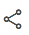
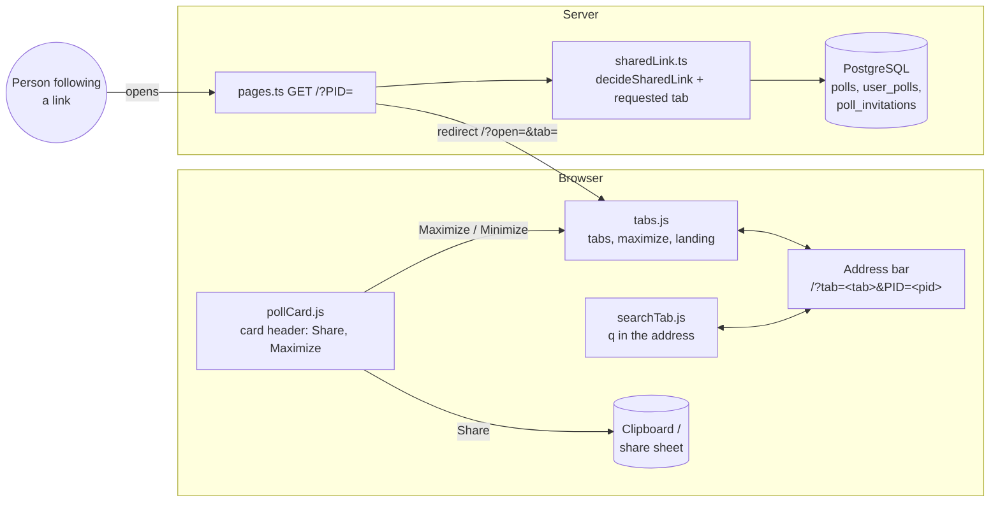
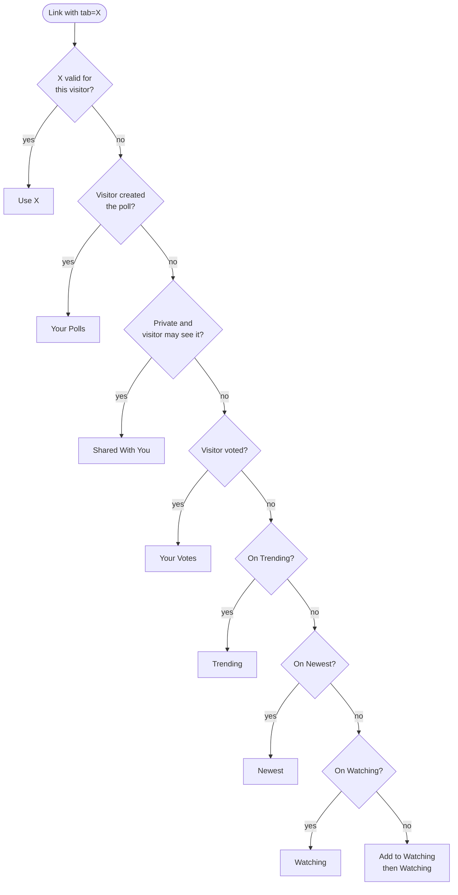
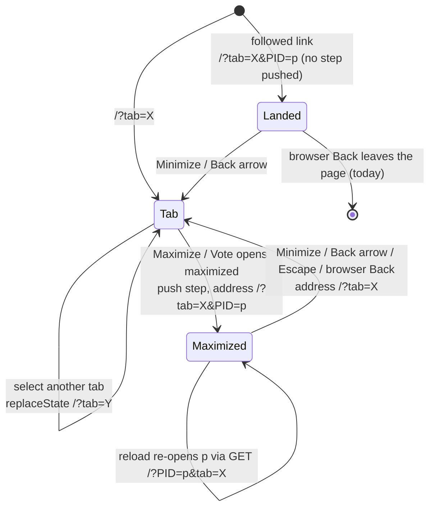
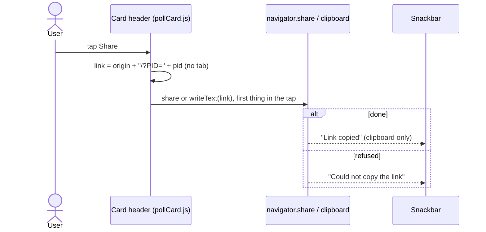

# High Level Requirements

Requirements: `requirements/20261119-182343-deep-links/requirements.md`  
External Files: `requirements/20261119-182343-deep-links/image.png`  
Generated: 2026-11-19 6:38 PM  

# Initial High-Level Requirements

This feature will implement "Deep links" links for the CrowdPoll webapp.

For example, currently, the home page tabs have a URL parameter to navigate directly to a specific tab:  
`https://crowdpoll.vote/home?tab=trending`

As far as we are able to determine,  
there are just two pages that don't have deep links implemented:
- the results of a user search
- Maximized poll view

Currently we are able to "Copy Link" for a poll from the Poll Administration Poll Card    
http://localhost:8080/?PID=6e1d7c5c-d6e5-4ed5-89d2-5fb8a38eaead
which lands on the Maximize view for a Poll.  

However, when navigating to the Maximize View from the home page,  
the url does not have the `PID` parameter appended.  

A problem with the link from "Copy Poll" (which doesn't have a `tab` parameter)  
is that when the Minimize icon, or "Back" icon is subsequently clicked  
either the "Your Polls" (if the poll belongs to the user) or "Shared With You" tab is shown. 
The "Shared With You" wouldn't actually be correct for a public poll. 
"Shared With You" is just for private polls.  

The correct behaviour would be, 
navigate to the "Your Polls" tab if the poll belongs to the user,   
or navigate to the "Shared With You" tab if the poll is Private "Anyone with the link"
or navigate to the "Shared With You" tab if the poll is Private "Invitation Only" and the user is invited, (if the user was not invited then the user would already be on the Home tab)
otherwise navigate to the "Home" tab.  

When the user manually navigates to the Maximize Poll view, the address bar should include the `PID` parameter corresponding to the poll being viewed,  
so that it can be copied and shared.  
This doesn't pose any risks because,  
if the poll is Public, anybody can see it anyways,  
if the Poll is Private "Invitation Only", then the link won't work for somebody not invited,  
if the poll is Private "Anybody with the link", then that is the purpose of the link.  
The link would include the "tab" parameter corresponding to the tab that user who shared the link was on.  

When the user clicks "Minimize" or "Back",   
the "tab" parameter would need to be validated to determine if it is valid according to these rules:    
If the parameter is "home" and the poll appears on the Home tab, then it is used.  
If the parameter is "your polls" and the poll belongs to the user, then it is used.  
If the parameter is "shared with you" and the poll is Private "Anyone with the link", then it is used.  
If the parameter is "shared with you" and the poll is Private "Invitation Only" and the user is invited, then it is used.  
If the parameter is "trending" and the poll appears on the Trending tab, then it is used.  
If the parameter is "newest" and the poll appears on the Newest tab, then it is used.  
If the parameter is "watching" and the poll appears on the Watching tab, then it is used.  
If the parameter is "live" and the poll appears on the Live tab, then it is used.  

If none of the above is true:
    if the poll belongs to the user, navigate to the "Your Polls" tab,  
    if the poll is Private "Anyone with the link", navigate to the "Shared With You" tab,  
    if the poll is Private "Invitation Only" and the user is invited, navigate to the "Shared With You" tab,  
    if the user has voted on the poll, navigate to the "your-votes" tab,  
    if the poll appears on the Trending tab, navigate to the "Trending" tab,  
    if the poll appears on the Newest tab, navigate to the "Newest" tab,  
    if the poll appears on the Watching tab, navigate to the "Watching" tab,  
    otherwise add the poll to the users list of poll they are "Watching", then navigate to the "Watching" tab.  
    

Exclusion: a future requirement may put a limit on the number of users that can access a poll via the "Anybody with the link" option

To support sharing links to a poll for an average user who doesn't typically interact with the address bar, especially when on a phone,  
every Poll Card (home tab or Maximized view) will have a "Share" button that allows the user to copy a deep-link to the poll.  
The icon will be the typical "Share" icon:  
  
The icon will be in the Poll Card header where the "Maximize" and "Minimize" buttons are located.  
Clicking the "Share" button will copy the deep-link to the user's clipboard, allowing them to easily share the poll with others.  
The link will be the same as that copied to the user's clipboard from the Admin Poll Card.  
i.e. the link will have no tab parameter included.


Question: are there any other existing pages that need deep-links that we have overlooked? 

Question: is there a better way to handle deep-links than we have described here?  
The problem as we see it is that a copied link includes context of the user who copied it,  
and that context does not apply to the user who follows the link.   

## Additional Requirements and Research Requests

**Instructions To The Developer**  
Enter any additional requirements or research requests under the ## Additional Requirements and Research Requests heading above.  
When you Type or Say: "Next" in the CC CLI terminal, the additional requirements and research requests will be applied to the report.  
  
You may leave these instructions here. They will be ignored when "Next" is executed.  

## 1. Overview and Scope

The feature makes the poll the user is looking at addressable.  
Today a poll link (`/?PID=<pid>`) already opens a poll maximized, but opening a poll from a tab leaves the address unchanged, so it cannot be copied from the address bar, and a poll card offers no way to share its link outside the administration page.  

**In scope**

- **The maximized view in the address**: while a poll is maximized, the address carries `PID=<pid>` beside `tab=<tab>`; minimizing removes `PID`.  
- **The tab behind a followed link**: the `tab` a link names is checked against the person following it, and replaced by a tab that person may see when it does not apply to them.  
  Once closed, the poll is shown as the first card on the chosen tab, even when that tab's list would not otherwise hold it or holds it further down, until the tab's next refresh (TWEAK01).  
- **A Share button** on every poll card's header (the grid and the maximized view), beside Maximize/Minimize, copying the same link as the administration card's "Copy poll link" (`/?PID=<pid>`, no `tab`).  
- **Search results in the address** (the requirements list them as missing; see RS1 for what exists today).  

**Out of scope**

- A limit on how many people may open an "Anyone with the link" poll (named as a future requirement).  
- Changes to who may see a poll: `src/polls/access.ts` and `decideSharedLink` keep deciding visibility.  

**What exists today (from the code)**

- `GET /?PID=<pid>` (`src/routes/pages.ts`): a guest goes to `/poll/<pid>` for a poll search engines may index, otherwise to `/login?PID=<pid>`.  
  A signed-in visitor goes through `resolveSharedLink` (`src/polls/sharedLink.ts`), which redirects to `/?open=<pid>&tab=<your-polls|shared-with-you|trending>` or to `/?notice=unavailable`; it ignores any `tab` in the link.  
- `tabs.js` `takeLanding()` removes `open` and `notice` from the address, selects the tab and maximizes the poll; a link landing pushes no history step.  
- Opening a card's maximized view pushes `{maximizedPid}` at **the same address**; Back, Minimize and Escape take that step back.  
- The Search tab reads `?tab=search&q=<terms>` on load and runs the search, but running a search writes only `tab=search`, never `q`.  
- Tab names in the address are the `TAB_NAMES` values: `home`, `your-polls`, `shared-with-you`, `your-votes`, `trending`, `newest`, `watching`, `live`, `search`.  
- "Watching" is the `bookmarked` relation in `user_polls`, capped at `ENV_MAX_BOOKMARKS_PER_USER` (200) per user.  

## 2. Context Diagram



## 3. Following a Link (sequence)

```mermaid
sequenceDiagram
    actor F as Follower
    participant B as Browser (tabs.js)
    participant R as pages.ts GET /
    participant L as sharedLink.ts
    F->>R: GET /?PID=pid&tab=trending (address bar copy)<br/>or /?PID=pid (Share / Copy poll link)
    alt not signed in
        R-->>B: 302 /poll/pid (indexable) or /login?PID=pid
    else signed in
        R->>L: resolveSharedLink(caller, pid, requestedTab)
        L->>L: may see the poll? (unchanged rules)
        L->>L: requested tab valid for this caller? else fallback tab
        L-->>R: { open: pid, tab } or { notice }
        R-->>B: 302 /?open=pid&tab=tab
        B->>B: takeLanding(): select tab, maximize pid
        B->>B: address becomes /?tab=tab&PID=pid
    end
    F->>B: Minimize / Back arrow
    B->>B: restore the grid of tab; address /?tab=tab
```

## 4. Choosing the Tab Behind the Poll (as written, before the findings)



The "correct behaviour" paragraph of the requirements ends at **Home** instead of the lower half of this chart (see IN1), and the "add to Watching" step writes on navigation (see UA1).

## 5. The Address While Viewing (state diagram)



## 6. The Share Button (sequence)



## 7. Breaking Changes

- **The maximized step's address changes**: CLAUDE.md and the phone-layout plan's R10 say a view opened from a card pushes `{maximizedPid}` *at the same address*; it now pushes the address with `PID`.  
  Client tests that check the address after maximizing (`tests/client-*.test.ts`) change with it.  
- **Reloading a maximized poll re-opens it**: the address with `PID` goes through `GET /?PID=` and its redirect, where today a reload shows the tab only.  
- **`GET /?PID=` honours `tab`**: `decideSharedLink` gains the requested tab, and `LandingTab` grows beyond `your-polls | shared-with-you | trending`; its tests (`tests/*shared-link*`) change.  
- **The landing tab for a public poll** may change from Trending to Home (IN1).  
- Existing links (`/?PID=<pid>` from "Copy poll link" and emails) keep working: no `tab` behaves as today's landing.  

## 8. Technical Debt

- **The address is read in two places**: the server decides the landing tab, and `tabFromAddress()` re-reads `tab` on the client; a single rule (the server's) would avoid the two disagreeing.  
- **Search reads `q` but never writes it** (`searchTab.js` `submit`): half of a deep link, already relied on by `searchFromAddress`.  
- **Copying a poll link lives in `adminCard.js`** (`pollLink()`, `copyPollLink()`, with its iOS first-thing-in-the-tap rule); the Share button needs the same code, which should move to one shared helper rather than be copied.  
- **`LandingTab` is a three-value type** narrower than `TAB_NAMES`; extending it means two lists of tab names to keep in step.  

## 9. Assumptions

- The parameter names stay as they are: `PID` (upper case, as every existing link) and `tab` with the `TAB_NAMES` values.  
- Visibility rules do not change: a poll a visitor may not see still answers "That poll isn't available." and leaves them on their default tab.  
- Opening a link still counts as a view for an "Anyone with the link" poll (the `linked` relation), which is what puts it in Shared With You.  
- The Share button copies only; it does not change the poll or record anything.  
- No new cookie or browser storage key is introduced.  

## 10. Research Results

### 10.1 Overlooked pages

**RS1. Are there any other existing pages that need deep links that we have overlooked?**  
<span style="font-size:large" ><b>
✅ Resolved</b></span>  
✅ Requirements File Updated: 2026-11-19 7:29 PM  
**Notes**: Recommendation accepted in file 2026-11-19: Recommendation A, keep the scope to the maximized view and search results (writing `q`), and list the administration page as a later feature;  
an **Answer (RS1)** now follows the first question in the requirements.  

> The requirements ask whether any page besides search results and the maximized view lacks a deep link.  
> Sources: the codebase — `src/public/tabs.js` (`showTabInAddress`, `tabFromAddress`, `takeLanding`), `src/public/searchTab.js` (`submit`), `src/public/adminList.js`, `src/routes/pages.ts`.  
> **Search results are half done**: `/?tab=search&q=<terms>` already runs the search on load (`searchFromAddress`), but running a search never writes `q`, so the address shows `?tab=search` only.  
> **The administration page** (`/admin`) keeps its view tabs, its search terms and the open result row out of the address: a reload or a copied address always opens its default view.  
> **Inside the maximized view**, its own states — the voting side, the line graph, the Who Voted list, "Show all N choices" — are not in the address;  
> they are moments of one poll rather than places, and sites rarely address them.  
> **Profile, Settings, Privacy and Terms** are single pages with their own addresses; the legal pages already have anchors (`/privacy#cookies`).  
> **Live Results** depends on the visitor's own live registration, so a `live` address cannot reproduce it for someone else.  

  - **Recommendation A** _(recommended)_: **keep the scope to the maximized view and search results (writing `q`), and list the administration page as a later feature.**  

    [X] ➡️ **Accepted**

    - <u>Pros</u>: the two places voters share; the administration page is used by a handful of creators and admins, and its open row has edit sessions of its own to consider.  
    - <u>Cons</u>: an admin reloading `/admin` still loses their view and search.  


  - **Recommendation B**: **also put the administration page's view, search terms and open row in its address.**  

    [ ] ➡️ **Not Accepted**

    - <u>Pros</u>: every list in the site becomes addressable at once.  
    - <u>Cons</u>: a larger feature touching `adminList.js`, whose open row holds wizard progress and an edit lock (admin-search R5–R7).  


  - **Developer Resolution C**:  

    [ ] ➡️ **Not Accepted**

### 10.2 A better way to handle deep links

**RS2. Is there a better way to handle deep links, given that a copied link carries the context of the person who copied it?**  
<span style="font-size:large" ><b>
✅ Resolved</b></span>  
✅ Requirements File Updated: 2026-11-19 7:29 PM  
**Notes**: Recommendation accepted in file 2026-11-19: Recommendation, treat `tab` in a link as a hint the server checks when the link is opened, and keep the shared link context-free;  
an **Answer (RS2)** now follows the second question in the requirements.  

> The requirements see the problem as a link carrying the copier's tab, which may not apply to the person following it.  
> Sources: [MDN — History.pushState()](https://developer.mozilla.org/en-US/docs/Web/API/History/pushState), [MDN — Navigator.share()](https://developer.mozilla.org/en-US/docs/Web/API/Navigator/share), [Google Search Central — canonical URLs](https://developers.google.com/search/docs/crawling-indexing/consolidate-duplicate-urls), and the codebase (`src/polls/sharedLink.ts`).  
> Common practice separates the **resource** from the **viewer's context**: a shared link names the thing (one canonical address per poll), and where it is shown is decided for whoever opens it.  
> Large sites follow this: a post or video has one address, and the list it was opened from is not part of what is shared.  
> CrowdPoll already does the hard half: `decideSharedLink` decides on the server, per visitor, whether they may see the poll and which tab it sits on.  
> What the server cannot do today is honour a `tab` that **does** apply to the visitor, such as the copier reloading their own page.  
> Deciding at the moment the link is opened, on the server, uses facts only the server has (creator, invitations, bans, votes, watch list) and needs no second check when Minimize is pressed.  

  - **Recommendation**: **treat `tab` in a link as a hint the server checks when the link is opened, and keep the shared link context-free.**  

    [X] ➡️ **Accepted**

    - The Share button and "Copy poll link" copy `/?PID=<pid>` only, the canonical poll link.  
    - The address bar shows `/?tab=<tab>&PID=<pid>`, so a reload or a copied address keeps the copier's tab when it is valid for whoever opens it.  
    - `GET /?PID=` passes the requested `tab` to `decideSharedLink`, which keeps it when valid for the caller and otherwise chooses the fallback tab; the browser then shows that tab behind the maximized poll from the start, so Minimize and Back need no check of their own.  


  - **Developer Resolution B**:  

    [ ] ➡️ **Not Accepted**

## 11. Findings

### 11.1 Inconsistencies

**IN1. Which tab is behind a public poll the visitor has no relation to: Home, or the fallback list?**  
<span style="font-size:large" ><b>
✅ Resolved</b></span>  
✅ Requirements File Updated: 2026-11-19 7:29 PM  
**Notes**: Recommendation accepted in file 2026-11-19: Recommendation A, one fallback list ending at Home (Trending for a guest), with no automatic watch;  
the fallback list in the requirements was replaced by the numbered list under **Choosing the tab behind a linked poll**.  
**TWEAK01** (2026-11-20): once closed, the poll is shown as the first card on the chosen tab, even when that tab's list would not otherwise hold it or holds it further down, until the tab's next refresh.  

> The "correct behaviour" paragraph ends with "otherwise navigate to the Home tab".  
> The fallback list for an invalid `tab` never reaches Home: after Your Polls and Shared With You it tries Your Votes, Trending, Newest, Watching, and finally adds the poll to Watching.  
> For the same public poll and visitor, the two give different tabs.  

  - **Recommendation A** _(recommended)_: **one fallback list: Your Polls (creator), Shared With You (private, may see), Your Votes (voted), Watching (watched), otherwise Home (Trending for a guest), with no automatic watch.**  

    [X] ➡️ **Accepted**

    - <u>Pros</u>: every step is a fact the server holds (`created_by_id`, `user_polls` relations, invitations); Home is where a signed-in visitor starts anyway; nothing is written on the visitor's behalf.  
    - <u>Cons</u>: the poll may not be in Home's list once minimized, so it is shown there as a retained card (as `mountLinkedPoll` does today) until the next refresh.  


  - **Recommendation B**: **the fallback list as written, ending with adding the poll to Watching.**  

    [ ] ➡️ **Not Accepted**

    - <u>Pros</u>: the poll is always found again in a list after Minimize.  
    - <u>Cons</u>: "on Trending" and "on Newest" need a definition (AM1); it writes a watch the visitor did not ask for (UA1); the "correct behaviour" paragraph must be removed.  


  - **Developer Resolution C**:  

    [ ] ➡️ **Not Accepted**

**IN2. The list of tabs a link may name omits Your Votes and Search, and spells tab names two ways.**  
<span style="font-size:large" ><b>
✅ Resolved</b></span>  
✅ Requirements File Updated: 2026-11-19 7:29 PM  
**Notes**: Recommendation accepted in file 2026-11-19: Recommendation, use the `TAB_NAMES` values, keep `your-votes` when the visitor voted, and never keep `search` from a link;  
the validation rules were rewritten with the address values under **Choosing the tab behind a linked poll**.  

> The validation rules cover home, your polls, shared with you, trending, newest, watching and live.  
> Your Votes appears in the fallback list but cannot be kept when a link names it, and Search is not mentioned.  
> The rules write "your polls" and "shared with you", while the address uses `your-polls` and `shared-with-you` (`TAB_NAMES`).  

  - **Recommendation**: **use the `TAB_NAMES` values; keep `your-votes` when the visitor voted on the poll; treat `search` as not valid behind a followed link (the fallback applies).**  

    [X] ➡️ **Accepted**

    - The search terms (`q`) are the copier's; a follower would land on someone else's search.  
    - The copier's own reload keeps `search` and `q`, since the browser keeps its own search when the address carries both (UA3).  


  - **Developer Resolution B**:  

    [ ] ➡️ **Not Accepted**

**IN3. Does Share copy the link, or open the share sheet?**  
<span style="font-size:large" ><b>
✅ Resolved</b></span>  
✅ Requirements File Updated: 2026-11-19 7:37 PM  
**Notes**: Recommendation accepted in file 2026-11-19: Recommendation, add a note under the original paragraph that the share sheet is used where available;  
a **Note (IN3)** now follows the original Share paragraph.  

> The original paragraph still says "Clicking the Share button will copy the deep-link to the user's clipboard".  
> The **Share button (NC1, UA4)** list added by NC1 says Share opens the share sheet where the browser has one, and copies only where it does not.  
> A reader of the first paragraph alone would build a copy-only button.  

  - **Recommendation**: **add a note under the original paragraph that the share sheet is used where available, per the Share button list.**  

    [X] ➡️ **Accepted**

    - Your wording stays as written; the note points to the decision, so the two cannot be read apart.  


  - **Developer Resolution B**:  

    [ ] ➡️ **Not Accepted**

**IN4. Is `search` kept when a maximized search result's address is reloaded?**  
<span style="font-size:large" ><b>
✅ Resolved</b></span>  
✅ Requirements File Updated: 2026-11-19 7:37 PM  
**Notes**: Recommendation accepted in file 2026-11-19: Recommendation A, keep `search` whenever the link also carries `q`, for anyone who opens it;  
the kept-tab list now has a `search` item, and `live` alone is never kept.  

> **Search results (UA3)** says a result maximized from Search adds `PID`, and Minimize returns to the same results.  
> **Choosing the tab behind a linked poll** says `search` is never kept from a link, and the address with `PID` goes through `GET /?PID=` on reload.  
> So reloading `/?tab=search&q=<terms>&PID=<pid>` would drop the search and land on the fallback tab, and Minimize would not return to the results.  
> IN2's own note expected the copier's reload to keep `search` and `q`.  

  - **Recommendation A** _(recommended)_: **keep `search` whenever the link also carries `q`, for anyone who opens it; the search runs with the visitor's own access.**  

    [X] ➡️ **Accepted**

    - <u>Pros</u>: reload and a copied address behave alike; Minimize always returns to results; the terms reveal nothing, since the search returns only polls the visitor may see.  
    - <u>Cons</u>: a follower lands on the copier's search, which may not list the poll for them.  


  - **Recommendation B**: **never keep `search` from a link; a reload of a maximized search result lands on the fallback tab.**  

    [ ] ➡️ **Not Accepted**

    - <u>Pros</u>: one rule for every link; nobody lands on another person's search.  
    - <u>Cons</u>: the copier's own reload loses their results, and UA3's "Minimize returns to the same results" holds only until a reload.  


  - **Developer Resolution C**:  

    [ ] ➡️ **Not Accepted**

### 11.2 Ambiguities

**AM1. What does "the poll appears on the Home / Trending / Newest / Live tab" mean?**  
<span style="font-size:large" ><b>
✅ Resolved</b></span>  
✅ Requirements File Updated: 2026-11-19 7:29 PM  
**Notes**: Recommendation accepted in file 2026-11-19: Recommendation A, `home`, `trending` and `newest` are kept for any published public poll, and `live` is never kept from a link;  
the requirements say so under **Choosing the tab behind a linked poll**.  

> Home is ranked for each user, Trending changes minute to minute, Newest is capped, and Live depends on the visitor's own live registration.  
> "Appears" could mean in the list the visitor would get right now, in the full ranking, or merely that the poll is public and published.  
> Testing real list membership means computing the visitor's tab on every followed link, and the answer can change before Minimize is pressed.  

  - **Recommendation A** _(recommended)_: **`home`, `trending` and `newest` are kept for any published public poll; `live` is never kept from a link.**  

    [X] ➡️ **Accepted**

    - <u>Pros</u>: a cheap, stable rule; the poll sits behind the maximized view as a retained card even when the list itself would not hold it; a private poll is never shown over a public list.  
    - <u>Cons</u>: after Minimize, the poll may not be in that tab's next refresh.  


  - **Recommendation B**: **test real membership in the visitor's current list for each tab.**  

    [ ] ➡️ **Not Accepted**

    - <u>Pros</u>: the poll is always in the tab shown after Minimize.  
    - <u>Cons</u>: one tab computation per followed link (Home's ranking is the costliest), and the answer can change seconds later.  


  - **Developer Resolution C**:  

    [ ] ➡️ **Not Accepted**

**AM2. When is the `tab` checked: when the link is opened, or when Minimize or Back is pressed?**  
<span style="font-size:large" ><b>
✅ Resolved</b></span>  
✅ Requirements File Updated: 2026-11-19 7:29 PM  
**Notes**: Recommendation accepted in file 2026-11-19: Recommendation, check the tab on the server when the link is opened;  
**Choosing the tab behind a linked poll** replaces "when the user clicks Minimize or Back" with that rule.  

> The requirements check the tab "when the user clicks Minimize or Back".  
> Until then, the maximized poll would sit over a tab that may not be valid, and the address would still show it.  
> Today the server chooses the tab when the link is opened (`decideSharedLink`), and the browser shows it behind the poll from the start.  

  - **Recommendation**: **check it on the server when the link is opened (RS2), so the tab behind the poll, the address and Minimize all agree from the start.**  

    [X] ➡️ **Accepted**

    - The facts the rules need (creator, invitations, votes, watch list, visibility) are on the server, which already reads them for the same request.  


  - **Developer Resolution B**:  

    [ ] ➡️ **Not Accepted**

**AM3. Does "Back" mean the page's Back arrow, the browser's Back, or both, after following a link?**  
<span style="font-size:large" ><b>
✅ Resolved</b></span>  
✅ Requirements File Updated: 2026-11-19 7:29 PM  
**Notes**: Recommendation accepted in file 2026-11-19: Recommendation A, keep today's rule: Minimize and the Back arrow show the tab, and the browser's Back leaves the page after a followed link;  
a **Back (AM3)** paragraph was added to the requirements.  

> A link landing pushes no history step today, so the browser's Back leaves CrowdPoll (back to the email or chat), while the Back arrow and Minimize show the tab.  
> A poll opened from a card pushes a step, so there the browser's Back also shows the tab.  

  - **Recommendation A** _(recommended)_: **keep today's rule: after a followed link, Minimize and the Back arrow show the tab, and the browser's Back leaves the page.**  

    [X] ➡️ **Accepted**

    - <u>Pros</u>: the browser's Back goes where the visitor came from, as on most sites; no change to the phone-layout history rules (R10).  
    - <u>Cons</u>: two Backs behave differently on a landed poll.  


  - **Recommendation B**: **push a step on landing too, so the browser's Back first shows the tab, then leaves.**  

    [ ] ➡️ **Not Accepted**

    - <u>Pros</u>: every Back behaves alike.  
    - <u>Cons</u>: a visitor who only wanted to vote needs two Backs to return to their chat; it reverses an earlier decision.  


  - **Developer Resolution C**:  

    [ ] ➡️ **Not Accepted**

**AM4. Which ways of opening the maximized view put `PID` in the address, and in what form?**  
<span style="font-size:large" ><b>
✅ Resolved</b></span>  
✅ Requirements File Updated: 2026-11-19 7:29 PM  
**Notes**: Recommendation accepted in file 2026-11-19: Recommendation, every maximized view shows `/?tab=<tab>&PID=<pid>`, and every way of closing it removes `PID`;  
a paragraph **The address while maximized (AM4)** was added after the address-bar paragraph.  

> "When the user manually navigates to the Maximize Poll view" could mean the Maximize button only, or also Vote opening the maximized view (phone, or a ballot that does not fit) and a followed link.  
> The address form is not given: `/?tab=<tab>&PID=<pid>`, or the public page `/poll/<pid>`.  

  - **Recommendation**: **every maximized view shows `/?tab=<tab>&PID=<pid>` (Maximize, Vote, a followed link), and every way of closing it removes `PID`.**  

    [X] ➡️ **Accepted**

    - The address then always matches what is on screen.  
    - `/poll/<pid>` stays the guests' crawler page and is not used for signed-in viewing.  
    - Other parameters already in the address (e.g. `q` on Search) are kept.  


  - **Developer Resolution B**:  

    [ ] ➡️ **Not Accepted**

### 11.3 Unspecified Aspects

**UA1. Adding the poll to Watching on the visitor's behalf is not specified.**  
<span style="font-size:large" ><b>
✅ Resolved</b></span>  
✅ Requirements File Updated: 2026-11-19 7:29 PM  
**Notes**: Recommendation accepted in file 2026-11-19: Recommendation, do not watch automatically;  
the requirements now say following a link never adds the poll to Watching.  

> The last fallback step adds the poll to the visitor's Watching list.  
> Not said: whether it is done for a poll the visitor may not watch, what happens at the watch cap (`ENV_MAX_BOOKMARKS_PER_USER`, 200), whether the visitor is told, and whether it happens again each time the link is opened.  
> Writing on navigation also means a link preview or a mis-tap changes the visitor's lists.  

  - **Recommendation**: **do not watch automatically; the visitor uses the card's own Watch control (follows IN1 A).**  

    [X] ➡️ **Accepted**

    - Nothing is written by following a link beyond what is written today (the `linked` view for an "Anyone with the link" poll), and the cap never interrupts a landing.  


  - **Developer Resolution B**:  

    [ ] ➡️ **Not Accepted**

**UA2. What does a guest (not signed in) see when following a link with a `tab`?**  
<span style="font-size:large" ><b>
✅ Resolved</b></span>  
✅ Requirements File Updated: 2026-11-19 7:29 PM  
**Notes**: Recommendation accepted in file 2026-11-19: Recommendation, guests keep today's routes, the `tab` is carried through login, and a guest's Minimize shows Trending;  
a **Guests (UA2)** paragraph was added to the requirements.  

> Every rule speaks of "the user".  
> Today a guest is sent to `/poll/<pid>` (a public, indexable poll, shown maximized over Trending) or to `/login?PID=<pid>`, and the personal tabs become Trending for a guest.  

  - **Recommendation**: **guests keep today's routes; after login the `tab` is carried through `/login?PID=` and checked as for any signed-in visitor; a guest's Minimize shows Trending.**  

    [X] ➡️ **Accepted**

    - The crawler page and the link preview on the login page stay as they are.  


  - **Developer Resolution B**:  

    [ ] ➡️ **Not Accepted**

**UA3. What the search deep link holds is not specified.**  
<span style="font-size:large" ><b>
✅ Resolved</b></span>  
✅ Requirements File Updated: 2026-11-19 7:29 PM  
**Notes**: Recommendation accepted in file 2026-11-19: Recommendation, a search writes `?tab=search&q=<terms>`, Clear removes `q`, and a maximized result adds `PID`;  
a **Search results (UA3)** paragraph was added to the requirements.  

> Search results are named as missing a deep link, but not what the address should show, nor what Clear or a new search does to it.  

  - **Recommendation**: **running a search writes `?tab=search&q=<terms>` (replaceState, like a tab change); Clear removes `q`; a result maximized from it adds `PID`, and Minimize returns to the same results.**  

    [X] ➡️ **Accepted**

    - Loading `?tab=search&q=` already runs the search, so only the writing is new.  


  - **Developer Resolution B**:  

    [ ] ➡️ **Not Accepted**

**UA4. Which cards show the Share button, and how is the copy confirmed?**  
<span style="font-size:large" ><b>
✅ Resolved</b></span>  
✅ Requirements File Updated: 2026-11-19 7:29 PM  
**Notes**: Recommendation accepted in file 2026-11-19: Recommendation, Share on every open or closed poll's card (not unpublished), confirmed by a snackbar, named "Share poll: <title>", with the phone halo;  
the requirements list it under **Share button (NC1, UA4)**.  

> "Every Poll Card" could include a guest's card, a closed poll, and a poll not yet published (in Your Polls).  
> The confirmation, the button's name for screen readers, and the room on the phone header beside Maximize are not given.  

  - **Recommendation**: **Share on every open or closed poll's card, in the grid and maximized, for guests too; not on an unpublished poll; a snackbar says "Link copied" or "Could not copy the link"; the button is named "Share poll: <title>", a 48 px control with the 64 px phone halo.**  

    [X] ➡️ **Accepted**

    - An unpublished poll's link only shows "That poll isn't available." to others, so sharing it would mislead.  
    - The snackbar text matches the administration card's existing messages.  


  - **Developer Resolution B**:  

    [ ] ➡️ **Not Accepted**

### 11.4 Needs Clarifications

**NC1. Should Share open the phone's share sheet, or only copy the link?**  
<span style="font-size:large" ><b>
✅ Resolved</b></span>  
✅ Requirements File Updated: 2026-11-19 7:29 PM  
**Notes**: Recommendation accepted in file 2026-11-19: Recommendation A, open the share sheet where the browser has one, and copy the link where it does not;  
the requirements list it under **Share button (NC1, UA4)**.  

> The requirements say Share copies the link to the clipboard, but the icon chosen is the one phones use for their share sheet, where people expect to pick an app.  
> Sources: [MDN — Navigator.share()](https://developer.mozilla.org/en-US/docs/Web/API/Navigator/share), [caniuse — Web Share API](https://caniuse.com/web-share), [MDN — Clipboard.writeText()](https://developer.mozilla.org/en-US/docs/Web/API/Clipboard/writeText).  
> `navigator.share()` is available in Safari (iOS and macOS), Chrome and Edge on Android, Windows and ChromeOS, and Firefox for Android, but not desktop Firefox;  
> it needs a secure page and a user tap, and sends nothing to any third party itself.  

  - **Recommendation A** _(recommended)_: **open the share sheet where the browser has one, and copy the link where it does not.**  

    [X] ➡️ **Accepted**

    - <u>Pros</u>: what the icon promises on a phone, one tap to a chat app; the sheet also offers "Copy".  
    - <u>Cons</u>: the button behaves differently on desktop Firefox; a cancelled sheet must not show an error.  


  - **Recommendation B**: **copy the link only, as written.**  

    [ ] ➡️ **Not Accepted**

    - <u>Pros</u>: one behaviour everywhere, identical to "Copy poll link".  
    - <u>Cons</u>: on a phone the visitor must then switch apps and paste.  


  - **Developer Resolution C**:  

    [ ] ➡️ **Not Accepted**

## 12. Requirements Report Complete Report  
  
- **Requirements Report Document:** requirements/20261119-182343-deep-links/requirements-report.md  
- **Requirements Document:** requirements/20261119-182343-deep-links/requirements.md  
- **Software Architecture Diagrams:** 5  
- **Inconsistencies:** 4  
- **Ambiguities:** 4  
- **Unspecified Aspects:** 4  
- **Needs Clarifications:** 1  
- **Research Results:** 2  
- **Breaking Changes:** 5  
- **Technical Debt items:** 4  
  
The requirements are ready for /speckit-specify.  
To generate specs from the requirements document, use the `/speckit-specify` skill followed by the path (relative to the project root) to the requirements file.  
At the prompt, Type:  
🟩 👉 /speckit-specify requirements/20261119-182343-deep-links/requirements.md  
