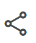

Start a new spec for these requirements called `20261119-182343-DEEP-LINKS`  
!! THIS FILE IS GENERATED USING THE SKILL `/speckit-requirements`. DO NOT EDIT OR DELETE THIS FILE !!  

# Initial High-Level Requirements

This feature will implement "Deep links" links for the CrowdPoll webapp.

For example, currently, the home page tabs have a URL parameter to navigate directly to a specific tab:  
`https://crowdpoll.vote/home?tab=trending`

As far as we are able to determine,  
there are just two pages that don't have deep links implemented:
- the results of a user search
- Maximized poll view

Currently we are able to "Copy Link" for a poll from the Poll Administration Poll Card    
http://localhost:8080/?PID=6e1d7c5c-d6e5-4ed5-89d2-5fb8a38eaead
which lands on the Maximize view for a Poll.  

However, when navigating to the Maximize View from the home page,  
the url does not have the `PID` parameter appended.  

A problem with the link from "Copy Poll" (which doesn't have a `tab` parameter)  
is that when the Minimize icon, or "Back" icon is subsequently clicked  
either the "Your Polls" (if the poll belongs to the user) or "Shared With You" tab is shown. 
The "Shared With You" wouldn't actually be correct for a public poll. 
"Shared With You" is just for private polls.  

The correct behaviour would be, 
navigate to the "Your Polls" tab if the poll belongs to the user,   
or navigate to the "Shared With You" tab if the poll is Private "Anyone with the link"
or navigate to the "Shared With You" tab if the poll is Private "Invitation Only" and the user is invited, (if the user was not invited then the user would already be on the Home tab)
otherwise navigate to the "Home" tab.  

When the user manually navigates to the Maximize Poll view, the address bar should include the `PID` parameter corresponding to the poll being viewed,  
so that it can be copied and shared.  
This doesn't pose any risks because,  
if the poll is Public, anybody can see it anyways,  
if the Poll is Private "Invitation Only", then the link won't work for somebody not invited,  
if the poll is Private "Anybody with the link", then that is the purpose of the link.  
The link would include the "tab" parameter corresponding to the tab that user who shared the link was on.  

**The address while maximized (AM4)**: every maximized view (the Maximize button, Vote opening the maximized view, a followed link) shows `/?tab=<tab>&PID=<pid>`, keeping other parameters already in the address (e.g. `q`);  
every way of closing it removes `PID`.  
`/poll/<pid>` stays the guests' crawler page and is not used for signed-in viewing.  

**Choosing the tab behind a linked poll (IN1, IN2, AM1, AM2, UA1)**  
The `tab` in a link is checked on the server when the link is opened (`GET /?PID=`), not when Minimize or Back is pressed;  
the browser then shows the chosen tab behind the maximized poll, and Minimize and Back return to it.  
Tab names are the address values (`TAB_NAMES`).  

The requested `tab` is kept when:  
- `your-polls`: the visitor created the poll;  
- `shared-with-you`: the poll is Private "Anyone with the link", or Private "Invitation Only" and the visitor is invited,
  and the visitor did not create it (Shared With You never lists the visitor's own polls);  
- `your-votes`: the visitor voted on the poll;  
- `watching`: the visitor watches the poll;  
- `home`, `trending` or `newest`: the poll is public and published (the poll is shown there as a retained card even when that tab's list would not hold it).  
- `search`: the link also carries `q`; the search runs with the visitor's own access, so a reload or a copied address of a maximized search result returns to the same results (IN4).  
- `live` is never kept from a link.  

Otherwise, the first that applies:  
1. the visitor created the poll: Your Polls;  
2. a Private poll the visitor may see: Shared With You;  
3. the visitor voted on the poll: Your Votes;  
4. the visitor watches the poll: Watching;  
5. otherwise: Home.  

Following a link never adds the poll to Watching; the visitor uses the card's own Watch control.  
Nothing is written beyond what is written today (the `linked` view of an "Anyone with the link" poll).  

**Guests (UA2)**: a guest keeps today's routes (`/poll/<pid>` for a public, indexable poll, otherwise `/login?PID=<pid>`);  
after login the `tab` is carried through and checked as above;  
a guest's Minimize shows Trending.  

**Back (AM3)**: after following a link, Minimize and the page's Back arrow show the chosen tab, and the browser's Back leaves the page, as today;  
a poll maximized from a card pushes a history step, so there the browser's Back also shows the tab.  

**Search results (UA3)**: running a search writes `?tab=search&q=<terms>` (replaceState, like a tab change);  
Clear removes `q`;  
a result maximized from it adds `PID`, and Minimize returns to the same results.  

Exclusion: a future requirement may put a limit on the number of users that can access a poll via the "Anybody with the link" option

To support sharing links to a poll for an average user who doesn't typically interact with the address bar, especially when on a phone,  
every Poll Card (home tab or Maximized view) will have a "Share" button that allows the user to copy a deep-link to the poll.  
The icon will be the typical "Share" icon:  
  
The icon will be in the Poll Card header where the "Maximize" and "Minimize" buttons are located.  
Clicking the "Share" button will copy the deep-link to the user's clipboard, allowing them to easily share the poll with others.  
The link will be the same as that copied to the user's clipboard from the Admin Poll Card.  
i.e. the link will have no tab parameter included.

**Note (IN3)**: where the browser has a share sheet, Share opens it rather than copying; see **Share button (NC1, UA4)** below.  

**Share button (NC1, UA4)**:  
- Where the browser has a share sheet (`navigator.share`), Share opens it with the link; elsewhere it copies the link to the clipboard.  
  A cancelled share sheet shows nothing.  
- Share is on every open or closed poll's card, in the grid and maximized, for guests too; it is not on an unpublished poll.  
- A copy is confirmed by a snackbar, "Link copied", or "Could not copy the link" when it fails.  
- The button is named "Share poll: <title>" for screen readers, and is a 48 px control with the 64 px halo in the phone layout.  

Question: are there any other existing pages that need deep-links that we have overlooked? 

**Answer (RS1)**: the scope is the maximized view and search results;  
the administration page (`/admin`: its view, search terms and open row) also lacks a deep link and is left for a later feature.  
The maximized view's own states (voting side, line graph, Who Voted, "Show all N choices"), Profile, Settings and the legal pages need none, and Live Results cannot be reproduced for someone else.  

Question: is there a better way to handle deep-links than we have described here?  
The problem as we see it is that a copied link includes context of the user who copied it,  
and that context does not apply to the user who follows the link.   

**Answer (RS2)**: the shared link stays free of the sharer's context, and the `tab` in a link is only a hint the server checks for whoever opens it.  
- The Share button and the administration card's "Copy poll link" copy `/?PID=<pid>` only, the canonical poll link.  
- The address bar shows `/?tab=<tab>&PID=<pid>`, so a reload or a copied address keeps the tab when it is valid for whoever opens it.  
- `GET /?PID=` passes the requested `tab` to `decideSharedLink`, which keeps it when valid for the caller and otherwise chooses the fallback tab;  
  the browser shows that tab behind the maximized poll from the start, so Minimize and Back need no check of their own.  

