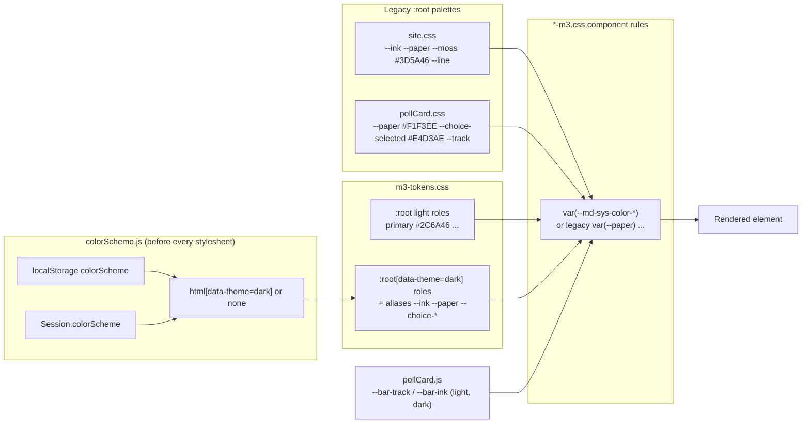
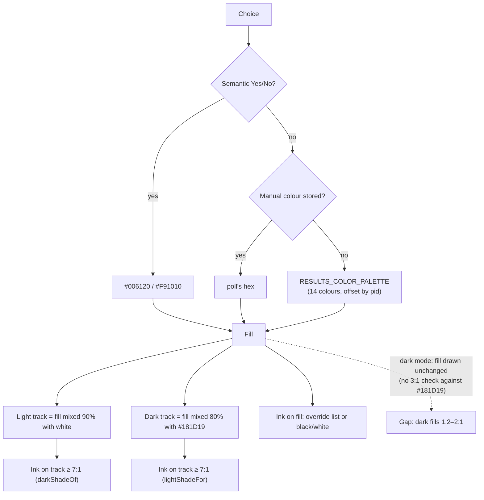
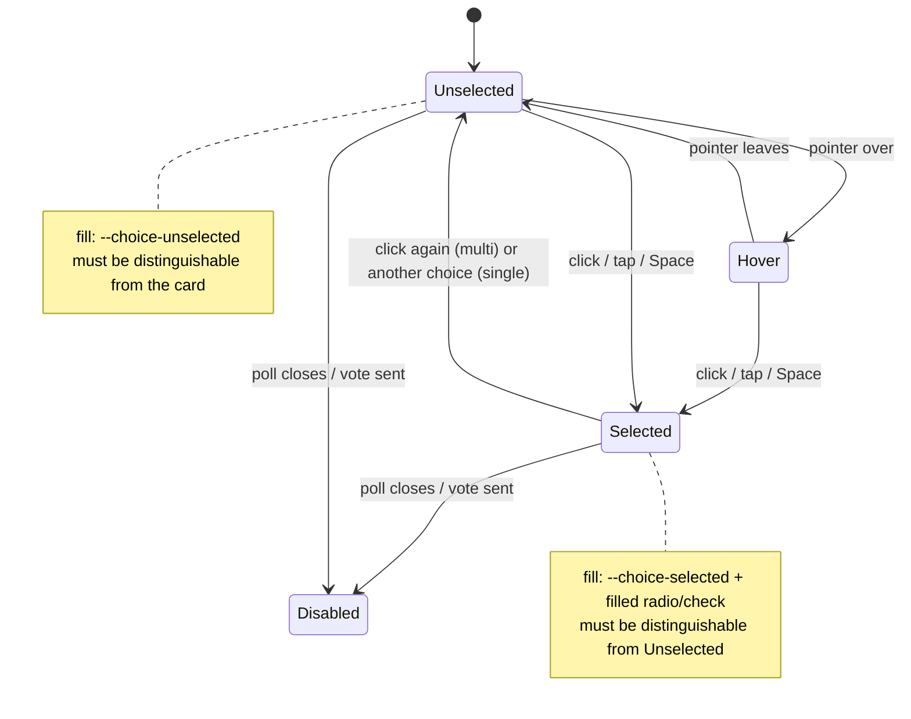
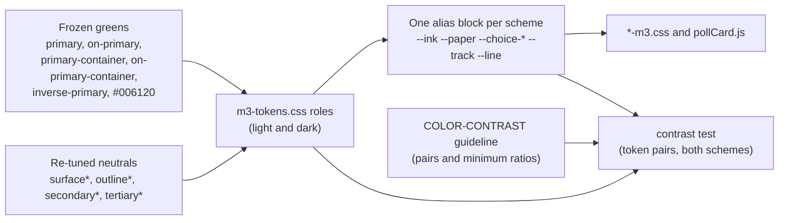
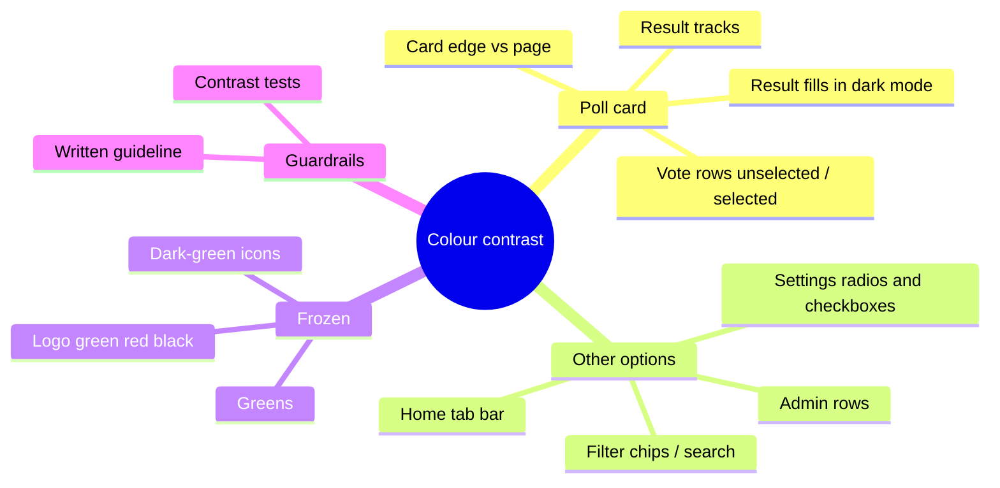

# High Level Requirements

Requirements: `requirements/20261120-175903-color-contrast/requirements.md`  
External Files: none  
Generated: 2026-11-20 5:59 PM  

Here is some feedback from a tester:  
```
I feel like the color scheme is lacking a lot of contrast too for the different options in both light and dark mode, I feel like they're blending in too much to the background, and they're not really looking colorful.
```

Do some deep thinking about how to improve the color contrast and make the options more visually distinct in both light and dark modes.  

We want to keep the green shades. The icons that use dark green should remain.  
We want to keep the logo that uses green, red and black.  

We want to explore ways to increase the contrast for other elements without altering the core green shades, ensuring that all options are easily distinguishable in both light and dark modes.

We should also document the color contrast guidelines and any changes made, so that future updates to the interface maintain the desired level of visual distinction and accessibility.  

## Additional Requirements and Research Requests

**Instructions To The Developer**  
Enter any additional requirements or research requests under the ## Additional Requirements and Research Requests heading above.  
When you Type or Say: "Next" in the CC CLI terminal, the additional requirements and research requests will be applied to the report.  
  
You may leave these instructions here. They will be ignored when "Next" is executed.  

## 1. Overview and Scope

A tester reports that the poll "options" blend into the background in both colour schemes and look dull.  
The feature raises the contrast and colourfulness of the interface while freezing three things: the green shades, the dark-green icons and the green/red/black logo.  
It also produces written colour-contrast guidelines so later changes keep the level reached.  

Measured today (WCAG 2.x contrast ratio, computed from the shipped tokens):  

| Pair | Light | Dark | WCAG 1.4.11 target for a UI boundary |
|---|---|---|---|
| Unselected vote row vs card | `#F1F3EE` on `#FFFFFF`: **1.12:1** | `#262B27` on `#181D19`: **1.19:1** | 3:1 |
| Selected vote row vs card | `#E4D3AE`: **1.48:1** | `#643F00`: **1.83:1** | 3:1 |
| Selected vs unselected row | **1.32:1** | **1.55:1** | 3:1 (or a non-colour cue) |
| Card vs page | **1.12:1** | **1.08:1** | none (decorative) |
| Card border vs card | `#D8DCD3`: **1.39:1** | `#414942`: **1.84:1** | none (decorative) |
| Result track (90% / 80% tint) vs card | **1.11–1.25:1** | **1.02–1.33:1** | 3:1 if it conveys the bar's extent |
| Result fill vs card (e.g. `#880015`, `#0808FD`, `#000000`) | 10.2 / 8.5 / 21:1 | **1.67 / 2.01 / 1.23:1** | 3:1 |
| Radio / checkbox outline vs row | 8.33:1 | 8.48:1 | 3:1 ✅ |
| Primary green vs card | `#2C6A46` 6.45:1 | `#94D5A8` 10.05:1 | 4.5:1 text ✅ |

The text inside rows already meets 7:1 (`client-bar-colours.test.ts` pins it).  
What fails is the **shapes**: the rows, the tracks and, in dark mode, the dark palette fills, which are almost the colour of the surface they sit on.  

**In scope**  
- The colour tokens (`m3-tokens.css` and the legacy `:root` palettes in `site.css` and `pollCard.css`) other than the frozen greens.  
- The poll card's vote rows (both faces), result tracks and fills, in both schemes.  
- Every other "option"-like control whose boundary or selected state is carried by colour (see AM1).  
- A written colour-contrast guideline and tests that keep it.  

**Out of scope (assumed)**  
- The type scale, layout and shapes.  
- The logo artwork itself.  
- Emails, the OG image and the favicon.  
- A third (high-contrast) colour scheme or reading the device's appearance setting.  

## 2. Architecture Diagrams

### 2.1 How a colour reaches an element today



In light mode the legacy palettes still decide the vote rows, card and page (the light `:root` block maps no legacy alias), while in dark mode the M3 aliases override them; this split is why the two schemes drift (see Technical Debt).  

### 2.2 Results bar colour derivation



The line graph already lifts each colour to 3:1 against the surface (`lineColorOn`); the bars have no such step.  

### 2.3 Vote row states



### 2.4 Target token layering (proposed)



### 2.5 Affected areas



## 3. Research Results

**RS1. Where does the current palette fall short, measured?**  
<span style="font-size:large" ><b>
✅ Resolved</b></span>  
✅ Requirements File Updated: 2026-11-20 7:05 PM  
**Notes**: Recommendation accepted in file 2026-11-20: Recommendation, record these measurements as the baseline and fix the shapes, not the text;  
the requirements now record the baseline and say which shapes are fixed.  

> The requirements ask for "deep thinking" about how to improve contrast and make the options distinct; this measures the current state in the codebase.  
> Sources: `src/public/m3-tokens.css`, `src/public/pollCard.css`, `src/public/site.css`, `src/public/pollCard.js` (`barColorsFor`, `darkBarColorsFor`), `tests/client-bar-colours.test.ts`, computed with the WCAG contrast formula ([WCAG 2.2 — contrast ratio](https://www.w3.org/TR/WCAG22/#dfn-contrast-ratio)).  
> Text contrast is already good: row labels are pinned at 7:1 and the primary green is 6.45:1 (light) and 10.05:1 (dark).  
> Shape contrast is the problem: unselected vote rows are 1.12:1 (light) and 1.19:1 (dark) against the card;  
> the selected row is only 1.32:1 (light) and 1.55:1 (dark) from an unselected one;  
> result tracks are 1.0–1.3:1 against the card in both schemes;  
> and in dark mode the dark palette fills (`#880015` 1.67:1, `#0808FD` 2.01:1, `#000000` 1.23:1, `#404040`, `#1A539E`, `#800080`) nearly vanish on `#181D19`, because the bars, unlike the line graph (`lineColorOn`), never lift a fill to 3:1.  
> Card and page differ by 1.12:1 (light) and 1.08:1 (dark), so cards float on nothing.  

  - **Recommendation**: **record these measurements as the baseline and fix the shapes, not the text: rows, tracks, dark fills and card edges.**  

    [X] ➡️ **Accepted**

    - The tester's "blending into the background" matches exactly the pairs under 1.5:1.  
    - The text pairs already pass and need no change.  


  - **Developer Resolution B**:  

    [ ] ➡️ **Not Accepted**

**RS2. Which accessibility standard and ratios apply to option boundaries and selected states?**  
<span style="font-size:large" ><b>
✅ Resolved</b></span>  
✅ Requirements File Updated: 2026-11-20 7:05 PM  
**Notes**: Recommendation accepted in file 2026-11-20: Recommendation, adopt WCAG 2.2 AA as the floor;  
the requirements now state 4.5:1 text, 3:1 for boundaries, selected-state cues and bar fills, and keep 7:1 inside bars.  

> The requirements ask that options be "easily distinguishable" and the guidelines keep "accessibility".  
> Sources: [WCAG 2.2 SC 1.4.3 Contrast (Minimum)](https://www.w3.org/WAI/WCAG22/Understanding/contrast-minimum.html), [WCAG 2.2 SC 1.4.11 Non-text Contrast](https://www.w3.org/WAI/WCAG22/Understanding/non-text-contrast.html), [WCAG 2.2 SC 1.4.1 Use of Color](https://www.w3.org/WAI/WCAG22/Understanding/use-of-color.html), [Material 3 — color roles](https://m3.material.io/styles/color/roles).  
> SC 1.4.3 (AA): text 4.5:1, large text 3:1;  
> SC 1.4.11 (AA): the visual information needed to identify a control and its state, and graphical objects needed to understand content (such as bar lengths), 3:1 against adjacent colours;  
> SC 1.4.1: a state must not be shown by colour alone (the radio dot / check mark already satisfy this for selection).  
> Logotypes are exempt from 1.4.3, and 1.4.11 does not apply to a logo, so the frozen logo green `#3FB34F` (2.70:1 on white) needs no change.  
> Material 3 meets 1.4.11 for selectable rows with an `outline` boundary (`#717971` light, `#8A938B` dark, both above 3:1 on their surfaces) rather than by darkening the fill.  

  - **Recommendation**: **adopt WCAG 2.2 AA as the floor: 4.5:1 text, 3:1 for every option's boundary, every selected-state cue and every bar fill, in both schemes.**  

    [X] ➡️ **Accepted**

    - It is the level legal accessibility guidance commonly cites, and it can be checked automatically per token pair.  
    - The existing 7:1 for text inside bars stays as a stricter house rule.  


  - **Developer Resolution B**:  

    [ ] ➡️ **Not Accepted**

**RS3. Which techniques raise contrast without changing the greens?**  
<span style="font-size:large" ><b>
✅ Resolved</b></span>  
✅ Requirements File Updated: 2026-11-20 7:05 PM  
**Notes**: Recommendation accepted in file 2026-11-20: Recommendation, use all five levers, each held to the RS2 floor;  
the requirements now list the five techniques.  

> The requirements ask to explore ways to increase contrast for other elements without altering the core green shades.  
> Sources: the codebase (RS1), [Material 3 — color roles](https://m3.material.io/styles/color/roles), [Material 3 — tonal surfaces](https://m3.material.io/styles/color/roles#surface).  
> Five levers exist, none of which touches `primary` or its container:  
> 1. an `outline` border (3:1) on each option row, keeping light fills;  
> 2. a wider tonal step between page, card and rows (e.g. page `surface-container`, card `surface`, rows `surface-container-highest`);  
> 3. a more saturated selected state built from the tertiary (amber) family, which is the scheme's accent and is not green;  
> 4. in dark mode, lifting each bar fill to 3:1 against the surface with the same HSL walk the line graph uses (`lineColorOn`);  
> 5. lower track tints (more of the fill colour in the track), so a bar's extent shows and the card reads as colourful.  
> Levers 1, 2 and 4 fix the measured failures;  
> levers 3 and 5 answer "not really looking colorful".  

  - **Recommendation**: **use all five levers, each held to the RS2 floor, and record them in the guideline.**  

    [X] ➡️ **Accepted**

    - Together they address both halves of the feedback (contrast and colour) while the greens and icons stay byte-identical.  
    - The exact values are settled in the specification and plan, against the tests in UA5.  


  - **Developer Resolution B**:  

    [ ] ➡️ **Not Accepted**

## 4. Findings

### 4.1 Inconsistencies

None found.

### 4.2 Ambiguities

**AM1. What are the "options" that must be distinguishable?**  
<span style="font-size:large" ><b>
✅ Resolved</b></span>  
✅ Requirements File Updated: 2026-11-20 7:05 PM  
**Notes**: Recommendation accepted in file 2026-11-20: Recommendation A, the poll's choices first, plus every selectable control shown by colour, on every page;  
the requirements now define "options" that way.  

> The tester and the requirements speak of "the different options", which is not a term the interface uses.  
> It most likely means a poll's choices (the vote rows and the result bars), but other things a user picks between — the home tabs, the search filters, the Settings radios, the admin rows — share the same pale-on-pale tokens.  

  - **Recommendation A** _(recommended)_: **the poll's choices first, plus every selectable control whose boundary or selected state is shown by colour, on every page.**  

    [X] ➡️ **Accepted**

    - <u>Pros</u>: the tokens are shared, so fixing them once improves every page consistently; no control is left at 1.1:1.  
    - <u>Cons</u>: more pages to re-check by eye and more tests that pin colours change.  


  - **Recommendation B**: **only the poll card's vote rows and result bars.**  

    [ ] ➡️ **Not Accepted**

    - <u>Pros</u>: smallest change, aimed exactly at the feedback.  
    - <u>Cons</u>: tab, chip and settings controls keep today's low contrast, and the two looks drift apart.  


  - **Developer Resolution C**:  

    [ ] ➡️ **Not Accepted**

**AM2. Which colours are "the green shades" that must be kept?**  
<span style="font-size:large" ><b>
✅ Resolved</b></span>  
✅ Requirements File Updated: 2026-11-20 7:05 PM  
**Notes**: Recommendation accepted in file 2026-11-20: Recommendation, the frozen greens listed by token;  
the requirements now list the frozen colours and free every other token.  

> The site has two sets of greens: the Material 3 roles (`primary` `#2C6A46` / `#94D5A8`, `primary-container` `#AFF1C3` / `#0D5130`, `inverse-primary`) and the legacy `--moss` `#3D5A46` and `--moss-dark` `#2C4234` in `site.css` and `pollCard.css`.  
> The `secondary` family (`#4F6354`, `#D1E8D5`, …) is a greyish green, and the semantic Yes colour is `#006120`.  
> Without a list, a change to `secondary` or a removal of `--moss` could count as "altering the green".  

  - **Recommendation**: **the frozen greens are, in both schemes: `primary`, `on-primary`, `primary-container`, `on-primary-container`, `inverse-primary`, the Yes colour `#006120`, and `--moss`/`--moss-dark` wherever they are still used; every other token, the greenish `secondary` and `surface` neutrals included, may change.**  

    [X] ➡️ **Accepted**

    - It keeps every green a user would recognise as the brand, and leaves the neutrals free, which is where the contrast is lost.  
    - The guideline lists the frozen values so a test can pin them.  


  - **Developer Resolution B**:  

    [ ] ➡️ **Not Accepted**

**AM3. Do "the icons that use dark green" stay dark green in dark mode too?**  
<span style="font-size:large" ><b>
✅ Resolved</b></span>  
✅ Requirements File Updated: 2026-11-20 7:05 PM  
**Notes**: Recommendation accepted in file 2026-11-20: Recommendation A, the icons keep the `primary` token;  
the requirements now say dark green in light mode, light green in dark mode.  

> In light mode, 52 rules draw icons and text with `--md-sys-color-primary`, `#2C6A46` (dark green).  
> In dark mode the same token is `#94D5A8`, a light green, because `#2C6A46` on the dark card is only 2.9:1.  
> "Should remain" can mean "keep using the primary token" (light green in dark mode) or "stay `#2C6A46` in both schemes".  

  - **Recommendation A** _(recommended)_: **the icons keep the `primary` token: dark green in light mode, the existing light green in dark mode.**  

    [X] ➡️ **Accepted**

    - <u>Pros</u>: no change at all; both shades already pass 3:1 (6.45:1 and 10.05:1).  
    - <u>Cons</u>: in dark mode the icons are not literally "dark green".  


  - **Recommendation B**: **the icons are `#2C6A46` in both schemes.**  

    [ ] ➡️ **Not Accepted**

    - <u>Pros</u>: one icon colour everywhere.  
    - <u>Cons</u>: 2.9:1 on the dark card fails the 3:1 floor, so dark-mode icons would get worse, against the feature's goal.  


  - **Developer Resolution C**:  

    [ ] ➡️ **Not Accepted**

**AM4. Does "keep the logo" include its dark-mode recolouring?**  
<span style="font-size:large" ><b>
✅ Resolved</b></span>  
✅ Requirements File Updated: 2026-11-20 7:05 PM  
**Notes**: Recommendation accepted in file 2026-11-20: Recommendation, the logo keeps its artwork and today's dark-mode substitution;  
the requirements now say so.  

> In dark mode `header-tab-bar-m3.css` already redraws the logo's black parts in `on-surface` (light grey) and makes its white parts transparent, because black on the dark page is 1.14:1.  
> "Keep the logo that uses green, red and black" could forbid that substitution.  

  - **Recommendation**: **the logo keeps its green, red and black artwork in light mode, and keeps today's dark-mode substitution (black drawn as `on-surface`); its green and red are never changed.**  

    [X] ➡️ **Accepted**

    - Black on the dark page would make the figures disappear, which contradicts the goal of this feature.  
    - If a new `on-surface` value is chosen, the logo follows it automatically.  


  - **Developer Resolution B**:  

    [ ] ➡️ **Not Accepted**

### 4.3 Unspecified Aspects

**UA1. How is a vote row made distinguishable from the card, and the selected row from the others?**  
<span style="font-size:large" ><b>
✅ Resolved</b></span>  
✅ Requirements File Updated: 2026-11-20 7:05 PM  
**Notes**: Recommendation accepted in file 2026-11-20: Recommendation A, a 1 px `outline` border and deeper fill per row, an accent fill and 2 px border when selected;  
the requirements now describe the vote rows.  

> Today an unselected row differs from the card by 1.12:1 (light) / 1.19:1 (dark), and a selected row from an unselected one by 1.32:1 / 1.55:1.  
> The requirements ask for distinct options but do not say whether that comes from the row's fill, an outline or both.  

  - **Recommendation A** _(recommended)_: **each row gets a 1 px `outline` border (≥ 3:1 against the card) and a slightly deeper neutral fill; a selected row gets a saturated accent fill and a 2 px border, with the existing radio dot or check mark, all ≥ 3:1 from an unselected row.**  

    [X] ➡️ **Accepted**

    - <u>Pros</u>: meets 1.4.11 without making the rows heavy or dark; the selected state is shown by colour, border width and the mark, so not by colour alone.  
    - <u>Cons</u>: 50 bordered rows in a full card look busier; compact rows (2 px corners) need the border kept to 1 px.  


  - **Recommendation B**: **no borders: the unselected fill alone is deepened to ≥ 3:1 against the card, the selected fill to ≥ 3:1 against the unselected.**  

    [ ] ➡️ **Not Accepted**

    - <u>Pros</u>: flat look, as today.  
    - <u>Cons</u>: 3:1 against white needs a mid-grey fill (about `#949494`), under which the dark label text falls below 7:1, and two steps of 3:1 in a row are hard to fit in the light range.  


  - **Developer Resolution C**:  

    [ ] ➡️ **Not Accepted**

**UA2. How are dark-mode result bars kept visible against the dark card?**  
<span style="font-size:large" ><b>
✅ Resolved</b></span>  
✅ Requirements File Updated: 2026-11-20 7:05 PM  
**Notes**: Recommendation accepted in file 2026-11-20: Recommendation A, dark-mode fills lifted to 3:1 with the line graph's lightness walk;  
the requirements now say so under Result bars.  

> The bars draw the 14 palette colours unchanged in dark mode;  
> six of them are under 3:1 against `#181D19` (darkred 1.67:1, blue 2.01:1, black 1.23:1, darkslategray, darkslateblue, purple), and the 80% dark tracks are 1.02–1.33:1.  
> The line graph solved the same problem with `lineColorOn`, lifting a colour's HSL lightness until it reaches 3:1.  

  - **Recommendation A** _(recommended)_: **in dark mode each fill (palette, Yes/No and manual) is lifted to ≥ 3:1 against the dark card with the line graph's lightness walk, its track and inks derived from the lifted colour as today.**  

    [X] ➡️ **Accepted**

    - <u>Pros</u>: one derivation for bars and lines, so a choice's colour matches between them; manual colours are covered too.  
    - <u>Cons</u>: black becomes a mid grey and darkred a brighter red in dark mode, so a colour reads a little differently between schemes.  


  - **Recommendation B**: **a second, hand-picked dark palette of 14 colours, each checked at ≥ 3:1.**  

    [ ] ➡️ **Not Accepted**

    - <u>Pros</u>: each dark colour chosen by eye.  
    - <u>Cons</u>: manual and Yes/No colours still need the lift; the bars and the line graph would disagree on colour.  


  - **Developer Resolution C**:  

    [ ] ➡️ **Not Accepted**

**UA3. Must a result bar's track (its unfilled remainder) be visible against the card?**  
<span style="font-size:large" ><b>
✅ Resolved</b></span>  
✅ Requirements File Updated: 2026-11-20 7:05 PM  
**Notes**: Recommendation accepted in file 2026-11-20: Recommendation, lower the track tint to at least 1.5:1 against the card;  
the requirements now say so under Result bars.  

> Tracks are the fill mixed 90% with white (light) or 80% with the dark surface, 1.0–1.3:1 against the card.  
> A bar's length is already readable from its fill, so 1.4.11 does not strictly require the track, but a near-invisible track is part of the "washed out" impression.  

  - **Recommendation**: **lower the track tint so every track is at least 1.5:1 against the card in both schemes, while its ink keeps 7:1, and record the tint values in the guideline.**  

    [X] ➡️ **Accepted**

    - A deeper track shows the bar's full row and makes the card more colourful, the second half of the feedback.  
    - 1.5:1 is a house target, below 3:1 because the track is decorative and the ink on it must stay readable.  


  - **Developer Resolution B**:  

    [ ] ➡️ **Not Accepted**

**UA4. How does a card stand out from the page?**  
<span style="font-size:large" ><b>
✅ Resolved</b></span>  
✅ Requirements File Updated: 2026-11-20 7:05 PM  
**Notes**: Recommendation accepted in file 2026-11-20: Recommendation A, a clearer tonal step between page and card, border at least 1.5:1;  
the requirements now say so under Cards and page.  

> Card and page differ by 1.12:1 (light) and 1.08:1 (dark), and the card border is 1.39:1 / 1.84:1.  
> In dark mode `--shadow` is `none`, so a card is separated from the page by almost nothing.  
> The requirements say elements "blend into the background" but do not name the card edge.  

  - **Recommendation A** _(recommended)_: **a clearer tonal step: the page one or two surface tones darker (light) or the card one or two tones lighter (dark), and the card border raised to at least 1.5:1 against both, with no border at 3:1.**  

    [X] ➡️ **Accepted**

    - <u>Pros</u>: cards read as cards in both schemes, without the heavy look of a dark outline around every card in a grid.  
    - <u>Cons</u>: the page background changes colour, which is visible on every page.  


  - **Recommendation B**: **card borders use `outline` (≥ 3:1), page and card colours unchanged.**  

    [ ] ➡️ **Not Accepted**

    - <u>Pros</u>: smallest change, strongest edge.  
    - <u>Cons</u>: a grid of cards each with a dark outline competes with the bordered rows inside them (UA1).  


  - **Developer Resolution C**:  

    [ ] ➡️ **Not Accepted**

**UA5. Where is the colour-contrast guideline written, and how is it kept?**  
<span style="font-size:large" ><b>
✅ Resolved</b></span>  
✅ Requirements File Updated: 2026-11-20 7:05 PM  
**Notes**: Recommendation accepted in file 2026-11-20: Recommendation, `COLOR-CONTRAST.md`, a `CLAUDE.md` invariant and `tests/color-contrast.test.ts`;  
the requirements now describe the guideline and its test.  

> The requirements ask to "document the color contrast guidelines and any changes made, so that future updates … maintain" them.  
> There is no guideline file today; `CLAUDE_COMPLETE.md` mentions contrast audits per feature, and `client-bar-colours.test.ts` and `client-line-colors.test.ts` pin ratios for bars and lines only.  
> A document alone does not stop a later change from undoing the work.  

  - **Recommendation**: **a new `COLOR-CONTRAST.md` at the project root (the frozen colours, every required pair with its minimum ratio in both schemes, the techniques of RS3, and a change log of this feature's before → after values), a one-line invariant in `CLAUDE.md` pointing to it, and a `tests/color-contrast.test.ts` that reads the tokens from the stylesheets and checks every listed pair and every frozen value.**  

    [X] ➡️ **Accepted**

    - The test turns the guideline into a gate: a later token change that drops a pair under its minimum, or alters a frozen green, fails `npm test`.  
    - The `CLAUDE.md` line makes future features read the guideline first.  


  - **Developer Resolution B**:  

    [ ] ➡️ **Not Accepted**

**UA6. How is success measured?**  
<span style="font-size:large" ><b>
✅ Resolved</b></span>  
✅ Requirements File Updated: 2026-11-20 7:05 PM  
**Notes**: Recommendation accepted in file 2026-11-20: Recommendation, automated pair and frozen-colour checks plus the tester's review;  
the requirements now state the success criteria.  

> "Easily distinguishable" and "colorful" are not testable as written.  

  - **Recommendation**: **success is: every pair in the guideline meets its minimum in both schemes (automated, UA5); the frozen colours are unchanged (automated); and the same tester, shown the home grid, a maximized poll in vote and results mode, and Settings, in both schemes, agrees the options stand out.**  

    [X] ➡️ **Accepted**

    - The automated part is objective and permanent; the review closes the loop on the subjective "colorful".  


  - **Developer Resolution B**:  

    [ ] ➡️ **Not Accepted**

### 4.4 Needs Clarifications

**NC1. Should the voting face be colourful, using each choice's results colour?**  
<span style="font-size:large" ><b>
✅ Resolved</b></span>  
✅ Requirements File Updated: 2026-11-20 7:23 PM  
**Notes**: Recommendation accepted in file 2026-11-20: Recommendation A, the voting face stays neutral with stronger contrast and a saturated amber selected state, the results face carries the colour;  
the requirements now say so under "Colour on the voting face (NC1)".  

> The tester says the options are "not really looking colorful".  
> Today the vote rows are flat neutral (grey-white, or dark grey) with a tan (light) or brown (dark) selected state, while the results face uses 14 vivid colours.  
> Colouring the vote rows is the biggest lever for "colorful" but changes the look of every open poll, and it may suggest a ranking before anyone has voted.  

  - **Recommendation A** _(recommended)_: **the voting face stays neutral but with stronger contrast (UA1), and its selected state uses a saturated amber (`tertiary`) fill; the results face carries the colour, with deeper tracks (UA3).**  

    [X] ➡️ **Accepted**

    - <u>Pros</u>: the selected choice pops against neutral rows, which is what a voter needs to see; no colour hints at a result.  
    - <u>Cons</u>: the voting face is still mostly neutral.  


  - **Recommendation B**: **each vote row is tinted with its choice's results colour (the track tint), and a selected row shows the full fill.**  

    [ ] ➡️ **Not Accepted**

    - <u>Pros</u>: the most colourful; the voting and results faces match colour for colour.  
    - <u>Cons</u>: Yes/No rows would be green and red before voting, which can read as a nudge; label ink must be re-derived per row; a bigger visual change.  


  - **Developer Resolution C**:  

    [ ] ➡️ **Not Accepted**

## 5. Breaking Changes

- **Visual only**: no route, payload, stored value or setting changes; polls' stored manual colours are kept and only drawn differently in dark mode (UA2).  
- **Tests that pin colours change**: `tests/client-bar-colours.test.ts` (tints, dark tracks), `tests/m3-assets.test.ts` (if a sheet is added to `LAYER_ORDER`), and any test asserting `--choice-*`, `--track` or surface values.  
- **Screenshots and the README** that show the current look become outdated.  

## 6. Technical Debt

- **Two palettes, applied unevenly**: light mode is still drawn by the legacy `:root` tokens in `site.css` and `pollCard.css` (`--paper #F1F3EE`, `--choice-selected #E4D3AE`, `--moss #3D5A46`), while dark mode maps those aliases to M3 roles in `m3-tokens.css`; the light `:root` has no such alias block, so a token change can reach one scheme and not the other.  
- **Duplicated `:root` blocks**: `site.css` and `pollCard.css` declare the same legacy palette twice.  
- **Hard-coded colours** outside the tokens, e.g. `.vote-radio` `#B7BDB5`, `.header-nav-link` `#4F564C`, the OAuth button colours, and the logo's fill list in `header-tab-bar-m3.css`.  
- **Two lifting rules**: the line graph lifts colours to 3:1 (`lineColorOn`) but the bars do not; one shared helper would serve both (UA2).  
- **`TEXT_ON_FILL_OVERRIDES`** is a hand-picked list that must be revisited whenever a fill changes.  

## 7. Assumptions

- Only the two existing schemes (Light, Dark) are in scope; no high-contrast scheme and no reading of `prefers-color-scheme` or `prefers-contrast`.  
- Text contrast stays at least where it is (7:1 inside bars, 4.5:1 elsewhere).  
- Fonts, sizes, spacing and shapes are unchanged, except a border width where a finding adopts one.  
- The favicon, OG image and email logo are not changed.  
- No new browser storage or cookie is added (`colorScheme` already exists).

## 8. Requirements Report Complete Report  
  
- **Requirements Report Document:** requirements/20261120-175903-color-contrast/requirements-report.md  
- **Requirements Document:** requirements/20261120-175903-color-contrast/requirements.md  
- **Software Architecture Diagrams:** 5  
- **Inconsistencies:** 0  
- **Ambiguities:** 4  
- **Unspecified Aspects:** 6  
- **Needs Clarifications:** 1  
- **Research Results:** 3  
- **Breaking Changes:** 3  
- **Technical Debt items:** 5  
  
The requirements are ready for /speckit-specify.  
To generate specs from the requirements document, use the `/speckit-specify` skill followed by the path (relative to the project root) to the requirements file.  
At the prompt, Type:  
🟩 👉 /speckit-specify requirements/20261120-175903-color-contrast/requirements.md  
