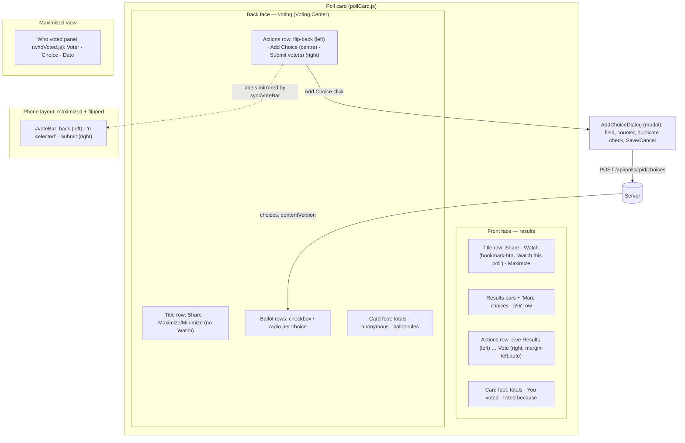
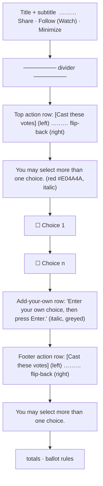
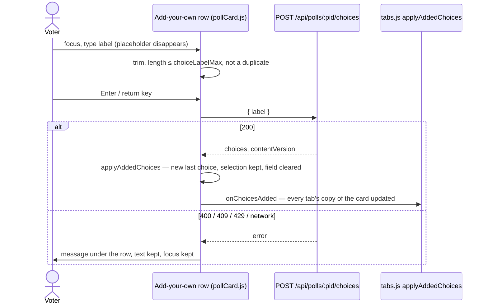
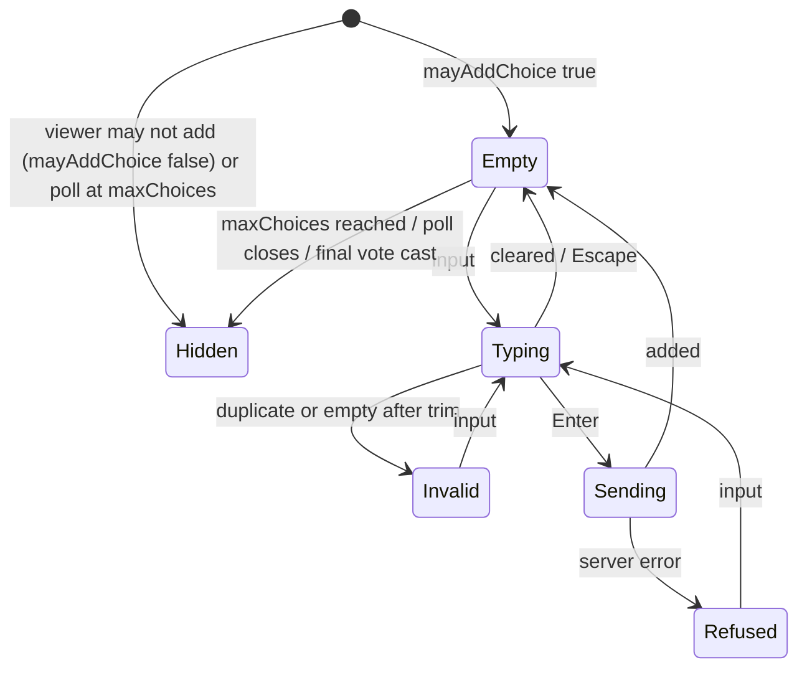
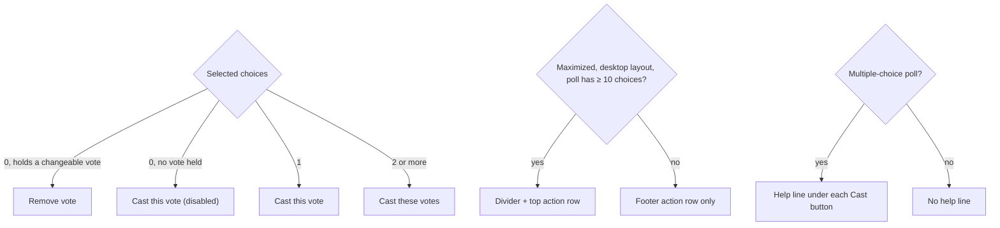

# High Level Requirements

Requirements: `requirements/20261122-012539-voting-center-ui/requirements.md`  
External Files: none linked (`image.png`, a mockup of a maximized multiple-choice voting face, sits in the folder but the document does not link it; see IN2)  
Generated: 2026-11-22 1:27 AM  

This feature will make changes to the UI/UX related to related to the voting process.

Requirement 1:  
Anywhere a "Vote" button appears, the button text will change to "Voting Center"   
The "Voting Center" button will be rendered "left-justified" on every row it currently resides.

Requirement 2:  
Anywhere a "Submit Votes" button appears, the button text change to "Cast this vote" or "Cast these votes" as appropriate, but will remain the same size and style, and will be rendered "left-justified" on every row it currently resides.

Requirement 3:  
Anywhere the "Flip back-btn" appears, it will be rendered "right-justified" on every row it currently resides.

Requirement 4:  
Currently a private poll has an optional setting that allow poll voters to add their own choices up to the max limit of choices.  
There is an "Add Choice" button on the voting face of the Poll that allows users to add their own choices.
When the user clicks the button, a model dialog box is launched that has one text field for entering the new choice.  
On "Save" it is added to the end of the choices list.  

The UI/UX for this will be changes as follows:  
A row will be appended to the list of bars on the Voting face - now also being referred to as the Voting Center.    
The row will have the same dimensions as the other rows in the Voting Center. The difference is that the bar fill will be white (or black in the dark mode) with black (or white text in dark mode).  
This row will not have a Checkbox and will not have a Radio button. the text in the new bottom bar will be an edit field with the suggestion text will beslightly greyed and in italics.  
The suggestion text will be - when on a computer.
```
Enter your own choice, then press Enter.
```

The suggestion text will be - when on a phone.
```
Enter your own choice, then press <symbol for return key>.  
```
When text is entered into the "Add choice" bar, the text is black (or white in dark mode).  
The suggestion text will immediately disappear.
Pressing enter append the new choice to the end of the choices list. 
And it is now votable by all voteres in this poll.

Requirement 5:  
When the voting face of a Poll is on the Maximized View, and there are 10 or more choices,  
the UI will have icons and buttons in the footer,   
That exat same row of icons and buttons will appear at the top of the card, under the title and subtitle.  
There will be a line between the title,subtitle and the buttons.  
If the Poll allows the user to change their choice while the poll is open, 
there will be help text under the Cast this/these Vote(s)" button, that will read:  
"You may select more than one choice." (in red and italics)  The red will be the #E04A4A as used in the logo.

Requirement 6:  
 On the Voting face of the Maximized view card, on thesame row as the title, there are 3 right-justified icons.  
 - Share poll
 - Watch this Poll
 - Minimize poll
 The "Watch this Poll"  tool tip will change to "Follow this Poll". 

Requirement 7:   
On the Home page (all tabs) the front of the Poll Card may have a "more choice - p%" bar under the polls' bars that fit on the card.  
If it does have a "More choices - p%" bar then another bar with the same appearance will be added at the bottom of the bars.  

Requirement 8:  
Currently a private poll has an optional setting that allow poll voters to add their own choices up to the max limit of choices.  
Currently, there is only one place that a user can add their choice, which is on the voting face of the Poll.

The UI/UX for this will be changes as follows:  
A row will be appended to the list of bars on the Front face as well.    
The row will have the same dimensions as the other rows on the front face. The difference is that the bar fill will be white (or black in the dark mode) with black (or white text in dark mode).  The poll's bars may need to be sized even futher to make room for the "Add your own choice" bar.  The edit field will span the entire width of the bar.
This row will not have a Checkbox ro a Radio button. The text in the new bottom bar will be an edit field with the suggestion text that will initially be slightly greyed and in italics.  
The suggestion text will be - when on a computer.
```
Enter your own choice, then press Enter.
```

The suggestion text will be - when on a phone.
```
Enter your own choice, then press <symbol for return key>.  
```
When text is entered into the "Add choice" bar, the text is black (or white in dark mode).
The suggestion text will immediately disappear.
Pressing enter append the new choice to the end of the choices list. 
And it is now votable by all voters in this poll.

Requirement 9:  

The UI/UX will now have a third option for adding choices directly from the front face of the poll on the Home Page Poll Card in the grid view.  
A row will be appended to the list of bars on the Front face as well.    
The row will have the same dimensions as the other rows on the front face. The difference is that the bar fill will be white (or black in the dark mode) with black (or white text in dark mode).  The poll's bars may need to be sized even futher to make room for the "Add your own choice" bar.  The edit field will span the entire width of the bar.
This row will not have a Checkbox ro a Radio button. The text in the new bottom bar will be an edit field with the suggestion text that will initially be slightly greyed and in italics.  
The suggestion text will be - when on a computer.
```
Enter your own choice, then press Enter.
```

The suggestion text will be - when on a phone.
```
Enter your own choice, then press <symbol for return key>.  
```
When text is entered into the "Add choice" bar, the text is black (or white in dark mode).
The suggestion text will immediately disappear.
Pressing enter append the new choice to the end of the choices list. 
And it is now votable by all voters in this poll.


Requirement 10:
The UI/UX for adding Choices will have a 4th option for adding choices directly from the poll card on the Voting Face for poll card that have enough room to fit all the bars for Choices in the grid. (i..e the Maximized View) is not needed to render all the bars.
This will be changes as follows:  
A row will be appended to the list of bars on the Voting face - now also being referred to as the Voting Center.    
The row will have the same dimensions as the other rows in the Voting Center. The difference is that the bar fill will be white (or black in the dark mode) with black (or white text in dark mode).  
This row will not have a Checkbox and will not have a Radio button. the text in the new bottom bar will be an edit field with the suggestion text will beslightly greyed and in italics.  
The suggestion text will be - when on a computer.
```
Enter your own choice, then press Enter.
```

The suggestion text will be - when on a phone.
```
Enter your own choice, then press <symbol for return key>.  
```
When text is entered into the "Add choice" bar, the text is black (or white in dark mode).  
The suggestion text will immediately disappear.
Pressing enter append the new choice to the end of the choices list. 
And it is now votable by all voteres in this poll.


Requirement 9:  
When a pollis not anonymouse there is a "Who Voted" tab section in the Maximized view.  
Change the "Date" column header to  "Vote Cast Date"

## Additional Requirements and Research Requests

**Instructions To The Developer**  
Enter any additional requirements or research requests under the ## Additional Requirements and Research Requests heading above.  
When you Type or Say: "Next" in the CC CLI terminal, the additional requirements and research requests will be applied to the report.  
  
You may leave these instructions here. They will be ignored when "Next" is executed.  

## 1. Overview and Scope

The feature reworks the poll card's voting face, which the requirements now also call the **Voting Center**.  
It is a client-only change: every requirement is met in `src/public/` (`pollCard.js`, `tabs.js`, `whoVoted.js`, `index.html` and the `*-m3.css` layers);  
the vote route and `POST /api/polls/:pid/choices` keep their contracts.  

- **Labels**: Vote → "Voting Center" (R1), Submit vote(s) → "Cast this vote" / "Cast these votes" (R2), Who Voted's "Date" → "Vote Cast Date" (R9), the Watch tooltip → "Follow this Poll" (R6).  
- **Placement**: the primary button moves to the left of its row (R1, R2) and the flip-back button to the right (R3).  
- **Add your own choice**: the Add Choice button and its modal dialog give way to an editable last row: on the maximized voting face (R4), on the compact voting face when every choice fits (R10), and on the front (results) face of a grid card (R8, the first R9); R7's second bar under "More choices" is probably the same row (NC2).  
- **Long ballots**: a maximized voting face with 10 or more choices repeats its action row under the title, with a divider and a help line (R5).  
- **Title row**: the maximized voting face shows Share, Watch and Minimize (R6); today it shows Share and Minimize only.  
- **Compact front face**: a second bar under "More choices · p%" (R7).  

Out of scope (assumed): server routes and payloads, the admin pages, the `/poll/<pid>` page's own layout beyond the card it embeds, and emails.  

## 2. The Voting Face Today

What the requirements change, as built (`src/public/pollCard.js:1688` `POLL_CARD_TEMPLATE`, `tabs.js:248` `syncVoteBar`, `addChoiceDialog.js`, `whoVoted.js:217`).



## 3. The Voting Center After the Change

A maximized voting face, desktop layout, 10 or more choices, multiple-choice poll whose voters may add choices (assuming the recommended resolutions).



The front face's action row, after R1 (see AM1): `[Voting Center]` on the left, Live Results on the right.

## 4. Adding a Choice Inline





## 5. Label and Visibility Rules



## 6. Assumptions

- "Vote" and "Submit votes" mean the card buttons `.vote-btn` and `.submit-vote-btn` and the phone Submit bar's `.vote-bar-submit`, wherever a poll card is drawn (every home tab, Live Results, `/poll/<pid>`).  
- "Flip back-btn" is the card's `.back-btn` (the page-with-curved-arrow icon) and the phone Submit bar's `.vote-bar-back`; it is not the page's back arrow (`backArrow.js`).  
- "Remove vote", shown when an empty selection removes a changeable vote, keeps its wording.  
- The add-your-own row is offered to the same viewers as today's Add Choice button (`mayAddChoice`), on every face it is drawn on, and the server rules are unchanged.  
- "Home page (all tabs)" in R7 means every tab of `index.html` that draws compact poll cards.  
- No new cookie, storage key, route or setting.  

## 7. Findings

### 7.1 Inconsistencies

**IN1. Requirements 8 and the first Requirement 9 both add the row to the front face**  
<span style="font-size:large" ><b>
✅ Resolved</b></span>  
✅ Requirements File Updated: 2026-11-22 2:05 AM  
**Notes**: Recommendation accepted in file 2026-11-22: Recommendation A, one front-face requirement, the row on every front face that shows bars;  
the decision is noted beneath the first Requirement 9.  

> Requirement 8 appends the add-your-own row "to the list of bars on the Front face as well";  
> the first Requirement 9 appends it to "the front face of the poll on the Home Page Poll Card in the grid view", as a "third option".  
> The two texts are the same word for word below their first lines, so they may be one change written twice, or Requirement 8 may mean the maximized front face and Requirement 9 the compact one.  
> Requirements 4 and 10 (voting face) also differ in small details: only Requirements 8 and 9 say the bars shrink to make room and the field spans the whole bar.  

  - **Recommendation A** _(recommended)_: **one front-face requirement: the row is the last bar of every front face that shows bars (compact grid card and maximized), on every tab; the details "the bars shrink to make room" and "the field spans the whole bar" hold for every add-your-own row, front and voting faces alike.**  

    [X] ➡️ **Accepted**

    - <u>Pros</u>: the row is wherever a viewer sees the poll's bars; one rule, no drift.  
    - <u>Cons</u>: the maximized front face gains a row the text names only implicitly.  


  - **Recommendation B**: **the grid card's front face only (compact); the maximized front face has no row, and voters add from the Voting Center there.**  

    [ ] ➡️ **Not Accepted**

    - <u>Pros</u>: reads Requirement 9 literally; the maximized results stay results-only.  
    - <u>Cons</u>: Requirement 8's "as well" is left without a meaning of its own.  


  - **Developer Resolution C**:  

    [ ] ➡️ **Not Accepted**

**IN2. The mockup contradicts Requirements 2, 3 and 4**  
<span style="font-size:large" ><b>
✅ Resolved</b></span>  
✅ Requirements File Updated: 2026-11-22 1:44 AM  
**Notes**: Recommendation accepted by "Accept all" 2026-11-22: **Recommendation**, the mockup illustrates Requirement 5's repeated row and divider only;  
Requirement 5 now links `image.png` with that note.  

> `image.png` shows a maximized voting face with the action row repeated under the title (Requirement 5).  
> In both rows the flip-back icon is on the left, an Add Choice button in the middle and Submit votes on the right, which is today's layout;  
> Requirements 2 and 3 put Cast on the left and flip-back on the right, and Requirement 4 removes the Add Choice button.  
> The mockup is also not linked from the requirements.  

  - **Recommendation**: **the mockup illustrates Requirement 5's repeated row and divider only; the row's contents follow Requirements 1–4.**  

    [X] ➡️ **Accepted**

    - Requirement 5 links `image.png` with a note saying so: the buttons' labels, order and the absence of Add Choice come from the text.  


  - **Developer Resolution B**:  

    [ ] ➡️ **Not Accepted**

**IN3. Requirement 5's help line: its condition does not match its words**  
<span style="font-size:large" ><b>
✅ Resolved</b></span>  
✅ Requirements File Updated: 2026-11-22 2:05 AM  
**Notes**: Recommendation accepted in file 2026-11-22: Recommendation A, the help line on Multiple-Choice polls;  
the decision is noted beneath Requirement 5.  

> The help line is shown "if the Poll allows the user to change their choice while the poll is open" (a Dynamic-Vote poll),  
> but it reads "You may select more than one choice.", which is true of a Multiple-Choice poll.  
> The two settings are independent: a single-choice poll can allow changes, and a multiple-choice poll can be final.  
> The mockup shows the line on a multiple-choice poll.  

  - **Recommendation A** _(recommended)_: **show "You may select more than one choice." on Multiple-Choice polls.**  

    [X] ➡️ **Accepted**

    - <u>Pros</u>: the words are always true where shown; it matches the mockup; it tells a voter the one thing a checkbox list does not say.  
    - <u>Cons</u>: nothing on the ballot itself says a vote can be changed (the card foot already says "You may change your vote").  


  - **Recommendation B**: **keep the Dynamic-Vote condition, and reword: "You may change your vote while the poll is open."**  

    [ ] ➡️ **Not Accepted**

    - <u>Pros</u>: keeps the condition as written.  
    - <u>Cons</u>: repeats the card foot's ballot rules; contradicts the mockup.  


  - **Recommendation C**: **both lines, each under its own condition.**  

    [ ] ➡️ **Not Accepted**

    - <u>Pros</u>: says everything.  
    - <u>Cons</u>: two red lines under a button is noisy, and both repeat the card foot.  


  - **Developer Resolution D**:  

    [ ] ➡️ **Not Accepted**

**IN4. The help line's colour and place differ between the text and the mockup**  
<span style="font-size:large" ><b>
✅ Resolved</b></span>  
✅ Requirements File Updated: 2026-11-22 2:05 AM  
**Notes**: Recommendation accepted in file 2026-11-22: Recommendation B, the mockup wins: on-surface colour, bold, right-aligned under the row;  
the decision is noted beneath Requirement 5, so no brand-red token is needed.  

> The text says red `#E04A4A`, italic, under the Cast button.  
> The mockup shows it black, bold, upright, right-aligned under the whole top row.  
> In dark mode `#E04A4A` on the dark card surface also needs a check of its contrast (WCAG AA asks 4.5:1 for small text).  

  - **Recommendation A** _(recommended)_: **the text wins: `#E04A4A`, italic, body-small, directly under the Cast button, in both themes.**  

    [ ] ➡️ **Not Accepted**

    - <u>Pros</u>: the brand red ties the hint to the logo; under the button it reads as that button's hint.  
    - <u>Cons</u>: red usually means error; the colour must become a named token (M3 layers hold only tokens), checked for contrast in dark mode.  


  - **Recommendation B**: **the mockup wins: on-surface colour, bold, right-aligned under the row.**  

    [X] ➡️ **Accepted**

    - <u>Pros</u>: no new colour; never mistaken for an error.  
    - <u>Cons</u>: drops the explicit red the text asks for.  


  - **Developer Resolution C**:  

    [ ] ➡️ **Not Accepted**

**IN5. "Same size" cannot hold for the longer labels**  
<span style="font-size:large" ><b>
✅ Resolved</b></span>  
✅ Requirements File Updated: 2026-11-22 2:05 AM  
**Notes**: Recommendation accepted in file 2026-11-22: Recommendation B, today's width, with the label shrunk or wrapped to fit;  
the decision is noted beneath Requirement 2.  

> Requirement 2 keeps the Cast button "the same size", but "Cast these votes" is longer than "Submit votes", and Requirement 1's "Voting Center" is longer than "Vote".  
> Today the Vote and Submit buttons share one width (008 FR-007, the `.btn-vote-sizer` spans), sized to the longest of "Submit vote(s)" and "Remove vote".  
> On a phone-width card the row also holds Live Results or the flip-back button.  

  - **Recommendation A** _(recommended)_: **same style and height; the shared width grows to the longest label ("Voting Center", "Cast this vote", "Cast these votes", "Remove vote"), on both faces.**  

    [ ] ➡️ **Not Accepted**

    - <u>Pros</u>: keeps 008 FR-007 (the button does not change width as the selection changes or the card flips); no truncated text.  
    - <u>Cons</u>: the button is wider than today on every card.  


  - **Recommendation B**: **today's width, with the label shrunk or wrapped to fit.**  

    [X] ➡️ **Accepted**

    - <u>Pros</u>: the size is literally unchanged.  
    - <u>Cons</u>: a smaller or two-line label in the card's main button; harder to read on a phone.  


  - **Developer Resolution C**:  

    [ ] ➡️ **Not Accepted**

**IN6. Two requirements are numbered 9**  
<span style="font-size:large" ><b>
✅ Resolved</b></span>  
✅ Requirements File Updated: 2026-11-22 1:44 AM  
**Notes**: Recommendation accepted by "Accept all" 2026-11-22: **Recommendation**, the Who Voted heading change becomes Requirement 11;  
the second "Requirement 9" is renumbered and the decision noted beneath it.  

> The front-face add-your-own requirement and the Who Voted heading change are both "Requirement 9", and the Who Voted one now follows Requirement 10.  
> Findings, the spec and its tests refer to requirements by number.  

  - **Recommendation**: **the Who Voted heading change becomes Requirement 11; the front-face requirement keeps 9.**  

    [X] ➡️ **Accepted**

    - Every number then names one requirement, in document order.  


  - **Developer Resolution B**:  

    [ ] ➡️ **Not Accepted**

### 7.2 Ambiguities

**AM1. "Voting Center" left-justified: where does Live Results go?**  
<span style="font-size:large" ><b>
✅ Resolved</b></span>  
✅ Requirements File Updated: 2026-11-22 2:05 AM  
**Notes**: Recommendation accepted in file 2026-11-22: Recommendation A, swap them: Voting Center on the left, Live Results on the right;  
the decision is noted beneath Requirement 1.  

> The front face's action row holds the Live Results link on the left and the Vote button on the right (`site.css:332`).  
> Requirement 1 moves the button to the left, which is where Live Results is.  

  - **Recommendation A** _(recommended)_: **swap them: Voting Center on the left, Live Results on the right.**  

    [X] ➡️ **Accepted**

    - <u>Pros</u>: the primary button is on the left on both faces, as Requirements 1–3 intend (primary left, secondary right).  
    - <u>Cons</u>: regular users find Live Results moved.  


  - **Recommendation B**: **both on the left, Voting Center first.**  

    [ ] ➡️ **Not Accepted**

    - <u>Pros</u>: Live Results stays near where it was.  
    - <u>Cons</u>: the right of the row is empty; crowded on a phone.  


  - **Developer Resolution C**:  

    [ ] ➡️ **Not Accepted**

**AM2. "Cast this vote" or "Cast these votes" — decided by what?**  
<span style="font-size:large" ><b>
✅ Resolved</b></span>  
✅ Requirements File Updated: 2026-11-22 2:05 AM  
**Notes**: Recommendation accepted in file 2026-11-22: Recommendation A, the label follows the selection;  
the decision is noted beneath Requirement 2.  

> Today the label follows the poll's mode: "Submit vote" on a single-choice poll, "Submit votes" on a multiple-choice one (`pollCard.js:1027`).  
> "As appropriate" may mean the same rule, or the number of choices the voter has selected.  

  - **Recommendation A** _(recommended)_: **by the selection: "Cast these votes" when two or more choices are selected, otherwise "Cast this vote"; "Remove vote" is unchanged.**  

    [X] ➡️ **Accepted**

    - <u>Pros</u>: the label is always grammatically true; a single-choice poll always reads "Cast this vote".  
    - <u>Cons</u>: the label changes as the voter ticks boxes (its width does not, see IN5).  


  - **Recommendation B**: **by the poll's mode, as today.**  

    [ ] ➡️ **Not Accepted**

    - <u>Pros</u>: a stable label.  
    - <u>Cons</u>: "Cast these votes" with one box ticked.  


  - **Developer Resolution C**:  

    [ ] ➡️ **Not Accepted**

**AM3. Does the phone Submit bar follow Requirements 2 and 3?**  
<span style="font-size:large" ><b>
✅ Resolved</b></span>  
✅ Requirements File Updated: 2026-11-22 1:44 AM  
**Notes**: Recommendation accepted by "Accept all" 2026-11-22: **Recommendation**, the phone Submit bar follows Requirements 2 and 3;  
the decision is noted beneath Requirement 3.  

> In the phone layout a maximized voting face keeps a bar at the bottom of the screen (`#voteBar`): back on the left, "n selected" in the middle, Submit on the right, its label copied from the card.  
> "Anywhere" a Submit or flip-back button appears includes it.  

  - **Recommendation**: **yes: Cast on the left, "n selected" in the middle, flip-back on the right; its label is the card's.**  

    [X] ➡️ **Accepted**

    - The phone bar mirrors the card, so the two never disagree.  


  - **Developer Resolution B**:  

    [ ] ➡️ **Not Accepted**

**AM4. The repeated top row: which choices count, and on which layouts?**  
<span style="font-size:large" ><b>
✅ Resolved</b></span>  
✅ Requirements File Updated: 2026-11-22 2:05 AM  
**Notes**: Recommendation accepted in file 2026-11-22: Recommendation A, count every choice; the top row in the desktop maximized voting face only;  
the decision is noted beneath Requirement 5.  

> "10 or more choices" may count all the poll's choices or only those drawn (a maximized ballot may hide some behind "Show all").  
> In the phone layout the Submit bar (AM3) already keeps Cast and flip-back on screen while scrolling.  

  - **Recommendation A** _(recommended)_: **count every choice of the poll (not the add-your-own row); show the top row in the maximized voting face of the desktop layout only.**  

    [X] ➡️ **Accepted**

    - <u>Pros</u>: a stable rule; no third copy of the buttons on a phone.  
    - <u>Cons</u>: the phone and desktop layouts differ.  


  - **Recommendation B**: **same count, and the phone layout also shows the top row.**  

    [ ] ➡️ **Not Accepted**

    - <u>Pros</u>: one rule for every layout.  
    - <u>Cons</u>: three Cast buttons on a phone screen (top row, footer, Submit bar).  


  - **Developer Resolution C**:  

    [ ] ➡️ **Not Accepted**

**AM5. Where does the help line appear?**  
<span style="font-size:large" ><b>
✅ Resolved</b></span>  
✅ Requirements File Updated: 2026-11-22 2:05 AM  
**Notes**: Recommendation accepted in file 2026-11-22: Recommendation A, the help line under every action row with a Cast button, on every voting face;  
the decision is noted beneath Requirement 5, worded to agree with IN4 B (right-aligned under the row).  

> Requirement 5 places it "under the Cast button", inside the paragraph about maximized faces with 10 or more choices.  
> It may be meant for those faces only, or for every Cast button.  

  - **Recommendation A** _(recommended)_: **under every Cast button on every voting face (compact and maximized, the top row's included), whenever IN3's condition holds.**  

    [X] ➡️ **Accepted**

    - <u>Pros</u>: a voter always learns the rule, however short the poll.  
    - <u>Cons</u>: one more line on the compact card, so fewer bars fit.  


  - **Recommendation B**: **only under the top row's Cast button (maximized, 10 or more choices), as in the mockup.**  

    [ ] ➡️ **Not Accepted**

    - <u>Pros</u>: compact cards unchanged.  
    - <u>Cons</u>: a short multiple-choice poll never says it.  


  - **Developer Resolution C**:  

    [ ] ➡️ **Not Accepted**

**AM6. Requirement 6 adds a Watch button the voting face does not have**  
<span style="font-size:large" ><b>
✅ Resolved</b></span>  
✅ Requirements File Updated: 2026-11-22 1:44 AM  
**Notes**: Recommendation accepted by "Accept all" 2026-11-22: **Recommendation**, the maximized voting face gains the Watch button between Share and Minimize;  
the decision is noted beneath Requirement 6.  

> Requirement 6 says the maximized voting face's title row "has" Share, Watch and Minimize.  
> Today only the front face has the Watch button; the voting face has Share and Minimize.  

  - **Recommendation**: **the maximized voting face gains the Watch button between Share and Minimize, behaving exactly as the front's (shown when the front's is, same state); the compact voting face is unchanged.**  

    [X] ➡️ **Accepted**

    - Both copies are driven by the one `updateActionButtons`, so they never disagree.  


  - **Developer Resolution B**:  

    [ ] ➡️ **Not Accepted**

**AM7. Requirements 4 and 10: which voting faces get the row?**  
<span style="font-size:large" ><b>
✅ Resolved</b></span>  
✅ Requirements File Updated: 2026-11-22 1:44 AM  
**Notes**: Recommendation accepted by "Accept all" 2026-11-22: **Recommendation**, Requirement 4 covers the maximized voting face and Requirement 10 the compact one;  
the decision is noted beneath Requirement 4.  

> Requirement 4 puts the row on "the Voting face", with no condition.  
> Requirement 10 adds it, as a "4th option", to the grid card's voting face when every choice fits, i.e. when the ballot does not have to open maximized.  
> Read together, Requirement 4 seems to mean the maximized voting face; the options are counted as the dialog (today), the maximized voting face, the front face and the compact voting face, but the text does not say so.  
> A compact ballot that does not fit already opens maximized (`ballotOpensMaximized`), so every voting face a viewer reaches would have the row.  

  - **Recommendation**: **Requirement 4 covers the maximized voting face and Requirement 10 the compact one; together, every voting face has the row, and the dialog is gone (UA7).**  

    [X] ➡️ **Accepted**

    - The requirements then say plainly what the "third" and "4th" options add to.  


  - **Developer Resolution B**:  

    [ ] ➡️ **Not Accepted**

### 7.3 Unspecified Aspects

**UA1. The add-your-own row: checks and error messages**  
<span style="font-size:large" ><b>
✅ Resolved</b></span>  
✅ Requirements File Updated: 2026-11-22 1:44 AM  
**Notes**: Recommendation accepted by "Accept all" 2026-11-22: **Recommendation**, the row keeps the dialog's checks;  
the decision is noted beneath Requirement 4.  

> The dialog being replaced checks the length (counter, `choiceLabelMax`, 35 by default), refuses a duplicate as the voter types, refuses an empty label, and shows the server's refusals (too soon, failed).  
> The requirements say nothing of these for the inline row.  

  - **Recommendation**: **the row keeps the dialog's checks: `maxlength` = `choiceLabelMax`, pasted newlines flattened, Enter ignored when the trimmed text is empty or a duplicate; a supporting line under the row (error colour) gives the dialog's messages and a counter shows while typing; Escape clears the field; on success the field empties and keeps focus, and the voter's selection is kept; the new choice is not selected for them.**  

    [X] ➡️ **Accepted**

    - Same rules as today, in a new place.  


  - **Developer Resolution B**:  

    [ ] ➡️ **Not Accepted**

**UA2. When the add-your-own row is shown, and how it is sized**  
<span style="font-size:large" ><b>
✅ Resolved</b></span>  
✅ Requirements File Updated: 2026-11-22 1:44 AM  
**Notes**: Recommendation accepted by "Accept all" 2026-11-22: **Recommendation**, one visibility and sizing rule for every face;  
the decision is noted beneath Requirement 4.  

> Today the Add Choice button follows `mayAddChoice` (Private poll, setting on, OPEN, the viewer may vote, not after a final vote, the creator always),  
> and at the maximum number of choices it stays visible and answers a click with an error.  
> The requirements now place the row on the voting faces (Requirements 4 and 10) and the front face (Requirements 8 and 9), but do not say whether one rule decides who sees it, what happens at the maximum, or whether it counts when the bars are sized.  
> A guest (not signed in) sees grid cards too.  

  - **Recommendation**: **one rule for every face: the row shows while `mayAddChoice` holds and the poll has fewer than `maxChoices` choices, so never for a guest; it is the last bar and counts as one bar when the bars are sized (so one fewer result may fit before "More choices"); a row that cannot be used is hidden rather than refused.**  

    [X] ➡️ **Accepted**

    - The same viewers as today's Add Choice button, wherever the row is drawn.  


  - **Developer Resolution B**:  

    [ ] ➡️ **Not Accepted**

**UA3. "On a phone": how it is decided, and which return symbol**  
<span style="font-size:large" ><b>
✅ Resolved</b></span>  
✅ Requirements File Updated: 2026-11-22 2:05 AM  
**Notes**: Recommendation accepted in file 2026-11-22: Recommendation A, touch-only devices read "press ↵", with `enterkeyhint="enter"`;  
the decision is noted beneath Requirement 4.  

> The site's phone layout is decided by width (`isPhoneLayout`), but what matters for the hint is whether the keyboard is on screen: a tablet has one, a narrow desktop window does not.  
> The return key's symbol is not named.  

  - **Recommendation A** _(recommended)_: **a touch-only device (`(pointer: coarse)` and no fine pointer) reads "Enter your own choice, then press ↵." (U+21B5); the field sets `enterkeyhint="enter"`; every other device reads "… then press Enter."**  

    [X] ➡️ **Accepted**

    - <u>Pros</u>: right on tablets and on narrow desktop windows; ↵ resembles the on-screen return key.  
    - <u>Cons</u>: a touch laptop with a mouse reads "Enter", which is also true.  


  - **Recommendation B**: **the phone layout (`isPhoneLayout`) decides.**  

    [ ] ➡️ **Not Accepted**

    - <u>Pros</u>: one rule already in the code.  
    - <u>Cons</u>: a tablet reads "press Enter"; a narrow desktop window reads the symbol.  


  - **Developer Resolution C**:  

    [ ] ➡️ **Not Accepted**

**UA4. The add-your-own row's colours on a light card**  
<span style="font-size:large" ><b>
✅ Resolved</b></span>  
✅ Requirements File Updated: 2026-11-22 1:44 AM  
**Notes**: Recommendation accepted by "Accept all" 2026-11-22: **Recommendation**, M3 surface tokens with an outline for the row;  
the decision is noted beneath Requirement 4.  

> The row is "white (black in dark mode)" with black (white) text.  
> The card surface is itself near white, so a plain white row would hardly show; the ballot rows are light grey.  
> M3 layers hold only M3 tokens (`m3-assets.test.ts`), not literal colours.  

  - **Recommendation**: **fill `--md-sys-color-surface-container-lowest` (white / near black), a 1px `--md-sys-color-outline` border, text `--md-sys-color-on-surface`, placeholder `--md-sys-color-on-surface-variant` italic; a focused row takes the primary-colour focus border of the site's text fields.**  

    [X] ➡️ **Accepted**

    - It reads as white/black, as asked, and stays visible on the card.  


  - **Developer Resolution B**:  

    [ ] ➡️ **Not Accepted**

**UA5. Who Voted's header in both views**  
<span style="font-size:large" ><b>
✅ Resolved</b></span>  
✅ Requirements File Updated: 2026-11-22 1:44 AM  
**Notes**: Recommendation accepted by "Accept all" 2026-11-22: **Recommendation**, "Vote Cast Date" in both orders;  
the decision is noted beneath Requirement 11.  

> The Who Voted table has two orders, by voter (Voter, Choice, Date) and by choice (Choice, Voter, Date) (`whoVoted.js:217`).  

  - **Recommendation**: **"Vote Cast Date" in both orders.**  

    [X] ➡️ **Accepted**

    - One heading, wherever the column shows.  


  - **Developer Resolution B**:  

    [ ] ➡️ **Not Accepted**

**UA6. The divider and the two action rows**  
<span style="font-size:large" ><b>
✅ Resolved</b></span>  
✅ Requirements File Updated: 2026-11-22 1:44 AM  
**Notes**: Recommendation accepted by "Accept all" 2026-11-22: **Recommendation**, the divider shows only with the top row, and both action rows are live copies;  
the decision is noted beneath Requirement 5.  

> Requirement 5 asks for "a line" between the title and the top row, and "the exact same row" at the top.  
> It does not say whether the line shows without the top row, nor how the two copies behave.  

  - **Recommendation**: **the divider (1px `--md-sys-color-outline-variant`) shows only with the top row; both rows are live copies kept in step by the same code (label, disabled state, Remove vote), and the top row comes first in the tab order.**  

    [X] ➡️ **Accepted**

    - A voter may cast from either end of a long ballot.  


  - **Developer Resolution B**:  

    [ ] ➡️ **Not Accepted**

**UA7. What becomes of the Add Choice button and dialog**  
<span style="font-size:large" ><b>
✅ Resolved</b></span>  
✅ Requirements File Updated: 2026-11-22 1:44 AM  
**Notes**: Recommendation accepted by "Accept all" 2026-11-22: **Recommendation**, remove the Add Choice button, `addChoiceDialog.js` and the dialog's styles;  
the decision is noted beneath Requirement 4.  

> Requirements 4, 8, 9 and 10 replace them with the inline row, but do not say they are removed.  

  - **Recommendation**: **remove the Add Choice button, `addChoiceDialog.js` and the dialog's styles (`add-choice-m3.css` sections 1–5 become the row's styles), and their page references.**  

    [X] ➡️ **Accepted**

    - No dead code, and the build's page-reference check stays clean.  


  - **Developer Resolution B**:  

    [ ] ➡️ **Not Accepted**

**UA8. The front-face row: clicks, and what the card does after adding**  
<span style="font-size:large" ><b>
✅ Resolved</b></span>  
✅ Requirements File Updated: 2026-11-22 1:44 AM  
**Notes**: Recommendation accepted by "Accept all" 2026-11-22: **Recommendation**, a click in the front-face row only focuses it, and the card stays on the front face after adding;  
the decision is noted beneath the first Requirement 9.  

> On the front face a click on a result bar opens the ballot (`.result-row` is clickable while Vote is offered), and the front face casts no votes.  
> The requirements do not say whether a click in the row does that, nor what the card shows once a choice is added from the results.  

  - **Recommendation**: **a click or tap in the row only focuses its field (it never flips or maximizes the card); after adding, the card stays on the front face, the new choice appears as a 0% bar in its place in the results order (last when `choicesInEnteredOrder` is on), and the voter casts a vote for it from the Voting Center as for any choice.**  

    [X] ➡️ **Accepted**

    - Adding a choice is not a vote, and the results face stays a results face.  


  - **Developer Resolution B**:  

    [ ] ➡️ **Not Accepted**

### 7.4 Needs Clarification

**NC1. "Follow this Poll": a tooltip, or a rename of Watch?**  
<span style="font-size:large" ><b>
✅ Resolved</b></span>  
✅ Requirements File Updated: 2026-11-22 2:05 AM  
**Notes**: Recommendation accepted in file 2026-11-22: Recommendation C, rename Watch to Follow in the whole UI, identifiers unchanged;  
the decision is noted beneath Requirement 6.  

> Requirement 6 changes one tooltip.  
> The same control says "Watch" / "Watching" to screen readers, "Stop watching this poll" when on, and the site has a Watching tab and a "You are watching" reason line.  
> A button titled "Follow" that files the poll under "Watching" may confuse.  

  - **Recommendation A** _(recommended)_: **every Watch button, on both faces: tooltips "Follow this Poll" / "Stop following this Poll", aria-labels "Follow" / "Following"; the Watching tab and other text unchanged.**  

    [ ] ➡️ **Not Accepted**

    - <u>Pros</u>: the button is consistent wherever it appears; small change.  
    - <u>Cons</u>: "Follow" on the button, "Watching" on the tab.  


  - **Recommendation B**: **only the maximized voting face's tooltip, as written.**  

    [ ] ➡️ **Not Accepted**

    - <u>Pros</u>: the smallest change.  
    - <u>Cons</u>: one button, two names, depending on the face.  


  - **Recommendation C**: **rename Watch to Follow in the whole UI (tab "Following", reason "You are following", snackbars, README), as Bookmark became "Favorites": routes, tables and identifiers keep `bookmark`.**  

    [X] ➡️ **Accepted**

    - <u>Pros</u>: one word everywhere.  
    - <u>Cons</u>: a larger change; the deep-link tab name `watching` in addresses would read differently from the UI.  


  - **Developer Resolution D**:  

    [ ] ➡️ **Not Accepted**

**NC2. Requirement 7: what is the second bar under "More choices"?**  
<span style="font-size:large" ><b>
✅ Resolved</b></span>  
✅ Requirements File Updated: 2026-11-22 2:05 AM  
**Notes**: Recommendation accepted in file 2026-11-22: Recommendation A, Requirement 7's bar is the add-your-own row, after "More choices", in the row's own look;  
the decision is noted beneath Requirement 7.  

> Requirement 7 adds "another bar with the same appearance" under the compact front face's "More choices · p%" row, but does not say what it reads or does.  
> The first Requirement 9 now appends the add-your-own row to the same front face, as its last bar.  
> Requirement 7 is probably that row, in the case where "More choices" is shown; but "the same appearance" (the grey "More choices" look) contradicts the row's white fill.  

  - **Recommendation A** _(recommended)_: **Requirement 7's bar is the first Requirement 9's add-your-own row: it comes after "More choices" when that row is shown, and looks like every add-your-own row (white / black fill), not like "More choices".**  

    [X] ➡️ **Accepted**

    - <u>Pros</u>: one row, one look, on every face; "same appearance" read as "same size".  
    - <u>Cons</u>: a guess at the intent.  


  - **Recommendation B**: **Requirement 7's bar is the add-your-own row, drawn in "More choices"'s grey look on the front face.**  

    [ ] ➡️ **Not Accepted**

    - <u>Pros</u>: reads "same appearance" literally.  
    - <u>Cons</u>: the row looks different on the front and voting faces, and different from the first Requirement 9's text.  


  - **Recommendation C**: **drop Requirement 7; the first Requirement 9 covers the front face.**  

    [ ] ➡️ **Not Accepted**

    - <u>Pros</u>: nothing ambiguous left.  
    - <u>Cons</u>: if Requirement 7 meant something else, it is lost.  


  - **Developer Resolution D**:  

    [ ] ➡️ **Not Accepted**

## 8. Breaking Changes

- **Button labels**: "Vote", "Submit vote(s)" and the Who Voted "Date" heading change; client suites that look buttons up by text (`tests/client-*.test.ts`) and README's user-facing description follow.  
- **Button order**: the front face's Vote/Live Results and the voting face's flip-back/Submit change sides, and the phone Submit bar with them (AM1, AM3); users' muscle memory changes.  
- **Add Choice dialog removed**: voters add choices only inline (UA7); tests of `addChoiceDialog.js` are rewritten for the row.  
- **The results face takes input**: until now the front face only showed results; with the add-your-own row it changes the poll, and its bar count drops by one for viewers who may add (UA2, UA8).  
- **Shared button width** (008 FR-007) is re-based on the new labels (IN5).  
- **Literal brand colour in an M3 layer** (`#E04A4A`, IN4) needs a token, or `m3-assets.test.ts`'s rule that M3 layers hold only tokens breaks.  

## 9. Technical Debt

- `POLL_CARD_TEMPLATE` repeats the title row on both faces; a third copy of the action row (R5) and a second Watch button (R6) grow that duplication; one builder for a row, used twice, would keep them in step.  
- The `.btn-vote-sizer` width trick ties the front and back buttons' widths to a list of every label they may show; each new label must be added there.  
- Watch wording is spread across `pollCard.js`, `tabs.js` and the listed-because words, with no single source; NC1 C would touch them all.  
- `whoVoted.js` builds its headings from two inline arrays; a shared column definition would keep the two orders aligned.  

## 10. Requirements Report Complete Report  
  
- **Requirements Report Document:** requirements/20261122-012539-voting-center-ui/requirements-report.md  
- **Requirements Document:** requirements/new-20261120-182305/requirements.md → requirements/20261122-012539-voting-center-ui/requirements.md  
- **Software Architecture Diagrams:** 5  
- **Inconsistencies:** 6  
- **Ambiguities:** 7  
- **Unspecified Aspects:** 8  
- **Needs Clarifications:** 2  
- **Research Results:** 0  
- **Breaking Changes:** 6  
- **Technical Debt items:** 4  
  
The requirements are ready for /speckit-specify.  
To generate specs from the requirements document, use the `/speckit-specify` skill followed by the path (relative to the project root) to the requirements file.  
At the prompt, Type:  
🟩 👉 /speckit-specify requirements/20261122-012539-voting-center-ui/requirements.md  
