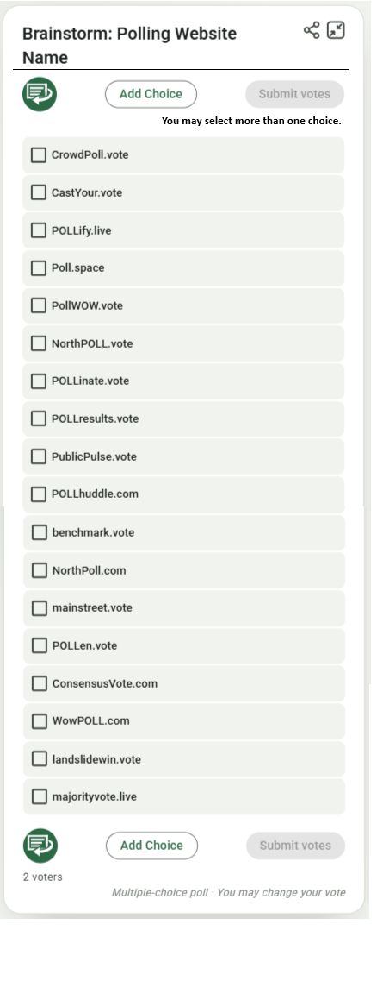

Start a new spec for these requirements called `20261122-012539-VOTING-CENTER-UI`  
!! THIS FILE IS GENERATED USING THE SKILL `/speckit-requirements`. DO NOT EDIT OR DELETE THIS FILE !!  

# Initial High-Level Requirements

This feature will make changes to the UI/UX related to related to the voting process.

Requirement 1:  
Anywhere a "Vote" button appears, the button text will change to "Voting Center"   
The "Voting Center" button will be rendered "left-justified" on every row it currently resides.

Resolved (AM1): on the front face's action row, Voting Center is on the left and Live Results on the right.  

Requirement 2:  
Anywhere a "Submit Votes" button appears, the button text change to "Cast this vote" or "Cast these votes" as appropriate, but will remain the same size and style, and will be rendered "left-justified" on every row it currently resides.

Resolved (IN5): the primary buttons keep today's width and style;  
a label longer than the button ("Voting Center", "Cast these votes") is shrunk or wrapped to fit.  

Resolved (AM2): the label follows the selection: "Cast these votes" when two or more choices are selected, otherwise "Cast this vote";  
"Remove vote" is unchanged.  

Requirement 3:  
Anywhere the "Flip back-btn" appears, it will be rendered "right-justified" on every row it currently resides.

Resolved (AM3): the phone Submit bar (`#voteBar`) follows Requirements 2 and 3: Cast on the left, "n selected" in the middle, flip-back on the right;  
its label is the card's.  

Requirement 4:  
Currently a private poll has an optional setting that allow poll voters to add their own choices up to the max limit of choices.  
There is an "Add Choice" button on the voting face of the Poll that allows users to add their own choices.
When the user clicks the button, a model dialog box is launched that has one text field for entering the new choice.  
On "Save" it is added to the end of the choices list.  

The UI/UX for this will be changes as follows:  
A row will be appended to the list of bars on the Voting face - now also being referred to as the Voting Center.    
The row will have the same dimensions as the other rows in the Voting Center. The difference is that the bar fill will be white (or black in the dark mode) with black (or white text in dark mode).  
This row will not have a Checkbox and will not have a Radio button. the text in the new bottom bar will be an edit field with the suggestion text will beslightly greyed and in italics.  
The suggestion text will be - when on a computer.
```
Enter your own choice, then press Enter.
```

The suggestion text will be - when on a phone.
```
Enter your own choice, then press <symbol for return key>.  
```
When text is entered into the "Add choice" bar, the text is black (or white in dark mode).  
The suggestion text will immediately disappear.
Pressing enter append the new choice to the end of the choices list. 
And it is now votable by all voteres in this poll.

Resolved (AM7): Requirement 4 covers the maximized voting face and Requirement 10 the compact one;  
together, every voting face has the add-your-own row, and the Add Choice dialog is gone.  

Resolved (UA1): the add-your-own row keeps the dialog's checks: `maxlength` = `choiceLabelMax`, pasted newlines flattened, Enter ignored when the trimmed text is empty or a duplicate;  
a supporting line under the row (error colour) gives the dialog's messages, and a counter shows while typing;  
Escape clears the field;  
on success the field empties and keeps focus (when the addition fills the poll, the row goes and focus moves to the face's primary button, else to Maximize), and the voter's selection is kept;  
the new choice is not selected for them.  

Resolved (UA2): one rule for every face: the row shows while `mayAddChoice` holds and the poll has fewer than `maxChoices` choices, so never for a guest;  
it is the last bar and counts as one bar when the bars are sized (so one fewer result may fit before "More choices");  
a row that cannot be used is hidden rather than refused.  

Resolved (UA4): the row's fill is `--md-sys-color-surface-container-lowest` (white / near black) with a 1px `--md-sys-color-outline` border;  
text `--md-sys-color-on-surface`, placeholder `--md-sys-color-on-surface-variant` in italics;  
a focused row takes the primary-colour focus border of the site's text fields.  

Resolved (UA7): the Add Choice button, `addChoiceDialog.js` and the dialog's styles are removed, with their page references;  
`add-choice-m3.css` holds the row's styles.  

Resolved (UA3): on a touch-only device (`(pointer: coarse)` and no fine pointer) the hint reads "Enter your own choice, then press ↵." (U+21B5), and the field sets `enterkeyhint="enter"`;  
every other device reads "Enter your own choice, then press Enter."  

Requirement 5:  
When the voting face of a Poll is on the Maximized View, and there are 10 or more choices,  
the UI will have icons and buttons in the footer,   
That exat same row of icons and buttons will appear at the top of the card, under the title and subtitle.  
There will be a line between the title,subtitle and the buttons.  
If the Poll allows the user to change their choice while the poll is open, 
there will be help text under the Cast this/these Vote(s)" button, that will read:  
"You may select more than one choice." (in red and italics)  The red will be the #E04A4A as used in the logo.

Resolved (IN2): the mockup  illustrates Requirement 5's repeated row and divider only;  
the row's contents (labels, order, no Add Choice button) follow Requirements 1–4.  

Resolved (UA6): the divider (1px `--md-sys-color-outline-variant`) shows only with the top row;  
both action rows are live copies kept in step by the same code (label, disabled state, Remove vote), and the top row comes first in the tab order.  

Resolved (IN3): the help line "You may select more than one choice." is shown on Multiple-Choice polls (not on the change-your-vote condition).  

Resolved (IN4): the mockup wins for the help line's look: on-surface colour, bold, upright, right-aligned under the action row, in both themes (no red).  

Resolved (AM4): "10 or more choices" counts every choice of the poll (not the add-your-own row);  
the top row shows in the maximized voting face of the desktop layout only (the phone keeps its Submit bar).  

Resolved (AM5): the help line appears under every action row with a Cast button, on every voting face (compact and maximized, the top row's included), whenever the poll is Multiple-Choice.  

Requirement 6:  
 On the Voting face of the Maximized view card, on thesame row as the title, there are 3 right-justified icons.  
 - Share poll
 - Watch this Poll
 - Minimize poll
 The "Watch this Poll"  tool tip will change to "Follow this Poll". 

Resolved (AM6): the maximized voting face gains the Watch button between Share and Minimize, behaving exactly as the front's (shown when the front's is, same state);  
the compact voting face is unchanged.  

Resolved (NC1): Watch is renamed Follow in the whole UI: the button's tooltips "Follow this Poll" / "Stop following this Poll", aria-labels "Follow" / "Following", the tab "Following", the reason "You are following", snackbars and README;  
routes, tables, identifiers and the deep-link tab name keep `bookmark` / `watching`, as Bookmark became "Favorites".  

Requirement 7:   
On the Home page (all tabs) the front of the Poll Card may have a "more choice - p%" bar under the polls' bars that fit on the card.  
If it does have a "More choices - p%" bar then another bar with the same appearance will be added at the bottom of the bars.  

Resolved (NC2): Requirement 7's bar is the first Requirement 9's add-your-own row: it comes after "More choices" when that row is shown, and looks like every add-your-own row (white / black fill), not like "More choices".  

Requirement 8:  
Currently a private poll has an optional setting that allow poll voters to add their own choices up to the max limit of choices.  
Currently, there is only one place that a user can add their choice, which is on the voting face of the Poll.

The UI/UX for this will be changes as follows:  
A row will be appended to the list of bars on the Front face as well.    
The row will have the same dimensions as the other rows on the front face. The difference is that the bar fill will be white (or black in the dark mode) with black (or white text in dark mode).  The poll's bars may need to be sized even futher to make room for the "Add your own choice" bar.  The edit field will span the entire width of the bar.
This row will not have a Checkbox ro a Radio button. The text in the new bottom bar will be an edit field with the suggestion text that will initially be slightly greyed and in italics.  
The suggestion text will be - when on a computer.
```
Enter your own choice, then press Enter.
```

The suggestion text will be - when on a phone.
```
Enter your own choice, then press <symbol for return key>.  
```
When text is entered into the "Add choice" bar, the text is black (or white in dark mode).
The suggestion text will immediately disappear.
Pressing enter append the new choice to the end of the choices list. 
And it is now votable by all voters in this poll.

Requirement 9:  

The UI/UX will now have a third option for adding choices directly from the front face of the poll on the Home Page Poll Card in the grid view.  
A row will be appended to the list of bars on the Front face as well.    
The row will have the same dimensions as the other rows on the front face. The difference is that the bar fill will be white (or black in the dark mode) with black (or white text in dark mode).  The poll's bars may need to be sized even futher to make room for the "Add your own choice" bar.  The edit field will span the entire width of the bar.
This row will not have a Checkbox ro a Radio button. The text in the new bottom bar will be an edit field with the suggestion text that will initially be slightly greyed and in italics.  
The suggestion text will be - when on a computer.
```
Enter your own choice, then press Enter.
```

The suggestion text will be - when on a phone.
```
Enter your own choice, then press <symbol for return key>.  
```
When text is entered into the "Add choice" bar, the text is black (or white in dark mode).
The suggestion text will immediately disappear.
Pressing enter append the new choice to the end of the choices list. 
And it is now votable by all voters in this poll.


Resolved (UA8): a click or tap in the front-face row only focuses its field (it never flips or maximizes the card);  
after adding, the card stays on the front face, and the new choice appears as a 0% bar in its place in the results order (last when `choicesInEnteredOrder` is on);  
the voter casts a vote for it from the Voting Center as for any choice.  

Resolved (IN1): Requirement 8 and this Requirement 9 are one front-face requirement: the add-your-own row is the last bar of every front face that shows bars (compact grid card and maximized), on every tab;  
"the bars shrink to make room" and "the field spans the whole bar" hold for every add-your-own row, front and voting faces alike.  

Requirement 10:
The UI/UX for adding Choices will have a 4th option for adding choices directly from the poll card on the Voting Face for poll card that have enough room to fit all the bars for Choices in the grid. (i..e the Maximized View) is not needed to render all the bars.
This will be changes as follows:  
A row will be appended to the list of bars on the Voting face - now also being referred to as the Voting Center.    
The row will have the same dimensions as the other rows in the Voting Center. The difference is that the bar fill will be white (or black in the dark mode) with black (or white text in dark mode).  
This row will not have a Checkbox and will not have a Radio button. the text in the new bottom bar will be an edit field with the suggestion text will beslightly greyed and in italics.  
The suggestion text will be - when on a computer.
```
Enter your own choice, then press Enter.
```

The suggestion text will be - when on a phone.
```
Enter your own choice, then press <symbol for return key>.  
```
When text is entered into the "Add choice" bar, the text is black (or white in dark mode).  
The suggestion text will immediately disappear.
Pressing enter append the new choice to the end of the choices list. 
And it is now votable by all voteres in this poll.


Requirement 11:  
When a pollis not anonymouse there is a "Who Voted" tab section in the Maximized view.  
Change the "Date" column header to  "Vote Cast Date"

Resolved (IN6): the Who Voted heading change, formerly a second "Requirement 9", is Requirement 11.  

Resolved (UA5): "Vote Cast Date" heads the column in both orders of the Who Voted table (by voter and by choice).  
