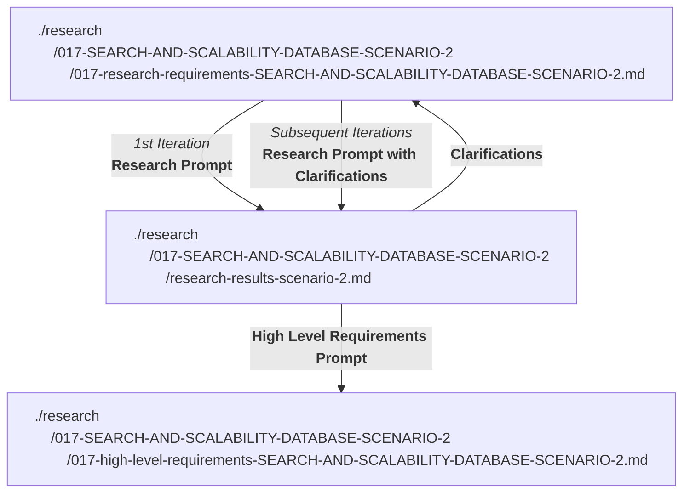

# OVERVIEW
Please research the options to support the future requirements below.  
Place the research results in research/017-SEARCH-AND-SCALABILITY-DATABASE-SCENARIO-2/research-results-scenario-2.md .
If there are further clarifications needed, please add them to the research/017-SEARCH-AND-SCALABILITY-DATABASE-SCENARIO-2/research-results-scenario-2.md file.
I will then add the response to the clarifications to this requirements document and request a revision of the research-results file.
There is no need to complete the research if clarifications are requested, until after the clarifications are provided.  
Base the research only on what is found in this document and the current implementation.
Ask for clarifications if something is missing.
Do not make reference to previous research requirements that may be similar.
It is permissible to completely start this research.md from scratch.

Do not assume any of the current constraints as non-negotiable.  
For example, mongoDB (will be replaced), the current requirement for screening all polls on the home page (this requirement will be removed).  
Provide recommendations for the best solution to support the requirements below, and provide the cost of each option considered.  

In the research results, there is no need to point out mongoDB short-comings or limitations. It is assumed that mongoDB will be replaced with a more suitable datastore.  

-------------------------------
### USAGE NOTES FOR THE DEVELOPER
The progress through documents for this research phase is:

The prompts referred to above are as follows:  
   
`Research Prompt`
```
Please research the options to support the requirements described in the design document research/017-SEARCH-AND-SCALABILITY-DATABASE-SCENARIO-2/017-research-requirements-SEARCH-AND-SCALABILITY-DATABASE-SCENARIO-2.md.  
Please place the results in research/017-SEARCH-AND-SCALABILITY-DATABASE-SCENARIO-2/research-results-scenario-2.md.
```

`Research Prompt with Clarifications`
```
I updated
research/017-SEARCH-AND-SCALABILITY-DATABASE-SCENARIO-2/017-research-requirements-SEARCH-AND-SCALABILITY-DATABASE-SCENARIO-2.md
to include the answers to the clarifications. 
Please update the research results in research/017-SEARCH-AND-SCALABILITY-DATABASE-SCENARIO-2/research-results-scenario-2.md to support the updated requirements.
```
Sample `Cosmetic Changes To Research Results File` 
```
Please update the research results in research/017-SEARCH-AND-SCALABILITY-DATABASE-SCENARIO-2/research-results-scenario-2.md so that:
- change the title "Clarifications requested - none - and the traffic scenarios used" to "Clarifications Resolved - and the traffic scenarios used"
- in the section "10. Development and test environment" change the "- ENV" bullet point to lists to a 3 column table with the following headings: ENV_ variable name , default value, notes 
- add a final section "Speckit Implementation Readiness Status", along with a description of the readiness status of the research results for use by speckit-specify and speckit-mdd-architecture to create Specs and an architecture document.
```


`High Level Requirements Prompt`  
```
Please create a high level requirements document based on accepting all the research results "Recommendations" in research/017-SEARCH-AND-SCALABILITY-DATABASE-SCENARIO-2/research-results-scenario-2.md. The high-level requirements document will be research/017-SEARCH-AND-SCALABILITY-DATABASE-SCENARIO-2/017-high-level-requirements-SEARCH-AND-SCALABILITY-DATABASE-SCENARIO-2.md . The high-level requirements document will be used by speckit-specify (and sometimes speckit-mdd-architecture) to create Specs (and sometimes an architecture document) that will be used to eventually implement the solution.
```
  
 . 
---------------------------

# REQUIREMENTS AND CONSIDERATIONS TO SUPPORT SEARCH AND SCALABILITY

Build now to support up to 250,000 polls in the future.  
This will make it impossible to display all polls on the home page, as the current implementation does now.
This will require a datastore that can support a large number of polls and a search feature that can handle free-text search on multiple fields.

The SUD still has no real users and is in development.  
So the data storage can be changed, with no requirements to port over existing data.  
MongoDB can simply be eliminated if a better solution is found.

A caching system such as Redis (Managed Caching) may be used if it helps with speed.  

Assume count fields exist in the poll schema for voteCount, invitedVoterCount, and bannedVoterCount,  
so that the arrays (or relational tables) do not need to be counted on the fly.  
There is no need to update the counts in real-time. They must be accumulated in a cache and flushed.

The main page of the webapp will have a tabbed interface as well as clickable topics (currently disabled) such as Trending, Sport, Politics etc. Any database changes required to support topics will be specified in the future. 
The actual UI/UX design is not part of this research, and will be left to a requirement in the future.

## LOAD TARGET
Design for 250,000 polls and up to 1,000,000 concurrently connected users.   
Assume a significant share of the 1,000,000 users are signed in, say 50% (the personalize "My ***" tabs require a session).  
State the expected number of App Platform instances and the shared cache required at that load.  
The current implementation keeps pages live by client polling: browsers re-fetch on `ENV_POLLING_INTERVAL` and `ENV_POLL_ADMIN_PAGE_REFRESH_INTERVAL`, and the server re-queries on its sweep intervals. This is not scalable to 1,000,000 concurrent users and the requirements below propose some solutions to this problem. The research should scrutinze these proposed solutions and propose any other solutions that would be more scalable and cost effective.

Assume the following peak rates, site-wide, at the load target:
- Votes: no limit, will be cached in RabbitMQ if necessary, and flushed to the database in batches.
- Searches: count against ENV_SERVER_MAX_REFRESH_PER_SECOND (described more fully below)
- Live Results refreshes: count against ENV_SERVER_MAX_REFRESH_PER_SECOND (described more fully below)
- Refresh button clicks: count against ENV_SERVER_MAX_REFRESH_PER_SECOND (described more fully below)

## SESSIONS
The research recommendation of a session cache-aside is accepted.  
Session lookup is cache-aside in the shared cache: the session token (hashed) is looked up in the cache before BetterAuth's database lookup, the result is cached for `ENV_SESSION_CACHE_TTL` (default 300000 — 5 minutes in milliseconds), and the entry is deleted on logout.  
PostgreSQL remains the session system of record.  
No second cookie is introduced; the single `session_token` cookie policy of 001-user-auth is unchanged. In particular, BetterAuth's `cookieCache` option must not be used, since it adds a second cookie.  
Every dynamic request and every page load (`/api/me`) therefore costs one cache read for its session, not a database read.  
Every code path that ends a session — logout today; account deletion or administrator revocation when they exist — goes through one session-helper function that signs out and deletes the cache entry, so an application-driven revocation takes effect on the next request. The cache entry stores the session's own expiry and is never served past it. A session removed directly in the database is honoured within `ENV_SESSION_CACHE_TTL`; this window is accepted.  

## APP PLATFORM AUTOSCALING
The research recommendation to autoscale the application fleet on CPU is accepted.  

App Platform autoscaling is a property of the service component in the app spec: a minimum and maximum instance count and a target average CPU utilisation. App Platform adds instances (from the already-built image, in about a minute) when average CPU exceeds the target and removes them after a cooldown when it falls below. It is available only on dedicated-CPU instance sizes; billing is per instance-hour, so the cost is for the instances that exist, not for the maximum.  

Nothing in this design has a shared phase — there is no timer that a million clients fire together (there is no automatic tab refresh, Live Results tabs start at random times, sweeps run on one instance) — so CPU rises and falls smoothly with real demand rather than in synchronised spikes that would fool the scaler or arrive faster than it can react.  

### Instance policy
| Setting | Production | Development |
|---|---|---|
| Instance size | dedicated-CPU, 1 vCPU / 2 GiB | one shared-CPU instance, or `npm run dev` |
| `min_instance_count` | 4 | 1 (no autoscaling) |
| `max_instance_count` | 12 | 1 |
| CPU target | 70% average utilisation | — |

These are app-spec settings (`.do/app.yaml`), not `ENV_` variables. A minimum of 4 leaves 3 instances during a rolling deploy or after the loss of one; a minimum of 2 would save about $50 per month and leave 1.  

### Statelessness conditions
So that any instance can serve any request and instances can be added or removed without coordination:  
- Every shared state lives in the shared cache (Valkey) or in PostgreSQL. In-process memory is used only as a disposable first-level cache for shared listing bytes.  
- Sweeps run under PostgreSQL advisory locks, so a new instance joins without coordination and a removed instance releases its lock automatically.  
- The vote-queue consumer joins the `writers` consumer group when the instance starts.  

### Graceful shutdown
On `SIGTERM` an instance stops accepting new requests, finishes and acknowledges its in-flight vote batch, and exits. The App Platform stop grace period must exceed the time of one batch; it is set to 30 seconds in the app spec (a 500-row batch completes in well under a second). Without this a scale-down can leave a batch pending until the consumer group's reclaim recovers it.  
The health check is `GET /healthz`: registered before the shedding middleware and excluded from the in-flight count; no session; no dependency other than a Valkey `PING` with a short timeout, and it answers `200` even if that `PING` fails (the dependency state goes in the body, for the metric). It answers only "can this process accept traffic?", so a cache or database blip never causes the load balancer to pull every instance at once. The app spec's health check points at this path.  

### Connection arithmetic
`max_instance_count` × the per-instance PostgreSQL pool size, plus the sweeps, must not exceed the PostgreSQL connection limit: 12 × 20 + about 20 ≈ 260, within the 397 connections of the 16 GB node, and through the managed connection pool in any case.  

### The budget follows the fleet
A static server budget makes no sense when the fleet is 4 instances one hour and 12 the next. Each instance registers a heartbeat key in the shared cache (`instance:<id>`, TTL 30 seconds). The effective budget is `ENV_SERVER_MAX_REFRESH_PER_INSTANCE_PER_SECOND` (default 1250) × the number of live instances, capped by `ENV_SERVER_MAX_REFRESH_PER_SECOND` (default 15000, the value at 12 instances). A 4-instance fleet therefore hands out intervals for a 5,000 per second budget and an 8-instance fleet for 10,000 per second. The two mechanisms interlock: the budget reacts within seconds and keeps the load bounded while autoscaling reacts within minutes and raises the budget.  

### Implications
| Area | Implication |
|---|---|
| Capacity | Dedicated CPU is guaranteed; shared-CPU instances can be throttled under sustained load, which is a risk at 10,000 requests per second regardless of autoscaling |
| Surges | Autoscaling lags by a minute or two; during the lag the budget controller lengthens intervals, so a surge costs freshness, never errors — the two mechanisms are complementary, not redundant |
| Redundancy | A floor of 4 leaves 3 instances during a rolling deploy or an instance loss |
| Scale-down | Polling holds no long-lived connections, so removing an instance drops nothing (the property a WebSocket or SSE design would lose) |
| Operations | Alert policies on instance count at maximum and on CPU above target for more than a few minutes; the load test confirms the CPU target and the per-instance request rate |
| Development | Unchanged: one instance, no autoscaling |

### Cost implications
List prices; dedicated 1 vCPU / 2 GiB about $25–29 per month (about $0.035–0.040 per instance-hour); shared about $10–20; verify before budgeting.  

| Fleet | Monthly cost | Notes |
|---|---|---|
| 8 fixed shared-CPU | about $80–160 | Cheapest on paper; CPU not guaranteed; cannot autoscale |
| 8 fixed dedicated-CPU | about $200–232 | Guaranteed CPU; pays for peak capacity all month |
| Autoscaled dedicated, 4 rising to 8–12 for 4 peak hours per day (adopted) | about $117–155 | 4 × $25–29 all month (about $100–116) plus 480–960 extra instance-hours (about $17–39) |
| Autoscaled, worst case pinned at 12 all month | about $300–350 | Only if load is at peak around the clock; the budget bounds CPU demand, so this is a ceiling, not an expectation |

Autoscaling on dedicated instances costs about the same as a fixed shared-CPU fleet and roughly 40% less than a fixed dedicated fleet, with guaranteed CPU and a hard cost ceiling. Nothing else in the estimate changes — PostgreSQL, the cache, OpenSearch, Spaces and egress are the same. At low load the fleet sits at 4 instances for about $100–116 per month.  

## PER-INSTANCE LOAD SHEDDING
The research recommendation of per-instance request caps with `503` + `Retry-After` is accepted.  

The cap is a per-instance *concurrency* limit, not a rate limit. A middleware counts the requests an instance currently has in flight and measures its event-loop lag; once either is over its threshold, the instance answers new requests immediately with `503 Service Unavailable` and `Retry-After` instead of letting them queue inside Node. An overloaded Node process without such a cap does not fail — it gets slow: latency climbs for every request, clients time out and retry (adding load), the health check eventually fails, the load balancer pulls the instance, and its share of traffic lands on the others. The cap turns that cascade into a few fast, cheap rejections while the instance stays healthy.  

It is the third and fastest of three load bounds that interlock:  

| Bound | Scope | Reacts in | Protects against |
|---|---|---|---|
| Per-instance cap (this section) | one instance | milliseconds | uneven load balancing, a slow dependency (cache or database latency spike, a GC pause), the seconds before the budget controller acts, page loads (which are outside the budget), a fleet mid-deploy |
| Budget controller (see LIVE RESULTS and VOTING AND SEARCH RATE LIMITS) | site-wide | seconds | sustained demand above what the fleet can serve |
| Autoscaling (see APP PLATFORM AUTOSCALING) | fleet size | minutes | demand that needs more instances |

The client needs nothing new: it treats `503` + `Retry-After` exactly as it treats the budget's `429` + `Retry-After` — wait, then retry.  

### Mechanism
- An instance sheds a request with `503` and `Retry-After` when either its in-flight request count exceeds `ENV_INSTANCE_MAX_INFLIGHT` (default 200) or its event-loop lag exceeds `ENV_INSTANCE_MAX_EVENT_LOOP_LAG` (default 100 — milliseconds).  
- The response body carries `retryAfterMs` (`ENV_SHED_RETRY_AFTER`, default 2000 — milliseconds) and, for dynamic requests, `nextRefreshMs`. The client adds 0–1 second of jitter before retrying.  
- Shedding order is the same as the budget's: Search first, then Refresh button clicks, then Live Results refreshes; votes and the health check are shed last. Votes because they are cheap (validate, increment, enqueue) and losing them is what the vote design exists to avoid; the health check because shedding is not ill health — an instance that failed its health check while shedding would be pulled by the load balancer, which is the cascade the cap prevents.  
- The two thresholds are set by the load test; they depend on the instance size and the request mix.  

### Client behaviour
Identical to `429`. For a shed vote the client keeps the vote pending and retries once automatically after `Retry-After`; for a shed refresh it waits for the interval; for a shed page load it renders its stored TRENDING copy.  

### When the shared cache is unreachable
Every request path depends on the shared cache, so its unavailability (a failover to the standby, or a longer outage) has one behaviour: every cache call has a short timeout (100 ms); while the client is disconnected an instance sheds every dynamic request with `503` and `Retry-After` — the same path and client behaviour as load shedding — and keeps serving the CDN-backed page-load paths and the health check, which stays `200`. Votes are not accepted while the cache is down (they cannot be counted or queued); the client shows the pending-vote notice and retries. Reads that have a database source (`/api/me`, the personal tabs' membership, the admin search) continue at database cost. The vote consumer and the sweeps pause and resume on reconnect. On reconnection the counters, registry and queue are the standby's (a loss of at most about one second, as accepted), the nightly reconcile corrects any counter gap, and the per-session and per-poll sets rebuild lazily from PostgreSQL. Nothing falls back to PostgreSQL for floors, budgets, counters or the vote write.  

### Observability
The count of shed requests per instance is a metric with an alert policy. Sustained shedding while CPU is below the autoscaling target means the cap or the target is mis-set.  

### Implications
| Area | Implication |
|---|---|
| Correctness | Nothing is lost: a shed vote is retried by the client; a shed refresh is late by a couple of seconds; counters and the vote queue are untouched |
| Latency | Bounded — a healthy instance never queues more than the cap, so tail latency stays near the cost of one request instead of climbing to timeouts |
| Failure containment | An instance in trouble sheds instead of stalling and does not drag the others down |
| Interaction with the budget | Shedding is the signal that the budget is too high for the current fleet, or that a dependency is slow; the budget is what stops shedding from being sustained |
| Interaction with autoscaling | Safe overload lets the CPU target sit at 70% rather than lower, because briefly exceeding capacity costs a few `503`s rather than a cascade |
| Tuning risk | Too low a cap sheds needlessly; too high protects nothing — hence the load test |
| Development | The middleware is on but effectively never triggers on one instance |

### Cost implications
- Direct cost: none. A middleware of a few dozen lines; no service, no infrastructure. A `503` is about 0.3 KB, so shed traffic is invisible in egress.  
- Indirect saving: headroom. Without safe overload a fleet is sized with a safety margin — 30–50% spare capacity, or a lower CPU target — so that a surge never reaches the point of cascade. With the cap, the margin can be the budget's few seconds of reaction time instead. At the load target that is the difference between autoscaling to 8–12 instances at 70% and 10–15 instances at 50%: roughly 2–3 fewer instances at peak, about $10–30 per month at four peak hours per day, and one fewer instance in the off-peak floor if 3 is chosen rather than 4 (about $25–29 per month).  
- The larger saving is the incident it prevents: a cascade at 1,000,000 users is a full outage, and the cap is what makes "a fleet plus a budget" a safe design rather than an optimistic one.  

## REFRESHING FOR GUESTS
All the sections below that describe refreshing, refer to signed-in users. Guest users (not logged in) do not have any automatic refreshing after they view any page or poll. Guest do not have access to "Live Results". A poll card will have a "Live Results" button and "Vote" button, but they will be prompted to sign in first. Guest users will need to manually refresh the page to see any changes.  
All five tabs are always shown; for a guest, My PRIVATE POLLS, Favourites and Live Results are disabled, and clicking one prompts to sign in.  
AI INSTRUCTION: As a topic of research, propose a way to prevent a user from repeatedly refreshing the webapp using the browser's Refresh functionality, which would cause a high load on the server.

## HOME PAGE CHANGES TO REDUCE SERVER LOAD
It is proposed that the home page will no longer display all polls (matching the default listing criteria)  
and it will no longer provide frequent live updates of each poll.
There will be a tab-type control for various categories of polls.  
Some of the important ones are:
- TRENDING polls (a fixed list of the most popular open polls and other criteria)
- My PRIVATE POLLS (private polls the current user has created, or is invited to, or has voted in)
- Favourites (public polls the current user has created, or has voted in, or has bookmarked)
- Search results 
- Live Results (a single poll that the user has selected to view live results for)

TRENDING polls are Public polls that are OPEN — or EDITING with a prior state of OPEN, in which case the last published content is shown, so a poll does not leave TRENDING merely because an administrator opened it for editing — ranked by votes in the trailing hour, ties by voteCount. `ENV_MAX_TRENDING_POLLS` polls (default 200). Recomputed every `ENV_TRENDING_POLLS_RECOMPUTE_INTERVAL` (default 60000 — 1 minute in milliseconds).  

TRENDING is published as **two objects** (see TRENDING PUBLISHING AND THE TWO-OBJECT SPLIT below):  
- `trending-counts.json` — the poll ids in TRENDING order, each with its current counters, plus a membership version (a hash of the set of ids, independent of order). Published every recompute. About 2 KB compressed.  
- `trending.json` — the full poll cards keyed by id. Published only when the set of poll ids changed — never on a reorder alone, since order travels in the counts object and changes on nearly every recompute. About 32 KB compressed at 200 cards.  

The client fetches `trending-counts.json` on each interaction (page load, TRENDING tab click, Refresh click) and applies it as a delta to the cards it holds. It fetches `trending.json` only when the membership version in the counts object differs from the one it holds.  
TRENDING interactions never reach an application instance, so they are not dynamic requests: the server cannot apply a floor, count them against `ENV_SERVER_MAX_REFRESH_PER_SECOND` or hand out a refresh rate for them. The manual floor for TRENDING is enforced by the client alone (the Refresh button is disabled for `ENV_MIN_MANUAL_REFRESH_INTERVAL`; a tab click within the floor re-renders the held copy), and the server-side bound is the CDN's `max-age` on both objects plus the client's stored copy. The per-kind floors and the budget apply to the tabs an instance serves.  
Because TRENDING carries no per-user fields, a signed-in client obtains its overlay — which of the visible polls it has voted in (and with which choices) or bookmarked — with one call, `GET /api/me/polls?pids=<the visible ids>`, answered by a single `user_polls` lookup and returning `{ voted, choiceIds?, bookmarked }` per poll. The client fetches it on page load and when the counts object brings ids it has no overlay entry for; after its own vote or bookmark action it updates the overlay locally from that response and does not re-fetch. The call is a manual-kind dynamic request (the manual floor and the budget apply). The personal tabs return the same overlay fields inline.  

All polls appearing in any tab, EXCEPT Search Results, will have a "Vote" button.  
All polls appearing in any tab, EXCEPT Live Results, will have a "Live Results" button (Search Results included — see HOME PAGE SEARCH).  

Tab content will be refreshed ONLY when the user clicks on the tab, or when the user clicks on a "refresh" button, or automatically on the "Live Results" tab (Live Results handling described below).  
A tab click within the floor does not send a request: the client holds the last response for each tab with the time it was received and renders that copy; it requests a refresh only when the held copy is older than `ENV_MIN_MANUAL_REFRESH_INTERVAL`, when no copy is held, or when the Refresh button is pressed after the floor. The server's rejection of an early request is a backstop for clients that bypass this, not the normal path.  
Each kind of refresh has its own per-user minimum interval (a "floor"). A user may make at most one request of a kind per its floor:  

| ENV_ variable | Default (milliseconds) | Applies to |
|---|---|---|
| `ENV_MIN_LIVE_REFRESH_INTERVAL` | 2000 (2 seconds) | the automatic refresh of the "Live Results" tab. Independent of `ENV_COUNTER_FLUSH_INTERVAL`: a Live Results response reads the live counters, not the flushed row (see COUNTER FLUSH AND LIVE RESULTS FRESHNESS), so this floor may be set as low as the server budget allows |
| `ENV_MIN_MANUAL_REFRESH_INTERVAL` | 5000 (5 seconds) | the "Refresh" button and tab clicks |
| `ENV_MIN_SEARCH_INTERVAL` | 2000 (2 seconds) | a search (Enter in the search box) |
| `ENV_MIN_VOTE_INTERVAL` | 2000 (2 seconds) | submitting a vote. Votes are never lengthened by the server budget (see VOTING AND SEARCH RATE LIMITS), so this floor is the only per-user bound on votes |

The floors replace the single `ENV_MIN_REFRESH_INTERVAL` (15 seconds) of earlier drafts. They bound each user; the server budget `ENV_SERVER_MAX_REFRESH_PER_SECOND` (see LIVE RESULTS) bounds the server, and lengthens the intervals it hands out above these floors when load is high.  

The refresh will be a single request to the server to get the current state of all polls in that tab, rather than a separate request for each poll.  
The manual "Refresh" limit will be supported by greying-out/disabling the refresh button for `ENV_MIN_MANUAL_REFRESH_INTERVAL` after a refresh,  
and by the server rejecting any refresh requests that are more frequent than every `ENV_MIN_MANUAL_REFRESH_INTERVAL`.  
The server-side measures will be in place to prevent a malicious user from bypassing the client-side measures.  
For example, by repeatedly using the browser's Refresh functionality. Note: a browser refresh will reset the UI and render the default tab, which is the TRENDING tab, and will not refresh any other tab. A refresh of the TRENDING tab is relatively low load, since it will be cached or even loaded from a CDN.

On first arrival to the webapp, the home page shows the TRENDING tab (the search box is empty).
Typing a search and pressing Enter switches to a Search tab and replaces the tab content (if any) with the new Search results. 
After hitting Enter, the search box will be cleared and the Search tab will remain selected.

## BOOKMARKED POLLS
Every poll card will have a "bookmark" button that allows the user to add that poll to their bookmarked polls.  
Polls that are bookmarked will be removed from the user's bookmarked polls list when:
- the poll has been ARCHIVED
- the poll has been in the CLOSED state for 6 months
- the poll is OPEN but has not received any votes for 6 months (measured from the last vote, or — for a poll that has never received a vote — from when it opened, or from its creation if it has no start date)
- the user clicks the "un-bookmark" button on the poll card
The sweep that removes polls from the user's bookmarked polls list will run once a day, and will be a single request to the server to remove all polls that meet the above criteria, rather than a separate request for each poll.  
The removal will be silent.  
There will be a cap on number of bookmarks per user: `ENV_MAX_BOOKMARKS_PER_USER` (200)

## LIVE RESULTS

The only poll that will be refreshed frequently is a poll that is displayed when the user clicks "Live Results" on the poll card.  
A "Live Results" tab contents displays the poll results for all polls that have had a "Live Results" request.    
Adding a poll to the "Live Results" tab requires the same view eligibility as viewing the poll today (public; private with the link; invitation-only only if invited or the creator); the check runs when the poll is added and is cached with the registration, so an ineligible user cannot watch a poll by supplying its id.  
Any one individual user will have a limit to how many polls can be displayed in the "Live Results" tab at the same time. An environment variable `ENV_MAX_LIVE_RESULTS_PER_USER` (default 5) will define this limit. Watching five polls costs the same one request per interval as watching one; only the response size grows.  
If the user requests "Live Results" for a poll that is already in the "Live Results" tab, the poll will be moved to the top of the list.  
If the user requests "Live Results" for a poll that is not already in the "Live Results" tab, and the tab already has `ENV_MAX_LIVE_RESULTS_PER_USER` polls, the poll that was least recently added will be removed from the list to make room for the new poll.  
The initial default and most frequent refresh rate for the "Live Results" tab will be `ENV_MIN_LIVE_REFRESH_INTERVAL` (default 2 seconds), and the server will reject any requests to refresh more frequently than that. The client will be responsible for ensuring that it does not request a refresh more frequently than that.  
There will also be a limit on the server of how many "Live Results" refresh requests can be processed in a given time period called `ENV_SERVER_MAX_REFRESH_PER_SECOND` (default 15,000 — the cap; the effective budget is `ENV_SERVER_MAX_REFRESH_PER_INSTANCE_PER_SECOND` × the number of live instances, see APP PLATFORM AUTOSCALING).  
To support this, the server will reject any requests to refresh more frequently than that limit, and provide a new less frequent refresh rate to the client in the response. The client will then use that new refresh rate for subsequent requests.  
As the number of "Live Results" refresh requests increases, the refresh rate will be reduced to keep the server load within acceptable limits.  
When the number of "Live Results" refresh requests decreases, the refresh rate will be increased until it reaches the limit of `ENV_MIN_LIVE_REFRESH_INTERVAL`. Never more frequently than that.

To be clear, a refresh of the polls on the "Live Results" tab is a single request to the server to get the current state of all polls in that tab, rather than a separate request for each poll.  

This technique of Adaptive polling ensures that the server load never exceeds predefined limits. The server bounds its own load by lengthening the interval it hands out. To repeat, the environment variable `ENV_SERVER_MAX_REFRESH_PER_SECOND` will define the maximum number of total "Live Results" refresh requests that can be processed per second on the server.  

When a user has been viewing a "Live Results" tab for `ENV_MAX_IDLE_TIME` (default 1800000 — 30 minutes in milliseconds) without any user interaction, the server will present a prompt to continue refreshing "Live Results". The prompt is only modal for that particular "Live Results" tab.
The prompt is: "Do you want to continue to receive Live Results updates for this poll?" with buttons "Cancel" and "Yes".  
Clicking "Yes" will restart the `ENV_MAX_IDLE_TIME` timer. Clicking "Cancel" will close the "Live Results" tab.
The client shows the prompt on its own timer. The server independently expires the live registration at idle time + one interval — where "one interval" is the interval the server last handed that session (`nextRefreshMs`, the floor × the current Live Results multiplier), not the bare floor, so a client stretched by the budget controller is never expired before its own next scheduled refresh — so a page that never answers cannot keep refreshing. Server-side expiry is what makes the idle rule count for load. Without it the rule is UI only.

These suggestions are intended to reduce the server load and improve the user experience.  
A desired outcome of the research is to determine whether these changes are sufficient to support the LOAD TARGET, or whether additional changes are required.  
Also, the research should propose other changes that could further reduce server load and improve scalability.  
This could involve changes to the webapp/s features, and/or changes to the server architecture, and/or changes to the database architecture.  

## VOTING AND SEARCH RATE LIMITS
For the purposes of server load management, every "Vote", "Search", "Live Results" refresh, and "Refresh" button clicks are counted as a "Refresh" request.
For example, submitting a vote counts a a refresh request that the server must limit when load is high.  
These all contribute to `ENV_SERVER_MAX_REFRESH_PER_SECOND`.
Every one of these requests will be counted against the per-user floor for its kind (`ENV_MIN_LIVE_REFRESH_INTERVAL`, `ENV_MIN_MANUAL_REFRESH_INTERVAL`, `ENV_MIN_SEARCH_INTERVAL`, `ENV_MIN_VOTE_INTERVAL` — see HOME PAGE CHANGES TO REDUCE SERVER LOAD), keyed per session (per IP for guests).

Each kind has its own floor, so a vote does not delay a Live Results refresh and a search does not delay a Refresh click; a user who votes sees the next Live Results update within `ENV_MIN_LIVE_REFRESH_INTERVAL`.  
However, the response to a Vote request, if it can be handled, will include the new voteCount and the new choice voteCounts, so the user will see the results of their own vote immediately.  
If the vote can not be handled because of excessive server load, the vote will be queued in a fast queuing system such as RabbitMQ, and the user will be informed that their vote is queued and will be processed as soon as possible.  
AI INSTRUCTION: please make recommendations related to this. If any clarifications are needed, please add them to the research-results-scenario-2.md file.  

Durability of queued votes: a queue absorbs peaks by holding votes in memory before they reach the database. A queue node failure loses whatever it holds.  
A loss window of the order of one second of votes during a rare failure is acceptable.  

Priority within the budget: when the server is over `ENV_SERVER_MAX_REFRESH_PER_SECOND`, it lengthens the intervals it hands out in this order — "Search" first, then "Refresh" button clicks, then "Live Results" refreshes — so the tab the user is actively watching degrades last. Votes are never lengthened; they are queued as described above. A vote response therefore always carries `ENV_MIN_VOTE_INTERVAL`, unstretched, as its `nextRefreshMs`, and the client uses it to time the re-enabling of the Vote buttons.  

Eligibility (banned, invited, already voted, poll OPEN) is checked before a vote is queued; a queued vote can fail only by system error.   Counters are incremented at enqueue and the response carries them.  
The eligibility checks read the shared cache, not the database, on the hot path: the poll's state from its cached projection; per-poll ban and invitation sets loaded from the roster tables on first use and invalidated by the roster transaction whenever an administrator changes a roster; and a per-session set of the polls the session has voted on, written at enqueue (before the queue) and rebuilt from the `votes` table on a miss. Because the per-session set is written at enqueue, a second vote from the same session while the first is still queued is refused — a queued vote is final from the user's perspective. The database is consulted only on a cache miss.  

Consider the single-path vote queue as the always-on write path, not a fallback — one code path, batched inserts, and a "queued" notice that is a status rather than a mode.

### Vote abuse resistance
Votes bypass the budget's back-off by design (a deferred vote is a lost vote), so `ENV_MIN_VOTE_INTERVAL` is the only per-user bound on the vote path. The following make it an abuse control rather than a number:  
1. **Scope of the floor**: `ENV_MIN_VOTE_INTERVAL` is per session across all polls — a user may submit at most one vote every 2 seconds, whichever poll it is for. A per-user-and-poll floor would let a script vote on hundreds of polls per second; per session is the scope that bounds write volume. A human clicking through TRENDING at 2-second spacing never notices it.  
2. **Final-Vote and Dynamic-Vote polls**: a second vote on a Final-Vote poll is refused by the eligibility check before the queue — it costs a cache read and never becomes a queue entry or a row. A changed vote on a Dynamic-Vote poll is a vote request like any other, subject to the floor, and replaces the row on insert.  
3. **Early vote response**: `429` with `Retry-After`. The client disables the Vote buttons for the interval; a vote submitted early is retried by the client after `Retry-After`, not lost.  
4. **Per-IP defence in depth**: at most `ENV_MAX_VOTES_PER_IP_PER_MINUTE` (default 600) votes per minute from one IP address — one counter with expiry in the shared cache — because the per-session floor says nothing about many sessions behind one address. The default is set in the anomaly range rather than the honest range, because a client IP is a poor proxy for one person: a campus, an office or a mobile carrier's NAT puts hundreds of honest users behind one address. Sixty accounts voting together from one address is a classroom; six hundred a minute is a script. Crossing the cap raises an alert as well as refusing the vote; the tight bound on a script that has obtained many sessions is the sign-in rate limit (item 5).  
   The same reasoning applies to the page-load limit under REFRESHING FOR GUESTS: it is keyed by session for signed-in users and by IP only for guests, with a generous default (120 per minute), because the cost of being wrong is a notice rather than a lockout. Guests behind one shared address are served at a shared rate for Search and Refresh; this is accepted, since TRENDING — the guest's main surface — is served by the CDN with no per-IP bound and a guest who signs in gets their own key.  
5. **Account creation is the outer bound**: every session needs a magic-link sign-in, which the existing `ENV_EMAIL_RATE_LIMIT_MINUTES_WINDOW` and `ENV_EMAIL_RATE_LIMIT_MAX_REQUESTS_PER_WINDOW` already limit per client; this is what stops a script from minting sessions to multiply its vote rate.  
6. **Honest bursts**: a viral poll's votes are absorbed by the queue up to the drain ceiling; above it, voters see "queued", never a refusal.  

Cost: none directly — the floor is the same cache key every other kind uses, and the per-IP counter is one more key per address. What it avoids: every vote that reaches the queue becomes three rows (`votes`, `vote_history`, `user_polls`) plus write-ahead log and outbox — roughly 0.5–1 KB of durable storage. A script voting once a second from 10,000 sessions would write about 36 million rows an hour (about 20–35 GB a day of database growth, about $4–7 a day in storage, compounding) and consume half the drain ceiling, pushing honest voters into "queued". At 2 seconds the same script does half of that; with the per-IP cap and the sign-in limit it does almost none of it. A 1-second floor doubles the per-session write ceiling and changes nothing else; 5 seconds would start to be felt by users voting through a list.  

## BUDGET CONTROLLER
The research recommendation of a predictive Live Results multiplier is accepted. This section first defines the budget controller that APP PLATFORM AUTOSCALING, PER-INSTANCE LOAD SHEDDING and SEARCH SUB-BUDGET refer to, then the prediction.  

### The controller
1. **Tick**: the controller runs every `ENV_BUDGET_CONTROLLER_INTERVAL` (default 1000 — 1 second in milliseconds) on one instance under the sweep lock. The tick must not exceed the smallest per-kind floor.  
2. **Multipliers**: three multipliers `k:search`, `k:refresh` and `k:live`, each ≥ 1, are held in the shared cache. The interval handed to a client for a kind is that kind's floor × its multiplier, and is returned as `nextRefreshMs` in every response of that kind, whether or not the server is over budget.  
3. **Raise rule**: while the observed rate of dynamic requests *R* exceeds the effective budget (see APP PLATFORM AUTOSCALING), the controller raises the first multiplier that is below its cap, in the order Search, then Refresh button clicks, then Live Results. Search and Refresh cap at `ENV_MAX_STRETCH` (default 8) × their floor, so that the loop moves on to the next kind rather than stretching one kind indefinitely; Live Results is uncapped, as the last resort. Votes are never lengthened. The search sub-budget raises `k:search` by the same rule (see SEARCH SUB-BUDGET).  
4. **Lower rule**: while *R* is below `ENV_BUDGET_LOWER_THRESHOLD_PERCENT` (default 80) of the effective budget, the controller lowers the multipliers in the reverse order, one step per tick, until each is back at 1.  

### The predictive Live Results multiplier
Searches, Refresh clicks and votes are click-driven: their rate rises only as fast as humans act. Live Results refreshes are timer-driven at the floor: when a large event starts and many live tabs open within a minute, every one of them fires at the floor from then on. A controller that only observes the rate sees that burst after it has happened — one tick of *V* / floor requests before `k:live` rises. At 100,000 live tabs and a 2-second floor that is 50,000 requests per second, five times the budget, for about a second; the per-instance cap sheds the excess with `503`s, so nothing breaks, but the first thing viewers of a big event would see is an error blip. The server does not need to observe the burst: it knows *V*, because every live tab is registered.  

5. **Live registry**: every Live Results refresh does `ZADD live:active <expiry> <session>` in the shared cache, with `expiry = now + nextRefreshMs + ENV_MAX_IDLE_TIME` (`nextRefreshMs` being the interval that response hands the session). This replaces the separate expiry refresh of the live registration. Each tick the controller removes entries whose expiry has passed (`ZREMRANGEBYSCORE`) and reads *V* = `ZCARD live:active`.  
6. **Prediction**: each tick the controller computes `k_pred = ceil((V × a / floor_live) / budget_left)`, where `budget_left` is the effective budget minus the observed rate of votes, searches and Refresh clicks, and *a* is an activity factor — the ratio of Live Results requests actually observed in the last tick to the number *V* would produce at the current interval — which corrects for tabs whose timers are paused because their page is hidden (see REFRESH ONLY VISIBLE PAGES). Then `k:live = max(k_pred, k_observed)`, where `k_observed` is the value the raise rule would give; decreases are applied one step per tick as in the lower rule.  
7. **Result**: when *V* rises, `k:live` rises in the same tick — before the new tabs' first refreshes arrive — so the burst never happens; when *V* falls, `k:live` falls without waiting for the lower-rule threshold. An overestimate of *V* errs on the side of a slightly longer interval, never on the side of `503`s.  

### Implications
| Area | Implication |
|---|---|
| Surge start | No `503` transient for Live Results at the start of an event; the per-instance cap is a backstop rather than the first responder |
| Load shedding | `ENV_INSTANCE_MAX_INFLIGHT` can be tuned for steady state rather than for absorbing a one-second burst of five to ten times the budget |
| Autoscaling | Unchanged: the controller reacts within a tick, autoscaling within minutes; prediction removes the tick of lag for the one kind that has it |
| Accuracy | *V* overcounts hidden tabs; the activity factor corrects that within a tick or two |
| The 1-second floor | This is the second of the two changes that make a 1-second Live Results floor safe (the first — reading the live counters — is adopted under COUNTER FLUSH AND LIVE RESULTS FRESHNESS). With both, the floor is purely a budget and user-experience choice |
| Other kinds | Nothing changes for Search, Refresh clicks and votes — they cannot burst ahead of the controller |
| Development | The registry and the prediction run on one instance and are tested against the in-process cache |

### Cost implications
- Direct cost: none. One sorted set (100,000 live tabs ≈ 5 MB of the cache), one `ZADD` per live refresh in place of the expiry refresh already done, and one `ZCARD` plus a prune per tick on one instance. No new service, no instance.  
- What it avoids: the `503` blip is a user-experience cost, not a dollar cost — shedding is cheap by design. The dollar effect is indirect and modest: without prediction one would either accept the blip or keep extra headroom (a lower shedding trigger, or a higher instance floor) to absorb a burst that lasts a second, which is the wrong tool; with it, the fleet and the caps are sized for sustained load only. At the load target that is of the order of $0–30 per month, and it is what keeps a future 1-second floor from costing a surge-sized fleet.  

## SEARCH SUB-BUDGET
The research recommendation of a search sub-budget is accepted.  

The global budget `ENV_SERVER_MAX_REFRESH_PER_SECOND` bounds the sum of dynamic requests. Votes, refreshes and Live Results are served from the shared cache, so their cost per request is tiny and roughly equal. A search is different: it is the one request whose cost lands on a component priced by capacity — the search engine — at 3–8 ms of engine CPU each. The global budget therefore says nothing about how large the search cluster must be; in the worst case every dynamic request is a search. The sub-budget gives the engine its own ceiling to be sized against.  

### Definition
- The server processes at most `ENV_SERVER_MAX_SEARCH_PER_SECOND` (default 2000) search-engine queries per second, site-wide.  
- **What counts**: a search served from the identical-query result cache (see HOME PAGE SEARCH) does not count — it never reaches the engine. A cache miss counts. Every search still counts against the global budget and against the user's `ENV_MIN_SEARCH_INTERVAL`. The sub-budget is therefore the number the cluster is sized against, and the cache is headroom on top of it.  
- **Mechanism**: a per-second counter of engine queries in the shared cache. When it exceeds the sub-budget, the search interval multiplier is raised by the budget controller exactly as when the global budget is exceeded, and lowered the same way — the same loop, one more comparison.  
- **It does not follow the fleet.** Unlike the global budget, which scales with the number of live instances (see APP PLATFORM AUTOSCALING), the search sub-budget is tied to the search cluster's capacity and changes only when the cluster is resized.  
- **Fallback value**: when searches are served by PostgreSQL full-text search (the search engine unset, unreachable or re-indexing), the sub-budget is `ENV_SERVER_MAX_SEARCH_PER_SECOND_FALLBACK` (default 200), because a PostgreSQL full-text query costs 5–150 ms of the database node that is also writing the votes. An engine outage then slows search intervals for users rather than putting the database at risk.  
- **Response contract**: identical to the global budget. Every search response carries `nextRefreshMs`; a search before that interval is answered `429` with `Retry-After`. The UI tells the user to wait that many seconds before searching again.  

### Sizing rule
The search cluster is sized to the sub-budget; the load test confirms the per-query cost.  

| Sub-budget (engine queries per second) | Cluster (DigitalOcean Managed OpenSearch) | Monthly (list price; verify) |
|---|---|---|
| 500 | 3 × 2 GiB (HA) | about $57 |
| 2,000 (default) | 3 × 4 GiB | about $114 |
| 5,000 | 3 × 8 GiB | about $228 |
| 10,000 | 3 × 16 GiB | about $456 |
| No sub-budget — sized for the global cap all being searches | 3 × 16–32 GiB | about $456–900 |

### Implications
| Area | Implication |
|---|---|
| Sizing | The cluster is sized to one number instead of to a worst case; capacity planning is a lookup in the table above |
| Failure containment | An overload of searches degrades search (longer intervals between searches) and nothing else. Without the sub-budget it would raise engine latency, which raises in-flight counts on every instance, which sheds everything — a search overload would become a site-wide event |
| Priority | Consistent with the priority order: Search is already the first kind lengthened; the sub-budget adds a second reason to lengthen it |
| Cache dependence | The search rate users enjoy is the sub-budget divided by (1 − cache hit rate). Popular terms repeat, so a 50% hit rate turns 2,000 engine queries per second into 4,000 searches per second. The hit rate is a load-test output, not an assumption |
| Fallback | With the fallback value, losing the search engine means slower search intervals, not a database at risk — the outage is contained to the feature that failed |
| Egress | A search page is about 32 KB; at 2,000 per second that is about 64 MB/s, about $4.60 per peak hour, already inside the estimate; the sub-budget caps it |
| Development | The counter runs; on one instance with PostgreSQL full-text search the fallback value applies and never triggers in practice |

### Cost implications
- The direct effect is that the cluster can be the $114 size with a defined behaviour above its capacity, instead of $456–900 sized against a worst case the priority order makes almost impossible to reach — a saving of about $340–790 per month at the load target.  
- It adds no infrastructure: one counter in the shared cache and one comparison in the budget controller.  
- The fallback value adds nothing either; it removes the need to size PostgreSQL for search traffic during an engine outage, which would otherwise mean the next node size (about +$240 per month).  


## COST CONSIDERATIONS
A solution that is cost effective and entirely hosted on Digital Ocean is preferrable.
If an external vector store service is required, or a third-party search back-end, provide an estimate of the cost for any services considered, making use of the assumption that there will be 250,000 polls.


## HOME PAGE SEARCH
The `/` home page (grid of poll cards) will gain a **Free-text Search feature**.  
The intended user will not be technical and as such will not be able to use structured search fields or a search grammar.  
This will search all:
- pollVisibility = "Public Poll" and pollState ∈ {OPEN, CLOSED, WAITING TO OPEN} polls  
AND  
pollVisibility = "Public Poll" and pollState = "EDITING" polls that were previously pollState ∈ {OPEN, CLOSED, WAITING TO OPEN}
- To support this, a field called `searchText` will be added to the poll schema that combines the fields:
- title
- subtitle
- choices
- keywords (will be added in the future)
The home page search will return up to `ENV_MAX_POLLS_SEARCH_RESULTS` results (default 200) that match the search terms best.  
They will be sorted by BEST MATCH first, if that measure is available.  
Best match: Relevance with title > subtitle > choices > keywords, then voteCount desc, then createdAt desc.

Invitation-only polls are never in the search scope (they reach their invitees through My PRIVATE POLLS).

On the Home Page Search, words are ANDed; if that returns fewer than the cap, the home page falls back to OR-ranked and then to a typo-tolerant pass.
  
The polls that are returned in the search results are not required to be refreshed in real-time.  
The Poll Cards on the search results will not have a "Vote" button.  They will have a "Bookmark" button and a "Live Results" button.  
Guests are prompted to sign in on Bookmarking.
The "Live Results" button will be disabled according to the existing logic.

Search results do not report a total match count. There will be a truncated= true flag when the cap is hit. An exact count costs more than the search.

Search results will have at most `ENV_MAX_POLLS_SEARCH_RESULTS` polls. 

A search runs on every Enter. An identical-query result cache will be used:  
- The cache is in the shared cache (Valkey), so every instance shares hits. The key is the normalised query text (trimmed, whitespace collapsed, lower-cased) together with the scope; the value is the complete, compressed response (cards, order, `truncated` flag).  
- A cached response is served for `ENV_SEARCH_CACHE_TTL` (default 10000 — 10 seconds in milliseconds) and then expires. Nothing invalidates it earlier; search results are not required to be real-time, so the counts on a result card may be up to `ENV_SEARCH_CACHE_TTL` plus the search index lag old.  
- A search served from the cache does not reach the search engine and does not count against the search sub-budget (see SEARCH SUB-BUDGET). It still counts as a dynamic request against `ENV_SERVER_MAX_REFRESH_PER_SECOND` and against the user's `ENV_MIN_SEARCH_INTERVAL`.  
- The Refresh button on the Search tab re-runs the last query through the same cache. It is a Refresh click, not a search, for the per-user floor and the interval the server hands back (`ENV_MIN_MANUAL_REFRESH_INTERVAL` and the Refresh multiplier); if it misses the cache, the engine query it causes counts against the search sub-budget like any other miss.  

Let the search index lag. Changes to searchable fields, state, visibility and (via the counter flush) counters are recorded in a search outbox and drained to the search engine in batches every `ENV_OUTBOX_DRAIN_INTERVAL` (default 15000 — 15 seconds in milliseconds), coalesced per poll, so a trending poll re-indexes at most once per drain, not once per vote. A new or edited poll is searchable within `ENV_OUTBOX_DRAIN_INTERVAL`; the counts on a search result card lag by at most `ENV_OUTBOX_DRAIN_INTERVAL` plus `ENV_SEARCH_CACHE_TTL`.


## ADMIN PAGE SEARCH
The `/admin` page will gain a free-text search feature, that is supported by other search fields that are structured, i.e. dropdowns.  
The intended user will be somewhat technical user, so they will be able to use structured search fields, but the search box will still be free-text with no specific grammar.  
The `/admin` search will allow the following elements:
- free text search on new `searchText` field (see above)
- pollState dropdown ["INITIALIZED", "EDITING", "AWAITING APPROVAL", "REJECTED", "WAITING TO OPEN", "OPEN", "CLOSED", "ARCHIVED"]
- pollVisibility dropdown ["Public Poll", "Private Poll"]  // export const POLL_VISIBILITIES = ["Public Poll", "Private Poll"] as const;
- choiceMode dropdown ["Single-Choice Poll"  "Multiple-Choice Poll"]
- voteMutability dropdown ["Final-Vote Poll", "Dynamic-Vote Poll"]
- createdByName textbox (makes use of a new poll field createdByName that will be derived from the createdBy userId at poll creation; when a user renames themselves, the profile route updates `createdByName` on every poll they created in the same transaction as the rename, bumping each poll's content version and queuing it for the search index — no database trigger)
- createdAt date selector [>=, <=, =] [YYYY-MM-DD]   (only day)
- startAt date selector [>=, <=, =] [YYYY-MM-DD]
- endAt date selector [>=, <=, =] [YYYY-MM-DD]   (only day)
- voteCount dropdown for operators and textbox for number [>=, <=, =] [positive integer]
- invitedVoterCount dropdown for operators and textbox for number [>=, <=, =] [positive integer]
- bannedVoterCount dropdown for operators and textbox for number [>=, <=, =] [positive integer]

Any number of the search terms can and will be combined with AND logic to find the matching polls.  
Any search field that is left blank will be ignored in the search.  
The results will be sorted by createdAt descending (most recent first) and limited to `ENV_MAX_POLLS_ADMIN_SEARCH_RESULTS`.

For createdAt, startAt, endAt, the calendar day in the administrator's browser time zone (the browser sends its IANA zone)
- `>=` from 00:00
- `<=` through end of day
- `=` the day itself

How createdByName matches on "case-insensitive" "Contains". Search on createdByName is only available to admin users.

Search results do not report a total match count. There will be a truncated=true flag when the cap is hit. An exact count costs more than the search.

Search results will have at most `ENV_MAX_POLLS_ADMIN_SEARCH_RESULTS` polls. (default 200)

# ALTERNATIVE ARCHITECTURES: PUSH NOTIFICATIONS VS WEBSOCKETS VS POLLING/REFRESHING
The current implementation keeps pages live by client polling: browsers re-fetch on `ENV_POLLING_INTERVAL` and `ENV_POLL_ADMIN_PAGE_REFRESH_INTERVAL`, and the server re-queries on its sweep intervals. This is not scalable to 1,000,000 concurrent users and the requirements below propose some solutions to this problem. The research should scrutinze these proposed solutions and propose any other solutions that would be more scalable and cost effective.  
The research should consider the pros and cons of each of the following approaches to keeping the webapp pages live:
- Push Notifications
- Websockets
- Polling/Refreshing

The research should consider other techniques that could be used to update only the changed data, rather than re-fetching all the data for a poll or a tab.  
Building for the future needs to be done in a way that is cost effective and scalable.  
As number of users and polls increases, the architecture must be able to scale to support the load.  
Ideally, the scaling should be easily done on Digital Ocean or even automatically scale up and scale down if possible.  

# NEAR REAL-TIME REFRESHING WHEN LOAD IS VERY LOW
When the server load is very low, is there any reason to limit the refresh to 15 seconds?  
Could the default value for `ENV_MIN_REFRESH_INTERVAL` be reduced to 5 seconds or even 1 second?  
The Adaptive Polling technique described above will ensure that the server load never exceeds predefined limits.  
The server bounds its own load by lengthening the interval it hands out.

Are there any other ENV_ variables that can have a different default value that will enhance the User Experience when the server load is low?

RESOLUTION: the single 15-second floor is replaced by the per-kind floors defined under HOME PAGE CHANGES TO REDUCE SERVER LOAD (Live Results 2 s, manual Refresh 5 s, Search 2 s, Vote 2 s). The server budget, not the floor, protects the server; the floors bound each user and set what a user gets when there is headroom.  

RESOLUTION: `ENV_TRENDING_POLLS_RECOMPUTE_INTERVAL` is lowered from 600,000 to 60,000 ms, with TRENDING published as two objects. The reasoning and the cost implications are recorded below.  

## TRENDING PUBLISHING AND THE TWO-OBJECT SPLIT
### Cost implications of lowering `ENV_TRENDING_POLLS_RECOMPUTE_INTERVAL` from 600,000 to 60,000
The recompute itself costs almost nothing at either value; the only real cost is CDN egress, and it is bounded by how often users interact, not by how often TRENDING is recomputed. At the load target it roughly doubles the TRENDING egress (about $220 to about $430 per month at four peak hours a day) unless the published object is split, in which case 60 s is cheaper than 600 s. At low load the difference is pennies.  

Component by component, at 1,000,000 users with a 200-card TRENDING of about 32 KB compressed:  

| Component | 600,000 ms | 60,000 ms | Change |
|---|---|---|---|
| Trending sweep (sum the twelve trailing 5-minute vote buckets in the cache over the active polls, take the top 200) | 6 runs per hour; about 20–30 MB read from the cache and about 100–300 ms of one instance's CPU per run | 60 runs per hour | About 0.5% of one instance's CPU; the cache is unaffected |
| Poll rows for the top 200 (one primary-key query), serialise, compress, write to the cache | 6 per hour | 60 per hour | Negligible |
| Spaces `PUT` of the object | 144 per day | 1,440 per day | Spaces does not charge per request; storage is one 32 KB object |
| Application instances | None — TRENDING is served by the CDN | None | None |
| CDN egress (single full object) | Each client fetches the full object at most once per 10 minutes: about 1,670 full fetches per second × 32 KB ≈ 190 GB per hour ≈ $1.80 per peak hour | The object changes every minute, so each client fetches it in full on every interaction (about every 5 minutes): about 3,300 per second × 32 KB ≈ 380 GB per hour ≈ $3.55 per peak hour | About +$1.75 per peak hour ≈ +$210 per month at four peak hours per day (Spaces egress at $0.01/GiB; 1 TiB included) |
| Client | The `sessionStorage` copy is stale after 60 s instead of 600 s, so more conditional requests; 32 KB per minute for an actively refreshing user | | Trivial |

The bound is worth noting: TRENDING cannot be fetched more often than users load or refresh the page, so going from 60 s to, say, 10 s would add nothing further to egress — only to the sweep.  

### The two-object split
To make 60 s cost less than 600 s costs with a single object, TRENDING is published as two objects instead of one:  
- `trending-counts.json` — the 200 poll ids in TRENDING order, each with its counters (voteCount and per-choice counts), plus a membership version. Published every recompute. About 2 KB compressed.  
- `trending.json` — the full poll cards keyed by id. Published only when the set of poll ids changed (order is carried by the counts object).  

The client fetches the counts object on each interaction and applies it as a delta to the cards it already holds. It fetches the full object only when the membership version moved. With a 60 s recompute the membership shifts by a few polls at a time, so the full object is fetched rarely; a future refinement may fetch only the new cards.  

Egress then becomes about 3,300 per second × 2 KB ≈ 24 GB per hour ≈ $0.22 per peak hour ≈ $27 per month, plus occasional full fetches — below the single-object figure at 600 s, with one-minute freshness. This is the same version-keyed delta technique used for tab refreshes, applied to the CDN object.  

What this buys: a poll that goes viral appears in TRENDING within a minute instead of within ten, and the counts on the TRENDING cards are at most a minute old.  

Both objects are served with `Cache-Control: public, max-age=60` (the recompute interval in seconds) and an `ETag`, so a client whose copy is current receives a `304`.  

The assumption is that TRENDING — and each future topic list — will be served from Spaces + CDN.  
Topics (Sport, Politics, …) are the same mechanism with a topic filter in the sweep: each topic is one more shared, CDN-served list — the cheapest kind of listing there is.  
The database changes for topics are deferred by the document; the listing mechanism needs none.

### Trending and counters
Trending and counters from bucketed Valkey counters, not from votes.  
Each vote does HINCRBY cnt:<pid> <choice> 1 and HINCRBY trend:<5-minute bucket> <pid> 1.  
The trending sweep sums the trailing twelve buckets over the active pids (tens of thousands of keys at most) and takes the top ENV_MAX_TRENDING_POLLS. 
The flush sweep writes the changed polls' counters to their rows.

## COUNTER FLUSH AND LIVE RESULTS FRESHNESS
The research recommendation that Live Results responses read the live counters directly, decoupling the Live Results floor from the counter flush, is accepted.  

### The counter flush
- A vote increments the poll's counters in the shared cache: `HINCRBY cnt:<pid> <choiceId> 1`, `HINCRBY cnt:<pid> total 1`, and `HINCRBY cnt:<pid> seq 1` (a per-vote sequence number, see below), plus the trending bucket described under Trending and counters.  
- The **counter flush sweep** runs every `ENV_COUNTER_FLUSH_INTERVAL` (default 2000 — 2 seconds in milliseconds). Each tick it takes the polls whose counters changed since the last tick and, in one batched `UPDATE`, writes their `choice_counts`, `vote_count`, `last_vote_at` and `counts_version` (set to the `seq` value at the time of the flush) to their rows, and marks them for the TRENDING recompute and the search index.  
- Counters are stored and transmitted as absolute values, never increments, so a delta applied twice or out of order is harmless and a missed delta is repaired by the next one.  
- The flushed row is what the database, the admin search filters, the TRENDING recompute and the search index see. It lags the live counters by at most one flush interval; this is accepted.  

### Two versions per poll
Every poll carries `content_version` (incremented by any change of state or content — title, subtitle, choices, keywords, visibility, schedule) and `counts_version` (the per-vote `seq`). The row's `counts_version` is the `seq` as of the last flush and is read only by the database, the admin filters, the TRENDING recompute and the search index; everything a client sees — the version-keyed refresh protocol's deltas, the Live Results response, the vote response and the TRENDING counts object — compares and returns the live `seq` from `cnt:<pid>`, so a poll shows the same number on every surface and a delta can never step backwards. The refresh protocol and the two-object split compare `content_version` and the live `seq`; nothing else does.  

### What a Live Results response is served from
A Live Results response reads the poll's content from its cached projection (`poll:<pid>`, which holds the content and `content_version` and is refreshed on any content change) and its counts from the live hash `cnt:<pid>`, using `seq` as `counts_version`. It never reads the database.  
The counts a viewer sees are therefore as of the request itself, not as of the last flush; the flush interval does not limit Live Results freshness, and `ENV_MIN_LIVE_REFRESH_INTERVAL` and `ENV_COUNTER_FLUSH_INTERVAL` are independent settings.  

### Why this form, and what it costs
The alternative — serving Live Results from a projection the flush refreshes — couples the two settings: a request sooner than the flush returns identical data, so the floor cannot usefully be below the flush interval, and a 1-second floor forces a 1-second flush. Reading the live counters removes the coupling for the cost of one `HGETALL` per poll per response where there was one `GET`, and one more `HINCRBY` per vote — a few microseconds each.  

| | Served from the flushed projection, 2 s floor / 2 s flush | Served from the live counters, 2 s floor (adopted) | Served from the live counters, 1 s floor |
|---|---|---|---|
| Counts a viewer sees are at most | about 2–4 seconds old | about 2 seconds old (as of the request) | about 1 second old |
| PostgreSQL | one batched `UPDATE` of a few hundred hot rows every 2 s — about 100–250 row updates per second, trivial | the same | the same — the flush stays at 2 s |
| Cache | 1 operation per poll per response | 2 operations per poll per response | 2 operations, twice as often |
| Live Results requests per viewer | 0.5 per second | 0.5 per second | 1 per second — doubles |
| Live tabs held at the floor with 8,800 per second of budget left | about 17,600 | about 17,600 | about 8,800 |
| Egress per 10,000 live tabs | about $0.60–1.50 per peak hour | the same | about $1.20–3.00 per peak hour |
| Monthly cost delta at the load target | — | $0 | about +$30–95 (egress, and 2–4 more instances at peak to hold the same live population at the floor) |

The floor drives every cost — request rate, budget share, egress — and the flush interval drives almost none. Reading the live counters therefore makes the 1-second floor a pure budget and user-experience trade-off, available later by changing one default (about +$30–95 per month at the load target; nothing at low load), rather than a database one. The floor stays at 2 seconds.  

## REFRESH ONLY VISIBLE PAGES
a simple optimization is to Refresh only visible pages. The client-side Live Results timer/Refresh timer pauses while document.hidden and resumes on focus. The idle prompt already covers the rest.


# ASSUMPTIONS
MongoDB will be replaced with a more suitable datastore. This removes the auth collections too. This feature changes databases, so accounts are re-created on PostgreSQL.

There will be 250,000 polls in the future, so the datastore must be able to support that many polls.

The webapp will be deployed to Digital Ocean.

A Managed Cache such as Redis can be used.

In memory caching can be used to speed up the search results.

ENV_ environment variables can be added.


# EXCLUSIONS
Preserving the existing data in MongoDB is not required. No data migration.

ENV_POLLING_INTERVAL is retired. No voter-facing page polls on it once Live Results uses ENV_MIN_LIVE_REFRESH_INTERVAL; the admin variables stay.

The standalone poll page and the single-poll view are retired; Live Results replaces them. Every other existing feature not mentioned in this document (the admin poll editor and its edit lock, screening and schedule sweeps, rosters, profile, result exports) is preserved with unchanged behaviour on the new data store.

The UI/UX of the tabbed home page and the topics control will be included in a future requirement. This research and the subsequent implementation is concerned with the database and server architecture to support the load requirements.  

Database changes for topics will be included in a future requirement.  

Any push transport (SSE per poll is the documented upgrade for Live Results, §6.7) and Web Push notifications (reserved for rare per-user events) are excluded.
