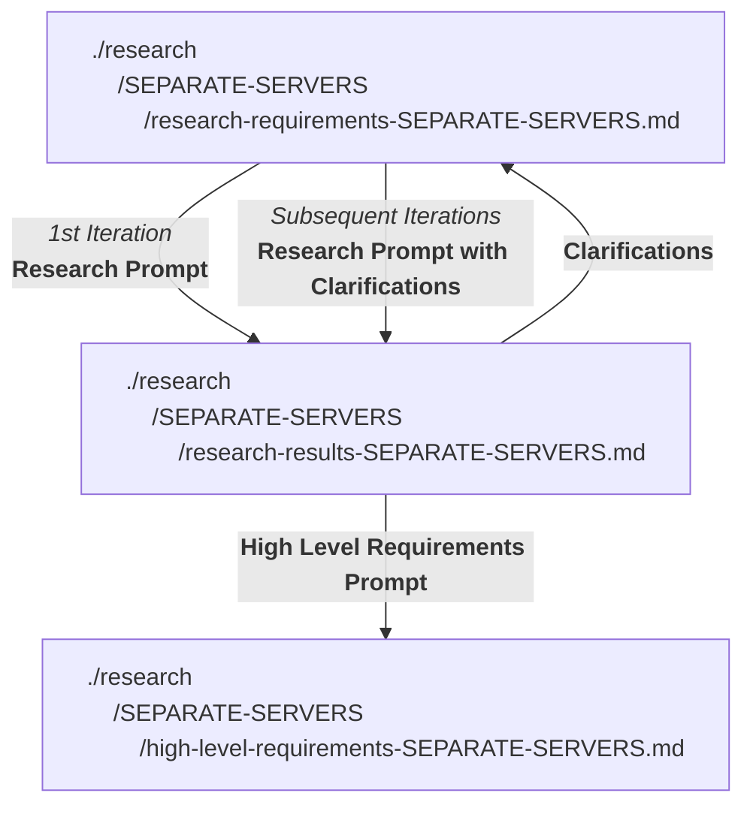

# OVERVIEW
Please research the items described in the # SEPARATE SERVERS section below.  

Place the research results in research/research-requirements-SEPARATE-SERVERS/research-results-SEPARATE-SERVERS.md.  

If there are further clarifications needed, please add them to the research/research-requirements-SEPARATE-SERVERS/research-results-SEPARATE-SERVERS.md file.
I will then add the response to the clarifications to this requirements document and request a revision of the research-results file.
There is no need to complete the research if clarifications are requested, until after the clarifications are provided.  
Base the research only on what is found in this document and the current implementation.
Ask for clarifications if something is missing.
Do not make reference to previous research requirements that may be similar.
It is permissible to completely start this research.md from scratch.

Do not assume any of the current constraints as non-negotiable.  

-------------------------------
### USAGE NOTES FOR THE DEVELOPER
The progress through documents for this research phase is:

The prompts referred to above are as follows:  
   
`Research Prompt`
```
Please research the options to support the requirements described in the design document  
research/SEPARATE-SERVERS/research-requirements-SEPARATE-SERVERS.md.  
Please place the results in research/SEPARATE-SERVERS/research-results-SEPARATE-SERVERS.md.
```

`Research Prompt with Clarifications`
```
I updated
research/SEPARATE-SERVERS/research-requirements-SEPARATE-SERVERS.md
to include the answers to the clarifications. 
Please update the research results in research/SEPARATE-SERVERS/research-results-SEPARATE-SERVERS.md to support the updated requirements.
```


`High Level Requirements Prompt`  
```
Please create a high level requirements document based on accepting all the research results "Recommendations" in research/SEPARATE-SERVERS/research-results-SEPARATE-SERVERS.md. The high-level requirements document will be research/SEPARATE-SERVERS/high-level-requirements-SEPARATE-SERVERS.md . The high-level requirements document will be used by speckit-specify (and sometimes speckit-mdd-architecture) to create Specs (and sometimes an architecture document) that will be used to eventually implement the solution.
```
  
 . 
---------------------------

# SEPARATE SERVERS

Please research and recommend whether this monolithic CrowPoll webapp should be broken up into some separate servers?  
Not to the extent of micro-services but just a small number of independant services.  
One particular server I'm thinking of is one to receive the Votes and stuff them into the ValKey queue.  
The priority is to never lose a vote that has been cast.  
Are there any other services that could be put in a separate server?  
Would this have any performance, reliability or even cost advantages?  
