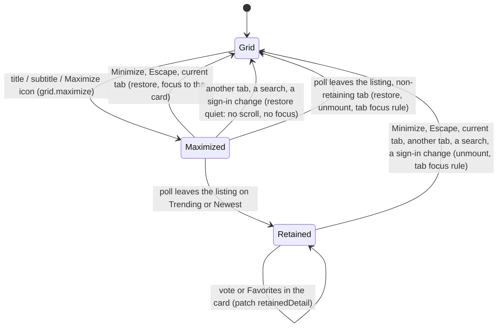

# Data Model: Maximized Poll Card

**Feature**: `specs/021-MAXIMIZED-POLL-CARD/spec.md` | **Date**: 2026-09-24

Nothing is stored. No table, column, route, payload, cache key or configuration setting changes.
The entities below live in the browser for the life of the page: one piece of state per grid, and
colour values derived once at load.

---

## 1. Maximized view (one per page, at most)

Held by `tabs.js` as `maximized = { grid, pid }`. Each grid (`createGrid`) holds the details for its
own card.

| Field | Held by | Meaning |
|---|---|---|
| `pid` | grid | The poll shown maximized; `null` when the grid shows its cards |
| `returnScrollY` | grid | `window.scrollY` when the view opened; restored on close |
| `retained` | grid | `true` once the poll has left the tab's listing on a tab that retains (Trending, Newest). The card stays shown until closed. |
| `retainedDetail` | grid | The last `PollDetail` the retained card rendered, patched by the visitor's own votes and Favorites changes |
| `maximizedEl` | grid | The tab panel's `.maximized-card-grid`, cloned from the page's template the first time |
| `retainMaximized` | grid option | `true` for Trending and Newest, absent elsewhere (research R8) |
| `choiceBounds` | card option | `{ minChoices, maxChoices }` from `/api/config`, for the maximized bar height |

### State transitions

### Rules

- At most one view is open. Opening one while another is open (a card on another tab cannot be
  clicked, since only the active panel is visible) is guarded by closing the old one first.
- While `pid` is set: the grid's `.card-grid` is `hidden`, `.maximized-card-grid` is shown, and the
  card is left out of `render`'s reordering loop.
- A card is in exactly one place: the grid or the maximized view.
- Closing always runs one path (`restore`), whatever triggered it. Focus goes by the face the card
  is on as it closes (the front's Maximize icon, or the back's title). A close caused by leaving the
  tab is `quiet`: no scroll restore and no focus move.

## 2. Poll card (existing instance, one new state)

| Field / method | Meaning |
|---|---|
| `setMaximized(on)` | Adds or removes `maximized-card-viewport` / `maximized-card-flip`, switches `.maximize-btn` between its Maximize and Minimize forms (icon, `aria-label`, `title`), switches the layout function (below), and re-renders |
| `isMaximized` | Read by the click handlers: the title, subtitle and Maximize icon do nothing while it is `true` |
| `detail()` | The last `PollDetail` applied; lets the grid capture `retainedDetail` |
| layout function | `measuredBarLayout(count, wrap)` (today's `computeBarLayout(count, wrap.clientHeight)`) or `maximizedBarLayout(count)` |

**`maximizedBarLayout(count)`**, with `n` clamped to `[minChoices, maxChoices]`:

`barHeight = 50 − (n − minChoices) / (maxChoices − minChoices) × (50 − 25)`, `gap = 2`,
`scrolling = false`. When `maxChoices = minChoices`, `barHeight = 50`.

| Choices | Bar height | Bar region (bars + gaps) |
|---|---|---|
| 2 (min) | 50 px | 102 px |
| 7 | 47.4 px | 344 px |
| 26 | 37.5 px | 1,025 px |
| 50 (max) | 25 px | 1,348 px |

## 3. Bar palette and derived ink

| Entity | Values | Derivation |
|---|---|---|
| `RESULTS_PALETTE_ENTRIES` | 50 `{ hex, name }` xkcd colours, all distinct; entry 1 darkish blue `#014182`, entry 2 dark green blue `#1F6357` (FIX05, from the research's `color-palette.md`) | Fixed list |
| Semantic colours | Yes `#018826`, No `#CF0234` | Fixed |
| Semantic tint | Yes `#D9EDDE`, No `#F8D9E1` | colour moved 85% of the way to white (`SEMANTIC_TRACK_TINT`) |
| Palette tint | one per palette fill | the fill moved 80% of the way to white (`RESULTS_TRACK_TINT`) |
| Ink over the tint | one per palette and semantic tint | `darkShadeOf(tint)`: the tint's hue and saturation, HSL lightness from 25% down in 1% steps until 7:1, floor 8% |
| Ink over the fill | one per palette fill | whichever of `lightShadeOf(fill)` (95% lightness) and `darkShadeOf(fill)` has the higher contrast (`inkOnFillFor`); white for a semantic fill |
| `BAR_COLORS` | `Map<fillHex, { track, inkOnTrack, inkOnFill }>` | computed once at script load, 52 entries |

### Assignment (unchanged in shape)

In display order: a bar whose label matches the Yes/No rules takes its semantic colour. Every
other bar takes the next palette entry. Only palette bars advance the palette index.

### Per-bar rendering

| Bar kind | Fill | Row background (track) | Label and percentage | Over the fill |
|---|---|---|---|---|
| Palette | palette hex | its 80% tint | ink of the tint, no shadow | copy in its fill ink, clipped to the fill's width and animated with it |
| Semantic | `#018826` / `#CF0234` | its tint | ink of the tint, no shadow | white copy, clipped to the fill's width and animated with it |

### Validation

| Rule | Measured |
|---|---|
| Palette ink over its tint ≥ 7:1 | lowest 7.03:1 |
| Palette ink over its fill | lowest 4.05:1; five fills below 4.5:1, where no shade of their hue reaches it |
| Palette fill against its tint | 28 fills below 3:1 (light fills); the trailing edge marks where they end |
| White on each semantic fill ≥ 4.5:1 | 4.61:1 (Yes), 5.66:1 (No) |
| Palette holds ≥ `maxChoices` entries | 50 = default `ENV_MAX_CHOICES` |
