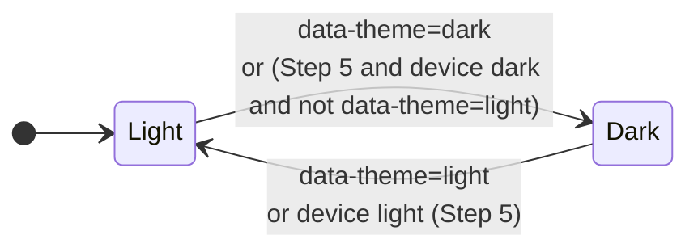
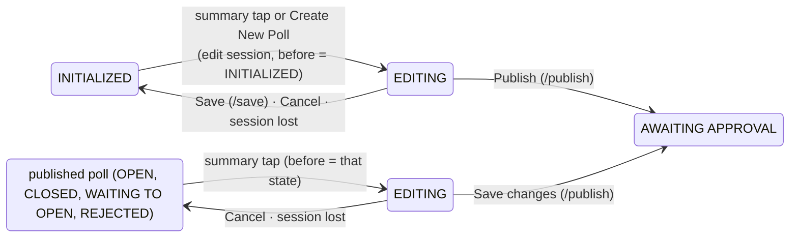

# Data Model: Material 3 Merge (024)

Steps 1–5 add no stored data and make no server change. Step 6 adds no table, column,
configuration variable or browser storage either, but it makes the existing `keywords` column a
poll setting, changes one default, and adds two fields to the admin list row (§6). §§1–5 are the
client-side value sets of Steps 1–5, and the rules that keep them consistent.

## 1. Colour scheme

| Attribute | Values | Rule |
|---|---|---|
| Scheme | `light` · `dark` | Steps 1–4: `dark` only when `<html data-theme="dark">` (development and tests). From Step 5: `dark` when the device prefers dark and `<html>` is not `data-theme="light"` |
| Forced light | `data-theme="light"` on `<html>` | Present on `admin.html` and `admin-results.html` only, from Step 5 until the admin feature (R13) |

## 2. Token sets (`m3-tokens.css`)

| Set | Members | Light | Dark |
|---|---|---|---|
| Colour roles | `--md-sys-color-*` (primary … on-surface-variant, outline, outline-variant, surface-container-*) | Generated from the moss `#3D5A46` seed with an amber `#E8A33D` tertiary. Surfaces are anchored to the site: `surface #FFFFFF`, `surface-container-low #F1F3EE`, `on-surface #1E2422` | Generated dark roles |
| Inverse roles | `inverse-surface`, `inverse-on-surface`, `inverse-primary` | `#2C322D` / `#EDF2EB` / `#94D5A8` | `#DFE4DD` / `#2C322D` / `#2C6A46` |
| Scrim | `--md-sys-color-scrim` | black, used at 32% | same |
| Production tokens | `--ink`, `--paper`, `--paper-raised`, `--moss`, `--line`, `--track`, `--choice-*`, `--muted`, `--shadow` | **Not restated**: today's values in `tabs.css` / `pollCard.css` stand | Restated as the matching dark roles |
| Type scale | Headline Small, Title Large, Title Small, Body Large, Body Medium, Body Small, Label Large (font, size, line height, weight, tracking) | Roboto | same |
| Shape | full, 28px, 12px, 8px, 4px | — | — |
| State | hover 8%, focus 10%, pressed 10% | — | — |
| Elevation | 2, 3 | shadows | none on dialogs |
| Motion | emphasized-decelerate easing | — | — |

Invariant: no light-mode value of a production token changes (SC-001).

## 3. Bar colour set (`pollCard.js`)

For each fill `f` in the 50-entry palette and the two semantic colours:

| Field | Source | Scheme |
|---|---|---|
| `fill` | `assignResultColors` (022, unchanged) | both |
| `track`, `inkOnTrack` | `BAR_COLORS.get(f)` (022, unchanged) | light |
| `inkOnFill` (the clipped copy) | `BAR_COLORS.get(f)` (022, unchanged) | both |
| `track` (dark) | `mixWith(f, #181D19, tint)`, with the tint at 022's light amount | dark |
| `inkOnTrack` (dark) | `lightShadeFor(track)`: HSL lightness from 0.75, raised by 0.01 until the contrast is ≥ 7:1 (ceiling 0.98) | dark |

Each row carries the set as custom properties: `--bar-track`, `--bar-ink`, `--bar-track-dark`,
`--bar-ink-dark`. Invariant: the dark ink against the dark track is ≥ 7:1 for all 52 entries
(SC-002).

## 4. Page × file matrix

| File | index | profile | login | create-account | not-authorized | admin | admin-results | Step |
|---|:-:|:-:|:-:|:-:|:-:|:-:|:-:|:-:|
| `m3-tokens.css`, `m3-ripple.js`, Roboto | ● | ● | ● | ● | ● | ● | ● | 1 |
| `tooltip-m3.css`, `tooltip-m3.js` | ● | ● | ● | ● | ● | ● | ● | 2 |
| `header-tab-bar-m3.css` | ● | ● | ● | ● | ● | ● | ● | 2 |
| `tabs-modal-m3.css` | ● | | | | | ● | | 2 |
| `live-idle-prompt-m3.css`, `empty-tab-line-m3.css` | ● | | | | | | | 2 |
| `discard-dialog-m3.css` | | | | | | ● | | 2 |
| `pollCard-m3.css` | ● | | | | | | | 3 |
| `card-shell-m3.css` | | ● | ● | ● | ● | | | 4 |
| `profile-editor-m3.css` | | ● | | | | | | 4 |
| `data-theme="light"` on `<html>` | | | | | | ● | ● | 5 |
| `admin-card-m3.css` | | | | | | ● | | 6 |

Order on each page: `m3-tokens.css` first, then the production sheets as today, then the layers
in the order above. `m3-ripple.js` is the first script, and `tooltip-m3.js` the second (from
Step 2).

## 5. Transient UI state

| Element | Owner | State |
|---|---|---|
| Tooltip | `tooltip-m3.js` | one element; the current target; the show and hide timers |
| Tab notice | `tabs.js` | text, `hidden`, the timer, the optional Close control |
| Profile snackbar | `profileCard.js` | one element, created on first success; `hidden`; a 4000 ms timer |
| Not Saved dialog | `adminCard.js` | the pending `Promise<boolean>` (one at a time) |
| Avatar menu | `app.js` | `hidden` mirrored in the button's `aria-expanded` |
| Cookie-banner offset | `app.js` | `--cookie-banner-offset` on `<html>`: the banner height + 8px, or unset |

## 6. Step 6: the poll as the admin cards read and write it

### 6.1 Poll fields

| Field (`Poll` / column) | Values | Rule | Change in Step 6 |
|---|---|---|---|
| `keywords` / `keywords` | `""` or comma-separated keywords | Each keyword `^[a-z0-9]+( [a-z0-9]+)*$`; no repeats; whole string ≤ 200 (`KEYWORDS_MAX`); always `""` on a `Private Poll`; frozen once the poll has a vote | Joins `Poll`, `rowToPoll`, `newRow`, `FIELD_TO_COLUMN`, `validatePollFields`, `duplicatePoll` (copied), `createDefaultPoll` (`""`) (R22) |
| `voteMutability` | `Final-Vote Poll` · `Dynamic-Vote Poll` | unchanged | New polls default to `Dynamic-Vote Poll` (R23) |
| `pollVisibility`, `pollSharingMode` | unchanged | unchanged | New polls stay `Public Poll` / `Anyone With The Link` (spec Q2 B) |
| `title`, `subtitle`, `choices` | unchanged | Server limits unchanged (100 / 100 / 100 per choice). The wizard's 50 (subtitle) and 40 (choice) apply in the browser to new polls only | `/save` drops an empty title and allows fewer than `ENV_MIN_CHOICES` choices (R21) |
| `voteAnonymity`, `choiceMode`, `startAt`, `endAt` | unchanged | unchanged | Written by the wizard as by the edit face |
| `voterCountLimit`, `invitedVoterList`, `bannedVoterList` | unchanged | unchanged | No longer written by the admin page (spec FR-048) |

### 6.2 Poll state and the wizard

- **Worded state** = `pollStateBeforeEditUpdate` while EDITING (else `launchedAt ? OPEN :
  INITIALIZED`), otherwise `pollState`. It decides the new-poll wizard (worded INITIALIZED,
  R19), the Summary Text links and the when-line.
- **Edit mode** = the session's mode, else `canEdit` → EDIT, `canUpdate` → UPDATE, else none.
- **Starter-choices hold** (FR-049, R28): Publish or Save changes on a poll whose choices are
  still "Choice 1 / Choice 2" returns it to INITIALIZED only when its effective state is
  INITIALIZED; a published poll goes to AWAITING APPROVAL like any other.

### 6.3 What may change (Summary Text links and unlocked wizard controls)

| Setting | Step | EDIT (no votes) | UPDATE (votes) |
|---|---|---|---|
| Who can vote, anonymity | 1 | ● | |
| Title, subtitle | 2 | ● | ● |
| Keywords (public only) | 2 | ● | |
| Choices | 3 | ● | |
| How to vote | 4 | ● | |
| Start | 5 | worded state INITIALIZED, REJECTED or WAITING TO OPEN | same |
| End | 5 | worded state not CLOSED or ARCHIVED | same |

No mode (AWAITING APPROVAL, ARCHIVED, EDITING elsewhere), or another card editing → nothing.

### 6.4 Admin list row (`GET /api/admin/polls`, `/search`)

Adds `pollStateBeforeEditUpdate` (`PollState | null`) and `keywords` (`string`). Every other
field is unchanged.

### 6.5 Wizard state (card instance, not stored)

| Field | Meaning |
|---|---|
| `step` | the current step, 1–5 |
| `visited` | steps opened; the circles' check marks; Publish needs all five |
| `answered` | steps left with Next (Step 5: its first change, or Publish); a Summary Text part shows only once its step is answered |
| `who`, `showVoters`, `title`, `subtitle`, `keywords`, `choicesText`, `multi`, `mutable`, `startMode`/`startLocal`, `endMode`/`endLocal` | the answers, mapped to the poll fields by `wizardFields()` |
| `wizardSaved` | what the last Save kept; reopened by a summary tap; kept across admin views (the list keeps a card that holds it, R27); lost on reload |
| `existing`, `dirty` | the existing-poll footer; whether Save changes or a Cancel prompt applies |
