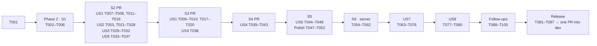

# Tasks: Material 3 Merge

**Input**: Design documents from `specs/024-MATERIAL3-MERGE/`

**Prerequisites**: plan.md, spec.md, research.md, data-model.md, contracts/ui-contracts.md,
contracts/admin-api.md (Step 6), quickstart.md

**Tests**: Included, and not optional.
- FR-030 makes the updated and new tests part of the feature, and constitution Principle IV
  requires a verifiable criterion for each task.
- jsdom covers markup, attributes, focus, timers and the inline custom properties. Asset tests
  cover the served text (links, order, rules).
- What only a browser can show (layout, paint, motion) is `quickstart.md` Q1–Q17 and the
  browser checklist.
- Step 6 adds server tests (supertest on the embedded PostgreSQL) for its four server changes.

**Organization**: by user story, in the order the merge steps need them.

**Every task names its merge step**, as `(S1)` … `(S6)`. Steps were first planned as one pull
request each; the developers chose instead to commit straight onto `024-MATERIAL3-MERGE`: Steps
1–5 as one commit (`c0da4ad`), Step 6 as the next, and one pull request into `dev` after Step 6
(REQUIREMENT "Merge to CrowdPoll Webapp"). A story can span two steps: US1's header work is S2 and
its card work is S3. The step order is fixed:
1. S1: Foundational.
2. S2: US1 (header part), US2, US3 and US5.
3. S3: US1 (card part), plus the `site.css` scope fix (US4).
4. S4: US4.
5. S5: US6.
6. S6: Step 6 foundation, US7, US8, and the release (Phases 10–14).

**Porting recipe** (research R2), used by every "Port … from …" task. Copy the prototype layer,
then make only these changes:
- (a) delete its token sections, which `m3-tokens.css` now holds;
- (b) in S2–S4, delete its `@media (prefers-color-scheme: dark){ … }` blocks and keep only the
  `:root[data-theme="dark"]` ones;
- (c) replace its literal `font-size` values with the `--md-sys-typescale-*` variables;
- (d) reduce its comments to section headings and links to external Material 3 documentation, with
  no `M3:`, `REQUIREMENT`, clarification or feature references (research R15, Constitution VI).

Then diff the result against the prototype. Every difference must be one of (a)–(d).

**Script edits** also follow (d): carry the prototype's behaviour, but not its `M3:` comments.

## Format: `[ID] [P?] [Story] Description`

- **[P]**: can run in parallel: different files, no dependency on an incomplete task
- **[Story]**: US1–US8, mapping to the user stories in `spec.md`
- Paths are repository-relative. `P/` abbreviates `prototypes/POLL-CARD-MATERIAL3/`.

---

## Phase 1: Setup

**Purpose**: a known-green baseline. No dependency or configuration is added.

- [X] T001 Run `npm test` and `npm run build` on the untouched tree. Record both results in this
  task's line: test files and counts, and the number of fingerprinted assets in
  `dist/public/assets/`. Every later checkpoint compares against them. — *Baseline 2026-10-01: 44 files passed, 1 skipped / 691 tests passed, 15 skipped; build clean, 23 fingerprinted assets. (`npm ci` needed `--ignore-scripts` on this mount; the esbuild and embedded-postgres install scripts were then run by hand.)*

---

## Phase 2: Foundational (S1, blocking prerequisites, no visible change)

**Purpose**: the shared tokens, ripple and font on all seven pages, with nothing visible changed
(FR-028).

- [X] T002 [P] (S1) Create `src/public/m3-tokens.css`, with the contents of research R3 in this order.
  - The light colour roles from `P/pollCard-m3.css` §1 `:root`.
  - The inverse roles from `P/HEADER-TAB-BAR/header-tab-bar-m3.css` §1, and elevations 2 and 3
    from `P/card-shell-m3.css` §1.
  - From the `:root` block at the top of `P/TABS-MODAL/tabs-modal-m3.css`: the scrim, the 28px
    corner, elevation 3 and the emphasized-decelerate easing.
  - Headline Small from `P/DISCARD-DIALOG/discard-dialog-m3.css`.
  - The type scale from `P/pollCard-m3.css` §2, and the shape and state tokens from §3.
  - The dark roles, and the production tokens restated for dark, from `P/pollCard-m3.css`
    `:root[data-theme="dark"]` (line 94) and the matching dark inverse blocks. These go **only**
    under `:root[data-theme="dark"]`; no `prefers-color-scheme` appears anywhere in the file.
  - The `.m3-ripple` and `.m3-ripple-host` rules, their keyframes and their reduced-motion rule
    from `P/pollCard-m3.css` §7.

  Where two prototypes declare the same custom property, their values must be equal. Stop and
  report any that differ.
- [X] T003 [P] (S1) Create `src/public/m3-ripple.js` to contract C1.
  - It is an IIFE that sets `window.M3Ripple = { add(selector) }`.
  - It installs one `pointerdown` listener on `document` that matches `event.target.closest()`
    against the registered selectors joined by `", "`.
  - Merge the body from `P/pollCard-m3.js`, including the vote-row branch that hosts the ripple in a
    `.m3-ripple-host` inside `.bar-scroll-inner`.
  - Skip `event.button !== 0`, reduced motion (`matchMedia('(prefers-reduced-motion: reduce)')`),
    `disabled`, `.is-inert` and `[aria-disabled="true"]`.
  - With no selectors registered, return at once.
- [X] T004 (S1) In all seven pages, make three changes:
  - add `<link rel="stylesheet" href="/m3-tokens.css">` as the **first** stylesheet link;
  - add `<script src="/m3-ripple.js" defer></script>` as the **first** script;
  - append `&family=Roboto:wght@400;500;700` to the existing Google Fonts `href`, before
    `&display=swap`.

  The pages are `src/public/index.html`, `profile.html`, `login.html`, `create-account.html`,
  `not-authorized.html`, `admin.html` and `admin-results.html`. Change nothing else in them.
- [X] T005 (S1) Create `tests/m3-assets.test.ts`, which reads the seven pages from `src/public`
  (`admin*.html` via `readFileSync`, as `tests/poll-card-assets.test.ts:218` does). Assert:
  - `m3-tokens.css` is each page's first stylesheet and `m3-ripple.js` its first script;
  - the font URL contains `Roboto:wght@400;500;700` and still contains Fraunces and Inter;
  - each page's ordered list of stylesheet `href`s and script `src`s equals an allowlist held in
    the test: `m3-tokens.css`, then the page's current production sheets (written out per page),
    then its matrix layers in `data-model.md` §4 order; and `m3-ripple.js`, then (from S2)
    `tooltip-m3.js`, then the page's current scripts. No git baseline is used. This enforces
    "nothing else changes" at every step, and every later linking task extends the allowlist;
  - no `.css` file in `src/public` contains `prefers-color-scheme: dark`;
  - `m3-ripple.js` defines `window.M3Ripple`;
  - a page × file table, held in one constant, matches `data-model.md` §4 rows for S1. Later
    steps extend this same constant.
- [X] T006 (S1) Run `npm test` and `npm run build`, and compare with T001 in
  `specs/024-MATERIAL3-MERGE/tasks.md`. Results match T001 plus the new test file, and
  the build has 2 more fingerprinted assets. Do the quickstart Q1 visual comparison. — *2026-10-01: the S1 run overlapped the start of S2 edits; it surfaced `tests/polls-editing-eligibility.test.ts`, which asserts `confirmDiscard`'s source text and was updated for FR-022. The clean S2 checkpoint run: 48 files passed, 1 skipped / 734 tests passed, 15 skipped. Q1 (visual) needs a browser and was not done in this sandbox.*

**Checkpoint S1**: open the S1 pull request into `024-MATERIAL3-MERGE`.

---

## Phase 3: User Story 1 - The home page looks and feels like one Material 3 product (Priority: P1) 🎯 MVP

**Goal**: the header, tab bar, snackbars, empty-tab line, phone layout (S2), poll cards and the
maximized view (S3) take their M3 forms, with light colours unchanged (FR-001–FR-010).

**Independent Test**: quickstart Q3 and Q5, and the US1 acceptance scenarios at four widths in
light mode. Each card matches `P/poll-card.html` and `P/MAXIMIZED-POLL-CARD/single-card.html`.

### Tests for User Story 1 (write first; they fail until the matching implementation lands)

- [X] T007 [P] [US1] (S2) Create `tests/client-m3-header.test.ts` with `openPage(ctx, "index.html")`.
  Add a `describe("tab notice")` block covering contract C3:
  - `#tabNotice` has `role="status"`;
  - `Tabs.notice("x", 3000)` has no `.tab-notice-close`;
  - `Tabs.notice("x")` has one with `aria-label="Close"`, and clicking it hides the notice;
  - with Close focused, hiding the notice moves focus to the Refresh control;
  - a second `notice()` replaces the content;
  - showing a notice does not change `document.activeElement`.
- [X] T008 [P] [US1] (S2) Update `tests/tab-bar-assets.test.ts`:
  - the assertions that read the tab icons' fills from `tabs.css` or the markup now read them from
    `src/public/header-tab-bar-m3.css` §4 (monochrome, `currentColor`);
  - add assertions that `index.html` links `header-tab-bar-m3.css` and `empty-tab-line-m3.css`
    after `site.css`;
  - add assertions that `tabs.css` contains the `@media (max-width:639.98px)` block **outside**
    any comment (strip `/* … */` comments with a non-greedy regex and find the block in what
    remains);
  - add assertions that `tabs.css` has no `.tab-notice,` / `.tab-empty{` group and no
    `[data-panel="search"] .tab-empty` rule.
- [X] T009 [P] [US1] (S3) Rewrite the colour reads in `tests/client-bar-colours.test.ts`.
  - Read `row.style.getPropertyValue("--bar-track")`, `--bar-ink`, `--bar-track-dark` and
    `--bar-ink-dark` instead of `row.style.background` and the label/pct `style.color`.
  - Keep every light expectation pinned to 022's values.
  - Add one case asserting that, for every row of a 50-choice poll and for Yes/No, the contrast of
    `--bar-ink-dark` against `--bar-track-dark` is ≥ 7, using a WCAG relative-luminance helper
    written in the test.
  - Add one case asserting that rows have no inline `background` and their label and percentage no
    inline `color`.
  - Add one case asserting that `.voting-list` has `is-multi` for a multi-choice poll and not for a
    single-choice poll (contract C9).
- [X] T010 [P] [US1] (S3) In `tests/client-maximized.test.ts` (around lines 250–254), read the
  rows' tints and inks from the four custom properties instead of `style.background` and
  `style.color`. The `.result-fill` background stays inline. Keep the expectations.

### Implementation for User Story 1: header part (S2)

- [X] T011 [P] [US1] (S2) Port `src/public/header-tab-bar-m3.css` from
  `P/HEADER-TAB-BAR/header-tab-bar-m3.css`, using the porting recipe.
  - For (c), replace the 14px and 16px sizes commented as Body Medium and Label Large with
    `var(--md-sys-typescale-body-medium-size)` and `var(--md-sys-typescale-label-large-size)`.
  - Also move the avatar rules of §7 and §10 (`.header-user .avatar` hover, state layer and focus
    ring) onto `.header-user .avatar-btn`, a reset button holding the 32px circle (research R7).
  - Keep §8 (the logo in dark) under `:root[data-theme="dark"]` only.
- [X] T012 [P] [US1] (S2) Port `src/public/empty-tab-line-m3.css` from
  `P/EMPTY-TAB-LINE/empty-tab-line-m3.css`, using the porting recipe.
- [X] T013 [US1] (S2) In `src/public/tabs.css`, make two changes (research R14):
  - reword the comment at line 223 so that it contains no `*/` before its end (for example
    `btn-header-* and avatar-icon, brand*, …`);
  - split the grouped `.tab-notice, .tab-empty{ … }` rule (lines 170–181) into one rule per
    selector with the same declarations, and delete the FIX029 comment and the
    `.tab-panel[data-panel="search"] .tab-empty{ text-align:center; }` rule.
- [X] T014 [US1] (S2) In `src/public/tabs.js`, make two changes:
  - set `role="status"` on `#tabNotice` in `init()`;
  - change `notice(text, ms)` to contract C3:
    - with `ms` omitted, append a `button.tab-notice-close` (`type="button"`, `aria-label="Close"`,
      with the × SVG from `P/HEADER-TAB-BAR/harness.js:80`);
    - its click hides the notice and, if it had focus, focuses the Refresh control (`refreshBtn()`);
    - set the text through a text node, so the button is not overwritten;
    - register `.tab-notice-close` with `window.M3Ripple?.add(…)` once, at module start.
- [X] T015 [US1] (S2) In `src/public/app.js`, make two changes (research R6):
  - at module start, call
    `window.M3Ripple?.add(".tab-bar .tab, .tab-refresh--icon, .search-icon-btn, .header-search-clear, .btn-header-ghost, .btn-header-primary, .avatar-btn, .avatar-menu a, .avatar-menu button, #cookie-banner button")`;
  - add the cookie-banner offset watcher from `P/HEADER-TAB-BAR/header-tab-bar-m3.js` §2. While
    `#cookie-banner` exists, it sets `--cookie-banner-offset` on `<html>` to the banner's
    `offsetHeight + 8` px (a `ResizeObserver`, guarded by `typeof ResizeObserver === "function"`),
    and removes it otherwise. A `MutationObserver` on `document.body` (`childList`) re-checks the
    banner.
- [X] T016 [US1] (S2) Link `header-tab-bar-m3.css` on all seven pages, and
  `empty-tab-line-m3.css` on `src/public/index.html`, after `site.css` in the order of
  `data-model.md` §4. Extend the matrix constant in
  `tests/m3-assets.test.ts` with these two S2 rows.

### Implementation for User Story 1: card part (S3)

- [X] T017 [US1] (S3) In `src/public/pollCard.js`, after `BAR_COLORS` (line 376 block), add the
  dark set as research R11 describes:
  - `RESULTS_DARK_SURFACE = "#181D19"`, `RESULTS_DARK_INK_START_LIGHTNESS = 0.75` and
    `RESULTS_DARK_INK_CEILING_LIGHTNESS = 0.98`;
  - `mixWith`, `lightShadeFor` and `darkBarColorsFor`;
  - `BAR_COLORS_DARK`.

  Copy them from `P/pollCard.js` lines 381–422 without the comment block. In `applyBarColors`,
  replace `row.style.background = track` and `text.style.color = inkOnTrack` with
  `row.style.setProperty` calls for `--bar-track`, `--bar-ink`, `--bar-track-dark` and
  `--bar-ink-dark`, as `P/pollCard.js` lines 670–677 do.
- [X] T018 [US1] (S3) In `src/public/pollCard.js`, make two changes:
  - in `render()`, after `votingList` is resolved, add
    `votingList?.classList.toggle("is-multi", Boolean(poll) && poll.choiceMode !== "Single-Choice Poll");`;
  - at module start, call
    `window.M3Ripple?.add(".card-face .btn-vote, .card-face .icon-btn, .card-face .bookmark-btn, .card-face .maximize-btn, .card-face .live-link, .card-face .arrow-row, .card-face .vote-row, .maximized-card-close")`.
- [X] T019 [US1] (S3) Port `src/public/pollCard-m3.css` from `P/pollCard-m3.css`, using the
  porting recipe:
  - drop §1–§3 (now in `m3-tokens.css`) and §7's ripple rules (moved in T002);
  - keep §4–§6 and §8;
  - in §5, keep only the `:root[data-theme="dark"] .result-row` rules (lines 219–221), not the
    `@media` copy (214–217).
- [X] T020 [US1] (S3) Link `pollCard-m3.css` on `src/public/index.html` in the order of
  `data-model.md` §4. Extend the matrix constant in `tests/m3-assets.test.ts`, and assert there
  that `pollCard-m3.css` contains `clamp(18px, 1.8vw, 22px)` for the card title (FR-004). T009,
  T010 and the full suite pass.

**Checkpoint US1**: S2's US1 tasks are green with US2, US3 and US5 for the S2 pull request. T017–T020
are green for the S3 pull request. Do quickstart Q5, and Q7 after S3.

---

## Phase 4: User Story 2 - Keyboard and screen-reader users can reach everything (Priority: P1)

**Goal**: the avatar menu by keyboard, guest tabs that reach `/login` and show their tooltip, a
named and trapped `Tabs.modal`, and a non-modal idle prompt that manages focus (FR-011–FR-014),
all in S2.

**Independent Test**: quickstart Q2 and Q4, and US2's acceptance scenarios, with the keyboard
only.

### Tests for User Story 2

- [X] T053 [US2] (S2) In `tests/helpers/browser.ts`, record navigation attempts. The virtual
  console's `jsdomError` handler (line 46) pushes to a `navigations` array whenever the error
  message contains `navigation` (jsdom's "Not implemented: navigation (except hash changes)",
  raised by setting `location.href` or calling `location.assign`), and still swallows every
  error. Return the array as `page.navigations` on `BrowserPage`. jsdom does not report the
  target URL, so tests assert that a navigation was attempted and that the page did not act
  otherwise. Existing tests are unaffected.
- [X] T021 [P] [US2] (S2) In `tests/client-m3-header.test.ts`, add four groups.
  - **`describe("avatar")`**, signed in, covering C8:
    - the avatar is a `button.avatar-btn` with `aria-haspopup="menu"` and `aria-expanded="false"`;
    - a click opens `.avatar-menu` and sets `aria-expanded="true"`;
    - Escape closes it and focuses the button;
    - a document click closes it.
  - **`describe("guest tabs")`**, covering C7:
    - personal tabs have `aria-disabled="true"`, no `disabled`, and
      `title="Sign in to use this tab"`;
    - a click records one entry in `page.navigations` (T053), and the tab does not become active
      and no tab request is sent (so the `/login` branch ran, not `select()`).
  - **`describe("Tabs.modal")`**, covering C4:
    - `aria-labelledby` resolves to the message;
    - a `Tab` and a `Shift+Tab` keydown leave focus on OK.
  - **`describe("idle prompt")`**, covering C5:
    - the text has no "for this poll" and there is no `aria-modal`;
    - `aria-labelledby` resolves to the text;
    - focus is on Yes when shown and returns to the prior element after Yes;
    - with a maximized card open, Escape closes the view while the prompt shows. Trigger the
      prompt the way `client-home.test.ts:792`'s test does.
- [X] T022 [P] [US2] (S2) In `tests/client-home.test.ts`, make two updates:
  - lines 71 and 89: assert `personal.getAttribute("aria-disabled")` is `"true"` / `null` instead
    of `personal.disabled`;
  - line 792: expect "Do you want to continue to receive Live Results updates?".

### Implementation for User Story 2

- [X] T023 [US2] (S2) In `src/public/app.js` (signed-in branch near line 297), create
  `const avatarBtn = document.createElement("button")` with `type="button"`, class `avatar-btn`,
  `aria-haspopup="menu"` and `aria-expanded="false"`, and append the existing `img.avatar` to it.
  - Move the click listener to `avatarBtn`, toggling `menu.hidden` and `aria-expanded`.
  - Add a `keydown` listener on `user` that, on Escape while the menu is open, hides it, sets
    `aria-expanded="false"` and focuses `avatarBtn`.
  - The document click also resets `aria-expanded`.
  - Append `avatarBtn` where `avatar` was appended (`user.append(name, avatarBtn, menu)`).
- [X] T024 [US2] (S2) In `src/public/tabs.js`, make three changes (research R8, C7):
  - `applyGuestState()` sets `btn.setAttribute("aria-disabled", "true")` for a guest and
    `btn.removeAttribute("aria-disabled")` otherwise, in place of `btn.disabled = …`;
  - the bar click handler's `if (btn.disabled)` becomes
    `if (btn.getAttribute("aria-disabled") === "true")`;
  - in `src/public/tabs.css`, line 122's `.tab-bar .tab:hover:not(.is-active):not(:disabled)`
    gains `:not([aria-disabled="true"])`.
- [X] T025 [US2] (S2) In `src/public/tabs.js` `modal()`, apply the two edits of
  `P/TABS-MODAL/tabsModal.js`:
  - give `.modal-text` `id="modal-text"` and the box `aria-labelledby="modal-text"`;
  - in `onKey`, on `Tab`, call `preventDefault()` and refocus `.modal-ok`.

  At module start, call `window.M3Ripple?.add(".modal .modal-ok")`.
- [X] T026 [US2] (S2) In `src/public/liveResults.js`, apply the edits of
  `P/LIVE-RESULTS-IDLE-PROMPT/liveIdlePrompt.js`:
  - `IDLE_PROMPT` becomes "Do you want to continue to receive Live Results updates?";
  - `showIdlePrompt()` drops `aria-modal`, gives `.live-idle-text` `id="live-idle-text"` and the
    dialog `aria-labelledby`, records `document.activeElement` before showing, and focuses
    `.live-idle-yes` after `panel.prepend(dialog)`;
  - on Yes, it refocuses the recorded element if that is not `body`, is connected and has
    `focus`.

  At module start, call `window.M3Ripple?.add(".live-idle-actions .tab-refresh")`.
- [X] T027 [P] [US2] (S2) Port `src/public/tabs-modal-m3.css` from
  `P/TABS-MODAL/tabs-modal-m3.css`, and `src/public/live-idle-prompt-m3.css` from
  `P/LIVE-RESULTS-IDLE-PROMPT/live-idle-prompt-m3.css`, both using the porting recipe.
- [X] T028 [US2] (S2) Link `tabs-modal-m3.css` and `live-idle-prompt-m3.css` on
  `src/public/index.html` in the order of `data-model.md` §4. Extend the matrix constant in
  `tests/m3-assets.test.ts`. T021 and T022 pass.

**Checkpoint US2**: Q2 and Q4 by keyboard. Tooltip display for guest tabs arrives with US3.

---

## Phase 5: User Story 3 - Tooltips that work everywhere (Priority: P2)

**Goal**: M3 plain tooltips replace every browser tooltip (FR-015–FR-019), in S2.

**Independent Test**: US3's acceptance scenarios on `index.html`, including a long press in a touch
emulator.

### Tests for User Story 3

- [X] T029 [P] [US3] (S2) Create `tests/client-m3-tooltip.test.ts`. Use `openPage(ctx,
  "index.html", { scripts: [<the default list>, "tooltip-m3.js"] })`. Use Vitest fake timers
  where needed. Assert (contract C2):
  - after load, no element in the document has a `title`, and the maximize control has
    `data-tooltip="Maximize Poll Card"`;
  - setting `title` later is adopted, and an empty `title` removes `data-tooltip`;
  - `pointerenter`, then 500 ms, shows `.m3-tooltip` with the text, and leaving for 150 ms hides
    it;
  - `focus` shows it at once, and Escape hides it;
  - a touch `pointerdown` held 500 ms shows it, and the following `click` has
    `defaultPrevented`;
  - `contextmenu` on a target is `defaultPrevented`;
  - a `.result-row` shows nothing when its label's stubbed `scrollWidth === clientWidth`, and
    shows the label when `scrollWidth > clientWidth` (stub with `Object.defineProperty`);
  - a guest's personal tab shows "Sign in to use this tab" on focus.

### Implementation for User Story 3

- [X] T030 [P] [US3] (S2) Port `src/public/tooltip-m3.css` from `P/tooltip-m3.css`, using the
  porting recipe (§1 inverse roles removed).
- [X] T031 [P] [US3] (S2) Port `src/public/tooltip-m3.js` from `P/tooltip-m3.js`. The behaviour is
  unchanged, and comments follow recipe (d).
- [X] T032 [US3] (S2) On all seven pages, link `tooltip-m3.css` in the order of `data-model.md` §4
  (before `header-tab-bar-m3.css`) and
  add `<script src="/tooltip-m3.js" defer></script>` right after `m3-ripple.js`. Extend the
  matrix constant in `tests/m3-assets.test.ts`. T029 passes, and the existing `title` assertions
  still pass, because the default script list is unchanged (research R5).

**Checkpoint US3**: the US3 scenarios hold in a browser (hover, focus, touch long press).

---

## Phase 6: User Story 5 - Administrators are asked before losing edits (Priority: P2)

**Goal**: the Not Saved page dialog replaces `window.confirm` for Cancel and the back link
(FR-022, FR-023), in S2.

**Independent Test**: quickstart Q6.

### Tests for User Story 5

- [X] T033 [P] [US5] (S2) Create `tests/client-admin-discard.test.ts`. Use the admin sign-in and
  `openPage(admin, "admin.html", { cookie, scripts: ["m3-ripple.js", "app.js", "adminCard.js",
  "adminList.js"] })` setup from `tests/client-home.test.ts:817`. Open a poll's editing card, then
  assert (contract C6):
  - with no edits, Cancel leaves editing at once, and the back link adds one entry to
    `page.navigations` (T053) after `releaseSession()`, with no `.modal`;
  - after typing in the title, Cancel opens `[role="alertdialog"]` labelled "Discard changes?"
    and described by "Your edits will be lost.", with focus on Keep editing;
  - Tab and Shift+Tab alternate between the two actions;
  - Keep editing, Escape and a backdrop click each close the dialog, keep the edit and refocus
    Cancel;
  - Discard leaves editing;
  - the back link with edits opens the dialog, does not navigate until Discard, and navigates
    after Discard;
  - `window.confirm` is never called (spy on it).

### Implementation for User Story 5

- [X] T034 [US5] (S2) In `src/public/adminCard.js`, replace `confirmDiscard()` (line 433) with the
  page dialog of `P/DISCARD-DIALOG/discardDialog.js`:
  - it returns `Promise<boolean>`;
  - it builds the `alertdialog` with the headline "Discard changes?", the text "Your edits will be
    lost.", and the `.modal-action` Keep editing and Discard buttons;
  - one pending promise is shared by overlapping calls;
  - Keep editing, Escape and the backdrop answer `false`, and Discard answers `true`;
  - Tab cycles the two actions;
  - focus returns to the opener when it is still connected.

  The two constants `DISCARD_HEADLINE` and `DISCARD_TEXT` sit beside it. The Cancel listener
  (line 964) becomes
  `cancel.addEventListener("click", async () => { if (!dirty || await confirmDiscard()) void cancelEdit(); });`.
  At module start, call `window.M3Ripple?.add(".modal .modal-action")`.
- [X] T035 [US5] (S2) In `src/public/adminList.js` `guardNavigation()` (line 417), make the
  listener `async`. It keeps `event.preventDefault()` first, and replaces
  `if (controller.isDirty() && !controller.confirmDiscard()) return;` with
  `if (controller.isDirty() && !(await controller.confirmDiscard())) return;`. The rest is
  unchanged.
- [X] T036 [P] [US5] (S2) Port `src/public/discard-dialog-m3.css` from
  `P/DISCARD-DIALOG/discard-dialog-m3.css`, using the porting recipe (its Headline Small
  `:root` is moved in T002).
- [X] T037 [US5] (S2) Link `tabs-modal-m3.css` and `discard-dialog-m3.css` on
  `src/public/admin.html` in the order of `data-model.md` §4. Extend the matrix constant in
  `tests/m3-assets.test.ts`. T033 and the existing admin tests in `tests/client-home.test.ts`
  pass.

**Checkpoint S2**: the US1 S2 tasks plus US2, US3 and US5 are green, and the suite is green. Do
quickstart Q2–Q6. Open the S2 pull request into `024-MATERIAL3-MERGE`.

**Checkpoint S3**: T017–T020 and T038 are green. Do quickstart Q7. Open the S3 pull request.

---

## Phase 7: User Story 4 - Sign-in, account and profile pages match the home page (Priority: P2)

**Goal**: Profile, Login, Create Account and Not Authorized take the card-shell layer, with no
title hover underline, and Profile shows the "User name saved" snackbar (FR-020, FR-021). The
`site.css` scope fix is S3, and the rest is S4.

**Independent Test**: quickstart Q8, and US4's acceptance scenarios on the four pages.

- [X] T038 [US4] (S3) In `src/public/site.css` (lines 785–787 and their `.subtitle` and cursor
  siblings), change each `.card-viewport:not(.maximized-card-viewport)` to
  `.card-viewport:not(.maximized-card-viewport):not(.card-shell-viewport)` (research R14). Add an
  assertion to `tests/m3-assets.test.ts` that every selector in `site.css` starting
  `.card-viewport:not(.maximized-card-viewport)` also carries `:not(.card-shell-viewport)`.

### Tests for User Story 4

- [X] T039 [P] [US4] (S4) Create `tests/client-profile-snackbar.test.ts`. Use
  `openPage(ctx, "profile.html", { cookie, scripts: ["m3-ripple.js", "app.js", "cardShell.js",
  "profileCard.js"] })` for a signed-in user created as the other client tests do. Assert
  (contract C10):
  - a successful user-name save shows `.profile-snackbar[role="status"]` with "User name saved",
    which is hidden after 4000 ms (fake timers);
  - a second success within 4000 ms keeps it shown for 4000 ms from the second;
  - no snackbar after:
    - a refused save (a name the server rejects with `400`);
    - a 429 (wrap `page.window.fetch` so `PATCH /api/me` answers `429` with a `nextAllowedAt`);
    - a network failure (wrap it to reject);
  - the status line reports "Saved." immediately after the save response, asserted before
    `settle()` lets the session refresh run (FR-018 clears it afterwards).

### Implementation for User Story 4

- [X] T040 [P] [US4] (S4) Port `src/public/card-shell-m3.css` from `P/card-shell-m3.css`, using the
  porting recipe:
  - drop §1;
  - for (c), replace the field labels' `font-size:14px` with
    `var(--md-sys-typescale-body-medium-size)`, keeping weight 500 and line height 18px;
  - the snackbar's bottom offset uses `var(--cookie-banner-offset, …)`, as the
    header-tab-bar layer's snackbar does.
- [X] T041 [P] [US4] (S4) Port `src/public/profile-editor-m3.css` from
  `P/PROFILE-EDITOR/profile-editor-m3.css`, using the porting recipe.
- [X] T042 [US4] (S4) In `src/public/profileCard.js`, add `showSnackbar(text)` from
  `P/PROFILE-EDITOR/harness.js` lines 63–77:
  - one `div.profile-snackbar`, `role="status"`, `hidden`, created on first call and appended to
    `<body>`;
  - each call sets the text, clears and restarts a 4000 ms timer, and unhides it;
  - next to `report(status, r.res, r.body, "Saved.")` (line 160), when `r.res.ok`, call
    `showSnackbar("User name saved")`.

  Nothing else changes (FR-018 clearing stays).
- [X] T043 [US4] (S4) Link `card-shell-m3.css` on `src/public/profile.html`, `login.html`,
  `create-account.html` and `not-authorized.html`, and `profile-editor-m3.css` on `profile.html`,
  in the order of `data-model.md` §4. Extend the matrix constant in
  `tests/m3-assets.test.ts`. T039, `tests/profile.test.ts`, `tests/pages.test.ts` and
  `tests/poll-card-assets.test.ts` pass unchanged.

**Checkpoint S4**: quickstart Q8. Open the S4 pull request.

---

## Phase 8: User Story 6 - Dark mode that follows the device (Priority: P3)

**Goal**: dark follows the device on the five public pages, and the admin pages stay light
(FR-024–FR-026), in S5.

**Independent Test**: US6's acceptance scenarios with the device in light and in dark.

### Tests for User Story 6

- [X] T044 [US6] (S5) In `tests/m3-assets.test.ts`, replace the "no `prefers-color-scheme: dark`"
  assertion with these:
  - in `m3-tokens.css` and every `*-m3.css`, the set of selectors under
    `:root[data-theme="dark"]` equals the set under
    `@media (prefers-color-scheme: dark)` with `:root[data-theme="dark"]` read as
    `:root:not([data-theme="light"])`, and each pair has identical declarations;
  - `admin.html` and `admin-results.html` open with `<html lang="en" data-theme="light">`, and the
    other five pages have no `data-theme`.

### Implementation for User Story 6

- [X] T045 [US6] (S5) In `src/public/m3-tokens.css`, `header-tab-bar-m3.css`,
  `tooltip-m3.css`, `tabs-modal-m3.css`, `pollCard-m3.css`, `card-shell-m3.css` and every other
  `*-m3.css` with a dark block, add before each `:root[data-theme="dark"] …` rule its twin
  `@media (prefers-color-scheme: dark){ :root:not([data-theme="light"]) … }`, with the same
  declarations. The prototypes' `@media` blocks are the reference.
- [X] T046 [US6] (S5) In `src/public/admin.html` and `src/public/admin-results.html`, change
  `<html lang="en">` to `<html lang="en" data-theme="light">`. T044 passes.

**Checkpoint S5**: the browser checklist (Phase 9, T050) passes before the S5 pull request merges.

---

## Phase 9: Polish & cross-cutting concerns (S5)

- [X] T047 [P] (S5) Update `README.md`, without referring to `specs/`, `designDocs/` or
  prototypes:
  - the look (Material 3, Roboto);
  - dark mode follows the device setting, and the admin pages stay light for now;
  - bar colours: light as before, with dark tracks and text on a dark device;
  - tooltips, including the long press on touch.
- [X] T048 [P] (S5) Update `ARCHITECTURE.md`:
  - the layer model (tokens, then production sheets, then area layers), with a Mermaid diagram;
  - `m3-ripple.js` and its registration;
  - the tooltip adoption of `title`;
  - scheme selection (`prefers-color-scheme`, `data-theme`);
  - where it says the bar colours are inline `background` / `color`, the four custom properties
    instead.
- [X] T049 [P] (S5) In `specs/021-MAXIMIZED-POLL-CARD/contracts/ui-contracts.md`, annotate the
  bar-colour rows: from 024 the row tint and ink are the four custom properties of
  `specs/024-MATERIAL3-MERGE/contracts/ui-contracts.md` C9. Check that `CLAUDE.md`'s 024 section
  still matches what was built.
- [ ] T050 (S5) Run the full browser checklist in
  `designDocs/024-high-level-requirements-MATERIAL3-MERGE.md` Step 5, plus the quickstart
  Step 5 additions (the admin pages are light on a dark device). Also do a keyboard sweep (SC-003):
  on each of the five public pages, in the admin pages' header and in the Not Saved dialog, Tab
  through every control and confirm that each is reachable, operable by Enter or Space, and shows
  the focus ring. Tick each checklist item in that file as it passes. Any failure is fixed before T051. — *Open: this sandbox has no browser. The automated tests cover markup, attributes, focus, timers and the bar custom properties; layout, paint, motion, `:has()` / `:user-invalid` states and the keyboard sweep need the developer's browser pass. It closes with T085, which repeats these items.*
- [X] T051 (S5) Run `npm test` and `npm run build`. Compare with T001: every pre-existing test
  passes, except the ones intentionally updated in T008, T009, T010 and T022, and the build has
  12 more fingerprinted assets (`dist/public/assets/`). Also confirm SC-009 and FR-023:
  `git diff --stat dev...HEAD -- src ':!src/public' postman .do` and
  `git diff --stat dev...HEAD -- src/public/admin.css src/public/styles.css src/public/adminResults.js`
  are both empty. — *2026-10-02: 49 files passed, 1 skipped / 744 tests passed, 15 skipped (baseline 44 / 691; the updated suites are T008–T010, T022 and `tests/polls-editing-eligibility.test.ts`, which asserted `confirmDiscard`'s old source text). Build: 35 fingerprinted assets (23 + 12). Both `git diff --stat` checks are empty against `HEAD` (the branch base; nothing is committed yet).*
- [X] T052 (S5) Commit Steps 1–5 as one commit on `024-MATERIAL3-MERGE`. — *Done: `c0da4ad`.
  Steps 1–5 were built together, so there are no per-step pull requests (REQUIREMENT Merge to
  CrowdPoll Webapp, recommendation 2). The merge into `dev`, first planned here, moved to T087,
  after Step 6.*

---

# Step 6: the admin cards (S6)

Sources: `spec.md` US7, US8, FR-032 to FR-048; `plan.md` "Step 6 order"; `research.md` R18–R26;
`data-model.md` §6; `contracts/ui-contracts.md` C13–C15; `contracts/admin-api.md` A1–A5;
`quickstart.md` Q9–Q17. `A/` abbreviates `prototypes/POLL-CARD-MATERIAL3/ADMIN-CARDS/`.

**Order**: the server first, so every server change is green before the client depends on it;
then the client port. Run `npm test` at each checkpoint; the suite stays green between phases
except for the tests a task names as rewritten or retired.

## Phase 10: Setup for Step 6

- [X] T054 (S6) Run `npm test` and `npm run build` on the committed tree (`c0da4ad` plus the
  planning documents). Record the pass and skip counts and the fingerprinted asset count in this
  task, as T001 did. Expect 744 passed, 15 skipped, and 35 assets (T051). — *2026-10-03: 49 files
  passed, 1 skipped / 744 tests passed, 15 skipped; build: 35 fingerprinted assets. (The sandbox
  needed the Linux builds of rollup, esbuild and embedded-postgres copied into `node_modules`
  beside the host's Windows builds.)*

---

## Phase 11: Foundational for Step 6 (S6, server; blocks US7 and US8)

**Purpose**: keywords become a poll setting, the new-poll default changes, and the admin list row
gains two fields (research R22–R24, `contracts/admin-api.md` A2–A5). No visible change yet.

### Tests (write first)

- [X] T055 [P] (S6) Create `tests/polls-admin-wizard.test.ts`, following
  `tests/polls-admin-crud.test.ts`'s setup (`startTestContext` with `ENV_ADMINS`, an admin session,
  `polls(ctx).insertMany(makePoll(…))`). Add three `describe` groups:
  - **keywords on publish** (A2, A4): an edit session, then `POST /api/admin/polls/:pid/publish`
    with `pollVisibility: "Public Poll"` and `keywords: "bake sale,school"` stores exactly that
    (read back with `GET /api/admin/polls/:pid`); `"Bake"`, `"bake,,sale"`, `"bake  sale"`,
    `" bake"`, `"bake,bake"` and a 201-character value are each refused with 400 and change
    nothing; `""` is stored; sending `pollVisibility: "Private Poll"` clears a stored value to
    `""` even without `keywords` in the body; a poll with a vote refuses `keywords` (400 through
    the UPDATE filter).
  - **search**: a listable public OPEN poll whose keywords are `bake sale` is returned by the home
    search for `bake` (PostgreSQL full-text, the test default), and a poll without them is not.
  - **admin list row** (A5): `GET /api/admin/polls` and `GET /api/admin/polls/search` rows carry
    `keywords` and `pollStateBeforeEditUpdate` (`null` normally; `"INITIALIZED"` for a poll
    holding an edit session started from INITIALIZED).
  — *Done: 16 tests, including "café" and exactly 200 characters, and a duplicate keeping its
  keywords.*
- [X] T056 [P] (S6) Change the new-poll default assertions: `tests/polls-service.test.ts:217` and
  `tests/polls-admin-crud.test.ts:41` expect `"Dynamic-Vote Poll"`. Leave
  `polls-service.test.ts:218` (`"Public Poll"`) as it is. Add, beside line 217, an assertion that
  `createDefaultPoll().keywords` is `""`.

### Implementation

- [X] T057 (S6) In `src/polls/store.ts`: add `keywords: string;` to `interface Poll` after
  `subtitle`; map it in `rowToPoll` (`keywords: row.keywords`), in `newRow`
  (`keywords: poll.keywords`) and in `FIELD_TO_COLUMN` (`keywords: "keywords"`). Do not add it to
  `NON_CONTENT_FIELDS`: a keyword change is a content change, so it bumps `content_version` and
  writes `search_outbox` as today.
- [X] T058 (S6) In `src/polls/service.ts` (research R22, R23):
  - `createDefaultPoll`: `voteMutability: "Dynamic-Vote Poll"` and `keywords: ""`. Visibility and
    sharing mode stay as they are.
  - `duplicatePoll`: `keywords: source.keywords`.
  - Add `export const KEYWORDS_MAX = 200;` beside `TITLE_MAX`, add it to `LIMITS`, and add
    `export function validateKeywords(value: unknown): string`: accept `""`; otherwise require a
    string of at most `KEYWORDS_MAX` characters whose comma-separated parts each match
    `/^[a-z0-9]+( [a-z0-9]+)*$/` and do not repeat; otherwise throw `AdminError(400, "Keywords
    must be lower-case letters, digits and single spaces, separated by commas, with no repeats,
    and at most 200 characters in total.")`.
  - `validatePollFields`: when `body.keywords !== undefined`, throw `AdminError(409, "keywords
    cannot be changed after the poll has received a vote.")` if `hasEverVoted`, else set
    `$set.keywords = validateKeywords(body.keywords)`. After visibility is resolved, if the
    resulting visibility (`$set.pollVisibility ?? poll.pollVisibility`) is not public and
    (`poll.keywords !== ""` or `$set.keywords` is set), set `$set.keywords = ""`. Use the existing
    `isPublicVisibility` helper.
- [X] T059 (S6) In `tests/helpers/poll-fixtures.ts` `makePoll`, default `keywords: ""`. Then run
  `npx tsc --noEmit` and fix every other place a `Poll` literal is built (the compiler lists
  them), each with `keywords: ""` unless it copies a poll.
  — *Done: `tsc` is clean. `tsconfig.json` covers `src/` only; in `tests/`, `makePoll` is the only
  whole-`Poll` literal (the others are partial `$set`s).*
- [X] T060 (S6) In `src/routes/pollsApi.ts` `adminListRow`, add
  `pollStateBeforeEditUpdate: p.poll_state_before_edit_update` after `pollState`, and
  `keywords: p.keywords` after `subtitle` (research R24). `buildAdminPollDetail` needs no change.
- [X] T061 (S6) In `postman/openapi.json`: add `keywords` (string, with A4's rule as its
  description) to the `/api/admin/polls/{pid}/publish` request body and to the admin poll detail
  schema; add `keywords` and `pollStateBeforeEditUpdate` (nullable string, the `PollState` enum)
  to the admin list row schema used by `GET /api/admin/polls` and `/api/admin/polls/search`;
  if the spec documents a `voteMutability` default for `POST /api/admin/polls`, change it to
  `Dynamic-Vote Poll`. Validate the file with `node -e "JSON.parse(require('fs').readFileSync('postman/openapi.json','utf8'))"`.
  — *Done: `keywords` on `AdminPollDetail`, `AdminPollSummary` and the publish body;
  `pollStateBeforeEditUpdate` on `AdminPollSummary`. No `voteMutability` default is documented,
  so none changed. The file is rewritten with `JSON.stringify(…, null, 2)`, which round-trips it
  byte for byte.*
- [X] T062 (S6) Checkpoint: `npm test` and `npm run build`. T055 and T056 pass; every other test
  passes as in T054.
  — *2026-10-03: 50 files passed, 1 skipped / 760 tests passed, 15 skipped (744 + T055's 16).
  `tsc` clean.*

---

## Phase 12: User Story 7 - Administrators set up a new poll in a guided wizard (Priority: P2)

**Goal**: Create New Poll opens a five-step wizard with the Settings Summary, the Named Circles,
Save, Cancel and Publish; Save stores a draft through the new `/save` route; the read-only face
is redesigned and its when-line worded by state.

**Independent Test**: `quickstart.md` Q9–Q13 and Q15–Q17; `tests/client-admin-wizard.test.ts`'s
new-poll groups; `tests/polls-admin-wizard.test.ts`'s `/save` group.

### Tests for User Story 7 (write first)

- [X] T063 [P] [US7] In `tests/polls-admin-wizard.test.ts`, add a `/save` group
  (`contracts/admin-api.md` A1): with an edit session on an INITIALIZED poll, `POST
  /api/admin/polls/:pid/save` stores the fields, answers 200 with
  `message: "Saved: you can finish later."`, and leaves `pollState` INITIALIZED with
  `pollEditUpdateClientGUID` null and no `pollApprovalTimestamp`; `title: ""` keeps the stored
  title; `labels: []` keeps the stored choices; `labels: ["Only"]` stores one choice; a poll whose
  title and choices are still the defaults is saved (no "default values" hold); refused: an
  AWAITING APPROVAL or OPEN poll (409), a poll locked by another `clientGuid` (409), duplicate
  labels (409), an inverted schedule (400), a malformed `keywords` (400), an unknown pid (404).
  Also: an INITIALIZED poll with no edit session is saved, as `/publish` allows (`contracts/admin-api.md` A1).
  — *Done: 10 tests in `tests/polls-admin-wizard.test.ts`, plus a published poll under edit
  (409).*
- [X] T064 [P] [US7] Create `tests/client-admin-wizard.test.ts`. Open `admin.html` with
  `openPage(ctx, "admin.html", { cookie, scripts: ["app.js", "adminCard.js", "adminList.js"] })`
  as `tests/client-admin-discard.test.ts` does, against a real server, and add the new-poll
  groups (spec US7 scenarios 1–11, `contracts/ui-contracts.md` C13–C15):
  - Create New Poll: the new card shows the wizard at Step 1 with "Everyone on CrowdPoll" checked;
    the other four circles are not yet visited and inert; Create New Poll is disabled.
  - Next: visits the next step and marks the previous circle visited (a button); Step 5 has no
    `.wizard-next`; a visited circle returns to its step.
  - Publish: `aria-disabled="true"` and its `title` names the first missing item ("Visit all five
    steps to publish.", then the title, then the choices); a click sends no request (spy on
    `fetch`); once complete it posts to `/publish` and the card shows AWAITING APPROVAL.
  - A duplicate choice ("Taco Town" and "taco  town ") blocks Next, Save and Publish.
  - Save: posts to `/save`; the card returns to the read-only face; a summary link reopens the
    wizard at its step with the visited circles kept.
  - A poll stored as EDITING with `pollStateBeforeEditUpdate: "INITIALIZED"` (released first)
    takes the Cancel / Save / Publish footer.
  - Cancel with edits opens "Discard changes?"; Keep editing keeps the wizard; Discard returns to
    the read-only face, and the poll still exists.
  - The anonymity switch shows for the two private options only; its state changes the summary's
    last Step 1 sentence.
  - The read-only face: the Date Related Panel (Open, Close, Archive; Created, Launched) and the
    Counts Panel; no `.card-pen`.
  - The when-line for INITIALIZED (no start), AWAITING APPROVAL (past start), WAITING TO OPEN,
    OPEN (no start), CLOSED (with end), ARCHIVED, and EDITING from OPEN (worded as OPEN), worded
    as C15.
  - Inside the steps (spec FR-035, FR-037, FR-039): Copy link shows only under "Anyone you send
    the link to" and confirms with a "Link copied" snackbar; a 41-character choice is cut to 40
    characters and "Choices are capped at 40 characters." is shown; Enter on an empty line is refused; Paste choices
    (stub `navigator.clipboard.readText`) appends lines and drops repeats with a snackbar; choosing
    "Poll starts on" pre-fills tomorrow at 9:00 and "Poll ends on" 7 days after the start; the
    time-zone line names the browser's zone; an end in the past blocks Publish with "The end must
    be in the future.".
  - Save, then reload `admin.html` (a new `openPage`) and tap a Summary Text link: the wizard
    opens at Step 1 with the saved answers (spec SC-012).
  - Neither the read-only face nor the wizard offers a voter count limit field, an invitation
    list or a banned voter list (spec FR-048).
  — *Done: 16 tests. The DOM details were written against the installed port (T068–T073), not
  before it, since they depend on the prototype's markup.*
- [X] T065 [P] [US7] In `tests/m3-assets.test.ts`: add `admin-card-m3.css` to `admin.html`'s
  expected sheets, last (after `discard-dialog-m3.css`), and assert that `m3-tokens.css` declares
  `--md-sys-typescale-title-medium-size`, `--md-sys-typescale-label-medium-size` and
  `--md-sys-typescale-label-small-size`. Keep the "no dark blocks outside the allowed files"
  assertion true for the new sheet (it has none).

### Implementation for User Story 7

- [X] T066 [US7] In `src/routes/pollsApi.ts`, add `POST /api/admin/polls/:pid/save` after the
  `/publish` route, `requireAdmin`, wrapped with `wrap`, exactly as research R21 steps 1–6:
  `findPoll` (404); `resolveEditContext` (409 with its message); effective state
  INITIALIZED or 409 "Only a poll that has not been published can be saved without publishing.";
  drop a trimmed-empty `title`, and a `labels` list with no non-blank labels, from the body; `validatePollFields`;
  `replaceChoices(poll, labels, { ...config, minChoices: 1 })` when labels remain;
  `updatePoll(store, poll._id, { ...$set, pollState: "INITIALIZED", ...CLEAR_SESSION })`; respond
  with `buildAdminPollDetail({ ...poll, ...$set, pollState: "INITIALIZED" })` plus the message;
  a `console.log` of `[admin] Saved poll <pid> without publishing`. Keep `/publish` unchanged.
  — *Done. The response's detail also shows the session fields cleared.*
- [X] T067 [US7] In `postman/openapi.json`, add the `/api/admin/polls/{pid}/save` path
  (`contracts/admin-api.md` A1: request body, the 200 / 400 / 404 / 409 responses). Validate as
  in T061.
- [X] T068 [P] [US7] In `src/public/m3-tokens.css`, add Title Medium (16 / 24 / 500 / 0.15px),
  Label Medium (12 / 16 / 500 / 0.5px) and Label Small (11 / 16 / 500 / 0.5px) beside the existing
  type roles, in the same four-property form (`-size`, `-line-height`, `-weight`, `-tracking`).
  Take the values from `A/admin-card-m3.css` section 1. Do not restate Title Small, Body Large or
  elevation 2.
- [X] T069 [P] [US7] Port `src/public/admin-card-m3.css` from `A/admin-card-m3.css` with the
  porting recipe: (a) delete section 1; (b) there are no dark blocks; (c) its sizes already read
  the type roles; (d) reduce the 7 REQUIREMENT / clarification references to plain section
  headings. Diff against the prototype: only (a) and (d).
  — *Done. Sections renumbered 1–12. (c) was not quite true: the 14px field label and the 16px
  chip close glyph now read Title Small and Body Large (same sizes); the 18px visited check and
  the 13px circle number below 360px are glyph sizes with no type role and stay literal.*
- [X] T070 [P] [US7] Replace `src/public/admin.css` with `A/admin.css` (production's sheet plus
  the cards' layout block), removing its 9 REQUIREMENT / `M3:` references under rule (d). Diff
  against the current file: only the layout block and the removal of the edit face's rules.
  — *Done. The prototype's sheet does not remove the edit face's rules: it is production's sheet
  plus the card block (420px cap, 20/18px corners, shadow) and the appended layout block, so
  those rules stay, unused, as in the prototype.*
- [X] T071 [US7] Replace `src/public/adminCard.js` with `A/adminCard.js`, then:
  - remove or rewrite every `M3:`, REQUIREMENT and clarification reference (71) as a plain
    description of the rule (research R25);
  - remove `isNewCard()` and every `cardType` read; `isWizardPoll()` becomes
    `wordedState() === "INITIALIZED"` (research R19);
  - add the ripple targets of `A/admin-card-m3.js` (`.poll-admin-card .m3-filled-btn`,
    `.m3-tonal-btn`, `.btn-header-primary`, `.btn-header-ghost`, `.admin-state-btn`,
    `.admin-rescreen-btn`, `.admin-icon-btn`, `.actions-menu-trigger`, `.m3-radio-item`,
    `.m3-switch-row`, and `.actions-menu a`, `.actions-menu button`) as
    `window.M3Ripple?.add(…)` calls beside the existing `.modal .modal-action` one;
  - add `openWizard: () => requestEdit(1)` to the controller object returned by `create`
    (contract C13);
  - keep `window.AdminCard = { create, setRuntimeConfig, sanitizeChoicesText, runtime }`.

  Do not port `A/admin-card-m3.js` or `A/harness.js`.
  — *Done. Every marker removed or rewritten; the header's obsolete mockup reference went with
  the edit face.*
- [X] T072 [US7] In `src/public/adminList.js` (research R20): line 470, replace
  `controller.element.querySelector(".card-pen")?.click();` with `controller.openWizard();`;
  line 391, replace `controller.focusPen();` with `controller.focusSummary();`. Leave the
  `createBtn.disabled` rule as it is.
- [X] T073 [US7] In `src/public/admin.html`, link `/admin-card-m3.css` after
  `/discard-dialog-m3.css`. Keep `data-theme="light"`.
- [X] T074 [US7] Rewrite `tests/client-admin-discard.test.ts` for the wizard: open the card by
  activating its first `.wizard-summary-link` (not `.card-pen`); find Cancel in the wizard
  footer (not `.card-header--editing`); detect editing by the wizard's presence. Keep every
  scenario: no edits acts at once; edits open the dialog with focus on Keep editing; Keep editing,
  Escape and the scrim keep the edits; Discard leaves; the back link the same.
- [X] T075 [US7] In `tests/client-home.test.ts`:
  - rewrite "the date fields on an admin card" to read Launched (and Created) in the Date Related
    Panel, and drop its Start / End assertions with a one-line comment that the dates now read in
    the when-line (covered by T064);
  - in the FIX010 view test ("Create New Poll opens the new poll on Newest from any view"),
    expect the new poll's wizard instead of the old edit face.
- [X] T076 [US7] Checkpoint: `npm test`. T063–T065, T074 and T075 pass. Failures that read the
  removed edit face are expected until Phase 13; list them in T080.
  — *2026-10-03: 760 passed, 27 failed, all in `poll-card-assets.test.ts` (17) and `polls-
  editing-eligibility.test.ts` (10); see T078–T080.*

---

## Phase 13: User Story 8 - Administrators edit an existing poll in the same wizard (Priority: P2)

**Goal**: every existing poll is edited in the wizard, with links only where its state allows,
locked controls with their reason, and Save changes sending only the changed fields. The code
arrives with T071; this phase proves it and retires what tested the edit face.

**Independent Test**: `quickstart.md` Q14–Q15; `tests/client-admin-wizard.test.ts`'s existing-poll
groups.

### Tests for User Story 8

- [X] T077 [P] [US8] In `tests/client-admin-wizard.test.ts`, add the existing-poll groups (spec
  US8, `data-model.md` §6.3):
  - links per state: AWAITING APPROVAL and ARCHIVED have none; a poll locked by another session
    has none; a poll with no votes in WAITING TO OPEN links every part; an OPEN poll with votes
    links the title, the subtitle and the end only; a CLOSED poll with votes links the title and
    the subtitle only;
  - a tap opens the wizard at that part's step with every circle visited; the locked controls are
    disabled with their reason line; the review line shows;
  - Save changes is `aria-disabled` until an edit, with its `title`; after a subtitle edit it
    posts to `/publish` with exactly `{ clientGuid, subtitle }` and the card shows AWAITING
    APPROVAL with no links;
  - an existing poll with a 70-character subtitle opens with it whole; after a title edit, Save
    changes is not blocked and its body has no `subtitle` (spec FR-042);
  - while one card is in its wizard, no other card has a `.wizard-summary-link`;
  - after Save, Cancel and a lost session (heartbeat answering not alive), focus is on the
    card's first link.
  — *Done: 7 tests. The Save changes test seeds real choices: `/publish` holds back any poll
  whose choices are still the starter "Choice 1 / Choice 2" and stores it as INITIALIZED, even
  an OPEN poll with votes, which `makePoll`'s default choices would trigger.*
- [X] T078 [US8] Retire, in `tests/poll-card-assets.test.ts`, each `describe` that reads the
  removed edit face's source or styles. Candidates: "Mechanics radio groups survive the shared
  .admin-field rules", "Save and Publish availability is decided in one place", "Participant
  edits are deferred to Save and Publish", "Clearing the voter count limit sends null…", "Voter
  count limit field presentation", "Editing form spacing", "Default choices are selected on
  entry", "The editing page reads the voter ceiling from configuration", "Frozen mechanics show
  their value on the editing card", "Private poll settings on the card", and any part of "Renamed
  poll settings reach every client" and "Admin buttons that drop the global fill…" that reads a
  removed rule. Keep a section when the behaviour still exists and only a selector moved: update
  it instead. Replace each retired block with one comment line naming the removal ("The admin
  card's editing face was replaced by the wizard; see client-admin-wizard.test.ts.").
  — *Done. Retired whole: "Save and Publish availability is decided in one place", "Clearing the
  voter count limit sends null", "Voter count limit field presentation", "Editing form spacing".
  Retired in part: participant edits (kept "makes no request of its own"), the voter ceiling
  (kept "fetches it" and "has it before the first render"), "Private poll settings" (now asserts
  the stored values; kept "no retired five-word values"), "renders the settings verbatim".
  Updated: the icon symbols (no `icon-pen`; the orphaned symbol was removed from `admin.html`,
  whose comment now says four glyphs).*
- [X] T079 [US8] Retire, in `tests/polls-editing-eligibility.test.ts`, the client-source
  sections that read the edit face: "Explicit publish replaces autosave" (its client `it`s,
  keeping any server ones), "Editing surfaces prevent an inverted schedule", and the parts of
  "Client heartbeat and release", "Every exit route warns", "Admin list refreshes in place" and
  "Action menu is rendered from the server's booleans" that slice `adminCard.js` at a removed
  function (`focusPen`, the edit face's builders). Update a section instead when the function
  still exists in the new `adminCard.js` (heartbeat, release, `confirmDiscard`, the actions
  menu). Keep every server section (`editModeFor`, `hasEverBeenVotedOn`, the edit-session route,
  "UPDATE-mode publish rejects fields it may not change").
  — *Done. Retired: the edit face's Save and Publish / Cancel bar tests (replaced by one
  asserting the wizard's footers). Updated to the new functions: the schedule check
  (`scheduleProblem`), the lost session's message, the release on every exit (`leaveWizard`,
  `cancelWizard`), the beforeunload arming (`syncWizardDirty`), the publish path, and the pen
  test (now the Settings Summary's `canOpenEditor`).*
- [X] T080 [US8] Run `npm test`. For every remaining failure, apply research R26's rule: rewrite
  it when the behaviour still exists, retire it with the comment of T078 when it does not. Record
  here each file and test changed this way.
  — *2026-10-03: 51 files passed, 1 skipped / 774 passed, 15 skipped. No failure beyond T078 and
  T079.*

---

## Phase 13b: Step 6 follow-ups (S6; FR-040, FR-049, FR-050)

Added 2026-10-03 after Step 6 was built (spec "Session 2026-10-03 (after building Step 6)";
research R27–R29). Numbered after T087 but run **before T085–T087**, which wait for this phase.
Order (plan "Follow-up order"): FR-049, then FR-040, then FR-050.

### FR-049: the starter-choices hold applies only to unpublished polls (US8)

- [X] T088 [P] [US8] In `tests/polls-admin-wizard.test.ts`, add a `describe("the starter-choices
  hold", …)` group (research R28): an OPEN poll with the starter choices ("Choice 1 / Choice 2",
  `makePoll`'s default), no vote, published with `{ subtitle: "x" }` goes to AWAITING APPROVAL and
  the response has no `message`; the same with a vote (seed `voteHistory`) goes to AWAITING
  APPROVAL; an INITIALIZED poll with the starter choices is still held back (`pollState`
  INITIALIZED, `message` "This poll still has its default values and cannot be published."); an
  INITIALIZED poll under its own edit session (`clientGuid` from `/edit-session`) is held back
  too.
  — *Done: 4 tests.*
- [X] T089 [US8] In `src/routes/pollsApi.ts`'s `/publish` handler, compute
  `const effectiveState = decision.holdsLock ? poll.pollStateBeforeEditUpdate ?? "INITIALIZED" : poll.pollState;`
  after `resolveEditContext`, and change `if (isAllDefaults(merged))` to
  `if (effectiveState === "INITIALIZED" && isAllDefaults(merged))`. Update the comment above the
  hold to say it applies to a poll that has not been published. Leave `isAllDefaults` unchanged.
  — *Done.*
- [X] T090 [US8] In `postman/openapi.json`, change the `/api/admin/polls/{pid}/publish` 200
  description (and the `message` property's description) to say the poll is held back as
  INITIALIZED only when it has not been published and still holds its starter choices. Validate
  the JSON as in T061.
  — *Done.*
- [X] T091 [US8] In `tests/client-admin-wizard.test.ts`, remove the comment and the real-choices
  override added in T077 to the "enables Save changes only after an edit" test (the poll may keep
  `makePoll`'s starter choices now), so the test also proves FR-049 through the page.
  — *Done. It surfaced a gap: the companion focus test had passed only because the old hold
  returned the poll to INITIALIZED, keeping its links. A published poll's Save changes now
  leaves it AWAITING APPROVAL with no link, so `focusSummary()` has nothing to focus and focus
  drops to the page; FR-043 does not say where it should go then. The test's Save half now uses
  a new poll's Save, which keeps its links.*

### FR-040: progress kept across admin views (US7)

- [X] T092 [P] [US7] In `tests/client-admin-wizard.test.ts`, add to the new-poll group: create a
  poll, answer Steps 1–3 (`answerFirstSteps`), Save; click `#adminTabBar .tab[data-tab="awaiting"]`,
  then `[data-tab="newest"]`; tap the "Cakes, Cookies" link; the wizard opens at Step 3 with
  Steps 1–3 visited (`is-visited`, `is-visited`, `is-current`). Repeat through the Search tab
  before a search (the empty Search view) and back.
  — *Done: 2 tests (another view; the empty Search view). They failed before T093–T094 and pass
  after.*
- [X] T093 [US7] In `src/public/adminCard.js`, add `hasSavedProgress: () => wizardSaved !== null`
  to the controller object returned by `create` (contract C13).
- [X] T094 [US7] In `src/public/adminList.js` `loadList()` (research R27): change the deletion
  loop to `if (!seen.has(pid) && pid !== editingPid && !controllers.get(pid).hasSavedProgress()) controllers.delete(pid);`,
  and replace the empty Search view's `controllers.clear()` with a loop that deletes only the
  controllers without saved progress; the empty view still clears the list's children
  (`syncChildren(…, [])`), so a kept card leaves the page and only its controller stays. Add one
  line of comment saying why such a card is kept.
  — *Done, as a helper `dropControllers(seen)` used by both places.*

### FR-050: the editing face's unused styles removed

- [X] T095 (S6) Before any CSS change, record the cards' computed style with a temporary,
  uncommitted test file (for example `tests/tmp-admin-css-snapshot.test.ts`) built on
  `openPage` against the test server, as `tests/client-admin-wizard.test.ts` does. jsdom does not
  load the page's `<link>` sheets, so the test inlines `styles.css`, `tabs.css`, `pollCard.css`,
  `admin.css`, `site.css` and the M3 layers in their link order as `<style>` elements. It seeds
  an OPEN, a CLOSED and an INITIALIZED poll, renders the read-only faces and the INITIALIZED
  poll's wizard at each of the five steps, and writes every element's `getComputedStyle` for
  the properties set anywhere in `admin.css` to a JSON file in the scratchpad. This proves that no
  element's computed style changed; jsdom does not settle every cascade question, so `quickstart.md`
  Q20 (the developer's browser check) is what confirms the look.
  — *Done: `tests/tmp-admin-css-snapshot.test.ts`, 1,135 elements (the read-only faces and the
  wizard's five steps) × 63 properties; two runs gave identical files. The property list was
  pinned so T098 measures the same properties.*
- [X] T096 (S6) In `src/public/admin.css`, remove the rules research R29 lists (FR-050): delete a
  rule whose selectors all name only listed classes or ids; in a selector list, delete only the
  listed selectors; delete a comment that described only a deleted rule. Keep `.admin-field` and
  its descendants (the admin search form), `.admin-create-btn:disabled`, and everything the
  wizard, the read-only face, the toolbar, the search form and `admin-results.html` use. Then
  re-run R29's scan (no listed name left; no new unused name), and check brace balance.
  — *Done: 71 rules removed, one selector list trimmed (`.card-state-buttons, .card-dates` keeps
  `.card-state-buttons`), 21 comments that described only removed rules removed; the "012 US5"
  section heading (now "icons and empty dates") and the FR-039 comment stay with the rules they
  describe. R29's scan finds no unused name; braces 122/122.*
- [X] T097 (S6) In `tests/poll-card-assets.test.ts`: in "Mechanics radio groups survive the shared
  .admin-field rules", keep the first `it` (the `.admin-field input` width rule stays) and retire
  the other two; retire "Frozen mechanics show their value on the editing card"; each with the
  T078 comment. Add an asset test to the same file that no selector in `src/public/admin.css`
  names any of research R29's classes or ids as a whole name: match each with
  `new RegExp("[.#]" + name + "(?![\\w-])")`, so `.card-dates-panel` (which stays) does not count
  as `.card-dates`. A removed rule then cannot come back unnoticed.
  — *Done. The guard flags all 47 names in the old sheet and none in the new one.*
- [X] T098 (S6) Re-run T095's temporary test on the edited sheet and compare the two JSON files:
  no difference (FR-050). Record the result here, then delete the temporary test file.
  — *2026-10-03: no difference in any of the 1,135 elements' 63 properties. The temporary test
  file is deleted.*

### Checkpoint

- [X] T099 (S6) Run `npm test` and `npm run build`. Compare with T084: the new tests of T088 and
  T092 pass; T091's test still passes with starter choices; the only removed tests are T097's.
  `git diff --stat c0da4ad -- src ':!src/public'` still lists only the three server files.
  — *2026-10-03: 51 files passed, 1 skipped / 778 passed, 15 skipped. Two tests in `tests/polls-
  admin-crud.test.ts` had relied on the old hold (publishing an OPEN fixture poll with the
  starter choices twice); they now seed an unpublished poll, which the hold still keeps
  editable. Build: 36 assets. `git diff --stat c0da4ad -- src ':!src/public'` lists only the
  three server files.*
- [X] T100 [P] (S6) In `ARCHITECTURE.md`'s "Poll administration and visibility", add that the
  starter-choices hold applies only to a poll that has not been published, and that the list
  keeps a card holding a new poll's saved progress across views.
  — *Done.*

---

## Phase 14: Polish and release (S6)

- [X] T081 [P] (S6) Update `README.md`, without referring to `specs/`, `designDocs/` or
  requirement numbers: the admin page's poll cards (the wizard for new and existing polls, the
  Settings Summary, Save to finish later, Save changes sending a poll back for review), keywords
  on public polls, and that new polls let voters change their vote by default.
- [X] T082 [P] (S6) Update `ARCHITECTURE.md`: the admin card's two faces and the worded state;
  the `/save` route beside `/publish`; `keywords` as a poll field feeding both search engines;
  the admin list row's two new fields.
- [X] T083 [P] (S6) Check that `CLAUDE.md`'s 024 block (Step 6 bullets) matches what was built;
  correct any detail that changed during implementation.
- [X] T084 (S6) Run `npm test` and `npm run build`. Compare with T054: every pre-existing test
  passes except those changed in T056, T074, T075, T078, T079 and T080; the build has one more
  fingerprinted asset (`admin-card-m3.css`). Confirm SC-009:
  `git diff --stat c0da4ad -- src ':!src/public'` lists only `src/polls/store.ts`,
  `src/polls/service.ts` and `src/routes/pollsApi.ts`, and no file under `src/db`; `git diff
  --stat c0da4ad -- .do` is empty.
  — *2026-10-03: 774 passed, 15 skipped (T054's 744, plus 26 server, 23 wizard and 1 asset test,
  less the 20 retired). Build: 36 fingerprinted assets (35 + `admin-card-m3.css`). `git diff
  --stat c0da4ad -- src ':!src/public'` lists only the three files; `src/db` and `.do` are
  unchanged.*
- [ ] T085 (S6) After Phase 13b (T088–T100). Developer's browser pass: `quickstart.md` Q9–Q20; the browser checklist's
  `ADMIN-CARDS/admin-cards.html` entry in
  `designDocs/024-high-level-requirements-MATERIAL3-MERGE.md` Step 5, on the prototype and then on
  the merged page; T050's open items; a keyboard sweep of the admin cards (SC-013); and the Q9–Q10 flow timed at 320px and at desktop,
  each under 3 minutes (SC-010). Tick each
  checklist item as it passes. Any failure is fixed before T086.
- [ ] T086 (S6) With the developer's go-ahead, commit Step 6 on `024-MATERIAL3-MERGE` (its own
  commit, after `c0da4ad` and the planning commits), with `tasks.md` ticked through T085, and
  push the branch.
- [ ] T087 (S6) With the developer's go-ahead, merge `dev` into the branch if it has moved (never
  rebase), then open the one pull request, `024-MATERIAL3-MERGE` into `dev`. Merging it deploys
  production once (FR-027, SC-007).

---

## Dependencies & execution order



- **Foundational (S1)** blocks everything. T002 and T003 must exist before any layer or ripple
  registration.
- **Within S2**:
  - T011 (`header-tab-bar-m3.css`) precedes T016, T027, T030 and T036, which link after it;
  - T016 precedes T028, T032 and T037 (the same link block);
  - T014, T024 and T025 all edit `tabs.js`, so do them in sequence;
  - T015 and T023 both edit `app.js`, so do them in sequence.
- **US3's guest-tab tooltip** depends on US2's T024 (`aria-disabled`).
- **US1's card part (S3)**: T017 and T019 must land in the same pull request, since rows lose
  their tints without the layer.
- **US4** depends on S2's `--cookie-banner-offset` (T015).
- **US6** depends on every layer existing (S2–S4).
- **Step 6**: Phase 11 (server) blocks US7 and US8. Within it, T057 → T058 → T059 (the `Poll`
  type first); T060 and T061 after T057. In US7, T066 needs T058 (`validateKeywords`); T071 needs
  T068 and T069 only for the visual pass; T072 and T073 follow T071; T074 and T075 follow T072.
  US8's code arrives with T071, so US8 follows US7. T086 and T087 wait for the developer.
- **Phase 13b** runs after T084 and before T085: T088 → T089 → T090, T091 (FR-049); T092 → T093 →
  T094 (FR-040); T095 → T096 → T097 → T098 (FR-050, the baseline first); then T099, T100.

### Parallel opportunities

- S1: T002 ‖ T003.
- S2:
  - Tests: T053 first (shared helper), then T007 ‖ T008 ‖ T021 ‖ T022 ‖ T029 ‖ T033.
  - New sheets: T011 ‖ T012 ‖ T027 ‖ T030 ‖ T031 ‖ T036.
  - Scripts in different files: T034 ‖ T035 ‖ T026, and with the `tabs.js` / `app.js` chains.
- S3: T009 ‖ T010 ‖ T019 ‖ T038, while T017 → T018 (same file).
- S4: T039 ‖ T040 ‖ T041.
- S5: T047 ‖ T048 ‖ T049.
- S6: T055 ‖ T056; T063 ‖ T064 ‖ T065; T068 ‖ T069 ‖ T070 (then T071); T077 alongside T078 ‖ T079
  (different files); T081 ‖ T082 ‖ T083.
- Phase 13b: T088 ‖ T092 ‖ T095 (different files: server test, client test, scratchpad); T100
  alongside T099.

## Parallel example: S2 sheets and tests

```text
# Together (different new files):
T011 src/public/header-tab-bar-m3.css
T012 src/public/empty-tab-line-m3.css
T027 src/public/tabs-modal-m3.css + live-idle-prompt-m3.css
T030 src/public/tooltip-m3.css
T031 src/public/tooltip-m3.js
T036 src/public/discard-dialog-m3.css

# Together (different test files):
T007/T021 tests/client-m3-header.test.ts
T022      tests/client-home.test.ts
T029      tests/client-m3-tooltip.test.ts
T033      tests/client-admin-discard.test.ts
```

## Implementation strategy

### MVP first

S1 and S2 (T001–T037) are the MVP. The whole header, the accessibility fixes, the tooltips and
the admin dialog are then in place on the feature branch, in light mode. Nothing reaches `dev`
before S5, so the MVP is a review milestone, not a release.

### Incremental delivery

1. S1: invisible foundation (Q1).
2. S2: header, dialogs, tooltips, admin dialog (Q2–Q6).
3. S3: cards and the maximized view (Q7).
4. S4: card-shell pages and the snackbar (Q8).
5. S5: dark mode, documents, the browser checklist.
6. S6: the server changes, then the admin cards (Q9–Q17), then the one pull request into `dev`.

## Notes

- 100 tasks. Steps 1–5: 53 (Setup 1, Foundational 5, US1 14, US2 9 (T053 is numbered last but
  runs first in US2), US3 4, US5 5, US4 6, US6 3, Polish 6). Step 6: 34 (Setup 1, Foundational 8,
  US7 14, US8 4, Polish and release 7), plus 13 follow-ups (T088–T100: US8 4, US7 3, the rest 6).
- Steps 1–5 leave the server, routes, `postman/openapi.json`, configuration and database
  untouched. Step 6 changes `src/polls/store.ts`, `src/polls/service.ts`, `src/routes/pollsApi.ts`
  and `postman/openapi.json` only; no configuration or database change.
- Steps are commits on `024-MATERIAL3-MERGE`; the only pull request is into `dev`, after Step 6
  (T087). Merge `dev` into the feature branch if it moves, never by rebase.
